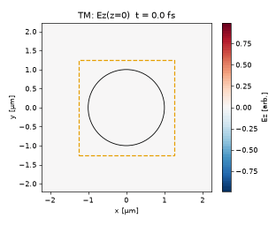
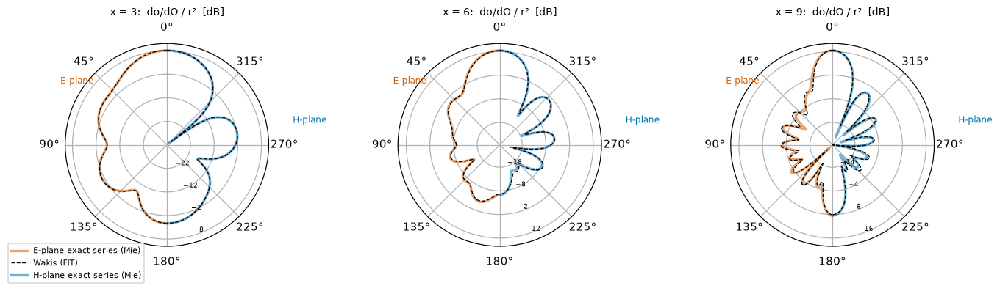
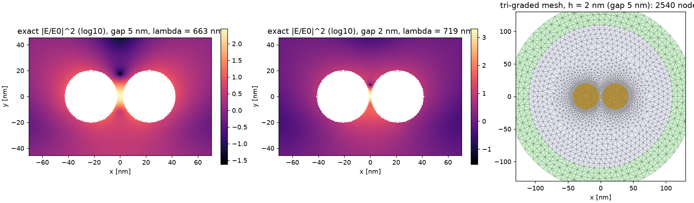

# Wakis Examples Library

*Worked tutorials, standalone scripts, upstream notebooks, and numerical-method studies for Wakis (Finite Integration Technique).*

<table>
  <tr>
    <td align="center" width="33%">
       
      <b><a href="tutorials/03_diffraction_and_scattering/03-04_mie_cylinder/">3.4 · 2D Mie cylinder</a></b> — TF/SF plane-wave pulse scattering on conformal Cartesian &amp; triangular FIT meshes vs analytical series.
    </td>
    <td align="center" width="33%">
       
      <b><a href="tutorials/03_diffraction_and_scattering/03-05_mie_sphere/">3.5 · 3D Mie sphere</a></b> — Near-to-far-field Stratton–Chu projection &amp; $Q_{\mathrm{sca}}(\lambda)$ validated against exact Lorenz–Mie theory.
    </td>
    <td align="center" width="33%">
       
      <b><a href="studies/subtri-hybrid/">Study · Plasmonic dimer nanogap</a></b> — Local field enhancement inside a 2 nm Au dimer gap resolved with a hybrid quadtree + body-fitted triangle mesh.
    </td>
  </tr>
</table>

## About

This page indexes all examples and validation studies in the repository, organized around the nine chapters of the [`tutorials/`](tutorials/README.md) textbook: **48 built tutorials** across Chapters 1–9 (2 in Chapter 1, 5 in Chapter 2, 6 in Chapter 3, 6 in Chapter 4, 10 in Chapter 5, 5 in Chapter 6, 6 in Chapter 7, 4 in Chapter 8, 4 in Chapter 9), **1 tutorial in progress** (lasers), **157 planned tutorial entries** (7 in Chapter 2, 20 in Chapter 3, 4 in Chapter 4, 49 in Chapter 5, 31 in Chapter 6, 2 in Chapter 7, 1 in Chapter 8, 29 in Chapter 9, and 14 in the solver how-to appendix), **12 standalone scripts** in [`examples/`](examples/), **10 upstream notebooks** in [`notebooks/`](notebooks/), and **28 method studies** in [`studies/`](studies/). Each built tutorial is a single-source Jupytext script (`--quick`, `--full`, `--task`, `--plot`) paired with its executed notebook, setup schematic, convergence study, and quantitative comparison against analytical theory, reference solvers, or published measurements.

| Section | Built | In progress | Planned |
| :--- | :---: | :---: | :---: |
| [Chapter 1 · Fields on a Grid](#chapter-1--fields-on-a-grid) | 2 | 0 | 0 |
| [Chapter 2 · Materials](#chapter-2--materials) | 5 | 0 | 7 |
| [Chapter 3 · Diffraction and Scattering](#chapter-3--diffraction-and-scattering) | 6 | 0 | 20 |
| [Chapter 4 · Radiation and Antennas](#chapter-4--radiation-and-antennas) | 6 | 0 | 4 |
| [Chapter 5 · Guided Waves](#chapter-5--guided-waves) | 10 | 0 | 49 |
| [Chapter 6 · Periodic Structures](#chapter-6--periodic-structures) | 5 | 0 | 31 |
| [Chapter 7 · Light Sources](#chapter-7--light-sources) | 6 | 1 | 2 |
| [Chapter 8 · Vacuum Electronics](#chapter-8--vacuum-electronics) | 4 | 0 | 1 |
| [Chapter 9 · Inverse Design](#chapter-9--inverse-design) | 4 | 0 | 29 |
| [Appendix · Solver Features and How-Tos](#appendix--solver-features-and-how-tos) | — | — | 14 |
| **Tutorial totals** | **48** | **1** | **157** |
| [Standalone scripts (`examples/`)](#standalone-scripts) | 12 | — | — |
| [Upstream Wakis notebooks (`notebooks/`)](#upstream-wakis-notebooks) | 10 | — | — |
| [Method studies (`studies/`)](#method-studies) | 28 | — | — |
| [Why FIT?](#why-fit) · [Contributing an example](#contributing-an-example) | — | — | — |

---

## Chapter 1 · Fields on a Grid

*Chapter overview: [`tutorials/01_fields_on_a_grid/README.md`](tutorials/01_fields_on_a_grid/README.md)*

### Built

- **1.1 · Tutorial 1.1 · Plane wave in a box** ([notebook](tutorials/01_fields_on_a_grid/01-01_plane_wave/plane_wave.ipynb) · [script](tutorials/01_fields_on_a_grid/01-01_plane_wave/plane_wave.py)) — Primary/dual FIT grid staggering, Courant–Friedrichs–Lewy stability limit, 1D/2D numerical phase-velocity anisotropy, calibrated `CurrentSource` sheet injection, and 1D-auxiliary `TFSFSource` Huygens boxes.
  - *Validation target:* Exact discrete Yee/FIT dispersion relation and von Neumann amplification roots.
  - *Headline result:* Phase-velocity error converges at second order (log-log slope $-2.01$ axial, $-1.99$ at $45^\circ$ over $\text{cpw}\in[10,60]$; $0.388\%$ axial error at $20\;\text{cpw}$), calibrated sheet impedance matches $\eta_0$ within $8.31\times 10^{-4}$, and `TFSFSource` exterior leakage stays at machine precision ($1.10\times 10^{-15}$).
- **1.2 · Tutorial 1.2 · Reflection and transmission at a slab** ([notebook](tutorials/01_fields_on_a_grid/01-02_slab_rt/slab_rt.ipynb) · [script](tutorials/01_fields_on_a_grid/01-02_slab_rt/slab_rt.py)) — Normal and oblique plane-wave reflection and transmission at a lossless dielectric slab ($n=2$), two-run `FluxMonitor` normalization, CPML reflection benchmarking, and Kottke subpixel smoothing vs staircase snapping.
  - *Validation target:* Exact Fresnel amplitude coefficients and Airy Fabry–Pérot transfer-matrix spectra.
  - *Headline result:* Fabry–Pérot reflectance $R(f)$ matches the exact Airy formula to $5.39\times 10^{-3}$ RMS at $28\;\text{cpw}$ with passivity $|R+T-1|\le 2.52\times 10^{-7}$, TM reflectance at Brewster's angle drops to $R_p(\theta_B)=6.36\times 10^{-4}$, and a 10-cell CPML ($m=4$) reaches $-91.59\;\text{dB}$ spurious reflection.

---

## Chapter 2 · Materials

*Chapter overview: [`tutorials/02_materials/README.md`](tutorials/02_materials/README.md)*

### Built

- **2.1 · Tutorial 2.1 · Where dispersion comes from** ([notebook](tutorials/02_materials/02-01_dispersion_physics/dispersion_physics.ipynb) · [script](tutorials/02_materials/02-01_dispersion_physics/dispersion_physics.py)) — Microscopic damped harmonic oscillator (Lorentz), free-electron gas (Drude), and dipolar relaxation (Debye) equations of motion, Kramers–Kronig causality relations, Thomas–Reiche–Kuhn $f$-sum rule, and second-order auxiliary differential equation (ADE) time stepping.
  - *Validation target:* Exact discrete ADE susceptibility `epsilon_discrete(f, dt)`, Kramers–Kronig principal-value integrals, and analytical transfer-matrix slab spectra.
  - *Headline result:* Single-cell FIT susceptibility recovery matches `epsilon_discrete(f, dt)` to relative $L_2$ errors of $8.65\times 10^{-5}$ (Lorentz), $8.77\times 10^{-7}$ (Drude), and $3.04\times 10^{-6}$ (Debye), with empirical $\Delta t$ convergence order $p = 2.00$.
- **2.2 · Tutorial 2.2 · Fitting Measured Material Data** ([notebook](tutorials/02_materials/02-02_fitting_measured_data/fitting_measured_data.ipynb) · [script](tutorials/02_materials/02-02_fitting_measured_data/fitting_measured_data.py)) — Passive multi-pole Drude–Lorentz fitting (`fit_poles`) to tabulated $(n,k)$ metal spectra, fused-silica Sellmeier dispersion, and 4-term Cole–Cole biological tissue models, showing how out-of-band UV interband poles shift visible/NIR phase through Kramers–Kronig coupling.
  - *Validation target:* Tabulated data from Johnson & Christy (1972) Au/Ag, Malitson (1965) $\text{SiO}_2$, and Gabriel *et al.* (1996) biological tissues, plus transfer-matrix slab reflectance/transmittance.
  - *Headline result:* For gold over $0.30\text{–}1.00\;\mu\text{m}$, adding two Lorentz interband poles (`1 Drude + 2 Lorentz`) cuts the complex-permittivity RMS fit error from $64.2\%$ ($N=1$) to $5.89\%$, while restricting a 2-pole fit to the $0.55\text{–}0.95\;\mu\text{m}$ operating window reaches $1.14\%$ RMS error.
- **2.3 · Tutorial 2.3 · Magnetic Materials** ([notebook](tutorials/02_materials/02-03_magnetic_materials/magnetic_materials.ipynb) · [script](tutorials/02_materials/02-03_magnetic_materials/magnetic_materials.py)) — Landau–Lifshitz–Gilbert magnetization precession, Lorentz/Debye dispersive permeability $\mu(\omega)$ on dual FIT edges, Snoek's static-susceptibility/resonance-frequency product, Acher's integral sum rule, magnetic hesitivity $h_m$, and impedance-matched $\varepsilon(\omega)=\mu(\omega)$ Dallenbach absorbers.
  - *Validation target:* Snoek (1948) and Acher (2008) sum rules, measured ferrite parameters ($\text{CoZrNb}$, $\text{Co}_2\text{Z}$, $\text{NiZn}$), analytical transfer matrices, and 3D PEC cavity eigenfrequencies.
  - *Headline result:* Acher's integral bound holds to $<10^{-4}$ relative error, single-pole hesitivity is invariant to $<10^{-14}$ across $1\;\text{MHz}\text{–}20\;\text{GHz}$, and dual-edge magnetic ADE stepping matches `mu_discrete(f, dt)` to $<5\times 10^{-4}$.
- **2.4 · Tutorial 2.4 · EMI shielding and absorbing materials** ([notebook](tutorials/02_materials/02-04_emi_shielding_materials/emi_shielding_materials.ipynb) · [script](tutorials/02_materials/02-04_emi_shielding_materials/emi_shielding_materials.py)) — Commercial shielding and absorbing materials as dispersive models — a magnetic-particle silicone (a commercially available absorber, fitted from its datasheet), a Sendust flake sheet, an $\varepsilon_r \approx 100$ ceramic, a CNT silicone above percolation, a Ni-graphite gasket and a copper film — with slab reflection/transmission, shielding effectiveness and metal-backed absorbers.
  - *Validation target:* exact transfer-matrix slab response, Schelkunoff shielding-effectiveness decomposition, and the datasheet curves of a commercially available magnetic absorber.
  - *Headline result:* the magnetic-silicone permeability fit reproduces the datasheet $\mu'(f), \mu''(f)$ within $0.36\%$; $\varepsilon' \approx 75$–$83$ is inferred from the attenuation curve; a graded mesh needs about $9$–$10\times$ fewer cells than a uniform one at the same accuracy.
- **2.5 · Tutorial 2.5 · Time interfaces and photonic time crystals** ([notebook](tutorials/02_materials/02-05_time_varying_media/time_varying_media.ipynb) · [script](tutorials/02_materials/02-05_time_varying_media/time_varying_media.py)) — Time-varying permittivity, conductivity and plasma frequency: time refraction and time reflection at a temporal interface, frequency conversion, and the momentum band gap of a photonic time crystal.
  - *Validation target:* Morgenthaler (1958) temporal Fresnel coefficients, Mendonça & Shukla (2002) frequency conversion, and Floquet/Mathieu theory of photonic time crystals (Lyubarov et al. 2022).
  - *Headline result:* D stays continuous across the temporal interface to $3\times10^{-16}$; frequency conversion $0.75007$ vs $0.75$; time-crystal growth rate $\gamma/\Omega = 0.03175$ vs Floquet $0.03192$; second-order convergence.

### Planned

- **Fully anisotropic media** — Steps symmetric $3\times 3$ permittivity tensors $\boldsymbol{\varepsilon}$ with off-diagonal components caused by rotated optic axes by interpolating dual-grid electric fluxes ([Anisotropic permittivity tensor](https://en.wikipedia.org/wiki/Birefringence), [Index ellipsoid](https://en.wikipedia.org/wiki/Index_ellipsoid)).
- **Gyrotropic (magneto-optic) media** — Breaks Lorentz reciprocity via imaginary off-diagonal permittivity/permeability terms ($\pm\mathrm{i}g$) to simulate Faraday rotation and non-reciprocal isolators ([Faraday rotation](https://en.wikipedia.org/wiki/Faraday_effect), [Gyrotropic media](https://en.wikipedia.org/wiki/Magneto-optic_effect)).
- **Beer-Lambert absorption check** — Verifies exponential intensity decay $I(z) = I_0 \exp(-4\pi k z / \lambda)$ and Fresnel interface reflection through a lossy slab of complex refractive index $\tilde{n} = n + \mathrm{i}k$ ([Beer–Lambert law](https://en.wikipedia.org/wiki/Beer%E2%80%93Lambert_law), [Fresnel equations](https://en.wikipedia.org/wiki/Fresnel_equations)).
- **Hyperbolic polaritons in hBN** — Inside Reststrahlen bands where $\varepsilon_\perp \varepsilon_\parallel < 0$, hexagonal boron nitride ($\mathrm{hBN}$) supports volume-confined hyperbolic phonon polariton rays at fixed propagation angles ([Phonon polariton](https://en.wikipedia.org/wiki/Polariton), [Hexagonal boron nitride](https://en.wikipedia.org/wiki/Boron_nitride) · Ref: [DOI](https://doi.org/10.1038/ncomms6221)).
- **MoS2 monolayer waveguides** — Models an atomically thin $\mathrm{MoS}_2$ transition-metal dichalcogenide monolayer as a 2D surface conductivity sheet ($\sigma_s(\omega)$) coupled to a dielectric waveguide ([Molybdenum disulfide](https://en.wikipedia.org/wiki/Molybdenum_disulfide), [Exciton-polariton](https://en.wikipedia.org/wiki/Exciton-polariton)).
- **Radiative cooling glass coating** — Micro-sphere polymer–glass composite maximizes thermal emissivity in the $8\text{--}13\ \mu\text{m}$ atmospheric transparency window while reflecting solar irradiance ([Passive daytime radiative cooling](https://en.wikipedia.org/wiki/Passive_daytime_radiative_cooling), [Atmospheric window](https://en.wikipedia.org/wiki/Infrared_window) · Ref: [DOI](https://doi.org/10.1126/science.aai7899)).
- **Metal-oxide sunscreen** — Optimizes $\mathrm{TiO}_2$ and $\mathrm{ZnO}$ nanoparticle size distributions to maximize UV-A/UV-B attenuation while minimizing visible back-scattering whiteness ([Mie scattering](https://en.wikipedia.org/wiki/Mie_scattering), [Titanium dioxide](https://en.wikipedia.org/wiki/Titanium_dioxide)).

---

## Chapter 3 · Diffraction and Scattering

*Chapter overview: [`tutorials/03_diffraction_and_scattering/README.md`](tutorials/03_diffraction_and_scattering/README.md)*

### Built

- **3.1 · Tutorial 3.1 · Diffraction by a Single Slit — Fresnel Near Field, Fraunhofer Far Field, and Vectorial Polarization Breakdown** ([notebook](tutorials/03_diffraction_and_scattering/03-01_single_slit/single_slit.ipynb) · [script](tutorials/03_diffraction_and_scattering/03-01_single_slit/single_slit.py)) — 2D plane-wave diffraction by a PEC slit across the Fresnel near-field and Fraunhofer far-field regimes ($a/\lambda \in \{4, 2, 1, 0.5\}$), comparing $\mathbf{E}\parallel$ (TE, $E_z$) and $\mathbf{E}\perp$ (TM, $H_z$) polarizations as the scalar theory breaks down at $a \sim \lambda$.
  - *Validation target:* Cornu-spiral Fresnel integrals, Fraunhofer $\operatorname{sinc}^2(\pi a\sin\theta/\lambda)$, Kirchhoff, and 2D Rayleigh–Sommerfeld I/II integrals (Sommerfeld 1896; Born & Wolf §8.5, §11.5).
  - *Headline result:* Extending the soft plane-wave line source across the full domain width into the lateral CPML keeps incident wavefront ripple below $0.05\%$ (vs $>30\%$ when truncated), far-field nulls match $\arcsin(m\lambda/a)$ ($\pm 14.48^\circ, \pm 30.0^\circ$ at $a=4\lambda, 2\lambda$), and FIT resolves the strong $\mathbf{E}\perp$ vs $\mathbf{E}\parallel$ transmission splitting at $a \le \lambda$.
- **3.2 · Tutorial 3.2 · Young's Double-Slit Diffraction — Interference × Envelope, Missing Orders, and Inter-Slit Coupling** ([notebook](tutorials/03_diffraction_and_scattering/03-02_double_slit/double_slit.ipynb) · [script](tutorials/03_diffraction_and_scattering/03-02_double_slit/double_slit.py)) — Two-slit interference $\cos^2\alpha\,\operatorname{sinc}^2\beta$ envelope factorization, fringe spacing $\Delta(\sin\theta)=\lambda/d$, missing diffraction orders at integer $d/a$, and sub-wavelength inter-slit mutual coupling via single-slit superposition residuals.
  - *Validation target:* Analytical Rayleigh–Sommerfeld double-slit diffraction and isolated single-slit FIT envelope superposition.
  - *Headline result:* Missing orders $m=\pm 2, \pm 3, \pm 4$ at $d/a \in \{2,3,4\}$ are suppressed to $<2\times 10^{-3}$ of the central peak at $\theta_{\text{null}}=\pm 41.81^\circ$, and first-order fringe peaks match $\arcsin(\lambda/d)$ within $1\%$.
- **3.3 · Tutorial 3.3 — $N$-Slit Diffraction Gratings: Principal Maxima, $(N-2)$ Sidelobes, Resolving Power, and Periodic vs Finite-$N$ Scaling** ([notebook](tutorials/03_diffraction_and_scattering/03-03_n_slits/n_slits.ipynb) · [script](tutorials/03_diffraction_and_scattering/03-03_n_slits/n_slits.py)) — Finite-$N$ PEC transmission gratings ($N\in\{2,3,4,6,8\}$), principal-maximum narrowing $\Delta(\sin\theta)=\lambda/(Nd)$, $(N-2)$ subsidiary maxima, Rayleigh chromatic resolving power $R=|m|N$, and convergence to an infinite periodic unit cell (`DiffractionMonitor`).
  - *Validation target:* Analytical $N$-slit array factor $\left[\frac{\sin(N\alpha)}{N\sin\alpha}\right]^2\operatorname{sinc}^2\beta$ and Rayleigh–Floquet order efficiencies.
  - *Headline result:* Finite-$N$ order fractions ($T_0/T_{\text{tot}}\approx 0.44$, $T_{\pm 1}/T_{\text{tot}}\approx 0.28$) converge toward the single-period `DiffractionMonitor` efficiencies as $N$ grows from $2$ to $8$, while the periodic unit cell reduces grid size from $\sim 140\text{k}$ cells ($N=8$) to $\sim 8.5\text{k}$ cells.
- **3.4 · Tutorial 3.4 · Mie scattering by a dielectric cylinder (2D)** ([notebook](tutorials/03_diffraction_and_scattering/03-04_mie_cylinder/mie_cylinder.ipynb) · [script](tutorials/03_diffraction_and_scattering/03-04_mie_cylinder/mie_cylinder.py)) — Broadband TF/SF plane-wave scattering cross section $Q_{\text{sca}}(kr)$ of an $n=2, a=1\;\mu\text{m}$ cylinder ($x=2\text{–}10$, TM and TE) across staircase, diagonal conformal (`conformal='all'`), full-tensor (`conformal='tensor'`), and body-fitted triangular FIT grids.
  - *Validation target:* Exact Bessel/Hankel cylinder Mie series (Bohren & Huffman Ch. 8).
  - *Headline result:* At $80\;\text{cells}/\mu\text{m}$ (`conformal='all'`, TM), $Q_{\text{sca}}$ reaches $0.33\%$ RMS error for $x\le 5$ and $1.2\%$ for $x\le 10$ with second-order convergence (vs $3.9\%$ and $4.8\%$ first-order staircase), and full-tensor TE reaches $0.21\%$ vs $0.35\%$ diagonal for $x\le 5$.
- **3.5 · Tutorial 3.5 · Mie scattering by a sphere (3D) and the near-to-far-field transform** ([notebook](tutorials/03_diffraction_and_scattering/03-05_mie_sphere/mie_sphere.ipynb) · [script](tutorials/03_diffraction_and_scattering/03-05_mie_sphere/mie_sphere.py)) — 3D TF/SF scattering cross section, internal whispering-gallery isosurfaces, and Stratton–Chu near-to-far-field angular patterns (`Near2FarMonitor`) of an $n=2, r=1\;\mu\text{m}$ dielectric sphere.
  - *Validation target:* Exact 3D Lorenz–Mie series for $Q_{\text{sca}}(kr)$ and scattering amplitudes $|S_1(\theta)|^2, |S_2(\theta)|^2$ (Bohren & Huffman Ch. 4).
  - *Headline result:* Full mode at $40\;\text{cells}/\mu\text{m}$ (`conformal='all'`, $6.3\;\text{Mcells}$, $11\;\text{min}$ on an NVIDIA L4 GPU) matches the analytical Lorenz–Mie $Q_{\text{sca}}(x)$ within $3.4\%$ RMS across $x=2\text{–}10$.
- **3.6 · Tutorial 3.6 · Localized surface plasmons of a metal cylinder: pole count, accuracy and cost** ([notebook](tutorials/03_diffraction_and_scattering/03-06_plasmonic_cylinder/plasmonic_cylinder.ipynb) · [script](tutorials/03_diffraction_and_scattering/03-06_plasmonic_cylinder/plasmonic_cylinder.py)) — Broadband TE scattering and absorption ($300\text{–}900\;\text{nm}$) of $2a=40\;\text{nm}$ and $80\;\text{nm}$ silver and gold nanocylinders across $N=1\dots 6$ Drude–Lorentz pole fits, separating pole-truncation error from spatial discretization error on body-fitted triangular meshes.
  - *Validation target:* Exact complex-index Mie cylinder series evaluated with Johnson & Christy (1972) and Rakić *et al.* (1998) permittivity data.
  - *Headline result:* For silver at $h=2\;\text{nm}$, going from $N=1$ (Drude) to $N=2$ poles cuts total $Q_{\text{ext}}$ NRMS error against the 6-pole reference from $14.36\%$ to $5.03\%$ ($\Delta\lambda_{\text{res}}=+2.26\;\text{nm}$), whereas gold requires $N\ge 3\text{–}6$ poles ($2.5\%\to 1.5\%$ NRMS) to resolve its $5d\to 6sp$ interband overlap with the LSPR peak.

### Planned

- **Plasmonic spheres Ag/Au, 10 nm-1 um** — Tracks the transition from dipolar quasi-static Fröhlich absorption ($\varepsilon(\omega) \approx -2\varepsilon_m$) at $10\text{ nm}$ to retarded multipolar radiation damping at $1\ \mu\text{m}$ for Drude–Lorentz $\mathrm{Ag}/\mathrm{Au}$ ([Localized surface plasmon](https://en.wikipedia.org/wiki/Localized_surface_plasmon), [Mie scattering](https://en.wikipedia.org/wiki/Mie_scattering)).
- **Shape effects of scatterers** — Compares resonant peak splitting and sharp-corner lightning-rod field enhancement across circular, square, triangular, and elliptical cross-sections at equal area ([Scattering cross-section](https://en.wikipedia.org/wiki/Scattering_cross-section), [Multipole expansion](https://en.wikipedia.org/wiki/Multipole_expansion)).
- **Radar cross section** — Computes monostatic and bistatic radar cross section $\sigma(\theta, \phi)$ from Rayleigh ($kr \ll 1$) through Mie resonance to the optical geometric limit ($\sigma \to \pi a^2$) ([Radar cross-section](https://en.wikipedia.org/wiki/Radar_cross-section), [Near-to-far transformation](https://en.wikipedia.org/wiki/Near_and_far_field)).
- **Zone plate field projection** — Simulates near-field transmission through concentric Fresnel zones and projects the complex aperture field via angular-spectrum / Rayleigh–Sommerfeld diffraction to the focal plane ([Zone plate](https://en.wikipedia.org/wiki/Zone_plate), [Fresnel diffraction](https://en.wikipedia.org/wiki/Fresnel_diffraction)).
- **Multipole expansion of scattering** — Decomposes induced polarization currents $\mathbf{J}(\mathbf{r})$ into electric dipole (ED), magnetic dipole (MD), toroidal dipole (TD), and quadrupole contributions to reveal anapole states ([Multipole expansion](https://en.wikipedia.org/wiki/Multipole_expansion), [Optical anapole](https://en.wikipedia.org/wiki/Anapole)).
- **Phase-change plasmonic antennas** — Actively tunes the localized surface plasmon resonance of gold nanoantennas in the mid-IR by switching an underlying $\mathrm{GST}$ phase-change layer ([Phase-change material](https://en.wikipedia.org/wiki/Phase-change_material), [Plasmonic nanoantenna](https://en.wikipedia.org/wiki/Localized_surface_plasmon) · Ref: [DOI](https://doi.org/10.1021/nl4006194)).
- **Near-to-far field: dielectric sphere RCS** — Benchmarks tangential surface-equivalence currents $(\mathbf{J}_s, \mathbf{M}_s)$ on a closed Huygens box against exact Mie bistatic radar cross section ([Surface equivalence principle](https://en.wikipedia.org/wiki/Surface_equivalence_principle), [Radar cross-section](https://en.wikipedia.org/wiki/Radar_cross-section)).
- **PEC sphere RCS** — Validates conformal PEC vs staircase PEC on the classic creeping-wave Mie oscillations of a perfectly conducting sphere ([Perfect electric conductor](https://en.wikipedia.org/wiki/Perfect_conductor), [Creeping wave](https://en.wikipedia.org/wiki/Creeping_wave)).
- **Plasmonic nanoparticle** — Measures absorption, scattering, and extinction cross sections ($C_{\mathrm{ext}} = C_{\mathrm{sca}} + C_{\mathrm{abs}}$) of a dispersive gold nanosphere using auxiliary differential equations ([Localized surface plasmon](https://en.wikipedia.org/wiki/Localized_surface_plasmon), [Extinction cross-section](https://en.wikipedia.org/wiki/Extinction_(astronomy))).
- **Field projections** — Projects near-field monitor data to arbitrary intermediate distances (Fresnel region) and far-field hemispheres (Fraunhofer region) via exact Green's function integration ([Near and far field](https://en.wikipedia.org/wiki/Near_and_far_field), [Green's function](https://en.wikipedia.org/wiki/Green%27s_function)).
- **Maxwell stress tensor (optical forces)** — Integrates the time-averaged Maxwell stress tensor $\oint \langle\mathbf{T}\rangle \cdot \hat{\mathbf{n}}\,\mathrm{d}A$ around a dielectric particle to compute optical tweezers gradient and radiation-pressure forces ([Maxwell stress tensor](https://en.wikipedia.org/wiki/Maxwell_stress_tensor), [Optical tweezers](https://en.wikipedia.org/wiki/Optical_tweezers)).
- **Anderson localization** — Multiple scattering in a disordered 2D dielectric scatterer array halts diffusive wave transport and traps exponentially localized eigenmodes ([Anderson localization](https://en.wikipedia.org/wiki/Anderson_localization), [Multiple scattering](https://en.wikipedia.org/wiki/Multiple_scattering_theory) · Ref: [DOI](https://doi.org/10.1073/pnas.1705130114)).
- **Disordered plasmonic structural colour** — Short-range correlated disorder in gap-plasmon nanoparticle arrays produces angle-independent reflective structural colour across the visible spectrum ([Structural coloration](https://en.wikipedia.org/wiki/Structural_coloration), [Gap plasmon](https://en.wikipedia.org/wiki/Localized_surface_plasmon)).
- **Directional scattering in Si nanodisks** — Overlaps electric and magnetic Mie dipole resonances in aspect-ratio-tuned silicon nanodisks to satisfy the first Kerker condition (zero backward scattering) ([Kerker condition](https://en.wikipedia.org/wiki/Mie_scattering), [Electric & magnetic dipoles](https://en.wikipedia.org/wiki/Multipole_expansion) · Ref: [DOI](https://doi.org/10.1021/nn402736f)).
- **Plasmonic photothermal heating of Au nanoparticles** — Computes resonant Ohmic power dissipation $q(\mathbf{r}) = \frac{1}{2}\omega\mathrm{Im}(\varepsilon)|\mathbf{E}|^2$ in gold nanospheres and nanorods for photothermal therapy modeling ([Photothermal therapy](https://en.wikipedia.org/wiki/Photothermal_therapy), [Plasmonic heating](https://en.wikipedia.org/wiki/Localized_surface_plasmon)).
- **Metasurface lens focusing** — Builds a subwavelength pillar phase library $\phi(w)$ and maps it onto a hyperbolic phase profile $\phi(r) = -k_0(\sqrt{r^2 + f^2} - f)$ to focus a plane wave to a diffraction-limited waist ([Metalens](https://en.wikipedia.org/wiki/Electromagnetic_metasurface), [Diffraction limit](https://en.wikipedia.org/wiki/Airy_disk) · Ref: [Meep tutorial](https://meep.readthedocs.io/en/master/Python_Tutorials/Near_to_Far_Field_Spectra/#focusing-properties-of-a-metasurface-lens)).
- **Luneburg lens** — Radially graded index profile $n(r) = \sqrt{2 - (r/R)^2}$ focuses an incident plane wave from any azimuth onto the opposite rim point without spherical aberration ([Luneburg lens](https://en.wikipedia.org/wiki/Luneburg_lens), [Gradient-index optics](https://en.wikipedia.org/wiki/Gradient-index_optics)).
- **Visible metalens** — High-aspect-ratio $\mathrm{TiO}_2$ nanopillars impart geometric or propagation phase across a visible-wavelength aperture, evaluated via far-field focal Strehl ratio ([Metalens](https://en.wikipedia.org/wiki/Electromagnetic_metasurface), [Strehl ratio](https://en.wikipedia.org/wiki/Strehl_ratio) · Ref: [Khorasaninejad et al., Science 352, 1190 (2016)](https://doi.org/10.1126/science.aaf6644)).
- **Mid-IR Si-pillar metalens** — Cylindrical silicon micropillars on a $\mathrm{CaF}_2/\mathrm{SiO}_2$ substrate focus mid-infrared thermal radiation with polarization-insensitive truncated-waveguide phase control ([Mid-IR metalens](https://en.wikipedia.org/wiki/Electromagnetic_metasurface), [Infrared optics](https://en.wikipedia.org/wiki/Infrared) · Ref: [Fan et al., Appl. Phys. Lett. 113, 181103 (2018)](https://doi.org/10.1063/1.5050562)).
- **Spherical Fresnel lens** — Collapses a continuous plano-convex lens into concentric modulo-$2\pi$ kinoform grooves, quantifying shadow-edge diffraction loss at finite groove heights ([Fresnel lens](https://en.wikipedia.org/wiki/Fresnel_lens), [Diffractive optical element](https://en.wikipedia.org/wiki/Diffractive_optical_element)).

---

## Chapter 4 · Radiation and Antennas

*Chapter overview: [`tutorials/04_radiation_and_antennas/README.md`](tutorials/04_radiation_and_antennas/README.md)*

### Built

- **4.1 · Tutorial 4.1 · Point (Hertzian) Dipole in 3D Free Space** ([notebook](tutorials/04_radiation_and_antennas/04-01_point_dipole/point_dipole.ipynb) · [script](tutorials/04_radiation_and_antennas/04-01_point_dipole/point_dipole.py)) — A short current element on a locally refined 3D mesh: near, intermediate and far zones, radiated power, pattern and radiation resistance.
  - *Validation target:* Exact Hertzian-dipole fields in all three zones, the $\sin^2\theta$ pattern, directivity $3/2$ and $R_{\text{rad}} = 80\pi^2 (l/\lambda)^2$.
  - *Headline result:* Directivity $1.489$ (exact $1.5$), pattern $L_2$ error $0.6\%$, field-zone median errors $0.8\text{–}1.0\%$, and radiated power from the flux box and the near-to-far transform within $1\%$ of the analytic value; the graded mesh reaches the same accuracy with $21\%$ fewer cells.
- **4.2 · Tutorial 4.2 · Half-Wave Dipole and Quarter-Wave Monopole Wire Antennas** ([notebook](tutorials/04_radiation_and_antennas/04-02_wire_dipoles/wire_dipoles.ipynb) · [script](tutorials/04_radiation_and_antennas/04-02_wire_dipoles/wire_dipoles.py)) — Center-fed $\lambda/2$ dipole and base-fed $\lambda/4$ monopole: current distribution, input impedance and length shortening, resolved wires vs the thin-wire subcell model, image theory and finite ground planes.
  - *Validation target:* Balanis dipole directivity and impedance, image theory ($Z_{\text{mono}} = Z_{\text{dip}}/2$, $+3\;\text{dB}$ directivity).
  - *Headline result:* Dipole directivity $1.646$ (analytic $1.641$); monopole impedance $44.4 + 19.9i\;\Omega$ vs half the dipole's $44.5 + 18.0i\;\Omega$ (image theory within $5\%$); monopole/dipole directivity ratio $3.04\;\text{dB}$ (theory $3.01\;\text{dB}$).
- **4.3 · Tutorial 4.3 · Dipole near a mirror: image theory, Drexhage effect and Purcell factor** ([notebook](tutorials/04_radiation_and_antennas/04-03_dipole_near_mirror/dipole_near_mirror.ipynb) · [script](tutorials/04_radiation_and_antennas/04-03_dipole_near_mirror/dipole_near_mirror.py)) — 2D line dipoles above PEC and lossy Drude-silver mirrors and inside planar Fabry–Pérot and $\text{TiO}_2/\text{SiO}_2$ DBR microcavities, separating radiative outcoupling from non-radiative surface-plasmon quenching.
  - *Validation target:* Exact 2D Bessel image theory $1\mp J_0(2kh)$, 2D Chance–Prock–Silbey Sommerfeld integral, and Abram / Benisty planar cavity transfer-matrix formulas.
  - *Headline result:* PEC mirror Purcell factor matches $1-J_0(2kh)$ to $0.12\text{–}0.85\%$, Drude silver matches the exact 2D Sommerfeld integral to $0.23\%$ mean relative error across 7 heights ($0.08\%$ at $6.10\;\text{cells}/\delta_E$), and Kottke DBR subpixel smoothing reduces error $22\times$ vs staircasing ($0.11\%$ vs $2.50\%$ at $32\;\text{cpw}$).
- **4.4 · Tutorial 4.4 · 2.4 GHz Printed Inverted-F PCB Antenna (Texas Instruments SWRU120D)** ([notebook](tutorials/04_radiation_and_antennas/04-04_pcb_ifa_2g4/pcb_ifa_2g4.ipynb) · [script](tutorials/04_radiation_and_antennas/04-04_pcb_ifa_2g4/pcb_ifa_2g4.py)) — Full-wave 3D FIT model of a $2.4\;\text{GHz}$ meandered inverted-F PCB antenna on $1.00\;\text{mm}$ FR-4 ($\varepsilon_r=4.4$), extracting `LumpedPort` $S_{11}(f)$, complex input impedance $Z_{\text{in}}(f)$, and 3D `Near2FarMonitor` gain patterns.
  - *Validation target:* Texas Instruments Design Note DN007 (SWRU120D, Andersen) reference specifications and the Wheeler–Chu fundamental $Q_{\text{Chu}}$ bound.
  - *Headline result:* Five-level mesh refinement ($\Delta_{\text{trace}}=0.50\to 0.1125\;\text{mm}$) converges monotonically to $f_{\text{res}}=2.400\;\text{GHz}$ (Richardson continuum $2.396\;\text{GHz}$ vs $\approx 2.44\;\text{GHz}$ TI reference), $|S_{11}|_{\min}=-15.35\;\text{dB}$ (TI spec $<-15\;\text{dB}$), and $-10\;\text{dB}$ bandwidth $275\;\text{MHz}$.
- **4.5 · Tutorial 4.5 · 77 GHz Series-Fed Microstrip Patch Array for Automotive Radar** ([notebook](tutorials/04_radiation_and_antennas/04-05_radar_patch_array_77g/radar_patch_array_77g.ipynb) · [script](tutorials/04_radiation_and_antennas/04-05_radar_patch_array_77g/radar_patch_array_77g.py)) — Full-wave 3D FIT simulation of a 10-element $77\;\text{GHz}$ series-fed microstrip patch column on $254\;\mu\text{m}$ Rogers RT/duroid 5880 ($\varepsilon_r=2.20$), comparing uniform (`"1111111111"`) and GA-tapered (`"1011111111"`) topologies.
  - *Validation target:* Yang *et al.*, *Sensors* **20**(11), 3066 (2020) ([DOI](https://doi.org/10.3390/s20113066)) and analytical patch-cavity / array-factor theory.
  - *Headline result:* At `res_fine` ($437\text{k}$ cells) and `gpu_superfine_32um` ($1.40\;\text{M}$ cells), the tapered array achieves broadside directivity $D_{\max,\text{PEC}}=16.19 / 15.81\;\text{dBi}$, lossy gain $G_{\max}=15.17 / 14.79\;\text{dBi}$ (paper $15.6\;\text{dBi}$ measured / $17.0\;\text{dBi}$ simulated), and elevation sidelobe level $\text{SLL}_E=-14.53 / -14.15\;\text{dB}$ (paper $-14.8\;\text{dB}$ measured).
- **4.6 · Tutorial 4.6 · NFC reader and tag coils at 13.56 MHz (near-field inductive coupling)** ([notebook](tutorials/04_radiation_and_antennas/04-06_nfc_coils/nfc_coils.ipynb) · [script](tutorials/04_radiation_and_antennas/04-06_nfc_coils/nfc_coils.py)) — 3D quasi-magnetostatic inductive link between an ISO/IEC 14443 3-turn spiral reader coil and an ID-1 tag coil at $13.56\;\text{MHz}$, two-port impedance matrix extraction, resonant $LC$ tuning, and flexible NiZn ferrite sheet shielding over a metal battery backplane.
  - *Validation target:* Wheeler, Mohan current-sheet, and Grover self-inductance formulas, the exact 3D filamentary Neumann double integral for $M(d, \Delta x)$, and Schormans *et al.* (2018) link efficiency formulas.
  - *Headline result:* Refining the trace/gap cell size to $\Delta = 1.5\;\text{mm}$ ($2\;\text{cells}$ per trace and inter-turn gap) brings 3D FIT mutual inductance $M(d=18\;\text{mm})$ and coupling factor $k$ within $<5\%$ of the exact 3D Neumann integral while verifying thin-sheet $(\mu'-1)t$ ferrite equivalence.

### Planned

- **Magnetic dipole antenna with and without a PEC ground plane** — Tests electromagnetic duality by comparing a magnetic dipole loop source $\mathbf{M}$ above a PEC ground plane (constructive image at $h \to 0$ for tangential $\mathbf{M}$) against analytical theory ([Magnetic dipole](https://en.wikipedia.org/wiki/Magnetic_dipole), [Image theory](https://en.wikipedia.org/wiki/Method_of_image_charges)).
- **Plasmonic Yagi-Uda nanoantenna** — Couples a dipole feed element to a detuned reflector and array of plasmonic director nanorods to achieve unidirectional forward emission and high front-to-back ratio ([Yagi–Uda antenna](https://en.wikipedia.org/wiki/Yagi%E2%80%93Uda_antenna), [Directivity](https://en.wikipedia.org/wiki/Directive_gain) · Ref: [DOI](https://doi.org/10.1038/nphoton.2010.34)).
- **Unidirectional waveguide grating antenna** — Dual-level offset silicon/nitride perturbations radiate a narrow upward beam with $>90\%$ directionality for optical phased-array (OPA) LiDAR emitters ([Optical phased array](https://en.wikipedia.org/wiki/Phased_array), [Leaky-wave antenna](https://en.wikipedia.org/wiki/Antenna_(radio)) · Ref: [DOI](https://doi.org/10.1364/OL.42.002563)).
- **Integrated plasmonic Vivaldi antenna** — Waveguide-fed exponentially flared gold slot antenna radiating broadband end-fire optical fields into free space ([Vivaldi antenna](https://en.wikipedia.org/wiki/Vivaldi_antenna), [Optical antenna](https://en.wikipedia.org/wiki/Optical_rectenna) · Ref: [DOI](https://doi.org/10.1364/OE.25.016214)).

---

## Chapter 5 · Guided Waves

*Chapter overview: [`tutorials/05_guided_waves/README.md`](tutorials/05_guided_waves/README.md)*

### Built

- **5.1 · Tutorial 5.1 · Y-junction power splitter** ([notebook](tutorials/05_guided_waves/05-01_y_junction/y_junction.ipynb) · [script](tutorials/05_guided_waves/05-01_y_junction/y_junction.py)) — 2D effective-index-method (EIM) simulation of a particle-swarm-optimized $2\;\mu\text{m}$ 13-knot spline SOI Y-junction splitter across $1500\text{–}1600\;\text{nm}$.
  - *Validation target:* Zhang *et al.*, *Opt. Express* **21**, 1310 (2013) ([DOI](https://doi.org/10.1364/OE.21.001310)) and an independent $56\;\text{cpw}$ Kottke reference.
  - *Headline result:* Insertion loss stays below $0.3\;\text{dB}$ across the C-band; Kottke transmission error $|T-T_{\text{ref}}|$ at $1550\;\text{nm}$ drops monotonically from $2.0\times 10^{-3}$ ($14\;\text{cpw}$) to $5.2\times 10^{-4}$ ($20\;\text{cpw}$) and $2.7\times 10^{-4}$ ($28\;\text{cpw}$), whereas staircasing stalls at $1.2\times 10^{-3}$.
- **5.2 · Tutorial 5.2 · Euler waveguide bend** ([notebook](tutorials/05_guided_waves/05-02_euler_bend/euler_bend.ipynb) · [script](tutorials/05_guided_waves/05-02_euler_bend/euler_bend.py)) — Hybrid clothoid–circular $90^\circ$ SOI waveguide bend vs constant-radius circular arcs across effective radii $R_{\text{eff}}=2.5\text{–}4.0\;\mu\text{m}$, quantifying curvature-continuity suppression of $\text{TE}_0\to\text{TE}_1$ transition loss.
  - *Validation target:* Fujisawa *et al.*, *Opt. Express* **25**, 9150 (2017) ([DOI](https://doi.org/10.1364/OE.25.009150)) and an independent $R=(40,16)$ Kottke reference.
  - *Headline result:* At $R_{\text{eff}}=4.0\;\mu\text{m}$ (`L3 = (20, 8)`), Kottke achieves band-mean transmission $\langle T\rangle=0.99781$ ($\text{IL}_{\text{mean}}=0.0095\;\text{dB}$, $\langle|S_{11}|^2\rangle=-47.21\;\text{dB}$), within $6.18\times 10^{-4}$ ($0.0027\;\text{dB}$) of the $40\;\text{cpw}$ reference ($3.4\times$ lower error than staircasing).
- **5.3 · Tutorial 5.3 · Mode size converters: tapers, Luneburg lens and semi-lens** ([notebook](tutorials/05_guided_waves/05-03_size_converter/size_converter.ipynb) · [script](tutorials/05_guided_waves/05-03_size_converter/size_converter.py)) — Comparison of linear adiabatic tapers ($L=0\text{–}100\;\mu\text{m}$), an $11.0\;\mu\text{m}$ graded-index Luneburg lens, and a $9.50\;\mu\text{m}$ 6-segment semi-lens expanding a $0.5\;\mu\text{m}$ SOI strip mode into a $10\text{–}12\;\mu\text{m}$ waveguide.
  - *Validation target:* Badri & Gilarlue, *J. Opt.* **21**, 125802 (2019) ([DOI](https://doi.org/10.1088/2040-8986/ab4fa3)), Abbaslou *et al.*, *Opt. Lett.* **42**, 4383 (2017), and an independent $R=(40,16)$ reference.
  - *Headline result:* Resolving the $50\;\text{nm}$ semi-lens gap with $8\text{–}16$ cells converges total flux transmission to $95.18\%$ and fundamental $\text{TE}_0$ share to $80.53\%$ at $R=(40,16)$ ($81.76\%$ at `L3`, matching Abbaslou *et al.*'s $\approx 80\%$ 3D FDTD), while the $11.0\;\mu\text{m}$ Luneburg lens reaches $T_{\text{TE}_0}(1550\;\text{nm})=96.48\%$ ($-0.155\;\text{dB}$).
- **5.4 · Tutorial 5.4 · Strip-to-slot waveguide mode converters** ([notebook](tutorials/05_guided_waves/05-04_strip_to_slot/strip_to_slot.ipynb) · [script](tutorials/05_guided_waves/05-04_strip_to_slot/strip_to_slot.py)) — Symmetric multimode-interference ($6\;\mu\text{m}$), symmetric double-tip V-groove ($8\;\mu\text{m}$), and asymmetric lateral taper ($20\;\mu\text{m}$) SOI converters coupling a $450\;\text{nm}$ strip $\text{TE}_0$ mode into a $100\;\text{nm}$ low-index slot.
  - *Validation target:* Deng *et al.*, *Opt. Lett.* **39**, 5665 (2014) ([DOI](https://doi.org/10.1364/OL.39.005665)), Wang *et al.* (2009), Feng *et al.* (2007), and an independent $R=(40,16)$ reference.
  - *Headline result:* At `L3 = (20, 8)`, the $6\;\mu\text{m}$ MMI converter reaches $T(1550\;\text{nm})=97.47\%$ ($0.111\;\text{dB}$ loss, within $0.020\%$ of $R=97.49\%$ and matching Deng *et al.*'s $96.5\text{–}97.5\%$), while the double-tip and asymmetric tapers reach $99.80\%$ and $99.66\%$.
- **5.5 · Tutorial 5.5 · Waveguide crossing with cosine tapers** ([notebook](tutorials/05_guided_waves/05-05_crossing/crossing.ipynb) · [script](tutorials/05_guided_waves/05-05_crossing/crossing.py)) — Orthogonal O-band ($1310\;\text{nm}$) SOI waveguide crossing using $\cos^2$ self-imaging tapers ($L_{\text{arm}}=3.20\;\mu\text{m}$) compared against plain and linear-taper intersections.
  - *Validation target:* Chandran *et al.*, *Opt. Lett.* **45**, 6230 (2020) ([DOI](https://doi.org/10.1364/OL.402446)) and an independent $R=(40,16)$ reference.
  - *Headline result:* Converged `--full` (`energy_decay=1e-4`) cosine crossing achieves $T(1310\;\text{nm})=97.96\%$ ($\text{IL}=0.0896\;\text{dB}$ at `L3`, $0.0945\;\text{dB}$ at `R` vs $0.950\;\text{dB}$ plain crossing) with orthogonal crosstalk $|S_{31}|^2=-43.47\;\text{dB}$ and Poynting flux-box closure $\langle\Phi_{\text{box}}\rangle=0.99991$.
- **5.6 · Tutorial 5.6 · 1×4 multimode-interference power splitter** ([notebook](tutorials/05_guided_waves/05-06_mmi_1x4/mmi_1x4.ipynb) · [script](tutorials/05_guided_waves/05-06_mmi_1x4/mmi_1x4.py)) — Symmetric $1\times 4$ $\text{Si–GaN–Si}$ slot-waveguide MMI splitter in 2D EIM ($n_{\text{eff,slot}}=2.9842$) across $1500\text{–}1600\;\text{nm}$, mapping $N$-fold Talbot self-imaging and $(W_{\text{mmi}}, L_{\text{mmi}})$ sensitivity.
  - *Validation target:* Malka *et al.*, *Materials* **9**, 516 (2016) ([DOI](https://doi.org/10.3390/ma9070516)), Soldano & Pennings (1995) self-imaging theory, and a $40\;\text{cpw}$ reference.
  - *Headline result:* At `L3` ($20\;\text{cpw}$), total 4-port transmission at $1550\;\text{nm}$ is $T_{\text{tot}}=89.80\%$ (within $0.248\%$ of $T_{\text{ref}}=90.02\%$, band-mean excess loss $0.50\;\text{dB}$) with pairwise port symmetry $<2\times 10^{-7}$.
- **5.7 · Tutorial 5.7 · 2×2 multimode-interference coupler** ([notebook](tutorials/05_guided_waves/05-07_mmi_2x2/mmi_2x2.ipynb) · [script](tutorials/05_guided_waves/05-07_mmi_2x2/mmi_2x2.py)) — Paired-interference $2\times 2$ SOI $3\;\text{dB}$ MMI coupler ($1.0\times 3.0\;\mu\text{m}$ multimode region with cosine S-bends) over $1500\text{–}1600\;\text{nm}$.
  - *Validation target:* Soldano & Pennings (1995) paired-interference theory, Bachmann *et al.* (1994) quadrature phase relation, and an independent $R=(40,16)$ Kottke reference.
  - *Headline result:* At $L_{\text{mmi}}=3.25\;\mu\text{m}$ (`L3`), bar/cross splitting reaches $49.46\% / 50.54\%$ at $1550\;\text{nm}$ ($-0.09\;\text{dB}$ imbalance, $0.63\;\text{dB}$ excess loss, and quadrature phase $\Delta\phi=-89.99^\circ$ at $3.50\;\mu\text{m}$), with Kottke giving $1.80\text{–}2.48\times$ lower per-port RMS error than staircasing.
- **5.8 · Tutorial 5.8 · Directional coupler: supermode beating and sidewall-angle sensitivity** ([notebook](tutorials/05_guided_waves/05-08_directional_coupler/directional_coupler.ipynb) · [script](tutorials/05_guided_waves/05-08_directional_coupler/directional_coupler.py)) — Evanescently coupled SOI waveguides ($w=450\;\text{nm}, g=100\;\text{nm}$) with S-bend transitions, length and gap sweeps, and sidewall slant angle sensitivity $\theta_{\text{sw}}\in[0^\circ, 30^\circ]$.
  - *Validation target:* Coupled-mode theory (CMT), FIT cross-section supermode dispersion $\Delta n_{\text{eff}}(\lambda)$, and an independent $R=(40,16)$ reference.
  - *Headline result:* Supermode splitting at $1530\;\text{nm}$ ($\Delta n_{\text{eff}}=0.07605$, beat length $L_\pi=10.08\;\mu\text{m}$) predicts the 50:50 crossover wavelength $\lambda_{\text{cross}}=1497.56\;\text{nm}$ at `L3`, within $0.186\%$ ($2.78\;\text{nm}$) of the $R=(40,16)$ reference ($1494.79\;\text{nm}$).
- **5.9 · Tutorial 5.9 · Waveguide-to-ring point coupler** ([notebook](tutorials/05_guided_waves/05-09_ring_coupling/ring_coupling.ipynb) · [script](tutorials/05_guided_waves/05-09_ring_coupling/ring_coupling.py)) — Single-pass directional coupling $(|t|^2, |\kappa|^2)$ between a straight SOI bus waveguide ($w=500\;\text{nm}$) and a curved microring ($r=5.0\;\mu\text{m}, g=50\text{–}250\;\text{nm}$) with PML-terminated ring arms.
  - *Validation target:* Coupled-mode theory saddle-point integral, 5-layer coupled-slab supermode solver, and an independent $R=(40,16)$ reference.
  - *Headline result:* At the tightest gap $g=50\;\text{nm}$ (`L3 = (20, 8)`), Kottke converges to $|t|^2=0.76420$ ($0.201\%$ vs $R=0.76574$) and $|\kappa|^2=0.23014$ ($0.751\%$ vs $R=0.22842$) with a $0.0029\%$ step change from `L2` to `L3` (eliminating the $\sim 40\%$ coupled-power error of an under-resolved 1-cell staircase gap).
- **5.10 · Tutorial 5.10 · Microring add-drop filter** ([notebook](tutorials/05_guided_waves/05-10_ring_add_drop/ring_add_drop.ipynb) · [script](tutorials/05_guided_waves/05-10_ring_add_drop/ring_add_drop.py)) — Four-port SOI microring resonator add-drop filter ($R=5.0\;\mu\text{m}, w=500\;\text{nm}, g=60\text{–}150\;\text{nm}$) across azimuthal orders $m\in\{48..51\}$.
  - *Validation target:* Analytical coupled-mode theory Lorentzian transfer functions and an independent $R=(40,16)$ reference ($1.08\;\text{Mcells}$).
  - *Headline result:* At $g=100\;\text{nm}$ (`L3 = (20, 8)`), Kottke converges to $\Delta\lambda_{\text{FSR}}=23.71\;\text{nm}$ ($0.41\%$ vs $R=23.80\;\text{nm}$), loaded quality factor $Q_L=760.2$ ($0.24\%$ vs $R=762.0$), and mean drop-port peak transmission $0.980$ ($0.14\%$ vs $R=0.981$).

### Planned

#### Waveguides and mode solving

- **2D effective index approximation of 3D simulations** — Reduces a 3D SOI strip waveguide ($220\text{ nm}$ slab) to an equivalent 2D in-plane problem via vertical slab effective index $n_{\mathrm{eff}}(\lambda)$, comparing ring resonance shifts against full 3D ([Effective refractive index](https://en.wikipedia.org/wiki/Refractive_index), [Optical waveguide](https://en.wikipedia.org/wiki/Waveguide_(optics)) · Ref: [DOI](https://doi.org/10.1007/s11082-009-9349-3)).
- **Scale-invariant effective index waveguide** — Demonstrates constant effective index independent of core width by pairing a high-index silicon core with low-index side barriers satisfying the cutoff $k_0$ condition ([Effective refractive index](https://en.wikipedia.org/wiki/Refractive_index), [Total internal reflection](https://en.wikipedia.org/wiki/Total_internal_reflection) · Ref: [DOI](https://doi.org/10.1038/s41467-023-42234-1)).
- **Dispersion in a tapered waveguide** — Tracks how group index $n_g(\lambda, w)$ and group-velocity dispersion $D(\lambda)$ evolve continuously along a width-tapered silicon waveguide ([Group velocity dispersion](https://en.wikipedia.org/wiki/Group_velocity_dispersion), [Dispersion (optics)](https://en.wikipedia.org/wiki/Dispersion_(optics))).
- **Mode solver** — Computes guided TE/TM and hybrid eigenmodes $(\mathbf{E}_m, \mathbf{H}_m, n_{\mathrm{eff}})$ of dielectric cross-sections on the discrete FIT dual grid ([Transverse mode](https://en.wikipedia.org/wiki/Transverse_mode), [Eigenvalue problem](https://en.wikipedia.org/wiki/Eigenvalues_and_eigenvectors)).
- **Modes of bent and angled waveguides** — Solves for radially shifted whispering-gallery modes in curved waveguides and tilted-facet port modes in angled waveguides ([Transverse mode](https://en.wikipedia.org/wiki/Transverse_mode), [Whispering-gallery wave](https://en.wikipedia.org/wiki/Whispering-gallery_wave)).
- **Radiative losses from the mode solver** — Extracts bend radiation attenuation $\alpha_{\mathrm{rad}}$ (dB/cm) directly from the imaginary part of $\tilde{n}_{\mathrm{eff}}$ in a PML-bounded cross-section eigenmode solver ([Perfectly matched layer](https://en.wikipedia.org/wiki/Perfectly_matched_layer), [Attenuation coefficient](https://en.wikipedia.org/wiki/Attenuation_coefficient)).
- **Mode overlap** — Evaluates the complex Poynting-flux orthogonality overlap integral $\eta_{mn}$ between mismatched waveguide or fibre mode profiles ([Poynting vector](https://en.wikipedia.org/wiki/Poynting_vector), [Coupled mode theory](https://en.wikipedia.org/wiki/Coupled_mode_theory)).
- **Group delay** — Extracts group delay $\tau_g(\omega) = -\mathrm{d}\phi/\mathrm{d}\omega$ and group index $n_g$ from broadband S-parameter phase spectra ([Group delay and phase delay](https://en.wikipedia.org/wiki/Group_delay_and_phase_delay), [Group velocity](https://en.wikipedia.org/wiki/Group_velocity)).
- **Low-contrast waveguides** — Models weakly guiding silica-on-silicon and polymer waveguides with large mode areas and stringent PML distance requirements ([Numerical aperture](https://en.wikipedia.org/wiki/Numerical_aperture), [Optical waveguide](https://en.wikipedia.org/wiki/Waveguide_(optics))).
- **Eigenmode expansion (EME) solver** — Propagates fields through long adiabatic tapers and periodic Bragg structures via bidirectional mode-overlap scattering matrices, independent of cell length ([Eigenmode expansion](https://en.wikipedia.org/wiki/Eigenmode_expansion), [Scattering parameters](https://en.wikipedia.org/wiki/Scattering_parameters)).

#### Splitters, crossings, couplers, and fibres

- **90 degree optical hybrid** — Mixes signal and local-oscillator inputs in a $4\times 4$ multimode interference region to demodulate in-phase ($I$) and quadrature ($Q$) coherent channels ([Optical hybrid](https://en.wikipedia.org/wiki/Interferometry), [In-phase and quadrature](https://en.wikipedia.org/wiki/In-phase_and_quadrature_components) · Ref: [DOI](https://doi.org/10.1364/OE.25.028957)).
- **MMI benchmark against Meep** — Cross-validates $1\times 2$ MMI insertion loss, imbalance, and convergence rate between Wakis FIT (staircase, subpixel, and `subtri`) and Meep FDTD ([FDTD method](https://en.wikipedia.org/wiki/Finite-difference_time-domain_method), [Talbot effect](https://en.wikipedia.org/wiki/Talbot_effect)).
- **SWG waveguide crossing** — Uses a subwavelength-grating (SWG) effective-index array to reduce index contrast and diffraction spread across a compact orthogonal waveguide intersection ([Effective medium](https://en.wikipedia.org/wiki/Effective_medium_approximations), [Crosstalk](https://en.wikipedia.org/wiki/Crosstalk) · Ref: [DOI](https://doi.org/10.1364/OE.550007)).
- **Broadband directional coupler** — Flattens the wavelength-dependent 50:50 splitting ratio using an asymmetric phase-control section between two coupled waveguide regions ([Directional coupler](https://en.wikipedia.org/wiki/Power_dividers_and_directional_couplers), [Dispersion compensation](https://en.wikipedia.org/wiki/Dispersion_(optics)) · Ref: [DOI](https://doi.org/10.1364/OE.23.003795)).
- **Exceptional coupling for crosstalk reduction** — Anisotropic subwavelength-grating cladding strips cancel the $\mathrm{TE}$ evanescent coupling coefficient ($\kappa = 0$), extending the beat length to infinity for dense waveguide arrays ([Crosstalk](https://en.wikipedia.org/wiki/Crosstalk), [Anisotropy](https://en.wikipedia.org/wiki/Anisotropy) · Ref: [DOI](https://doi.org/10.1364/optica.394987)).
- **TFLN adiabatic waveguide coupler** — Counter-tapered thin-film lithium niobate ($\mathrm{LiNbO}_3$) waveguides evolve a single fundamental mode into an equal-amplitude supermode for broadband 3 dB splitting ([Lithium niobate](https://en.wikipedia.org/wiki/Lithium_niobate), [Adiabatic theorem](https://en.wikipedia.org/wiki/Adiabatic_theorem) · Ref: [DOI](https://doi.org/10.1364/OE.435633)).
- **Inverse taper edge coupler** — Narrows a silicon strip waveguide down to a sub-cutoff nanotip ($120\text{ nm}$) at the chip facet to delocalize the mode and match a lensed optical fibre spot ([Evanescent field](https://en.wikipedia.org/wiki/Evanescent_field), [Mode field diameter](https://en.wikipedia.org/wiki/Numerical_aperture) · Ref: [DOI](https://doi.org/10.1016/j.optcom.2011.05.072)).
- **Bilayer SiN edge coupler (visible)** — Two vertically stacked $\mathrm{Si}_3\mathrm{N}_4$ inverse tapers expand a visible-wavelength guided mode in both transverse dimensions for fibre-to-chip coupling ([Silicon nitride](https://en.wikipedia.org/wiki/Silicon_nitride), [Optical waveguide](https://en.wikipedia.org/wiki/Waveguide_(optics)) · Ref: [DOI](https://doi.org/10.1364/OE.435669)).
- **SiN-to-AlOx vertical coupler** — Adiabatically transfers UV/blue light vertically from a lower $\mathrm{Si}_3\mathrm{N}_4$ layer into an upper $\mathrm{Al}_2\mathrm{O}_3$ waveguide across an interlayer oxide gap ([Coupled mode theory](https://en.wikipedia.org/wiki/Coupled_mode_theory), [Aluminium oxide](https://en.wikipedia.org/wiki/Aluminium_oxide) · Ref: [DOI](https://doi.org/10.1364/OE.562888)).
- **Free-form chip-to-chip coupler** — Models 3D two-photon-polymerized photonic wire bonds bridging lateral and vertical misalignments between separate optical dies ([Multiphoton lithography](https://en.wikipedia.org/wiki/Multiphoton_lithography), [Photonic integrated circuit](https://en.wikipedia.org/wiki/Photonic_integrated_circuit) · Ref: [DOI](https://doi.org/10.1109/JLT.2020.2971724)).
- **Dielectric-to-plasmonic coupler (Bayesian optimization)** — Funnels a dielectric silicon $\mathrm{TE}_0$ mode into a $50\text{ nm}$ gold metal–insulator–metal (MIM) plasmonic slot via a Bayesian-optimized taper junction ([Surface plasmon polariton](https://en.wikipedia.org/wiki/Surface_plasmon_polariton), [Bayesian optimization](https://en.wikipedia.org/wiki/Bayesian_optimization) · Ref: [DOI](https://doi.org/10.1117/12.3080652)).
- **8-channel mode and polarization demultiplexer** — Phase-matched asymmetric directional couplers selectively extract $\mathrm{TE}_{0\text{--}3}$ and $\mathrm{TM}_{0\text{--}3}$ modes from a multimode trunk bus into individual single-mode ports ([Mode division multiplexing](https://en.wikipedia.org/wiki/Multiplexing), [Phase matching](https://en.wikipedia.org/wiki/Coupled_mode_theory) · Ref: [DOI](https://doi.org/10.1002/lpor.201300157)).
- **THz ring-resonator demultiplexer/filter** — High-resistivity silicon ring resonator dropping sub-terahertz carrier channels with low propagation loss ([Ring resonator](https://en.wikipedia.org/wiki/Optical_ring_resonators), [Terahertz radiation](https://en.wikipedia.org/wiki/Terahertz_radiation) · Ref: [DOI](https://doi.org/10.1002/lpor.202200136)).
- **MMI-based NIR/MIR demultiplexer** — Exploits the strong wavelength dependence of the beat length $L_\pi(\lambda)$ to image near-IR and mid-IR bands onto opposite output ports of an asymmetric MMI ([Wavelength-division multiplexing](https://en.wikipedia.org/wiki/Wavelength-division_multiplexing), [Self-imaging](https://en.wikipedia.org/wiki/Talbot_effect) · Ref: [DOI](https://doi.org/10.1364/OE.25.010893)).
- **Plasmonic waveguide CO2 sensor** — Enhances the mid-IR $4.26\ \mu\text{m}$ vibrational absorption line of $\mathrm{CO}_2$ gas via slow-light field confinement in a plasmonic slot waveguide ([Surface plasmon polariton](https://en.wikipedia.org/wiki/Surface_plasmon_polariton), [Infrared gas sensing](https://en.wikipedia.org/wiki/Infrared_spectroscopy) · Ref: [DOI](https://doi.org/10.3390/s21082669)).
- **MIM resonator** — Couples a subwavelength metal–insulator–metal bus waveguide to a side-coupled stub cavity to produce Fano interference and plasmon-induced transparency ([MIM plasmonic waveguide](https://en.wikipedia.org/wiki/Surface_plasmon_polariton), [Fano resonance](https://en.wikipedia.org/wiki/Fano_resonance)).
- **Anti-resonant hollow-core fiber** — Tubular silica cladding capillaries of wall thickness $t$ act as anti-resonant Fabry–Pérot mirrors (ARROW mechanism) to confine $>99.9\%$ of the optical mode in air with $n_{\mathrm{eff}} < 1$ ([Hollow-core fiber](https://en.wikipedia.org/wiki/Photonic-crystal_fiber), [ARROW waveguide](https://en.wikipedia.org/wiki/Total_internal_reflection) · Ref: [Poletti, Opt. Express 22, 23807 (2014)](https://doi.org/10.1364/OE.22.023807)).

#### Polarization devices

- **Bi-level taper polarization rotator-splitter** — Breaks vertical and horizontal symmetry in a partial-etch rib taper to hybridize $\mathrm{TM}_0 \to \mathrm{TE}_1$, then couples $\mathrm{TE}_1$ across a narrow gap into a $\mathrm{TE}_0$ cross arm ([Polarization rotator](https://en.wikipedia.org/wiki/Polarization_rotator), [Avoided crossing](https://en.wikipedia.org/wiki/Avoided_crossing) · Ref: [DOI](https://doi.org/10.1364/OE.22.003777)).
- **Compact polarization splitter-rotator** — Simultaneously rotates and separates orthogonal polarizations over a short coupling length using an asymmetric etched directional coupler ([Wave polarization](https://en.wikipedia.org/wiki/Polarization_(waves)), [Form birefringence](https://en.wikipedia.org/wiki/Birefringence) · Ref: [DOI](https://doi.org/10.1364/OE.19.010940)).
- **Photonic crystal waveguide polarization filter** — Uses a 1D periodic hole array along a silicon waveguide to open a polarization-selective photonic bandgap that reflects $\mathrm{TE}$ while transmitting $\mathrm{TM}$ ([Polarizer](https://en.wikipedia.org/wiki/Polarizer), [Photonic bandgap](https://en.wikipedia.org/wiki/Photonic_crystal) · Ref: [DOI](https://doi.org/10.1117/12.2649885)).
- **SWG broadband polarizer (anisotropic metamaterial)** — Subwavelength silicon-pillar cladding acts as an artificial uniaxial crystal whose effective index guides one polarization while leaking the orthogonal mode into radiation ([Birefringence](https://en.wikipedia.org/wiki/Birefringence), [Anisotropic metamaterial](https://en.wikipedia.org/wiki/Metamaterial) · Ref: [DOI](https://doi.org/10.1364/PRJ.7.001432)).
- **Polarization splitter-rotator from 90 degree bends** — Cascaded $90^\circ$ curved directional couplers exploit curvature-induced mode hybridization and differential bend loss to split and rotate $\mathrm{TE}/\mathrm{TM}$ modes ([Polarization rotator](https://en.wikipedia.org/wiki/Polarization_rotator), [Bent-waveguide coupling](https://en.wikipedia.org/wiki/Coupled_mode_theory)).
- **TFLN polarization splitter-rotator** — Accounts for the intrinsic uniaxial material anisotropy ($n_o \neq n_e$) of X-cut thin-film lithium niobate during adiabatic $\mathrm{TM}_0 \to \mathrm{TE}_1$ conversion ([Lithium niobate](https://en.wikipedia.org/wiki/Lithium_niobate), [Uniaxial birefringence](https://en.wikipedia.org/wiki/Birefringence) · Ref: [DOI](https://doi.org/10.1364/PRJ.432906)).
- **Anisotropic-metamaterial broadband PBS** — Subwavelength grating fins between two waveguides make the inter-waveguide barrier transparent to $\mathrm{TM}$ and opaque to $\mathrm{TE}$ across $>200\text{ nm}$ bandwidth ([Polarizing beam splitter](https://en.wikipedia.org/wiki/Beam_splitter), [Effective medium](https://en.wikipedia.org/wiki/Effective_medium_approximations) · Ref: [DOI](https://doi.org/10.1002/lpor.201800349)).
- **Photonic spin selector (direct binary search)** — Digital nanohole pattern optimized by direct binary search routes left- and right-handed circularly polarized light ($\sigma_\pm$) into opposite waveguide ports via spin–orbit locking ([Circular polarization](https://en.wikipedia.org/wiki/Circular_polarization), [Spin–orbit interaction of light](https://en.wikipedia.org/wiki/Orbital_angular_momentum_of_light)).

#### Active, multiphysics, and nonlinear waveguide devices

- **Thermally tuned waveguide (metal heater)** — Joule heating in a $\mathrm{TiN}$ micro-heater above the oxide cladding induces a temperature profile $\Delta T(x,y)$ and refractive index shift $\Delta n = (\mathrm{d}n/\mathrm{d}T)\Delta T$ to reach $P_\pi$ ([Thermo-optic coefficient](https://en.wikipedia.org/wiki/Thermo-optic_coefficient), [Joule heating](https://en.wikipedia.org/wiki/Joule_heating)).
- **Thermally tuned ring resonator** — Shifts microring resonance wavelengths ($\Delta\lambda / \Delta T \approx 75\text{ pm/K}$ in silicon) across an entire free spectral range via integrated micro-heater power sweep ([Optical ring resonators](https://en.wikipedia.org/wiki/Optical_ring_resonators), [Thermo-optic tuning](https://en.wikipedia.org/wiki/Thermo-optic_coefficient)).
- **Carrier-injection Mach-Zehnder modulator** — Depletes or injects free electrons and holes ($\Delta N_e, \Delta N_h$) in a lateral silicon junction to modulate $\Delta n$ and $\Delta\alpha$ via Soref–Bennett plasma dispersion in a Mach–Zehnder interferometer ([Mach–Zehnder modulator](https://en.wikipedia.org/wiki/Mach%E2%80%93Zehnder_interferometer), [Plasma dispersion effect](https://en.wikipedia.org/wiki/Electro-optic_modulator)).
- **Thermo-optic modulator with doped Si heater** — Places $n^{++}$-doped silicon resistive heaters directly in the rib slab wings to reduce thermal time constants while balancing free-carrier absorption loss ([Thermo-optic effect](https://en.wikipedia.org/wiki/Thermo-optic_coefficient), [Semiconductor doping](https://en.wikipedia.org/wiki/Doping_(semiconductor))).
- **Heat dissipation in SOI** — Evaluates steady-state Fourier heat conduction through the buried oxide ($\mathrm{BOX}$) layer and air trenches to suppress thermal crosstalk between adjacent waveguides ([Thermal conduction](https://en.wikipedia.org/wiki/Thermal_conduction), [Silicon on insulator](https://en.wikipedia.org/wiki/Silicon_on_insulator)).
- **Transient heat in thermo-optic phase shifters** — Tracks microsecond heating/cooling step responses $\Delta T(x,y,t)$ and the resulting 3 dB modulation bandwidth of thermo-optic phase shifters ([Heat equation](https://en.wikipedia.org/wiki/Heat_equation), [Thermal time constant](https://en.wikipedia.org/wiki/Rise_time)).
- **Thermal analysis for co-packaged optics** — Models package-level heat spreading from switch ASICs into co-packaged photonic engines and its impact on ring-modulator wavelength drift ([Co-packaged optics](https://en.wikipedia.org/wiki/Photonic_integrated_circuit), [Heat transfer](https://en.wikipedia.org/wiki/Heat_transfer)).
- **TFLN electro-optic modulator** — Computes the linear Pockels index perturbation $\Delta n = -\frac{1}{2} n_e^3 r_{33} E_z$ and $V_\pi L$ overlap between coplanar RF electrodes and an X-cut $\mathrm{LiNbO}_3$ optical rib mode ([Pockels effect](https://en.wikipedia.org/wiki/Pockels_effect), [Electro-optic modulator](https://en.wikipedia.org/wiki/Electro-optic_modulator)).
- **Photo-thermal control in Si waveguides** — Couples optical absorption heating $Q_{\mathrm{abs}}(\mathbf{r}) = \frac{1}{2}\omega\varepsilon''|\mathbf{E}|^2$ to steady-state temperature rise for all-optical phase tuning ([Photothermal effect](https://en.wikipedia.org/wiki/Photothermal_effect), [Thermo-optic coefficient](https://en.wikipedia.org/wiki/Thermo-optic_coefficient)).
- **Forward-bias PIN phase shifter + thermal** — Combines blue-shifting free-carrier injection with red-shifting self-heating in a forward-biased silicon PIN diode rib waveguide ([PIN diode](https://en.wikipedia.org/wiki/PIN_diode), [Optical phase shifter](https://en.wikipedia.org/wiki/Electro-optic_modulator)).
- **Small-signal AC of a Si PIN photodiode** — Maps the optical photogeneration rate $G(\mathbf{r})$ inside a vertical PIN photodetector into transit-time and RC-limited small-signal AC bandwidth ([Photodiode](https://en.wikipedia.org/wiki/Photodiode), [PIN diode](https://en.wikipedia.org/wiki/PIN_diode)).
- **Silicon-organic hybrid slot EO modulator** — Concentrates both the optical $\mathrm{TE}$ slot mode and the RF modulating voltage inside a sub-100 nm electro-optic polymer slot for sub-1 V$\cdot$mm $V_\pi L$ ([Slot-waveguide](https://en.wikipedia.org/wiki/Slot-waveguide), [Pockels effect](https://en.wikipedia.org/wiki/Pockels_effect) · Ref: [DOI](https://doi.org/10.1364/OE.383120)).
- **Kerr sideband generation** — Instantaneous third-order nonlinearity $P^{(3)} = \varepsilon_0 \chi^{(3)} E^3$ generates four-wave-mixing sidebands ($\omega_1 \pm \Delta\omega$) and third-harmonic tones during time-domain propagation ([Optical Kerr effect](https://en.wikipedia.org/wiki/Kerr_effect), [Four-wave mixing](https://en.wikipedia.org/wiki/Four-wave_mixing)).
- **TPA and FCA in a Si waveguide** — Models intensity-dependent two-photon absorption ($\beta_{\mathrm{TPA}} I^2$) and the resulting free-carrier absorption (FCA) and dispersion in high-power silicon waveguides ([Two-photon absorption](https://en.wikipedia.org/wiki/Two-photon_absorption), [Nonlinear optics](https://en.wikipedia.org/wiki/Nonlinear_optics)).

---

## Chapter 6 · Periodic Structures

*Chapter overview: [`tutorials/06_periodic_structures/README.md`](tutorials/06_periodic_structures/README.md)*

### Built

- **6.1 · Tutorial 6.1 · Sidewall-corrugated waveguide Bragg grating** ([notebook](tutorials/06_periodic_structures/06-01_bragg_grating/bragg_grating.ipynb) · [script](tutorials/06_periodic_structures/06-01_bragg_grating/bragg_grating.py)) — 100-period SOI sidewall-corrugated Bragg grating ($\Lambda=324\;\text{nm}, \Delta w=50\;\text{nm}$) comparing aligned teeth, $\Lambda/2$ vernier phase shifts, and Gaussian apodization against coupled-mode theory and a subgrid cost study ([`studies/subgrid-vs-graded-bragg/`](studies/subgrid-vs-graded-bragg/)).
  - *Validation target:* Wang *et al.*, *Opt. Lett.* **39**, 5519 (2014) ([DOI](https://doi.org/10.1364/OL.39.005519)), analytical coupled-mode theory, and an independent $R=(40,16)$ Kottke reference.
  - *Headline result:* Kottke Bragg wavelength error $|\lambda_B-\lambda_{B,\text{ref}}|$ against $R$ ($1552.27\;\text{nm}$) drops monotonically from $11.71\;\text{nm}$ (`L1`) to $5.14\;\text{nm}$ (`L2`) and $2.55\;\text{nm}$ ($0.164\%$ at `L3`), outperforming staircasing by $3.28\times$ in $\lambda_B$ and $4.02\times$ in stopband FWHM ($0.61\;\text{nm}$ vs $2.44\;\text{nm}$).
- **6.2 · Tutorial 6.2 · Slow-wave structure cold test: corrugated and glide-symmetric waveguides** ([notebook](tutorials/06_periodic_structures/06-02_sws_cold_test/sws_cold_test.ipynb) · [script](tutorials/06_periodic_structures/06-02_sws_cold_test/sws_cold_test.py)) — Single-period Bloch-periodic eigenfrequency (`harminv`), Floquet space-harmonic decomposition, and Pierce interaction impedance $K_n$ of 2D mirror/glide-symmetric corrugated waveguides and a 3D V-band staggered-pillar slow-wave structure.
  - *Validation target:* McVey multimodal field-matching dispersion equation and exact Pierce interaction impedance integrals.
  - *Headline result:* Dey–Mittra conformal PEC converges monotonically at second order to $f_1=97.9918\;\text{GHz}$ (`Reference`, $-0.13\%$ vs slot-extrapolated McVey $98.120\;\text{GHz}$; Richardson limit $98.0670\;\text{GHz}$, $-0.05\%$) and on-axis Pierce impedance $K_{-1}(0)=1.7749\;\Omega$ ($+0.63\%$ vs McVey $1.7637\;\Omega$; Richardson $+0.25\%$), whereas staircase PEC remains $-3.24\%$ off in $f_1$ and $+23.2\%$ off in $K_{-1}(0)$.
- **6.3 · Tutorial 6.3 · Quasi-bound states in the continuum: metasurface Q vs asymmetry** ([notebook](tutorials/06_periodic_structures/06-03_quasi_bic_metasurface/quasi_bic_metasurface.ipynb) · [script](tutorials/06_periodic_structures/06-03_quasi_bic_metasurface/quasi_bic_metasurface.py)) — A symmetry-protected bound state in the continuum in a 2D periodic dielectric metasurface, opened into a quasi-BIC by an asymmetry $\alpha$; Fano spectra, ring-down Q, absorption saturation and angular dispersion.
  - *Validation target:* the $Q_{\mathrm{rad}} \propto \alpha^{-2}$ scaling law of Koshelev et al., PRL 121, 193903 (2018), and an independent 1D RCWA reference.
  - *Headline result:* fitted slope $-1.998$ (FIT) and $-2.005$ (RCWA) over $Q = 10^3$–$10^5$; Fano-fit Q within $1.7\%$ of the ring-down Q. The scaling law is reproduced; the paper's 3D device is not.
- **6.4 · Tutorial 6.4 · AR waveguide combiner: k-space map and grating order efficiencies** ([notebook](tutorials/06_periodic_structures/06-04_ar_waveguide_combiner/ar_waveguide_combiner.ipynb) · [script](tutorials/06_periodic_structures/06-04_ar_waveguide_combiner/ar_waveguide_combiner.py)) — The k-space design of a diffractive waveguide combiner (in-coupler, pupil expander, out-coupler), the index-limited field of view, and full-wave order efficiencies vs angle at RGB wavelengths with constant-angle Floquet sweeps.
  - *Validation target:* grating-vector closure, the field-of-view limit of the glass index (Kress & Chatterjee 2021), and RCWA order efficiencies.
  - *Headline result:* in-coupler efficiencies agree with RCWA to $1.3\times10^{-3}$; out-coupler reflection to $2.9\times10^{-3}$.
- **6.5 · Tutorial 6.5 · Slanted and blazed in-coupler gratings** ([notebook](tutorials/06_periodic_structures/06-05_slanted_grating_coupler/slanted_grating_coupler.ipynb) · [script](tutorials/06_periodic_structures/06-05_slanted_grating_coupler/slanted_grating_coupler.py)) — Slanted, blazed and binary in-coupler gratings: first-order efficiency into the guided direction vs slant angle, depth and fill, with subpixel vs staircase convergence of the slanted edges.
  - *Validation target:* RCWA order efficiencies, the Bragg slant condition, and the slanted-grating designs of Wang & Ma (arXiv:2307.01600) and Levola & Laakkonen (2007).
  - *Headline result:* at the $25^\circ$ slant, $T_{-1} = 82.3\%$ (Wakis) vs $81.9\%$ (RCWA); $-1/+1$ order selectivity $16\times$ slanted, $12.6\times$ blazed, $1\times$ binary.

### Planned

#### Grating couplers and Bragg filters

- **Uniform linear grating coupler** — Shallow-etched periodic silicon teeth ($\Lambda = 630\text{ nm}$) diffract a guided slab mode into free space at the phase-matched angle $\sin\theta = (n_{\mathrm{eff}} - \lambda/\Lambda)/n_c$ ([Grating coupler](https://en.wikipedia.org/wiki/Diffraction_grating), [Bragg phase matching](https://en.wikipedia.org/wiki/Bragg%27s_law)).
- **Focusing apodized grating coupler** — Confocal elliptical grating arcs focus a fibre mode directly into a strip waveguide while linearly apodized fill factors match the Gaussian beam profile ([Grating coupler](https://en.wikipedia.org/wiki/Diffraction_grating), [Apodization](https://en.wikipedia.org/wiki/Apodization) · Ref: [DOI](https://doi.org/10.1038/s41598-017-16505-z)).
- **Bilayer SiN/Si grating coupler** — Laterally offset $\mathrm{Si}_3\mathrm{N}_4$ and $\mathrm{Si}$ grating layers interfere destructively downward and constructively upward for unidirectional fibre coupling ([Grating coupler](https://en.wikipedia.org/wiki/Diffraction_grating), [Phased-array interference](https://en.wikipedia.org/wiki/Wave_interference) · Ref: [DOI](https://doi.org/10.1364/OE.23.026305)).
- **SOI vertical grating coupler (Bayesian optimization)** — Suppresses second-order Bragg back-reflection at $\theta = 0^\circ$ vertical incidence using non-uniform rib/slot widths found via Gaussian-process Bayesian optimization ([Grating coupler](https://en.wikipedia.org/wiki/Diffraction_grating), [Bayesian optimization](https://en.wikipedia.org/wiki/Bayesian_optimization) · Ref: [DOI](https://doi.org/10.1109/JLT.2017.2755673)).
- **Bragg grating filter with phase change material** — Switches the Bragg reflection peak and extinction ratio non-volatilely by toggling chalcogenide phase-change ($\mathrm{Ge}_2\mathrm{Sb}_2\mathrm{Se}_4\mathrm{Te}_1$) patches between amorphous and crystalline states ([Phase-change material](https://en.wikipedia.org/wiki/Phase-change_material), [Bragg reflector](https://en.wikipedia.org/wiki/Distributed_Bragg_reflector) · Ref: [DOI](https://doi.org/10.1117/1.OE.61.8.087101)).

#### Photonic crystals

- **Band structure of a PhC slab** — Sweeps Bloch wavevector $\mathbf{k}$ along $\Gamma\text{–}X\text{–}M\text{–}\Gamma$ with broadband dipole ringing to map the photonic band diagram $\omega(\mathbf{k})$ and light cone ([Photonic crystal](https://en.wikipedia.org/wiki/Photonic_crystal), [Bloch's theorem](https://en.wikipedia.org/wiki/Bloch%27s_theorem)).
- **Optimized L3 cavity** — Removes three adjacent holes in a triangular-lattice PhC slab and shifts the two end holes outward by $\Delta x = 0.15a$ to suppress leaky Fourier components inside the light cone and boost $Q > 10^5$ ([Photonic crystal cavity](https://en.wikipedia.org/wiki/Photonic_crystal), [Q factor](https://en.wikipedia.org/wiki/Q_factor) · Ref: [DOI](https://doi.org/10.1038/nature02063)).
- **Bistability in PhC microcavities** — Kerr refractive index shift inside a high-$Q/V$ photonic crystal defect cavity tilts the Lorentzian resonance into an S-shaped optical hysteresis loop ([Optical bistability](https://en.wikipedia.org/wiki/Optical_bistability), [Kerr nonlinearity](https://en.wikipedia.org/wiki/Kerr_effect)).
- **Nanobeam cavity** — Tapers air-hole radii and lattice pitch quadratically toward the centre of a 1D silicon nanobeam to create a Gaussian-envelope defect mode with ultrasmall mode volume $V \sim (\lambda/n)^3$ ([Optical microcavity](https://en.wikipedia.org/wiki/Optical_cavity), [Purcell effect](https://en.wikipedia.org/wiki/Purcell_effect) · Ref: [DOI](https://doi.org/10.1364/OE.19.018529)).
- **Topological edge states in a PhC** — Deforms honeycomb hexamers (Wu–Hu / valley-Hall transition) to invert $p/d$ band parities and create backscattering-immune topological edge states along a domain wall ([Photonic topological insulator](https://en.wikipedia.org/wiki/Topological_insulator), [Photonic crystal](https://en.wikipedia.org/wiki/Photonic_crystal) · Ref: [DOI](https://doi.org/10.1103/PhysRevLett.114.223901)).
- **Hexagonal lattice bands** — Maps $\mathrm{TE}$ and $\mathrm{TM}$ band gaps across the $\Gamma\text{–}M\text{–}K\text{–}\Gamma$ irreducible Brillouin zone of a 2D hexagonal photonic crystal using oblique periodic Bloch boundaries ([Brillouin zone](https://en.wikipedia.org/wiki/Brillouin_zone), [Hexagonal lattice](https://en.wikipedia.org/wiki/Hexagonal_lattice)).
- **Photonic crystal components** — Demonstrates W1 line-defect waveguides, $60^\circ$ sharp bends, and resonant point-defect channel drop filters in a 2D photonic crystal lattice ([Photonic crystal](https://en.wikipedia.org/wiki/Photonic_crystal), [Slow light](https://en.wikipedia.org/wiki/Slow_light)).

#### Gratings, metasurfaces, and metamaterials

- **Diffraction grating** — Decomposes transmitted and reflected Floquet harmonics into diffraction orders $m\lambda = \Lambda(\sin\theta_m - \sin\theta_i)$ and verifies power conservation across Wood's anomalies ([Diffraction grating](https://en.wikipedia.org/wiki/Diffraction_grating), [Floquet modes](https://en.wikipedia.org/wiki/Floquet_theory)).
- **Diffracted orders of a hexagonal lattice** — Computes 2D reciprocal-lattice diffraction efficiencies $(m_1, m_2)$ for a triangular/hexagonal array of dielectric pillars using a rectangular supercell ([Reciprocal lattice](https://en.wikipedia.org/wiki/Reciprocal_lattice), [2D diffraction grating](https://en.wikipedia.org/wiki/Diffraction_grating) · Ref: [Meep tutorial](https://meep.readthedocs.io/en/master/Python_Tutorials/Mode_Decomposition/#diffracted-orders-of-a-triangularhexagonal-lattice)).
- **Liquid-crystal polarization grating** — Spatially rotating nematic director $\hat{\mathbf{n}}(x)$ imparts a geometric Pancharatnam–Berry phase $\Phi = \pm 2\theta(x)$ that steers circularly polarized light into the $\pm 1$ orders with $\sim 100\%$ efficiency ([Pancharatnam–Berry phase](https://en.wikipedia.org/wiki/Geometric_phase), [Liquid crystal](https://en.wikipedia.org/wiki/Liquid_crystal) · Ref: [Meep tutorial](https://meep.readthedocs.io/en/master/Python_Tutorials/Mode_Decomposition/#diffraction-spectrum-of-liquid-crystal-polarization-gratings)).
- **Grating efficiency (diffraction orders)** — Projects periodic monitor fields onto propagating plane-wave Bloch harmonics to extract per-order diffraction efficiencies $\eta_m(\lambda)$ ([Grating efficiency](https://en.wikipedia.org/wiki/Diffraction_grating), [Bloch harmonics](https://en.wikipedia.org/wiki/Bloch%27s_theorem)).
- **Broadband plane wave at constant oblique angle** — Compares fixed-$k_\parallel$ Bloch runs ($\theta(\omega)$ varies with frequency) against constant-angle oblique injection techniques for broadband angular reflectance spectra ([Oblique plane wave](https://en.wikipedia.org/wiki/Plane_wave), [Bloch boundary conditions](https://en.wikipedia.org/wiki/Bloch%27s_theorem)).
- **Dielectric metasurface absorber** — Degenerately overlaps electric and magnetic dipole resonances in lossy silicon nanodisks (critical coupling + Kerker condition) to achieve unity absorption without a metal backplane ([Electromagnetic metasurface](https://en.wikipedia.org/wiki/Electromagnetic_metasurface), [Critical coupling](https://en.wikipedia.org/wiki/Impedance_matching) · Ref: [Liu et al., Opt. Express 25, 191 (2017)](https://doi.org/10.1364/OE.25.000191)).
- **Gradient metasurface reflector** — Discretizes a $0\text{--}2\pi$ linear reflection phase gradient across a supercell of gap-plasmon resonators to anomalously reflect normal incidence according to the generalized Snell's law ([Gradient metasurface](https://en.wikipedia.org/wiki/Electromagnetic_metasurface), [Generalized Snell's law](https://en.wikipedia.org/wiki/Snell%27s_law) · Ref: [Yu et al., Science 334, 333 (2011)](https://doi.org/10.1126/science.1210713)).
- **Graphene metamaterial absorber** — Tunes terahertz Salisbury/plasmonic absorption peaks via the Kubo surface conductivity $\sigma_s(\omega, \mu_c)$ of Fermi-level-gated graphene ribbons ([Graphene plasmonics](https://en.wikipedia.org/wiki/Graphene_plasmonics), [Metamaterial absorber](https://en.wikipedia.org/wiki/Metamaterial_absorber) · Ref: [Thongrattanasiri, Koppens & García de Abajo, Phys. Rev. Lett. 108, 047401 (2012)](https://doi.org/10.1103/PhysRevLett.108.047401)).
- **Tunable chiral metasurface (PCM)** — Breaks mirror symmetry in gammadion/split-ring resonators integrated with $\mathrm{GST}$ phase-change layers to switch circular dichroism ($\mathrm{CD} = A_{\mathrm{LCP}} - A_{\mathrm{RCP}}$) ([Circular dichroism](https://en.wikipedia.org/wiki/Circular_dichroism), [Electromagnetic chirality](https://en.wikipedia.org/wiki/Chirality_(electromagnetism))).
- **Microwave frequency selective surface** — Periodic metallic Jerusalem-cross / loop aperture array acting as an $LC$ band-pass radome filter at microwave frequencies ([Frequency selective surface](https://en.wikipedia.org/wiki/Frequency_selective_surface), [Band-pass filter](https://en.wikipedia.org/wiki/Band-pass_filter)).
- **High-Q Si resonator metasurface** — Excites sharp guided-mode resonances in periodic silicon nanoblocks and extracts quality factors via both time-domain ringdown and harminv pole analysis ([Q factor](https://en.wikipedia.org/wiki/Q_factor), [Guided-mode resonance](https://en.wikipedia.org/wiki/Fano_resonance) · Ref: [Campione et al., ACS Photonics 3, 2362 (2016)](https://doi.org/10.1021/acsphotonics.6b00556)).
- **Ge Fano metasurface** — Asymmetric germanium resonator pairs in the mid-IR interfere a bright continuum dipole with a dark subradiant mode to produce an asymmetric Fano line shape ([Fano resonance](https://en.wikipedia.org/wiki/Fano_resonance), [Germanium](https://en.wikipedia.org/wiki/Germanium) · Ref: [Leitis et al., Sci. Adv. 5, eaaw2871 (2019)](https://doi.org/10.1126/sciadv.aaw2871)).
- **Biosensor grating** — Measures bulk and surface-adlayer refractive index sensitivity $S = \Delta\lambda / \Delta n$ (nm/RIU) and figure of merit $\mathrm{FOM} = S/\mathrm{FWHM}$ of a dielectric resonant grating ([Optical biosensor](https://en.wikipedia.org/wiki/Biosensor), [Resonant grating sensor](https://en.wikipedia.org/wiki/Surface_plasmon_resonance)).
- **Distributed Bragg reflector and cavity** — Quarter-wave $\lambda/(4n)$ dielectric stacks enclosing a $\lambda/(2n)$ Fabry–Pérot defect layer, validated against exact $2\times 2$ transfer-matrix theory ([Distributed Bragg reflector](https://en.wikipedia.org/wiki/Distributed_Bragg_reflector), [Transfer-matrix method](https://en.wikipedia.org/wiki/Transfer-matrix_method_(optics))).
- **CMOS RGB image sensor** — Models on-chip microlenses, Bayer R/G/B colour filters, deep trench isolation (DTI), and silicon photodiode optical quantum efficiency ([CMOS image sensor](https://en.wikipedia.org/wiki/Active-pixel_sensor), [Bayer filter](https://en.wikipedia.org/wiki/Bayer_filter)).
- **Au nanorod array plasmonic cavity** — Hybridizes localized surface plasmons on periodic gold nanorods with Rayleigh diffraction anomalies to form narrow-linewidth surface lattice resonances (SLRs) ([Plasmonic nanorod](https://en.wikipedia.org/wiki/Nanorod), [Surface lattice resonance](https://en.wikipedia.org/wiki/Localized_surface_plasmon)).
- **All-dielectric structural colours** — Converts narrowband Mie reflectance spectra $R(\lambda)$ of subwavelength $\mathrm{Si}/\mathrm{TiO}_2$ nanopillar arrays into CIE 1931 $xy$ chromaticity coordinates and sRGB swatches ([Structural coloration](https://en.wikipedia.org/wiki/Structural_coloration), [CIE 1931 color space](https://en.wikipedia.org/wiki/CIE_1931_color_space) · Ref: [Proust et al., ACS Nano 10, 7761 (2016)](https://doi.org/10.1021/acsnano.6b03207)).
- **Vortex beam metasurface** — Azimuthally varying nanopillars imprint an $\exp(\mathrm{i}\ell\phi)$ helical phase front to convert a Gaussian input into an orbital-angular-momentum (OAM) optical vortex with a central intensity null ([Optical vortex](https://en.wikipedia.org/wiki/Optical_vortex), [Orbital angular momentum](https://en.wikipedia.org/wiki/Orbital_angular_momentum_of_light)).
- **Unidirectional SPP from non-Hermitian metagratings** — Operates a loss-modulated two-element groove metagrating at a parity–time ($\mathcal{PT}$) exceptional point to launch surface plasmon polaritons exclusively in one direction ([Exceptional point](https://en.wikipedia.org/wiki/Exceptional_point), [Surface plasmon polariton](https://en.wikipedia.org/wiki/Surface_plasmon_polariton) · Ref: [DOI](https://doi.org/10.1126/sciadv.adf3510)).

---

## Chapter 7 · Light Sources

*Chapter overview: [`tutorials/07_light_sources/README.md`](tutorials/07_light_sources/README.md)*

### Built

- **7.1 · Tutorial 7.1 · Planar deep-UV LED: escape cone, total internal reflection, TE vs TM dipoles** ([notebook](tutorials/07_light_sources/07-01_planar_led/planar_led.ipynb) · [script](tutorials/07_light_sources/07-01_planar_led/planar_led.py)) — Planar $\text{AlGaN}$ deep-UV LED ($\lambda_0=280\;\text{nm}$) escape cone, total internal reflection trapping, TE vs TM dipole light-extraction efficiency across absorbing $\text{p-GaN}$ thickness, and multi-dipole incoherent averaging.
  - *Validation target:* Ryu *et al.*, *AIP Adv.* **4**, 097126 (2014) ([DOI](https://doi.org/10.1063/1.4896412)) and exact 2D Fresnel escape-cone integrals.
  - *Headline result:* Lossless-slab extraction matches exact 2D Fresnel integrals within $0.04\text{–}1.05\;\text{pp}$ across $n\in\{1.5, 2.0, 2.6\}$, and resolving the $25\;\text{nm}$ absorbing $\text{p-GaN}$ layer with $8\;\text{cells}$ ($18.8\;\text{cells}/\delta$ at $20\;\text{cpw}$) converges Kottke TE extraction to $10.80\%$ ($25\;\text{nm}$), $8.18\%$ ($50\;\text{nm}$), and $3.29\%$ ($100\;\text{nm}$), within $0.03\text{–}0.32\%$ of the $28\;\text{cpw}$ reference.
- **7.2 · Tutorial 7.2 · Superluminescent diode: residual reflectivity of a tilted facet** ([notebook](tutorials/07_light_sources/07-02_sled_tilted_facet/sled_tilted_facet.ipynb) · [script](tutorials/07_light_sources/07-02_sled_tilted_facet/sled_tilted_facet.py)) — Modal retro-reflection $R_{00}(\theta_t)$ and mode conversion $R_{01}(\theta_t)$ of bare and $\lambda_0/4$ $\text{Si}_3\text{N}_4$ AR-coated tilted semiconductor waveguide facets ($w=1.5\;\mu\text{m}, \theta_t\in[0^\circ, 12^\circ]$).
  - *Validation target:* Marcuse, *J. Lightwave Technol.* **7**, 336 (1989) ([DOI](https://doi.org/10.1109/50.17776)) tilted-facet overlap theory, 1D step-index slab dispersion, and Zah *et al.* (1987) measurements.
  - *Headline result:* At $20\;\text{cpw}$ (`--full`), Kottke reproduces the $7^\circ$ bare-facet reflectivity $R_{00}(7^\circ)=3.546\times 10^{-3}$ (within $2.1\%$ of 1D slab theory $3.473\times 10^{-3}$ and $0.98\%$ between $28$ and $40\;\text{cpw}$), the $10^\circ$ Marcuse null at $1.39\times 10^{-8}$ (vs $1.82\times 10^{-6}$ staircase floor), and an $81.4\times$ AR-coating reduction to $R_{00}^{\text{AR}}(7^\circ)=4.36\times 10^{-5}$ (cutting SLED gain ripple from $7.89\;\text{dB}$ to $0.82\;\text{dB}$).
- **7.3 · Tutorial 7.3 · MicroLED with a graded-index micro-horn collimator** ([notebook](tutorials/07_light_sources/07-03_microled_horn/microled_horn.ipynb) · [script](tutorials/07_light_sources/07-03_microled_horn/microled_horn.py)) — InGaN/GaN microLED ($\lambda_0=450\;\text{nm}$) with sloped Drude-silver micro-horn collimators filled with air, $\text{SiO}_2$, or a 6-layer descending GRIN ($\text{dGRIN}$) stack.
  - *Validation target:* Luce, Alaee & Abass, *Sci. Rep.* **16**, 7391 (2026) ([DOI](https://doi.org/10.1038/s41598-026-38440-w)).
  - *Headline result:* With a converged 17-dipole incoherent ensemble and Johnson & Christy (1972) silver at $\Delta x_{\text{bg}}=7.5\;\text{nm}$, forward $\pm 15^\circ$ extraction $\text{LEE}_{15}$ is $27.48\%$ for the air horn (paper $27.5\%$), $31.11\%$ for the $\text{SiO}_2$ horn (paper $30.4\%$), and $37.58\%$ for the $\text{dGRIN}$ horn (paper $37.7\%$), within $0.71\;\text{pp}$ across all three horns.
- **7.4 · Tutorial 7.4 · RGB microLED array: incoherent averaging, collimation and crosstalk** ([notebook](tutorials/07_light_sources/07-04_rgb_microled_array/rgb_microled_array.ipynb) · [script](tutorials/07_light_sources/07-04_rgb_microled_array/rgb_microled_array.py)) — Monolithic 3-pixel RGB ($\lambda_0=611, 527, 457\;\text{nm}$) microLED array with incoherent MQW dipole averaging, plano-convex microlens collimation, and Si/Ag black-matrix isolation trenches.
  - *Validation target:* Chen *et al.*, *Nanomaterials* **15**(3), 190 (2025) ([DOI](https://doi.org/10.3390/nano15030190)) and an independent $28\;\text{cpw}$ interface-snapped reference.
  - *Headline result:* Snapping grid nodes to planar layer interfaces at $20\;\text{cpw}$ ($41\;\text{cells}$ across the $200\;\text{nm}$ MQW, $57\text{–}450\;\text{cells}$ per Si skin depth $\delta_P$) converges forward collimation $\eta_{\pm 20^\circ}=36.12\%$ and total extraction $\text{LEE}_{\text{tot}}=26.00\%$ to within $0.99\%$ and $0.55\%$ of the $28\;\text{cpw}$ reference.
- **7.5 · Tutorial 7.5 · Partially coherent light through a double slit** ([notebook](tutorials/07_light_sources/07-05_partial_coherence_double_slit/partial_coherence_double_slit.ipynb) · [script](tutorials/07_light_sources/07-05_partial_coherence_double_slit/partial_coherence_double_slit.py)) — Young's double slit under spatially and temporally partially coherent illumination via incoherent point-source ensembles, Gaussian Schell-model (GSM) modes, and broadband pulses.
  - *Validation target:* Exact van Cittert–Zernike theorem (Zernike 1938; Born & Wolf §10.4.2), Starikov & Wolf (1982) GSM coherent-mode theory, and Wiener–Khinchin temporal coherence.
  - *Headline result:* At $20\;\text{cpw}$, van Cittert–Zernike coherence matches exact Hankel/$\operatorname{sinc}$ theory ($\mu_{12}(0.5 D_0)=+0.6409$ vs $+0.6424$, phase-reversed lobe $\mu_{12}(1.4 D_0)=-0.1994$ vs $-0.2179$), GSM fringe visibility matches $\exp(-d^2/2\sigma_\mu^2)$ to $<0.01$, and a resolved Drude Ag screen ($\Delta z_{\min}=3.5\;\text{nm}, >8\;\text{cells}/\delta_E$) transmits $+5.75\%$ ($+5.01\%$ quick) more on-axis intensity than PEC.
- **7.6 · Tutorial 7.6 · Thin-film LED: emission computed as absorption (Helmholtz reciprocity)** ([notebook](tutorials/07_light_sources/07-06_led_reciprocity/led_reciprocity.ipynb) · [script](tutorials/07_light_sources/07-06_led_reciprocity/led_reciprocity.py)) — Thin-film GaN LED ($\lambda_0=450\;\text{nm}$) angular emission computed via reciprocal incoming plane-wave absorption and periodic outcoupling-grating optimization.
  - *Validation target:* Janssen, Wachters & Urbach, *Opt. Express* **18**, 24522 (2010) ([DOI](https://doi.org/10.1364/OE.18.024522)), Benisty *et al.* (1998) cavity TMM, and a direct 75-run incoherent dipole sum.
  - *Headline result:* At $20\;\text{cpw}$ (`--full`), reciprocal absorption matches the 75-run direct incoherent dipole sum to $0.066\%$ relative $L_2$ error ($6.63\times 10^{-4}$), flat-slab standing waves match exact TMM to $1.15\%$ (PEC) and $1.61\%$ (Drude Ag at $28\;\text{cpw}$), and the optimized Ag grating achieves $2.02\times$ unpolarized ($2.14\times$ TM) extraction enhancement over the flat LED.
- **7.7 · Tutorial 7.7 · DFB laser with a quarter-wave phase shift** ([notebook](tutorials/07_light_sources/07-07_dfb_laser/dfb_laser.ipynb) · [script](tutorials/07_light_sources/07-07_dfb_laser/dfb_laser.py)) — Index-coupled distributed-feedback laser: uniform stop-band-edge doublet vs the single defect mode of the $\lambda/4$-shifted grating, linear-gain thresholds in 1D and in a 2D slab waveguide, gain clamping, spatial hole burning and lasing from spontaneous-emission noise.
  - *Validation target:* Kogelnik & Shank (1972) and Haus & Shank (1976) coupled-wave theory, including an independent transfer-matrix solve of the quarter-wave-shifted side mode and a gain-dispersive coupled-wave threshold for lasing from noise.
  - *Headline result:* Threshold gains follow coupled-wave theory across $\kappa L \in [0.5, 4]$ with $O(N_\Lambda^{-2})$ convergence; the $\lambda/4$ side-mode margin at $\kappa L = 2$ is $0.733$; lasing from noise on the uniform grating gives the gain-pulled doublet $|\delta L| = 2.487$ vs $2.507$ (within one spectral bin).
- **7.8 · Tutorial 7.8 · Microdisk whispering-gallery laser** ([notebook](tutorials/07_light_sources/07-08_microdisk_laser/microdisk_laser.ipynb) · [script](tutorials/07_light_sources/07-08_microdisk_laser/microdisk_laser.py)) — A 2D microdisk ($n = 2$, $R = 1\;\mu\text{m}$) with a bus waveguide: cold-cavity WGM frequencies and $Q$, linear-gain threshold, lasing from noise with a four-level gain medium, side-mode suppression, pump-profile mode selection and spatial hole burning.
  - *Validation target:* Exact Bessel/Hankel WGM roots of the dielectric disk and four-level rate-equation theory (threshold, saturation, single-mode $L$–pump curve).
  - *Headline result:* $\text{TM}_{6,1}$ frequency $-1.42\%$ vs the Bessel root on the staircased disk and $\text{TM}_{6,2}$ within $0.12\%$; lasing from noise selects $\text{TM}_{6,1}$ with $32.8\;\text{dB}$ side-mode suppression; gain clamping is reported as not converged ($\pm 6$–$12\%$ window to window).

### In progress

- **7.9 · Tutorial 7.9 · Lasing from a bound state in the continuum** ([notebook](tutorials/07_light_sources/07-09_bic_laser/bic_laser.ipynb) · [script](tutorials/07_light_sources/07-09_bic_laser/bic_laser.py)) — Symmetry-protected and quasi-BICs of a dimer bar grating: radiative $Q$ versus Bloch momentum, the far-field polarization vortex, finite-array scaling, single-mode lasing with `wakis.gain`, the doughnut far-field beam and a symmetry-breaking mutation.
  - *Validation target:* BIC theory ($Q \propto k_\parallel^{-2}$ near $\Gamma$, topological charge $q = \pm 1$; Hsu *et al.* 2016; Kodigala *et al.* 2017) and the analytic far field of the finite array.
  - *Headline result:* 3D FIT gives $Q(k) \propto k^{-1.96}$ off $\Gamma$ and $Q_\Gamma > 10^7$ (lower bound from a 22-cycle record), charge $q = +1$ from the simulated near field, and a doughnut far-field peak at $10.0^\circ$ vs $11.25^\circ$ from the analytic array factor.
- **7.10 · Tutorial 7.10 · Photonic-crystal surface-emitting laser (PCSEL)** ([notebook](tutorials/07_light_sources/07-10_pcsel/pcsel.ipynb) · [script](tutorials/07_light_sources/07-10_pcsel/pcsel.py)) — Square-lattice PCSEL band-edge modes from 3D FIT Bloch unit cells compared with `wakis.pcsel_cwt` coupled-wave theory, and finite-size threshold margins of single and double lattices.
  - *Validation target:* 3D coupled-wave theory (Liang *et al.* 2011; Yoshida *et al.* 2019) against 3D FIT on the same layer stack.
  - *Headline result:* Band-edge frequencies agree within the FIT discretization error (0.25–0.28 %); the transverse-only coupled-wave model underestimates the band-edge splitting 6.8×, and an ad hoc longitudinal term reduces that to 1.5×; the threshold margin falls as $L^{-2}$, and the double lattice beats a circular-hole single lattice only below about 1.75 mm.
- **7.x lasers (DFB, microdisk, PCSEL, BIC) after the gain-media feature**

### Planned

- **LED: stochastic dipole emission** — Ensemble-averages uncorrelated random-phase dipole sources across a quantum-well active layer to compute spatially incoherent LED emission without running one simulation per emitter ([Light-emitting diode](https://en.wikipedia.org/wiki/Light-emitting_diode), [Spontaneous emission](https://en.wikipedia.org/wiki/Spontaneous_emission) · Ref: [Meep tutorial](https://meep.readthedocs.io/en/master/Python_Tutorials/Custom_Source/#stochastic-dipole-emission-in-light-emitting-diodes)).
- **Blue micro-LEDs with inclined sidewalls** — Tapered $\mathrm{GaN}$ mesa sidewalls with an omnidirectional reflector redirect laterally guided quantum-well emission into the forward viewing cone ([MicroLED](https://en.wikipedia.org/wiki/MicroLED), [Gallium nitride](https://en.wikipedia.org/wiki/Gallium_nitride)).

---

## Chapter 8 · Vacuum Electronics

*Chapter overview: [`tutorials/08_vacuum_electronics/README.md`](tutorials/08_vacuum_electronics/README.md)*

### Built

- **8.1 · Tutorial 8.1 · Space-charge waves on a drifting electron beam** ([notebook](tutorials/08_vacuum_electronics/08-01_space_charge_waves/space_charge_waves.ipynb) · [script](tutorials/08_vacuum_electronics/08-01_space_charge_waves/space_charge_waves.py)) — Fast and slow space-charge waves ($\omega = k_z v_0 \pm R\omega_p/\gamma_0^{3/2}$) on a relativistic cold-fluid electron beam (`LinearizedBeam`) in 2D planar and 3D cylindrical PEC drift tubes, klystron ballistic bunching beat $\lambda_q$, and Chu's kinetic power conservation.
  - *Validation target:* Ramo (1939) and Branch & Mihran (1955) transcendental dispersion relations, Mealy *et al.* (2022), and Haus & Bobroff (1957) kinetic power theorem.
  - *Headline result:* On the converged $64\times 128$ (`--full`) grid ($16\;\text{cells}$ across beam half-thickness $b$, $64\;\text{cpw}$), the FIT plasma-frequency reduction factor $R_{\text{FIT}}=0.46660$ agrees with the analytical Branch–Mihran root $R_{\text{BM}}=0.46622$ to $0.082\%$ ($0.017\%$ vs Richardson continuum $R_\infty=0.46652$).
- **8.2 · Tutorial 8.2 · Cherenkov Radiation from a Moving Charge** ([notebook](tutorials/08_vacuum_electronics/08-02_cherenkov_radiation/cherenkov_radiation.ipynb) · [script](tutorials/08_vacuum_electronics/08-02_cherenkov_radiation/cherenkov_radiation.py)) — 3D Cherenkov radiation from a relativistic Gaussian bunch (`Beam`) in non-dispersive and Lorentz-dispersive dielectrics, plus suppression of spurious vacuum numerical Cherenkov radiation using the dispersion-free `scheme="tete"` integrator.
  - *Validation target:* Cherenkov (1934) Mach cone angle $\cos\theta_c = 1/(\beta n)$, Frank & Tamm (1937) spectral energy loss $d^2W/(d\omega\,dz)$, and Dohlus & Zagorodnov (2009) dispersion-free TE/TM scheme.
  - *Headline result:* On the fine 3D grid ($\Delta x = 0.32\;\text{mm}$, $20.8\;\text{cells}/\lambda$ at $30\;\text{GHz}$ in $n=1.5$), the extracted Mach angle $\theta_c=42.87^\circ$ matches theory ($42.21^\circ$, $\cos\theta_c$ error $1.05\%$) with $2.81\%$ Frank–Tamm spectral $L_2$ error and $1.44\%$ integrated $dW/dz$ error over $12\text{–}30\;\text{GHz}$, while `scheme="tete"` eliminates the vacuum numerical Cherenkov wake to machine precision.
- **8.3 · Tutorial 8.3 · Laser Acceleration of Electrons in Vacuum — From Lawson–Woodward to Attosecond Bunches** ([notebook](tutorials/08_vacuum_electronics/08-03_vacuum_laser_acceleration/vacuum_laser_acceleration.ipynb) · [script](tutorials/08_vacuum_electronics/08-03_vacuum_laser_acceleration/vacuum_laser_acceleration.py)) — After Zolotorev and colleagues: an electron in a plane wave, the Lawson–Woodward theorem for a focused beam, breaking it with a reflecting screen (3D FIT), ponderomotive acceleration from rest with the two-mode crater trap, and the laser as an X-ray FEL wiggler.
  - *Validation target:* Exact plane-wave orbits, the Lawson–Woodward theorem, Huang, Stupakov & Zolotorev (2004), Plettner et al. (2005), Stupakov & Zolotorev (2001) and Zolotorev (2002).
  - *Headline result:* Plane-wave peak $\gamma = 4.124$ vs $1 + a^2/2 = 4.125$ with zero net gain; screen-terminated gain follows the $\cos\phi$ polarization law; the ponderomotive optimum lands at $Z_R = 1.006\,a^2 c\tau/2$; the crater-trapped bunch compresses to $\sigma_t = 49.6\;\text{as}$ (paper: $\approx 50\;\text{as}$).
- **8.4 · Tutorial 8.4 · Smith–Purcell radiation and the dielectric laser accelerator grating** ([notebook](tutorials/08_vacuum_electronics/08-04_smith_purcell_dla/smith_purcell_dla.ipynb) · [script](tutorials/08_vacuum_electronics/08-04_smith_purcell_dla/smith_purcell_dla.py)) — A relativistic charge over metallic and dielectric gratings (Smith–Purcell radiation), then the inverse process: a laser-driven fused-silica grating whose synchronous space harmonic accelerates electrons (DLA).
  - *Validation target:* the Smith–Purcell dispersion relation, the evanescent impact-parameter decay, and Peralta et al., Nature 503, 91 (2013).
  - *Headline result:* Smith–Purcell wavelengths follow $d(1/\beta - \cos\theta)$ for three $\beta$; DLA synchronism at $801.7$ nm vs $800$ nm; the gradient ratio between the $400$ and $800$ nm gaps is $1.98$ vs $2.04 \pm 0.24$ measured.

### Planned

- **Gaussian and advanced beams** — Injects paraxial and vector-corrected Hermite–Gaussian ($\mathrm{HG}_{mn}$), Laguerre–Gaussian ($\mathrm{LG}_{p\ell}$), and high-NA focused beams with Gouy phase evolution ([Gaussian beam](https://en.wikipedia.org/wiki/Gaussian_beam), [Gouy phase shift](https://en.wikipedia.org/wiki/Gouy_phase_shift)).

---

## Chapter 9 · Inverse Design

*Chapter overview: [`tutorials/09_inverse_design/README.md`](tutorials/09_inverse_design/README.md)*

Electromagnetic inverse design and the adjoint method in this chapter build on foundational work from Owen D. Miller's group at Yale ([millergroup.yale.edu](https://millergroup.yale.edu)), including computational inverse design ([Miller 2012](https://arxiv.org/abs/1308.0212)) and adjoint shape optimization applied to electromagnetic design ([Lalau-Keraly, Bhargava, Miller & Yablonovitch 2013](https://doi.org/10.1364/OE.21.021693)), high-NA achromatic metalenses by inverse design ([Chung & Miller 2020](https://doi.org/10.1364/OE.385440)), computational bounds to light–matter interactions via local conservation laws ([Kuang & Miller 2020](https://doi.org/10.1103/PhysRevLett.125.263607)) and showing that many photonic design problems are sparse QCQPs ([Gertler, Kuang, Christie, Li & Miller 2025](https://doi.org/10.1126/sciadv.adl3237)), validation and characterization of algorithms and software for photonics inverse design ([Chen et al. 2024](https://doi.org/10.1364/JOSAB.506412)), and Nyquist-sampled time-domain adjoint FDTD ([Park, Miller & Chung 2026](https://arxiv.org/abs/2607.08159)).

### Built

- **9.1 · Tutorial 9.1 · Adjoint gradients for time-domain Maxwell solvers** ([notebook](tutorials/09_inverse_design/09-01_adjoint_gradients/adjoint_gradients.ipynb) · [script](tutorials/09_inverse_design/09-01_adjoint_gradients/adjoint_gradients.py)) — The exact discrete adjoint of the FIT time stepper: transpose step in reversed time, dot-product tests across physics regimes, adjoint vs finite differences, sensitivity maps, the memory ladder (stored, checkpointed, reversed, Nyquist) and a first density optimization.
  - *Validation target:* the operator dot-product identity, central finite differences with a step-size sweep, and deliberately corrupted transposes that must fail.
  - *Headline result:* time-reversed adjoint matches the forward operator to $2.5\times10^{-15}$, while a corrupted transpose fails at $3.4\times10^{-4}$; the memory ladder cuts stored state for the invrs-gym bend from $11.6$ GB to $0.25$–$1.1$ GB.
- **9.2 · Tutorial 9.2 · Waveguide bend (invrs-gym)** ([notebook](tutorials/09_inverse_design/09-02_waveguide_bend/waveguide_bend.ipynb) · [script](tutorials/09_inverse_design/09-02_waveguide_bend/waveguide_bend.py)) — Our round-2 design for the invrs-gym `ceviche_waveguide_bend` challenge (10 nm grid, 6 wavelengths, 8 px minimum length scale): optimizer stages, length scale by construction, fields, spectrum vs target windows, and a Wakis re-simulation of the stored design.
  - *Validation target:* the official invrs-gym evaluator (ceviche FDFD), the like-for-like re-score of the leaderboard solutions, and Wakis vs ceviche cross-validation.
  - *Headline result:* official eval metric $+0.643$ at $8/8$ px vs the leaderboard best $-1.250$ at $9/7$ px; the Wakis re-simulation reproduces the stored spectrum within $1.3\times10^{-3}$ in $|S_{21}|^2$.

**invrs-gym results behind this chapter** (scored with the gym's own evaluators; designs from [`invrs-wakis`](https://github.com/eshipton/invrs-wakis)): waveguide bend $+0.643$ (leaderboard best $-1.250$), power splitter $+0.068$ (leaderboard best $+0.009$), mode converter $+0.312$ (leaderboard $0.854$ at the same $8/8$ px length scale — behind), metalens enhancement $8.87$ with guaranteed length scale. Related studies: [`studies/adjoint-memory/`](studies/adjoint-memory/), [`studies/ssp/`](studies/ssp/) (subpixel-smoothed projection), [`studies/gpu-perf/`](studies/gpu-perf/) (fused GPU step, 45× faster iterations).

- **9.3 · Tutorial 9.3 · Multi-Objective Power Splitter and Mode Converter** ([notebook](tutorials/09_inverse_design/09-03_splitter_and_mode_converter/splitter_and_mode_converter.ipynb) · [script](tutorials/09_inverse_design/09-03_splitter_and_mode_converter/splitter_and_mode_converter.py)) — invrs-gym `ceviche_power_splitter` and `ceviche_mode_converter` designed with the exact Wakis adjoint, scored with the official evaluators.
  - *Validation target:* Official invrs-gym evaluators and leaderboard; FDFD re-simulation.
  - *Headline result:* Power splitter $+0.068$ vs leaderboard best $+0.009$; mode converter $+0.312$ vs $0.854$ (behind; the shortfall is the TE$_0$→TE$_1$ conversion at $1265\;\text{nm}$).
- **9.4 · Tutorial 9.4 · Visible-Band RGB Achromatic Metalens** ([notebook](tutorials/09_inverse_design/09-04_metalens/metalens.ipynb) · [script](tutorials/09_inverse_design/09-04_metalens/metalens.py)) — invrs-gym `metalens`: a 2D achromatic metalens at 450/550/650 nm with a guaranteed minimum length scale.
  - *Validation target:* fmmax on the reference lens; Chung & Miller (2020) high-NA achromatic metalenses; the RGB-metalens benchmark of Chen et al. (2024).
  - *Headline result:* Wakis reproduces fmmax on the reference lens (enhancement $15.55/14.27/16.09$ vs $16.39/14.30/15.45$); our length-scale-feasible design reaches $8.87$.
### Planned

- **Inverse design intro** — Introduces density-based parameterization $\rho(\mathbf{r}) \in [0,1]$, forward + adjoint field overlap $\mathbf{E}_{\mathrm{fwd}} \cdot \mathbf{E}_{\mathrm{adj}}$, and gradient-ascent updates ([Inverse design](https://en.wikipedia.org/wiki/Inverse_problem), [Adjoint state method](https://en.wikipedia.org/wiki/Adjoint_state_method)).
- **Multi-objective design** — Balances competing figures of merit across multiple wavelengths, polarizations, or ports using minimax and softplus objective formulations ([Multi-objective optimization](https://en.wikipedia.org/wiki/Multi-objective_optimization), [Pareto front](https://en.wikipedia.org/wiki/Pareto_efficiency)).
- **Boundary (shape) gradients** — Differentiates subpixel-averaged permittivity tensors with respect to polygon vertex coordinates and sidewall normal displacements ([Shape optimization](https://en.wikipedia.org/wiki/Shape_optimization), [Automatic differentiation](https://en.wikipedia.org/wiki/Automatic_differentiation)).
- **Grating coupler** — Optimizes non-uniform grating tooth widths and spacings via adjoint gradients to maximize Gaussian fibre-mode coupling efficiency ([Grating coupler](https://en.wikipedia.org/wiki/Diffraction_grating), [Shape optimization](https://en.wikipedia.org/wiki/Shape_optimization)).
- **WDM** — Designs a compact $1310 / 1550\text{ nm}$ wavelength-division demultiplexer in a $3 \times 3\ \mu\text{m}^2$ silicon footprint using broadband time-domain adjoint gradients ([Wavelength-division multiplexing](https://en.wikipedia.org/wiki/Wavelength-division_multiplexing), [Topology optimization](https://en.wikipedia.org/wiki/Topology_optimization)).
- **Y branch by level set** — Represents the silicon–oxide boundary as the zero contour $\phi(\mathbf{r}) = 0$ of a continuous level-set function to guarantee crisp binary structures throughout optimization ([Level-set method](https://en.wikipedia.org/wiki/Level-set_method), [Y-branch splitter](https://en.wikipedia.org/wiki/Power_dividers_and_directional_couplers)).
- **Light extractor** — Patterns the dielectric surface above a buried dipole quantum emitter to maximize collection flux into a finite numerical aperture ([Purcell enhancement](https://en.wikipedia.org/wiki/Purcell_effect), [Quantum light extractor](https://en.wikipedia.org/wiki/Single-photon_source)).
- **Metasurface** — Free-form topology optimization of a periodic metasurface unit cell for high-efficiency large-angle beam deflection into the $+1$ diffraction order ([Metasurface](https://en.wikipedia.org/wiki/Electromagnetic_metasurface), [Blazed metagrating](https://en.wikipedia.org/wiki/Diffraction_grating)).
- **Antenna** — Designs a compact dielectric optical nanoantenna that converts a guided waveguide mode into a directive far-field radiation lobe ([Dielectric antenna](https://en.wikipedia.org/wiki/Dielectric_resonator_antenna), [Directive gain](https://en.wikipedia.org/wiki/Directive_gain)).
- **Bilayer coupler** — Simultaneously optimizes two vertically stacked lithographic masks to break vertical symmetry and achieve high-efficiency unidirectional grating coupling ([Bilayer grating coupler](https://en.wikipedia.org/wiki/Diffraction_grating), [Multi-layer optimization](https://en.wikipedia.org/wiki/Topology_optimization)).
- **Band-pass filter** — Shapes a spectral passband and stopband rejection window by differentiating multi-frequency S-parameters in a single broadband time-domain run ([Optical band-pass filter](https://en.wikipedia.org/wiki/Band-pass_filter), [S-parameters](https://en.wikipedia.org/wiki/Scattering_parameters)).
- **Apodized grating coupler** — Enforces minimum feature-size constraints on rib and trench widths while optimizing an apodized fibre-to-chip grating coupler ([Apodization](https://en.wikipedia.org/wiki/Apodization), [Grating coupler](https://en.wikipedia.org/wiki/Diffraction_grating)).
- **Metalens waveguide taper** — Replaces a long adiabatic taper with an inverse-designed on-chip metasurface lens that converts a broad slab wavefront into a single-mode strip waveguide within a few microns ([On-chip metalens](https://en.wikipedia.org/wiki/Electromagnetic_metasurface), [Mode conversion](https://en.wikipedia.org/wiki/Transverse_mode)).
- **GaP light extractor** — Optimizes a gallium phosphide ($\mathrm{GaP}$) nanostructured membrane over diamond to extract negatively charged nitrogen-vacancy ($\mathrm{NV}^-$) zero-phonon-line emission ([Nitrogen-vacancy center](https://en.wikipedia.org/wiki/Nitrogen-vacancy_center), [Gallium phosphide](https://en.wikipedia.org/wiki/Gallium_phosphide) · Ref: [Chakravarthi et al., Optica 7, 1805 (2020)](https://doi.org/10.1364/OPTICA.408611)).
- **Photonic crystal** — Perturbs hole radii and positions around a photonic crystal cavity or waveguide bend via shape gradients to maximize quality factor $Q$ or transmission bandwidth ([Photonic crystal](https://en.wikipedia.org/wiki/Photonic_crystal), [Cavity Q optimization](https://en.wikipedia.org/wiki/Q_factor)).
- **Fabrication-aware inverse design** — Optimizes worst-case performance simultaneously across eroded ($\eta_e$), nominal ($\eta_0$), and dilated ($\eta_d$) morphological projections plus minimum radius-of-curvature penalties ([Design for manufacturability](https://en.wikipedia.org/wiki/Design_for_manufacturability), [Morphological erosion/dilation](https://en.wikipedia.org/wiki/Mathematical_morphology)).
- **Waveguide crossing** — Enforces $D_4$ fourfold rotational and mirror symmetry on the design density to synthesize an ultra-compact low-crosstalk orthogonal waveguide intersection ([D4 symmetry](https://en.wikipedia.org/wiki/Dihedral_group), [Waveguide crossing](https://en.wikipedia.org/wiki/Crosstalk)).
- **Diffractive beam splitter** — Designs a periodic metagrating supercell that splits a normal-incidence plane wave equally into a target set of transmitted diffraction orders with minimal zero-order leakage ([Diffractive optical element](https://en.wikipedia.org/wiki/Diffractive_optical_element), [Beam splitter](https://en.wikipedia.org/wiki/Beam_splitter)).
- **S-matrix gradients** — Differentiates full multiport scattering matrices $S_{ij}(\omega)$ to optimize both amplitude transmission and inter-port phase relationships ([Scattering matrix](https://en.wikipedia.org/wiki/Scattering_parameters), [Adjoint sensitivity](https://en.wikipedia.org/wiki/Adjoint_state_method)).
- **Fiber lens** — Designs a diffractive microlens directly on the cleaved facet of a single-mode optical fibre to focus the output beam without external bulk optics ([Single-mode optical fiber](https://en.wikipedia.org/wiki/Single-mode_optical_fiber), [Microlens](https://en.wikipedia.org/wiki/Microlens)).
- **Source gradients** — Differentiates an objective function with respect to source amplitudes, phases, and spatial profiles $\mathbf{J}_{\mathrm{src}}(\mathbf{r})$ for coherent wavefront shaping and time-reversal focusing ([Time-reversal focusing](https://en.wikipedia.org/wiki/Time_reversal_signal_processing), [Wavefront shaping](https://en.wikipedia.org/wiki/Phased_array)).
- **Grating coupler with beam optimization** — Jointly optimizes the grating tooth geometry and the target free-space beam angle and waist position via differentiable far-field projection ([Grating coupler](https://en.wikipedia.org/wiki/Diffraction_grating), [Gaussian beam shaping](https://en.wikipedia.org/wiki/Gaussian_beam)).
- **Microstrip patch antenna (RF)** — Optimizes the conductor topology of a planar RF microstrip patch antenna to minimize return loss $|S_{11}|$ at the target GHz carrier frequency ([Patch antenna](https://en.wikipedia.org/wiki/Patch_antenna), [Return loss](https://en.wikipedia.org/wiki/Return_loss)).
- **Particle swarm optimization of a PBS** — Uses gradient-free particle swarm optimization (PSO) to tune segment widths of a compact polarizing beam splitter and compares simulation count against adjoint methods ([Particle swarm optimization](https://en.wikipedia.org/wiki/Particle_swarm_optimization), [Polarizing beam splitter](https://en.wikipedia.org/wiki/Beam_splitter) · Ref: [Chen et al., Opt. Express 28, 30701 (2020)](https://doi.org/10.1364/OE.408432)).
- **PSO of a bullseye cavity for a quantum emitter** — Optimizes concentric circular Bragg grating pitch and central disk radius via PSO to maximize both Purcell enhancement $F_P$ and vertical collection efficiency ([Purcell effect](https://en.wikipedia.org/wiki/Purcell_effect), [Particle swarm optimization](https://en.wikipedia.org/wiki/Particle_swarm_optimization)).
- **Optical switch by direct binary search** — Flips discrete nanohole pixels one by one (direct binary search) in a phase-change-material multimode region to route light between bar and cross ports upon crystallization ([Optical switch](https://en.wikipedia.org/wiki/Optical_switch), [Direct binary search](https://en.wikipedia.org/wiki/Local_search_(optimization))).
- **S-bend with CMA-ES** — Optimizes Bézier control points of a tight waveguide S-bend using the Covariance Matrix Adaptation Evolution Strategy (CMA-ES) to suppress inter-modal transition loss ([CMA-ES](https://en.wikipedia.org/wiki/CMA-ES), [Bézier curve](https://en.wikipedia.org/wiki/B%C3%A9zier_curve)).
- **Genetic-algorithm Si reflector** — Evolves a population of binary-encoded etched trench patterns via crossover and mutation to create a broadband integrated waveguide mirror ([Genetic algorithm](https://en.wikipedia.org/wiki/Genetic_algorithm), [Waveguide reflector](https://en.wikipedia.org/wiki/Distributed_Bragg_reflector) · Ref: [Yu, Cui & Sun, Photonics Res. 5, B15 (2017)](https://doi.org/10.1364/PRJ.5.000B15)).
- **Bayesian optimization of a Y branch** — Fits a Gaussian-process surrogate model with expected-improvement acquisition to minimize Y-junction insertion loss in fewer than 60 function evaluations ([Bayesian optimization](https://en.wikipedia.org/wiki/Bayesian_optimization), [Gaussian process](https://en.wikipedia.org/wiki/Gaussian_process)).

---

## Appendix · Solver Features and How-Tos

### Planned

- **Symmetry planes** — Halves or quarters the computational domain using even (PMC, $+1$) and odd (PEC, $-1$) mirror symmetry planes to select $\mathrm{TE}$ or $\mathrm{TM}$ parity states ([Reflection symmetry](https://en.wikipedia.org/wiki/Reflection_symmetry), [Parity (physics)](https://en.wikipedia.org/wiki/Parity_(physics))).
- **Boundary conditions (PEC/PMC/periodic/Bloch/PML)** — Side-by-side reference verifying electric wall (PEC), magnetic wall (PMC), periodic, phase-shifted Bloch $\exp(\mathrm{i}\mathbf{k}\cdot\mathbf{L})$, and stretched-coordinate CPML boundaries ([Boundary conditions](https://en.wikipedia.org/wiki/Boundary_value_problem), [Perfectly matched layer](https://en.wikipedia.org/wiki/Perfectly_matched_layer)).
- **Absorbing boundary reflection vs PML thickness** — Measures spurious reflection $R(\theta, N_{\mathrm{PML}})$ from $-40\text{ dB}$ down to $-120\text{ dB}$ as a function of CPML layer count, polynomial grading order, and grazing angle ([Perfectly matched layer](https://en.wikipedia.org/wiki/Perfectly_matched_layer), [Reflection coefficient](https://en.wikipedia.org/wiki/Reflection_coefficient)).
- **TF/SF plane-wave source** — Injects a clean plane wave inside a Huygens box while subtracting the incident field outside, verified down to $<-70\text{ dB}$ background leakage ([study](studies/tfsf/)) ([Total-field / scattered-field](https://en.wikipedia.org/wiki/Surface_equivalence_principle), [Plane wave](https://en.wikipedia.org/wiki/Plane_wave)).
- **Source normalization** — Divides discrete-time Fourier-transformed monitor fields by the analytical pulse spectrum $\tilde{s}(\omega)$ so a single pulse yields calibrated continuous-wave transfer functions ([Fourier transform](https://en.wikipedia.org/wiki/Fourier_transform), [Spectral normalization](https://en.wikipedia.org/wiki/Transfer_function)).
- **Custom field sources** — Injects arbitrary user-defined tangential $(\mathbf{E}_t, \mathbf{H}_t)$ spatial profiles and custom temporal waveforms across a source plane ([Equivalent surface currents](https://en.wikipedia.org/wiki/Surface_equivalence_principle), [Source injection](https://en.wikipedia.org/wiki/Maxwell%27s_equations)).
- **Resonance finder (harminv-like)** — Decomposes short ringdown time traces $E(t) = \sum_k a_k \exp(-\mathrm{i}\omega_k t - \gamma_k t)$ via filter diagonalization / Prony analysis to extract high-$Q$ eigenfrequencies without waiting for full decay ([Filter diagonalization (harminv)](https://en.wikipedia.org/wiki/Prony%27s_method), [Q factor](https://en.wikipedia.org/wiki/Q_factor)).
- **Cavity figures of merit (Q, V, Purcell)** — Computes quality factor $Q$, effective mode volume $V_{\mathrm{eff}} = \int \varepsilon|\mathbf{E}|^2 / \max(\varepsilon|\mathbf{E}|^2)$, and local density of optical states (Purcell factor $F_P$) ([Purcell factor](https://en.wikipedia.org/wiki/Purcell_effect), [Mode volume](https://en.wikipedia.org/wiki/Optical_cavity)).
- **S-matrix of a multiport** — Automates port-by-port eigenmode excitation and complex wave-amplitude decomposition ($a_i, b_i$) to assemble the full $N \times N$ scattering matrix $S(\omega)$ and check unitarity ([Scattering parameters](https://en.wikipedia.org/wiki/Scattering_parameters), [Passivity & unitarity](https://en.wikipedia.org/wiki/Unitary_matrix)).
- **PIC component library** — Parametric layout generators in `wakis/templates/photonics.py` for waveguides, bends, tapers, directional couplers, MMIs, and rings ([Photonic integrated circuit](https://en.wikipedia.org/wiki/Photonic_integrated_circuit), [Photonic PDK](https://en.wikipedia.org/wiki/Process_design_kit)).
- **Diverged simulations: diagnosing instability** — Diagnoses Courant–Friedrichs–Lewy (CFL) violations, non-passive dispersive pole fits, and grazing-angle PML instabilities in time-domain runs ([CFL stability condition](https://en.wikipedia.org/wiki/Courant%E2%80%93Friedrichs%E2%80%93Lewy_condition), [Numerical stability](https://en.wikipedia.org/wiki/Von_Neumann_stability_analysis)).
- **STL / GDS geometry import** — Imports 2D GDSII lithography polygons and 3D watertight STL surface meshes into Wakis with conformal subcell and `subtri` interface meshing ([GDSII](https://en.wikipedia.org/wiki/GDSII), [STL mesh import](https://en.wikipedia.org/wiki/STL_(file_format))).
- **Local subpixel averaging** — Applies Kottke anisotropic inverse-permittivity tensor averaging $\langle\varepsilon^{-1}\rangle^{-1}$ normal and $\langle\varepsilon\rangle$ parallel to curved dielectric and dispersive metal interfaces ([study](studies/tensor-dispersive/)) ([Subpixel smoothing](https://en.wikipedia.org/wiki/Finite-difference_time-domain_method), [Interface continuity](https://en.wikipedia.org/wiki/Maxwell%27s_equations)).
- **Layer refinement and automatic meshing** — Combines wavelength-aware automatic grid grading with nested 2:1 quadtree subgridding ([study](studies/mie-cylinder-subgrid/)) and local corner/layer refinement ([Adaptive mesh refinement](https://en.wikipedia.org/wiki/Adaptive_mesh_refinement), [Grid generation](https://en.wikipedia.org/wiki/Mesh_generation)).

---

## Standalone scripts

Standalone Python scripts in [`examples/`](examples/) demonstrating wakefields, field monitors, linear plasma wakefields, dispersive magnetic slabs, thin sheets/wires, and oblique Floquet gratings:

- [`examples/001_CPU_wakefield_simulation.py`](examples/001_CPU_wakefield_simulation.py) — Single-node CPU 3D wakefield simulation of a relativistic bunch ($\beta=1$) traversing a lossy cavity, computing longitudinal/transverse wake potentials and coupling impedances.
- [`examples/002_GPU_wakefield_simulation.py`](examples/002_GPU_wakefield_simulation.py) — CuPy GPU-accelerated 3D wakefield simulation (`use_gpu=True`) on the same lossy cavity geometry.
- [`examples/003_MPI_wakefield_simulation.py`](examples/003_MPI_wakefield_simulation.py) — 3D MPI-parallel wakefield simulation (`use_mpi=True`) with longitudinal domain decomposition and HDF5 field dumps.
- [`examples/004_MPI+GPU_wakefield_simulation.py`](examples/004_MPI+GPU_wakefield_simulation.py) — Multi-GPU domain-decomposed (`use_mpi=True, use_gpu=True`) 3D wakefield simulation with `communicate()` halo exchanges.
- [`examples/005_CPU_with_field_monitor.py`](examples/005_CPU_with_field_monitor.py) — Demonstrates `FieldMonitor` on-the-fly 3D frequency-domain accumulation inside a cylindrical cavity excited by a `RingBeam`.
- [`examples/006_CPU_counter_moving_field_monitor.py`](examples/006_CPU_counter_moving_field_monitor.py) — Counter-moving frame `FieldMonitor` sampling fields co-propagating with a relativistic beam.
- [`examples/007_linear_plasma_wakefield.py`](examples/007_linear_plasma_wakefield.py) — Linear cold-fluid plasma wakefield (`wakis.plasma.PlasmaStage`) driven by a Gaussian electron bunch in a PEC pipe, validated against closed-form linear theory ($0.1\text{–}0.7\%$ amplitude agreement at $48\;\text{cells}/\lambda_p$).
- [`examples/008_dispersive_mu_slab.py`](examples/008_dispersive_mu_slab.py) — Broadband plane-wave reflection, transmission, and absorption through a Lorentz-permeability ferrite slab with Snoek's product $(\mu_s-1)f_r=\text{const}$, validated against exact 1D transfer-matrix spectra.
- [`examples/009_material_library.py`](examples/009_material_library.py) — Plots complex refractive index $n-\mathrm{i}k$ of representative metals, dielectrics, semiconductors, and uniaxial crystals from `wakis.materials` against tabulated source data.
- [`examples/010_thin_sheets_and_wires.py`](examples/010_thin_sheets_and_wires.py) — Subcell `solver.add_sheet` (Salisbury radar-absorbing screen and Drude graphene sheet vs transfer matrix) and Holland `solver.add_thin_wire` ($a=\Delta x/10, \Delta x/50$ half-wave dipole vs Hallén MoM).
- [`examples/011_oblique_grating.py`](examples/011_oblique_grating.py) — Broadband constant-angle ($\theta=15^\circ$) diffraction-order efficiencies of a periodic dielectric grating via `wakis.floquet` (`FloquetCell`, `AngleSweep`) validated against 1D RCWA (`rcwa_1d_grating`).
- [`examples/012_fabry_perot_laser.py`](examples/012_fabry_perot_laser.py) — A 1D Fabry–Pérot laser with a four-level atomic gain medium (`wakis.gain`): lasing threshold vs cavity loss, light-vs-pump curve, relaxation oscillations and the lasing frequency at the cavity mode.
- [`examples/014_laser_noise_and_time_scaling.py`](examples/014_laser_noise_and_time_scaling.py) — Spontaneous-emission Langevin noise and lifetime acceleration in `wakis.gain`: FDT-calibrated spontaneous-emission power, gain-narrowed ASE spectrum, lasing from noise with $\beta_{\text{sp}}$ threshold rounding, and the validity limits of the `time_scale` acceleration.
- [`examples/015_semiconductor_fp_laser.py`](examples/015_semiconductor_fp_laser.py) — A Fabry–Pérot diode laser with `SemiconductorGain`: threshold and $L$–$I$ curve, relaxation-oscillation frequency against rate equations with a measured cold-cavity photon lifetime, and adiabatic chirp from the linewidth enhancement factor.

---

## Upstream Wakis notebooks

Interactive Jupyter notebooks in [`notebooks/`](notebooks/) covering 3D wakefields, MPI domain decomposition, mesh refinement, kick/loss factors, CPML/TF-SF boundaries, and laser-pulse propagation:

- [`notebooks/001_Wakefield-simulation.ipynb`](notebooks/001_Wakefield-simulation.ipynb) — End-to-end 3D wakefield simulation workflow: STL geometry import, `GridFIT3D`, `WakeSolver`, `SolverFIT3D`, and impedance post-processing.
- [`notebooks/001b_Wakefield-MPI-simulation.ipynb`](notebooks/001b_Wakefield-MPI-simulation.ipynb) — Running 3D wakefield simulations across multiple MPI ranks and gathering wake potentials on rank 0.
- [`notebooks/001c_Wakefield-mesh-refinement.ipynb`](notebooks/001c_Wakefield-mesh-refinement.ipynb) — Defining piecewise-graded non-uniform Cartesian axes (`x, y, z`) and inspecting subcell refinement around cavity irises.
- [`notebooks/001d_Wakefield-kick-loss-factors.ipynb`](notebooks/001d_Wakefield-kick-loss-factors.ipynb) — Computing longitudinal loss factors and transverse kick factors from wake potentials and impedances.
- [`notebooks/001e_Wakefield-CPML-TFSF.ipynb`](notebooks/001e_Wakefield-CPML-TFSF.ipynb) — Configuring stretched-coordinate CPML absorbing boundaries and Total-Field / Scattered-Field (TF/SF) excitation.
- [`notebooks/002_Laser-pulse-through-barriers.ipynb`](notebooks/002_Laser-pulse-through-barriers.ipynb) — Propagating a pulsed electromagnetic wave through dielectric and conducting barriers in 3D FIT.
- [`notebooks/002b_Laser-pulse-absorption-PML.ipynb`](notebooks/002b_Laser-pulse-absorption-PML.ipynb) — Benchmarking laser-pulse absorption and spurious reflection at PML boundaries.
- [`notebooks/003a_Harris-Pulse-Absorption-CPML.ipynb`](notebooks/003a_Harris-Pulse-Absorption-CPML.ipynb) — Absorbing a smooth finite-support Harris pulse at a 10-cell CPML termination.
- [`notebooks/003b_Broadband-Pulse-Longitudinal-Boundaries.ipynb`](notebooks/003b_Broadband-Pulse-Longitudinal-Boundaries.ipynb) — Comparing longitudinal boundary conditions (PEC, PMC, ABC, CPML) under broadband Gaussian pulse illumination.
- [`notebooks/003c_Monochromatic-Wave-Longitudinal-Boundaries.ipynb`](notebooks/003c_Monochromatic-Wave-Longitudinal-Boundaries.ipynb) — Steady-state standing-wave and travelling-wave checks on longitudinal boundaries under monochromatic excitation.

---

## Method studies

Reproducible numerical-method studies in [`studies/`](studies/) (each containing its driver script, committed JSON data, and figures):

- [`studies/adjoint-memory/`](studies/adjoint-memory/) — Exact-gradient memory ladder (`store`, `checkpoint`, `reverse`, `nyquist`): binomial checkpointing is bitwise equal to `store` across 14 physics cases while cutting gradient memory $12\text{–}60\times$ at $1.5\text{–}1.9\times$ wall time, and lossless `reverse` agrees to $(0.3\text{–}5)\times 10^{-15}$ with zero recomputed forward steps.
- [`studies/b3-pml2/`](studies/b3-pml2/) — Second-order 12-edge least-squares patch gap reconstruction and 40-ring radial PML on the `B3` Au dimer: removes the $1\text{–}2\%$ pointwise Raviart–Thomas plateau so graded triangles converge below $1\%$ `enh_peak` error on all three gaps ($18\text{k}$ unknowns at $g=10\;\text{nm}$, $40.5\text{k}$ at $5\;\text{nm}$, $107\text{k}$ at $2\;\text{nm}$).
- [`studies/benchmark-polygon/`](studies/benchmark-polygon/) — Polygonal FIT (`hybrid-quadtri`, `voronoi-poly`) on plasmonic benchmarks `B2` and `B3`: `hybrid-quadtri` matches graded triangles at $1\%$ TE $Q_{\text{ext}}$ NRMS ($1.3\times$ less work) and uses $2.5\times$ less work on Au TM ($0.1\%$) and $\ge 2.2\times$ less work at $5\%$ gap enhancement on `B3-g2`.
- [`studies/benchmarks/`](studies/benchmarks/) — Cross-solver benchmark suite `B1`–`B5` (`wakis.benchmarks`): graded triangles need $\sim 10\times$ fewer unknowns and $30\times$ less work than graded conformal Cartesian at $1\%$ on `B2` metal TE spectra and $4\text{–}49\times$ less work at $5\%$ on `B3` dimer gaps, while conformal PEC meets $1\%$ $f_{\text{res}}$ on `B4` wire dipole from the coarsest rung ($0.05\text{–}0.13\%$).
- [`studies/conformal-pec-mask/`](studies/conformal-pec-mask/) — Fix for legacy staircase cell-mask overwrite in PEC-only `conformal='pec'`/`'all'` geometries: restores second-order $\text{TM}_{010}$ convergence in an off-grid PEC tube ($40\text{–}80\times$ lower error than staircasing at $16\text{–}32$ cells/radius) and brings `B4` dipole resonance error from $-6.0\%$ to $-0.048\%$.
- [`studies/dispersion-free-wake/`](studies/dispersion-free-wake/) — Explicit TE/TM dispersion-free wake integrator (`scheme='tete'`, Dohlus & Zagorodnov 2009) vs Yee: reduces smooth-pipe numerical Cherenkov wake to round-off and uses $19\times$ less work ($\approx 10\times$ less wall time) than Yee to reach $1\%$ loss-factor error on a short bunch ($\sigma_z=0.8\;\text{mm}, \sigma_z/\Delta z = 3$).
- [`studies/gpu-perf/`](studies/gpu-perf/) — Fused CuPy kernels and CUDA-graph replay (`SolverFIT3D(use_gpu=True, fused=True)`): reduces the `invrs-gym` waveguide-bend forward + adjoint iteration ($56,587$ steps, $98\text{k}$ cells) on an NVIDIA L4 from $753\;\text{s}$ to $15.3\text{–}16.6\;\text{s}$ ($45\text{–}49\times$ speedup, $93\%$ GPU utilization) with gradients matching to $3.0\times 10^{-11}$.
- [`studies/highorder-bench/`](studies/highorder-bench/) — Curved isoparametric nodal DGTD ($p=1\dots 4$) on plasmonic benchmarks `B2` and `B3`: curved `dg2-pml` reaches $0.1\%$ $Q_{\text{ext}}$ NRMS on `B2-Ag-TE` and `B2-Au-TE` with $14\text{–}14.8\times$ fewer unknowns and $22\text{–}28\times$ fewer unknown-steps than `tri-uniform` (while straight-sided $p=4$ stalls above $1.4\%$), though second-order triangle FIT remains faster in wall time at loose $1\text{–}5\%$ tolerances.
- [`studies/highorder-mie/`](studies/highorder-mie/) — High-order curved DGTD ($p=4\text{–}5$) and Cartesian `(2,4)` schemes vs second-order FIT on `B1` and an electrically large cylinder ($x=20\text{–}30$): curved DG $p=5$ reaches $0.1\%$ on `B1` with $17\text{k}$ unknowns ($\sim 120\times$ fewer unknowns and $29\text{–}55\times$ less 1-core time than extrapolated graded triangle FIT), while `(2,4)` leapfrog is fastest at $1\%$.
- [`studies/mesh-comparison/`](studies/mesh-comparison/) — Cavity eigenfrequency convergence across staircase, Kottke diagonal conformal, full-tensor conformal, O-grid NFIT, and Delaunay triangular/tetrahedral FIT: full-tensor averaging (`conformal='tensor'`) and body-fitted triangles restore second-order TE convergence ($4.9\times 10^{-6}$ and $1.1\times 10^{-4}$ rod error) where diagonal conformal and staircase remain first order.
- [`studies/mie-cylinder-graded/`](studies/mie-cylinder-graded/) — Radially graded triangle meshes with a 10-ring radial CFS-PML (`tri-graded-pml`) on the `B1` Mie cylinder: cuts unknowns $2.5\text{–}3\times$ vs uniform triangles and uses $1.4\text{–}2.2\times$ fewer unknowns ($1.4\text{–}2.3\times$ less work) than graded conformal Cartesian at $1\%$ $Q_{\text{sca}}$ RMS error.
- [`studies/mie-cylinder-mesh/`](studies/mie-cylinder-mesh/) — Uniform-mesh comparison of staircase, diagonal conformal, tensor conformal, Voronoi-dual triangles, and barycentric-dual triangles on `B1` ($x=2\text{–}10$): conforming triangles and conformal Cartesian reach the same $0.62\text{–}0.71\%$ RMS error at $40\;\text{cells}/\lambda$, with uniform triangles costing $1.45\times$ more work due to $14\%$ more unknowns and a $21\%$ smaller $\Delta t$.
- [`studies/mie-cylinder-nfit/`](studies/mie-cylinder-nfit/) — Curvilinear body-fitted O-grid nonorthogonal FIT (`wakis.curvilinear`) on `B1`, coated cylinders, `B2`, and `B3`: uses $1.22\text{–}1.55\times$ fewer unknowns ($1.33\text{–}1.9\times$ less work) than `tri-graded-pml` at $1\%$ on `B1` and $4.5\times$ fewer unknowns ($2.5\times$ less work) than `tri-uniform` at $0.1\%$ on `B2-Au-TE`, but loses $3\text{–}8\times$ to graded triangles on `B3` dimer gaps.
- [`studies/mie-cylinder-polyfit/`](studies/mie-cylinder-polyfit/) — Polygonal FIT (`hybrid` square/triangle and `voronoi` honeycomb meshes) on `B1`: `hybrid` uses $1.25\text{–}1.40\times$ fewer unknowns ($1.06\text{–}1.28\times$ less work) than graded Cartesian on the same square PML domain, and `voronoi` cuts TM unknowns $1.95\times$ ($1.87\times$ less work) relative to `tri-graded`.
- [`studies/mie-cylinder-subgrid/`](studies/mie-cylinder-subgrid/) — Nested 2:1 quadtree Cartesian subgridding (`wakis.subgrid`) on `B1`: eliminates the rectilinear grading penalty ($2.1\times$ fewer unknowns and $2.3\text{–}2.4\times$ less work than `cart-graded-compact`, and $1.38\text{–}1.49\times$ fewer unknowns than `tri-graded-pml` at $1\%$), reaching $88\text{k}$ unknowns and $1.4\times 10^9$ work with $p=2$ LTS.
- [`studies/prism-cavity/`](studies/prism-cavity/) — 3D extruded triangular-prism FIT (`PrismFIT3D`) vs conformal Cartesian and Whitney tetrahedral FIT on the 20 lowest hybrid modes of a 3D dielectric-rod cavity: `prism-graded` reaches $0.1\%$ / $0.05\%$ RMS frequency error with $2.0\text{–}3.6\times$ fewer unknowns and $2.9\text{–}5.6\times$ less work than `cart-graded`, and runs $28\text{–}35\times$ faster than implicit-mass tetrahedra.
- [`studies/prism-dipole/`](studies/prism-dipole/) — 3D thin-wire dipole benchmark (`B4`, $L/a=300$) on `PrismFIT3D` vs conformal-PEC Cartesian FIT: negative result where `prism-graded` reaches $0.53\%$ $f_{\text{res}}$ error and $3.35\%$ $Z_{\text{in}}$ NRMS at $h_t=a/3$ ($3.4\;\text{M}$ $E+B$ unknowns), losing to the fixed `cart-conformal-pec-graded` arm ($0.05\%$ $f_{\text{res}}$ error and $1.3\%$ NRMS at $h_t=a$) due to first-order lateral absorber reflections.
- [`studies/prism-ring/`](studies/prism-ring/) — 3D silicon microring resonator ($R=1.5\;\mu\text{m}, 500\times 220\;\text{nm}$ core) on `PrismFIT3D` vs uniform conformal Cartesian against a body-of-revolution reference: `prism` reaches $1.29\;\text{nm}$ max resonance error at $h=30\;\text{nm}$ using $15\times$ fewer unknowns and $22\times$ less work than $h=20\;\text{nm}$ Cartesian ($2.16\;\text{nm}$), though `prism` plateaus near $\sim 1.0\;\text{nm}$ whereas $h=10\;\text{nm}$ GPU Cartesian reaches $0.39\;\text{nm}$.
- [`studies/sphere-pml-gap/`](studies/sphere-pml-gap/) — Sensitivity of 3D Mie sphere $Q_{\text{sca}}$ and Stratton–Chu far-field patterns to CPML buffer distance ($1.05\text{–}4.2\;\mu\text{m}$) and CFS $\alpha_{\max}$: moving the CPML from $1.05\;\mu\text{m}$ to $4.2\;\mu\text{m}$ changes $Q_{\text{sca}}$ by $\le 3.7\times 10^{-4}$ and far fields by $\le 0.010\;\text{dB}$, confirming that residual deviations at $40\;\text{cells}/\mu\text{m}$ ($3.40\% \to 2.92\%$ at $50\;\text{cells}/\mu\text{m}$) are bulk discretization error.
- [`studies/sphere-symmetry/`](studies/sphere-symmetry/) — Mirror-parity test ($x\to -x, y\to -y$) of the 3D Mie sphere (`conformal='all'`, $20\;\text{cells}/\mu\text{m}$): interpolating staggered DFT edge components to cell centres lowers $|\mathbf{E}|$ mirror asymmetry from $9.6\text{–}11.1\%$ (uninterpolated array trimming) to $5.6\text{–}5.7\times 10^{-5}$.
- [`studies/ssp/`](studies/ssp/) — Subpixel-smoothed projection for topology optimization: designs stay differentiable at $\beta = \infty$; an invrs-gym pilot (2 challenges × 4 seeds) works end to end but shows no robust gain over the round-2 pipeline at equal iteration budget.
- [`studies/subgrid-benchmarks/`](studies/subgrid-benchmarks/) — 2:1 quadtree subgridding (`Subgrid2DArm`) on `B2` plasmonic cylinders, `B3` Au dimers, and `S1` silicon nanogap dimers: cuts unknowns $16\text{–}52\times$ ($50\text{–}200\times$ faster with $p=8$ LTS) vs graded rectilinear grids on the `S1` dielectric nanogap, while body-fitted triangles remain $4\text{–}5\times$ cheaper on curved TE metals (`B2`/`B3`).
- [`studies/subgrid-vs-graded-bragg/`](studies/subgrid-vs-graded-bragg/) — Fair equal-accuracy cost comparison on the 100-period SOI Bragg grating (Tutorial 6.1, `--full`) against a neutral $\mathcal{O}(h^2)$ Richardson reference ($\lambda_{B,\text{ref}}=1551.308\pm 0.110\;\text{nm}$): `subgrid_lts3` uses $3.61\times$ ($6.46\times$) less work than fair `graded_tuned` at $1.0\;\text{nm}$ ($0.5\;\text{nm}$) error, but shows no demonstrated work advantage over a plain uniform cut-cell mesh (`uniform_20nm` reaches $0.785\;\text{nm}$ at $2.01\times 10^{10}$ work vs $2.58\times 10^{10}$) because the grating fills $82\%$ of the narrow domain.
- [`studies/subtri-hybrid/`](studies/subtri-hybrid/) — Quadtree squares with a conforming $\pm 2h$ Delaunay triangle interface band and two-level LTS (`subtri-hybrid`): achieves $0.15\text{–}0.22\times$ the work ($5\text{–}7\times$ reduction) of the best baseline on `B1` and $0.39\text{–}0.74\times$ the work on `B3` dimer gap enhancement, while losing ($1.3\text{–}2.5\times$ more work) on single-cylinder `B2` where curved DGTD wins.
- [`studies/tensor-dispersive/`](studies/tensor-dispersive/) — Passive capacitor-network subpixel averaging for dispersive Drude/Lorentz/Debye cut cells with exact discrete adjoint (dot product $\le 5\times 10^{-17}$): reduces conductive Debye slab error $5.5\times$ ($1.6\times 10^{-2}\to 2.9\times 10^{-3}$) and improves lossless Drude rod accuracy $4.6\text{–}5.2\times$ over $\varepsilon_\infty$-only averaging, though curved TE metals remain first order.
- [`studies/tfsf/`](studies/tfsf/) — 1D-auxiliary dispersion-matched `TFSFSource` vs continuum and face-referenced Huygens sheets: `TFSFSource` keeps exterior power leakage at round-off ($\sim 10^{-30}$ power, $\sim 10^{-15}$ field) whereas continuum sheets leak $\propto (kh)^4$ and half-cell face-referenced sheets leak $\propto (kh)^2$ ($5\%$ power leakage at $20\;\text{cells}/\lambda$).
- [`studies/unstructured-lts/`](studies/unstructured-lts/) — Damped-Chebyshev leapfrog local time stepping (`lts=2`, Diaz & Grote 2009) on graded 2D triangle meshes: conserves discrete energy to $2\times 10^{-14}$ over $10^5$ steps with an exact transposed adjoint ($<10^{-14}$) and cuts unknown-weighted work $1.56\text{–}1.88\times$ on `B1` while lowering $Q_{\text{sca}}$ error $1.4\text{–}2.2\times$.
- [`studies/unstructured-pml/`](studies/unstructured-pml/) — Radial complex-frequency-shifted PML (`UnstructuredFIT2D(..., pml=...)`) on polar-aligned trapezoid-split triangle rings: keeps the anisotropic Hodge strictly diagonal and reduces outgoing cylindrical-wave reflection over $x=2\text{–}10$ from $1.9\text{–}7.7\times 10^{-2}$ (first-order ABC) to $2.2\text{–}7.8\times 10^{-4}$ with a 10-cell layer.

---

## Why FIT?

The Finite Integration Technique (FIT, Weiland 1977) discretizes Maxwell's equations in integral form on a dual pair of cell complexes $(\mathcal{G}, \tilde{\mathcal{G}})$ so that the topological curl and divergence matrices obey $\mathbf{D}\mathbf{C}=0$ and $\tilde{\mathbf{D}}\tilde{\mathbf{C}}=0$ exactly on any mesh, while all metric and material approximations live in symmetric positive-definite Hodge matrices $\mathbf{M}_\varepsilon, \mathbf{M}_{\mu^{-1}}$. Our benchmark hypothesis in [`studies/`](studies/) is that **combining cheap 2:1 quadtree Cartesian squares in the bulk with a narrow body-fitted Delaunay triangle band ($\pm 2h$) around curved interfaces and nanogaps, stepped with two-level Chebyshev local time stepping (`subtri-hybrid`), requires less computational work ($\text{unknowns}\times\text{steps}$) at equal accuracy than either conformal Cartesian FDTD/FIT or all-triangle meshes**. Tested across [`studies/subtri-hybrid/`](studies/subtri-hybrid/), [`studies/highorder-bench/`](studies/highorder-bench/), and [`studies/prism-ring/`](studies/prism-ring/), the hypothesis holds on dielectric scattering (`B1`, **$0.15\text{–}0.22\times$** the work of the best baseline at $1\text{–}2\%$ $Q_{\mathrm{sca}}$ error) and plasmonic dimer nanogaps (`B3`, **$0.39\text{–}0.74\times$** the work at $1\text{–}5\%$ gap-field error), fails on isolated plasmonic cylinders at tight tolerances (`B2`, where curved isoparametric DGTD wins by an order of magnitude), and in 3D extruded prism FIT beats Cartesian conformal FIT on vertical-rod cavities ($2.9\text{–}5.6\times$ less work) and coarse microrings ($22\times$ less work at $\sim 2\;\text{nm}$) but plateaus near $\sim 1\;\text{nm}$ on planar rings and loses on thin-wire dipoles (`B4`) until a 3D radial PML replaces the lateral absorber.

---

## Contributing an example

Every tutorial in [`tutorials/`](tutorials/README.md) follows a single-source chapter layout:

1. **Chapter folder and file naming:** Place each tutorial in `tutorials/NN_chapter/NN-MM_slug/` with script `tutorials/NN_chapter/NN-MM_slug/slug.py`, executed notebook `tutorials/NN_chapter/NN-MM_slug/slug.ipynb`, `README.md`, `figures/`, and `data/`. Add the corresponding fast regression and mutation test at `tests/test_tut_NN_MM_slug.py`.
2. **Single-source Jupytext script:** Write `slug.py` in percent-cell format (`# %% [markdown]` / `# %%`) starting with `# # Tutorial N.M · Title`. Support `--quick` (laptop/CI run under $90\;\text{s}$), `--full` / `--task` (converged resolution sweep), and `--plot` (regenerates all figures from `data/` without re-running the solver).
3. **Labelled setup schematic first:** the first figures are `figures/00a_setup_geometry.png` (materials, dimensions, ports, monitors, sources and PML boundaries) and `figures/00b_setup_mesh_and_excitation.png` (mesh with a zoom on the smallest feature, excitation pulse and spectrum), generated from the solver objects with `wakis.schematic.save_setup_figures` before the full sweep, followed by the setup table `figures/00_setup_table.md`.
4. **Publication figure style and resolution policy:** Use `wakis.figstyle` when available (`300 dpi`, direct curve labels, units on every axis). Enforce $\ge 10\;\text{cpw}$ in the highest-index material for `--quick` ($\ge 20\;\text{cpw}$ for `--full`), $\ge 4$ cells across the smallest feature or gap, and $\ge 4$ cells per skin depth for metals, with a multi-level convergence study against an analytical formula, reference solver, or published paper.
5. **Verified references and clean-room rule:** Verify every citation (`DOI`, author list, journal, volume, pages, year) before committing. Use only physical parameters and published equations/measurements; never copy GPL code (Meep, gmsh, NEC) or external tutorial text.
6. **Gallery and link check:** Register the tutorial in its chapter section of `EXAMPLES.md` and `tutorials/README.md`, then run `python tutorials/gallery/check_examples.py` to verify all tutorial numbers, links, and anchors.
