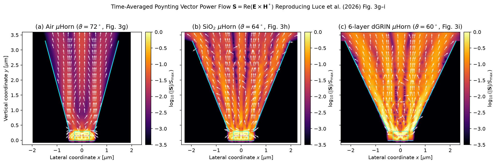
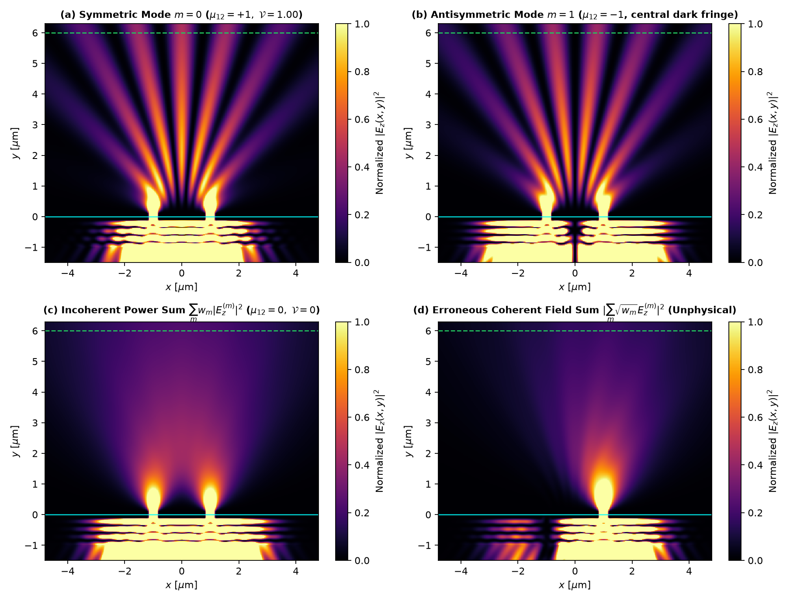
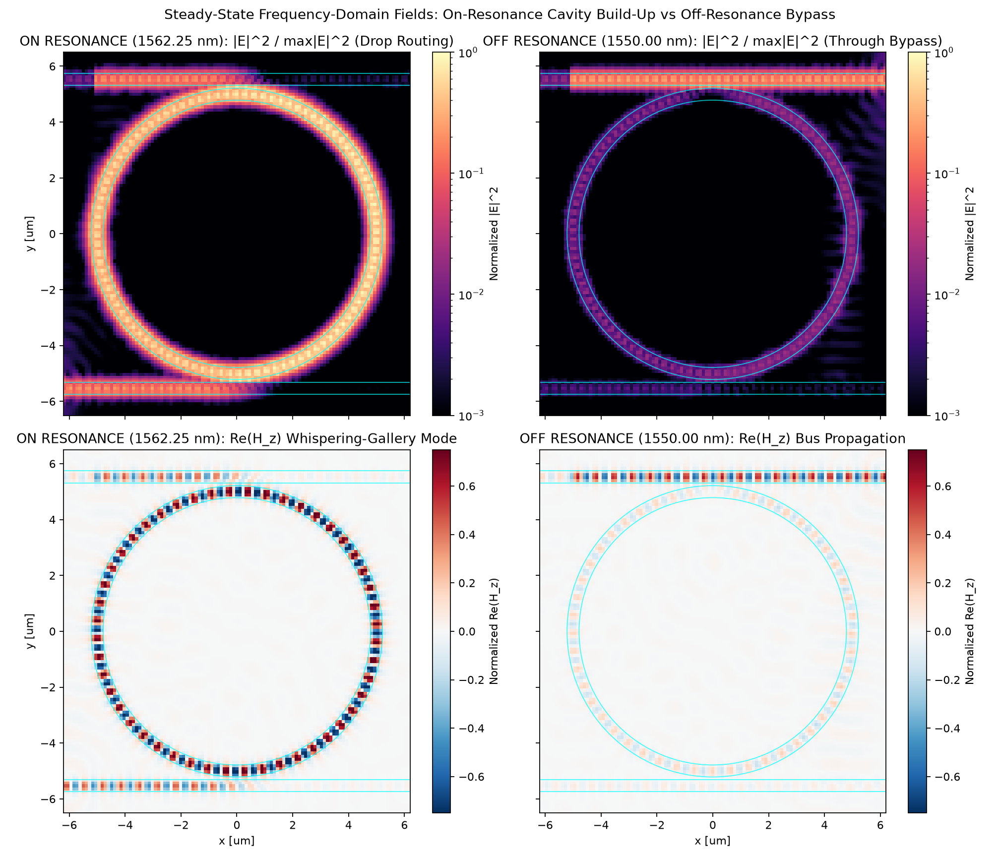
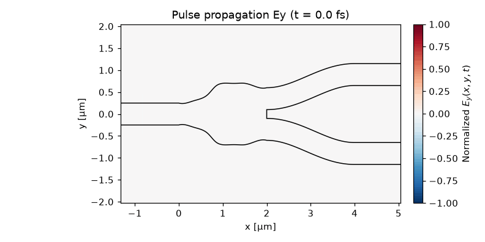
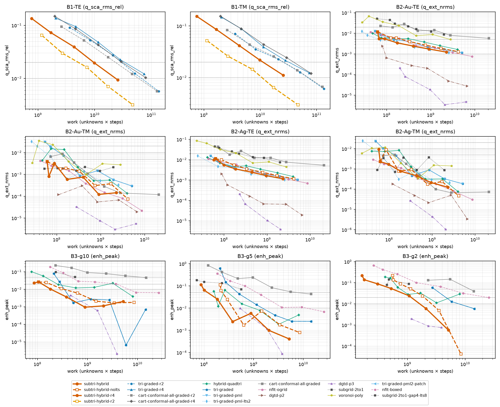
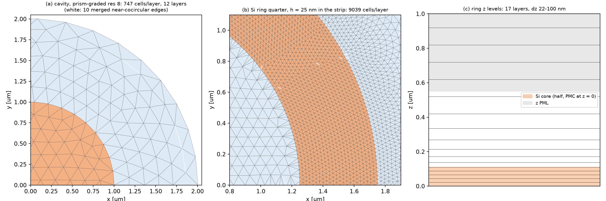
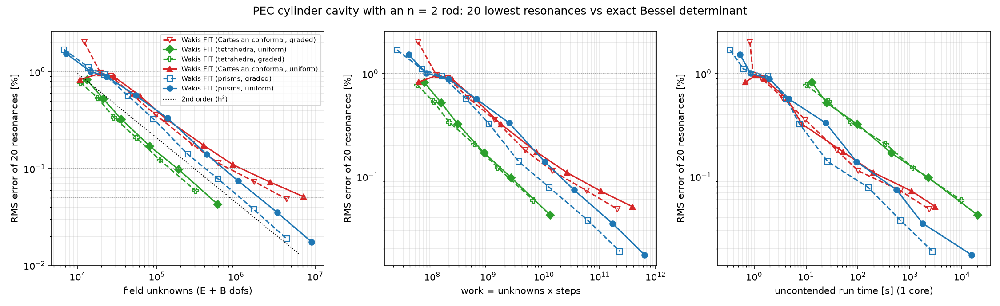
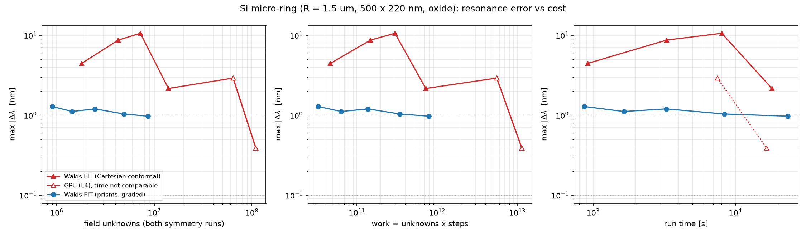

> Open-source **Wak**e and **I**mpedance **S**olver

[](https://wakis.readthedocs.io/en/latest/?badge=latest)
[](https://github.com/ImpedanCEI/Wakis/actions/workflows/nightly_tests_CPU_p3.14.yml)
[](https://codecov.io/github/elenafuengar/wakis)
[](https://github.com/astral-sh/ruff)


[](https://doi.org/10.5281/zenodo.14988676)


`wakis` is a **3D Time-domain Electromagnetic solver** that solves the Integral form of Maxwell's equations using the Finite Integration Technique (FIT) numerical method. It computes the longitudinal and transverse **wake potential and beam-coupling impedance** from the simulated electric and magnetic fields. It is also a multi-purpose solver, capable of simulating planewaves interaction with nano-structures, optical diffraction, and much more!

**Contents:** [About this fork](#about-this-fork) · [Highlights](#highlights) · [New features](#new-features-in-this-fork) · [Work on feature branches](#work-on-feature-branches-status-21-october-2026) · [Tutorials and examples](#tutorials-and-examples) · [Roadmap](#feature-checklist-and-roadmap) · [Installation](#installation) · [Upstream Wakis](#about)

## About this fork

This is a fork of [CERN's Wakis](https://github.com/ImpedanCEI/wakis), the open-source wake and impedance solver, grown into a
general-purpose electromagnetic and optical design tool. It covers RF and antennas, photonic integrated circuits, LEDs and
microLEDs, metasurfaces, plasmonics and accelerator structures, and its whole pipeline is differentiable for gradient-based
inverse design.

The [examples library (EXAMPLES.md)](EXAMPLES.md) lists every tutorial, study and upstream example with a thumbnail.

What this fork adds to Wakis:
- **Meshes beyond the Cartesian staircase**: conformal and full-tensor subpixel averaging (including dispersive metals),
  graded and locally refined grids, Cartesian subgridding, triangles and tetrahedra, polygonal, prism, curvilinear O-grid and
  high-order DGTD meshes, and local time stepping.
- **The tools of a design suite**: plane-wave TF/SF sources, mode solvers, mode ports and S-parameters, lumped elements,
  DFT/flux/diffraction monitors, near-to-far transforms, harmonic inversion, dispersive materials, Bloch-periodic boundaries,
  and design templates for antennas, waveguides, metasurfaces and silicon photonics.
- **Inverse design**: an exact discrete adjoint with a JAX wrapper for every feature above, on CPU, GPU and MPI, with a
  memory ladder that makes long 3D gradients affordable, and a fused GPU time step.
- **Tutorials and studies**: worked examples that reproduce published results (LEDs, microLEDs, superluminescent diodes,
  partially coherent light, silicon photonics, Mie scattering), each with a resolution study, and benchmark studies that compare
  mesh types at equal accuracy.

How the work is done: every feature is validated against analytic results, conservation laws or independent solvers (exact
series, RCWA, FDFD, method of moments, Meep-inspired tests) with tests that can fail, and documented in the
[physics guide](docs/physicsguide.md) with equations, references and its limits. Every speed or accuracy claim names its
baseline and is measured at equal accuracy; studies run on cloud batch machines and are reproducible from the scripts in
[studies/](studies). Corrections are stated in the text where they happen. Bug fixes and broadly useful features go back to
upstream Wakis as small, focused pull requests (see the roadmap). The
[User Manual & FIT Theory Guide](user_manual.md) has quickstarts, the FIT theory, the API reference and benchmarks.

## Highlights

What you can do with it. Tutorials marked  live on a feature branch and are being reviewed before they are merged.

#### LEDs, microLEDs and superluminescent diodes &nbsp;·&nbsp; `feature/emitter-tutorials`


<table>
<tr>
<td colspan="2"></td>
</tr>
<tr>
<td colspan="2">

Seven tutorials model light emitters with incoherent dipole ensembles, Drude silver mirrors, near-to-far transforms and
reciprocity, each against a publication or exact theory and each with a resolution study (at least 10 cells per wavelength,
4 cells across the thinnest layer and 4 per metal skin depth). Above: power flow in the microLED micro-horn collimators of
Luce *et al.* (2026). With the paper's definition (equal polarization weights, normalized to the source power) and a
converged ensemble of 17 dipoles, extraction into ±15° with Johnson & Christy silver is 27.5 % for the air horn (paper, 2D:
27.5 %), 31.1 % for the SiO<sub>2</sub> horn (30.4 %) and 37.6 % for the graded-index horn (37.7 %). Without a horn it is
9.9 % (14.9 %), a gap that is still unexplained. The paper does not say which silver data it used; with Rakić silver all
three horns come out 5.7–7.4 points lower. Also: the deep-UV LED extraction of Ryu *et al.* (2014) versus p-GaN thickness (e.g. 1.72 % vs 1.70 % at
50 nm), RGB microLED arrays (Chen *et al.* 2025), a dipole near a mirror and in a microcavity (Drexhage oscillation, Purcell
factor), the tilted facet of a superluminescent diode (Marcuse 1989; an anti-reflection coating suppresses the facet
reflection 81×), and LED far fields computed by reciprocity, which agree with the direct dipole sum to 0.07 %.

</td>
</tr>
</table>

#### Partially coherent light &nbsp;·&nbsp; `feature/emitter-tutorials`


<table>
<tr>
<td width="55%"></td>
<td>

Time-domain solvers are coherent; partially coherent light is a weighted **incoherent sum of coherent runs**. A double slit
lit by an extended source reproduces the van Cittert–Zernike theorem (fringe-visibility error against theory 0.012 RMS,
second-order convergence), a Gaussian Schell-model beam is built from its coherent modes, and a broadband pulse shows temporal
coherence. The panel at the bottom right is what goes wrong when the fields instead of the powers are summed. A silver screen
transmits 5 % more on axis than a perfect conductor once its skin depth is resolved (an under-resolved grid gave 10.5 %).

</td>
</tr>
</table>

#### Photonic integrated circuits &nbsp;·&nbsp; `feature/pic-tutorials`


<table>
<tr>
<td width="58%"></td>
<td><br>

Eleven silicon-photonics tutorials in 2D (effective-index method): Y-junction, ring coupler, crossing, Euler bend,
directional coupler, 1×4 and 2×2 MMIs, add-drop ring (left), size and strip-to-slot converters, Bragg grating. Mode ports,
broadband S-parameters, field movies, and a Kottke-versus-staircase convergence study against an independent fine reference
in every one. The lesson they share: resolve the smallest feature, not just the wavelength. With one cell across a 50 nm
coupler gap the staircase gets the coupled power 40 % wrong; with six cells, 0.3 %.

</td>
</tr>
</table>

#### Photonic inverse design: invrs-gym &nbsp;·&nbsp; [invrs-wakis](https://github.com/eshipton/invrs-wakis)

<table>
<tr>
<td width="55%"></td>
<td>

[invrs-gym](https://github.com/invrs-io/gym) challenges optimized with Wakis's **exact adjoint + JAX** and scored by the gym's own backends. In the round-2 pilot, the length-scale constraints are enforced by construction: **all 18 designs meet the 3/3-pixel length scale** (most round-1 designs violated it). Best official scores: **waveguide bend +0.675, mode converter +0.381, power splitter +0.052**. The 10 nm ceviche re-check gives +0.462, +0.315 and +0.045. These are the lightweight challenges, which are not on the leaderboard. The full-ceviche (leaderboard-eligible) and metalens GPU sweeps are running. In round 1, Wakis's predictions agreed with the official evaluator to < 0.007.

</td>
</tr>
</table>


#### Light scattering: Mie in 2D and 3D with a total-field/scattered-field plane wave &nbsp;·&nbsp; [tutorials/](tutorials/)

<table>
<tr>
<td colspan="2"></td>
</tr>
<tr>
<td width="50%"></td>
<td width="50%"></td>
</tr>
<tr>
<td colspan="2"></td>
</tr>
<tr>
<td colspan="2">

[Tutorial 3.4 · Mie scattering by a dielectric cylinder (2D)](tutorials/03_diffraction_and_scattering/03-04_mie_cylinder/mie_cylinder.ipynb) ([Colab](https://colab.research.google.com/github/eshipton/Wakis/blob/main/tutorials/03_diffraction_and_scattering/03-04_mie_cylinder/mie_cylinder.ipynb)): a `TFSFSource` plane wave hits an n = 2 cylinder (a = 1 µm, x = 2&ndash;10, TM and TE). The scattered flux is compared with the exact series. Over 42 runs, conformal averaging reaches **0.33 % RMS error for x &le; 5 and 1.2 % for x &le; 10 at 80 cells/µm (TM)**, at second order. The staircase at the same resolution stays first order (3.9 % and 4.8 %). TE needs the full tensor (0.21 % vs 0.35 % diagonal at x &le; 5). A triangle-mesh section shows that conforming triangles match conformal Cartesian accuracy at equal h, at ~1.45× the work on uniform meshes; graded meshes change that (see above).

</td>
</tr>
<tr>
<td colspan="2"></td>
</tr>
<tr>
<td width="50%"></td>
<td width="50%"><br><sub>Split polar plot: left half E-plane (xz, |S<sub>2</sub>|²), right half H-plane (yz, |S<sub>1</sub>|²); the two planes differ physically (dipole null near 90° in the E-plane), and each is symmetric in ±θ.</sub></td>
</tr>
<tr>
<td colspan="2">

[Tutorial 3.5 · Mie scattering by a sphere (3D) and the near-to-far-field transform](tutorials/03_diffraction_and_scattering/03-05_mie_sphere/mie_sphere.ipynb) ([Colab](https://colab.research.google.com/github/eshipton/Wakis/blob/main/tutorials/03_diffraction_and_scattering/03-05_mie_sphere/mie_sphere.ipynb)): the same set-up in 3D, an n = 2 sphere with r = 1 µm. It covers the Mie series, near fields, isosurfaces, a movie, and the far field (`Near2FarMonitor` against S<sub>1</sub>, S<sub>2</sub>). Full mode on an NVIDIA L4: 6.3 Mcells and 11 min, with **Q<sub>sca</sub> within 3.4 % RMS of Mie** over x = 2&ndash;10 (conformal, 40 cells/µm). The 3D resolution study is still to do.

</td>
</tr>
</table>

#### Accelerator wakefields without numerical Cherenkov radiation &nbsp;·&nbsp; `SolverFIT3D(scheme='tete')`

<table>
<tr>
<td width="55%"></td>
<td>

Opt-in `SolverFIT3D(scheme="tete")`: the explicit TE/TM scheme of Dohlus & Zagorodnov (JCP 228, 2822, 2009), dispersion-free along the beam axis at c·dt = dz, with conformal PEC, the TF/SF beam, GPU, MPI and an exact transposed step. **Smooth pipe (exact wake 0): ≤ 3e-8 V/pC, against 1.2–660 V/pC of spurious Cherenkov wake for Yee, growing with length.** Closed box at σ<sub>z</sub>/dz = 1: loss-factor error 10 % vs 48 % for Yee (19× less work to reach 1 %); pillbox with pipes at σ<sub>z</sub>/dz = 2: 3.3 % vs 42 %. Long bunches: equal to Yee. Found along the way: Wakis wake post-processing samples E<sub>z</sub> at `int(t/dt)` (first order in dt), which raises the Yee loss-factor error from 1.5 % to 7.8 %; an upstream issue is drafted. **Limits:** 1.3–1.9× cost per simulated time; not yet fused for GPU; no x/y CPML, ADE or `AdjointSimulation`. Code on `main`, [studies/dispersion-free-wake](studies/dispersion-free-wake).

</td>
</tr>
</table>

## New features in this fork

 merged on `develop`/`main` &nbsp;  interim numbers only &nbsp;  code on a feature branch

Each result names its baseline. Work is unknowns × time steps, which does not depend on the implementation.

#### Plasmonic nanoparticles: 10× fewer unknowns with body-fitted triangles &nbsp;·&nbsp; `wakis.unstructured`, `wakis.benchmarks`


<table>
<tr>
<td colspan="2"></td>
</tr>
<tr>
<td width="55%"></td>
<td>

Benchmark **B2**: Au (in an n = 2 host) and Ag (in vacuum) nanocylinders, a = 20 nm, Rakić Drude–Lorentz ε(ω), against the exact series. 168 uncontended Cloud Batch runs, h = 4 → 0.5 nm. At **1 % Q<sub>ext</sub> NRMS on Au-TE, graded triangles need 4.8k unknowns and 6.5e7 work, against 46k and 2.0e9 for the best Cartesian arm (graded conformal)**: about **10× fewer unknowns and 30× less work**. The staircase never reaches 1 % (2.7 % at 0.5 nm). Conformal Cartesian TE is not monotone in h (2.3, 2.0, 2.9, 1.3, 1.4, 0.8, 0.6 %): averaging metal and host gives mixed cells whose ε(ω) crosses zero in the band. Triangles converge at second order. Limit: 2D only. **Run window checked:** tripling the 80 fs window changes every B2 metric by < 1e-5 (B3 < 1e-5 too; low-Q plasmons decay within a few fs). Code on `main`; study: [studies/benchmarks](studies/benchmarks).

</td>
</tr>
<tr>
<td colspan="2"></td>
</tr>
<tr>
<td colspan="2">

**B3**: Au nanodimers (a = 20 nm, n = 2 host) with 10, 5 and 2 nm gaps, E along the dimer axis, against an exact multi-cylinder T-matrix (maps above). Metric: the mean |E/E<sub>0</sub>|² over 9 gap points, reconstructed at second order (a patch fit on triangles, bilinear on the Cartesian grid). 98 uncontended runs; run window checked (< 1e-5). **Graded triangles converge to 1 % on every gap (g = 5 nm: 41k unknowns, 1.5e9 work), while graded conformal Cartesian reaches only 5 % (111k, 8.0e9) and never 2 %.** At 5 %, triangles need 2.4–10× fewer unknowns and 4–49× less work than conformal Cartesian; the staircase reaches none of the targets. An earlier first-order (Raviart–Thomas) single-cell gap reconstruction made sub-2 % comparisons mesh noise; it was replaced, and the triangle PML was raised to 40 rings (boundary effect ~1e-4). **B4** (3D λ/2 dipole, against our Hallén MoM, confirmed by NEC-2 to 0.04 %): conformal PEC reaches f<sub>res</sub> within 0.05–0.13 % and R<sub>in</sub> within ~1 % (after the conformal-PEC mask fix; it was −6 % before).

</td>
</tr>
</table>

#### Quadtree squares + body-fitted triangle band: 5–7× less work on the Mie benchmark &nbsp;·&nbsp; `wakis.unstructured.subtri`


<table>
<tr>
<td width="55%"></td>
<td>

Cheap 2:1 quadtree squares fill the bulk. A conforming Delaunay triangle band of ±2h is used only at curved interfaces and in nanogaps, and the finest squares fill the metal. Hanging nodes are tied in by a linear prolongation P with K = G·P and a lumped mass D = Pᵀm, so the operator is symmetric, energy is conserved exactly (drift ≤ 2e-15 over 2e4 real steps), the scheme is stable iff dt²λ<sub>max</sub> < 4, and the adjoint dot-product test holds to 1e-17. Two-level local time stepping plugs in unchanged. **B1 Mie cylinder (3000 fs, uncapped) at 1 % RMS: 0.20× (TE) / 0.15× (TM) the work and 0.15× / 0.11× the wall time of the best existing arm** (graded conformal Cartesian in TE, graded triangles in TM). **B3 Au dimer gaps: 0.39–0.74× the work at the 5 % and 2 % gap-field targets for g = 10 / 5 nm and at 5 % for g = 2 nm, against the best FIT/FDTD arm (hybrid quad-tri or graded triangles + PML)**; at 1 % in the 2 nm gap, high-order DGTD p3 still needs less work. **Limits:** on the single Au/Ag cylinder (B2) it loses (1.3–2.5× the work; TE plateaus near 0.12 %; DGTD wins). Local time stepping also *halves* the error at equal h on B1, which looks too good: a dispersion study must confirm it before we rely on it. Two LTS levels only; circles only; squares carry piecewise-constant material, so every interface needs the band. Code on `main`, [studies/subtri-hybrid](studies/subtri-hybrid).

</td>
</tr>
<tr>
<td colspan="2"></td>
</tr>
</table>

#### Fused GPU time step: 45× faster inverse-design iterations &nbsp;·&nbsp; `SolverFIT3D(..., use_gpu=True, fused=True)`


<table>
<tr>
<td width="55%"></td>
<td>

GPU runs were limited by Python dispatch and kernel launches (up to ~500 launches per step), not by the GPU. The step, CPML, sources, DFT/flux/mode monitors, tensor averaging, dispersive ADE and the transposed adjoint step are now a few custom CUDA kernels, replayed 64 steps at a time with CUDA graphs. **invrs full ceviche bend: one forward + adjoint iteration from 753 s to 15–17 s on an L4 (45–49×)**, GPU utilization 11 % → 93 %, identical loss and gradients to 3e-11. Per step: CPML 3D 7.3 → 0.68 ms, TF/SF + 81-frequency flux 11.7 → 0.63 ms, adjoint 6.0 → 0.10 ms. Exactness: fields and monitors match the previous GPU path to ≤ 1e-11, the fused adjoint passes the dot-product test (< 1e-12), and graph replay is bitwise identical. **Limits:** opt-in for now; float64/complex128 and no MPI; ~60 % more GPU memory with CPML; plain 3D grids at ~300k cells are 7 % slower (bandwidth-bound). Code on `main`, [studies/gpu-perf](studies/gpu-perf), `docs/performance.md`.

</td>
</tr>
</table>

#### Graded triangles with a radial PML (and a correction) &nbsp;·&nbsp; `wakis.unstructured`


<table>
<tr>
<td colspan="2"></td>
</tr>
<tr>
<td width="55%"></td>
<td>

**Correction (2026-10-19):** an earlier version of this highlight claimed graded triangles need 2.2× fewer unknowns than graded Cartesian on the B1 dielectric cylinder. That comparison used a 1000 fs run window (error floor 0.14 % TM / 0.87 % TE) and a Cartesian arm whose outer cell size was capped at λ/20, which stops refining the region between the scatterer and the extraction circles. **With a 3000 fs window and no cap, the two families are equivalent on B1:** 521k (TM) / 506k (TE) unknowns for graded triangles vs 511k / 452k for graded conformal Cartesian at 1 %, both second order. The radial **CFS-PML reflects 2–8e-4** over x = 2–10 (10 cells at h = 20 nm; the old first-order ABC reflected 6–17 %), and a tabulated plane-wave source costs one sparse mat-vec per step. **Where triangles do win is curved metal** (plasmonic B2/B3, first highlight): ~10× fewer unknowns. Code on `main`, [studies/mie-cylinder-graded](studies/mie-cylinder-graded), [studies/unstructured-pml](studies/unstructured-pml), [studies/benchmarks](studies/benchmarks).

</td>
</tr>
</table>

#### Local time stepping: 2× fewer steps at unchanged error, energy-conserving, exact adjoint &nbsp;·&nbsp; `UnstructuredFIT2D(lts=2)`


<table>
<tr>
<td width="55%"></td>
<td>

A leapfrog LTS (Diaz & Grote 2009), stabilized with a damped Chebyshev polynomial. Only the vacuum band next to the scatterer takes sub-steps (3–23 % of the nodes). The rest of the mesh, cylinder included, takes **1.94× the global step**. The scheme conserves an exact discrete energy (drift 2e-14 over 10<sup>5</sup> steps) and its transpose is an exact adjoint (dot product < 1e-14). Baseline: global leapfrog **on the same mesh**. Mie cylinder: **1.56–1.88× less work**. B2/B3 (Au/Ag nanocylinders, Au dimers with 2/5/10 nm gaps): **exactly 2× fewer steps with unchanged error** (largest difference 0.0241 vs 0.0247). Spot-machine wall-time ratio 1.01–2.67×, median ≈ 1.75×. Code on `main`; study: [studies/unstructured-lts](studies/unstructured-lts).

</td>
</tr>
<tr>
<td colspan="2"></td>
</tr>
</table>

#### Polygonal FIT: hybrid square/triangle and Voronoi meshes &nbsp;·&nbsp; `wakis.unstructured.PolygonFIT2D`


<table>
<tr>
<td colspan="2"></td>
</tr>
<tr>
<td width="55%"></td>
<td>

FIT on any polygon mesh with an orthogonal dual: squares in the bulk and triangles only at the interface (hybrid), or mostly hexagonal Voronoi cells. Mie cylinder at 1 % RMS: **Voronoi needs 1.95× fewer unknowns and 1.87× less work than graded triangles** (TM, same disk domain). The Bloch analysis (left) explains why: the **honeycomb has half the dispersion error** of squares or triangles at equal unknowns. The hybrid needs 1.40× fewer unknowns than graded Cartesian (TM, same square domain and PML). On the **2 nm-gap Au dimer** (B3-g2), the hybrid refines only the gap and needs **≥ 2.6× fewer unknowns** for 5 % than the first converged graded-triangle rung. That is a bound, since coarser triangle rungs were not run. Limits: B1 TE at 1 % is limited by the 1000 fs run window (see above), and there is no polygon PML yet. Code on `main`; studies: [studies/mie-cylinder-polyfit](studies/mie-cylinder-polyfit), [studies/benchmark-polygon](studies/benchmark-polygon).

</td>
</tr>
</table>

#### Extruded prism FIT: 15× fewer unknowns on a Si micro-ring, 3–6× less work on a 3D cavity &nbsp;·&nbsp; `wakis.unstructured.PrismFIT3D`


<table>
<tr>
<td colspan="2"></td>
</tr>
<tr>
<td width="55%"></td>
<td>

Body-fitted 2D triangles × independent z layers: a diagonal Voronoi Hodge, z PML and GPU support, with planar photonics (curved sidewalls, thin cores) as the target. **3D dielectric rod cavity, 20 lowest resonances against the exact hybrid-mode determinant, at 0.1 % RMS: graded prisms need 412k unknowns / 7.5e9 work, against 821k / 2.2e10 for graded conformal Cartesian (2.9× less work); at 0.05 %, 1.13 M / 3.4e10 against 4.08 M / 1.9e11 (5.6× less work).** Tetrahedra need fewer unknowns and less work but are ~28× slower in wall time than graded prisms. **220 nm Si micro-ring (TE<sub>0</sub>, m = 13–16) against a body-of-revolution reference, at about 2 nm accuracy: prisms at h = 30 nm (1.3 nm error, 0.90 M unknowns) against uniform conformal Cartesian at h = 20 nm (2.2 nm, 14 M): 15× fewer unknowns, 22× less work.** **Limits:** prisms plateau at a +0.04–0.07 % (~1 nm) offset on the ring whose cause has not been found yet (sub-nm needs Cartesian h = 10 nm); on the B4 dipole antenna the first-order lateral absorber makes prisms lose to the fixed conformal-PEC Cartesian arm (0.56 % / 2.2 % NRMS at 4.5 M unknowns vs 0.05 % / 1.3 % in 242 s). Code on `main`, [studies/prism-cavity](studies/prism-cavity), [studies/prism-ring](studies/prism-ring), [studies/prism-dipole](studies/prism-dipole).

</td>
</tr>
<tr>
<td colspan="2"></td>
</tr>
</table>

#### Cartesian subgridding: provably stable nested patches, cheapest on dielectrics &nbsp;·&nbsp; `wakis.subgrid`


<table>
<tr>
<td width="55%"></td>
<td>

Nested 2:1/3:1 Cartesian patches (auto-balanced quadtree). The fine-to-coarse restriction is the exact transpose of the prolongation with a row-sum-lumped mass, so energy is conserved exactly (drift ≤ 4e-15 over 10<sup>5</sup> steps), the scheme is stable iff dt < 2/√λ<sub>max</sub>, the interface reflection is second order, and the core step passes the dot-product adjoint test (1e-13). A non-transposed restriction blows up by 10<sup>12</sup>. **B1 Mie cylinder at 1 % RMS, equal global Δt: 175k (TM) / 164k (TE) unknowns vs 240k / 245k for graded triangles + PML and 362k / 347k for compact graded Cartesian** (1.5–1.7× and 2.3–2.4× less work). The local time stepping above plugs in unchanged. **Limits:** on curved metal in TE (B2) convergence drops to first order and triangles stay 4–5× cheaper; on B3 dimer gaps it does not reach 5 % (best 5.0–8.6 %); local time stepping with the Rakić Au/Ag poles fails the stability check at the coarse step. 2D only (3D octree plan in the physics guide). Code on `main`, [studies/mie-cylinder-subgrid](studies/mie-cylinder-subgrid), [studies/subgrid-benchmarks](studies/subgrid-benchmarks).

</td>
</tr>
</table>

#### Curvilinear O-grid FIT (NFIT): fewest unknowns on round dielectric and plasmonic scatterers &nbsp;·&nbsp; `wakis.curvilinear.CurvilinearFIT2D`


<table>
<tr>
<td colspan="2"></td>
</tr>
<tr>
<td width="55%"></td>
<td>

Time-domain nonorthogonal FIT (Schuhmann & Weiland 2000) on body-fitted polar grids. A symmetric flux-to-voltage Hodge conserves energy (drift 7e-16), with a radial complex-stretching PML (reflection 5e-5). **B1 Mie cylinder at 1 % RMS (3000 fs window): O-grid 158k (TM) / 176k (TE) unknowns vs 244k / 215k for graded triangles + PML** (1.9× / 1.3× less work, 1.8× / 1.6× faster) and vs graded Cartesian (about 4× faster). **B2 Au-TE at 0.1 %: 19.6k unknowns vs 88k for uniform triangles** (settings tuned on B2; the untuned default needs 42k). **Limits:** on B3 dimer gaps it is 3–8× worse than graded triangles (a structured grid cannot refine only the gap). On a 20 nm coated cylinder it ties triangles, while Cartesian averaging stalls at 1.1 % (TM) / 3.4 % (TE). Best for round, coaxial and layered geometry, including beam pipes. Code on `main`, [studies/mie-cylinder-nfit](studies/mie-cylinder-nfit).

</td>
</tr>
</table>

#### High-order DGTD on curved triangles: 0.1 % with ~100× fewer unknowns &nbsp;·&nbsp; `wakis.highorder`


<table>
<tr>
<td width="55%"></td>
<td>

Nodal discontinuous Galerkin time domain (Hesthaven & Warburton 2008) on **curved** triangles, p = 1–5, with upwind flux, LSRK(5,4), CFS-PML, Drude/Lorentz/Debye ADE driven by the total field, and a probed sparse operator for exact adjoints (dot test 1e-12). A Cartesian (2,4) scheme with LSRK4 is also included. **B1 Mie cylinder, 0.1 % TM: DG p = 5 needs 17k unknowns and 91 s, against ~2.1M unknowns (~2600 s, extrapolated) for the best second-order arm** (graded triangles + PML); 0.01 % with 25k unknowns. Above x ≈ 6 the second-order error is 95–99 % bulk dispersion, which the high-order stencils remove. **B2 Au-TE, 0.1 %: p = 2 needs 6.0k unknowns vs 88k for uniform triangles** (equal wall time). Curved elements are essential: straight-sided p = 4 stalls at 1–5 %. **Limits:** at 1–2 % accuracy the (2,4) leapfrog scheme or graded triangle FIT is faster in seconds (DG costs 150–300 ns per unknown-step vs ~19 ns); the rectangular DG PML becomes unstable in long runs on fine meshes (unsolved, long windows use an absorbing disk). Code on `main`, [studies/highorder-mie](studies/highorder-mie), [studies/highorder-bench](studies/highorder-bench).

</td>
</tr>
</table>

#### Exact plane-wave source: TF/SF at round-off vs continuum Huygens sheets &nbsp;·&nbsp; `TFSFSource`, [studies/tfsf](studies/tfsf)


<table>
<tr>
<td width="55%"></td>
<td>

`TFSFSource` takes its incident field from a 1D FIT line, so it solves the discrete equations exactly: **the leaked power is round-off** ((3.7–7.9)e-32 of the face power in 3D) at every resolution. The same box driven by continuum equivalent-current (Huygens) sheets leaks as (kh)<sup>4</sup>, from the grid-dispersion mismatch. Meep-style sheets referenced to the face plane leak as (kh)<sup>2</sup>, from the half-cell offset: **5 % of the face power at 20 cells/λ, 300× more** than the exact-registration sheets. Discrete sheets that carry the 1D-line field reproduce `TFSFSource` to round-off: its commutator corrections *are* the discrete Huygens sheets.

</td>
</tr>
</table>

#### Exact adjoint gradients in 30–60× less memory &nbsp;·&nbsp; `AdjointSimulation(memory=...)`


<table>
<tr>
<td width="55%"></td>
<td>

A memory ladder for the backward sweep:
- `store`: keep every step;
- binomial `checkpoint`: bitwise-equal gradients in 14 physics cases;
- `reverse`: time-reversed leapfrog with recorded CPML layers, which agrees with `store` to 3e-16 to 2e-15, with round-off flat at (0.3–5)e-15 up to N<sub>t</sub> = 64 000;
- `nyquist`: approximate and opt-in.

Measured on a bend-sized 2D case (313² cells, 20 000 steps): **`store` 12.3 GB, `checkpoint` 0.2–2.1 GB at 1.5–1.9× the time, `reverse` 0.39 GB at 1.22×**; measured memory matches the planner. Projected for the ceviche WDM at r = 1: 185 GB with `store` (float64), **2.9 GB with `reverse`**, or 4.3 GB with `checkpoint` at 2.4 extra forward passes. `memory="auto"` picks a mode from a budget. It works with the fused GPU step (checkpoint/reverse gradients ≤ 1e-12 from fused `store`). **Limits:** `reverse` needs lossless media and is validated in float64 only; for 3D TF/SF problems it records the face currents and loses to checkpointing. Code on `main`, [studies/adjoint-memory](studies/adjoint-memory).

</td>
</tr>
</table>

#### Subpixel-smoothed projection for binary designs &nbsp;·&nbsp; `wakis.inverse.smoothed_projection`


<table>
<tr>
<td width="55%"></td>
<td>

SSP (Hammond et al. 2025), implemented from the paper's equations rather than from Meep's GPL code. At β = ∞ the objective stays smooth as a level set moves through a cell, and the **adjoint gradient matches finite differences to 2e-6–1e-4**. A step projection gives an exactly zero gradient. The paper's R = 0.55 Δx leaves a 17× modulation of the shape derivative with sub-pixel position; R = 0.75 Δx reduces it to 1.6×. The invrs-gym pilot (bend and mode converter, against the round-2 arm) is pending. Branch `feature/subpixel-projection`.

</td>
</tr>
</table>

#### Dispersive subpixel averaging: metals and dispersive dielectrics at interfaces &nbsp;·&nbsp; `conformal='all'/'tensor'`


<table>
<tr>
<td colspan="2"></td>
</tr>
<tr>
<td colspan="2">

Cut metal and dispersive-dielectric cells now average the full ε(ω); Meep averages only ε<sub>∞</sub>. The averaging is a passive capacitor network, so the step stays stable and its adjoint exact (dot product ≤ 5e-17). **The result is mixed.** On a lossless Drude rod it converges monotonically and is 4.6–5.2× more accurate than ε<sub>∞</sub>-only averaging, but **2–8× less accurate than a fine staircase**. For a conductive Debye slab the error drops from 1.6e-2 to 2.9e-3. For metals, Kottke averaging is first order and not monotone (mixed cells near ε = 0). Use triangles (B2 above) for second-order plasmonics. Details: physics guide, "Dispersive subpixel averaging".

</td>
</tr>
</table>

#### Linear plasma wakefields in a plasma-filled pipe &nbsp;·&nbsp; `wakis.plasma`


<table>
<tr>
<td width="55%"></td>
<td>

A relativistic Gaussian bunch drives a plasma wave in a metal pipe filled with cold plasma (a Drude medium with ω<sub>p</sub> = c k<sub>p</sub>). Wakis (blue) against closed-form linear theory (dashed) for three bunch lengths: **0.1–0.7 % in amplitude** and **wavelength to 2·10<sup>-4</sup>** at 48 cells per plasma wavelength. Conformal pipe walls converge at second order (0.05 % at 64 cells); staircased walls stay at 4.5 %. The wiggles at k<sub>p</sub>σ<sub>z</sub> = 0.5 are transition radiation from the plasma entrance, a real transient of the setup. Linear regime only: the blowout regime needs particle-in-cell.

</td>
</tr>
</table>

#### Curved dielectrics and metals: when E crosses the interface &nbsp;·&nbsp; `conformal='tensor'`, `wakis.unstructured`


<table>
<tr>
<td width="55%"></td>
<td>

Dielectric rod (ε<sub>r</sub> = 6) in a metal cavity, against the exact Bessel solution. With **E along the rod (TM)** every conformal method is excellent. With **E crossing the curved interface (TE)**, staircasing and diagonal subpixel averaging are only **first order**. Full-tensor averaging (`conformal='tensor'`) restores near second order on the Cartesian grid (50–600× better for a 3D dielectric sphere), and the unstructured triangular/tetrahedral solver is **second order in both polarizations**. For a plasmonic (Drude) rod it reaches **1.3·10<sup>-5</sup>** where Cartesian meshes stall near 3·10<sup>-3</sup>. Details: [studies/mesh-comparison](studies/mesh-comparison).

</td>
</tr>
</table>

#### Unstructured FIT on triangles and tetrahedra &nbsp;·&nbsp; `wakis.unstructured`


<table>
<tr>
<td width="55%"></td>
<td>

FIT on a Delaunay mesh with its **Voronoi dual**: the dual edges are perpendicular to the primary edges, so the material matrices stay diagonal and the scheme keeps the exact discrete identities of FIT (div curl = 0 to round-off). Every cell holds one material, so curved interfaces are exact. Phase 1: 2D and 3D solvers, PEC/PMC/absorbing boundaries, Drude/Lorentz/Debye media, eigen and time-domain solvers, validated against exact Bessel and spherical-Bessel solutions. Phase 2 has added graded meshes, the radial PML, local time stepping and polygonal cells (above); ports, GPU, MPI and the CAD → gmsh workflow are next.

</td>
</tr>
</table>

Other validated numbers: Hertzian-dipole radiated power and directivity 1.50 (theory 1.5); flux-box energy conservation 0.08 %;
RCWA agreement of grating diffraction efficiencies 1.3e-3; TE10 propagation constant to 1e-12 of the discrete dispersion; Fresnel
reflection at oblique incidence 0.15–0.55 %; exact discrete adjoint (dot-product tests ~1e-17, finite-difference gradients 1e-8–1e-10);
MPI results identical to serial to ~1e-14; forward step ~2x faster than upstream. See `docs/performance.md` and the test suite.

### Work on feature branches (status 21 October 2026)

Features marked complete and checked roadmap items are merged on `develop` (identical to `main` on GitHub). The work below
lives on feature branches and will be merged after review.

| Branch | Contents | Status |
|---|---|---|
| `feature/pic-tutorials` | 11 photonic-integrated-circuit tutorials in 2D (effective-index method, Chapters 5 and 6): Y-junction (5.1), Euler bend (5.2), size converter (5.3), strip-to-slot converter (5.4), waveguide crossing (5.5), 1×4 MMI (5.6), 2×2 MMI (5.7), directional coupler (5.8), waveguide-to-ring coupler (5.9), add-drop micro-ring (5.10), Bragg grating (6.1). Each one is a single-source script + notebook with 13–16 figures, tests that can fail, and a Kottke-vs-staircase convergence study against an independent fine reference. Also: mesh-override boxes in the templates (`Simulation(mesh_overrides=...)`, `PICSimulation(mesh_overrides=...)`) and a Cloud Batch study runner (`tutorials/05_guided_waves/cloud/`). | Quick studies done and resolution-audited; full-resolution studies (162 Batch tasks) finished, figures being re-rendered from them |
| `feature/emitter-tutorials` | 7 light-emitter tutorials (Chapters 4 and 7): dipole near a mirror / microcavity Purcell factor (4.1), planar deep-UV LED vs Ryu 2014 (7.1), superluminescent-diode tilted facet vs Marcuse 1989 (7.2), microLED with a graded-index micro-horn vs Luce 2026 (7.3), RGB microLED array vs Chen 2025 (7.4), partially coherent light in a double slit: van Cittert–Zernike and Gaussian Schell-model (7.5), LED far field by reciprocity (7.6) | Full studies done for 4.1 and 7.1–7.6 |
| `docs/examples-library` | `EXAMPLES.md`: chapter-organized index of 35 built tutorials, 14 tutorials in progress, 157 planned examples across Chapters 2–9 and the solver how-to appendix, 11 standalone scripts, 10 upstream notebooks, and 27 method studies | Updated |
| `feature/subgrid-kit` | Subgridding (`wakis.subgrid`) as a backend for the photonics kit: polygon geometry, mode ports, DFT/flux monitors, S-parameters; then a cost comparison against the graded mesh on the Bragg grating at equal accuracy | Started |
| (planned) | Vacuum-electronics series: slow-wave structure design, traveling-wave tubes, backward-wave oscillators, microwave amplifiers | Planning |

**Resolution policy for every tutorial.** At least 10 cells per wavelength in the highest-index material (20 for the accurate
runs), at least 4 cells across the smallest geometric feature (gaps, teeth, thin layers), and for metals a resolution study
that refines until the metric stops changing, ending at no fewer than 4 cells per skin depth. Local refinement uses graded
axes and mesh-override boxes; under-resolved runs are kept only as labelled demonstrations. Applying this policy changed
several results, which the tutorials state plainly:
- Size converter: TE0 transmission 82.3 % → 77.0 % once the 50 nm segment has 4–8 cells (was < 1).
- Partially coherent double slit: the silver-vs-PEC transmission gain is +5.0 %, not +10.5 % (skin depth 0.58 → 8 cells).
- Deep-UV LED: the 30–60 % gap to Ryu 2014 closes once the 25 nm absorbing p-GaN layer has 6 cells.
- LED reciprocity: a staircase error that grew with refinement was the staircased grating geometry changing with the grid and
  tuning a guided-mode resonance; with the geometry snapped to the grid, staircase converges.
- Bragg grating: the Bragg wavelength converges (1564 → 1557.5 → 1554.9 nm) instead of drifting by > 36 nm.

## Tutorials and examples

Status: ✅ merged on `develop`/`main` · 🔵 built on a feature branch (script, notebook, figures, tests and a full-resolution
study; in review) · 🚧 being built · 🗺️ planned. Every tutorial is a single-source script (`--quick`, `--full`, `--task`,
`--plot`) that generates its notebook and figures, reproduces a publication or an exact result, and includes a resolution study.
See [`tutorials/README.md`](tutorials/README.md) for the full table of contents by chapter.

**Chapter 1 · Fields on a Grid** ([`tutorials/01_fields_on_a_grid/`](tutorials/01_fields_on_a_grid/README.md))

| # | Tutorial | Reproduces / validates against | Status |
|---|---|---|---|
| 1.1 | [Tutorial 1.1 · Plane wave in a box](tutorials/01_fields_on_a_grid/01-01_plane_wave/plane_wave.ipynb) | Exact discrete Yee dispersion, TF/SF round-off leakage, CPML reflection | 🔵 |
| 1.2 | [Tutorial 1.2 · Reflection and transmission at a slab](tutorials/01_fields_on_a_grid/01-02_slab_rt/slab_rt.ipynb) | Fresnel equations, Fabry–Pérot transfer matrix | 🔵 |

**Chapter 2 · Materials** ([`tutorials/02_materials/`](tutorials/02_materials/README.md))

| # | Tutorial | Reproduces / validates against | Status |
|---|---|---|---|
| 2.1 | [Tutorial 2.1 · Where dispersion comes from](tutorials/02_materials/02-01_dispersion_physics/dispersion_physics.ipynb) | Lorentz, Drude and Debye ADE; Kramers–Kronig and skin depth | 🔵 |
| 2.2 | [Tutorial 2.2 · Fitting Measured Material Data](tutorials/02_materials/02-02_fitting_measured_data/fitting_measured_data.ipynb) | Multi-pole Drude–Lorentz fitting to `wakis.materials` | 🔵 |
| 2.3 | [Tutorial 2.3 · Magnetic Materials](tutorials/02_materials/02-03_magnetic_materials/magnetic_materials.ipynb) | Dispersive permeability $\mu(\omega)$ and impedance-matched slabs | 🔵 |
| 2.4–2.5 | EMI shielding and absorbing materials; Time interfaces and photonic time crystals | Schelkunoff shielding theory; Morgenthaler / temporal Fresnel laws | 🚧 |

**Chapter 3 · Diffraction and Scattering** ([`tutorials/03_diffraction_and_scattering/`](tutorials/03_diffraction_and_scattering/README.md))

| # | Tutorial | Reproduces / validates against | Status |
|---|---|---|---|
| 3.1 | [Tutorial 3.1 · Diffraction by a Single Slit](tutorials/03_diffraction_and_scattering/03-01_single_slit/single_slit.ipynb) | Fresnel and Fraunhofer slit diffraction | 🔵 |
| 3.2 | [Tutorial 3.2 · Young's Double-Slit Diffraction](tutorials/03_diffraction_and_scattering/03-02_double_slit/double_slit.ipynb) | Young's two-slit interference pattern | 🔵 |
| 3.3 | [Tutorial 3.3 · N-Slit Diffraction Gratings](tutorials/03_diffraction_and_scattering/03-03_n_slits/n_slits.ipynb) | Multi-slit interference and grating factor | 🔵 |
| 3.4 | [Tutorial 3.4 · Mie scattering by a dielectric cylinder (2D)](tutorials/03_diffraction_and_scattering/03-04_mie_cylinder/mie_cylinder.ipynb) | Exact Mie series (TM/TE, staircase vs conformal vs triangles) | ✅ |
| 3.5 | [Tutorial 3.5 · Mie scattering by a sphere (3D) and the near-to-far-field transform](tutorials/03_diffraction_and_scattering/03-05_mie_sphere/mie_sphere.ipynb) | Lorenz–Mie $S_1/S_2$ and $Q_{\text{sca}}$ | ✅ |
| 3.6 | [Tutorial 3.6 · Localized surface plasmons of a metal cylinder: pole count, accuracy and cost](tutorials/03_diffraction_and_scattering/03-06_plasmonic_cylinder/plasmonic_cylinder.ipynb) | Mie series with Drude–Lorentz Ag/Au metals | 🔵 |

**Chapter 4 · Radiation and Antennas** ([`tutorials/04_radiation_and_antennas/`](tutorials/04_radiation_and_antennas/README.md))

| # | Tutorial | Reproduces / validates against | Status |
|---|---|---|---|
| 4.1–4.2 | Point dipole; Half-wave dipole and quarter-wave monopole | Hertzian dipole fields and Balanis dipole impedance/pattern | 🚧 |
| 4.3 | [Tutorial 4.3 · Dipole near a mirror: image theory, Drexhage effect and Purcell factor](tutorials/04_radiation_and_antennas/04-03_dipole_near_mirror/dipole_near_mirror.ipynb) | Drexhage oscillation, Purcell factor, exact Sommerfeld integral for silver | 🔵 |
| 4.4 | [Tutorial 4.4 · 2.4 GHz Printed Inverted-F PCB Antenna (Texas Instruments SWRU120D)](tutorials/04_radiation_and_antennas/04-04_pcb_ifa_2g4/pcb_ifa_2g4.ipynb) | TI DN007 (SWRU120D) $S_{11}$, $Z_{\text{in}}$, 3D gain pattern, Wheeler–Chu limit | 🔵 |
| 4.5 | [Tutorial 4.5 · 77 GHz Series-Fed Microstrip Patch Array for Automotive Radar](tutorials/04_radiation_and_antennas/04-05_radar_patch_array_77g/radar_patch_array_77g.ipynb) | Yang *et al.* 2020 10-element 77 GHz patch array directivity and sidelobes | 🔵 |
| 4.6 | [Tutorial 4.6 · NFC reader and tag coils at 13.56 MHz (near-field inductive coupling)](tutorials/04_radiation_and_antennas/04-06_nfc_coils/nfc_coils.ipynb) | Wheeler/Grover self-inductance, 3D Neumann mutual inductance, ferrite shielding | 🔵 |

**Chapter 5 · Guided Waves** (`feature/pic-tutorials`, [`tutorials/05_guided_waves/`](tutorials/05_guided_waves/README.md), 2D effective-index method)

| # | Tutorial | Key result / check | Status |
|---|---|---|---|
| 5.1 | [Tutorial 5.1 · Y-junction power splitter](tutorials/05_guided_waves/05-01_y_junction/y_junction.ipynb) | Zhang *et al.* 2013; independent 56-cpw reference | 🔵 |
| 5.2 | [Tutorial 5.2 · Euler waveguide bend](tutorials/05_guided_waves/05-02_euler_bend/euler_bend.ipynb) | Bend loss vs radius 2.5–4 µm | 🔵 |
| 5.3 | [Tutorial 5.3 · Mode size converters: tapers, Luneburg lens and semi-lens](tutorials/05_guided_waves/05-03_size_converter/size_converter.ipynb) | TE0 transmission 77 %, mode share vs 3D FDTD | 🔵 |
| 5.4 | [Tutorial 5.4 · Strip-to-slot waveguide mode converters](tutorials/05_guided_waves/05-04_strip_to_slot/strip_to_slot.ipynb) | Kottke vs staircase on a 100 nm slot | 🔵 |
| 5.5 | [Tutorial 5.5 · Waveguide crossing with cosine tapers](tutorials/05_guided_waves/05-05_crossing/crossing.ipynb) | Insertion loss 0.19 dB, crosstalk −44 dB at 1310 nm | 🔵 |
| 5.6 | [Tutorial 5.6 · 1×4 multimode-interference power splitter](tutorials/05_guided_waves/05-06_mmi_1x4/mmi_1x4.ipynb) | Self-imaging; 0.47 dB excess loss; W × L optimum sweep | 🔵 |
| 5.7 | [Tutorial 5.7 · 2×2 multimode-interference coupler](tutorials/05_guided_waves/05-07_mmi_2x2/mmi_2x2.ipynb) | Splitting ratio and 90° phase | 🔵 |
| 5.8 | [Tutorial 5.8 · Directional coupler: supermode beating and sidewall-angle sensitivity](tutorials/05_guided_waves/05-08_directional_coupler/directional_coupler.ipynb) | Supermode beating, gap and sidewall-angle sweeps | 🔵 |
| 5.9 | [Tutorial 5.9 · Waveguide-to-ring point coupler](tutorials/05_guided_waves/05-09_ring_coupling/ring_coupling.ipynb) | Coupling vs gap (50–250 nm), exponential decay; 1 cell across the gap gives a 40 % error, 6 cells 0.3 % | 🔵 |
| 5.10 | [Tutorial 5.10 · Microring add-drop filter](tutorials/05_guided_waves/05-10_ring_add_drop/ring_add_drop.ipynb) | FSR 23.7 nm, loaded Q ≈ 760, gap sweep vs coupled-mode theory | 🔵 |
| — | Grating couplers, polarization devices, (de)multiplexers, further splitters and couplers | See the catalogue below | 🗺️ |

**Chapter 6 · Periodic Structures** ([`tutorials/06_periodic_structures/`](tutorials/06_periodic_structures/README.md))

| # | Tutorial | Reproduces / validates against | Status |
|---|---|---|---|
| 6.1 | [Tutorial 6.1 · Sidewall-corrugated waveguide Bragg grating](tutorials/06_periodic_structures/06-01_bragg_grating/bragg_grating.ipynb) | Bragg wavelength convergence, coupled-mode theory, side-lobe suppression ([subgrid cost study](studies/subgrid-vs-graded-bragg/)) | 🔵 |
| 6.2 | [Tutorial 6.2 · Slow-wave structure cold test: corrugated and glide-symmetric waveguides](tutorials/06_periodic_structures/06-02_sws_cold_test/sws_cold_test.ipynb) | Field-matching dispersion, space harmonics, Pierce interaction impedance | 🔵 |
| — | Diffraction gratings (revisiting Tutorial 3.3 with periodic boundaries), photonic crystals, metasurfaces | Floquet orders, band structure, RCWA | 🗺️ |

**Chapter 7 · Light Sources** (`feature/emitter-tutorials`, [`tutorials/07_light_sources/`](tutorials/07_light_sources/README.md))

| # | Tutorial | Reproduces / validates against | Status |
|---|---|---|---|
| 7.1 | [Tutorial 7.1 · Planar deep-UV LED: escape cone, total internal reflection, TE vs TM dipoles](tutorials/07_light_sources/07-01_planar_led/planar_led.ipynb) | Ryu *et al.* 2014 (Fig. 3, Fig. 7); analytic escape cone | 🔵 |
| 7.2 | [Tutorial 7.2 · Superluminescent diode: residual reflectivity of a tilted facet](tutorials/07_light_sources/07-02_sled_tilted_facet/sled_tilted_facet.ipynb) | Marcuse 1989; exact slab overlap | 🔵 |
| 7.3 | [Tutorial 7.3 · MicroLED with a graded-index micro-horn collimator](tutorials/07_light_sources/07-03_microled_horn/microled_horn.ipynb) | Luce *et al.* 2026 | 🔵 |
| 7.4 | [Tutorial 7.4 · RGB microLED array: incoherent averaging, collimation and crosstalk](tutorials/07_light_sources/07-04_rgb_microled_array/rgb_microled_array.ipynb) | Chen *et al.* 2025 | 🔵 |
| 7.5 | [Tutorial 7.5 · Partially coherent light through a double slit](tutorials/07_light_sources/07-05_partial_coherence_double_slit/partial_coherence_double_slit.ipynb) | van Cittert–Zernike, Gaussian Schell-model, temporal coherence | 🔵 |
| 7.6 | [Tutorial 7.6 · Thin-film LED emission by Lorentz reciprocity](tutorials/07_light_sources/07-06_led_reciprocity/led_reciprocity.ipynb) | Direct dipole sum (0.07 %), transfer matrix | 🔵 |

**Chapter 8 · Vacuum Electronics** (`feature/vacuum-electronics`, [`tutorials/08_vacuum_electronics/`](tutorials/08_vacuum_electronics/README.md))

| # | Tutorial | Validates against | Status |
|---|---|---|---|
| 8.1 | [Tutorial 8.1 · Space-charge waves on a drifting electron beam](tutorials/08_vacuum_electronics/08-01_space_charge_waves/space_charge_waves.ipynb) | Fast/slow space-charge waves, plasma-frequency reduction, Chu kinetic power | 🔵 |
| 8.2 | [Tutorial 8.2 · Cherenkov Radiation and Vavilov–Cherenkov Cone](tutorials/08_vacuum_electronics/08-02_cherenkov_radiation/cherenkov_radiation.ipynb) | Tamm–Frank cone angle $\cos\theta_C = 1/(\beta n)$ and Tamm–Frank spectrum | 🔵 |
| 8.3–8.4 | Laser acceleration in vacuum (after Zolotorev); Smith–Purcell radiation and the DLA grating | Lawson–Woodward theorem; Smith–Purcell dispersion | 🚧 |
| — | Folded-waveguide slow-wave structure (3D, W-band to 220 GHz) | Published dispersion and impedance | 🗺️ |
| — | Helix slow-wave structure (3D) | Sheath-helix model | 🗺️ |
| — | Metamaterial slow-wave structures (e.g. CSRR-loaded waveguide, reversed-Cherenkov BWO) | Published dispersion, effective-medium model | 🗺️ |
| — | Frequency-selective-surface slow-wave structures | Surface-impedance and equivalent-circuit models | 🗺️ |
| — | Traveling-wave tube small-signal gain (sheet beam) | Pierce three-wave theory | 🗺️ |
| — | Backward-wave oscillator: start oscillation and voltage tuning | Johnson's start-oscillation condition | 🗺️ |
| — | Klystron cavities and two-cavity gain | R/Q and Q from the wake tools; ballistic bunching theory | 🗺️ |
| — | Microwave amplifier circuit: microstrip matching networks with transistor S-parameters | Circuit theory, stability and gain circles | 🗺️ |

**Chapter 9 · Inverse Design** ([`tutorials/09_inverse_design/`](tutorials/09_inverse_design/README.md))

| # | Tutorial | Validates against | Status |
|---|---|---|---|
| 9.1–9.4 | Adjoint gradients, `invrs-gym` waveguide bend, power splitter and mode converter, metalens | Dot-product test, finite differences, `invrs-gym` evaluator | 🚧 |

Large-signal beam physics (saturation, efficiency) needs a particle-in-cell beam, which is on the roadmap but not built.

**Examples library** ([`EXAMPLES.md`](EXAMPLES.md)): organized around Chapters 1–9 of the textbook plus a solver how-to appendix, indexing 35 built tutorials (`tutorials/01_*` through `tutorials/08_*`), 14 tutorials in progress, 157 planned examples with literature references (Ch 2: 7, Ch 3: 20, Ch 4: 4, Ch 5: 49, Ch 6: 31, Ch 7: 2, Ch 8: 1, Ch 9: 29, Appendix: 14), 11 standalone scripts in `examples/`, 10 upstream notebooks in `notebooks/`, and 27 method studies in `studies/`.

**Inverse design**: invrs-gym challenges with the exact adjoint ([invrs-wakis](https://github.com/eshipton/invrs-wakis)):
rounds 1–2 ✅; full-ceviche and metalens sweeps 🚧; 3D challenges (metagrating, splitter, meta-atom library, Bayer sorter,
photon extractor) 🗺️.

**Accelerator wakefields** (upstream Wakis, [examples/](examples), [notebooks/](notebooks)): CPU, GPU, MPI and MPI+GPU wakefield
simulations, field monitors, and the linear plasma wakefield ✅; dispersion-free (TE/TM) wakes ✅; nonlinear plasma wakefields
(particle-in-cell) 🗺️.

**Method studies** ([studies/](studies), all ✅, reproducible from their scripts): mesh comparison; Mie cylinder on graded,
triangular, curvilinear (NFIT), polygonal and subgridded meshes; benchmark suite B1–B5 (dielectric and plasmonic cylinders,
Au dimer gaps, wire dipole vs method of moments); quadtree + triangle hybrid; high-order DGTD; prism FIT (cavity, ring, dipole);
local time stepping; unstructured PML; tensor-averaged dispersive media; TF/SF source; dispersion-free wake; adjoint memory;
GPU performance; sphere symmetry and PML gap; conformal-PEC mask.

## Feature checklist and roadmap

**Sources, monitors and post-processing**
- [x] Dispersion-free (Cherenkov-free) wake computation: explicit TE/TM time stepping along the beam axis (`SolverFIT3D(scheme='tete')`, Dohlus & Zagorodnov 2009) with z-CPML/TFSF beam, conformal PEC, GPU, MPI and exact adjoint; smooth-pipe wake at round-off (Yee: 1–660 V/pC), 19x less work for 1 % loss-factor error at sigma_z = 0.8 mm ([studies/dispersion-free-wake](studies/dispersion-free-wake))
- [x] Soft current sources (`CurrentSource`) with Gaussian (zero-DC), continuous and custom time profiles
- [x] Magnetic current sources and one-directional (Huygens) sources
- [x] Plane-wave total-field/scattered-field box source (`TFSFSource`): incident field from a 1D FIT line, leakage at round-off (1e-15), 2D and 3D, CPU/GPU; compared with continuum and Meep-style Huygens sheets ([studies/tfsf](studies/tfsf))
- [x] Scattered-field plane-wave source for unstructured meshes with a tabulated separable delay (one sparse mat-vec per step)
- [x] DFT and flux monitors; near-to-far transform and antenna metrics (directivity, gain, efficiency, axial ratio)
- [x] Diffraction-order monitor (Floquet orders, TE/TM/circular polarization)
- [x] Harmonic inversion for resonance frequencies and Q (`harminv`, `ResonanceMonitor`)

**Ports, materials and boundaries**
- [x] Lumped R/L/C elements, discrete ports, S-parameters, Touchstone export, energy-decay stopping
- [x] 2D mode solver, mode ports and mode decomposition
- [x] Dispersive materials (Drude/Lorentz/Debye), materials library and pole fitting
- [x] Bloch-periodic boundaries with complex fields; oblique plane waves in unit cells
- [x] Conformal FIT: cut-cell PEC, averaged dielectrics, thin metal sheets
- [x] Full-tensor subpixel averaging for curved dielectrics (`conformal='tensor'`)
- [x] Dispersive subpixel averaging for metals and dispersive dielectrics (passive network, exact adjoint; first order for metals)
- [ ] Magnetic dispersion (ferrites)

**Meshes and time stepping**
- [x] Unstructured triangular/tetrahedral FIT, phase 1 (`wakis.unstructured`)
- [x] Graded triangle meshes (`graded_disk_mesh`, `cluster_mesh`) and a radial CFS-PML for unstructured FIT (reflection 2–8e-4)
- [x] Two-level local time stepping for unstructured FIT: energy-conserving, exact adjoint (`lts=2`)
- [x] Polygonal FIT: hybrid square/triangle and Voronoi meshes (`PolygonFIT2D`)
- [x] Cartesian subgridding with nested 2:1/3:1 patches (`wakis.subgrid`): symmetric hanging-node interface (energy-conserving, second order, exact transposed step), sub-pixel averaging, PML, scattered-field plane waves, Drude/Lorentz ADE, LTS; benchmark arm `subgrid-2to1` ([studies/mie-cylinder-subgrid](studies/mie-cylinder-subgrid), [studies/subgrid-benchmarks](studies/subgrid-benchmarks))
- [ ] Mesh-override boxes on graded tensor-product meshes (`Simulation(mesh_overrides=...)`; built on `feature/pic-tutorials`, not yet merged)
- [ ] Subgridding backend for the photonics kit (mode ports, monitors) and graded-vs-subgrid cost study (`feature/subgrid-kit`, started)
- [ ] Cartesian subgridding in 3D (`SolverFIT3D` octree blocks; plan in the physics guide)
- [x] Curvilinear (body-fitted O-grid, nonorthogonal) time-domain FIT in 2D with radial PML, dispersive media and multi-block O-grid/Cartesian meshes (`wakis.curvilinear`): 1.2–1.6× fewer unknowns than graded triangles on the Mie cylinder at 1 %, 4.5× fewer than uniform triangles on a plasmonic Au cylinder at 0.1 %, 3–8× worse than graded triangles on dimer gaps ([studies/mie-cylinder-nfit](studies/mie-cylinder-nfit))
- [ ] Curvilinear FIT in 3D (curvilinear hexahedra for beam pipes and cavities)
- [x] High-order DGTD on curved triangles (`wakis.highorder`, see Highlights)
- [ ] High-order Cartesian (2,4) scheme
- [x] Extruded prism 3D FIT (`PrismFIT3D`: triangles × z layers, diagonal Voronoi Hodge, z PML, GPU; `tests/test_050_prism_fit.py`; studies `prism-cavity` (2.9–5.6× less work than graded conformal Cartesian at 0.1–0.05 %), `prism-ring` (Si micro-ring vs a BOR reference), `prism-dipole` (B4, negative result))
- [x] Quadtree squares + conforming triangle band (`wakis.unstructured.subtri`, two-level LTS; `tests/test_subtri*.py`; [studies/subtri-hybrid](studies/subtri-hybrid): B1 5–7× less work, B3 wins vs FIT/FDTD arms, B2 negative result)
- [ ] Unstructured FIT phase 2, remainder: ports, GPU, MPI, CAD/gmsh workflow
- [ ] Adaptive refinement

**Inverse design**
- [x] Exact discrete adjoint with a JAX wrapper (`wakis.inverse`) for all features above, on CPU, GPU and MPI
- [x] Material grids, filters and projections
- [x] Exact-gradient memory ladder (`AdjointSimulation(memory=...)`): binomial checkpointing (bitwise-equal gradients), time reversal with recorded CPML interface layers (lossless problems), opt-in approximate Nyquist storage ([study](studies/adjoint-memory/README.md))
- [x] Differentiable subpixel smoothing for density designs (`MaterialGrid(smoothing='tensor')`)
- [x] Subpixel-smoothed projection (Hammond et al. 2025): differentiable at β = ∞, evaluated per E edge (`MaterialGrid(projection_beta=...)`, `smoothed_projection`) ([studies/ssp](studies/ssp))
- [ ] Differentiable layer thickness

**Core fixes and performance**
- [x] High-side boundaries on the domain edge and node-centred dual lengths (2nd order on non-uniform meshes)
- [x] PEC/PMC masking, `update_tensors` initialization, MPI (CPML deadlock, grid edge, rank-boundary sources/monitors)
- [x] Forward step ~2x faster on CPU and GPU; periodic setup 59 s → 0.02 s
- [x] Memory and run-time estimator with preflight check (`wakis.estimate`)
- [x] Fused GPU time stepping (`SolverFIT3D(use_gpu=True, fused=True)`): step, CPML, sources, DFT/flux/mode monitors, TF/SF, tensor averaging, ADE and the exact adjoint in a few kernels, replayed as CUDA graphs; invrs bend forward + adjoint 753 s → 15–17 s on an L4, 10–19× on CPML/monitor-heavy runs ([studies/gpu-perf](studies/gpu-perf/README.md)); opt-in until validated as default

**Physics and applications**
- [x] Design templates: patch and dipole antennas, waveguides, metasurface cells, silicon photonics; sweeps and optimizers
- [x] Linear plasma wakefields in a plasma-filled pipe (`wakis.plasma`)
- [x] invrs-gym bridge and round-1 results ([invrs-wakis](https://github.com/eshipton/invrs-wakis))
- [x] invrs-gym round-2 pilot on the lightweight ceviche challenges (all designs meet the length scale)
- [ ] invrs-gym full-ceviche (leaderboard-eligible) and metalens sweeps (running); 3D challenges (metagrating, splitter, meta-atom library, Bayer sorter, photon extractor)
- [ ] Nonlinear plasma wakefields (blowout regime, PIC)

**Tutorials** ([tutorials/](tutorials/), Colab notebooks generated from runnable scripts)
- [x] Tutorial 3.4: 2D Mie scattering by a dielectric cylinder (TF/SF, TM/TE, staircase vs conformal convergence)
- [x] Tutorial 3.4: triangular-mesh (unstructured FIT) section: conforming triangles match conformal Cartesian accuracy at equal h, at ~1.45x the work ([studies/mie-cylinder-mesh](studies/mie-cylinder-mesh))
- [x] Tutorial 3.5: 3D Mie sphere (TF/SF, near/far field vs Mie S1/S2; 3.4 % RMS at 40 cells/µm on an L4)
- [ ] Tutorial 3.5: 3D resolution study (staircase vs conformal vs tensor)
- [ ] Tutorial 3.6: plasmonic cylinder (Drude–Lorentz Ag/Au)
- [ ] Guided-wave and Bragg-grating tutorial series (Chapters 5–6): 11 tutorials built (`feature/pic-tutorials`, full studies done, review before merge); grating couplers, polarization devices and multiplexers next
- [ ] Radiation and light-source tutorial series (Chapters 4 and 7): dipole near a mirror, LEDs, microLEDs, SLED, partial coherence; 7 tutorials built (`feature/emitter-tutorials`, review before merge)
- [ ] Visual examples library `EXAMPLES.md` (`docs/examples-library`, draft)
- [ ] Vacuum-electronics series (Chapters 6 and 8): slow-wave structure cold test (6.2), space-charge waves (8.1), TWT, BWO, microwave amplifiers

**Validation and studies**
- [x] ~30 Meep-inspired validation tests (Purcell factor, Fresnel, Bragg mirror, Poynting balance, CPML convergence, line source, ...)
- [x] Mesh-comparison study: Cartesian, conformal, nonorthogonal, triangular and tensor-averaged FIT ([studies/mesh-comparison](studies/mesh-comparison))
- [x] Benchmark suite B1–B3 (`wakis.benchmarks`): dielectric Mie cylinder, Au/Ag nanocylinders, Au dimer gaps (2/5/10 nm), exact references, shared results store
- [ ] B1 reruns with the 3000 fs window (the 1000 fs window set a TE error floor near 0.9 %); B2/B3 window check (in progress)
- [ ] Benchmark B4: wire dipole antenna against Hallén MoM (in progress)
- [x] Shared benchmark suite B1–B5 (`wakis.benchmarks`, [studies/benchmarks](studies/benchmarks)): multi-cylinder T-matrix reference, dispersive scattered-field source for triangles, and Hallén thin-wire reference

**Contributions to upstream Wakis**
- [x] [PR #109](https://github.com/ImpedanCEI/Wakis/pull/109): combine PEC/PMC face masks for mixed boundary types
- [x] [PR #110](https://github.com/ImpedanCEI/Wakis/pull/110): fix a CPML + MPI deadlock
- [x] [PR #111](https://github.com/ImpedanCEI/Wakis/pull/111): fix `update_tensors` initialization
- [x] [PR #112](https://github.com/ImpedanCEI/Wakis/pull/112): fix the accumulator in the 3D wake-potential integration (`calc_long_WP_3d`)
- [x] Analysis and tests offered on [PR #105](https://github.com/ImpedanCEI/Wakis/pull/105) (high-side PEC and dual-grid metrics) and [issue #62](https://github.com/ImpedanCEI/Wakis/issues/62) (wake integration)
- [ ] Further fixes: periodic-setup and time-step performance, quiet `verbose=0`, plane-wave gradient on non-uniform meshes
- [ ] Feature proposals via issues (harmonic inversion, conformal PEC, dispersion-free wake, soft sources, monitors, ports, estimator, dispersive materials)

## Installation

### Install this fork

The `develop` and `main` branches are kept identical.
```bash
pip install "wakis @ git+https://github.com/eshipton/Wakis.git@main"            # solver
pip install "wakis[inverse] @ git+https://github.com/eshipton/Wakis.git@main"   # + JAX for inverse design
```

### Install upstream Wakis
Wakis supports `Python 3.9 - 3.14` and can be installed in any `conda` or `venv` environment.

📖 **For a detailed installation guide (GPU, MPI setup, FAQs), check our [documentation](https://wakis.readthedocs.io/en/latest/installation.html).**

#### Install via PyPI
For basic usage, simply run:
```bash
pip install wakis
```
For additional features, including **interactive 3D plots in Jupyter notebooks** and Wakis' satellite packages, use:
```bash
pip install wakis['all']
```

GPU execution also requires a CuPy build compatible with your CUDA or ROCm installation, and MPI execution requires `mpi4py` plus an MPI runtime. See the [GPU and MPI installation instructions](https://wakis.readthedocs.io/en/latest/installation.html) before running those examples.

To install Wakis from the source, clone the repository and install it in *editable* mode:
```bash
git clone https://github.com/ImpedanCEI/wakis.git
cd wakis
pip install -e .
```

#### Install via Docker
A pre-built [Docker image of Wakis](https://hub.docker.com/r/edelafue/wakis) is available for easy setup and reproducibility.

```bash
sudo docker pull docker.io/edelafue/wakis:latest
sudo docker run --rm -it docker.io/edelafue/wakis:latest /bin/bash
```

💡 **Have a bug, feature request, or suggestion?** Open a [GitHub Issue](https://github.com/ImpedanCEI/wakis/issues) so the community can track it.

🛠️ **Want to contribute?**  To merge your changes into `main`, create a **Pull Request (PR)** following our [PR template](https://github.com/ImpedanCEI/wakis/blob/main/.github/pull_request_template.md).

## About
🚀 Some of `wakis` features:
* Wake potential and impedance calculations for particle beams with different relativistic $\beta$
* Material tensors: permittivity $\varepsilon$, permeability $\mu$, conductivity $\sigma$. Possibility of anisotropy.
* CAD geometry importer (`STL` & `STEP` format) for definition of embedded boundaries and material regions, based on [`pyvista`](https://github.com/pyvista/pyvista), with sub-cell smoothing added in [v0.8.0](https://github.com/ImpedanCEI/wakis/releases/tag/v0.8.0).
* Snappy Smart mesh added in [v0.6.2](https://github.com/ImpedanCEI/wakis/releases/tag/v0.6.2)
* Boundary conditions: PEC, PMC, periodic, first-order Mur absorbing boundaries (`abc`), PML and CPML, added in [v0.8.0](https://github.com/ImpedanCEI/wakis/releases/tag/v0.8.0)
* Different time-domain sources: particle beam, planewave, gaussian wavepacket
* 100% Python, fully exposed API (material tensors and fields $E$, $H$, $J$), with matrix operations based on `numpy` and `scipy.sparse`. Routines ensure multithreaded calculations using Intel's `mkl-service`.
* 1d, 2d, 3d built-in plotting on-the-fly
* Optimized memory consumption & GPU acceleration using `cupy/cupyx` on double and *single* precision: added in [v0.6.1](https://github.com/ImpedanCEI/wakis/releases/tag/v0.6.1)
* CUDA-aware MPI parallelization with `mpi4py` and `ipyparallel`: added in [v0.6.0](https://github.com/ImpedanCEI/wakis/releases/tag/v0.6.0)


🧩 Other complementary tools in the ecosystem:
* Wakefield extrapolation via broadband resonator fitting with PIML [`iddefix`](https://github.com/ImpedanCEI/IDDEFIX) evolutionary algorithms
* Non-equidistant Filon Fourier integration with [`neffint`](https://github.com/ImpedanCEI/neffint)
* Beam-induced heating estimation due to impedance with [`bihc`](https://github.com/ImpedanCEI/BIHC)

📣 Tag and version changes are described in each Wakis [GitHub release](https://github.com/ImpedanCEI/wakis/releases).

* For specific needs, please contact the developer 👩‍💻👋: elena.de.la.fuente.garcia@cern.ch

## How to use
📖 Documentation, powered by `sphinx`, is available at [wakis.readthedocs.io](https://wakis.readthedocs.io)

Check 📁 [`examples/`](https://github.com/ImpedanCEI/wakis/tree/main/examples) and [`notebooks/`](https://github.com/ImpedanCEI/wakis/tree/main/notebooks) for different physical applications:
* Planewave interacting with a PEC or dielectric sphere
* Gaussian wavepacket travelling through vacuum / dielectric
* Custom perturbation interacting with PEC geometry
* And of course, **full Wakefield simulation** of different accelerator components on CPU, GPU and with MPI.

Check 🌐📁 [`SWAN_tutorial/`](https://github.com/ImpedanCEI/SWAN_tutorial) for hands-on notebook examples ready to run on CERN's SWAN service's GPUs (A100, Tesla T4):

[][gallery_url]

[gallery_url]:https://cern.ch/swanserver/cgi-bin/go?projurl=https://github.com/ImpedanCEI/SWAN_tutorial.git

Check 🌐📁 [`wakis-benchmarks/`](https://github.com/ImpedanCEI/wakis-benchmarks) for beam-coupling impedance calculations & comparisons to the commercial tool *CST® Wakefield solver*:
* PEC cubic cavity below cutoff (mm) and above cutoff (cm)
* Conductive cubic cavity below cutoff
* Lossy pillbox cavity (cylindrical) above cutoff
* Simulations using beams with different relativistic $\beta$

Check 🌐📁 [`BE-Seminar-demo/`](https://github.com/ImpedanCEI/BE-Seminar-demo) for a complete live demonstration of Wakis usage.

## Motivation
🎯 The determination of electromagnetic wakefields and their impact on accelerator performance is a significant issue in current accelerator components. These wakefields, which are generated within the accelerator vacuum chamber as a result of the interaction between the structure and a passing beam, can have significant effects on the machine.
These effects can be characterized through the beam coupling impedance in the frequency domain and wake potential in the time domain. Accurate evaluation of these properties is essential for predicting dissipated power and maintaining beam stability.
`wakis` is an open-source tool that can compute wake potential and impedance for both longitudinal and transverse planes for general 3D structures.

* 🌱 `wakis` was firstly presented at the **International Particle Accelerator Conference in 2023** (IPAC23) as a post-processing tool: https://doi.org/10.18429/JACoW-IPAC2023-WEPL170

* 🌳 It has now evolved from a post-processing tool to a full 3D electromagnetic, time domain solver; and has been presented at the **ICAP24: The 14th International Computational Accelerator Physics Conference in 2024**: https://indico.gsi.de/event/19249/contributions/82636/

* 🌸 A dedicated contribution was presented at **IPAC'25: The 16th International Particle Accelerator Conference**: https://inspirehep.net/literature/3101186

## Citing `Wakis`
🔖 Each Wakis release is archived on [Zenodo](https://zenodo.org/records/14988676) with a version-specific DOI. For a citation that points to the latest archived version, use the [concept DOI](https://doi.org/10.5281/zenodo.14988676):

> E. de la Fuente Garcia et al., “Wakis”. Zenodo. https://doi.org/10.5281/zenodo.14988676

---
### Tests badges
[](https://github.com/ImpedanCEI/Wakis/actions/workflows/nightly_tests_CPU_p3.10.yml)
[](https://github.com/ImpedanCEI/Wakis/actions/workflows/nightly_tests_CPU_p3.11.yml)
[](https://github.com/ImpedanCEI/Wakis/actions/workflows/nightly_tests_CPU_p3.12.yml)
[](https://github.com/ImpedanCEI/Wakis/actions/workflows/nightly_tests_CPU_p3.13.yml)
[](https://github.com/ImpedanCEI/Wakis/actions/workflows/nightly_tests_CPU_p3.14.yml)
