> Open-source **Wak**e and **I**mpedance **S**olver

[](https://wakis.readthedocs.io/en/latest/?badge=latest)
[](https://github.com/ImpedanCEI/Wakis/actions/workflows/nightly_tests_CPU_p3.14.yml)
[](https://codecov.io/github/elenafuengar/wakis)
[](https://github.com/astral-sh/ruff)


[](https://doi.org/10.5281/zenodo.14988676)


`wakis` is a **3D Time-domain Electromagnetic solver** that solves the Integral form of Maxwell's equations using the Finite Integration Technique (FIT) numerical method. It computes the longitudinal and transverse **wake potential and beam-coupling impedance** from the simulated electric and magnetic fields. It is also a multi-purpose solver, capable of simulating planewaves interaction with nano-structures, optical diffraction, and much more!

**Contents:** [About this fork](#about-this-fork) · [What this fork adds](#what-this-fork-adds-to-wakis) · [Tutorial textbook](#the-tutorial-textbook) · [Roadmap](#feature-checklist-and-roadmap) · [Installation](#installation) · [Upstream Wakis](#about)

## About this fork

This is a fork of [CERN's Wakis](https://github.com/ImpedanCEI/wakis), the open-source wake and impedance solver, grown into a
general-purpose electromagnetic and optical design tool. It covers RF and antennas, photonic integrated circuits, LEDs and
microLEDs, metasurfaces, plasmonics and accelerator structures, and its whole pipeline is differentiable for gradient-based
inverse design.

The [examples library (EXAMPLES.md)](EXAMPLES.md) lists every tutorial, study and upstream example with a thumbnail.

How the work is done: every feature is validated against analytic results, conservation laws or independent solvers (exact
series, RCWA, FDFD, method of moments, Meep-inspired tests) with tests that can fail, and documented in the
[physics guide](docs/physicsguide.md) with equations, references and its limits. Every speed or accuracy claim names its
baseline and is measured at equal accuracy; studies run on cloud batch machines and are reproducible from the scripts in
[studies/](studies). Corrections are stated in the text where they happen. Bug fixes and broadly useful features go back to
upstream Wakis as small, focused pull requests (see the roadmap). The
[User Manual & FIT Theory Guide](user_manual.md) has quickstarts, the FIT theory, the API reference and benchmarks.

## What this fork adds to Wakis

Everything added to the Wakis FIT solver in this fork, grouped by area. Each feature ships with validation tests
against analytic results, independent solvers or published data, and most have a section in the
[physics guide](docs/physicsguide.md) with equations, references, limits and failure modes. The benchmark
studies behind each speed or accuracy claim, with their baselines, are in [studies/](studies).

### 1 · Meshes and discretizations

<table><tr>
<td width="300" valign="top">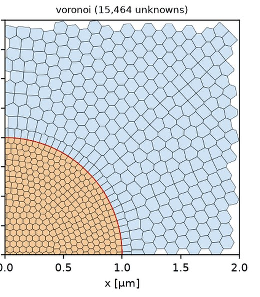</td>
<td valign="top">

- **Unstructured FIT on triangles and tetrahedra** (`wakis.unstructured`): Body-fitted meshes with circumcentric (Voronoi) dual. Graded triangle meshes and a radial CFS-PML (reflection 2–8×10⁻⁴). Exact discrete adjoint.
- **Local time stepping** (`UnstructuredFIT2D(lts=2)`): Two-level, energy-conserving subcycling in fine-mesh regions: about 2× fewer steps at unchanged error, exact adjoint.
- **Polygonal FIT** (`PolygonFIT2D`): Hybrid square/triangle and Voronoi meshes.
- **Quadtree squares + triangle band** (`wakis.unstructured.subtri`): Cartesian cells away from interfaces, a thin conforming triangle band at curved boundaries, two-level LTS. 5–7× less work than the best Cartesian baseline on the dielectric Mie benchmark.
- **Extruded prism 3D FIT** (`PrismFIT3D`): Triangles × z layers with GPU support: 15× fewer unknowns on a silicon micro-ring, 3–6× less work on a 3D cavity.
- **Cartesian subgridding** (`wakis.subgrid`): Nested 2:1 / 3:1 patches with a symmetric hanging-node interface: energy-conserving, second order, exact transposed step; works with subpixel averaging, PML, plane waves, Drude/Lorentz media and LTS.
- **Curvilinear O-grid FIT** (`wakis.curvilinear`): Body-fitted nonorthogonal 2D FIT with radial PML and dispersive media; fewest unknowns on round dielectric and plasmonic scatterers.
- **High-order DGTD on curved triangles** (`wakis.highorder`): 0.1 % accuracy with about 100× fewer unknowns than low-order FIT on smooth scatterers.
- **Conformal and subpixel averaging** (`conformal='tensor' / 'all'`): Cut-cell PEC, full-tensor subpixel averaging for curved dielectrics, and dispersive subpixel averaging for metals and dispersive dielectrics (passive network, exact adjoint).
- **Graded meshes and mesh overrides** (`PhotonicCircuit(mesh_overrides=…)`, `SubgridPhotonicCircuit`): Local refinement boxes on graded meshes and a photonic integrated circuit simulation kit (shapes, mode ports, monitors, LTS) on top of the subgrid solver.

</td></tr></table>

### 2 · Materials

<table><tr>
<td width="300" valign="top">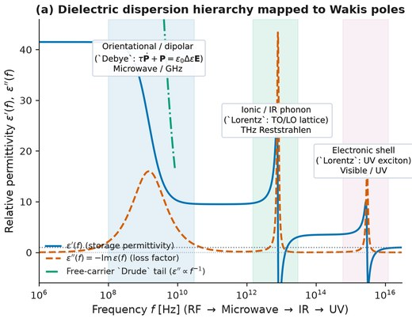</td>
<td valign="top">

- **Dispersive permittivity** (`DispersiveMaterial`): Drude, Lorentz and Debye media through auxiliary differential equations, with pole fitting to measured data and a stability check.
- **Dispersive permeability μ(ω)** (`mu_poles`): Magnetic Lorentz/Debye poles (ferrites, magneto-dielectrics), the exact dual of the permittivity update, with its exact adjoint. Validated on slabs, the Snoek limit and a magnon–photon cavity.
- **Materials library** (`wakis.material_library`): Metals, semiconductors, dielectrics and tissues fitted from the original literature and CC0 refractive-index data, each entry with its source citation; ferrite models for NFC shielding.
- **Thin sheets and thin wires** (`wakis.subcell`): Resistive and PEC sheets and wires thinner than a cell (graphene, resistive films, thin traces, wire antennas). Salisbury screen and wire resonance within 1 %, exact adjoint.
- **Linear plasma wakefields** (`wakis.plasma`): Wakefields in a plasma-filled pipe.
- **Gain media** (`wakis.gain`): Four-level atomic system coupled to the fields: lasing threshold, gain saturation and mode competition (a Fabry–Pérot laser is the first example); spontaneous-emission Langevin noise so lasers start from noise, and lifetime acceleration for slow upper-state lifetimes.
- **Semiconductor gain** (`wakis.gain_semiconductor`): Carrier-density gain with linewidth enhancement factor (chirp), validated on a Fabry–Pérot diode laser (relaxation-oscillation frequency against rate equations with a measured cold-cavity photon lifetime).
- **Kerr nonlinear media** (`wakis.nonlinear`): Sub-cycle χ⁽³⁾ Kerr and delayed Raman response in the time step, plus a FIT-informed Lugiato–Lefever solver for soliton microcombs (Tutorial 5.11).
- **Time-varying materials** (`wakis.time_varying`): ε(t), σ(t) and time-varying Drude media for time interfaces and photonic time crystals (Tutorial 2.5).

</td></tr></table>

### 3 · Sources and boundaries

<table><tr>
<td width="300" valign="top">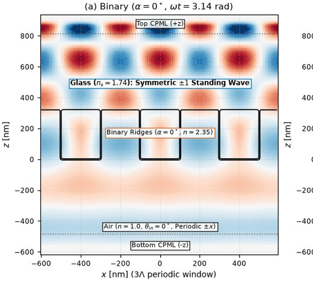</td>
<td valign="top">

- **Soft and magnetic current sources** (`CurrentSource`): Gaussian (zero-DC), continuous and custom profiles; magnetic currents and one-directional Huygens sources.
- **Total-field / scattered-field plane waves** (`TFSFSource`): Incident field from a 1D FIT line, leakage at round-off (10⁻¹⁵), 2D and 3D, CPU and GPU; a scattered-field variant for unstructured meshes.
- **Bloch-periodic boundaries** (`wakis.bloch`): Complex fields in unit cells, oblique plane waves at fixed transverse wavevector.
- **Triangular and honeycomb lattices** (`wakis.lattices`): Hexagonal crystals on Cartesian supercells, band unfolding, plane-wave reference bands and gauge-invariant Berry curvature (Tutorial 6.6).
- **Broadband oblique incidence and Floquet ports** (`wakis.floquet`): Constant-angle spectra from (k∥, f) sampling, Floquet-mode ports and S-matrices, and a built-in 1D RCWA reference; validated against Fresnel, Brewster, total internal reflection and fmmax.
- **Dispersion-free wake computation** (`scheme='tete'`): Explicit TE/TM stepping along the beam axis removes numerical Cherenkov radiation: smooth-pipe wake at round-off and 19× less work for a 1 % loss-factor error.
- **Incoherent emitters and reciprocity** (`wakis.subgrid.emitters`): Incoherent dipole ensembles, analytic dipole-above-mirror and slab references, and emission computed as absorption via Helmholtz reciprocity (LEDs, microLEDs).
- **Linearized electron beams** (`wakis.beam_fluid`): Cold-fluid beam coupled to the fields, space-charge reduction factors (planar, cylindrical, rectangular) and ballistic bunching for slow-wave-structure and TWT work.
- **Self-consistent particles** (`wakis.particles`): Electromagnetic particle-in-cell on the FIT grid: charge-conserving Esirkepov deposit (discrete Gauss law to 10⁻¹³), Boris, Vay and Higuera–Cary pushers, absorbing, PEC and collector boundaries, on CPU and GPU (CuPy kernels with no host synchronisation in the step), and on several GPUs or CPU ranks with MPI slab decomposition (GPU-to-GPU NCCL or pinned-host MPI transfers).

</td></tr></table>

### 4 · Ports, monitors and post-processing

<table><tr>
<td width="300" valign="top">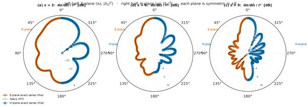</td>
<td valign="top">

- **Lumped elements and S-parameters** (`wakis.lumped, wakis.sparameters`): R/L/C elements, discrete ports, S-parameters, Touchstone export, energy-decay stopping.
- **Mode solver and mode ports** (`wakis.mode_solver`): 2D eigenmodes, mode sources and mode decomposition.
- **DFT, flux and diffraction monitors**: Frequency-domain fields, Poynting flux, and diffraction-order efficiencies (TE/TM/circular).
- **Near-to-far transform** (`wakis.near2far`): Far-field patterns and antenna metrics: directivity, gain, efficiency, axial ratio.
- **Resonances and Q** (`harminv, ResonanceMonitor`): Harmonic inversion for resonance frequencies and quality factors.
- **Benchmark suite** (`wakis.benchmarks`): Shared references B1–B5: dielectric Mie cylinder, Au/Ag nanocylinders, Au dimer gaps, multi-cylinder T-matrix, Hallén thin-wire dipole.

</td></tr></table>

### 5 · Inverse design

<table><tr>
<td width="300" valign="top"></td>
<td valign="top">

- **Exact discrete adjoint** (`wakis.inverse`): Gradients through the discrete time stepper to round-off (dot-product tests ~10⁻¹⁵), with a JAX wrapper, on CPU, GPU and MPI, for all features above.
- **Adjoint memory options** (`AdjointSimulation(memory=…)`): Binomial checkpointing (bitwise-equal gradients), time reversal with recorded boundary layers, optional Nyquist storage (after Park, Miller & Chung, [arXiv:2607.08159](https://arxiv.org/abs/2607.08159)): exact gradients in 30–60× less memory.
- **Material grids, filters and projections**: Density parameterization, conic filters, tanh projection and differentiable subpixel smoothing (MaterialGrid(smoothing='tensor')).
- **Subpixel-smoothed projection** (`wakis.inverse.smoothed_projection`): Binary designs that stay differentiable at β = ∞, evaluated per edge.
- **invrs-gym bridge** (`github.com/eshipton/invrs-wakis`): Runs the invrs-gym photonic design challenges with Wakis and scores them with the official evaluators. Our waveguide-bend and power-splitter designs score above the published leaderboard best at the required feature size.

This work builds on the adjoint inverse-design literature, and in particular on the work of Owen Miller's group at Yale ([millergroup.yale.edu](https://millergroup.yale.edu)): computational inverse design from fundamental physics ([Miller 2012](https://arxiv.org/abs/1308.0212)), adjoint shape optimization ([Lalau-Keraly et al. 2013](https://doi.org/10.1364/OE.21.021693)), inverse-designed high-NA achromatic metalenses ([Chung & Miller 2020](https://doi.org/10.1364/OE.385440)), computational bounds on what any design can reach ([Kuang & Miller 2020](https://doi.org/10.1103/PhysRevLett.125.263607)), the photonics inverse-design benchmarks that the invrs-gym metalens and metagrating challenges come from ([Chen et al. 2024](https://doi.org/10.1364/JOSAB.506412)), and memory-efficient Nyquist-sampled time-domain adjoints ([Park, Miller & Chung 2026](https://arxiv.org/abs/2607.08159)).

</td></tr></table>

### 6 · Performance and tooling

<table><tr>
<td width="300" valign="top">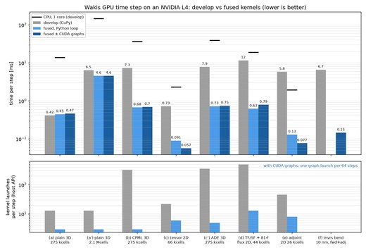</td>
<td valign="top">

- **Fused GPU time stepping** (`SolverFIT3D(use_gpu=True, fused=True)`): Step, CPML, sources, monitors, subpixel averaging, dispersive media and the adjoint in a few kernels replayed as CUDA graphs: 45× faster inverse-design iterations on an L4.
- **Faster core step**: Forward step about 2× faster on CPU and GPU; periodic setup 59 s → 0.02 s.
- **Memory and run-time estimator** (`wakis.estimate`): Predicts memory and time before a run, with a preflight check against the machine.
- **Design templates** (`wakis.templates`): Patch and dipole antennas, waveguides, metasurface cells, silicon photonics, with sweeps and optimizers.
- **Correctness fixes**: Second-order boundaries on non-uniform meshes, mixed PEC/PMC masks, tensor-update initialization, MPI fixes (CPML deadlock, rank-boundary sources and monitors).
- **Figure and schematic tools** (`wakis.figstyle`, `wakis.schematic`): A shared publication figure style and labelled simulation-setup schematics (geometry, sources, monitors, boundaries, mesh, excitation) drawn from the solver objects.

</td></tr></table>

### 7 · Next up

<table><tr>
<td width="300" valign="top">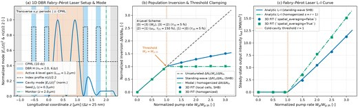</td>
<td valign="top">

- **Vacuum electronics**: folded-waveguide, helix, metamaterial and FSS slow-wave structures; traveling-wave-tube gain; backward-wave oscillators; a beam over a slow-wave structure.
- **Magnetic antennas**: magnetic antennas in cavities.
- **Particles at scale**: multi-node GPU runs, beam injection and emission, and large-signal tutorials: space-charge-limited diode, TWT saturation, metamaterial backward-wave oscillator, klystron, nonlinear plasma wakefields.

</td></tr></table>

**Upstream contributions.** Three fixes merged into CERN's Wakis (PR #109, mixed PEC/PMC masks; PR #110, a CPML + MPI deadlock; PR #112, the 3D wake-potential accumulator) and one under review (PR #111, tensor-update initialization), plus analysis and tests offered on PR #105 and issue #62.

## The tutorial textbook

61 tutorials in nine chapters, from fields on a grid to antennas, silicon photonics, light sources, vacuum
electronics and inverse design. Each one is a single-source script that generates its notebook and figures,
reproduces a publication or an exact result, and includes a resolution study. Open any of them in Colab with the
badge. Full chapter guides: [`tutorials/README.md`](tutorials/README.md); every tutorial, study and planned
example: [`EXAMPLES.md`](EXAMPLES.md).

### Chapter 1 · Fields on a Grid

[Chapter guide](tutorials/01_fields_on_a_grid/README.md)

<table>
<tr>
<td width="170" valign="top"><a href="tutorials/01_fields_on_a_grid/01-01_plane_wave/plane_wave.ipynb">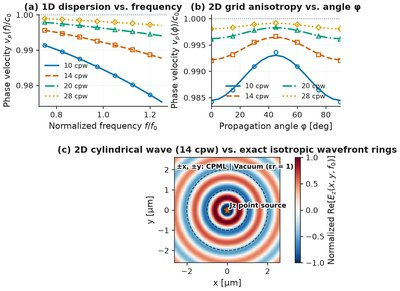</a></td><td width="300" valign="top"><b><a href="tutorials/01_fields_on_a_grid/01-01_plane_wave/plane_wave.ipynb">1.1 · Plane wave in a box</a></b><br><sub>Exact discrete Yee dispersion, Courant limit, TF/SF round-off leakage, CPML reflection</sub><br><a href="https://colab.research.google.com/github/eshipton/Wakis/blob/main/tutorials/01_fields_on_a_grid/01-01_plane_wave/plane_wave.ipynb"></a></td>
<td width="170" valign="top"><a href="tutorials/01_fields_on_a_grid/01-02_slab_rt/slab_rt.ipynb">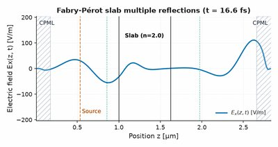</a></td><td width="300" valign="top"><b><a href="tutorials/01_fields_on_a_grid/01-02_slab_rt/slab_rt.ipynb">1.2 · Reflection and transmission at a slab</a></b><br><sub>Fresnel equations and the Fabry–Pérot transfer matrix; subpixel averaging</sub><br><a href="https://colab.research.google.com/github/eshipton/Wakis/blob/main/tutorials/01_fields_on_a_grid/01-02_slab_rt/slab_rt.ipynb"></a></td>
</tr>
</table>

### Chapter 2 · Materials

[Chapter guide](tutorials/02_materials/README.md)

<table>
<tr>
<td width="170" valign="top"><a href="tutorials/02_materials/02-01_dispersion_physics/dispersion_physics.ipynb">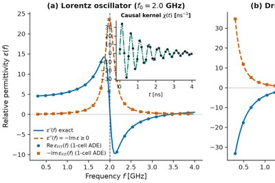</a></td><td width="300" valign="top"><b><a href="tutorials/02_materials/02-01_dispersion_physics/dispersion_physics.ipynb">2.1 · Where dispersion comes from</a></b><br><sub>Lorentz, Drude and Debye media; Kramers–Kronig, f-sum rule, ADE stability</sub><br><a href="https://colab.research.google.com/github/eshipton/Wakis/blob/main/tutorials/02_materials/02-01_dispersion_physics/dispersion_physics.ipynb"></a></td>
<td width="170" valign="top"><a href="tutorials/02_materials/02-02_fitting_measured_data/fitting_measured_data.ipynb">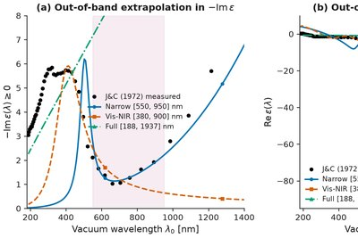</a></td><td width="300" valign="top"><b><a href="tutorials/02_materials/02-02_fitting_measured_data/fitting_measured_data.ipynb">2.2 · Fitting measured material data</a></b><br><sub>Multi-pole fits to Johnson &amp; Christy Au/Ag, Malitson SiO₂ and Gabriel tissues</sub><br><a href="https://colab.research.google.com/github/eshipton/Wakis/blob/main/tutorials/02_materials/02-02_fitting_measured_data/fitting_measured_data.ipynb"></a></td>
</tr>
<tr>
<td width="170" valign="top"><a href="tutorials/02_materials/02-03_magnetic_materials/magnetic_materials.ipynb">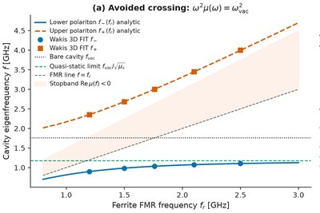</a></td><td width="300" valign="top"><b><a href="tutorials/02_materials/02-03_magnetic_materials/magnetic_materials.ipynb">2.3 · Magnetic materials</a></b><br><sub>Dispersive μ(ω): Snoek limit, impedance-matched slabs, magnon–photon avoided crossing</sub><br><a href="https://colab.research.google.com/github/eshipton/Wakis/blob/main/tutorials/02_materials/02-03_magnetic_materials/magnetic_materials.ipynb"></a></td>
<td width="170" valign="top"><a href="tutorials/02_materials/02-04_emi_shielding_materials/emi_shielding_materials.ipynb">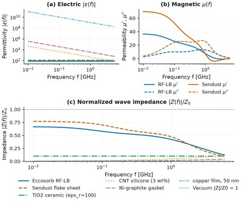</a></td><td width="300" valign="top"><b><a href="tutorials/02_materials/02-04_emi_shielding_materials/emi_shielding_materials.ipynb">2.4 · EMI shielding and absorbing materials</a></b><br><sub>Commercially available absorbers fitted from datasheet curves, Schelkunoff shielding, Rozanov limit</sub><br><a href="https://colab.research.google.com/github/eshipton/Wakis/blob/main/tutorials/02_materials/02-04_emi_shielding_materials/emi_shielding_materials.ipynb"></a></td>
</tr>
<tr>
<td width="170" valign="top"><a href="tutorials/02_materials/02-05_time_varying_media/time_varying_media.ipynb">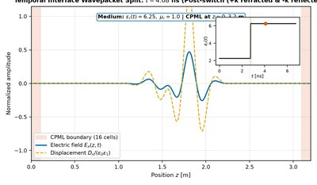</a></td><td width="300" valign="top"><b><a href="tutorials/02_materials/02-05_time_varying_media/time_varying_media.ipynb">2.5 · Time interfaces and photonic time crystals</a></b><br><sub>Temporal Fresnel laws, momentum gaps and growth rate m/8</sub><br><a href="https://colab.research.google.com/github/eshipton/Wakis/blob/main/tutorials/02_materials/02-05_time_varying_media/time_varying_media.ipynb"></a></td>
</tr>
</table>

### Chapter 3 · Diffraction and Scattering

[Chapter guide](tutorials/03_diffraction_and_scattering/README.md)

<table>
<tr>
<td width="170" valign="top"><a href="tutorials/03_diffraction_and_scattering/03-01_single_slit/single_slit.ipynb">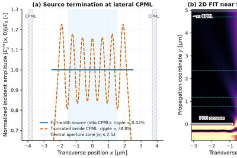</a></td><td width="300" valign="top"><b><a href="tutorials/03_diffraction_and_scattering/03-01_single_slit/single_slit.ipynb">3.1 · Diffraction by a single slit</a></b><br><sub>Fresnel near field, Fraunhofer far field, vectorial polarization effects</sub><br><a href="https://colab.research.google.com/github/eshipton/Wakis/blob/main/tutorials/03_diffraction_and_scattering/03-01_single_slit/single_slit.ipynb"></a></td>
<td width="170" valign="top"><a href="tutorials/03_diffraction_and_scattering/03-02_double_slit/double_slit.ipynb">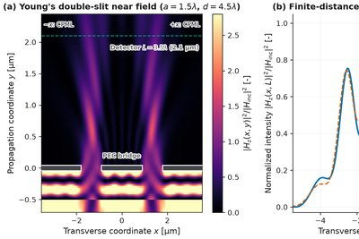</a></td><td width="300" valign="top"><b><a href="tutorials/03_diffraction_and_scattering/03-02_double_slit/double_slit.ipynb">3.2 · Young&#x27;s double slit</a></b><br><sub>Interference × envelope, missing orders, inter-slit coupling</sub><br><a href="https://colab.research.google.com/github/eshipton/Wakis/blob/main/tutorials/03_diffraction_and_scattering/03-02_double_slit/double_slit.ipynb"></a></td>
</tr>
<tr>
<td width="170" valign="top"><a href="tutorials/03_diffraction_and_scattering/03-03_n_slits/n_slits.ipynb">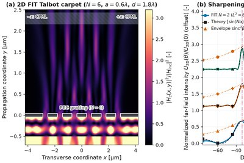</a></td><td width="300" valign="top"><b><a href="tutorials/03_diffraction_and_scattering/03-03_n_slits/n_slits.ipynb">3.3 · N-slit diffraction gratings</a></b><br><sub>Principal maxima, N−2 sidelobes, resolving power, periodic vs finite N</sub><br><a href="https://colab.research.google.com/github/eshipton/Wakis/blob/main/tutorials/03_diffraction_and_scattering/03-03_n_slits/n_slits.ipynb"></a></td>
<td width="170" valign="top"><a href="tutorials/03_diffraction_and_scattering/03-04_mie_cylinder/mie_cylinder.ipynb">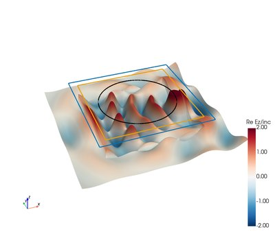</a></td><td width="300" valign="top"><b><a href="tutorials/03_diffraction_and_scattering/03-04_mie_cylinder/mie_cylinder.ipynb">3.4 · Mie scattering by a dielectric cylinder (2D)</a></b><br><sub>Exact Mie series: staircase vs conformal vs triangle meshes</sub><br><a href="https://colab.research.google.com/github/eshipton/Wakis/blob/main/tutorials/03_diffraction_and_scattering/03-04_mie_cylinder/mie_cylinder.ipynb"></a></td>
</tr>
<tr>
<td width="170" valign="top"><a href="tutorials/03_diffraction_and_scattering/03-05_mie_sphere/mie_sphere.ipynb">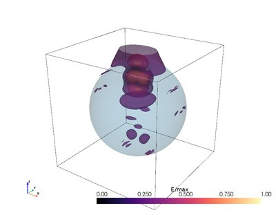</a></td><td width="300" valign="top"><b><a href="tutorials/03_diffraction_and_scattering/03-05_mie_sphere/mie_sphere.ipynb">3.5 · Mie scattering by a sphere (3D)</a></b><br><sub>Lorenz–Mie S₁/S₂ and Q_sca with the near-to-far-field transform</sub><br><a href="https://colab.research.google.com/github/eshipton/Wakis/blob/main/tutorials/03_diffraction_and_scattering/03-05_mie_sphere/mie_sphere.ipynb"></a></td>
<td width="170" valign="top"><a href="tutorials/03_diffraction_and_scattering/03-06_plasmonic_cylinder/plasmonic_cylinder.ipynb">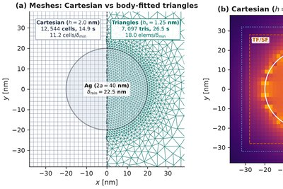</a></td><td width="300" valign="top"><b><a href="tutorials/03_diffraction_and_scattering/03-06_plasmonic_cylinder/plasmonic_cylinder.ipynb">3.6 · Localized surface plasmons of a metal cylinder</a></b><br><sub>Mie series for Drude–Lorentz Ag/Au; body-fitted triangles</sub><br><a href="https://colab.research.google.com/github/eshipton/Wakis/blob/main/tutorials/03_diffraction_and_scattering/03-06_plasmonic_cylinder/plasmonic_cylinder.ipynb"></a></td>
</tr>
</table>

### Chapter 4 · Radiation and Antennas

[Chapter guide](tutorials/04_radiation_and_antennas/README.md)

<table>
<tr>
<td width="170" valign="top"><a href="tutorials/04_radiation_and_antennas/04-01_point_dipole/point_dipole.ipynb">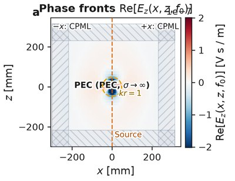</a></td><td width="300" valign="top"><b><a href="tutorials/04_radiation_and_antennas/04-01_point_dipole/point_dipole.ipynb">4.1 · Point (Hertzian) dipole in 3D</a></b><br><sub>Near, intermediate and far zones; radiation resistance; directivity 1.5</sub><br><a href="https://colab.research.google.com/github/eshipton/Wakis/blob/main/tutorials/04_radiation_and_antennas/04-01_point_dipole/point_dipole.ipynb"></a></td>
<td width="170" valign="top"><a href="tutorials/04_radiation_and_antennas/04-02_wire_dipoles/wire_dipoles.ipynb">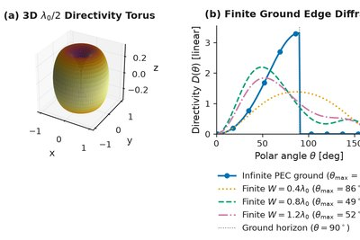</a></td><td width="300" valign="top"><b><a href="tutorials/04_radiation_and_antennas/04-02_wire_dipoles/wire_dipoles.ipynb">4.2 · Half-wave dipole and quarter-wave monopole</a></b><br><sub>Balanis impedance and pattern, image theory, thin-wire subcell model</sub><br><a href="https://colab.research.google.com/github/eshipton/Wakis/blob/main/tutorials/04_radiation_and_antennas/04-02_wire_dipoles/wire_dipoles.ipynb"></a></td>
</tr>
<tr>
<td width="170" valign="top"><a href="tutorials/04_radiation_and_antennas/04-03_dipole_near_mirror/dipole_near_mirror.ipynb">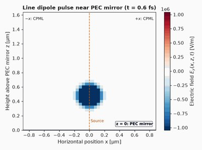</a></td><td width="300" valign="top"><b><a href="tutorials/04_radiation_and_antennas/04-03_dipole_near_mirror/dipole_near_mirror.ipynb">4.3 · Dipole near a mirror</a></b><br><sub>Drexhage oscillation, Purcell factor, exact Sommerfeld integral for silver</sub><br><a href="https://colab.research.google.com/github/eshipton/Wakis/blob/main/tutorials/04_radiation_and_antennas/04-03_dipole_near_mirror/dipole_near_mirror.ipynb"></a></td>
<td width="170" valign="top"><a href="tutorials/04_radiation_and_antennas/04-04_pcb_ifa_2g4/pcb_ifa_2g4.ipynb">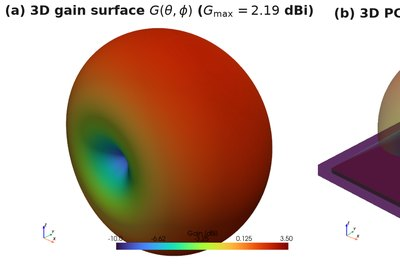</a></td><td width="300" valign="top"><b><a href="tutorials/04_radiation_and_antennas/04-04_pcb_ifa_2g4/pcb_ifa_2g4.ipynb">4.4 · 2.4 GHz printed inverted-F antenna</a></b><br><sub>Texas Instruments DN007: S₁₁, impedance, 3D gain, Wheeler–Chu limit</sub><br><a href="https://colab.research.google.com/github/eshipton/Wakis/blob/main/tutorials/04_radiation_and_antennas/04-04_pcb_ifa_2g4/pcb_ifa_2g4.ipynb"></a></td>
</tr>
<tr>
<td width="170" valign="top"><a href="tutorials/04_radiation_and_antennas/04-05_radar_patch_array_77g/radar_patch_array_77g.ipynb">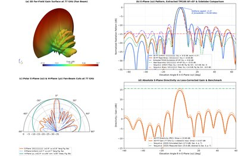</a></td><td width="300" valign="top"><b><a href="tutorials/04_radiation_and_antennas/04-05_radar_patch_array_77g/radar_patch_array_77g.ipynb">4.5 · 77 GHz series-fed patch array</a></b><br><sub>Yang et al. 2020 automotive radar array: gain and sidelobes</sub><br><a href="https://colab.research.google.com/github/eshipton/Wakis/blob/main/tutorials/04_radiation_and_antennas/04-05_radar_patch_array_77g/radar_patch_array_77g.ipynb"></a></td>
<td width="170" valign="top"><a href="tutorials/04_radiation_and_antennas/04-06_nfc_coils/nfc_coils.ipynb">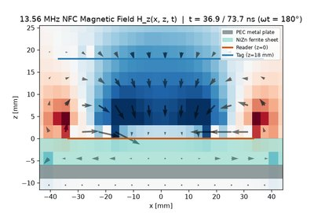</a></td><td width="300" valign="top"><b><a href="tutorials/04_radiation_and_antennas/04-06_nfc_coils/nfc_coils.ipynb">4.6 · NFC reader and tag coils at 13.56 MHz</a></b><br><sub>Wheeler/Grover inductance, Neumann mutual inductance, ferrite shielding</sub><br><a href="https://colab.research.google.com/github/eshipton/Wakis/blob/main/tutorials/04_radiation_and_antennas/04-06_nfc_coils/nfc_coils.ipynb"></a></td>
</tr>
<tr>
<td width="170" valign="top"><a href="tutorials/04_radiation_and_antennas/04-07_magnetic_toroid/magnetic_toroid.ipynb">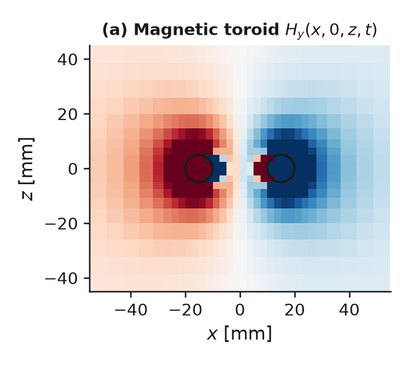</a></td><td width="300" valign="top"><b><a href="tutorials/04_radiation_and_antennas/04-07_magnetic_toroid/magnetic_toroid.ipynb">4.7 · The magnetic toroid</a></b><br><sub>A closed magnetization loop radiates as an axial electric dipole; Marinov compensation, octupole correction</sub><br><a href="https://colab.research.google.com/github/eshipton/Wakis/blob/main/tutorials/04_radiation_and_antennas/04-07_magnetic_toroid/magnetic_toroid.ipynb"></a></td>
<td width="170" valign="top"><a href="tutorials/04_radiation_and_antennas/04-08_magnetic_antenna_ground/magnetic_antenna_ground.ipynb">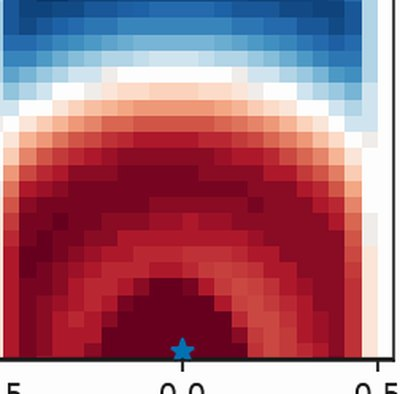</a></td><td width="300" valign="top"><b><a href="tutorials/04_radiation_and_antennas/04-08_magnetic_antenna_ground/magnetic_antenna_ground.ipynb">4.8 · Magnetic antennas on and near a ground plane</a></b><br><sub>Image theory, +3 dB over PEC, efficiency below the magneto-dielectric bound</sub><br><a href="https://colab.research.google.com/github/eshipton/Wakis/blob/main/tutorials/04_radiation_and_antennas/04-08_magnetic_antenna_ground/magnetic_antenna_ground.ipynb"></a></td>
</tr>
<tr>
<td width="170" valign="top"><a href="tutorials/04_radiation_and_antennas/04-09_implant_antennas_tissue/implant_antennas_tissue.ipynb">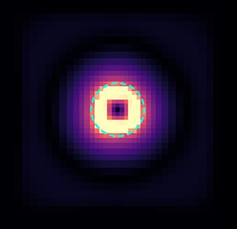</a></td><td width="300" valign="top"><b><a href="tutorials/04_radiation_and_antennas/04-09_implant_antennas_tissue/implant_antennas_tissue.ipynb">4.9 · Electric vs magnetic implant antennas in tissue</a></b><br><sub>Near-zone loss, Li et al. efficiency bounds, ferrite cores</sub><br><a href="https://colab.research.google.com/github/eshipton/Wakis/blob/main/tutorials/04_radiation_and_antennas/04-09_implant_antennas_tissue/implant_antennas_tissue.ipynb"></a></td>
</tr>
</table>

### Chapter 5 · Guided Waves

[Chapter guide](tutorials/05_guided_waves/README.md)

<table>
<tr>
<td width="170" valign="top"><a href="tutorials/05_guided_waves/05-01_y_junction/y_junction.ipynb">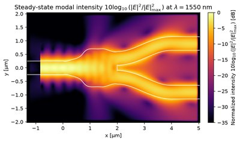</a></td><td width="300" valign="top"><b><a href="tutorials/05_guided_waves/05-01_y_junction/y_junction.ipynb">5.1 · Y-junction power splitter</a></b><br><sub>Zhang et al. 2013; independent 56-cells-per-wavelength reference</sub><br><a href="https://colab.research.google.com/github/eshipton/Wakis/blob/main/tutorials/05_guided_waves/05-01_y_junction/y_junction.ipynb"></a></td>
<td width="170" valign="top"><a href="tutorials/05_guided_waves/05-02_euler_bend/euler_bend.ipynb">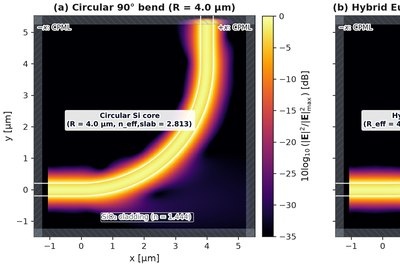</a></td><td width="300" valign="top"><b><a href="tutorials/05_guided_waves/05-02_euler_bend/euler_bend.ipynb">5.2 · Euler waveguide bend</a></b><br><sub>Bend loss vs radius, Euler vs circular</sub><br><a href="https://colab.research.google.com/github/eshipton/Wakis/blob/main/tutorials/05_guided_waves/05-02_euler_bend/euler_bend.ipynb"></a></td>
</tr>
<tr>
<td width="170" valign="top"><a href="tutorials/05_guided_waves/05-03_size_converter/size_converter.ipynb">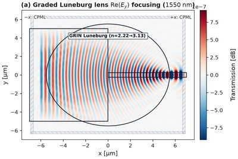</a></td><td width="300" valign="top"><b><a href="tutorials/05_guided_waves/05-03_size_converter/size_converter.ipynb">5.3 · Mode size converters</a></b><br><sub>Tapers, Luneburg lens and semi-lens; TE₀ transmission vs 3D FDTD</sub><br><a href="https://colab.research.google.com/github/eshipton/Wakis/blob/main/tutorials/05_guided_waves/05-03_size_converter/size_converter.ipynb"></a></td>
<td width="170" valign="top"><a href="tutorials/05_guided_waves/05-04_strip_to_slot/strip_to_slot.ipynb">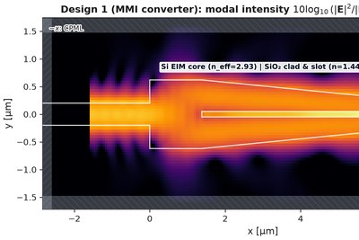</a></td><td width="300" valign="top"><b><a href="tutorials/05_guided_waves/05-04_strip_to_slot/strip_to_slot.ipynb">5.4 · Strip-to-slot mode converters</a></b><br><sub>Subpixel averaging vs staircase on a 100 nm slot</sub><br><a href="https://colab.research.google.com/github/eshipton/Wakis/blob/main/tutorials/05_guided_waves/05-04_strip_to_slot/strip_to_slot.ipynb"></a></td>
</tr>
<tr>
<td width="170" valign="top"><a href="tutorials/05_guided_waves/05-05_crossing/crossing.ipynb">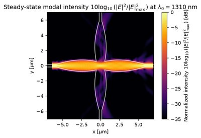</a></td><td width="300" valign="top"><b><a href="tutorials/05_guided_waves/05-05_crossing/crossing.ipynb">5.5 · Waveguide crossing</a></b><br><sub>Cosine tapers: 0.19 dB insertion loss, −44 dB crosstalk</sub><br><a href="https://colab.research.google.com/github/eshipton/Wakis/blob/main/tutorials/05_guided_waves/05-05_crossing/crossing.ipynb"></a></td>
<td width="170" valign="top"><a href="tutorials/05_guided_waves/05-06_mmi_1x4/mmi_1x4.ipynb">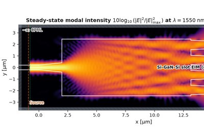</a></td><td width="300" valign="top"><b><a href="tutorials/05_guided_waves/05-06_mmi_1x4/mmi_1x4.ipynb">5.6 · 1×4 MMI power splitter</a></b><br><sub>Self-imaging; 0.47 dB excess loss; width × length sweep</sub><br><a href="https://colab.research.google.com/github/eshipton/Wakis/blob/main/tutorials/05_guided_waves/05-06_mmi_1x4/mmi_1x4.ipynb"></a></td>
</tr>
<tr>
<td width="170" valign="top"><a href="tutorials/05_guided_waves/05-07_mmi_2x2/mmi_2x2.ipynb">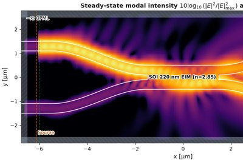</a></td><td width="300" valign="top"><b><a href="tutorials/05_guided_waves/05-07_mmi_2x2/mmi_2x2.ipynb">5.7 · 2×2 MMI coupler</a></b><br><sub>Splitting ratio and 90° phase</sub><br><a href="https://colab.research.google.com/github/eshipton/Wakis/blob/main/tutorials/05_guided_waves/05-07_mmi_2x2/mmi_2x2.ipynb"></a></td>
<td width="170" valign="top"><a href="tutorials/05_guided_waves/05-08_directional_coupler/directional_coupler.ipynb">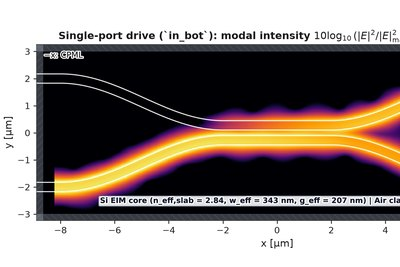</a></td><td width="300" valign="top"><b><a href="tutorials/05_guided_waves/05-08_directional_coupler/directional_coupler.ipynb">5.8 · Directional coupler</a></b><br><sub>Supermode beating vs coupled-mode theory; sidewall-angle sensitivity</sub><br><a href="https://colab.research.google.com/github/eshipton/Wakis/blob/main/tutorials/05_guided_waves/05-08_directional_coupler/directional_coupler.ipynb"></a></td>
</tr>
<tr>
<td width="170" valign="top"><a href="tutorials/05_guided_waves/05-09_ring_coupling/ring_coupling.ipynb">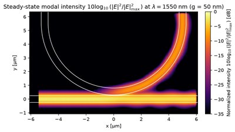</a></td><td width="300" valign="top"><b><a href="tutorials/05_guided_waves/05-09_ring_coupling/ring_coupling.ipynb">5.9 · Waveguide-to-ring point coupler</a></b><br><sub>Coupling vs gap against coupled-mode theory</sub><br><a href="https://colab.research.google.com/github/eshipton/Wakis/blob/main/tutorials/05_guided_waves/05-09_ring_coupling/ring_coupling.ipynb"></a></td>
<td width="170" valign="top"><a href="tutorials/05_guided_waves/05-10_ring_add_drop/ring_add_drop.ipynb">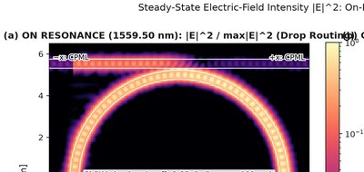</a></td><td width="300" valign="top"><b><a href="tutorials/05_guided_waves/05-10_ring_add_drop/ring_add_drop.ipynb">5.10 · Microring add-drop filter</a></b><br><sub>FSR, loaded Q and gap sweep vs coupled-mode theory</sub><br><a href="https://colab.research.google.com/github/eshipton/Wakis/blob/main/tutorials/05_guided_waves/05-10_ring_add_drop/ring_add_drop.ipynb"></a></td>
</tr>
<tr>
<td width="170" valign="top"><a href="tutorials/05_guided_waves/05-11_kerr_microcomb/kerr_microcomb.ipynb">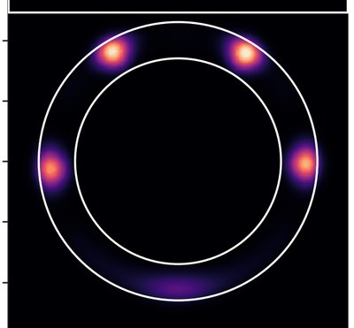</a></td><td width="300" valign="top"><b><a href="tutorials/05_guided_waves/05-11_kerr_microcomb/kerr_microcomb.ipynb">5.11 · Kerr nonlinear media and soliton microcombs</a></b><br><sub>χ⁽³⁾ in FIT; Bessel WGM dispersion; FIT-informed LLE</sub><br><a href="https://colab.research.google.com/github/eshipton/Wakis/blob/main/tutorials/05_guided_waves/05-11_kerr_microcomb/kerr_microcomb.ipynb"></a></td>
</tr>
</table>

*Planned:* Grating couplers, polarization devices, (de)multiplexers and more splitters and couplers (catalogue in [EXAMPLES.md](EXAMPLES.md)).

### Chapter 6 · Periodic Structures

[Chapter guide](tutorials/06_periodic_structures/README.md)

<table>
<tr>
<td width="170" valign="top"><a href="tutorials/06_periodic_structures/06-01_bragg_grating/bragg_grating.ipynb">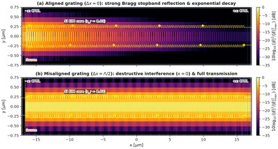</a></td><td width="300" valign="top"><b><a href="tutorials/06_periodic_structures/06-01_bragg_grating/bragg_grating.ipynb">6.1 · Waveguide Bragg grating</a></b><br><sub>Bragg wavelength convergence, coupled-mode theory, apodization</sub><br><a href="https://colab.research.google.com/github/eshipton/Wakis/blob/main/tutorials/06_periodic_structures/06-01_bragg_grating/bragg_grating.ipynb"></a></td>
<td width="170" valign="top"><a href="tutorials/06_periodic_structures/06-02_sws_cold_test/sws_cold_test.ipynb">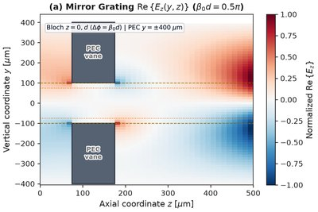</a></td><td width="300" valign="top"><b><a href="tutorials/06_periodic_structures/06-02_sws_cold_test/sws_cold_test.ipynb">6.2 · Slow-wave structure cold test</a></b><br><sub>Corrugated and glide-symmetric waveguides: dispersion, Pierce impedance</sub><br><a href="https://colab.research.google.com/github/eshipton/Wakis/blob/main/tutorials/06_periodic_structures/06-02_sws_cold_test/sws_cold_test.ipynb"></a></td>
</tr>
<tr>
<td width="170" valign="top"><a href="tutorials/06_periodic_structures/06-03_quasi_bic_metasurface/quasi_bic_metasurface.ipynb">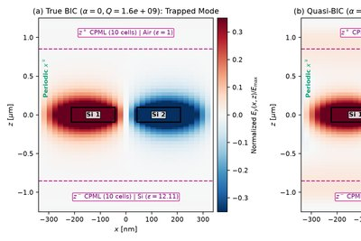</a></td><td width="300" valign="top"><b><a href="tutorials/06_periodic_structures/06-03_quasi_bic_metasurface/quasi_bic_metasurface.ipynb">6.3 · Quasi-bound states in the continuum</a></b><br><sub>Metasurface Q ∝ α⁻², Fano spectra, absorption-limited Q</sub><br><a href="https://colab.research.google.com/github/eshipton/Wakis/blob/main/tutorials/06_periodic_structures/06-03_quasi_bic_metasurface/quasi_bic_metasurface.ipynb"></a></td>
<td width="170" valign="top"><a href="tutorials/06_periodic_structures/06-04_ar_waveguide_combiner/ar_waveguide_combiner.ipynb">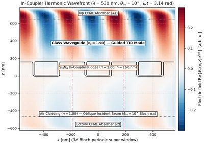</a></td><td width="300" valign="top"><b><a href="tutorials/06_periodic_structures/06-04_ar_waveguide_combiner/ar_waveguide_combiner.ipynb">6.4 · AR waveguide combiner</a></b><br><sub>k-space map, field-of-view limits, RGB in-coupler efficiencies</sub><br><a href="https://colab.research.google.com/github/eshipton/Wakis/blob/main/tutorials/06_periodic_structures/06-04_ar_waveguide_combiner/ar_waveguide_combiner.ipynb"></a></td>
</tr>
<tr>
<td width="170" valign="top"><a href="tutorials/06_periodic_structures/06-05_slanted_grating_coupler/slanted_grating_coupler.ipynb">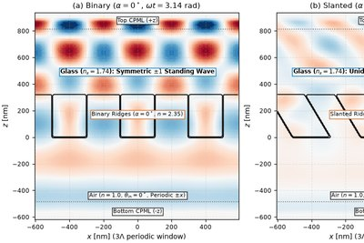</a></td><td width="300" valign="top"><b><a href="tutorials/06_periodic_structures/06-05_slanted_grating_coupler/slanted_grating_coupler.ipynb">6.5 · Slanted and blazed in-coupler gratings</a></b><br><sub>Unidirectional coupling; conformal subpixel meshing vs staircase</sub><br><a href="https://colab.research.google.com/github/eshipton/Wakis/blob/main/tutorials/06_periodic_structures/06-05_slanted_grating_coupler/slanted_grating_coupler.ipynb"></a></td>
<td width="170" valign="top"><a href="tutorials/06_periodic_structures/06-06_valley_hall_edge_states/valley_hall_edge_states.ipynb">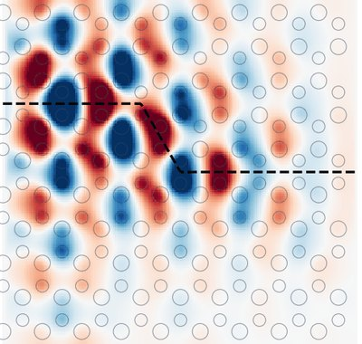</a></td><td width="300" valign="top"><b><a href="tutorials/06_periodic_structures/06-06_valley_hall_edge_states/valley_hall_edge_states.ipynb">6.6 · Valley-Hall photonic crystal and edge states</a></b><br><sub>Valley Chern number from FIT fields vs PWE; Z-bend</sub><br><a href="https://colab.research.google.com/github/eshipton/Wakis/blob/main/tutorials/06_periodic_structures/06-06_valley_hall_edge_states/valley_hall_edge_states.ipynb"></a></td>
</tr>
</table>

*Planned:* Diffraction gratings with periodic boundaries, photonic crystals, metasurfaces.

### Chapter 7 · Light Sources

[Chapter guide](tutorials/07_light_sources/README.md)

<table>
<tr>
<td width="170" valign="top"><a href="tutorials/07_light_sources/07-01_planar_led/planar_led.ipynb">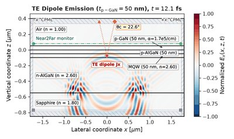</a></td><td width="300" valign="top"><b><a href="tutorials/07_light_sources/07-01_planar_led/planar_led.ipynb">7.1 · Planar deep-UV LED</a></b><br><sub>Ryu et al. 2014; analytic escape cone; TE vs TM dipoles</sub><br><a href="https://colab.research.google.com/github/eshipton/Wakis/blob/main/tutorials/07_light_sources/07-01_planar_led/planar_led.ipynb"></a></td>
<td width="170" valign="top"><a href="tutorials/07_light_sources/07-02_sled_tilted_facet/sled_tilted_facet.ipynb">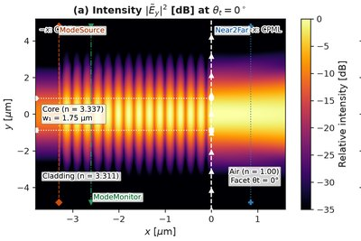</a></td><td width="300" valign="top"><b><a href="tutorials/07_light_sources/07-02_sled_tilted_facet/sled_tilted_facet.ipynb">7.2 · Superluminescent diode tilted facet</a></b><br><sub>Marcuse 1989 residual reflectivity; exact slab overlap</sub><br><a href="https://colab.research.google.com/github/eshipton/Wakis/blob/main/tutorials/07_light_sources/07-02_sled_tilted_facet/sled_tilted_facet.ipynb"></a></td>
</tr>
<tr>
<td width="170" valign="top"><a href="tutorials/07_light_sources/07-03_microled_horn/microled_horn.ipynb">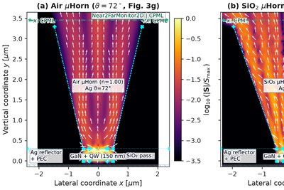</a></td><td width="300" valign="top"><b><a href="tutorials/07_light_sources/07-03_microled_horn/microled_horn.ipynb">7.3 · MicroLED with a graded-index micro-horn</a></b><br><sub>Luce et al. 2026 collimation and far field</sub><br><a href="https://colab.research.google.com/github/eshipton/Wakis/blob/main/tutorials/07_light_sources/07-03_microled_horn/microled_horn.ipynb"></a></td>
<td width="170" valign="top"><a href="tutorials/07_light_sources/07-04_rgb_microled_array/rgb_microled_array.ipynb">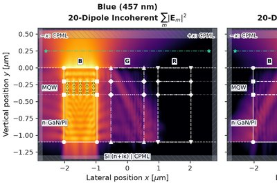</a></td><td width="300" valign="top"><b><a href="tutorials/07_light_sources/07-04_rgb_microled_array/rgb_microled_array.ipynb">7.4 · RGB microLED array</a></b><br><sub>Chen et al. 2025: incoherent averaging, collimation and crosstalk</sub><br><a href="https://colab.research.google.com/github/eshipton/Wakis/blob/main/tutorials/07_light_sources/07-04_rgb_microled_array/rgb_microled_array.ipynb"></a></td>
</tr>
<tr>
<td width="170" valign="top"><a href="tutorials/07_light_sources/07-05_partial_coherence_double_slit/partial_coherence_double_slit.ipynb">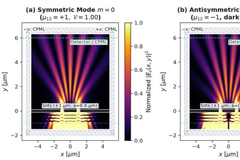</a></td><td width="300" valign="top"><b><a href="tutorials/07_light_sources/07-05_partial_coherence_double_slit/partial_coherence_double_slit.ipynb">7.5 · Partially coherent light through a double slit</a></b><br><sub>van Cittert–Zernike, Gaussian Schell model, temporal coherence</sub><br><a href="https://colab.research.google.com/github/eshipton/Wakis/blob/main/tutorials/07_light_sources/07-05_partial_coherence_double_slit/partial_coherence_double_slit.ipynb"></a></td>
<td width="170" valign="top"><a href="tutorials/07_light_sources/07-06_led_reciprocity/led_reciprocity.ipynb"></a></td><td width="300" valign="top"><b><a href="tutorials/07_light_sources/07-06_led_reciprocity/led_reciprocity.ipynb">7.6 · Thin-film LED emission by Helmholtz reciprocity</a></b><br><sub>Direct dipole sum (0.07 %), transfer matrix, Janssen et al.</sub><br><a href="https://colab.research.google.com/github/eshipton/Wakis/blob/main/tutorials/07_light_sources/07-06_led_reciprocity/led_reciprocity.ipynb"></a></td>
</tr>
<tr>
<td width="170" valign="top"><a href="tutorials/07_light_sources/07-07_dfb_laser/dfb_laser.ipynb"></a></td><td width="300" valign="top"><b><a href="tutorials/07_light_sources/07-07_dfb_laser/dfb_laser.ipynb">7.7 · DFB laser with a quarter-wave phase shift</a></b><br><sub>Kogelnik–Shank coupled-wave thresholds; lasing from noise</sub><br><a href="https://colab.research.google.com/github/eshipton/Wakis/blob/main/tutorials/07_light_sources/07-07_dfb_laser/dfb_laser.ipynb"></a></td>
<td width="170" valign="top"><a href="tutorials/07_light_sources/07-08_microdisk_laser/microdisk_laser.ipynb"></a></td><td width="300" valign="top"><b><a href="tutorials/07_light_sources/07-08_microdisk_laser/microdisk_laser.ipynb">7.8 · Microdisk whispering-gallery laser</a></b><br><sub>Bessel/Hankel WGM roots; clamping and hole burning</sub><br><a href="https://colab.research.google.com/github/eshipton/Wakis/blob/main/tutorials/07_light_sources/07-08_microdisk_laser/microdisk_laser.ipynb"></a></td>
</tr>
<tr>
<td width="170" valign="top"><a href="tutorials/07_light_sources/07-09_bic_laser/bic_laser.ipynb"></a></td><td width="300" valign="top"><b><a href="tutorials/07_light_sources/07-09_bic_laser/bic_laser.ipynb">7.9 · Lasing from a bound state in the continuum</a></b><br><sub>Q ∝ k⁻² near Γ; polarization vortex; doughnut beam</sub><br><a href="https://colab.research.google.com/github/eshipton/Wakis/blob/main/tutorials/07_light_sources/07-09_bic_laser/bic_laser.ipynb"></a></td>
<td width="170" valign="top"><a href="tutorials/07_light_sources/07-10_pcsel/pcsel.ipynb"></a></td><td width="300" valign="top"><b><a href="tutorials/07_light_sources/07-10_pcsel/pcsel.ipynb">7.10 · Photonic-crystal surface-emitting laser</a></b><br><sub>3D FIT band-edge modes vs coupled-wave theory</sub><br><a href="https://colab.research.google.com/github/eshipton/Wakis/blob/main/tutorials/07_light_sources/07-10_pcsel/pcsel.ipynb"></a></td>
</tr>
</table>


### Chapter 8 · Vacuum Electronics

[Chapter guide](tutorials/08_vacuum_electronics/README.md)

<table>
<tr>
<td width="170" valign="top"><a href="tutorials/08_vacuum_electronics/08-01_space_charge_waves/space_charge_waves.ipynb"></a></td><td width="300" valign="top"><b><a href="tutorials/08_vacuum_electronics/08-01_space_charge_waves/space_charge_waves.ipynb">8.1 · Space-charge waves on an electron beam</a></b><br><sub>Fast/slow waves, plasma-frequency reduction, Chu kinetic power</sub><br><a href="https://colab.research.google.com/github/eshipton/Wakis/blob/main/tutorials/08_vacuum_electronics/08-01_space_charge_waves/space_charge_waves.ipynb"></a></td>
<td width="170" valign="top"><a href="tutorials/08_vacuum_electronics/08-02_cherenkov_radiation/cherenkov_radiation.ipynb"></a></td><td width="300" valign="top"><b><a href="tutorials/08_vacuum_electronics/08-02_cherenkov_radiation/cherenkov_radiation.ipynb">8.2 · Cherenkov radiation from a moving charge</a></b><br><sub>Cone angle cos θ = 1/βn, Frank–Tamm spectrum, numerical Cherenkov</sub><br><a href="https://colab.research.google.com/github/eshipton/Wakis/blob/main/tutorials/08_vacuum_electronics/08-02_cherenkov_radiation/cherenkov_radiation.ipynb"></a></td>
</tr>
<tr>
<td width="170" valign="top"><a href="tutorials/08_vacuum_electronics/08-03_vacuum_laser_acceleration/vacuum_laser_acceleration.ipynb"></a></td><td width="300" valign="top"><b><a href="tutorials/08_vacuum_electronics/08-03_vacuum_laser_acceleration/vacuum_laser_acceleration.ipynb">8.3 · Laser acceleration of electrons in vacuum</a></b><br><sub>Lawson–Woodward theorem, Huang–Stupakov–Zolotorev screen, attosecond bunches</sub><br><a href="https://colab.research.google.com/github/eshipton/Wakis/blob/main/tutorials/08_vacuum_electronics/08-03_vacuum_laser_acceleration/vacuum_laser_acceleration.ipynb"></a></td>
<td width="170" valign="top"><a href="tutorials/08_vacuum_electronics/08-04_smith_purcell_dla/smith_purcell_dla.ipynb"></a></td><td width="300" valign="top"><b><a href="tutorials/08_vacuum_electronics/08-04_smith_purcell_dla/smith_purcell_dla.ipynb">8.4 · Smith–Purcell radiation and the DLA grating</a></b><br><sub>Smith–Purcell dispersion; Peralta et al. 2013 dielectric laser accelerator</sub><br><a href="https://colab.research.google.com/github/eshipton/Wakis/blob/main/tutorials/08_vacuum_electronics/08-04_smith_purcell_dla/smith_purcell_dla.ipynb"></a></td>
</tr>
<tr>
<td width="170" valign="top"><a href="tutorials/08_vacuum_electronics/08-05_bunch_through_sws/bunch_through_sws.ipynb"></a></td><td width="300" valign="top"><b><a href="tutorials/08_vacuum_electronics/08-05_bunch_through_sws/bunch_through_sws.ipynb">8.5 · Electron bunch through a slow-wave structure</a></b><br><sub>Beam–wave impedance vs Pierce K; L² scaling</sub><br><a href="https://colab.research.google.com/github/eshipton/Wakis/blob/main/tutorials/08_vacuum_electronics/08-05_bunch_through_sws/bunch_through_sws.ipynb"></a></td>
<td width="170" valign="top"><a href="tutorials/08_vacuum_electronics/08-06_twt_small_signal_gain/twt_small_signal_gain.ipynb"></a></td><td width="300" valign="top"><b><a href="tutorials/08_vacuum_electronics/08-06_twt_small_signal_gain/twt_small_signal_gain.ipynb">8.6 · Traveling-wave-tube small-signal gain</a></b><br><sub>Pierce theory vs FIT hot tests with a linearized beam</sub><br><a href="https://colab.research.google.com/github/eshipton/Wakis/blob/main/tutorials/08_vacuum_electronics/08-06_twt_small_signal_gain/twt_small_signal_gain.ipynb"></a></td>
</tr>
<tr>
<td width="170" valign="top"><a href="tutorials/08_vacuum_electronics/08-07_metamaterial_sws_reversed_cherenkov/metamaterial_sws.ipynb"></a></td><td width="300" valign="top"><b><a href="tutorials/08_vacuum_electronics/08-07_metamaterial_sws_reversed_cherenkov/metamaterial_sws.ipynb">8.7 · Metamaterial slow-wave structure: reversed Cherenkov radiation</a></b><br><sub>CeSRR backward band (v<sub>g</sub> &lt; 0), upstream energy flow, BWO start current (Duan et al. 2017)</sub><br><a href="https://colab.research.google.com/github/eshipton/Wakis/blob/main/tutorials/08_vacuum_electronics/08-07_metamaterial_sws_reversed_cherenkov/metamaterial_sws.ipynb"></a></td>
<td width="170" valign="top"><a href="tutorials/08_vacuum_electronics/08-08_mtm_wakefield_wagon_wheel/mtm_wakefield_wagon_wheel.ipynb"></a></td><td width="300" valign="top"><b><a href="tutorials/08_vacuum_electronics/08-08_mtm_wakefield_wagon_wheel/mtm_wakefield_wagon_wheel.ipynb">8.8 · Reversed-Cherenkov wakefields in a wagon-wheel metamaterial</a></b><br><sub>Backward-wave wakefield of a 65 MeV, 45 nC bunch; upstream RF power vs the measured 25 MW (Lu et al. 2019)</sub><br><a href="https://colab.research.google.com/github/eshipton/Wakis/blob/main/tutorials/08_vacuum_electronics/08-08_mtm_wakefield_wagon_wheel/mtm_wakefield_wagon_wheel.ipynb"></a></td>
</tr>
</table>

*Planned:* Folded-waveguide and helix slow-wave structures, FSS slow-wave structures, backward-wave oscillator, klystron cavities.

### Chapter 9 · Inverse Design

[Chapter guide](tutorials/09_inverse_design/README.md)

<table>
<tr>
<td width="170" valign="top"><a href="tutorials/09_inverse_design/09-01_adjoint_gradients/adjoint_gradients.ipynb"></a></td><td width="300" valign="top"><b><a href="tutorials/09_inverse_design/09-01_adjoint_gradients/adjoint_gradients.ipynb">9.1 · Adjoint gradients for time-domain Maxwell</a></b><br><sub>Dot-product test (1e-15), finite differences, memory ladder</sub><br><a href="https://colab.research.google.com/github/eshipton/Wakis/blob/main/tutorials/09_inverse_design/09-01_adjoint_gradients/adjoint_gradients.ipynb"></a></td>
<td width="170" valign="top"><a href="tutorials/09_inverse_design/09-02_waveguide_bend/waveguide_bend.ipynb"></a></td><td width="300" valign="top"><b><a href="tutorials/09_inverse_design/09-02_waveguide_bend/waveguide_bend.ipynb">9.2 · Inverse design of a 90° waveguide bend</a></b><br><sub>invrs-gym ceviche bend: +0.643 vs leaderboard best −1.250</sub><br><a href="https://colab.research.google.com/github/eshipton/Wakis/blob/main/tutorials/09_inverse_design/09-02_waveguide_bend/waveguide_bend.ipynb"></a></td>
</tr>
<tr>
<td width="170" valign="top"><a href="tutorials/09_inverse_design/09-03_splitter_and_mode_converter/splitter_and_mode_converter.ipynb"></a></td><td width="300" valign="top"><b><a href="tutorials/09_inverse_design/09-03_splitter_and_mode_converter/splitter_and_mode_converter.ipynb">9.3 · Power splitter and mode converter</a></b><br><sub>invrs-gym: splitter +0.068 vs +0.009; mode converter +0.312 vs 0.854</sub><br><a href="https://colab.research.google.com/github/eshipton/Wakis/blob/main/tutorials/09_inverse_design/09-03_splitter_and_mode_converter/splitter_and_mode_converter.ipynb"></a></td>
<td width="170" valign="top"><a href="tutorials/09_inverse_design/09-04_metalens/metalens.ipynb"></a></td><td width="300" valign="top"><b><a href="tutorials/09_inverse_design/09-04_metalens/metalens.ipynb">9.4 · RGB achromatic metalens</a></b><br><sub>Wakis vs fmmax on the reference lens; length-scale-feasible design</sub><br><a href="https://colab.research.google.com/github/eshipton/Wakis/blob/main/tutorials/09_inverse_design/09-04_metalens/metalens.ipynb"></a></td>
</tr>
</table>

## Feature checklist and roadmap

**Sources, monitors and post-processing**
- [x] Dispersion-free (Cherenkov-free) wake computation: explicit TE/TM time stepping along the beam axis (`SolverFIT3D(scheme='tete')`, Dohlus & Zagorodnov 2009) with z-CPML/TFSF beam, conformal PEC, GPU, MPI and exact adjoint; smooth-pipe wake at round-off (Yee: 1–660 V/pC), 19x less work for 1 % loss-factor error at sigma_z = 0.8 mm ([studies/dispersion-free-wake](studies/dispersion-free-wake))
- [x] Soft current sources (`CurrentSource`) with Gaussian (zero-DC), continuous and custom time profiles
- [x] Magnetic current sources and one-directional (Huygens) sources
- [x] Plane-wave total-field/scattered-field box source (`TFSFSource`): incident field from a 1D FIT line, leakage at round-off (1e-15), 2D and 3D, CPU/GPU; compared with continuum and Meep-style Huygens sheets ([studies/tfsf](studies/tfsf))
- [x] Scattered-field plane-wave source for unstructured meshes with a tabulated separable delay (one sparse mat-vec per step)
- [x] DFT and flux monitors; near-to-far transform and antenna metrics (directivity, gain, efficiency, axial ratio)
- [x] Diffraction-order monitor (Floquet orders, TE/TM/circular polarization)
- [x] Harmonic inversion for resonance frequencies and Q (`harminv`, `ResonanceMonitor`)
- [x] Broadband constant-angle oblique incidence and Floquet-mode ports with S-matrices (`wakis.floquet`), validated against Fresnel, Brewster, total internal reflection and fmmax
- [x] Incoherent dipole ensembles and emission computed as absorption by reciprocity (`wakis.subgrid.emitters`)
- [x] Publication figure style and labelled simulation-setup schematics drawn from the solver objects (`wakis.figstyle`, `wakis.schematic`)

**Ports, materials and boundaries**
- [x] Lumped R/L/C elements, discrete ports, S-parameters, Touchstone export, energy-decay stopping
- [x] 2D mode solver, mode ports and mode decomposition
- [x] Dispersive materials (Drude/Lorentz/Debye), materials library and pole fitting
- [x] Bloch-periodic boundaries with complex fields; oblique plane waves in unit cells
- [x] Conformal FIT: cut-cell PEC, averaged dielectrics, thin metal sheets
- [x] Full-tensor subpixel averaging for curved dielectrics (`conformal='tensor'`)
- [x] Dispersive subpixel averaging for metals and dispersive dielectrics (passive network, exact adjoint; first order for metals)
- [x] Dispersive permeability μ(ω) for ferrites and magneto-dielectrics (`mu_poles`), exact adjoint
- [x] Materials library fitted from the original literature with source citations (`wakis.material_library`)
- [x] Thin sheets and thin wires below the cell size (`wakis.subcell`): graphene, resistive films, traces, wire antennas
- [x] Gain media: four-level atomic system coupled to the fields (`wakis.gain`), with spontaneous-emission noise and lifetime acceleration
- [x] Semiconductor gain with linewidth enhancement factor (`wakis.gain_semiconductor`)
- [x] Kerr (χ⁽³⁾) and Raman nonlinear media with a FIT-informed LLE microcomb solver (`wakis.nonlinear`)
- [x] Triangular/honeycomb lattices, band unfolding and Berry curvature (`wakis.lattices`)
- [x] Time-varying materials: ε(t), σ(t), time-varying Drude media (`wakis.time_varying`)

**Meshes and time stepping**
- [x] Unstructured triangular/tetrahedral FIT, phase 1 (`wakis.unstructured`)
- [x] Graded triangle meshes (`graded_disk_mesh`, `cluster_mesh`) and a radial CFS-PML for unstructured FIT (reflection 2–8e-4)
- [x] Two-level local time stepping for unstructured FIT: energy-conserving, exact adjoint (`lts=2`)
- [x] Polygonal FIT: hybrid square/triangle and Voronoi meshes (`PolygonFIT2D`)
- [x] Cartesian subgridding with nested 2:1/3:1 patches (`wakis.subgrid`): symmetric hanging-node interface (energy-conserving, second order, exact transposed step), sub-pixel averaging, PML, scattered-field plane waves, Drude/Lorentz ADE, LTS; benchmark arm `subgrid-2to1` ([studies/mie-cylinder-subgrid](studies/mie-cylinder-subgrid), [studies/subgrid-benchmarks](studies/subgrid-benchmarks))
- [x] Mesh-override boxes on graded tensor-product meshes (`PhotonicCircuit(mesh_overrides=...)`)
- [x] Subgridding backend for the photonics kit (shapes, mode ports, monitors, LTS) and a graded-vs-subgrid cost study ([studies/subgrid-vs-graded-bragg](studies/subgrid-vs-graded-bragg))
- [ ] Cartesian subgridding in 3D (`SolverFIT3D` octree blocks; plan in the physics guide)
- [x] Curvilinear (body-fitted O-grid, nonorthogonal) time-domain FIT in 2D with radial PML, dispersive media and multi-block O-grid/Cartesian meshes (`wakis.curvilinear`): 1.2–1.6× fewer unknowns than graded triangles on the Mie cylinder at 1 %, 4.5× fewer than uniform triangles on a plasmonic Au cylinder at 0.1 %, 3–8× worse than graded triangles on dimer gaps ([studies/mie-cylinder-nfit](studies/mie-cylinder-nfit))
- [ ] Curvilinear FIT in 3D (curvilinear hexahedra for beam pipes and cavities)
- [x] High-order DGTD on curved triangles (`wakis.highorder`, [studies/highorder-mie](studies/highorder-mie))
- [ ] High-order Cartesian (2,4) scheme
- [x] Extruded prism 3D FIT (`PrismFIT3D`: triangles × z layers, diagonal Voronoi Hodge, z PML, GPU; `tests/test_050_prism_fit.py`; studies `prism-cavity` (2.9–5.6× less work than graded conformal Cartesian at 0.1–0.05 %), `prism-ring` (Si micro-ring vs a BOR reference), `prism-dipole` (B4, negative result))
- [x] Quadtree squares + conforming triangle band (`wakis.unstructured.subtri`, two-level LTS; `tests/test_subtri*.py`; [studies/subtri-hybrid](studies/subtri-hybrid): B1 5–7× less work, B3 wins vs FIT/FDTD arms, B2 negative result)
- [ ] Unstructured FIT phase 2, remainder: ports, GPU, MPI, CAD/gmsh workflow
- [ ] Adaptive refinement

**Inverse design**
- [x] Exact discrete adjoint with a JAX wrapper (`wakis.inverse`) for all features above, on CPU, GPU and MPI
- [x] Material grids, filters and projections
- [x] Exact-gradient memory ladder (`AdjointSimulation(memory=...)`): binomial checkpointing (bitwise-equal gradients), time reversal with recorded CPML interface layers (lossless problems), opt-in approximate Nyquist storage ([study](studies/adjoint-memory/README.md))
- [x] Differentiable subpixel smoothing for density designs (`MaterialGrid(smoothing='tensor')`)
- [x] Subpixel-smoothed projection (Hammond et al. 2025): differentiable at β = ∞, evaluated per E edge (`MaterialGrid(projection_beta=...)`, `smoothed_projection`) ([studies/ssp](studies/ssp))
- [ ] Differentiable layer thickness

**Core fixes and performance**
- [x] High-side boundaries on the domain edge and node-centred dual lengths (2nd order on non-uniform meshes)
- [x] PEC/PMC masking, `update_tensors` initialization, MPI (CPML deadlock, grid edge, rank-boundary sources/monitors)
- [x] Forward step ~2x faster on CPU and GPU; periodic setup 59 s → 0.02 s
- [x] Memory and run-time estimator with preflight check (`wakis.estimate`)
- [x] Fused GPU time stepping (`SolverFIT3D(use_gpu=True, fused=True)`): step, CPML, sources, DFT/flux/mode monitors, TF/SF, tensor averaging, ADE and the exact adjoint in a few kernels, replayed as CUDA graphs; invrs bend forward + adjoint 753 s → 15–17 s on an L4, 10–19× on CPML/monitor-heavy runs ([studies/gpu-perf](studies/gpu-perf/README.md)); opt-in until validated as default

**Physics and applications**
- [x] Design templates: patch and dipole antennas, waveguides, metasurface cells, silicon photonics; sweeps and optimizers
- [x] Linear plasma wakefields in a plasma-filled pipe (`wakis.plasma`)
- [x] invrs-gym bridge and round-1 results ([invrs-wakis](https://github.com/eshipton/invrs-wakis))
- [x] invrs-gym round-2 pilot on the lightweight ceviche challenges (all designs meet the length scale)
- [x] invrs-gym round 2 with the official evaluators: waveguide bend +0.643 (leaderboard best −1.250), power splitter +0.068 (+0.009), mode converter +0.312 (0.854, behind), metalens with a guaranteed length scale (Tutorials 9.2–9.4)
- [ ] invrs-gym 3D challenges (metagrating, splitter, meta-atom library, Bayer sorter, photon extractor)
- [x] Self-consistent electromagnetic particles (`wakis.particles`), core and GPU: Esirkepov deposit with Gauss's law at round-off (≤ 9e-14 vs 0.58 for a naive deposit), Boris/Vay/Higuera–Cary pushers, cold-plasma frequency within 2.3e-7 of the discrete dispersion relation; GPU = CPU to a derived round-off bound, 23–387× per coupled step on one L4 vs a 1-thread NumPy reference (examples 017, 018)
- [x] Particles on MPI and multiple GPUs: slab decomposition with particle migration and guard-current reduction, NCCL or pinned-host MPI; multi-rank runs match the serial CPU reference to a derived round-off envelope; 1.8× on 2 L4 at 10⁷ particles with cell sorting, 87–88 % efficiency against an equal-work one-GPU control (example 019)
- [x] Particles: beam self-fields in a PEC pipe (c·B = β·E, 1/γ² force) and numerical Cherenkov radiation at the predicted resonance, including aliased harmonics and the binomial filter (example 021); two-stream instability validated against the discrete dispersion relation (example 022); GPU-resident phase-space, energy, current, emittance and track monitors (example 025); checkpoint and restart of coupled field + particle runs, bitwise on CPU and to a derived round-off bound on GPU
- [ ] Particles: multi-node GPU runs, beam injection, emission models, large-signal tutorials
- [ ] Nonlinear plasma wakefields (blowout regime, `wakis.particles`)

**Tutorials** ([tutorials/](tutorials/), Colab notebooks generated from runnable scripts)
- [x] Tutorial textbook, Chapters 1–9: 61 tutorials, each reproducing a publication or an exact result with a resolution study (see [The tutorial textbook](#the-tutorial-textbook))
- [x] Visual examples library ([EXAMPLES.md](EXAMPLES.md)): built tutorials, studies and 157 planned examples with literature references
- [x] Setup schematics, labelled overlays and graded/non-square meshes in Chapters 2–7 and Tutorials 8.1, 8.2 and 8.4–8.8 (Chapter 1 and Tutorial 8.3 in progress)
- [ ] Tutorial 3.5: 3D resolution study (staircase vs conformal vs tensor)
- [x] Laser tutorials: DFB (7.7), microdisk (7.8), BIC laser (7.9) and PCSEL (7.10)
- [x] Coupled-wave theory for photonic-crystal surface-emitting lasers (`wakis.pcsel_cwt`)
- [x] Vacuum electronics, linear: bunch through a slow-wave structure (8.5), traveling-wave-tube small-signal gain (8.6), metamaterial slow-wave structure with reversed Cherenkov radiation and backward-wave-oscillator start current (8.7), reversed-Cherenkov wakefields in a wagon-wheel metamaterial (8.8)
- [ ] Vacuum electronics, remaining: folded-waveguide, helix and FSS slow-wave structures; klystron cavities; large-signal tutorials on `wakis.particles`
- [x] Magnetic antennas on and near ground planes (4.8) and implant antennas in tissue (4.9), on the dispersive-μ feature
- [x] Toroidal magnetic antennas (4.7): a closed magnetization loop radiating as an axial electric dipole, Marinov compensation, finite-r/R octupole
- [ ] Grating couplers, polarization devices and (de)multiplexers (Chapter 5 catalogue)

**Validation and studies**
- [x] ~30 Meep-inspired validation tests (Purcell factor, Fresnel, Bragg mirror, Poynting balance, CPML convergence, line source, ...)
- [x] Mesh-comparison study: Cartesian, conformal, nonorthogonal, triangular and tensor-averaged FIT ([studies/mesh-comparison](studies/mesh-comparison))
- [x] Shared benchmark suite B1–B5 (`wakis.benchmarks`, [studies/benchmarks](studies/benchmarks)): multi-cylinder T-matrix reference, dispersive scattered-field source for triangles, and Hallén thin-wire reference; run windows checked (B1 at 3000 fs, B2/B3 changes < 1e-5)

**Contributions to upstream Wakis**
- [x] Merged: [PR #109](https://github.com/ImpedanCEI/Wakis/pull/109): combine PEC/PMC face masks for mixed boundary types
- [x] Merged: [PR #110](https://github.com/ImpedanCEI/Wakis/pull/110): fix a CPML + MPI deadlock
- [ ] [PR #111](https://github.com/ImpedanCEI/Wakis/pull/111): fix `update_tensors` initialization (open, under review)
- [x] Merged: [PR #112](https://github.com/ImpedanCEI/Wakis/pull/112): fix the accumulator in the 3D wake-potential integration (`calc_long_WP_3d`)
- [x] Analysis and tests offered on [PR #105](https://github.com/ImpedanCEI/Wakis/pull/105) (high-side PEC and dual-grid metrics) and [issue #62](https://github.com/ImpedanCEI/Wakis/issues/62) (wake integration)
- [ ] Further fixes: periodic-setup and time-step performance, quiet `verbose=0`, plane-wave gradient on non-uniform meshes
- [ ] Feature proposals via issues (harmonic inversion, conformal PEC, dispersion-free wake, soft sources, monitors, ports, estimator, dispersive materials)

## Installation

### Install this fork

The `develop` and `main` branches are kept identical.
```bash
pip install "wakis @ git+https://github.com/eshipton/Wakis.git@main"            # solver
pip install "wakis[inverse] @ git+https://github.com/eshipton/Wakis.git@main"   # + JAX for inverse design
```

### Install upstream Wakis
Wakis supports `Python 3.9 - 3.14` and can be installed in any `conda` or `venv` environment.

📖 **For a detailed installation guide (GPU, MPI setup, FAQs), check our [documentation](https://wakis.readthedocs.io/en/latest/installation.html).**

#### Install via PyPI
For basic usage, simply run:
```bash
pip install wakis
```
For additional features, including **interactive 3D plots in Jupyter notebooks** and Wakis' satellite packages, use:
```bash
pip install wakis['all']
```

GPU execution also requires a CuPy build compatible with your CUDA or ROCm installation, and MPI execution requires `mpi4py` plus an MPI runtime. See the [GPU and MPI installation instructions](https://wakis.readthedocs.io/en/latest/installation.html) before running those examples.

To install Wakis from the source, clone the repository and install it in *editable* mode:
```bash
git clone https://github.com/ImpedanCEI/wakis.git
cd wakis
pip install -e .
```

#### Install via Docker
A pre-built [Docker image of Wakis](https://hub.docker.com/r/edelafue/wakis) is available for easy setup and reproducibility.

```bash
sudo docker pull docker.io/edelafue/wakis:latest
sudo docker run --rm -it docker.io/edelafue/wakis:latest /bin/bash
```

💡 **Have a bug, feature request, or suggestion?** Open a [GitHub Issue](https://github.com/ImpedanCEI/wakis/issues) so the community can track it.

🛠️ **Want to contribute?**  To merge your changes into `main`, create a **Pull Request (PR)** following our [PR template](https://github.com/ImpedanCEI/wakis/blob/main/.github/pull_request_template.md).

## About
🚀 Some of `wakis` features:
* Wake potential and impedance calculations for particle beams with different relativistic $\beta$
* Material tensors: permittivity $\varepsilon$, permeability $\mu$, conductivity $\sigma$. Possibility of anisotropy.
* CAD geometry importer (`STL` & `STEP` format) for definition of embedded boundaries and material regions, based on [`pyvista`](https://github.com/pyvista/pyvista), with sub-cell smoothing added in [v0.8.0](https://github.com/ImpedanCEI/wakis/releases/tag/v0.8.0).
* Snappy Smart mesh added in [v0.6.2](https://github.com/ImpedanCEI/wakis/releases/tag/v0.6.2)
* Boundary conditions: PEC, PMC, periodic, first-order Mur absorbing boundaries (`abc`), PML and CPML, added in [v0.8.0](https://github.com/ImpedanCEI/wakis/releases/tag/v0.8.0)
* Different time-domain sources: particle beam, planewave, gaussian wavepacket
* 100% Python, fully exposed API (material tensors and fields $E$, $H$, $J$), with matrix operations based on `numpy` and `scipy.sparse`. Routines ensure multithreaded calculations using Intel's `mkl-service`.
* 1d, 2d, 3d built-in plotting on-the-fly
* Optimized memory consumption & GPU acceleration using `cupy/cupyx` on double and *single* precision: added in [v0.6.1](https://github.com/ImpedanCEI/wakis/releases/tag/v0.6.1)
* CUDA-aware MPI parallelization with `mpi4py` and `ipyparallel`: added in [v0.6.0](https://github.com/ImpedanCEI/wakis/releases/tag/v0.6.0)


🧩 Other complementary tools in the ecosystem:
* Wakefield extrapolation via broadband resonator fitting with PIML [`iddefix`](https://github.com/ImpedanCEI/IDDEFIX) evolutionary algorithms
* Non-equidistant Filon Fourier integration with [`neffint`](https://github.com/ImpedanCEI/neffint)
* Beam-induced heating estimation due to impedance with [`bihc`](https://github.com/ImpedanCEI/BIHC)

📣 Tag and version changes are described in each Wakis [GitHub release](https://github.com/ImpedanCEI/wakis/releases).

* For specific needs, please contact the developer 👩‍💻👋: elena.de.la.fuente.garcia@cern.ch

## How to use
📖 Documentation, powered by `sphinx`, is available at [wakis.readthedocs.io](https://wakis.readthedocs.io)

Check 📁 [`examples/`](https://github.com/ImpedanCEI/wakis/tree/main/examples) and [`notebooks/`](https://github.com/ImpedanCEI/wakis/tree/main/notebooks) for different physical applications:
* Planewave interacting with a PEC or dielectric sphere
* Gaussian wavepacket travelling through vacuum / dielectric
* Custom perturbation interacting with PEC geometry
* And of course, **full Wakefield simulation** of different accelerator components on CPU, GPU and with MPI.

Check 🌐📁 [`SWAN_tutorial/`](https://github.com/ImpedanCEI/SWAN_tutorial) for hands-on notebook examples ready to run on CERN's SWAN service's GPUs (A100, Tesla T4):

[][gallery_url]

[gallery_url]:https://cern.ch/swanserver/cgi-bin/go?projurl=https://github.com/ImpedanCEI/SWAN_tutorial.git

Check 🌐📁 [`wakis-benchmarks/`](https://github.com/ImpedanCEI/wakis-benchmarks) for beam-coupling impedance calculations & comparisons to the commercial tool *CST® Wakefield solver*:
* PEC cubic cavity below cutoff (mm) and above cutoff (cm)
* Conductive cubic cavity below cutoff
* Lossy pillbox cavity (cylindrical) above cutoff
* Simulations using beams with different relativistic $\beta$

Check 🌐📁 [`BE-Seminar-demo/`](https://github.com/ImpedanCEI/BE-Seminar-demo) for a complete live demonstration of Wakis usage.

## Motivation
🎯 The determination of electromagnetic wakefields and their impact on accelerator performance is a significant issue in current accelerator components. These wakefields, which are generated within the accelerator vacuum chamber as a result of the interaction between the structure and a passing beam, can have significant effects on the machine.
These effects can be characterized through the beam coupling impedance in the frequency domain and wake potential in the time domain. Accurate evaluation of these properties is essential for predicting dissipated power and maintaining beam stability.
`wakis` is an open-source tool that can compute wake potential and impedance for both longitudinal and transverse planes for general 3D structures.

* 🌱 `wakis` was firstly presented at the **International Particle Accelerator Conference in 2023** (IPAC23) as a post-processing tool: https://doi.org/10.18429/JACoW-IPAC2023-WEPL170

* 🌳 It has now evolved from a post-processing tool to a full 3D electromagnetic, time domain solver; and has been presented at the **ICAP24: The 14th International Computational Accelerator Physics Conference in 2024**: https://indico.gsi.de/event/19249/contributions/82636/

* 🌸 A dedicated contribution was presented at **IPAC'25: The 16th International Particle Accelerator Conference**: https://inspirehep.net/literature/3101186

## Citing `Wakis`
🔖 Each Wakis release is archived on [Zenodo](https://zenodo.org/records/14988676) with a version-specific DOI. For a citation that points to the latest archived version, use the [concept DOI](https://doi.org/10.5281/zenodo.14988676):

> E. de la Fuente Garcia et al., “Wakis”. Zenodo. https://doi.org/10.5281/zenodo.14988676

---
### Tests badges
[](https://github.com/ImpedanCEI/Wakis/actions/workflows/nightly_tests_CPU_p3.10.yml)
[](https://github.com/ImpedanCEI/Wakis/actions/workflows/nightly_tests_CPU_p3.11.yml)
[](https://github.com/ImpedanCEI/Wakis/actions/workflows/nightly_tests_CPU_p3.12.yml)
[](https://github.com/ImpedanCEI/Wakis/actions/workflows/nightly_tests_CPU_p3.13.yml)
[](https://github.com/ImpedanCEI/Wakis/actions/workflows/nightly_tests_CPU_p3.14.yml)
