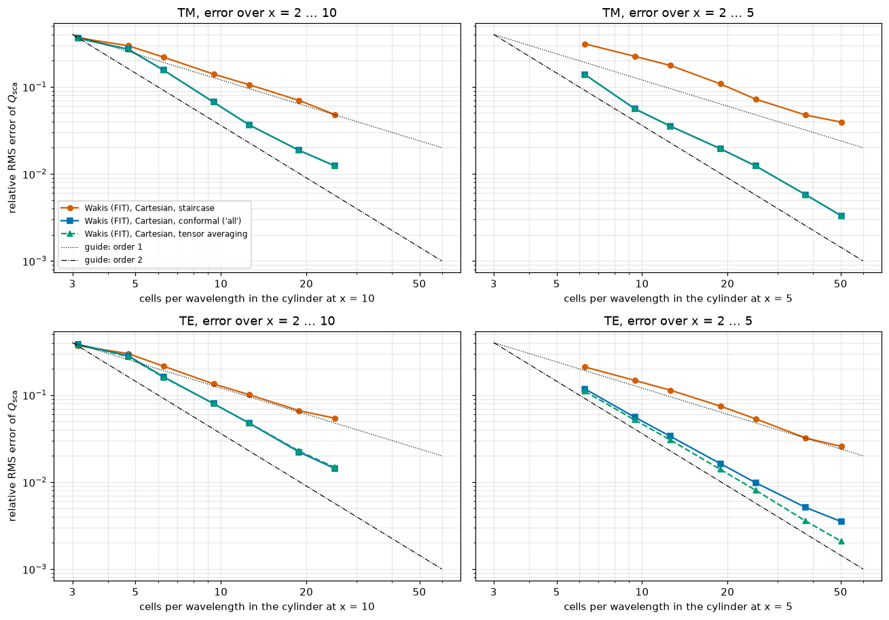
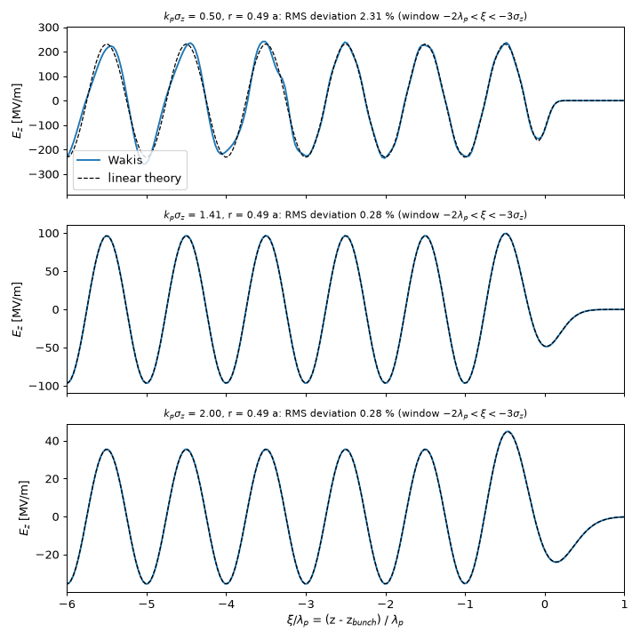
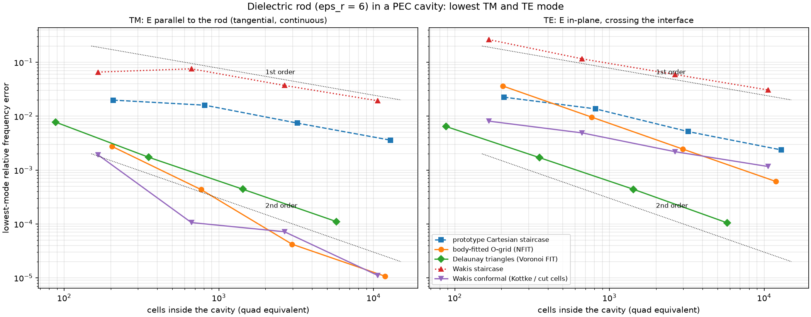
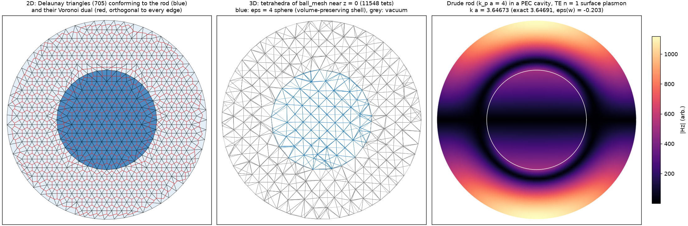
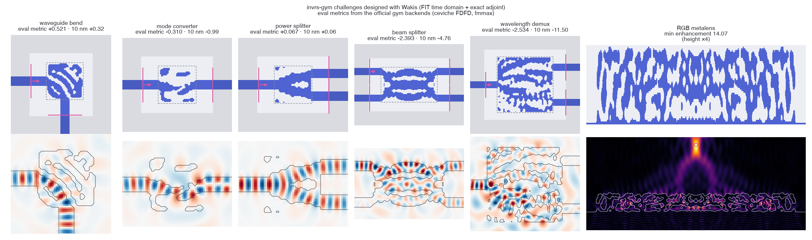

> Open-source **Wak**e and **I**mpedance **S**olver

[](https://wakis.readthedocs.io/en/latest/?badge=latest)
[](https://github.com/ImpedanCEI/Wakis/actions/workflows/nightly_tests_CPU_p3.14.yml)
[](https://codecov.io/github/elenafuengar/wakis)
[](https://github.com/astral-sh/ruff)


[](https://doi.org/10.5281/zenodo.14988676)


`wakis` is a **3D Time-domain Electromagnetic solver** that solves the Integral form of Maxwell's equations using the Finite Integration Technique (FIT) numerical method. It computes the longitudinal and transverse **wake potential and beam-coupling impedance** from the simulated electric and magnetic fields. It is also a multi-purpose solver, capable of simulating planewaves interaction with nano-structures, optical diffraction, and much more!

## About this fork

This is a fork of [CERN's Wakis](https://github.com/ImpedanCEI/wakis) (Apache-2.0, © CERN) that extends it toward a general-purpose
electromagnetic and optical design tool (RF, antennas, photonics, metasurfaces, plasmonics), comparable in scope to commercial FIT codes, with
the whole pipeline differentiable for gradient-based inverse design. Every feature is validated against analytic results, conservation laws or
independent solvers (Meep-inspired tests, RCWA, FDFD) on CPU, GPU and MPI, and documented in the [physics guide](docs/physicsguide.md) with
references. Bug fixes and broadly useful features are contributed back to upstream Wakis as small, focused pull requests.

Install the fork (the `develop` and `main` branches are kept identical):
```bash
pip install "wakis @ git+https://github.com/eshipton/Wakis.git@main"            # solver
pip install "wakis[inverse] @ git+https://github.com/eshipton/Wakis.git@main"   # + JAX for inverse design
```

### Highlights

#### Tutorials: 2D Mie scattering with a total-field/scattered-field plane wave &nbsp;·&nbsp; [tutorials/](tutorials/)

<table>
<tr>
<td width="55%"></td>
<td>

[Tutorial 01](tutorials/01_mie_cylinder/mie_cylinder.ipynb) ([Colab](https://colab.research.google.com/github/eshipton/Wakis/blob/main/tutorials/01_mie_cylinder/mie_cylinder.ipynb)): a plane wave from the new `TFSFSource` hits an infinite n = 2 cylinder (radius 1 µm, x = 2&ndash;10, TM and TE) and a flux box in the scattered-field region gives Q<sub>sca</sub>(x) in one run, compared with the exact series (`wakis.analytic`). In 42 runs from 10 to 80 cells/µm (named baseline: the staircased cylinder at the same resolution), conformal averaging reaches **0.33 % RMS error for x &le; 5 and 1.2 % for x &le; 10 at 80 cells/µm (TM)**, with a fitted order of 1.9 between 40 and 80 cells/µm, while the staircase, half a cell too large, stays first order (3.9 % and 4.8 %, order 0.9). For TE, where E crosses the curved surface, the full tensor averaging is needed for second order (0.21 % vs 0.35 % for the diagonal model at x &le; 5). Built on reusable pieces for the series: PyVista scene, mesh and field views (`wakis.visualize`), Mie theory for spheres and cylinders, a memory preflight and a parallel study runner.

</td>
</tr>
</table>

#### Linear plasma wakefields in a plasma-filled pipe &nbsp;·&nbsp; `wakis.plasma`

<table>
<tr>
<td width="55%"></td>
<td>

A relativistic Gaussian bunch drives a plasma wave in a metal pipe filled with cold plasma (a Drude medium with ω<sub>p</sub> = c k<sub>p</sub>). Wakis (blue) against closed-form linear theory (dashed) for three bunch lengths: **0.1–0.7 % in amplitude** and **wavelength to 2·10<sup>-4</sup>** at 48 cells per plasma wavelength. Conformal pipe walls converge at second order (0.05 % at 64 cells); staircased walls stay at 4.5 %. The wiggles at k<sub>p</sub>σ<sub>z</sub> = 0.5 are transition radiation from the plasma entrance, a real transient of the setup. Linear regime only: the blowout regime needs particle-in-cell.

</td>
</tr>
</table>

#### Curved dielectrics and metals: when E crosses the interface &nbsp;·&nbsp; `conformal='tensor'`, `wakis.unstructured`

<table>
<tr>
<td width="55%"></td>
<td>

Dielectric rod (ε<sub>r</sub> = 6) in a metal cavity, against the exact Bessel solution. With **E along the rod (TM)** every conformal method is excellent. With **E crossing the curved interface (TE)**, staircasing and diagonal subpixel averaging are only **first order**. Full-tensor averaging (`conformal='tensor'`) restores near second order on the Cartesian grid (50–600× better for a 3D dielectric sphere), and the unstructured triangular/tetrahedral solver is **second order in both polarizations**. For a plasmonic (Drude) rod it reaches **1.3·10<sup>-5</sup>** where Cartesian meshes stall near 3·10<sup>-3</sup>. Details: [studies/mesh-comparison](studies/mesh-comparison).

</td>
</tr>
</table>

#### Unstructured FIT on triangles and tetrahedra &nbsp;·&nbsp; `wakis.unstructured`

<table>
<tr>
<td width="55%"></td>
<td>

FIT on a Delaunay mesh with its **Voronoi dual**: the dual edges are perpendicular to the primary edges, so the material matrices stay diagonal and the scheme keeps the exact discrete identities of FIT (div curl = 0 to round-off). Every cell holds one material, so curved interfaces are exact. Phase 1: 2D and 3D solvers, PEC/PMC/absorbing boundaries, Drude/Lorentz/Debye media, eigen and time-domain solvers, validated against exact Bessel and spherical-Bessel solutions. **Phase 2** (PML, ports, adjoint, GPU, MPI, CAD → gmsh) is on the roadmap.

</td>
</tr>
</table>

#### Photonic inverse design benchmarks &nbsp;·&nbsp; [invrs-wakis](https://github.com/eshipton/invrs-wakis)

<table>
<tr>
<td width="55%"></td>
<td>

The [invrs-gym](https://github.com/invrs-io/gym) challenges optimized with Wakis's **exact adjoint + JAX**, then scored by the gym's own solvers. Round 1: **waveguide bend (+0.52) and power splitter (+0.067) solved**; Wakis's predictions agree with the official ceviche evaluator to **< 0.007** in every run; metalens **14.1** (leaderboard best 19.95). Not yet leaderboard-valid: most designs violate the 3-pixel length scale. Round 2 (length-scale constraints by construction, finer meshes, tensor smoothing, more seeds) is in progress.

</td>
</tr>
</table>

Other validated numbers: Hertzian-dipole radiated power and directivity 1.50 (theory 1.5); flux-box energy conservation 0.08 %;
RCWA agreement of grating diffraction efficiencies 1.3e-3; TE10 propagation constant to 1e-12 of the discrete dispersion; Fresnel
reflection at oblique incidence 0.15–0.55 %; exact discrete adjoint (dot-product tests ~1e-17, finite-difference gradients 1e-8–1e-10);
MPI results identical to serial to ~1e-14; forward step ~2x faster than upstream. See `docs/performance.md` and the test suite.

### Added features and roadmap

**Sources, monitors and post-processing**
- [x] Soft current sources (`CurrentSource`) with Gaussian (zero-DC), continuous and custom time profiles
- [x] Magnetic current sources and one-directional (Huygens) sources
- [x] DFT and flux monitors; near-to-far transform and antenna metrics (directivity, gain, efficiency, axial ratio)
- [x] Diffraction-order monitor (Floquet orders, TE/TM/circular polarization)
- [x] Harmonic inversion for resonance frequencies and Q (`harminv`, `ResonanceMonitor`)

**Ports, materials and boundaries**
- [x] Lumped R/L/C elements, discrete ports, S-parameters, Touchstone export, energy-decay stopping
- [x] 2D mode solver, mode ports and mode decomposition
- [x] Dispersive materials (Drude/Lorentz/Debye), materials library and pole fitting
- [x] Bloch-periodic boundaries with complex fields; oblique plane waves in unit cells
- [x] Conformal FIT: cut-cell PEC, averaged dielectrics, thin metal sheets
- [x] Full-tensor subpixel averaging for curved dielectrics (`conformal='tensor'`)
- [x] Unstructured triangular/tetrahedral FIT, phase 1 (`wakis.unstructured`)
- [ ] Unstructured FIT phase 2: PML, ports, adjoint, GPU, MPI, CAD/gmsh workflow
- [ ] Subgridding, hybrid structured/unstructured meshes, adaptive refinement
- [ ] Magnetic dispersion (ferrites)

**Inverse design**
- [x] Exact discrete adjoint with a JAX wrapper (`wakis.inverse`) for all features above, on CPU, GPU and MPI
- [x] Material grids, filters and projections
- [x] Differentiable subpixel smoothing for density designs (`MaterialGrid(smoothing='tensor')`)
- [ ] Differentiable layer thickness

**Core fixes and performance**
- [x] High-side boundaries on the domain edge and node-centred dual lengths (2nd order on non-uniform meshes)
- [x] PEC/PMC masking, `update_tensors` initialization, MPI (CPML deadlock, grid edge, rank-boundary sources/monitors)
- [x] Forward step ~2x faster on CPU and GPU; periodic setup 59 s → 0.02 s
- [x] Memory and run-time estimator with preflight check (`wakis.estimate`)

**Physics and applications**
- [x] Design templates: patch and dipole antennas, waveguides, metasurface cells, silicon photonics; sweeps and optimizers
- [x] Linear plasma wakefields in a plasma-filled pipe (`wakis.plasma`)
- [x] invrs-gym bridge and round-1 results ([invrs-wakis](https://github.com/eshipton/invrs-wakis))
- [ ] invrs-gym round 2 and the 3D challenges (metagrating, splitter, meta-atom library, Bayer sorter, photon extractor)
- [ ] Nonlinear plasma wakefields (blowout regime, PIC)

**Tutorials** ([tutorials/](tutorials/), Colab notebooks generated from runnable scripts)
- [x] Tutorial 01: 2D Mie scattering by a dielectric cylinder (TF/SF, TM/TE, staircase vs conformal convergence)
- [ ] Tutorial 01: triangular-mesh (unstructured FIT) comparison section
- [ ] Tutorial 01b: 3D Mie sphere (script and notebook written; validation runs pending)
- [ ] Tutorial 02: plasmonic Ag/Au spheres, 10 nm to 1 µm

**Validation and studies**
- [x] ~30 Meep-inspired validation tests (Purcell factor, Fresnel, Bragg mirror, Poynting balance, CPML convergence, line source, ...)
- [x] Mesh-comparison study: Cartesian, conformal, nonorthogonal, triangular and tensor-averaged FIT ([studies/mesh-comparison](studies/mesh-comparison))

**Contributions to upstream Wakis**
- [x] [PR #109](https://github.com/ImpedanCEI/Wakis/pull/109): combine PEC/PMC face masks for mixed boundary types
- [x] Analysis and tests offered on [PR #105](https://github.com/ImpedanCEI/Wakis/pull/105) (high-side PEC and dual-grid metrics)
- [ ] Further fixes: CPML+MPI deadlock, `update_tensors`, periodic-setup and time-step performance, quiet `verbose=0`
- [ ] Feature proposals via issues (harmonic inversion, conformal PEC, soft sources, monitors, ports, estimator, dispersive materials)

## About
🚀 Some of `wakis` features:
* Wake potential and impedance calculations for particle beams with different relativistic $\beta$
* Material tensors: permittivity $\varepsilon$, permeability $\mu$, conductivity $\sigma$. Possibility of anisotropy.
* CAD geometry importer (`STL` & `STEP` format) for definition of embedded boundaries and material regions, based on [`pyvista`](https://github.com/pyvista/pyvista), with sub-cell smoothing added in [v0.8.0](https://github.com/ImpedanCEI/wakis/releases/tag/v0.8.0).
* Snappy Smart mesh added in [v0.6.2](https://github.com/ImpedanCEI/wakis/releases/tag/v0.6.2)
* Boundary conditions: PEC, PMC, periodic, first-order Mur absorbing boundaries (`abc`), PML and CPML, added in [v0.8.0](https://github.com/ImpedanCEI/wakis/releases/tag/v0.8.0)
* Different time-domain sources: particle beam, planewave, gaussian wavepacket
* 100% Python, fully exposed API (material tensors and fields $E$, $H$, $J$), with matrix operations based on `numpy` and `scipy.sparse`. Routines ensure multithreaded calculations using Intel's `mkl-service`.
* 1d, 2d, 3d built-in plotting on-the-fly
* Optimized memory consumption & GPU acceleration using `cupy/cupyx` on double and *single* precision: added in [v0.6.1](https://github.com/ImpedanCEI/wakis/releases/tag/v0.6.1)
* CUDA-aware MPI parallelization with `mpi4py` and `ipyparallel`: added in [v0.6.0](https://github.com/ImpedanCEI/wakis/releases/tag/v0.6.0)


🧩 Other complementary tools in the ecosystem:
* Wakefield extrapolation via broadband resonator fitting with PIML [`iddefix`](https://github.com/ImpedanCEI/IDDEFIX) evolutionary algorithms
* Non-equidistant Filon Fourier integration with [`neffint`](https://github.com/ImpedanCEI/neffint)
* Beam-induced heating estimation due to impedance with [`bihc`](https://github.com/ImpedanCEI/BIHC)

📣 Tag and version changes are described in each Wakis [GitHub release](https://github.com/ImpedanCEI/wakis/releases).

* For specific needs, please contact the developer 👩‍💻👋: elena.de.la.fuente.garcia@cern.ch

## How to use
📖 Documentation, powered by `sphinx`, is available at [wakis.readthedocs.io](https://wakis.readthedocs.io)

Check 📁 [`examples/`](https://github.com/ImpedanCEI/wakis/tree/main/examples) and [`notebooks/`](https://github.com/ImpedanCEI/wakis/tree/main/notebooks) for different physical applications:
* Planewave interacting with a PEC or dielectric sphere
* Gaussian wavepacket travelling through vacuum / dielectric
* Custom perturbation interacting with PEC geometry
* And of course, **full Wakefield simulation** of different accelerator components on CPU, GPU and with MPI.

Check 🌐📁 [`SWAN_tutorial/`](https://github.com/ImpedanCEI/SWAN_tutorial) for hands-on notebook examples ready to run on CERN's SWAN service's GPUs (A100, Tesla T4):

[][gallery_url]

[gallery_url]:https://cern.ch/swanserver/cgi-bin/go?projurl=https://github.com/ImpedanCEI/SWAN_tutorial.git

Check 🌐📁 [`wakis-benchmarks/`](https://github.com/ImpedanCEI/wakis-benchmarks) for beam-coupling impedance calculations & comparisons to the commercial tool *CST® Wakefield solver*:
* PEC cubic cavity below cutoff (mm) and above cutoff (cm)
* Conductive cubic cavity below cutoff
* Lossy pillbox cavity (cylindrical) above cutoff
* Simulations using beams with different relativistic $\beta$

Check 🌐📁 [`BE-Seminar-demo/`](https://github.com/ImpedanCEI/BE-Seminar-demo) for a complete live demonstration of Wakis usage.

## Installation
Wakis supports `Python 3.9 - 3.14` and can be installed in any `conda` or `venv` environment.

📖 **For a detailed installation guide (GPU, MPI setup, FAQs), check our [documentation](https://wakis.readthedocs.io/en/latest/installation.html).**

### Install via PyPI
For basic usage, simply run:
```bash
pip install wakis
```
For additional features, including **interactive 3D plots in Jupyter notebooks** and Wakis' satellite packages, use:
```bash
pip install wakis['all']
```

GPU execution also requires a CuPy build compatible with your CUDA or ROCm installation, and MPI execution requires `mpi4py` plus an MPI runtime. See the [GPU and MPI installation instructions](https://wakis.readthedocs.io/en/latest/installation.html) before running those examples.

To install Wakis from the source, clone the repository and install it in *editable* mode:
```bash
git clone https://github.com/ImpedanCEI/wakis.git
cd wakis
pip install -e .
```

### Install via Docker
A pre-built [Docker image of Wakis](https://hub.docker.com/r/edelafue/wakis) is available for easy setup and reproducibility.

```bash
sudo docker pull docker.io/edelafue/wakis:latest
sudo docker run --rm -it docker.io/edelafue/wakis:latest /bin/bash
```

💡 **Have a bug, feature request, or suggestion?** Open a [GitHub Issue](https://github.com/ImpedanCEI/wakis/issues) so the community can track it.

🛠️ **Want to contribute?**  To merge your changes into `main`, create a **Pull Request (PR)** following our [PR template](https://github.com/ImpedanCEI/wakis/blob/main/.github/pull_request_template.md).

## Motivation
🎯 The determination of electromagnetic wakefields and their impact on accelerator performance is a significant issue in current accelerator components. These wakefields, which are generated within the accelerator vacuum chamber as a result of the interaction between the structure and a passing beam, can have significant effects on the machine.
These effects can be characterized through the beam coupling impedance in the frequency domain and wake potential in the time domain. Accurate evaluation of these properties is essential for predicting dissipated power and maintaining beam stability.
`wakis` is an open-source tool that can compute wake potential and impedance for both longitudinal and transverse planes for general 3D structures.

* 🌱 `wakis` was firstly presented at the **International Particle Accelerator Conference in 2023** (IPAC23) as a post-processing tool: https://doi.org/10.18429/JACoW-IPAC2023-WEPL170

* 🌳 It has now evolved from a post-processing tool to a full 3D electromagnetic, time domain solver; and has been presented at the **ICAP24: The 14th International Computational Accelerator Physics Conference in 2024**: https://indico.gsi.de/event/19249/contributions/82636/

* 🌸 A dedicated contribution was presented at **IPAC'25: The 16th International Particle Accelerator Conference**: https://inspirehep.net/literature/3101186

## Citing `Wakis`
🔖 Each Wakis release is archived on [Zenodo](https://zenodo.org/records/14988676) with a version-specific DOI. For a citation that points to the latest archived version, use the [concept DOI](https://doi.org/10.5281/zenodo.14988676):

> E. de la Fuente Garcia et al., “Wakis”. Zenodo. https://doi.org/10.5281/zenodo.14988676

---
### Tests badges
[](https://github.com/ImpedanCEI/Wakis/actions/workflows/nightly_tests_CPU_p3.10.yml)
[](https://github.com/ImpedanCEI/Wakis/actions/workflows/nightly_tests_CPU_p3.11.yml)
[](https://github.com/ImpedanCEI/Wakis/actions/workflows/nightly_tests_CPU_p3.12.yml)
[](https://github.com/ImpedanCEI/Wakis/actions/workflows/nightly_tests_CPU_p3.13.yml)
[](https://github.com/ImpedanCEI/Wakis/actions/workflows/nightly_tests_CPU_p3.14.yml)
