> Open-source **Wak**e and **I**mpedance **S**olver

[](https://wakis.readthedocs.io/en/latest/?badge=latest)
[](https://github.com/ImpedanCEI/Wakis/actions/workflows/nightly_tests_CPU_p3.14.yml)
[](https://codecov.io/github/elenafuengar/wakis)
[](https://github.com/astral-sh/ruff)


[](https://doi.org/10.5281/zenodo.14988676)


`wakis` is a **3D Time-domain Electromagnetic solver** that solves the Integral form of Maxwell's equations using the Finite Integration Technique (FIT) numerical method. It computes the longitudinal and transverse **wake potential and beam-coupling impedance** from the simulated electric and magnetic fields. It is also a multi-purpose solver, capable of simulating planewaves interaction with nano-structures, optical diffraction, and much more!

## About this fork

This is a fork of [CERN's Wakis](https://github.com/ImpedanCEI/wakis) (Apache-2.0, © CERN) that extends it toward a general-purpose
electromagnetic and optical design tool (RF, antennas, photonics, metasurfaces, plasmonics), comparable in scope to commercial FIT codes, with
the whole pipeline differentiable for gradient-based inverse design. Every feature is validated against analytic results, conservation laws or
independent solvers (Meep-inspired tests, RCWA, FDFD) on CPU, GPU and MPI, and documented in the [physics guide](docs/physicsguide.md) with
references. Bug fixes and broadly useful features are contributed back to upstream Wakis as small, focused pull requests.

Install the fork (the `develop` and `main` branches are kept identical):
```bash
pip install "wakis @ git+https://github.com/eshipton/Wakis.git@main"            # solver
pip install "wakis[inverse] @ git+https://github.com/eshipton/Wakis.git@main"   # + JAX for inverse design
```

### Highlights

Each result names its baseline. Work is unknowns × time steps, which does not depend on the implementation. Results whose code is still on a feature branch name that branch; they are merged into `develop` after review. Items marked **In progress** report interim numbers only.

#### Plasmonic nanoparticles: 10× fewer unknowns with body-fitted triangles &nbsp;·&nbsp; `wakis.unstructured`, `wakis.benchmarks`

<table>
<tr>
<td colspan="2">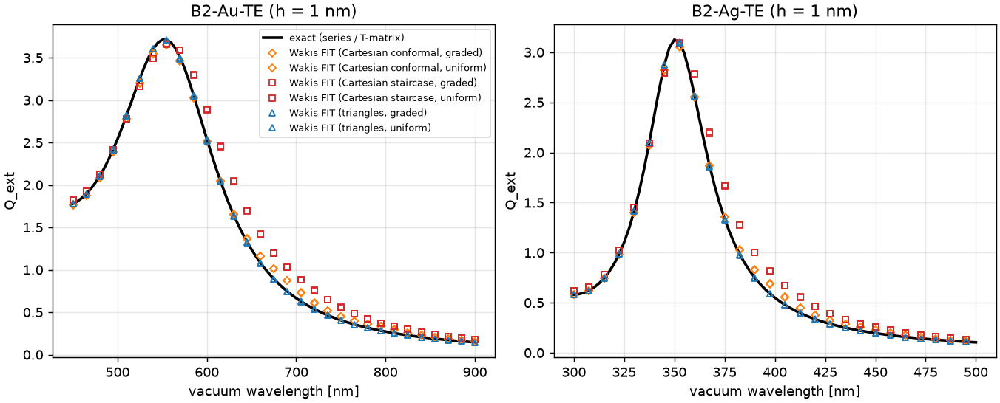</td>
</tr>
<tr>
<td width="55%">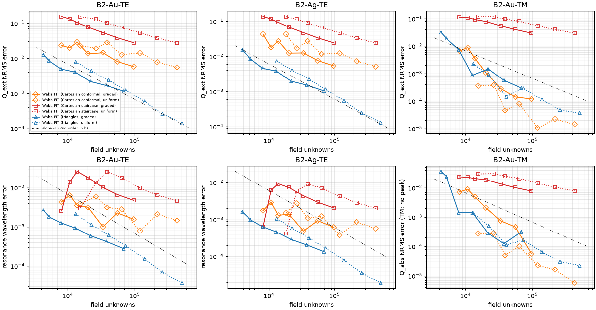</td>
<td>

Benchmark **B2**: Au (in an n = 2 host) and Ag (in vacuum) nanocylinders, a = 20 nm, Rakić Drude–Lorentz ε(ω), against the exact series. 168 uncontended Cloud Batch runs, h = 4 → 0.5 nm. At **1 % Q<sub>ext</sub> NRMS on Au-TE, graded triangles need 4.8k unknowns and 6.5e7 work, against 46k and 2.0e9 for the best Cartesian arm (graded conformal)**: about **10× fewer unknowns and 30× less work**. The staircase never reaches 1 % (2.7 % at 0.5 nm). Conformal Cartesian TE is not monotone in h (2.3, 2.0, 2.9, 1.3, 1.4, 0.8, 0.6 %): averaging metal and host gives mixed cells whose ε(ω) crosses zero in the band. Triangles converge at second order. Limit: 2D only. **Run window checked:** tripling the 80 fs window changes every B2 metric by < 1e-5 (B3 < 1e-5 too; low-Q plasmons decay within a few fs). Code on `main`; study: [studies/benchmarks](studies/benchmarks).

</td>
</tr>
<tr>
<td colspan="2"></td>
</tr>
<tr>
<td colspan="2">

**B3**: Au nanodimers (a = 20 nm, n = 2 host) with 10, 5 and 2 nm gaps, E along the dimer axis, against an exact multi-cylinder T-matrix (maps above). Metric: the mean |E/E<sub>0</sub>|² over 9 points in the gap. 102 uncontended runs; run window checked (< 1e-5). To reach **5 % error in the gap field enhancement at g = 5 nm, graded triangles need 7.2k unknowns and 1.2e8 work, against 111k and 8.0e9 for graded conformal Cartesian** (15× fewer unknowns, ~65× less work). At g = 10 nm and g = 2 nm the triangles already meet 5 % on their coarsest mesh (≤ 6k and ≤ 35k unknowns, vs 141k and 143k). At g = 2 nm conformal Cartesian never reaches 1 % in Q<sub>ext</sub> (1.7 % at h = 0.5 nm). The staircase never reaches 5 % (12–120 %, and at g = 5 nm the gap mode splits into a spurious red-shifted peak). Limit: the triangle gap error levels off at about 1–2 %, consistent with the 3.5–5e-3 field reflection of the triangle PML (B3 cannot be de-embedded); a better absorber is next.

</td>
</tr>
</table>

#### Tutorials: Mie scattering in 2D and 3D with a total-field/scattered-field plane wave &nbsp;·&nbsp; [tutorials/](tutorials/)

<table>
<tr>
<td colspan="2">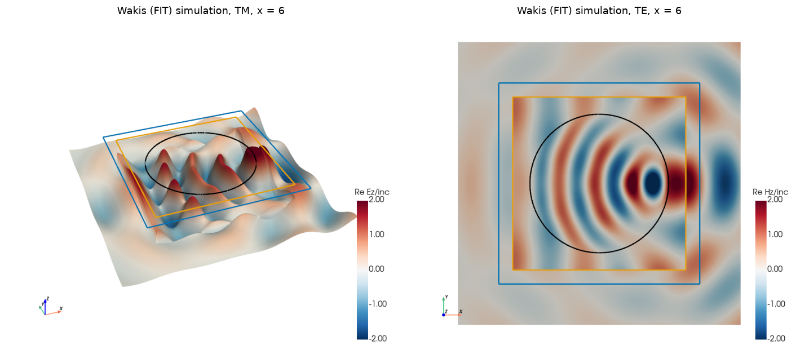</td>
</tr>
<tr>
<td width="50%"></td>
<td width="50%">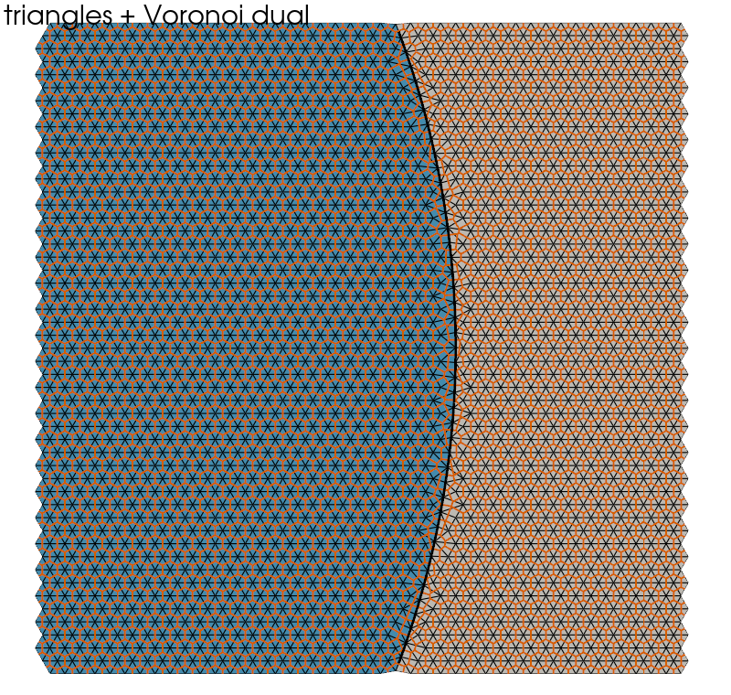</td>
</tr>
<tr>
<td colspan="2">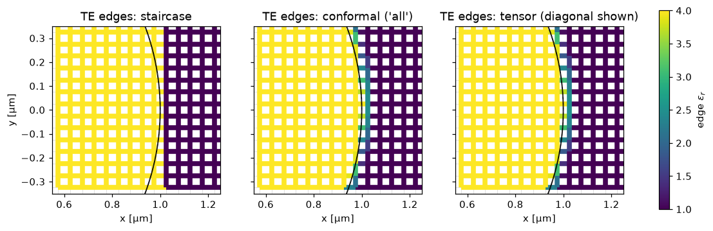</td>
</tr>
<tr>
<td colspan="2">

[Tutorial 01](tutorials/01_mie_cylinder/mie_cylinder.ipynb) ([Colab](https://colab.research.google.com/github/eshipton/Wakis/blob/main/tutorials/01_mie_cylinder/mie_cylinder.ipynb)): a `TFSFSource` plane wave hits an n = 2 cylinder (a = 1 µm, x = 2&ndash;10, TM and TE). The scattered flux is compared with the exact series. Over 42 runs, conformal averaging reaches **0.33 % RMS error for x &le; 5 and 1.2 % for x &le; 10 at 80 cells/µm (TM)**, at second order. The staircase at the same resolution stays first order (3.9 % and 4.8 %). TE needs the full tensor (0.21 % vs 0.35 % diagonal at x &le; 5). A triangle-mesh section shows that conforming triangles match conformal Cartesian accuracy at equal h, at ~1.45× the work on uniform meshes; graded meshes change that (see above).

</td>
</tr>
<tr>
<td colspan="2">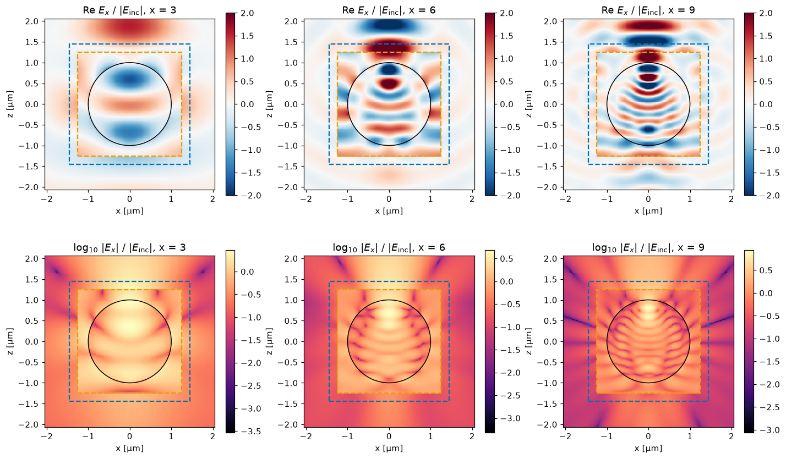</td>
</tr>
<tr>
<td width="50%">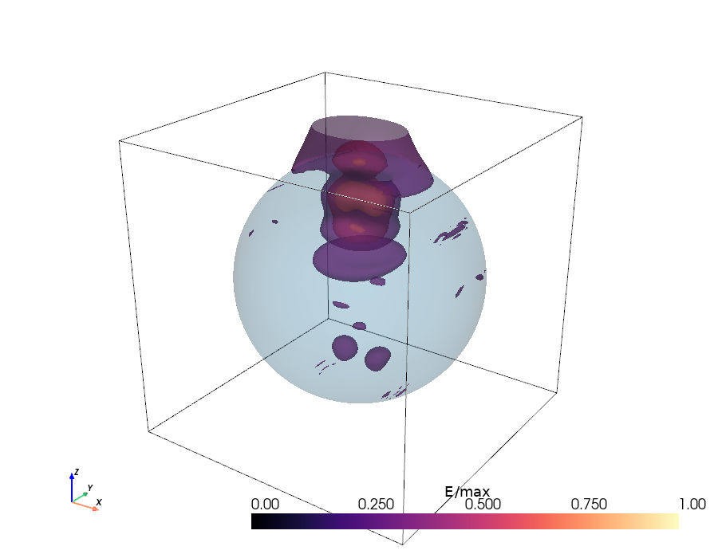</td>
<td width="50%"><br><sub>Split polar plot: left half E-plane (xz, |S<sub>2</sub>|²), right half H-plane (yz, |S<sub>1</sub>|²); the two planes differ physically (dipole null near 90° in the E-plane), and each is symmetric in ±θ.</sub></td>
</tr>
<tr>
<td colspan="2">

[Tutorial 01b](tutorials/01b_mie_sphere/mie_sphere.ipynb) ([Colab](https://colab.research.google.com/github/eshipton/Wakis/blob/main/tutorials/01b_mie_sphere/mie_sphere.ipynb)): the same set-up in 3D, an n = 2 sphere with r = 1 µm. It covers the Mie series, near fields, isosurfaces, a movie, and the far field (`Near2FarMonitor` against S<sub>1</sub>, S<sub>2</sub>). Full mode on an NVIDIA L4: 6.3 Mcells and 11 min, with **Q<sub>sca</sub> within 3.4 % RMS of Mie** over x = 2&ndash;10 (conformal, 40 cells/µm). The 3D resolution study is still to do.

</td>
</tr>
</table>

#### Fused GPU time step: 45× faster inverse-design iterations &nbsp;·&nbsp; `SolverFIT3D(..., use_gpu=True, fused=True)`

<table>
<tr>
<td width="55%"></td>
<td>

GPU runs were limited by Python dispatch and kernel launches (up to ~500 launches per step), not by the GPU. The step, CPML, sources, DFT/flux/mode monitors, tensor averaging, dispersive ADE and the transposed adjoint step are now a few custom CUDA kernels, replayed 64 steps at a time with CUDA graphs. **invrs full ceviche bend: one forward + adjoint iteration from 753 s to 15–17 s on an L4 (45–49×)**, GPU utilization 11 % → 93 %, identical loss and gradients to 3e-11. Per step: CPML 3D 7.3 → 0.68 ms, TF/SF + 81-frequency flux 11.7 → 0.63 ms, adjoint 6.0 → 0.10 ms. Exactness: fields and monitors match the previous GPU path to ≤ 1e-11, the fused adjoint passes the dot-product test (< 1e-12), and graph replay is bitwise identical. **Limits:** opt-in for now; float64/complex128 and no MPI; ~60 % more GPU memory with CPML; plain 3D grids at ~300k cells are 7 % slower (bandwidth-bound). Code on `main`, [studies/gpu-perf](studies/gpu-perf), `docs/performance.md`.

</td>
</tr>
</table>

#### Graded triangles with a radial PML: 2.2× fewer unknowns than graded Cartesian &nbsp;·&nbsp; `wakis.unstructured`

<table>
<tr>
<td colspan="2">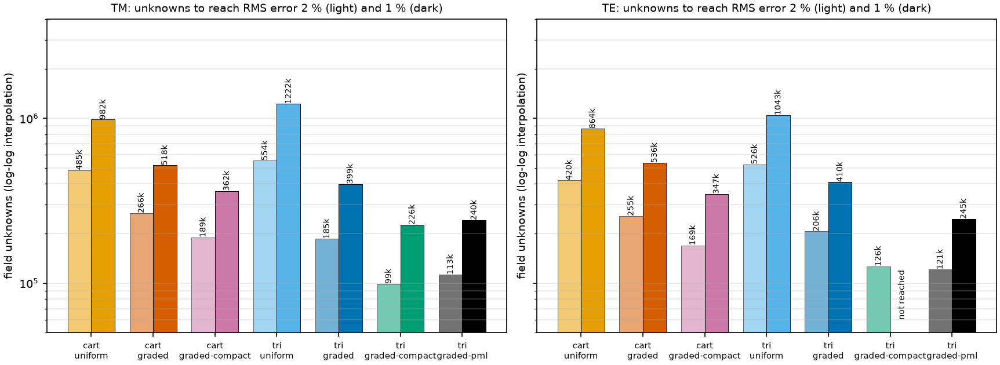</td>
</tr>
<tr>
<td width="55%"></td>
<td>

Mie cylinder (B1: n = 2, a = 1 µm, x = 2–10) to 1 % RMS error in Q<sub>sca</sub>. Graded triangles keep h<sub>in</sub> only at the cylinder. The new **radial CFS-PML reflects 2–8e-4** over x = 2–10 (10 cells at h = 20 nm; the old first-order ABC reflected 6–17 %), and a tabulated plane-wave source costs one sparse mat-vec per step. In **TM**, against **graded conformal Cartesian**, the triangles need **2.2× fewer unknowns and 2.3× less work** (240k vs 518k unknowns). Against the compact Cartesian arm the gain is 1.5× in unknowns and 1.6× in work. **Correction:** the B1 errors have a floor from the 1000 fs DFT window, not from the mesh. Converged DGTD plateaus at 0.140 % (TM) and 0.866 % (TE), dominated by a high-Q TE resonance near x ≈ 6.4. With a 3000 fs window the floor drops to 0.012 %/0.036 %. B1 TE results at the 1 % target are therefore window-limited and are not quoted here. The benchmark default is now 3000 fs, and the reruns are pending. Code on `main`; studies: [studies/mie-cylinder-graded](studies/mie-cylinder-graded), [studies/unstructured-pml](studies/unstructured-pml).

</td>
</tr>
</table>

#### Local time stepping: 2× fewer steps at unchanged error, energy-conserving, exact adjoint &nbsp;·&nbsp; `UnstructuredFIT2D(lts=2)`

<table>
<tr>
<td width="55%">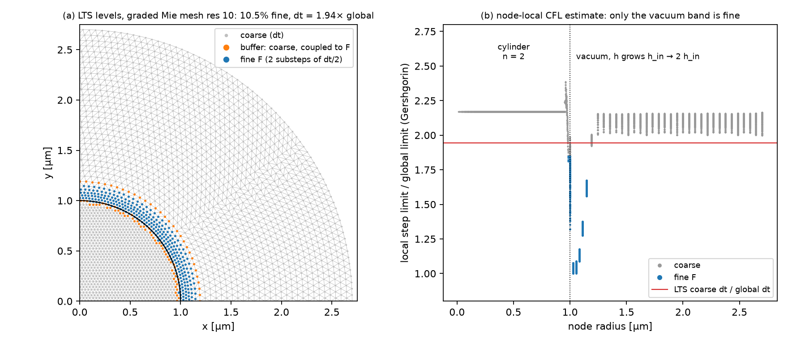</td>
<td>

A leapfrog LTS (Diaz & Grote 2009), stabilized with a damped Chebyshev polynomial. Only the vacuum band next to the scatterer takes sub-steps (3–23 % of the nodes). The rest of the mesh, cylinder included, takes **1.94× the global step**. The scheme conserves an exact discrete energy (drift 2e-14 over 10<sup>5</sup> steps) and its transpose is an exact adjoint (dot product < 1e-14). Baseline: global leapfrog **on the same mesh**. Mie cylinder: **1.56–1.88× less work**. B2/B3 (Au/Ag nanocylinders, Au dimers with 2/5/10 nm gaps): **exactly 2× fewer steps with unchanged error** (largest difference 0.0241 vs 0.0247). Spot-machine wall-time ratio 1.01–2.67×, median ≈ 1.75×. Code on `main`; study: [studies/unstructured-lts](studies/unstructured-lts).

</td>
</tr>
<tr>
<td colspan="2">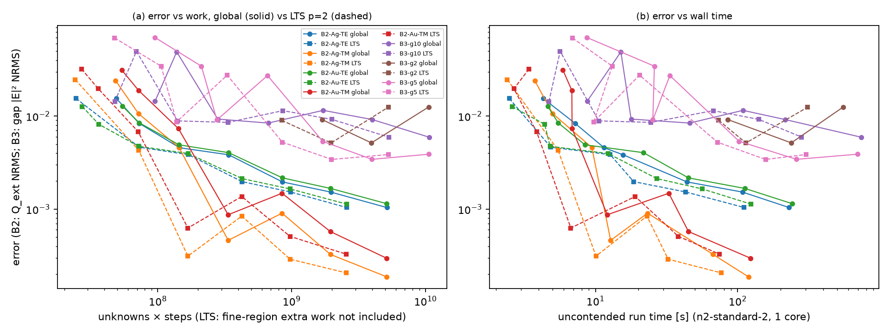</td>
</tr>
</table>

#### Polygonal FIT: hybrid square/triangle and Voronoi meshes &nbsp;·&nbsp; `wakis.unstructured.PolygonFIT2D`

<table>
<tr>
<td colspan="2">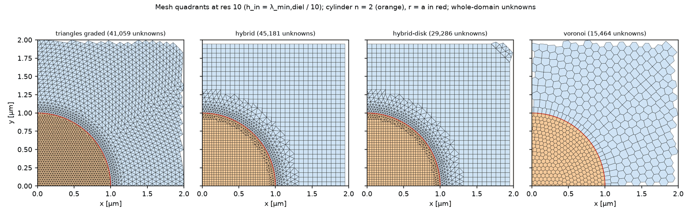</td>
</tr>
<tr>
<td width="55%">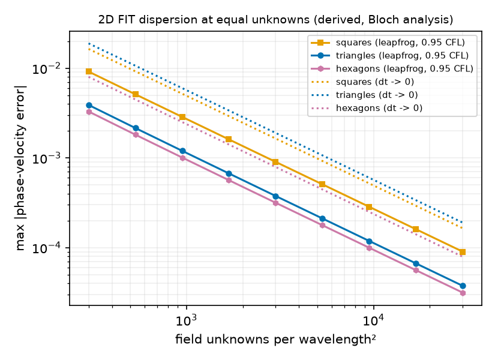</td>
<td>

FIT on any polygon mesh with an orthogonal dual: squares in the bulk and triangles only at the interface (hybrid), or mostly hexagonal Voronoi cells. Mie cylinder at 1 % RMS: **Voronoi needs 1.95× fewer unknowns and 1.87× less work than graded triangles** (TM, same disk domain). The Bloch analysis (left) explains why: the **honeycomb has half the dispersion error** of squares or triangles at equal unknowns. The hybrid needs 1.40× fewer unknowns than graded Cartesian (TM, same square domain and PML). On the **2 nm-gap Au dimer** (B3-g2), the hybrid refines only the gap and needs **≥ 2.6× fewer unknowns** for 5 % than the first converged graded-triangle rung. That is a bound, since coarser triangle rungs were not run. Limits: B1 TE at 1 % is limited by the 1000 fs run window (see above), and there is no polygon PML yet. Code on `main`; studies: [studies/mie-cylinder-polyfit](studies/mie-cylinder-polyfit), [studies/benchmark-polygon](studies/benchmark-polygon).

</td>
</tr>
</table>

#### Cartesian subgridding: provably stable nested patches, cheapest on dielectrics &nbsp;·&nbsp; `wakis.subgrid`

<table>
<tr>
<td width="55%"></td>
<td>

Nested 2:1/3:1 Cartesian patches (auto-balanced quadtree). The fine-to-coarse restriction is the exact transpose of the prolongation with a row-sum-lumped mass, so energy is conserved exactly (drift ≤ 4e-15 over 10<sup>5</sup> steps), the scheme is stable iff dt < 2/√λ<sub>max</sub>, the interface reflection is second order, and the core step passes the dot-product adjoint test (1e-13). A non-transposed restriction blows up by 10<sup>12</sup>. **B1 Mie cylinder at 1 % RMS, equal global Δt: 175k (TM) / 164k (TE) unknowns vs 240k / 245k for graded triangles + PML and 362k / 347k for compact graded Cartesian** (1.5–1.7× and 2.3–2.4× less work). The local time stepping above plugs in unchanged. **Limits:** on curved metal in TE (B2) convergence drops to first order and triangles stay 4–5× cheaper; on B3 dimer gaps it does not reach 5 % (best 5.0–8.6 %); local time stepping with the Rakić Au/Ag poles fails the stability check at the coarse step. 2D only (3D octree plan in the physics guide). Code on `main`, [studies/mie-cylinder-subgrid](studies/mie-cylinder-subgrid), [studies/subgrid-benchmarks](studies/subgrid-benchmarks).

</td>
</tr>
</table>

#### Curvilinear O-grid FIT (NFIT): fewest unknowns on round dielectric and plasmonic scatterers &nbsp;·&nbsp; `wakis.curvilinear.CurvilinearFIT2D`

<table>
<tr>
<td colspan="2">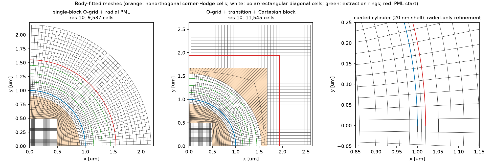</td>
</tr>
<tr>
<td width="55%">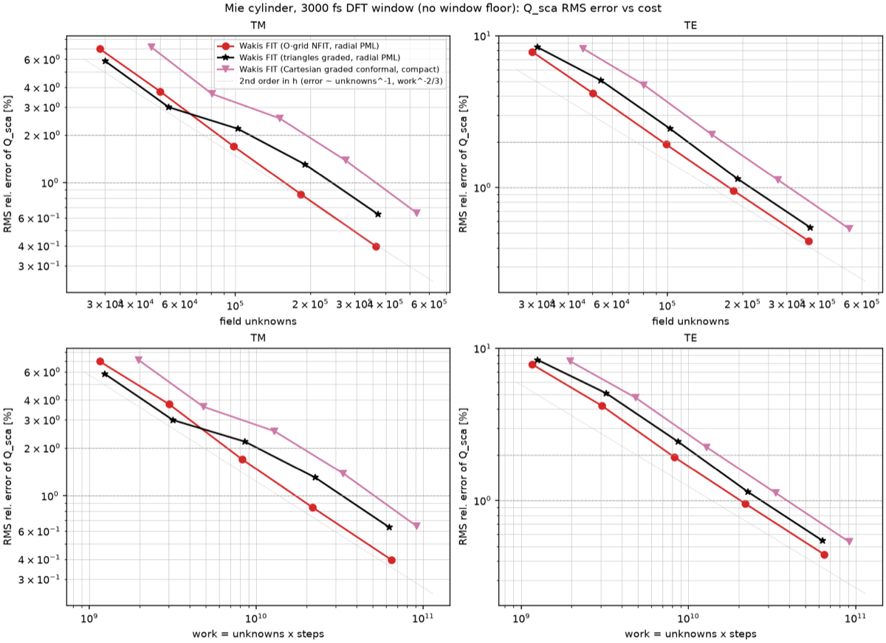</td>
<td>

Time-domain nonorthogonal FIT (Schuhmann & Weiland 2000) on body-fitted polar grids. A symmetric flux-to-voltage Hodge conserves energy (drift 7e-16), with a radial complex-stretching PML (reflection 5e-5). **B1 Mie cylinder at 1 % RMS (3000 fs window): O-grid 158k (TM) / 176k (TE) unknowns vs 244k / 215k for graded triangles + PML** (1.9× / 1.3× less work, 1.8× / 1.6× faster) and vs graded Cartesian (about 4× faster). **B2 Au-TE at 0.1 %: 19.6k unknowns vs 88k for uniform triangles** (settings tuned on B2; the untuned default needs 42k). **Limits:** on B3 dimer gaps it is 3–8× worse than graded triangles (a structured grid cannot refine only the gap). On a 20 nm coated cylinder it ties triangles, while Cartesian averaging stalls at 1.1 % (TM) / 3.4 % (TE). Best for round, coaxial and layered geometry, including beam pipes. Code on `main`, [studies/mie-cylinder-nfit](studies/mie-cylinder-nfit).

</td>
</tr>
</table>

#### High-order DGTD on curved triangles: 0.1 % with ~100× fewer unknowns &nbsp;·&nbsp; `wakis.highorder`

<table>
<tr>
<td width="55%">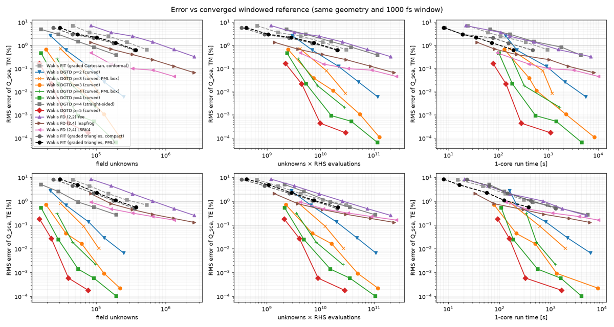</td>
<td>

Nodal discontinuous Galerkin time domain (Hesthaven & Warburton 2008) on **curved** triangles, p = 1–5, with upwind flux, LSRK(5,4), CFS-PML, Drude/Lorentz/Debye ADE driven by the total field, and a probed sparse operator for exact adjoints (dot test 1e-12). A Cartesian (2,4) scheme with LSRK4 is also included. **B1 Mie cylinder, 0.1 % TM: DG p = 5 needs 17k unknowns and 91 s, against ~2.1M unknowns (~2600 s, extrapolated) for the best second-order arm** (graded triangles + PML); 0.01 % with 25k unknowns. Above x ≈ 6 the second-order error is 95–99 % bulk dispersion, which the high-order stencils remove. **B2 Au-TE, 0.1 %: p = 2 needs 6.0k unknowns vs 88k for uniform triangles** (equal wall time). Curved elements are essential: straight-sided p = 4 stalls at 1–5 %. **Limits:** at 1–2 % accuracy the (2,4) leapfrog scheme or graded triangle FIT is faster in seconds (DG costs 150–300 ns per unknown-step vs ~19 ns); the rectangular DG PML becomes unstable in long runs on fine meshes (unsolved, long windows use an absorbing disk). Code on `main`, [studies/highorder-mie](studies/highorder-mie), [studies/highorder-bench](studies/highorder-bench).

</td>
</tr>
</table>

#### Exact plane-wave source: TF/SF at round-off vs continuum Huygens sheets &nbsp;·&nbsp; `TFSFSource`, [studies/tfsf](studies/tfsf)

<table>
<tr>
<td width="55%"></td>
<td>

`TFSFSource` takes its incident field from a 1D FIT line, so it solves the discrete equations exactly: **the leaked power is round-off** ((3.7–7.9)e-32 of the face power in 3D) at every resolution. The same box driven by continuum equivalent-current (Huygens) sheets leaks as (kh)<sup>4</sup>, from the grid-dispersion mismatch. Meep-style sheets referenced to the face plane leak as (kh)<sup>2</sup>, from the half-cell offset: **5 % of the face power at 20 cells/λ, 300× more** than the exact-registration sheets. Discrete sheets that carry the 1D-line field reproduce `TFSFSource` to round-off: its commutator corrections *are* the discrete Huygens sheets.

</td>
</tr>
</table>

#### Photonic inverse design: invrs-gym round 2 &nbsp;·&nbsp; [invrs-wakis](https://github.com/eshipton/invrs-wakis)

<table>
<tr>
<td width="55%">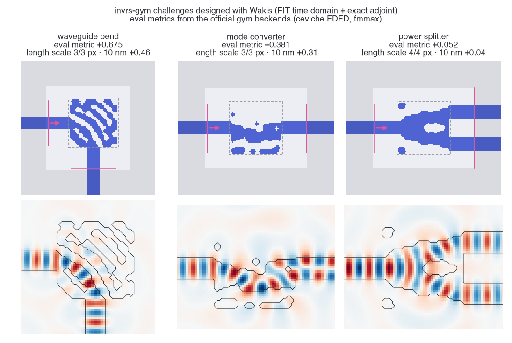</td>
<td>

[invrs-gym](https://github.com/invrs-io/gym) challenges optimized with Wakis's **exact adjoint + JAX** and scored by the gym's own backends. In the round-2 pilot, the length-scale constraints are enforced by construction: **all 18 designs meet the 3/3-pixel length scale** (most round-1 designs violated it). Best official scores: **waveguide bend +0.675, mode converter +0.381, power splitter +0.052**. The 10 nm ceviche re-check gives +0.462, +0.315 and +0.045. These are the lightweight challenges, which are not on the leaderboard. The full-ceviche (leaderboard-eligible) and metalens GPU sweeps are running. In round 1, Wakis's predictions agreed with the official evaluator to < 0.007.

</td>
</tr>
</table>


#### In progress: Cherenkov-free wakefields with the explicit TE/TM scheme &nbsp;·&nbsp; `SolverFIT3D(scheme='tete')`

<table>
<tr>
<td width="55%">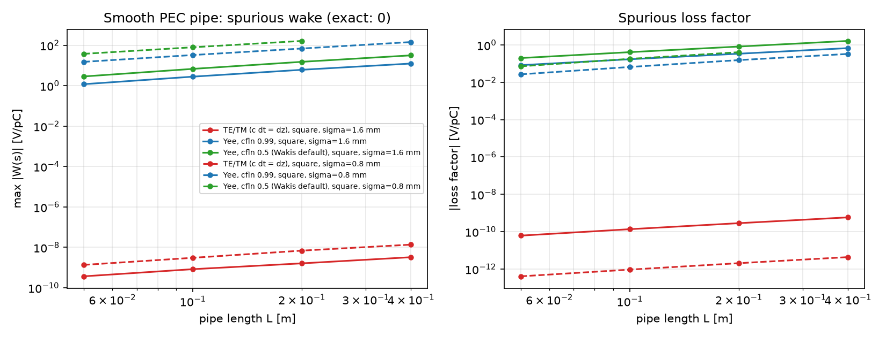</td>
<td>

The explicit TE/TM scheme of Dohlus & Zagorodnov (2009) has no numerical dispersion along the beam axis at c&nbsp;dt = dz. A relativistic bunch in a smooth pipe therefore leaves no numerical Cherenkov wake. The figure shows the spurious wake and loss factor in a smooth PEC pipe, where the exact answer is zero. TE/TM is compared on the same grid with Yee at Courant 0.99 (best Yee) and at 0.5 (the Wakis default). Box-cavity and pillbox comparisons against an analytic modal wake are running; numbers will follow in the study write-up. Branch `feature/dispersion-free-wake`.

</td>
</tr>
</table>

#### In progress: exact adjoint gradients in less memory &nbsp;·&nbsp; `AdjointSimulation(memory=...)`

<table>
<tr>
<td width="55%">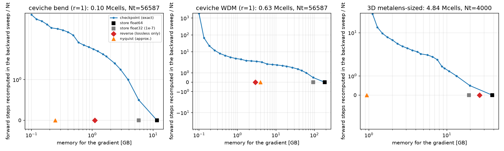</td>
<td>

A memory ladder for the backward sweep:
- `store`: keep every step;
- binomial `checkpoint`: bitwise-equal gradients in 14 physics cases;
- `reverse`: time-reversed leapfrog with recorded CPML layers, which agrees with `store` to 3e-16 to 2e-15, with round-off flat at (0.3–5)e-15 up to N<sub>t</sub> = 64 000;
- `nyquist`: approximate and opt-in.

Projection for the ceviche WDM at r = 1: **185 GB with `store` (float64), 2.9 GB with `reverse` at no recomputation**, or 4.3 GB with `checkpoint` at 2.4 extra forward passes. Measured CPU/L4 memory-vs-time results are pending. Branch `feature/adjoint-memory`.

</td>
</tr>
</table>

#### In progress: subpixel-smoothed projection for binary designs &nbsp;·&nbsp; `wakis.inverse.smoothed_projection`

<table>
<tr>
<td width="55%">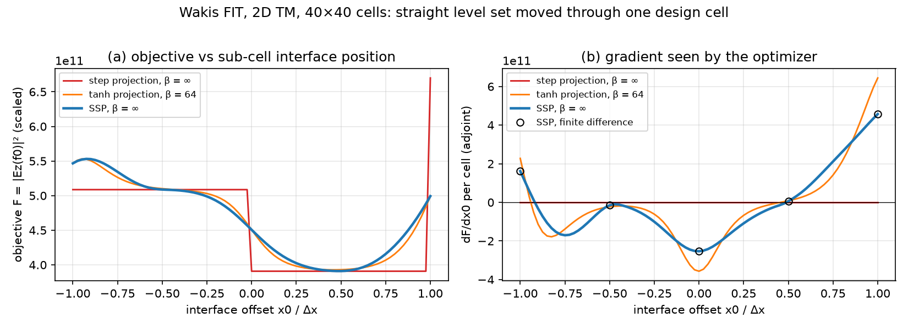</td>
<td>

SSP (Hammond et al. 2025), implemented from the paper's equations rather than from Meep's GPL code. At β = ∞ the objective stays smooth as a level set moves through a cell, and the **adjoint gradient matches finite differences to 2e-6–1e-4**. A step projection gives an exactly zero gradient. The paper's R = 0.55 Δx leaves a 17× modulation of the shape derivative with sub-pixel position; R = 0.75 Δx reduces it to 1.6×. The invrs-gym pilot (bend and mode converter, against the round-2 arm) is pending. Branch `feature/subpixel-projection`.

</td>
</tr>
</table>

#### Dispersive subpixel averaging: metals and dispersive dielectrics at interfaces &nbsp;·&nbsp; `conformal='all'/'tensor'`

<table>
<tr>
<td colspan="2">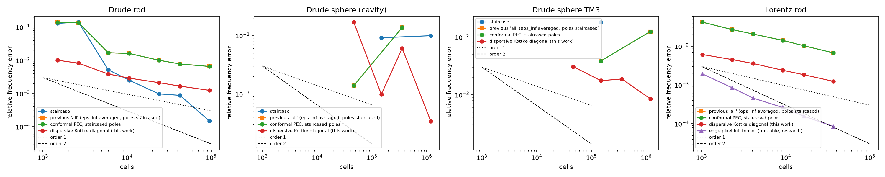</td>
</tr>
<tr>
<td colspan="2">

Cut metal and dispersive-dielectric cells now average the full ε(ω); Meep averages only ε<sub>∞</sub>. The averaging is a passive capacitor network, so the step stays stable and its adjoint exact (dot product ≤ 5e-17). **The result is mixed.** On a lossless Drude rod it converges monotonically and is 4.6–5.2× more accurate than ε<sub>∞</sub>-only averaging, but **2–8× less accurate than a fine staircase**. For a conductive Debye slab the error drops from 1.6e-2 to 2.9e-3. For metals, Kottke averaging is first order and not monotone (mixed cells near ε = 0). Use triangles (B2 above) for second-order plasmonics. Details: physics guide, "Dispersive subpixel averaging".

</td>
</tr>
</table>

#### Linear plasma wakefields in a plasma-filled pipe &nbsp;·&nbsp; `wakis.plasma`

<table>
<tr>
<td width="55%"></td>
<td>

A relativistic Gaussian bunch drives a plasma wave in a metal pipe filled with cold plasma (a Drude medium with ω<sub>p</sub> = c k<sub>p</sub>). Wakis (blue) against closed-form linear theory (dashed) for three bunch lengths: **0.1–0.7 % in amplitude** and **wavelength to 2·10<sup>-4</sup>** at 48 cells per plasma wavelength. Conformal pipe walls converge at second order (0.05 % at 64 cells); staircased walls stay at 4.5 %. The wiggles at k<sub>p</sub>σ<sub>z</sub> = 0.5 are transition radiation from the plasma entrance, a real transient of the setup. Linear regime only: the blowout regime needs particle-in-cell.

</td>
</tr>
</table>

#### Curved dielectrics and metals: when E crosses the interface &nbsp;·&nbsp; `conformal='tensor'`, `wakis.unstructured`

<table>
<tr>
<td width="55%"></td>
<td>

Dielectric rod (ε<sub>r</sub> = 6) in a metal cavity, against the exact Bessel solution. With **E along the rod (TM)** every conformal method is excellent. With **E crossing the curved interface (TE)**, staircasing and diagonal subpixel averaging are only **first order**. Full-tensor averaging (`conformal='tensor'`) restores near second order on the Cartesian grid (50–600× better for a 3D dielectric sphere), and the unstructured triangular/tetrahedral solver is **second order in both polarizations**. For a plasmonic (Drude) rod it reaches **1.3·10<sup>-5</sup>** where Cartesian meshes stall near 3·10<sup>-3</sup>. Details: [studies/mesh-comparison](studies/mesh-comparison).

</td>
</tr>
</table>

#### Unstructured FIT on triangles and tetrahedra &nbsp;·&nbsp; `wakis.unstructured`

<table>
<tr>
<td width="55%"></td>
<td>

FIT on a Delaunay mesh with its **Voronoi dual**: the dual edges are perpendicular to the primary edges, so the material matrices stay diagonal and the scheme keeps the exact discrete identities of FIT (div curl = 0 to round-off). Every cell holds one material, so curved interfaces are exact. Phase 1: 2D and 3D solvers, PEC/PMC/absorbing boundaries, Drude/Lorentz/Debye media, eigen and time-domain solvers, validated against exact Bessel and spherical-Bessel solutions. Phase 2 has added graded meshes, the radial PML, local time stepping and polygonal cells (above); ports, GPU, MPI and the CAD → gmsh workflow are next.

</td>
</tr>
</table>

Other validated numbers: Hertzian-dipole radiated power and directivity 1.50 (theory 1.5); flux-box energy conservation 0.08 %;
RCWA agreement of grating diffraction efficiencies 1.3e-3; TE10 propagation constant to 1e-12 of the discrete dispersion; Fresnel
reflection at oblique incidence 0.15–0.55 %; exact discrete adjoint (dot-product tests ~1e-17, finite-difference gradients 1e-8–1e-10);
MPI results identical to serial to ~1e-14; forward step ~2x faster than upstream. See `docs/performance.md` and the test suite.

### Added features and roadmap

**Sources, monitors and post-processing**
- [x] Soft current sources (`CurrentSource`) with Gaussian (zero-DC), continuous and custom time profiles
- [x] Magnetic current sources and one-directional (Huygens) sources
- [x] Plane-wave total-field/scattered-field box source (`TFSFSource`): incident field from a 1D FIT line, leakage at round-off (1e-15), 2D and 3D, CPU/GPU; compared with continuum and Meep-style Huygens sheets ([studies/tfsf](studies/tfsf))
- [x] Scattered-field plane-wave source for unstructured meshes with a tabulated separable delay (one sparse mat-vec per step)
- [x] DFT and flux monitors; near-to-far transform and antenna metrics (directivity, gain, efficiency, axial ratio)
- [x] Diffraction-order monitor (Floquet orders, TE/TM/circular polarization)
- [x] Harmonic inversion for resonance frequencies and Q (`harminv`, `ResonanceMonitor`)

**Ports, materials and boundaries**
- [x] Lumped R/L/C elements, discrete ports, S-parameters, Touchstone export, energy-decay stopping
- [x] 2D mode solver, mode ports and mode decomposition
- [x] Dispersive materials (Drude/Lorentz/Debye), materials library and pole fitting
- [x] Bloch-periodic boundaries with complex fields; oblique plane waves in unit cells
- [x] Conformal FIT: cut-cell PEC, averaged dielectrics, thin metal sheets
- [x] Full-tensor subpixel averaging for curved dielectrics (`conformal='tensor'`)
- [x] Dispersive subpixel averaging for metals and dispersive dielectrics (passive network, exact adjoint; first order for metals)
- [ ] Magnetic dispersion (ferrites)

**Meshes and time stepping**
- [x] Unstructured triangular/tetrahedral FIT, phase 1 (`wakis.unstructured`)
- [x] Graded triangle meshes (`graded_disk_mesh`, `cluster_mesh`) and a radial CFS-PML for unstructured FIT (reflection 2–8e-4)
- [x] Two-level local time stepping for unstructured FIT: energy-conserving, exact adjoint (`lts=2`)
- [x] Polygonal FIT: hybrid square/triangle and Voronoi meshes (`PolygonFIT2D`)
- [x] Cartesian subgridding with nested 2:1/3:1 patches (`wakis.subgrid`): symmetric hanging-node interface (energy-conserving, second order, exact transposed step), sub-pixel averaging, PML, scattered-field plane waves, Drude/Lorentz ADE, LTS; benchmark arm `subgrid-2to1` ([studies/mie-cylinder-subgrid](studies/mie-cylinder-subgrid), [studies/subgrid-benchmarks](studies/subgrid-benchmarks))
- [ ] Cartesian subgridding in 3D (`SolverFIT3D` octree blocks; plan in the physics guide)
- [x] Curvilinear (body-fitted O-grid, nonorthogonal) time-domain FIT in 2D with radial PML, dispersive media and multi-block O-grid/Cartesian meshes (`wakis.curvilinear`): 1.2–1.6× fewer unknowns than graded triangles on the Mie cylinder at 1 %, 4.5× fewer than uniform triangles on a plasmonic Au cylinder at 0.1 %, 3–8× worse than graded triangles on dimer gaps ([studies/mie-cylinder-nfit](studies/mie-cylinder-nfit))
- [ ] Curvilinear FIT in 3D (curvilinear hexahedra for beam pipes and cavities)
- [ ] High-order schemes: DGTD on curved triangles and Cartesian (2,4) (in progress)
- [ ] Extruded prism 3D FIT (cavity, ring, dipole studies) (in progress)
- [ ] Unstructured FIT phase 2, remainder: ports, GPU, MPI, CAD/gmsh workflow
- [ ] Adaptive refinement

**Inverse design**
- [x] Exact discrete adjoint with a JAX wrapper (`wakis.inverse`) for all features above, on CPU, GPU and MPI
- [x] Material grids, filters and projections
- [x] Differentiable subpixel smoothing for density designs (`MaterialGrid(smoothing='tensor')`)
- [ ] Subpixel-smoothed projection (SSP) for binary designs with useful gradients (in progress)
- [ ] Adjoint memory ladder: checkpointing, time-reversed leapfrog (in progress)
- [ ] Differentiable layer thickness

**Core fixes and performance**
- [x] High-side boundaries on the domain edge and node-centred dual lengths (2nd order on non-uniform meshes)
- [x] PEC/PMC masking, `update_tensors` initialization, MPI (CPML deadlock, grid edge, rank-boundary sources/monitors)
- [x] Forward step ~2x faster on CPU and GPU; periodic setup 59 s → 0.02 s
- [x] Memory and run-time estimator with preflight check (`wakis.estimate`)
- [x] Fused GPU time stepping (`SolverFIT3D(use_gpu=True, fused=True)`): step, CPML, sources, DFT/flux/mode monitors, TF/SF, tensor averaging, ADE and the exact adjoint in a few kernels, replayed as CUDA graphs; invrs bend forward + adjoint 753 s → 15–17 s on an L4, 10–19× on CPML/monitor-heavy runs ([studies/gpu-perf](studies/gpu-perf/README.md)); opt-in until validated as default

**Physics and applications**
- [x] Design templates: patch and dipole antennas, waveguides, metasurface cells, silicon photonics; sweeps and optimizers
- [x] Linear plasma wakefields in a plasma-filled pipe (`wakis.plasma`)
- [x] invrs-gym bridge and round-1 results ([invrs-wakis](https://github.com/eshipton/invrs-wakis))
- [x] invrs-gym round-2 pilot on the lightweight ceviche challenges (all designs meet the length scale)
- [ ] invrs-gym full-ceviche (leaderboard-eligible) and metalens sweeps (running); 3D challenges (metagrating, splitter, meta-atom library, Bayer sorter, photon extractor)
- [ ] Cherenkov-free wakefields with the explicit TE/TM scheme (`scheme='tete'`) (in progress)
- [ ] Nonlinear plasma wakefields (blowout regime, PIC)

**Tutorials** ([tutorials/](tutorials/), Colab notebooks generated from runnable scripts)
- [x] Tutorial 01: 2D Mie scattering by a dielectric cylinder (TF/SF, TM/TE, staircase vs conformal convergence)
- [x] Tutorial 01: triangular-mesh (unstructured FIT) section: conforming triangles match conformal Cartesian accuracy at equal h, at ~1.45x the work ([studies/mie-cylinder-mesh](studies/mie-cylinder-mesh))
- [x] Tutorial 01b: 3D Mie sphere (TF/SF, near/far field vs Mie S1/S2; 3.4 % RMS at 40 cells/µm on an L4)
- [ ] Tutorial 01b: 3D resolution study (staircase vs conformal vs tensor)
- [ ] Tutorial 02: plasmonic Ag/Au spheres, 10 nm to 1 µm

**Validation and studies**
- [x] ~30 Meep-inspired validation tests (Purcell factor, Fresnel, Bragg mirror, Poynting balance, CPML convergence, line source, ...)
- [x] Mesh-comparison study: Cartesian, conformal, nonorthogonal, triangular and tensor-averaged FIT ([studies/mesh-comparison](studies/mesh-comparison))
- [x] Benchmark suite B1–B3 (`wakis.benchmarks`): dielectric Mie cylinder, Au/Ag nanocylinders, Au dimer gaps (2/5/10 nm), exact references, shared results store
- [ ] B1 reruns with the 3000 fs window (the 1000 fs window set a TE error floor near 0.9 %); B2/B3 window check (in progress)
- [ ] Benchmark B4: wire dipole antenna against Hallén MoM (in progress)

**Contributions to upstream Wakis**
- [x] [PR #109](https://github.com/ImpedanCEI/Wakis/pull/109): combine PEC/PMC face masks for mixed boundary types
- [x] [PR #110](https://github.com/ImpedanCEI/Wakis/pull/110): fix a CPML + MPI deadlock
- [x] [PR #111](https://github.com/ImpedanCEI/Wakis/pull/111): fix `update_tensors` initialization
- [x] [PR #112](https://github.com/ImpedanCEI/Wakis/pull/112): fix the accumulator in the 3D wake-potential integration (`calc_long_WP_3d`)
- [x] Analysis and tests offered on [PR #105](https://github.com/ImpedanCEI/Wakis/pull/105) (high-side PEC and dual-grid metrics) and [issue #62](https://github.com/ImpedanCEI/Wakis/issues/62) (wake integration)
- [ ] Further fixes: periodic-setup and time-step performance, quiet `verbose=0`, plane-wave gradient on non-uniform meshes
- [ ] Feature proposals via issues (harmonic inversion, conformal PEC, dispersion-free wake, soft sources, monitors, ports, estimator, dispersive materials)

## About
🚀 Some of `wakis` features:
* Wake potential and impedance calculations for particle beams with different relativistic $\beta$
* Material tensors: permittivity $\varepsilon$, permeability $\mu$, conductivity $\sigma$. Possibility of anisotropy.
* CAD geometry importer (`STL` & `STEP` format) for definition of embedded boundaries and material regions, based on [`pyvista`](https://github.com/pyvista/pyvista), with sub-cell smoothing added in [v0.8.0](https://github.com/ImpedanCEI/wakis/releases/tag/v0.8.0).
* Snappy Smart mesh added in [v0.6.2](https://github.com/ImpedanCEI/wakis/releases/tag/v0.6.2)
* Boundary conditions: PEC, PMC, periodic, first-order Mur absorbing boundaries (`abc`), PML and CPML, added in [v0.8.0](https://github.com/ImpedanCEI/wakis/releases/tag/v0.8.0)
* Different time-domain sources: particle beam, planewave, gaussian wavepacket
* 100% Python, fully exposed API (material tensors and fields $E$, $H$, $J$), with matrix operations based on `numpy` and `scipy.sparse`. Routines ensure multithreaded calculations using Intel's `mkl-service`.
* 1d, 2d, 3d built-in plotting on-the-fly
* Optimized memory consumption & GPU acceleration using `cupy/cupyx` on double and *single* precision: added in [v0.6.1](https://github.com/ImpedanCEI/wakis/releases/tag/v0.6.1)
* CUDA-aware MPI parallelization with `mpi4py` and `ipyparallel`: added in [v0.6.0](https://github.com/ImpedanCEI/wakis/releases/tag/v0.6.0)


🧩 Other complementary tools in the ecosystem:
* Wakefield extrapolation via broadband resonator fitting with PIML [`iddefix`](https://github.com/ImpedanCEI/IDDEFIX) evolutionary algorithms
* Non-equidistant Filon Fourier integration with [`neffint`](https://github.com/ImpedanCEI/neffint)
* Beam-induced heating estimation due to impedance with [`bihc`](https://github.com/ImpedanCEI/BIHC)

📣 Tag and version changes are described in each Wakis [GitHub release](https://github.com/ImpedanCEI/wakis/releases).

* For specific needs, please contact the developer 👩‍💻👋: elena.de.la.fuente.garcia@cern.ch

## How to use
📖 Documentation, powered by `sphinx`, is available at [wakis.readthedocs.io](https://wakis.readthedocs.io)

Check 📁 [`examples/`](https://github.com/ImpedanCEI/wakis/tree/main/examples) and [`notebooks/`](https://github.com/ImpedanCEI/wakis/tree/main/notebooks) for different physical applications:
* Planewave interacting with a PEC or dielectric sphere
* Gaussian wavepacket travelling through vacuum / dielectric
* Custom perturbation interacting with PEC geometry
* And of course, **full Wakefield simulation** of different accelerator components on CPU, GPU and with MPI.

Check 🌐📁 [`SWAN_tutorial/`](https://github.com/ImpedanCEI/SWAN_tutorial) for hands-on notebook examples ready to run on CERN's SWAN service's GPUs (A100, Tesla T4):

[][gallery_url]

[gallery_url]:https://cern.ch/swanserver/cgi-bin/go?projurl=https://github.com/ImpedanCEI/SWAN_tutorial.git

Check 🌐📁 [`wakis-benchmarks/`](https://github.com/ImpedanCEI/wakis-benchmarks) for beam-coupling impedance calculations & comparisons to the commercial tool *CST® Wakefield solver*:
* PEC cubic cavity below cutoff (mm) and above cutoff (cm)
* Conductive cubic cavity below cutoff
* Lossy pillbox cavity (cylindrical) above cutoff
* Simulations using beams with different relativistic $\beta$

Check 🌐📁 [`BE-Seminar-demo/`](https://github.com/ImpedanCEI/BE-Seminar-demo) for a complete live demonstration of Wakis usage.

## Installation
Wakis supports `Python 3.9 - 3.14` and can be installed in any `conda` or `venv` environment.

📖 **For a detailed installation guide (GPU, MPI setup, FAQs), check our [documentation](https://wakis.readthedocs.io/en/latest/installation.html).**

### Install via PyPI
For basic usage, simply run:
```bash
pip install wakis
```
For additional features, including **interactive 3D plots in Jupyter notebooks** and Wakis' satellite packages, use:
```bash
pip install wakis['all']
```

GPU execution also requires a CuPy build compatible with your CUDA or ROCm installation, and MPI execution requires `mpi4py` plus an MPI runtime. See the [GPU and MPI installation instructions](https://wakis.readthedocs.io/en/latest/installation.html) before running those examples.

To install Wakis from the source, clone the repository and install it in *editable* mode:
```bash
git clone https://github.com/ImpedanCEI/wakis.git
cd wakis
pip install -e .
```

### Install via Docker
A pre-built [Docker image of Wakis](https://hub.docker.com/r/edelafue/wakis) is available for easy setup and reproducibility.

```bash
sudo docker pull docker.io/edelafue/wakis:latest
sudo docker run --rm -it docker.io/edelafue/wakis:latest /bin/bash
```

💡 **Have a bug, feature request, or suggestion?** Open a [GitHub Issue](https://github.com/ImpedanCEI/wakis/issues) so the community can track it.

🛠️ **Want to contribute?**  To merge your changes into `main`, create a **Pull Request (PR)** following our [PR template](https://github.com/ImpedanCEI/wakis/blob/main/.github/pull_request_template.md).

## Motivation
🎯 The determination of electromagnetic wakefields and their impact on accelerator performance is a significant issue in current accelerator components. These wakefields, which are generated within the accelerator vacuum chamber as a result of the interaction between the structure and a passing beam, can have significant effects on the machine.
These effects can be characterized through the beam coupling impedance in the frequency domain and wake potential in the time domain. Accurate evaluation of these properties is essential for predicting dissipated power and maintaining beam stability.
`wakis` is an open-source tool that can compute wake potential and impedance for both longitudinal and transverse planes for general 3D structures.

* 🌱 `wakis` was firstly presented at the **International Particle Accelerator Conference in 2023** (IPAC23) as a post-processing tool: https://doi.org/10.18429/JACoW-IPAC2023-WEPL170

* 🌳 It has now evolved from a post-processing tool to a full 3D electromagnetic, time domain solver; and has been presented at the **ICAP24: The 14th International Computational Accelerator Physics Conference in 2024**: https://indico.gsi.de/event/19249/contributions/82636/

* 🌸 A dedicated contribution was presented at **IPAC'25: The 16th International Particle Accelerator Conference**: https://inspirehep.net/literature/3101186

## Citing `Wakis`
🔖 Each Wakis release is archived on [Zenodo](https://zenodo.org/records/14988676) with a version-specific DOI. For a citation that points to the latest archived version, use the [concept DOI](https://doi.org/10.5281/zenodo.14988676):

> E. de la Fuente Garcia et al., “Wakis”. Zenodo. https://doi.org/10.5281/zenodo.14988676

---
### Tests badges
[](https://github.com/ImpedanCEI/Wakis/actions/workflows/nightly_tests_CPU_p3.10.yml)
[](https://github.com/ImpedanCEI/Wakis/actions/workflows/nightly_tests_CPU_p3.11.yml)
[](https://github.com/ImpedanCEI/Wakis/actions/workflows/nightly_tests_CPU_p3.12.yml)
[](https://github.com/ImpedanCEI/Wakis/actions/workflows/nightly_tests_CPU_p3.13.yml)
[](https://github.com/ImpedanCEI/Wakis/actions/workflows/nightly_tests_CPU_p3.14.yml)
