# Figure Style & Simulation-Setup Schematics

Wakis provides two publication-grade plotting modules for tutorials, notebooks, and scientific reports:

* **`wakis.figstyle`** — high-contrast, colour-blind-safe light journal style (`7.0 in` full width, `3.4 in` half width at `200 dpi`, near-black `#1a1a1a` ink, Okabe–Ito categorical palette with paired colour + linestyle + marker, symmetric `RdBu_r` diverging field colormap, and automatic minimum-font/contrast enforcement).
* **`wakis.schematic`** — automated simulation-setup schematics split into **two clean figures + a Markdown setup table** drawn directly from live Wakis solver, grid, source, and monitor objects:
  1. **Figure A (`00a_setup_geometry.png`, `plot_schematic`)**: domain drawn to scale, materials as filled regions, boundaries shown graphically (CPML as a hatched band, PEC as a thick dark edge, periodic/Bloch as dashed edges with matching arrows) with one short tag per face placed outside the domain box (`"CPML"`, `"PEC"`, `"periodic"`, `"Bloch"`), sources and monitors as distinct symbols with a short numbered tag ($\le 6$ labels inside the axes), one dimension arrow per physical axis, and a compact legend below the axes.
  2. **Setup table (`setup_table`)**: a GitHub-flavored Markdown table listing domain size and cell counts, discretization ($\Delta$, $\text{cells}/\lambda$ in $n_{\max}$, and cells across the smallest feature), every boundary face (`-x`, `+x`, `-y`, `+y`, `-z`, `+z`), materials ($\varepsilon_r$, $\mu_r$, model), sources, monitors, and run variations.
  3. **Figure B (`00b_setup_mesh_and_excitation.png`, `plot_mesh_and_excitation`)**: up to 3 panels showing (a) the computational mesh with every $n$-th line and a $1\times$ zoom inset at the smallest feature, (b) the wave packet in space at one instant along the propagation axis with its $1/e$ extent and CPML/material shading, and (c) the source pulse time trace $s(t)$ and spectrum $|S(f)|$ with $f_0$, bandwidth (`−3 dB` or `1/e`), and shaded simulated monitor band.

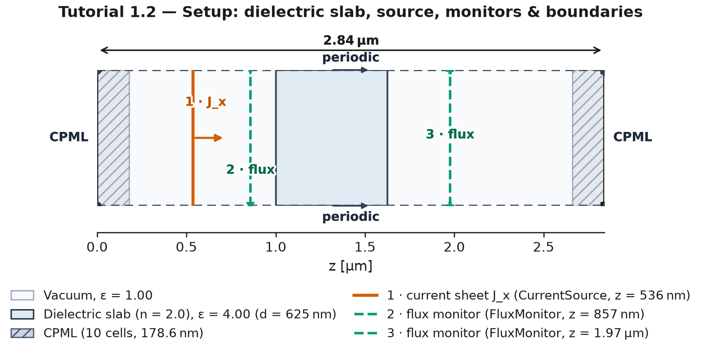

---

## 1. Publication figure style (`wakis.figstyle`)

### Core API

| Function / Constant | Signature / Value | Description |
| :--- | :--- | :--- |
| `apply_style` | `apply_style()` | Apply Wakis journal `rcParams` globally or as a `with figstyle.apply_style():` context manager. |
| `new_figure` | `new_figure(width_in=7.0, height_in=None, ncols=1, nrows=1, **subplots_kw)` | Create `(fig, axes)` at literal print width (`FULL_WIDTH_IN = 7.0`, `HALF_WIDTH_IN = 3.4`). |
| `series_style` | `series_style(index, *, with_marker=True, with_line=True, lw=1.9, ms=5.2, markevery=None)` | Return a distinct `(color, linestyle, marker)` dictionary from the Okabe–Ito palette for 1D curve `index`. |
| `symmetric_limits` | `symmetric_limits(values, percentile=None)` | Return symmetric `(-vmax, +vmax)` limits for diverging real fields (`CMAP_DIVERGING = "RdBu_r"`). |
| `spectrum_grid` | `spectrum_grid(ax)` | Enable a subtle dotted grid on spectral, dispersion, or convergence panels. |
| `place_legend_below` | `place_legend_below(ax, ncol=None, y_offset=-0.22)` | Move a panel's legend below the x-axis label without frame or data occlusion. |
| `finish` | `finish(fig, *, max_panels=3, auto_legend_below=False)` | Enforce minimum font size (`8.5 pt`), darken low-contrast text to WCAG $\ge 4.5:1$, add white halos to in-axes annotations on field maps, warn if $> 3$ content panels, and apply layout. |
| `save` | `save(fig, path, *, dpi=200, close=False, auto_legend_below=True)` | Run `finish(fig)` and save a `200 dpi` PNG. |

### Colormaps

* **`figstyle.CMAP_DIVERGING`** (`"RdBu_r"`): real signed field components ($E_x, H_y, \dots$) paired with `figstyle.symmetric_limits(field)`.
* **`figstyle.CMAP_MAGNITUDE`** (`"inferno"`) and **`figstyle.CMAP_INTENSITY`** (`"magma"`): non-negative field magnitudes $|\mathbf{E}|$ and energy/Poynting intensities.
* **`figstyle.CMAP_EPS`** (`"wakis_eps"`): light grey permittivity ramp (`#ffffff` $\to$ `#d0d5dd`) so material outlines, field contours, and text annotations remain high-contrast.

---

## 2. Two-figure setup schematics & setup table (`wakis.schematic`)

Every tutorial begins with **Figure A** (`00a_setup_geometry.png`), followed immediately by the **Markdown setup table** in the notebook prose, and **Figure B** (`00b_setup_mesh_and_excitation.png`). A third setup figure (`00c_...`) is added only when a tutorial runs a genuinely distinct geometry or boundary configuration.

### Convenience one-call workflow (`save_setup_figures`)

```python
from wakis import schematic

res = schematic.save_setup_figures(
    solver,
    "figures/",
    plane="zx",
    unit="µm",
    material_names={"region_0": "Dielectric slab (n = 2.0)"},
    sources=[src],
    monitors=[flux_r, flux_t],
    wavelength=1.0e-6,
    min_feature=0.625e-6,
    title_geometry="Tutorial 1.2 — Setup: dielectric slab, source, monitors & boundaries",
    title_mesh="Tutorial 1.2 — Discretization and excitation",
    variations=[
        {"name": "Reference run", "details": "Vacuum everywhere (ε_r = 1.00)"},
        {"name": "Slab run", "details": "Dielectric slab ε_r = 4.00 (d = 625 nm)"},
    ],
)
print(res["table"])
```

### Core API

| Function | Signature | Purpose |
| :--- | :--- | :--- |
| `plot_schematic` | `plot_schematic(solver_or_grid, plane="auto", ax=None, cut_coord=None, structures=None, material_names=None, sources=None, monitors=None, probes=None, unit="auto", show_mesh=False, mesh_every=None, mesh_zoom=False, wavelength=None, freq=None, include_3d=False, title=None, width_in=7.0, height_in=None)` | Render **Figure A** (`00a_setup_geometry.png`): scale domain, filled materials, graphical boundaries with one short tag per face outside the domain box, numbered source/monitor symbols ($\le 6$ in-axes tags), one dimension arrow per physical axis, and a compact legend below the axes. Hides the meaningless transverse axis on 1D domains and formats numbers + upright units with a thin space (`\u2009`). |
| `plot_mesh_and_excitation` | `plot_mesh_and_excitation(solver_or_grid, plane="auto", cut_coord=None, structures=None, material_names=None, sources=None, monitors=None, probes=None, unit="auto", mesh_every=None, zoom_bounds=None, wave_packet_center=None, wavelength=None, freq=None, min_feature=None, bandwidth_def="-3dB", title=None, width_in=7.0, height_in=None)` | Render **Figure B** (`00b_setup_mesh_and_excitation.png`) with 3 panels: (a) mesh & $1\times$ zoom inset annotated with $\Delta$, $\text{cells}/\lambda$ in $n_{\max}$, and cells across the smallest feature; (b) spatial wave packet with $1/e$ extent and CPML/material shading; (c) source pulse $s(t)$ and spectrum $|S(f)|$ with $f_0$, bandwidth (`-3 dB` or `1/e`), and shaded simulated band. |
| `setup_table` | `setup_table(solver_or_grid, plane="auto", cut_coord=None, structures=None, material_names=None, sources=None, monitors=None, probes=None, unit="auto", wavelength=None, freq=None, min_feature=None, variations=None)` | Return a GitHub-flavored Markdown table summarizing domain size & cell counts, discretization metrics, every boundary face (`-x` through `+z`), materials, sources, monitors, and run variations. |
| `save_setup_figures` | `save_setup_figures(solver_or_grid, out_dir, *, prefix="00", suffix="", ...)` | Render and save `00a_setup_geometry.png`, `00b_setup_mesh_and_excitation.png`, and `00_setup_table.md`, returning a dictionary with paths and the Markdown table string. |
| `draw_mesh` | `draw_mesh(ax, solver_or_grid, plane="auto", unit="m", every=None, wavelength=None, freq=None, zoom_inset=False, zoom_bounds=None, color="#6B7280", alpha=0.42, linewidth=0.5, show_cpw=True)` | Overlay uniform/graded Cartesian grid lines (`GridFIT3D`), quadtree subgrid patches (`QuadMesh`), or unstructured triangle/tet/prism edges (`wakis.unstructured`), plus an optional $1\times$ zoom inset. |
| `overlay_geometry` | `overlay_geometry(ax, solver_or_grid, plane="auto", unit="m", orientation="2d", structures=None, material_names=None, sources=None, monitors=None, probes=None, show_boundaries=True, show_materials=True, show_sources=False, show_monitors=False, fill_materials=False)` | Draw material outlines, hatched CPML layers, boundary tags, and optional source/monitor markers directly on top of a 2D field map (`orientation="2d"`) or a 1D/space-time field plot (`orientation="1d"`). |
| `extract_setup_info` | `extract_setup_info(solver_or_grid, plane="auto", cut_coord=None, structures=None, material_names=None, sources=None, monitors=None, probes=None)` | Inspect a Wakis solver/grid and return a normalized dictionary of domain bounds, short boundary tags, detailed boundary labels, CPML thicknesses, material regions, sources, and monitors. |
| `in_axes_texts` | `in_axes_texts(ax)` | Return visible `ax.texts` placed inside the domain/axes box (enforced to $\le 6$ in `plot_schematic`). |
| `choose_length_unit` | `choose_length_unit(span_m, unit="auto")` | Select a human-readable upright length unit (`'nm'`, `'µm'`, `'mm'`, `'cm'`, `'m'`) and scale factor. |

### What is read automatically vs. passed explicitly

* **Read automatically from `solver` / `grid`**:
  * Domain bounds, physical node coordinates, cell counts (`Nx, Ny, Nz`), and minimum cell spacing.
  * Per-face boundary conditions (`bc_low`, `bc_high`), `n_pml` cell counts and physical CPML thickness per face, and Bloch wavevector `k_bloch` (`_bloch_axes`).
  * Assigned template shapes (`Box`, `Cylinder`, `PolySlab`, or custom shapes with `.bounds` passed to `assign_materials`), CAD solids in `grid.stl_solids`, or contiguous dielectric/PEC regions from `solver.ieps`.
  * Sources and monitors stored on `solver`.
* **Passed explicitly when not stored on `solver`**:
  * `sources=[...]` and `monitors=[...]` if building the schematic before calling `solver.emsolve(...)` or when stepping manually with `solver.one_step()`.
  * `probes=[...]` for ad-hoc array index readouts (`solver.E[ix, iy, iz, 'x']`).
  * `material_names={...}` to give human-readable names (e.g. `{"region_0": "SiO₂ slab"}`) to numeric permittivity regions.

---

## 3. Electromagnetic particle-in-cell benchmark figures (`wakis.particles`)

Generated by `examples/017_particles_plasma_oscillation_and_gyration.py` (metrics written to `examples/017_particles_plasma_oscillation_and_gyration.json`):

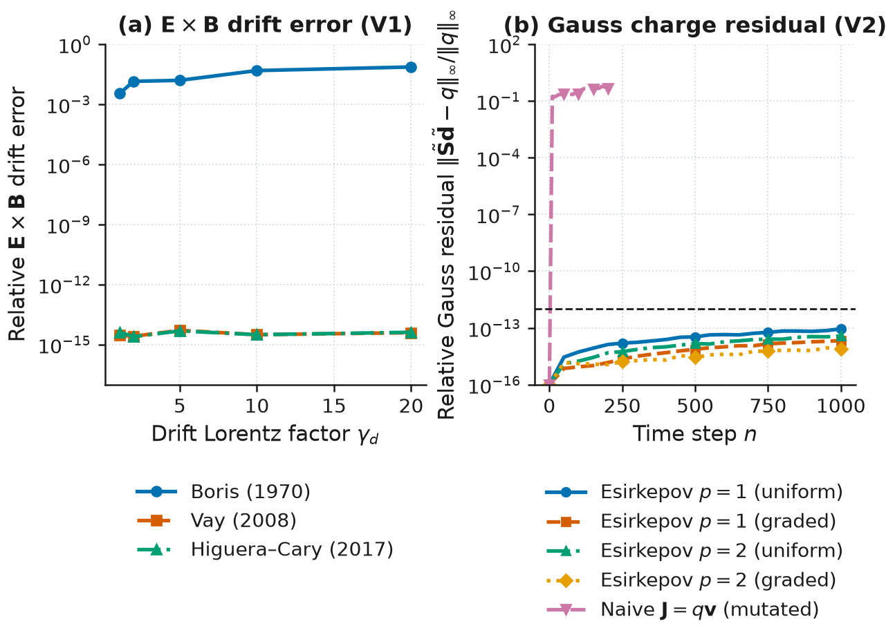

* **Figure (`img/particles_pushers_and_charge_conservation.png`)**: (a) Relativistic $\mathbf{E}\times\mathbf{B}$ drift error vs drift Lorentz factor $\gamma_d \in [1.1, 20.0]$: the Boris pusher drift error grows from $3.44\times 10^{-3}$ ($\gamma_d = 1.1$) to $7.24\times 10^{-2}$ ($\gamma_d = 20.0$), whereas Vay (2008) ($\le 5.16\times 10^{-15}$) and Higuera–Cary (2017) ($\le 4.82\times 10^{-15}$) cancel the drift fixed point to machine precision; (b) 3D discrete Gauss's law relative residual $\|\tilde{\mathbf{S}}\tilde{\mathbf{d}} - q\|_\infty / \|q\|_\infty$ over $1000$ steps with $1024$ relativistic electrons for Esirkepov $p=1$ ($8.86\times 10^{-14}$ uniform, $2.11\times 10^{-14}$ graded) and $p=2$ ($3.74\times 10^{-14}$ uniform, $8.72\times 10^{-15}$ graded) compared against a mutated naive $\mathbf{J}=q\mathbf{v}$ midpoint deposition ($5.83\times 10^{-1}$).

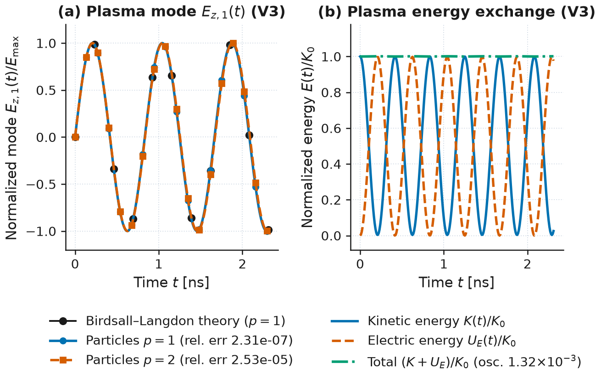

* **Figure (`img/particles_cold_plasma_oscillation.png`)**: (a) Longitudinal cold electron plasma oscillation mode $E_{z,1}(t)/E_{\max}$ in a $32\text{ cells}/\lambda$ periodic box ($\omega_{p0}/2\pi = 1.2\text{ GHz}$) for $p=1$ (relative frequency error $2.31\times 10^{-7}$ vs the Birdsall–Langdon discrete prediction $\omega_p^{\text{pred}} = 7.54148\times 10^9\text{ rad/s}$) and $p=2$ (relative frequency error $2.53\times 10^{-5}$ vs $\omega_p^{\text{pred}} = 7.51728\times 10^9\text{ rad/s}$); (b) reversible kinetic $K(t)/K_0$ and electric field energy $U_E(t)/K_0$ exchange with bounded leapfrog total energy oscillation $\max|K + U_E - K_0|/K_0 = 1.32\times 10^{-3}$ ($(\omega_p\Delta t)^2/4 = 1.32\times 10^{-3}$, secular drift $1.41\times 10^{-7}$) and Gauss residual $1.03\times 10^{-15}$.

Generated by `examples/018_particles_gpu_throughput.py` (metrics written to `examples/018_particles_gpu_throughput.json` using explicit `coupled_*` and `stage_sum_*` keys; the 1-thread CPU baseline strips unused setup attributes `imu`, `sigma`, `itA`, `J_old`, `grid.L/iA/tL/itA`, `ps._q0_buf/_H_prev`, `solver._particles_q_bg`, replaces `ps._itA_arr` with the uniform-cube scalar `float(n_grid**2)`, shares one CSR `indptr` between `tDsiDmuiDaC` and `itDaiDepsDstC`, averages $5$ steps at $N_p = 10^4$ and $3$ steps at $N_p \in \{10^5, 10^6, 10^7\}$, and resets `ps.n_particle_steps = 1` before timing $< 50$ steps so `coupled_one_step_s` excludes periodic cell sorting `sort_every = 50` while `stage_sum_step_s` includes `sort_amortized_s = sort_call_s / 50`):

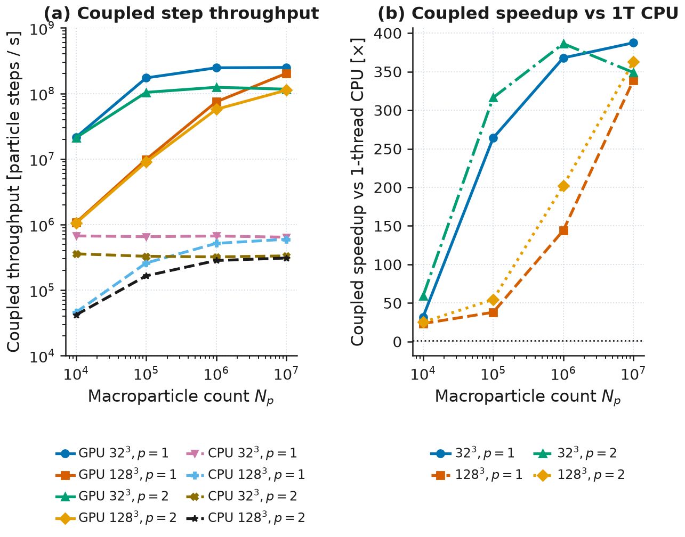

* **Figure (`img/particles_gpu_throughput_scaling.png`)**: (a) Coupled `solver.one_step()` particle + field throughput [particle steps / s] (`coupled_particle_steps_per_s`) across $N_p \in \{10^4, 10^5, 10^6, 10^7\}$ macroparticles on $32^3$ ($32,768$ cells) and $128^3$ ($2,097,152$ cells) periodic grids for spline orders $p=1$ (CIC) and $p=2$ (TSC) on an NVIDIA L4 GPU (`use_gpu=True`, CuPy `14.2.0`, CUDA `12.9 (12090)`, `gpu_one_step_variant = "_one_step"`) vs the 1-process, 1-thread unoptimised vectorised NumPy M1 CPU baseline on the same VM (`Intel(R) Xeon(R) CPU @ 2.20GHz`, $8$ vCPUs, `MKL_NUM_THREADS = OMP_NUM_THREADS = OPENBLAS_NUM_THREADS = 1`, `cpu_one_step_variant = "_one_step"`), reaching $2.488\times 10^{8}\text{ part-steps/s}$ ($32^3, p=1$), $1.162\times 10^{8}\text{ part-steps/s}$ ($32^3, p=2$), $2.024\times 10^{8}\text{ part-steps/s}$ ($128^3, p=1$), and $1.120\times 10^{8}\text{ part-steps/s}$ ($128^3, p=2$) at $N_p = 10^7$ (compared with $6.421\times 10^{5}$, $3.329\times 10^{5}$, $5.975\times 10^{5}$, and $3.089\times 10^{5}\text{ part-steps/s}$ on the 1-thread CPU baseline); (b) L4 GPU coupled `solver.one_step()` speedup (`coupled_speedup`) over the 1-process, 1-thread unoptimised vectorised NumPy M1 CPU baseline on the same VM, scaling from $23.4\text{–}59.1\times$ at $N_p = 10^4$ to $387.4\times$ ($32^3, p=1$; $367.8\times$ at $N_p = 10^6$), $348.9\times$ ($32^3, p=2$; $386.3\times$ at $N_p = 10^6$), $338.7\times$ ($128^3, p=1$), and $362.7\times$ ($128^3, p=2$) at $N_p = 10^7$.

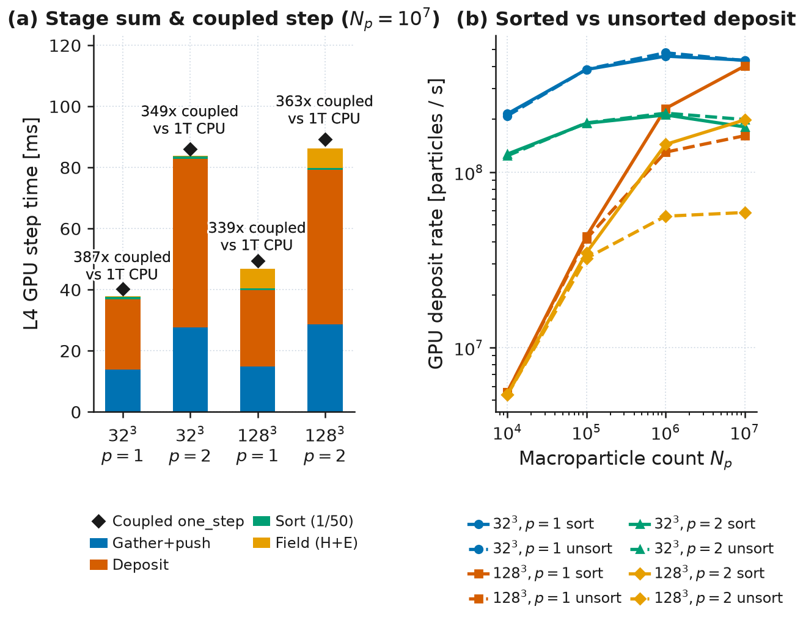

* **Figure (`img/particles_gpu_kernel_breakdown.png`)**: (a) L4 GPU sum of stage times (`stage_sum_step_s`) at $N_p = 10^7$ (`37.88 ms` on $32^3, p=1$; `83.79 ms` on $32^3, p=2$; `46.95 ms` on $128^3, p=1$; `86.31 ms` on $128^3, p=2$) and diamond markers (`Coupled one_step`) showing the measured coupled `solver.one_step()` times (`coupled_one_step_s`: `40.20 ms`, `86.09 ms`, `49.41 ms`, and `89.25 ms`), decomposed into fused `gather + push` ($13.90\text{ ms}$, $27.60\text{ ms}$, $14.91\text{ ms}$, $28.70\text{ ms}$), Esirkepov `float64` `atomicAdd` `deposit` ($23.03\text{ ms}$, $55.24\text{ ms}$, $24.87\text{ ms}$, $50.45\text{ ms}$), amortised periodic cell sort (`1/50` of a $38.50\text{–}38.54\text{ ms}$ sort call $= 0.77\text{ ms/step}$), and FIT `field` step ($0.18\text{ ms}$ on $32^3$, $6.39\text{ ms}$ on $128^3$), with bar labels explicitly reporting `387x coupled vs 1T CPU`, `349x coupled vs 1T CPU`, `339x coupled vs 1T CPU`, and `363x coupled vs 1T CPU`; (b) GPU Esirkepov deposit rate [particles / s] across all four $(32^3, 128^3) \times (p=1, p=2)$ configurations with and without periodic cell sorting: on $128^3$ ($48\text{ MiB}$ edge accumulators), cell sorting accelerates deposit at $N_p = 10^7$ by $2.49\times$ for $p=1$ ($4.020\times 10^{8}$ vs $1.612\times 10^{8}\text{ particles/s}$) and by $3.37\times$ for $p=2$ ($1.982\times 10^{8}$ vs $5.884\times 10^{7}\text{ particles/s}$).

Generated by `examples/019_particles_multi_gpu_scaling.py` (metrics written to `examples/019_particles_multi_gpu_scaling.json`):

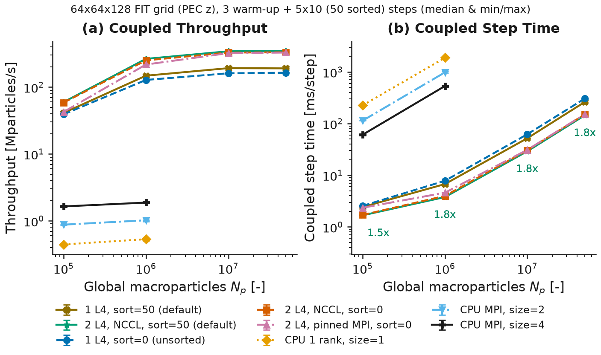

* **Figure (`img/particles_multi_gpu_scaling.png`)**: (a) Coupled `solver.one_step()` throughput (median with min/max error bars across independent repeats after warm-up) vs global macroparticle count for `"1 L4, this code, size=1"` (`particles_comm="none"`), multi-GPU NCCL (`particles_comm="nccl"`), multi-GPU pinned-host MPI (`particles_comm="mpi"`), and CPU MPI rank counts under identical grid, boundary conditions (periodic transverse, PEC longitudinal), and a uniform global particle distribution filtered per rank by $z$-slab (best-case load balance); (b) corresponding coupled step wall time (median with min/max error bars) annotated with 2-GPU NCCL speedups.

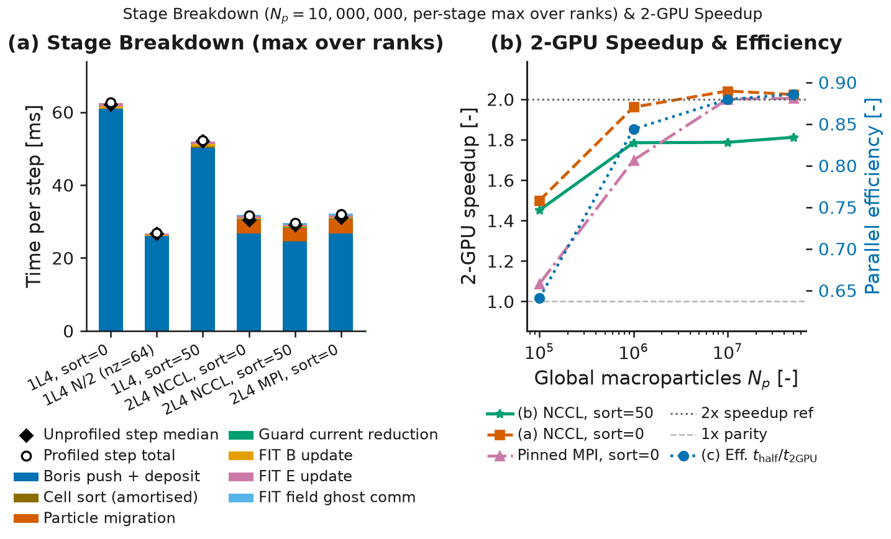

* **Figure (`img/particles_multi_gpu_stage_breakdown.png`)**: (a) Stacked per-step stage breakdown from a separate profiled run (Boris push + Esirkepov deposit, particle migration, guard current reduction, FIT magnetic update, FIT electric update, and FIT field ghost communication, noting that per-stage device synchronizations inflate the profiled stage sum relative to the overlaid unprofiled step median diamond markers); (b) 2-GPU speedup vs `"1 L4, this code, size=1"` comparing the GPU-to-GPU NCCL path against the pinned-host MPI fallback, the `1x parity` line, and the `2x reference` line.

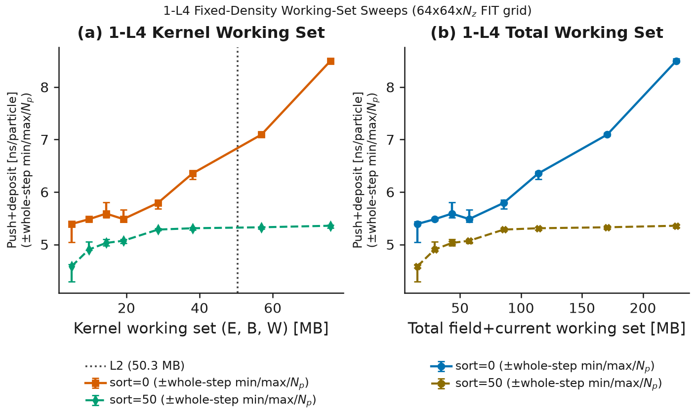

* **Figure (`img/particles_multi_gpu_working_set.png`)**: (a) 1-L4 per-particle push and deposit time across the fixed-density longitudinal grid sweep vs the kernel working set (`E`, `B_n`, `Wx`, `Wy`, `Wz`) with the L2 cache size marked, comparing unsorted (`sort_every=0`) and cell-sorted execution; (b) the same sweep plotted against the total field and current working set.

Generated by `examples/022_particles_two_stream_instability.py` (metrics written to `examples/022_particles_two_stream_instability.json`):

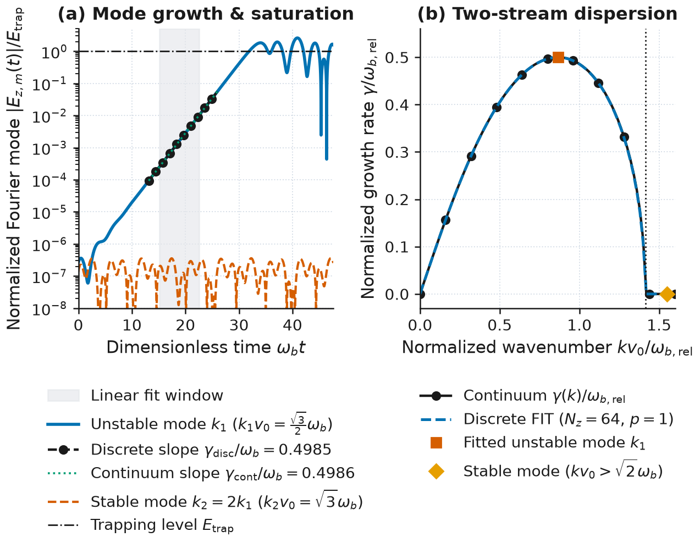

* **Figure (`img/particles_two_stream_growth.png`)**: (a) Normalised Fourier amplitude $|E_{z,1}(t)|/E_\text{trap}$ of the seeded unstable mode $k_1 v_0 = (\sqrt{3}/2)\,\omega_b$ on a log scale, with the linear fit window (shaded; start set by the decay of the fast $\omega_+$ oscillation, end by $\alpha_\text{sat} E_\text{trap}$), the fitted points, the discrete and continuum slopes, the stable mode $k_2 = 2k_1$ and the trapping level; (b) growth rate $\gamma(k)/\omega_{b,\text{rel}}$ of the continuum and discrete FIT ($N_z = 64$, $p = 1$) dispersion relations, with the fitted unstable mode and the stable mode marked. Fitted, discrete and continuum rates are in `metrics` of the JSON.

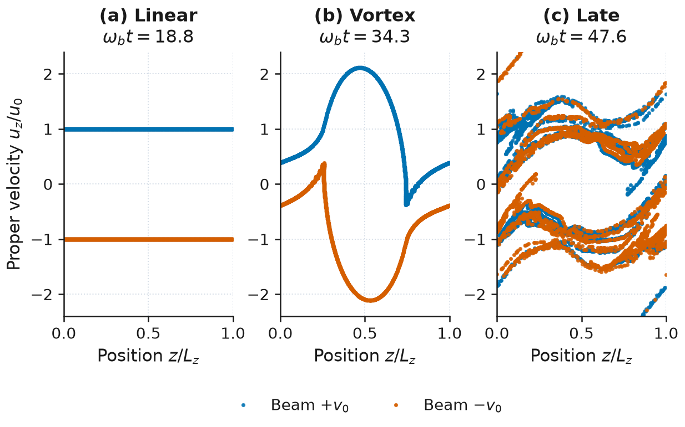

* **Figure (`img/particles_two_stream_phase_space.png`)**: Longitudinal phase space $(z/L_z,\,u_z/u_0)$ of the two counter-streaming beams in (a) the linear phase, (b) at saturation (trapping vortex) and (c) late in the nonlinear phase.

Generated by `examples/021_particles_numerical_cherenkov.py` (metrics written to `examples/021_particles_numerical_cherenkov.json`; Cloud Batch, 1 NVIDIA T4):

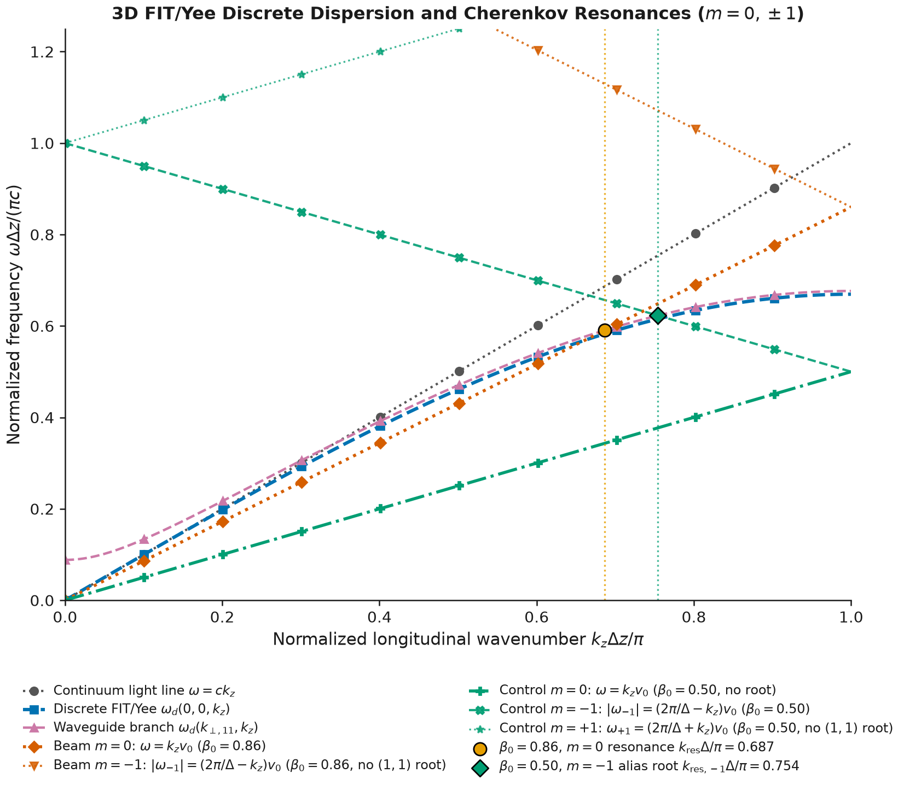

* **Figure (`img/particles_numerical_cherenkov_dispersion.png`)**: Discrete FIT/Yee dispersion $\omega_d(k_z)$ on axis and on the hollow-pipe $(1,1)$ waveguide branch, against the continuum light line and the beam lines $\omega = (k_z + 2\pi m/\Delta)v_0$ for $m = 0, \pm 1$ at $\beta_0 = 0.86$ and for the sub-$v_\text{min}$ control at $\beta_0 = 0.50$. Marked: the predicted $m = 0$ resonance of the fast beam and the $m = -1$ alias resonance of the control.

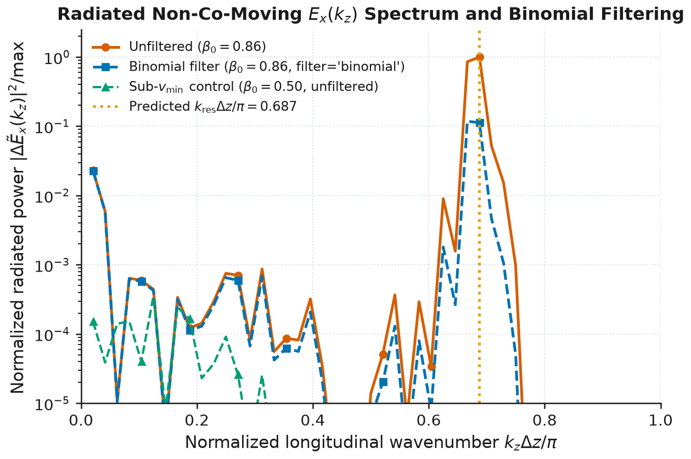

* **Figure (`img/particles_numerical_cherenkov_spectrum.png`)**: Radiated (non-co-moving) $|\Delta\tilde{E}_x(k_z)|^2$ spectrum of the $\beta_0 = 0.86$ beam without and with the compensated 1-2-1 binomial current filter, and of the sub-$v_\text{min}$ control in the $m = 0$ frame, with the predicted resonance marked. Predicted and measured peak bins, the filter power ratio and the control's $m = -1$ alias peak are in the JSON.

Generated by `examples/025_particles_phase_space_diagnostics.py --benchmark` (metrics written to `examples/025_particles_phase_space_diagnostics.json`; Cloud Batch, 1 NVIDIA L4):

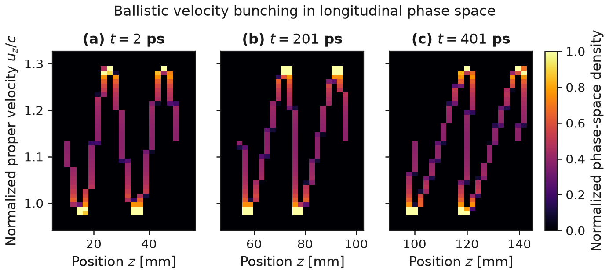

* **Figure (`img/particles_phase_space_bunching.png`)**: `PhaseSpaceMonitor` $(z,\,u_z)$ histograms of a velocity-modulated drifting electron beam at three times, showing ballistic bunching; colour is the normalised weighted phase-space density.

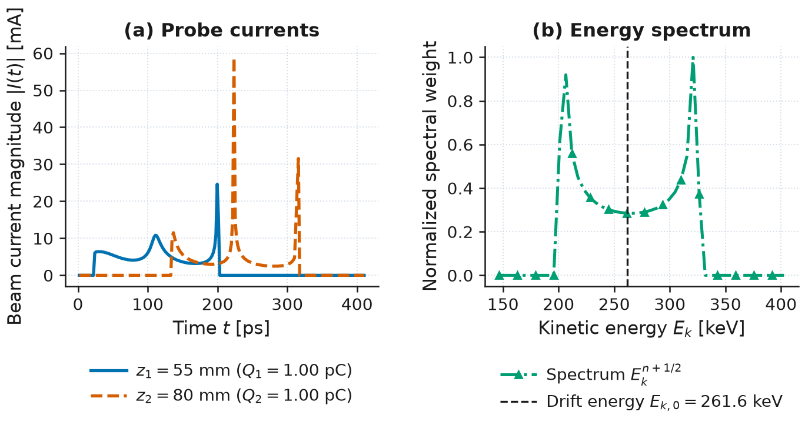

* **Figure (`img/particles_current_probes_and_spectrum.png`)**: (a) Beam current $|I(t)|$ from two `PlaneCurrentProbe`s at $z_1 = 55$ mm and $z_2 = 80$ mm, each with its total transmitted charge; (b) `EnergySpectrumMonitor` kinetic-energy spectrum at the half-step level $E_k^{n+1/2}$, with the drift energy marked. The JSON also holds the emittance checks and the monitor-overhead benchmark (`benchmark`, with GPU name and versions).

Generated by `examples/020_particles_beam_energy_balance.py` (metrics written to `examples/020_particles_beam_energy_balance.json`; Cloud Batch, 1 NVIDIA L4):

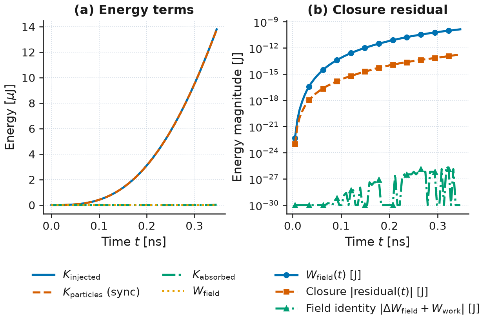

* **Figure (`img/particles_beam_energy_balance_time.png`)**: (a) Injected, particle (synchronised), absorbed and field energies vs time for an electron beam injected from a PEC cathode into a closed PEC box; (b) staggered field energy $W^n$, the total closure residual, and the discrete FIT field identity $|\Delta W_\text{field} + W_\text{work}|$, which holds to round-off.

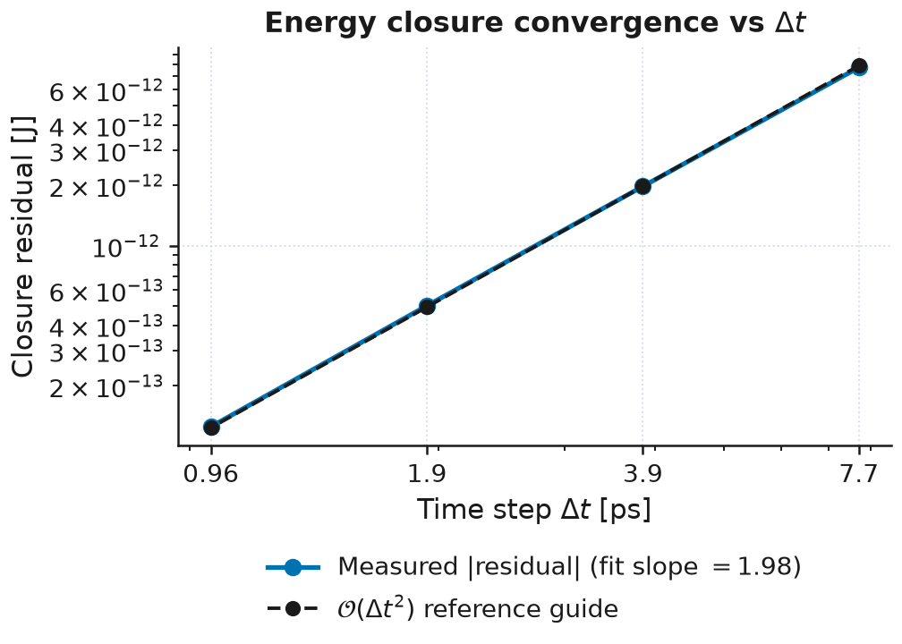

* **Figure (`img/particles_beam_energy_closure_convergence.png`)**: Total energy-closure residual vs $\Delta t$ at a fixed grid (four CFL levels, dt-independent lattice beam), with an $\mathcal{O}(\Delta t^2)$ guide; the fitted slope and the local slopes are in the JSON.

Generated by `examples/023_particles_child_langmuir_diode.py` (metrics written to `examples/023_particles_child_langmuir_diode.json`; Cloud Batch, 1 NVIDIA L4):

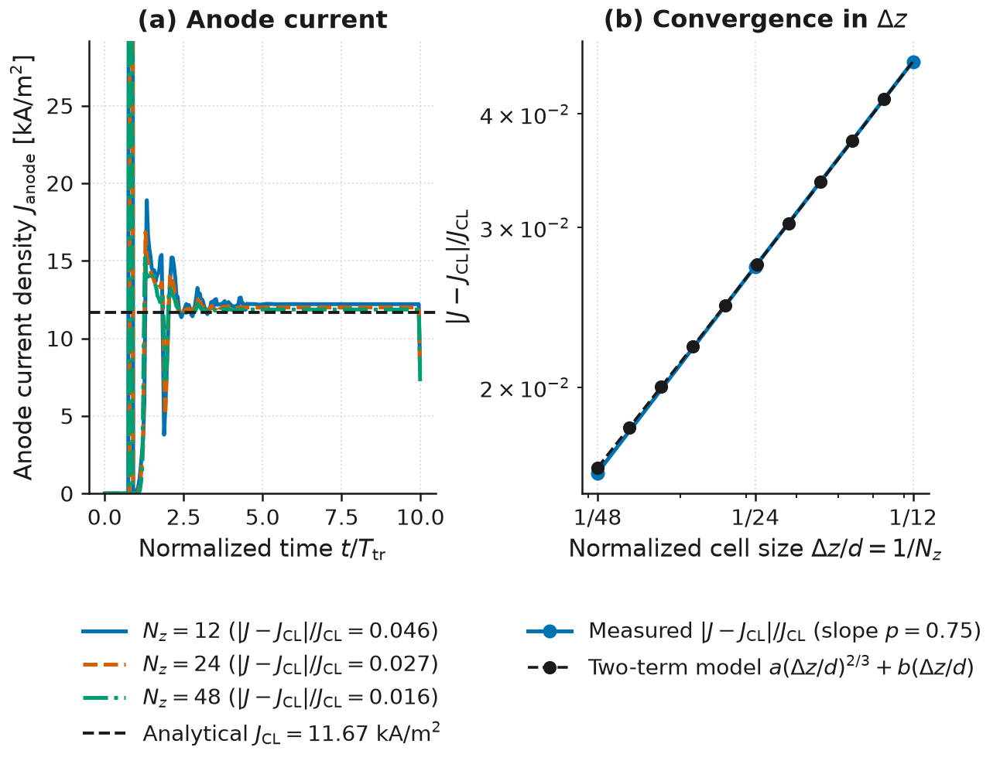

* **Figure (`img/particles_child_langmuir_current_vs_time.png`)**: (a) Anode current density vs time for a space-charge-limited planar diode at $N_z = 12, 24, 48$ against $J_\text{CL}$ (start-up spike clipped); (b) steady-current error vs $\Delta z/d$ with the two-term model $a(\Delta z/d)^{2/3} + b(\Delta z/d)$.

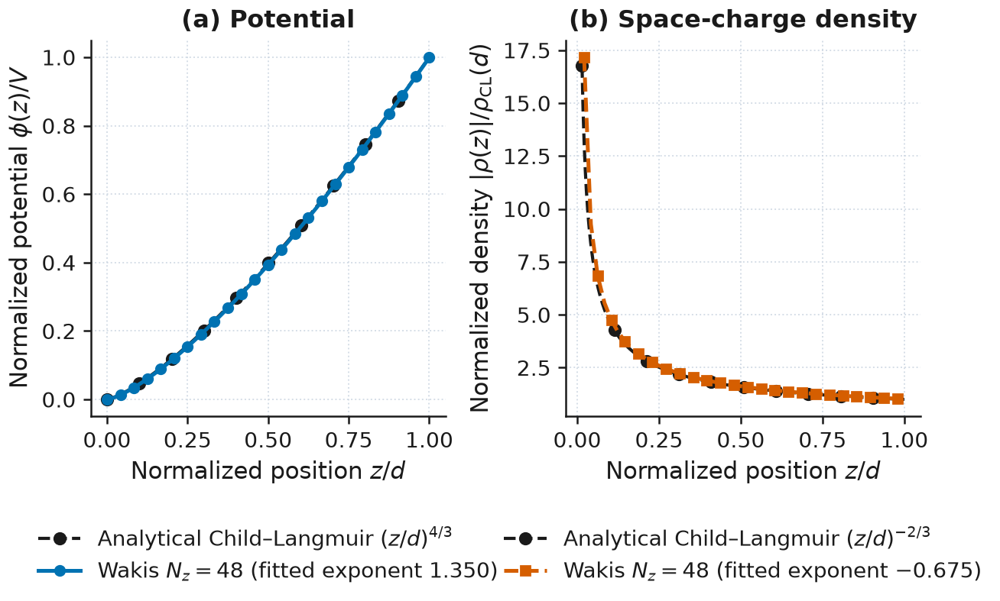

* **Figure (`img/particles_child_langmuir_profiles.png`)**: Steady potential $\phi(z)/V$ and space-charge density at $N_z = 48$ against the Child–Langmuir $(z/d)^{4/3}$ and $(z/d)^{-2/3}$ profiles.

Generated by `examples/024_particles_space_charge_waves.py` (metrics written to `examples/024_particles_space_charge_waves.json`; Cloud Batch, 1 NVIDIA A100-40GB; plotted data from the fine grid $(20, 1, 948)$):

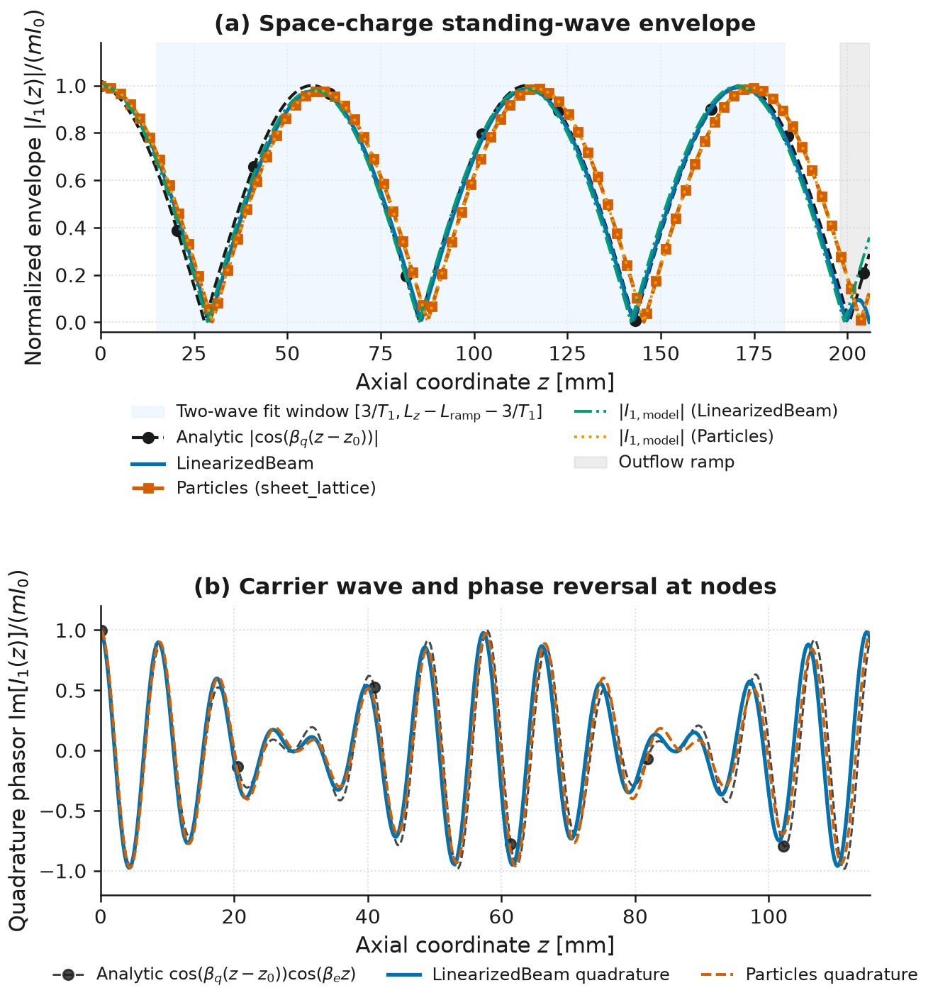

* **Figure (`img/particles_space_charge_waves_envelope.png`)**: (a) Normalised first-harmonic current envelope $|I_1(z)|/(mI_0)$ of a velocity-modulated electron beam in a PEC tunnel from `wakis.particles` (shape 2, `sheet_lattice`) and the `LinearizedBeam` fluid model, with each code's modal model $|I_{1,\mathrm{model}}|$ and the continuum curve $|\cos(\beta_q(z-z_0))|$ ($\beta_q = 54.58$ rad/m). The two codes have different discrete predictions, so their nodes do not coincide: the fitted $\beta_q$ is 55.3897 rad/m for `LinearizedBeam` (discrete modal prediction 55.3861 rad/m, residual $6.5\times10^{-5}$ within the slack $1.48\times10^{-4}$) and 54.3650 rad/m for the particles (D20 multistream prediction 54.3621 rad/m, residual $5.3\times10^{-5}$ within $7.8\times10^{-5}$). (b) Quadrature phasor $\mathrm{Im}[I_1(z)]/(mI_0)$ over one plasma wavelength $\lambda_q = 115.12$ mm, showing the carrier and its phase reversal at the envelope nodes.

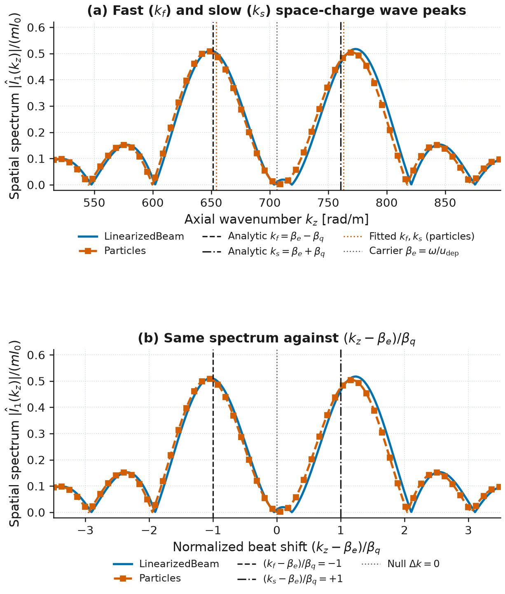

* **Figure (`img/particles_space_charge_waves_spectrum.png`)**: (a) Windowed spatial spectrum $|\hat I_1(k_z)|/(mI_0)$ of both codes, with the continuum fast and slow wave numbers $k_{f,s} = \beta_e \mp \beta_q$ and the peak positions fitted to the particle spectrum (654.29 and 763.02 rad/m, half-split 54.37 rad/m). The peak positions are for illustration only: the window resolution $2\pi/(z_\max - z_\min) \approx 37$ rad/m is coarser than the offsets shown, and the $\beta_q$ checks use the two-wave fit of panel (a) of the envelope figure. (b) The same spectra against $(k_z - \beta_e)/\beta_q$.

The JSON also holds both grids. On the coarse grid $(10, 1, 474)$ the single deterministic particle run misses its prediction by $4.95\times10^{-5}$, just above the slack $4.76\times10^{-5}$, which excludes macroparticle noise; the seed-averaged check, which includes it, passes on both grids ($5.45\times10^{-5} \le 9.70\times10^{-5}$ coarse, $5.64\times10^{-5} \le 8.47\times10^{-5}$ fine). The observed convergence order of the cross-code difference between the grids is 2.01. The measured DC depression (fine-grid seed mean 1.04754 %) agrees with the discrete model (1.04758 %) within the derived first-cell entrance bound described in the physics guide.

Generated by `studies/lb-modal-prediction/plot_figures.py` from the TD settle scan `studies/lb-modal-prediction/out/scan_<grid>.json` (`td_settle_scan.py`) and the D21 numbers `studies/lb-modal-prediction/out/d21_numbers_<grid>.json` (`d21_numbers.py`: `lb_first_pass_prediction`, `lb_error_decomposition` and the production `run_linearized_beam_drift`; Cloud Batch, n2-standard-4):

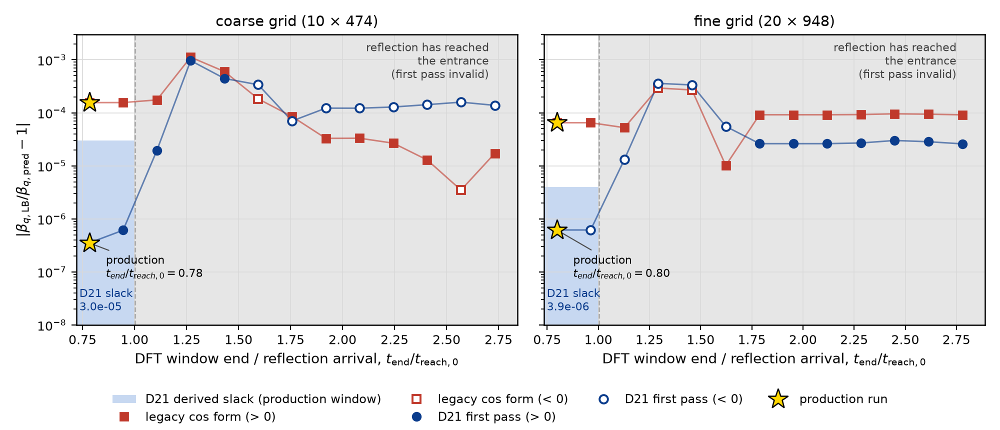

* **Figure (`img/lb_d21_settle_scan.png`)**: Residual $|\beta_{q,\mathrm{LB}}/\beta_{q,\mathrm{pred}} - 1|$ of the `LinearizedBeam` two-wave fit against the D21 first-pass prediction (circles) and the legacy cos-form prediction (squares; filled $> 0$, open $< 0$), for DFT windows ending at $t_{\mathrm{end}}/t_{\mathrm{reach},0}$, where $t_{\mathrm{reach},0}$ is the earliest arrival of the outflow reflection (upstream parasitic branch) at the entrance; (a) coarse grid $(10, 1, 474)$, (b) fine grid $(20, 1, 948)$. The shaded band is the derived D21 slack of the production window ($2.996\times10^{-5}$ coarse, $3.94\times10^{-6}$ fine, dominated by the parasitic-front bound $s_{\mathrm{front}}$). The stars are the production runs ($t_{\mathrm{end}}/t_{\mathrm{reach},0} = 0.782$ coarse, $0.797$ fine): D21 residual $+3.51\times10^{-7}$ and $-6.17\times10^{-7}$, legacy residual $+1.554\times10^{-4}$ and $+6.49\times10^{-5}$. The second window ($1.25\times$ settle, still before the arrival) stays at $\approx 6\times10^{-7}$ on both grids; once the reflection has reached the entrance (grey) the residual jumps to $\sim 10^{-3}$ and settles at the multi-bounce level ($\sim 10^{-4}$ coarse, $\sim 3\times10^{-5}$ fine), where neither first-pass model applies.

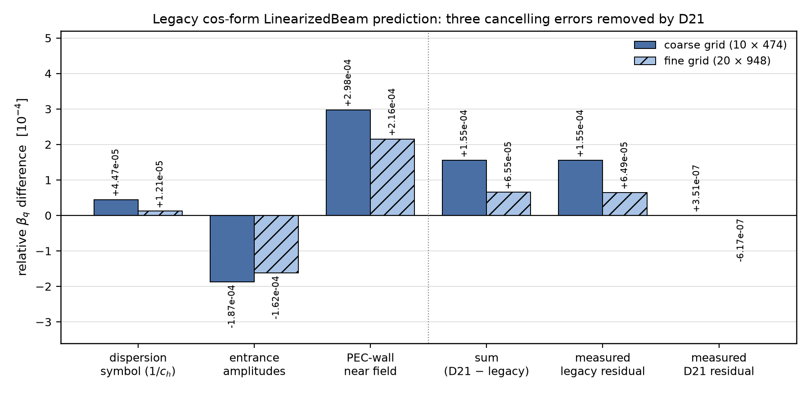

* **Figure (`img/lb_d21_error_decomposition.png`)**: `lb_error_decomposition` of the difference between the D21 and the legacy cos-form `LinearizedBeam` predictions, relative to the legacy one, coarse (solid) and fine (hatched): Crank–Nicolson dispersion symbol $1/c_h$ ($+4.47\times10^{-5}$ / $+1.21\times10^{-5}$), cos-form entrance amplitudes ($-1.873\times10^{-4}$ / $-1.621\times10^{-4}$), PEC-wall near field at $z = 0$ ($+2.977\times10^{-4}$ / $+2.155\times10^{-4}$) and their sum ($+1.551\times10^{-4}$ / $+6.55\times10^{-5}$), next to the measured residuals of the production run against the legacy prediction ($+1.554\times10^{-4}$ / $+6.49\times10^{-5}$) and against D21 ($+3.51\times10^{-7}$ / $-6.17\times10^{-7}$). The three terms partly cancel: their sum is 1.9 (coarse) to 3.3 (fine) times smaller than the PEC-wall term alone, so the legacy residual understates the size of each of its approximations.

---

## Unstructured FIT: exact adjoint and inverse design (`wakis.unstructured.adjoint`)

Generated by `studies/unstructured-adjoint/make_figures.py` from `results.json` and `fields.npz` of `shadow_focus.py` (Cloud Batch `uadj-demo-1`, n2-standard-4). The window check is `check_window.py` (`uadj-window-1`). Derivation: `docs/physicsguide_sections/unstructured_adjoint.md`. Setup: 2D TM, PEC cylinder r < 0.5 λ0, design annulus 0.5–1.25 λ0 (ε_r ∈ [1, 4] per triangle), graded triangle mesh (λ0/40 → λ0/20), radial CFS-PML, line source at (−2, 0) λ0, focus at (1.75, 0) λ0.

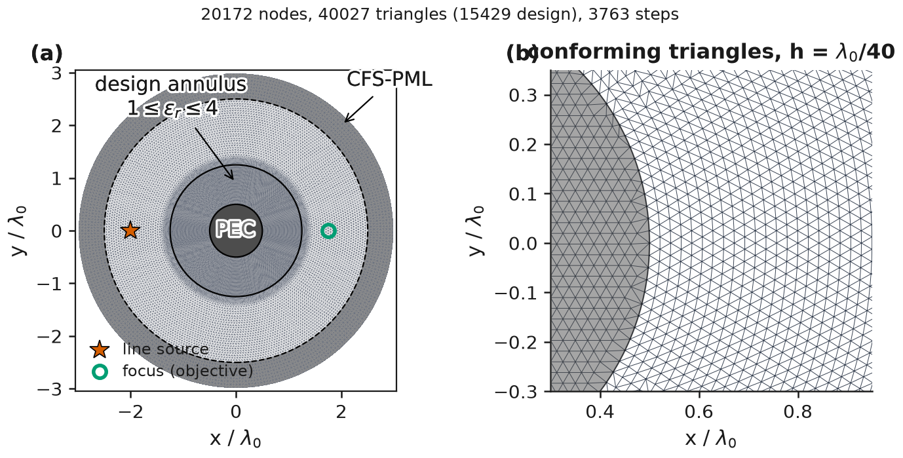

* **Figure (`studies/unstructured-adjoint/figures/00_setup_mesh.png`)**: (a) Domain with the PEC cylinder, the design annulus, the vacuum region and the PML ring (shaded), the source (star) and the focus (circle); 20172 nodes, 40027 triangles (15429 design), 3763 steps. (b) Zoom of the conforming triangles at the cylinder boundary (h = λ0/40).

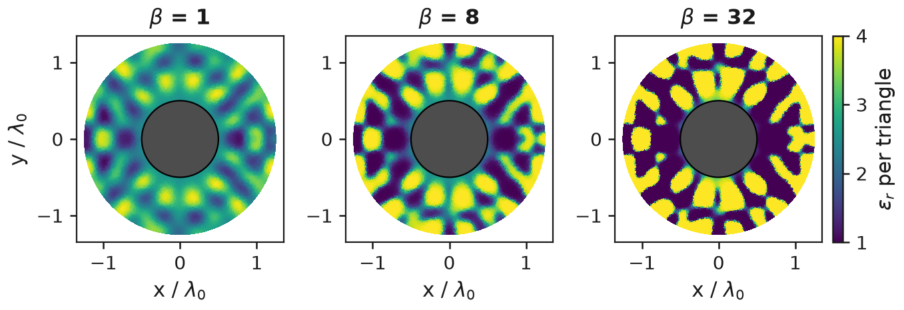

* **Figure (`studies/unstructured-adjoint/figures/01_design_evolution.png`)**: ε_r per triangle at the end of the β = 1, 8 and 32 stages (cone filter R = 0.08 λ0, tanh projection).

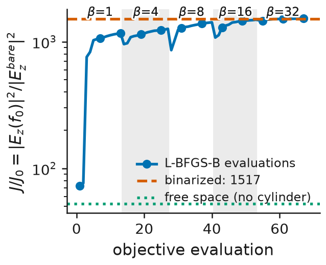

* **Figure (`studies/unstructured-adjoint/figures/02_objective.png`)**: J/J0 (focus intensity normalized by the bare cylinder on the same mesh) for each of the 68 L-BFGS-B evaluations, with the β stages shaded. Also shown: the binarized design (1517 over the optimized 60-period window; 1392 window-converged at 4–8 N_t) and the free-space level (J_free/J0 = 52.5).

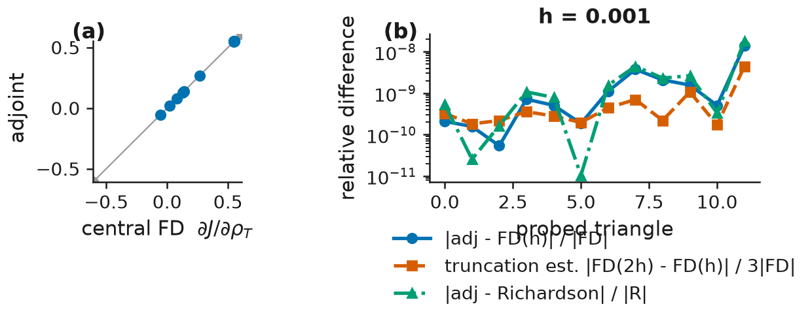

* **Figure (`studies/unstructured-adjoint/figures/03_gradient_vs_fd.png`)**: (a) Adjoint vs central-FD gradient (h = 1e-3) on 12 design triangles. (b) Relative differences, the truncation estimate |FD(2h) − FD(h)|/3 and the difference to the Richardson value. The absolute difference is 1–3e-10 for every cell, independent of |g|: the FD round-off floor.

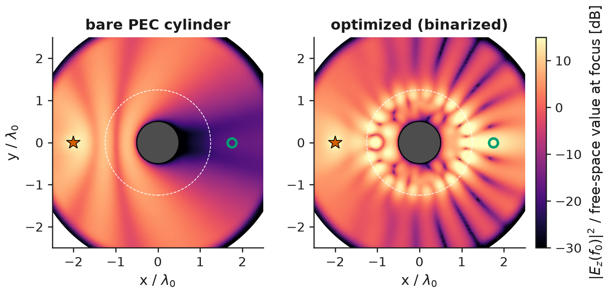

* **Figure (`studies/unstructured-adjoint/figures/04_fields.png`)**: |E_z(f0)|² in dB relative to the free-space intensity at the focus. Bare PEC cylinder (shadow at the focus: −17.2 dB) and binarized design (window-converged +14.2 dB, i.e. J/J0 = 1392).

## 4. 3D Cartesian subgridding (`wakis.subgrid3d`)

Generated by `studies/subgrid3d/plot_figures.py` from `studies/subgrid3d/results_{A,B,C}.json` (`run_study.py`; Cloud Batch jobs `sg3d-study-a-2`/`-b-2`/`-c-2`, n2-standard-8 / n2-highmem-8):

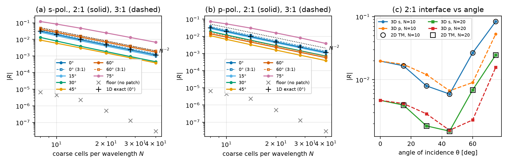

* **Figure (`img/subgrid3d_reflection.png`)**: Reflection $|R|$ of a planar 3D coarse/fine interface, from the exact time-discrete steady state in a Bloch column.
  * (a) s-polarisation and (b) p-polarisation against coarse cells per wavelength $N$, at 0–75°; 2:1 solid, 3:1 dashed. Also shown: the exact 1D closed form at normal incidence (+), the $N^{-2}$ guide and the measurement floor without a patch (×, 30°).
  * (c) $|R|$ against the angle at $N=10$ and 20, with the 2D TM result of `wakis.subgrid` (open symbols), which 3D s-polarisation reproduces to $1.5\times10^{-10}$.

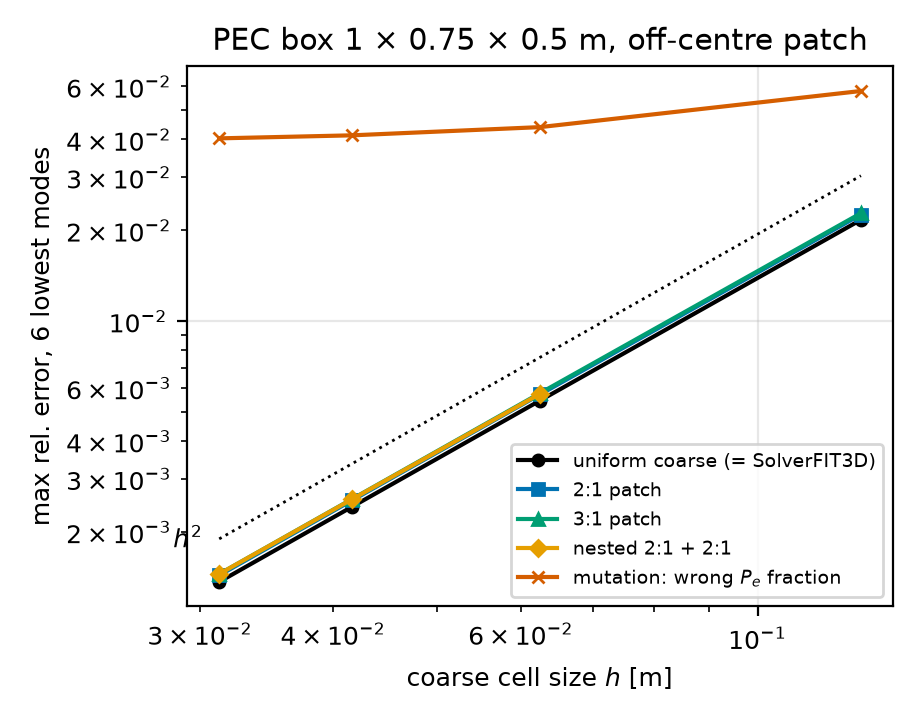

* **Figure (`img/subgrid3d_cavity_convergence.png`)**: Maximum relative error of the 6 lowest TE+TM eigenfrequencies of a $1\times0.75\times0.5$ m PEC box against the coarse cell size, for:
  * the uniform coarse grid (the `SolverFIT3D` operator);
  * an off-centre 2:1 or 3:1 patch;
  * a nested 2:1+2:1 patch;
  * the wrong-fraction mutation of $\mathbf P_e$.

  The observed orders are 1.99 / 1.99 / 1.99 / 1.98, and 0.27 for the mutation; the dotted line is the $h^2$ guide.

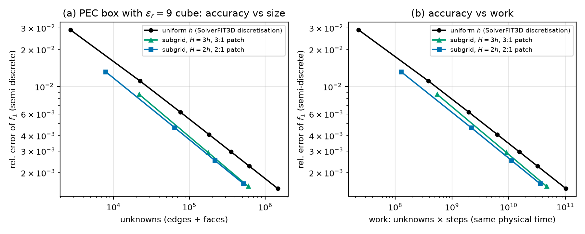

* **Figure (`img/subgrid3d_cost.png`)**: Relative error of the lowest resonance $f_1$ of a PEC box with an $\varepsilon_r=9$ cube. The resonance comes from a time-domain run (Hann-window DFT, mapped to the semi-discrete frequency); the reference $f^*=190.716$ MHz is the power-law extrapolation of the uniform arms, observed order 1.46.
  * (a) Error against unknowns (edges + faces).
  * (b) Error against work (unknowns × steps to the same physical time, each arm at $0.95\,\Delta t_\max$).
  * Arms: the uniform grid (the `SolverFIT3D` discretisation), and subgrids with $H=3h$ (3:1) or $H=2h$ (2:1) patches over the cube plus 0.1 m. At equal error the subgrid uses 1.7–2.4× fewer unknowns and 1.4–2.2× less work.

Generated by `studies/unstructured-pml3d/pml3d_reflection.py plot` from `studies/unstructured-pml3d/reflection.json` and `stability.json` (Cloud Batch `pml3d-refl-v2`, n2-highmem-8; `pml3d-stab-v1`, n2-standard-4):

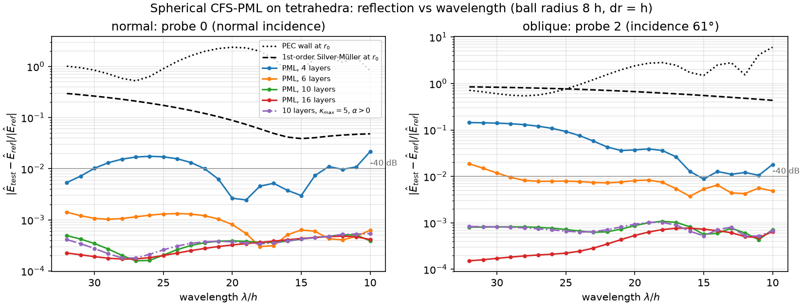

* **Figure (`img/unstructured_pml3d_reflection.png`)**: Spectral reflection $|\hat E_{test}-\hat E_{ref}|/|\hat E_{ref}|$ of the spherical CFS-PML of `UnstructuredFIT3D` (ball radius 8 h, layers dr = h, $R_{th}=10^{-8}$, $m=3$) against an identical-interior reference with 40 extra vacuum layers, for 4, 6, 10, 16 layers and $\kappa_{max}=5,\ \alpha=\omega_0/10$; baselines on the same ball: bare PEC wall and first-order Silver–Müller at $r_0$. (a) Centred z-dipole, probe at r = 7 h on the equator (normal incidence). (b) Radial dipole 1 h below the PML surface, probe at separation 60° (incidence 61° at the specular point). 10 layers: $\le 5.2\times10^{-4}$ normal, $\le 3.7\times10^{-3}$ oblique (worst probe), against 0.05–0.98 for Silver–Müller.

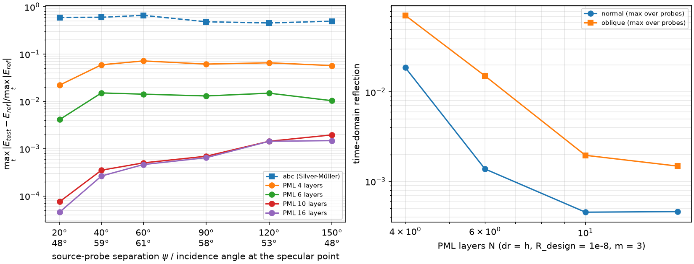

* **Figure (`img/unstructured_pml3d_angle_layers.png`)**: (a) Time-domain reflection $\max_t|E_{test}-E_{ref}|/\max_t|E_{ref}|$ vs source–probe separation ψ (tick labels give the incidence angle at the specular point, 48–61°) for Silver–Müller and 4–16 PML layers. (b) Worst-probe time-domain reflection vs the number of layers N at fixed dr: steep fall from N = 4 to 10 (discretised grading, $\sigma_{max}\,dr/c$ = 9.2 → 3.7), floor at ≈ 4.5e-4 (normal) from N = 10 to 16 whose origin is open.

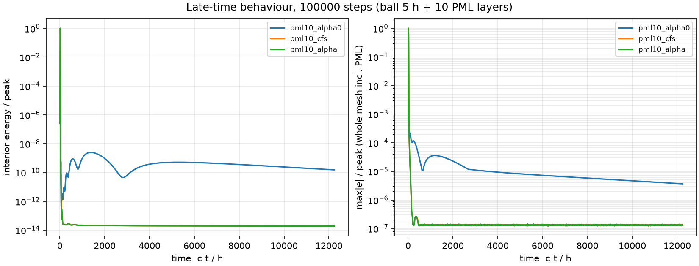

* **Figure (`img/unstructured_pml3d_late_time.png`)**: Interior energy (leapfrog-conserved form, r ≤ r0) and $\max|e|$ over the whole mesh, normalised to their peaks, over $10^5$ steps for a 10-layer PML (ball radius 5 h) with α = 0, α = ω0/10, and κ_max = 5 with α = ω0/10.
