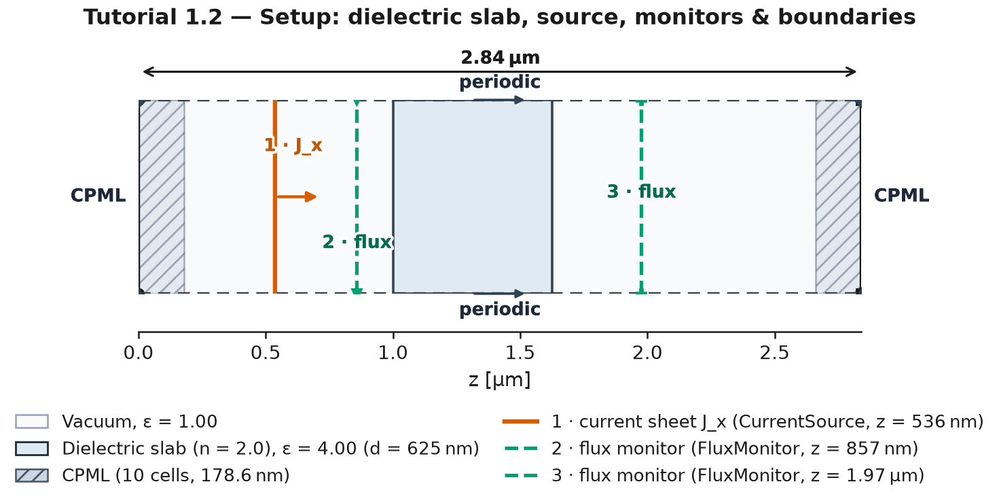
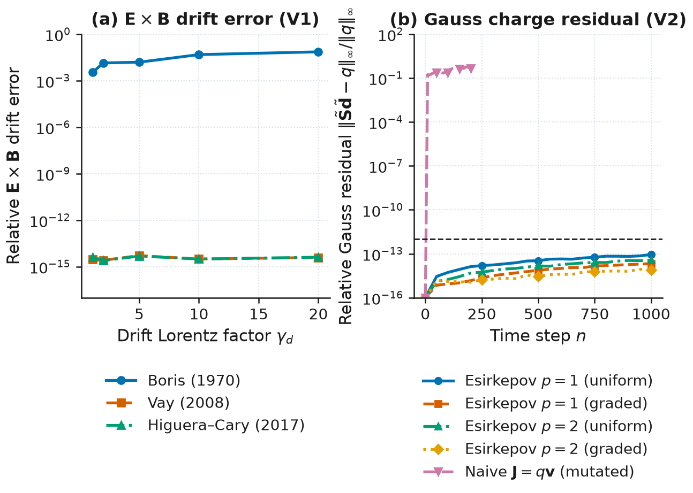
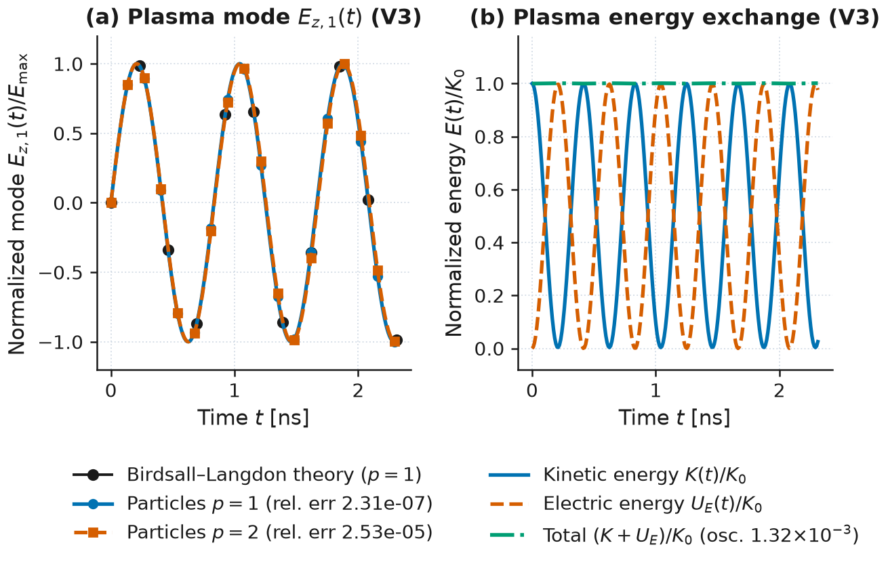
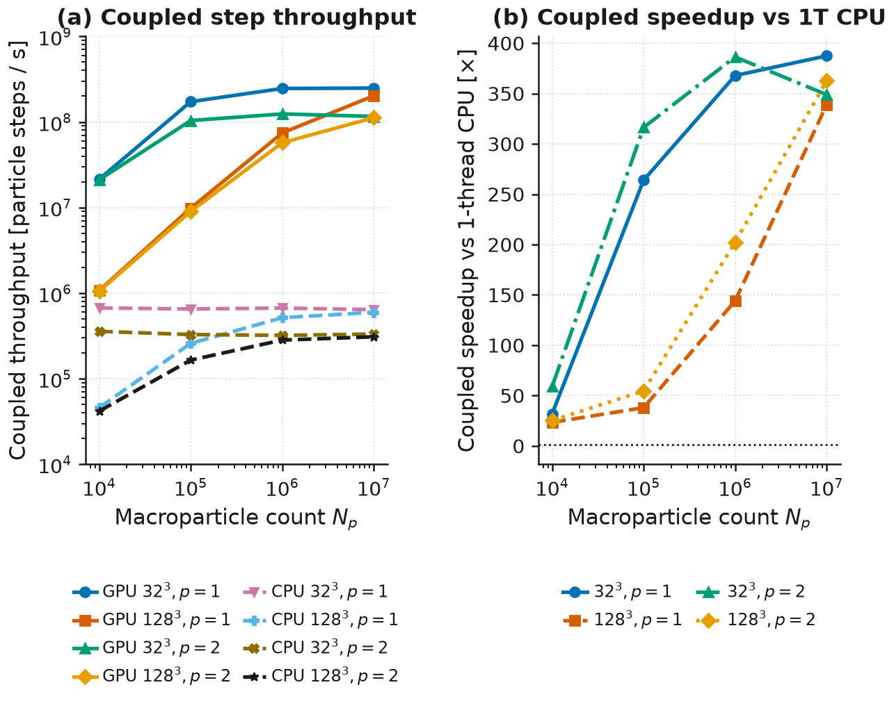
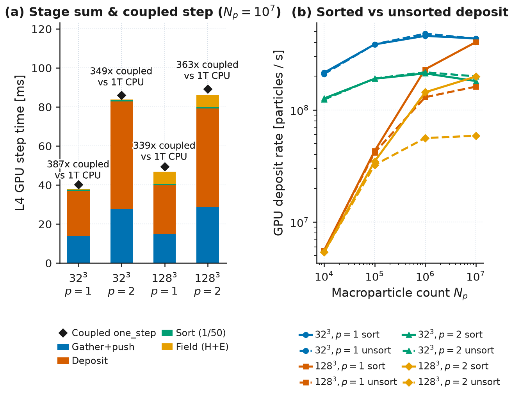

# Figure Style & Simulation-Setup Schematics

Wakis provides two publication-grade plotting modules for tutorials, notebooks, and scientific reports:

* **`wakis.figstyle`** — high-contrast, colour-blind-safe light journal style (`7.0 in` full width, `3.4 in` half width at `200 dpi`, near-black `#1a1a1a` ink, Okabe–Ito categorical palette with paired colour + linestyle + marker, symmetric `RdBu_r` diverging field colormap, and automatic minimum-font/contrast enforcement).
* **`wakis.schematic`** — automated simulation-setup schematics split into **two clean figures + a Markdown setup table** drawn directly from live Wakis solver, grid, source, and monitor objects:
  1. **Figure A (`00a_setup_geometry.png`, `plot_schematic`)**: domain drawn to scale, materials as filled regions, boundaries shown graphically (CPML as a hatched band, PEC as a thick dark edge, periodic/Bloch as dashed edges with matching arrows) with one short tag per face placed outside the domain box (`"CPML"`, `"PEC"`, `"periodic"`, `"Bloch"`), sources and monitors as distinct symbols with a short numbered tag ($\le 6$ labels inside the axes), one dimension arrow per physical axis, and a compact legend below the axes.
  2. **Setup table (`setup_table`)**: a GitHub-flavored Markdown table listing domain size and cell counts, discretization ($\Delta$, $\text{cells}/\lambda$ in $n_{\max}$, and cells across the smallest feature), every boundary face (`-x`, `+x`, `-y`, `+y`, `-z`, `+z`), materials ($\varepsilon_r$, $\mu_r$, model), sources, monitors, and run variations.
  3. **Figure B (`00b_setup_mesh_and_excitation.png`, `plot_mesh_and_excitation`)**: up to 3 panels showing (a) the computational mesh with every $n$-th line and a $1\times$ zoom inset at the smallest feature, (b) the wave packet in space at one instant along the propagation axis with its $1/e$ extent and CPML/material shading, and (c) the source pulse time trace $s(t)$ and spectrum $|S(f)|$ with $f_0$, bandwidth (`−3 dB` or `1/e`), and shaded simulated monitor band.



---

## 1. Publication figure style (`wakis.figstyle`)

### Core API

| Function / Constant | Signature / Value | Description |
| :--- | :--- | :--- |
| `apply_style` | `apply_style()` | Apply Wakis journal `rcParams` globally or as a `with figstyle.apply_style():` context manager. |
| `new_figure` | `new_figure(width_in=7.0, height_in=None, ncols=1, nrows=1, **subplots_kw)` | Create `(fig, axes)` at literal print width (`FULL_WIDTH_IN = 7.0`, `HALF_WIDTH_IN = 3.4`). |
| `series_style` | `series_style(index, *, with_marker=True, with_line=True, lw=1.9, ms=5.2, markevery=None)` | Return a distinct `(color, linestyle, marker)` dictionary from the Okabe–Ito palette for 1D curve `index`. |
| `symmetric_limits` | `symmetric_limits(values, percentile=None)` | Return symmetric `(-vmax, +vmax)` limits for diverging real fields (`CMAP_DIVERGING = "RdBu_r"`). |
| `spectrum_grid` | `spectrum_grid(ax)` | Enable a subtle dotted grid on spectral, dispersion, or convergence panels. |
| `place_legend_below` | `place_legend_below(ax, ncol=None, y_offset=-0.22)` | Move a panel's legend below the x-axis label without frame or data occlusion. |
| `finish` | `finish(fig, *, max_panels=3, auto_legend_below=False)` | Enforce minimum font size (`8.5 pt`), darken low-contrast text to WCAG $\ge 4.5:1$, add white halos to in-axes annotations on field maps, warn if $> 3$ content panels, and apply layout. |
| `save` | `save(fig, path, *, dpi=200, close=False, auto_legend_below=True)` | Run `finish(fig)` and save a `200 dpi` PNG. |

### Colormaps

* **`figstyle.CMAP_DIVERGING`** (`"RdBu_r"`): real signed field components ($E_x, H_y, \dots$) paired with `figstyle.symmetric_limits(field)`.
* **`figstyle.CMAP_MAGNITUDE`** (`"inferno"`) and **`figstyle.CMAP_INTENSITY`** (`"magma"`): non-negative field magnitudes $|\mathbf{E}|$ and energy/Poynting intensities.
* **`figstyle.CMAP_EPS`** (`"wakis_eps"`): light grey permittivity ramp (`#ffffff` $\to$ `#d0d5dd`) so material outlines, field contours, and text annotations remain high-contrast.

---

## 2. Two-figure setup schematics & setup table (`wakis.schematic`)

Every tutorial begins with **Figure A** (`00a_setup_geometry.png`), followed immediately by the **Markdown setup table** in the notebook prose, and **Figure B** (`00b_setup_mesh_and_excitation.png`). A third setup figure (`00c_...`) is added only when a tutorial runs a genuinely distinct geometry or boundary configuration.

### Convenience one-call workflow (`save_setup_figures`)

```python
from wakis import schematic

res = schematic.save_setup_figures(
    solver,
    "figures/",
    plane="zx",
    unit="µm",
    material_names={"region_0": "Dielectric slab (n = 2.0)"},
    sources=[src],
    monitors=[flux_r, flux_t],
    wavelength=1.0e-6,
    min_feature=0.625e-6,
    title_geometry="Tutorial 1.2 — Setup: dielectric slab, source, monitors & boundaries",
    title_mesh="Tutorial 1.2 — Discretization and excitation",
    variations=[
        {"name": "Reference run", "details": "Vacuum everywhere (ε_r = 1.00)"},
        {"name": "Slab run", "details": "Dielectric slab ε_r = 4.00 (d = 625 nm)"},
    ],
)
print(res["table"])
```

### Core API

| Function | Signature | Purpose |
| :--- | :--- | :--- |
| `plot_schematic` | `plot_schematic(solver_or_grid, plane="auto", ax=None, cut_coord=None, structures=None, material_names=None, sources=None, monitors=None, probes=None, unit="auto", show_mesh=False, mesh_every=None, mesh_zoom=False, wavelength=None, freq=None, include_3d=False, title=None, width_in=7.0, height_in=None)` | Render **Figure A** (`00a_setup_geometry.png`): scale domain, filled materials, graphical boundaries with one short tag per face outside the domain box, numbered source/monitor symbols ($\le 6$ in-axes tags), one dimension arrow per physical axis, and a compact legend below the axes. Hides the meaningless transverse axis on 1D domains and formats numbers + upright units with a thin space (`\u2009`). |
| `plot_mesh_and_excitation` | `plot_mesh_and_excitation(solver_or_grid, plane="auto", cut_coord=None, structures=None, material_names=None, sources=None, monitors=None, probes=None, unit="auto", mesh_every=None, zoom_bounds=None, wave_packet_center=None, wavelength=None, freq=None, min_feature=None, bandwidth_def="-3dB", title=None, width_in=7.0, height_in=None)` | Render **Figure B** (`00b_setup_mesh_and_excitation.png`) with 3 panels: (a) mesh & $1\times$ zoom inset annotated with $\Delta$, $\text{cells}/\lambda$ in $n_{\max}$, and cells across the smallest feature; (b) spatial wave packet with $1/e$ extent and CPML/material shading; (c) source pulse $s(t)$ and spectrum $|S(f)|$ with $f_0$, bandwidth (`-3 dB` or `1/e`), and shaded simulated band. |
| `setup_table` | `setup_table(solver_or_grid, plane="auto", cut_coord=None, structures=None, material_names=None, sources=None, monitors=None, probes=None, unit="auto", wavelength=None, freq=None, min_feature=None, variations=None)` | Return a GitHub-flavored Markdown table summarizing domain size & cell counts, discretization metrics, every boundary face (`-x` through `+z`), materials, sources, monitors, and run variations. |
| `save_setup_figures` | `save_setup_figures(solver_or_grid, out_dir, *, prefix="00", suffix="", ...)` | Render and save `00a_setup_geometry.png`, `00b_setup_mesh_and_excitation.png`, and `00_setup_table.md`, returning a dictionary with paths and the Markdown table string. |
| `draw_mesh` | `draw_mesh(ax, solver_or_grid, plane="auto", unit="m", every=None, wavelength=None, freq=None, zoom_inset=False, zoom_bounds=None, color="#6B7280", alpha=0.42, linewidth=0.5, show_cpw=True)` | Overlay uniform/graded Cartesian grid lines (`GridFIT3D`), quadtree subgrid patches (`QuadMesh`), or unstructured triangle/tet/prism edges (`wakis.unstructured`), plus an optional $1\times$ zoom inset. |
| `overlay_geometry` | `overlay_geometry(ax, solver_or_grid, plane="auto", unit="m", orientation="2d", structures=None, material_names=None, sources=None, monitors=None, probes=None, show_boundaries=True, show_materials=True, show_sources=False, show_monitors=False, fill_materials=False)` | Draw material outlines, hatched CPML layers, boundary tags, and optional source/monitor markers directly on top of a 2D field map (`orientation="2d"`) or a 1D/space-time field plot (`orientation="1d"`). |
| `extract_setup_info` | `extract_setup_info(solver_or_grid, plane="auto", cut_coord=None, structures=None, material_names=None, sources=None, monitors=None, probes=None)` | Inspect a Wakis solver/grid and return a normalized dictionary of domain bounds, short boundary tags, detailed boundary labels, CPML thicknesses, material regions, sources, and monitors. |
| `in_axes_texts` | `in_axes_texts(ax)` | Return visible `ax.texts` placed inside the domain/axes box (enforced to $\le 6$ in `plot_schematic`). |
| `choose_length_unit` | `choose_length_unit(span_m, unit="auto")` | Select a human-readable upright length unit (`'nm'`, `'µm'`, `'mm'`, `'cm'`, `'m'`) and scale factor. |

### What is read automatically vs. passed explicitly

* **Read automatically from `solver` / `grid`**:
  * Domain bounds, physical node coordinates, cell counts (`Nx, Ny, Nz`), and minimum cell spacing.
  * Per-face boundary conditions (`bc_low`, `bc_high`), `n_pml` cell counts and physical CPML thickness per face, and Bloch wavevector `k_bloch` (`_bloch_axes`).
  * Assigned template shapes (`Box`, `Cylinder`, `PolySlab`, or custom shapes with `.bounds` passed to `assign_materials`), CAD solids in `grid.stl_solids`, or contiguous dielectric/PEC regions from `solver.ieps`.
  * Sources and monitors stored on `solver`.
* **Passed explicitly when not stored on `solver`**:
  * `sources=[...]` and `monitors=[...]` if building the schematic before calling `solver.emsolve(...)` or when stepping manually with `solver.one_step()`.
  * `probes=[...]` for ad-hoc array index readouts (`solver.E[ix, iy, iz, 'x']`).
  * `material_names={...}` to give human-readable names (e.g. `{"region_0": "SiO₂ slab"}`) to numeric permittivity regions.

---

## 3. Electromagnetic particle-in-cell benchmark figures (`wakis.particles`)

Generated by `examples/017_particles_plasma_oscillation_and_gyration.py` (metrics written to `examples/017_particles_plasma_oscillation_and_gyration.json`):



* **Figure (`img/particles_pushers_and_charge_conservation.png`)**: (a) Relativistic $\mathbf{E}\times\mathbf{B}$ drift error vs drift Lorentz factor $\gamma_d \in [1.1, 20.0]$: the Boris pusher drift error grows from $3.44\times 10^{-3}$ ($\gamma_d = 1.1$) to $7.24\times 10^{-2}$ ($\gamma_d = 20.0$), whereas Vay (2008) ($\le 5.16\times 10^{-15}$) and Higuera–Cary (2017) ($\le 4.82\times 10^{-15}$) cancel the drift fixed point to machine precision; (b) 3D discrete Gauss's law relative residual $\|\tilde{\mathbf{S}}\tilde{\mathbf{d}} - q\|_\infty / \|q\|_\infty$ over $1000$ steps with $1024$ relativistic electrons for Esirkepov $p=1$ ($8.86\times 10^{-14}$ uniform, $2.11\times 10^{-14}$ graded) and $p=2$ ($3.74\times 10^{-14}$ uniform, $8.72\times 10^{-15}$ graded) compared against a mutated naive $\mathbf{J}=q\mathbf{v}$ midpoint deposition ($5.83\times 10^{-1}$).



* **Figure (`img/particles_cold_plasma_oscillation.png`)**: (a) Longitudinal cold electron plasma oscillation mode $E_{z,1}(t)/E_{\max}$ in a $32\text{ cells}/\lambda$ periodic box ($\omega_{p0}/2\pi = 1.2\text{ GHz}$) for $p=1$ (relative frequency error $2.31\times 10^{-7}$ vs the Birdsall–Langdon discrete prediction $\omega_p^{\text{pred}} = 7.54148\times 10^9\text{ rad/s}$) and $p=2$ (relative frequency error $2.53\times 10^{-5}$ vs $\omega_p^{\text{pred}} = 7.51728\times 10^9\text{ rad/s}$); (b) reversible kinetic $K(t)/K_0$ and electric field energy $U_E(t)/K_0$ exchange with bounded leapfrog total energy oscillation $\max|K + U_E - K_0|/K_0 = 1.32\times 10^{-3}$ ($(\omega_p\Delta t)^2/4 = 1.32\times 10^{-3}$, secular drift $1.41\times 10^{-7}$) and Gauss residual $1.03\times 10^{-15}$.

Generated by `examples/018_particles_gpu_throughput.py` (metrics written to `examples/018_particles_gpu_throughput.json` using explicit `coupled_*` and `stage_sum_*` keys; the 1-thread CPU baseline strips unused setup attributes `imu`, `sigma`, `itA`, `J_old`, `grid.L/iA/tL/itA`, `ps._q0_buf/_H_prev`, `solver._particles_q_bg`, replaces `ps._itA_arr` with the uniform-cube scalar `float(n_grid**2)`, shares one CSR `indptr` between `tDsiDmuiDaC` and `itDaiDepsDstC`, averages $5$ steps at $N_p = 10^4$ and $3$ steps at $N_p \in \{10^5, 10^6, 10^7\}$, and resets `ps.n_particle_steps = 1` before timing $< 50$ steps so `coupled_one_step_s` excludes periodic cell sorting `sort_every = 50` while `stage_sum_step_s` includes `sort_amortized_s = sort_call_s / 50`):



* **Figure (`img/particles_gpu_throughput_scaling.png`)**: (a) Coupled `solver.one_step()` particle + field throughput [particle steps / s] (`coupled_particle_steps_per_s`) across $N_p \in \{10^4, 10^5, 10^6, 10^7\}$ macroparticles on $32^3$ ($32,768$ cells) and $128^3$ ($2,097,152$ cells) periodic grids for spline orders $p=1$ (CIC) and $p=2$ (TSC) on an NVIDIA L4 GPU (`use_gpu=True`, CuPy `14.2.0`, CUDA `12.9 (12090)`, `gpu_one_step_variant = "_one_step"`) vs the 1-process, 1-thread unoptimised vectorised NumPy M1 CPU baseline on the same VM (`Intel(R) Xeon(R) CPU @ 2.20GHz`, $8$ vCPUs, `MKL_NUM_THREADS = OMP_NUM_THREADS = OPENBLAS_NUM_THREADS = 1`, `cpu_one_step_variant = "_one_step"`), reaching $2.488\times 10^{8}\text{ part-steps/s}$ ($32^3, p=1$), $1.162\times 10^{8}\text{ part-steps/s}$ ($32^3, p=2$), $2.024\times 10^{8}\text{ part-steps/s}$ ($128^3, p=1$), and $1.120\times 10^{8}\text{ part-steps/s}$ ($128^3, p=2$) at $N_p = 10^7$ (compared with $6.421\times 10^{5}$, $3.329\times 10^{5}$, $5.975\times 10^{5}$, and $3.089\times 10^{5}\text{ part-steps/s}$ on the 1-thread CPU baseline); (b) L4 GPU coupled `solver.one_step()` speedup (`coupled_speedup`) over the 1-process, 1-thread unoptimised vectorised NumPy M1 CPU baseline on the same VM, scaling from $23.4\text{–}59.1\times$ at $N_p = 10^4$ to $387.4\times$ ($32^3, p=1$; $367.8\times$ at $N_p = 10^6$), $348.9\times$ ($32^3, p=2$; $386.3\times$ at $N_p = 10^6$), $338.7\times$ ($128^3, p=1$), and $362.7\times$ ($128^3, p=2$) at $N_p = 10^7$.



* **Figure (`img/particles_gpu_kernel_breakdown.png`)**: (a) L4 GPU sum of stage times (`stage_sum_step_s`) at $N_p = 10^7$ (`37.88 ms` on $32^3, p=1$; `83.79 ms` on $32^3, p=2$; `46.95 ms` on $128^3, p=1$; `86.31 ms` on $128^3, p=2$) and diamond markers (`Coupled one_step`) showing the measured coupled `solver.one_step()` times (`coupled_one_step_s`: `40.20 ms`, `86.09 ms`, `49.41 ms`, and `89.25 ms`), decomposed into fused `gather + push` ($13.90\text{ ms}$, $27.60\text{ ms}$, $14.91\text{ ms}$, $28.70\text{ ms}$), Esirkepov `float64` `atomicAdd` `deposit` ($23.03\text{ ms}$, $55.24\text{ ms}$, $24.87\text{ ms}$, $50.45\text{ ms}$), amortised periodic cell sort (`1/50` of a $38.50\text{–}38.54\text{ ms}$ sort call $= 0.77\text{ ms/step}$), and FIT `field` step ($0.18\text{ ms}$ on $32^3$, $6.39\text{ ms}$ on $128^3$), with bar labels explicitly reporting `387x coupled vs 1T CPU`, `349x coupled vs 1T CPU`, `339x coupled vs 1T CPU`, and `363x coupled vs 1T CPU`; (b) GPU Esirkepov deposit rate [particles / s] across all four $(32^3, 128^3) \times (p=1, p=2)$ configurations with and without periodic cell sorting: on $128^3$ ($48\text{ MiB}$ edge accumulators), cell sorting accelerates deposit at $N_p = 10^7$ by $2.49\times$ for $p=1$ ($4.020\times 10^{8}$ vs $1.612\times 10^{8}\text{ particles/s}$) and by $3.37\times$ for $p=2$ ($1.982\times 10^{8}$ vs $5.884\times 10^{7}\text{ particles/s}$).
