# Figure Style & Simulation-Setup Schematics

Wakis provides two publication-grade plotting modules for tutorials, notebooks, and scientific reports:

* **`wakis.figstyle`** — high-contrast, colour-blind-safe light journal style (`7.0 in` full width, `3.4 in` half width at `200 dpi`, near-black `#1a1a1a` ink, Okabe–Ito categorical palette with paired colour + linestyle + marker, symmetric `RdBu_r` diverging field colormap, and automatic minimum-font/contrast enforcement).
* **`wakis.schematic`** — automated simulation-setup schematics split into **two clean figures + a Markdown setup table** drawn directly from live Wakis solver, grid, source, and monitor objects:
  1. **Figure A (`00a_setup_geometry.png`, `plot_schematic`)**: domain drawn to scale, materials as filled regions, boundaries shown graphically (CPML as a hatched band, PEC as a thick dark edge, periodic/Bloch as dashed edges with matching arrows) with one short tag per face placed outside the domain box (`"CPML"`, `"PEC"`, `"periodic"`, `"Bloch"`), sources and monitors as distinct symbols with a short numbered tag ($\le 6$ labels inside the axes), one dimension arrow per physical axis, and a compact legend below the axes.
  2. **Setup table (`setup_table`)**: a GitHub-flavored Markdown table listing domain size and cell counts, discretization ($\Delta$, $\text{cells}/\lambda$ in $n_{\max}$, and cells across the smallest feature), every boundary face (`-x`, `+x`, `-y`, `+y`, `-z`, `+z`), materials ($\varepsilon_r$, $\mu_r$, model), sources, monitors, and run variations.
  3. **Figure B (`00b_setup_mesh_and_excitation.png`, `plot_mesh_and_excitation`)**: up to 3 panels showing (a) the computational mesh with every $n$-th line and a $1\times$ zoom inset at the smallest feature, (b) the wave packet in space at one instant along the propagation axis with its $1/e$ extent and CPML/material shading, and (c) the source pulse time trace $s(t)$ and spectrum $|S(f)|$ with $f_0$, bandwidth (`−3 dB` or `1/e`), and shaded simulated monitor band.

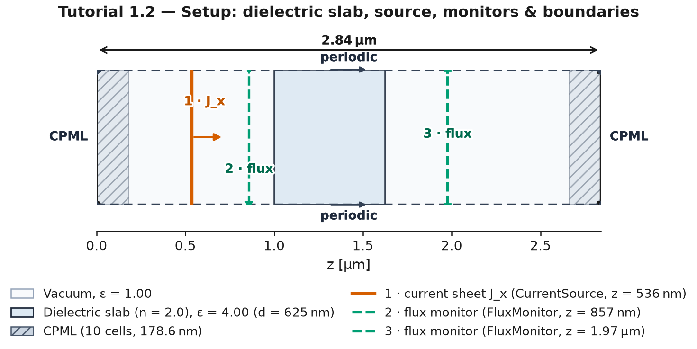

---

## 1. Publication figure style (`wakis.figstyle`)

### Core API

| Function / Constant | Signature / Value | Description |
| :--- | :--- | :--- |
| `apply_style` | `apply_style()` | Apply Wakis journal `rcParams` globally or as a `with figstyle.apply_style():` context manager. |
| `new_figure` | `new_figure(width_in=7.0, height_in=None, ncols=1, nrows=1, **subplots_kw)` | Create `(fig, axes)` at literal print width (`FULL_WIDTH_IN = 7.0`, `HALF_WIDTH_IN = 3.4`). |
| `series_style` | `series_style(index, *, with_marker=True, with_line=True, lw=1.9, ms=5.2, markevery=None)` | Return a distinct `(color, linestyle, marker)` dictionary from the Okabe–Ito palette for 1D curve `index`. |
| `symmetric_limits` | `symmetric_limits(values, percentile=None)` | Return symmetric `(-vmax, +vmax)` limits for diverging real fields (`CMAP_DIVERGING = "RdBu_r"`). |
| `spectrum_grid` | `spectrum_grid(ax)` | Enable a subtle dotted grid on spectral, dispersion, or convergence panels. |
| `place_legend_below` | `place_legend_below(ax, ncol=None, y_offset=-0.22)` | Move a panel's legend below the x-axis label without frame or data occlusion. |
| `finish` | `finish(fig, *, max_panels=3, auto_legend_below=False)` | Enforce minimum font size (`8.5 pt`), darken low-contrast text to WCAG $\ge 4.5:1$, add white halos to in-axes annotations on field maps, warn if $> 3$ content panels, and apply layout. |
| `save` | `save(fig, path, *, dpi=200, close=False, auto_legend_below=True)` | Run `finish(fig)` and save a `200 dpi` PNG. |

### Colormaps

* **`figstyle.CMAP_DIVERGING`** (`"RdBu_r"`): real signed field components ($E_x, H_y, \dots$) paired with `figstyle.symmetric_limits(field)`.
* **`figstyle.CMAP_MAGNITUDE`** (`"inferno"`) and **`figstyle.CMAP_INTENSITY`** (`"magma"`): non-negative field magnitudes $|\mathbf{E}|$ and energy/Poynting intensities.
* **`figstyle.CMAP_EPS`** (`"wakis_eps"`): light grey permittivity ramp (`#ffffff` $\to$ `#d0d5dd`) so material outlines, field contours, and text annotations remain high-contrast.

---

## 2. Two-figure setup schematics & setup table (`wakis.schematic`)

Every tutorial begins with **Figure A** (`00a_setup_geometry.png`), followed immediately by the **Markdown setup table** in the notebook prose, and **Figure B** (`00b_setup_mesh_and_excitation.png`). A third setup figure (`00c_...`) is added only when a tutorial runs a genuinely distinct geometry or boundary configuration.

### Convenience one-call workflow (`save_setup_figures`)

```python
from wakis import schematic

res = schematic.save_setup_figures(
    solver,
    "figures/",
    plane="zx",
    unit="µm",
    material_names={"region_0": "Dielectric slab (n = 2.0)"},
    sources=[src],
    monitors=[flux_r, flux_t],
    wavelength=1.0e-6,
    min_feature=0.625e-6,
    title_geometry="Tutorial 1.2 — Setup: dielectric slab, source, monitors & boundaries",
    title_mesh="Tutorial 1.2 — Discretization and excitation",
    variations=[
        {"name": "Reference run", "details": "Vacuum everywhere (ε_r = 1.00)"},
        {"name": "Slab run", "details": "Dielectric slab ε_r = 4.00 (d = 625 nm)"},
    ],
)
print(res["table"])
```

### Core API

| Function | Signature | Purpose |
| :--- | :--- | :--- |
| `plot_schematic` | `plot_schematic(solver_or_grid, plane="auto", ax=None, cut_coord=None, structures=None, material_names=None, sources=None, monitors=None, probes=None, unit="auto", show_mesh=False, mesh_every=None, mesh_zoom=False, wavelength=None, freq=None, include_3d=False, title=None, width_in=7.0, height_in=None)` | Render **Figure A** (`00a_setup_geometry.png`): scale domain, filled materials, graphical boundaries with one short tag per face outside the domain box, numbered source/monitor symbols ($\le 6$ in-axes tags), one dimension arrow per physical axis, and a compact legend below the axes. Hides the meaningless transverse axis on 1D domains and formats numbers + upright units with a thin space (`\u2009`). |
| `plot_mesh_and_excitation` | `plot_mesh_and_excitation(solver_or_grid, plane="auto", cut_coord=None, structures=None, material_names=None, sources=None, monitors=None, probes=None, unit="auto", mesh_every=None, zoom_bounds=None, wave_packet_center=None, wavelength=None, freq=None, min_feature=None, bandwidth_def="-3dB", title=None, width_in=7.0, height_in=None)` | Render **Figure B** (`00b_setup_mesh_and_excitation.png`) with 3 panels: (a) mesh & $1\times$ zoom inset annotated with $\Delta$, $\text{cells}/\lambda$ in $n_{\max}$, and cells across the smallest feature; (b) spatial wave packet with $1/e$ extent and CPML/material shading; (c) source pulse $s(t)$ and spectrum $|S(f)|$ with $f_0$, bandwidth (`-3 dB` or `1/e`), and shaded simulated band. |
| `setup_table` | `setup_table(solver_or_grid, plane="auto", cut_coord=None, structures=None, material_names=None, sources=None, monitors=None, probes=None, unit="auto", wavelength=None, freq=None, min_feature=None, variations=None)` | Return a GitHub-flavored Markdown table summarizing domain size & cell counts, discretization metrics, every boundary face (`-x` through `+z`), materials, sources, monitors, and run variations. |
| `save_setup_figures` | `save_setup_figures(solver_or_grid, out_dir, *, prefix="00", suffix="", ...)` | Render and save `00a_setup_geometry.png`, `00b_setup_mesh_and_excitation.png`, and `00_setup_table.md`, returning a dictionary with paths and the Markdown table string. |
| `draw_mesh` | `draw_mesh(ax, solver_or_grid, plane="auto", unit="m", every=None, wavelength=None, freq=None, zoom_inset=False, zoom_bounds=None, color="#6B7280", alpha=0.42, linewidth=0.5, show_cpw=True)` | Overlay uniform/graded Cartesian grid lines (`GridFIT3D`), quadtree subgrid patches (`QuadMesh`), or unstructured triangle/tet/prism edges (`wakis.unstructured`), plus an optional $1\times$ zoom inset. |
| `overlay_geometry` | `overlay_geometry(ax, solver_or_grid, plane="auto", unit="m", orientation="2d", structures=None, material_names=None, sources=None, monitors=None, probes=None, show_boundaries=True, show_materials=True, show_sources=False, show_monitors=False, fill_materials=False)` | Draw material outlines, hatched CPML layers, boundary tags, and optional source/monitor markers directly on top of a 2D field map (`orientation="2d"`) or a 1D/space-time field plot (`orientation="1d"`). |
| `extract_setup_info` | `extract_setup_info(solver_or_grid, plane="auto", cut_coord=None, structures=None, material_names=None, sources=None, monitors=None, probes=None)` | Inspect a Wakis solver/grid and return a normalized dictionary of domain bounds, short boundary tags, detailed boundary labels, CPML thicknesses, material regions, sources, and monitors. |
| `in_axes_texts` | `in_axes_texts(ax)` | Return visible `ax.texts` placed inside the domain/axes box (enforced to $\le 6$ in `plot_schematic`). |
| `choose_length_unit` | `choose_length_unit(span_m, unit="auto")` | Select a human-readable upright length unit (`'nm'`, `'µm'`, `'mm'`, `'cm'`, `'m'`) and scale factor. |

### What is read automatically vs. passed explicitly

* **Read automatically from `solver` / `grid`**:
  * Domain bounds, physical node coordinates, cell counts (`Nx, Ny, Nz`), and minimum cell spacing.
  * Per-face boundary conditions (`bc_low`, `bc_high`), `n_pml` cell counts and physical CPML thickness per face, and Bloch wavevector `k_bloch` (`_bloch_axes`).
  * Assigned template shapes (`Box`, `Cylinder`, `PolySlab`, or custom shapes with `.bounds` passed to `assign_materials`), CAD solids in `grid.stl_solids`, or contiguous dielectric/PEC regions from `solver.ieps`.
  * Sources and monitors stored on `solver`.
* **Passed explicitly when not stored on `solver`**:
  * `sources=[...]` and `monitors=[...]` if building the schematic before calling `solver.emsolve(...)` or when stepping manually with `solver.one_step()`.
  * `probes=[...]` for ad-hoc array index readouts (`solver.E[ix, iy, iz, 'x']`).
  * `material_names={...}` to give human-readable names (e.g. `{"region_0": "SiO₂ slab"}`) to numeric permittivity regions.

---

## 3. Electromagnetic particle-in-cell benchmark figures (`wakis.particles`)

Generated by `examples/017_particles_plasma_oscillation_and_gyration.py` (metrics written to `examples/017_particles_plasma_oscillation_and_gyration.json`):

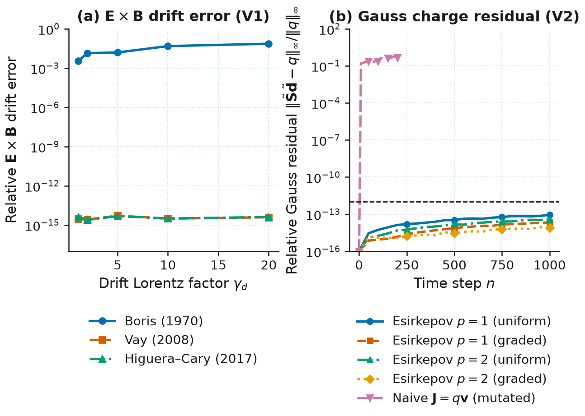

* **Figure (`img/particles_pushers_and_charge_conservation.png`)**: (a) Relativistic $\mathbf{E}\times\mathbf{B}$ drift error vs drift Lorentz factor $\gamma_d \in [1.1, 20.0]$: the Boris pusher drift error grows from $3.44\times 10^{-3}$ ($\gamma_d = 1.1$) to $7.24\times 10^{-2}$ ($\gamma_d = 20.0$), whereas Vay (2008) ($\le 5.16\times 10^{-15}$) and Higuera–Cary (2017) ($\le 4.82\times 10^{-15}$) cancel the drift fixed point to machine precision; (b) 3D discrete Gauss's law relative residual $\|\tilde{\mathbf{S}}\tilde{\mathbf{d}} - q\|_\infty / \|q\|_\infty$ over $1000$ steps with $1024$ relativistic electrons for Esirkepov $p=1$ ($8.86\times 10^{-14}$ uniform, $2.11\times 10^{-14}$ graded) and $p=2$ ($3.74\times 10^{-14}$ uniform, $8.72\times 10^{-15}$ graded) compared against a mutated naive $\mathbf{J}=q\mathbf{v}$ midpoint deposition ($5.83\times 10^{-1}$).

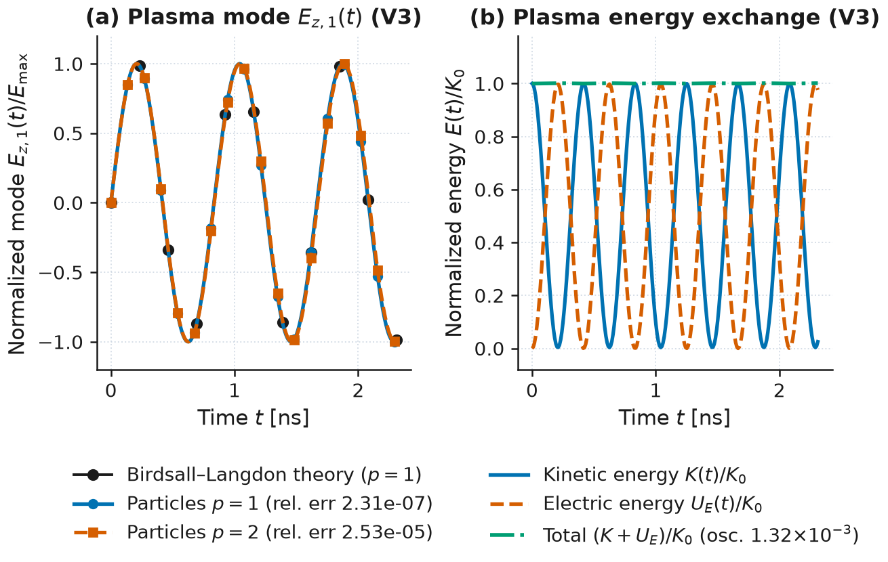

* **Figure (`img/particles_cold_plasma_oscillation.png`)**: (a) Longitudinal cold electron plasma oscillation mode $E_{z,1}(t)/E_{\max}$ in a $32\text{ cells}/\lambda$ periodic box ($\omega_{p0}/2\pi = 1.2\text{ GHz}$) for $p=1$ (relative frequency error $2.31\times 10^{-7}$ vs the Birdsall–Langdon discrete prediction $\omega_p^{\text{pred}} = 7.54148\times 10^9\text{ rad/s}$) and $p=2$ (relative frequency error $2.53\times 10^{-5}$ vs $\omega_p^{\text{pred}} = 7.51728\times 10^9\text{ rad/s}$); (b) reversible kinetic $K(t)/K_0$ and electric field energy $U_E(t)/K_0$ exchange with bounded leapfrog total energy oscillation $\max|K + U_E - K_0|/K_0 = 1.32\times 10^{-3}$ ($(\omega_p\Delta t)^2/4 = 1.32\times 10^{-3}$, secular drift $1.41\times 10^{-7}$) and Gauss residual $1.03\times 10^{-15}$.

Generated by `examples/018_particles_gpu_throughput.py` (metrics written to `examples/018_particles_gpu_throughput.json` using explicit `coupled_*` and `stage_sum_*` keys; the 1-thread CPU baseline strips unused setup attributes `imu`, `sigma`, `itA`, `J_old`, `grid.L/iA/tL/itA`, `ps._q0_buf/_H_prev`, `solver._particles_q_bg`, replaces `ps._itA_arr` with the uniform-cube scalar `float(n_grid**2)`, shares one CSR `indptr` between `tDsiDmuiDaC` and `itDaiDepsDstC`, averages $5$ steps at $N_p = 10^4$ and $3$ steps at $N_p \in \{10^5, 10^6, 10^7\}$, and resets `ps.n_particle_steps = 1` before timing $< 50$ steps so `coupled_one_step_s` excludes periodic cell sorting `sort_every = 50` while `stage_sum_step_s` includes `sort_amortized_s = sort_call_s / 50`):

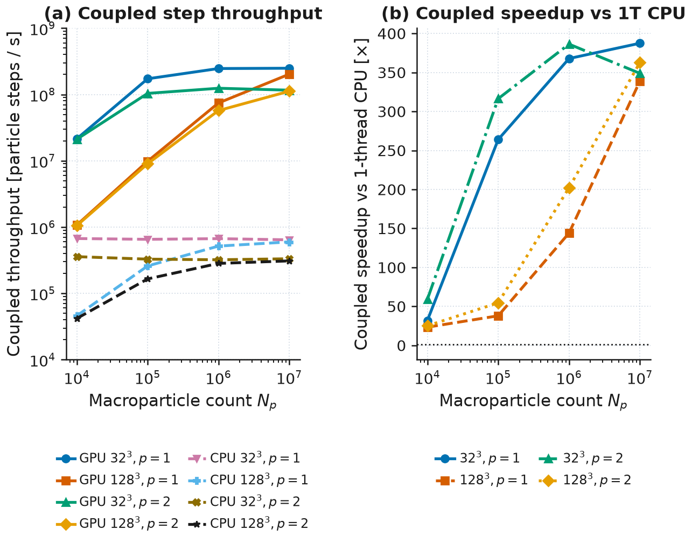

* **Figure (`img/particles_gpu_throughput_scaling.png`)**: (a) Coupled `solver.one_step()` particle + field throughput [particle steps / s] (`coupled_particle_steps_per_s`) across $N_p \in \{10^4, 10^5, 10^6, 10^7\}$ macroparticles on $32^3$ ($32,768$ cells) and $128^3$ ($2,097,152$ cells) periodic grids for spline orders $p=1$ (CIC) and $p=2$ (TSC) on an NVIDIA L4 GPU (`use_gpu=True`, CuPy `14.2.0`, CUDA `12.9 (12090)`, `gpu_one_step_variant = "_one_step"`) vs the 1-process, 1-thread unoptimised vectorised NumPy M1 CPU baseline on the same VM (`Intel(R) Xeon(R) CPU @ 2.20GHz`, $8$ vCPUs, `MKL_NUM_THREADS = OMP_NUM_THREADS = OPENBLAS_NUM_THREADS = 1`, `cpu_one_step_variant = "_one_step"`), reaching $2.488\times 10^{8}\text{ part-steps/s}$ ($32^3, p=1$), $1.162\times 10^{8}\text{ part-steps/s}$ ($32^3, p=2$), $2.024\times 10^{8}\text{ part-steps/s}$ ($128^3, p=1$), and $1.120\times 10^{8}\text{ part-steps/s}$ ($128^3, p=2$) at $N_p = 10^7$ (compared with $6.421\times 10^{5}$, $3.329\times 10^{5}$, $5.975\times 10^{5}$, and $3.089\times 10^{5}\text{ part-steps/s}$ on the 1-thread CPU baseline); (b) L4 GPU coupled `solver.one_step()` speedup (`coupled_speedup`) over the 1-process, 1-thread unoptimised vectorised NumPy M1 CPU baseline on the same VM, scaling from $23.4\text{–}59.1\times$ at $N_p = 10^4$ to $387.4\times$ ($32^3, p=1$; $367.8\times$ at $N_p = 10^6$), $348.9\times$ ($32^3, p=2$; $386.3\times$ at $N_p = 10^6$), $338.7\times$ ($128^3, p=1$), and $362.7\times$ ($128^3, p=2$) at $N_p = 10^7$.

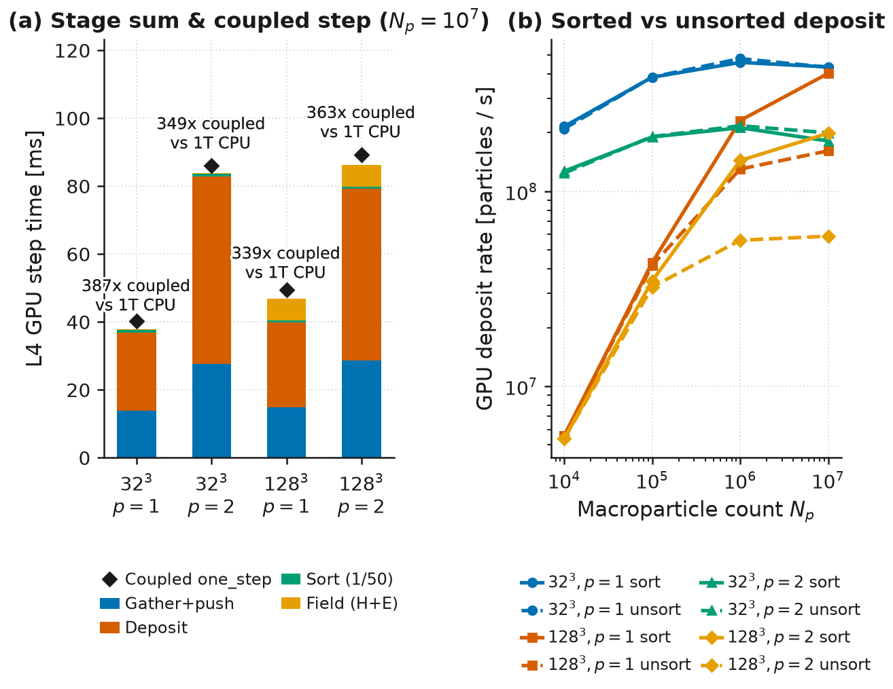

* **Figure (`img/particles_gpu_kernel_breakdown.png`)**: (a) L4 GPU sum of stage times (`stage_sum_step_s`) at $N_p = 10^7$ (`37.88 ms` on $32^3, p=1$; `83.79 ms` on $32^3, p=2$; `46.95 ms` on $128^3, p=1$; `86.31 ms` on $128^3, p=2$) and diamond markers (`Coupled one_step`) showing the measured coupled `solver.one_step()` times (`coupled_one_step_s`: `40.20 ms`, `86.09 ms`, `49.41 ms`, and `89.25 ms`), decomposed into fused `gather + push` ($13.90\text{ ms}$, $27.60\text{ ms}$, $14.91\text{ ms}$, $28.70\text{ ms}$), Esirkepov `float64` `atomicAdd` `deposit` ($23.03\text{ ms}$, $55.24\text{ ms}$, $24.87\text{ ms}$, $50.45\text{ ms}$), amortised periodic cell sort (`1/50` of a $38.50\text{–}38.54\text{ ms}$ sort call $= 0.77\text{ ms/step}$), and FIT `field` step ($0.18\text{ ms}$ on $32^3$, $6.39\text{ ms}$ on $128^3$), with bar labels explicitly reporting `387x coupled vs 1T CPU`, `349x coupled vs 1T CPU`, `339x coupled vs 1T CPU`, and `363x coupled vs 1T CPU`; (b) GPU Esirkepov deposit rate [particles / s] across all four $(32^3, 128^3) \times (p=1, p=2)$ configurations with and without periodic cell sorting: on $128^3$ ($48\text{ MiB}$ edge accumulators), cell sorting accelerates deposit at $N_p = 10^7$ by $2.49\times$ for $p=1$ ($4.020\times 10^{8}$ vs $1.612\times 10^{8}\text{ particles/s}$) and by $3.37\times$ for $p=2$ ($1.982\times 10^{8}$ vs $5.884\times 10^{7}\text{ particles/s}$).

Generated by `examples/019_particles_multi_gpu_scaling.py` (metrics written to `examples/019_particles_multi_gpu_scaling.json`):

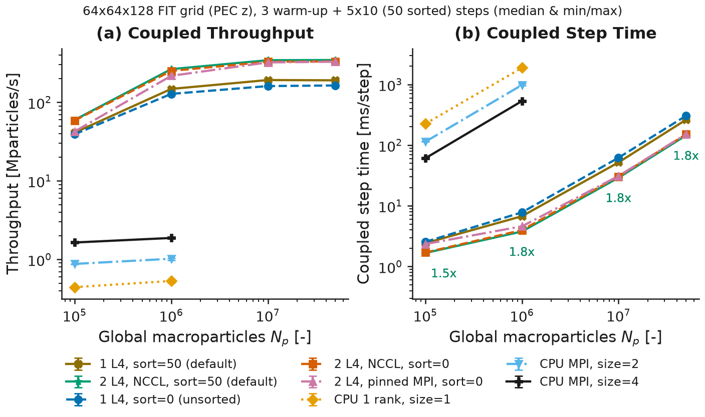

* **Figure (`img/particles_multi_gpu_scaling.png`)**: (a) Coupled `solver.one_step()` throughput (median with min/max error bars across independent repeats after warm-up) vs global macroparticle count for `"1 L4, this code, size=1"` (`particles_comm="none"`), multi-GPU NCCL (`particles_comm="nccl"`), multi-GPU pinned-host MPI (`particles_comm="mpi"`), and CPU MPI rank counts under identical grid, boundary conditions (periodic transverse, PEC longitudinal), and a uniform global particle distribution filtered per rank by $z$-slab (best-case load balance); (b) corresponding coupled step wall time (median with min/max error bars) annotated with 2-GPU NCCL speedups.

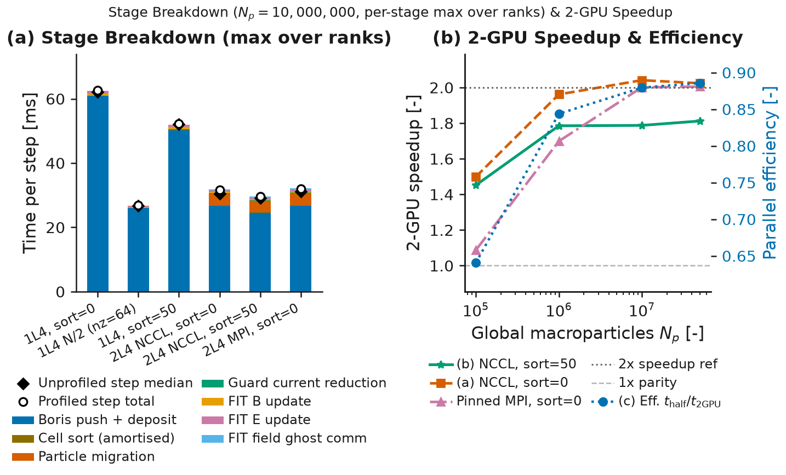

* **Figure (`img/particles_multi_gpu_stage_breakdown.png`)**: (a) Stacked per-step stage breakdown from a separate profiled run (Boris push + Esirkepov deposit, particle migration, guard current reduction, FIT magnetic update, FIT electric update, and FIT field ghost communication, noting that per-stage device synchronizations inflate the profiled stage sum relative to the overlaid unprofiled step median diamond markers); (b) 2-GPU speedup vs `"1 L4, this code, size=1"` comparing the GPU-to-GPU NCCL path against the pinned-host MPI fallback, the `1x parity` line, and the `2x reference` line.

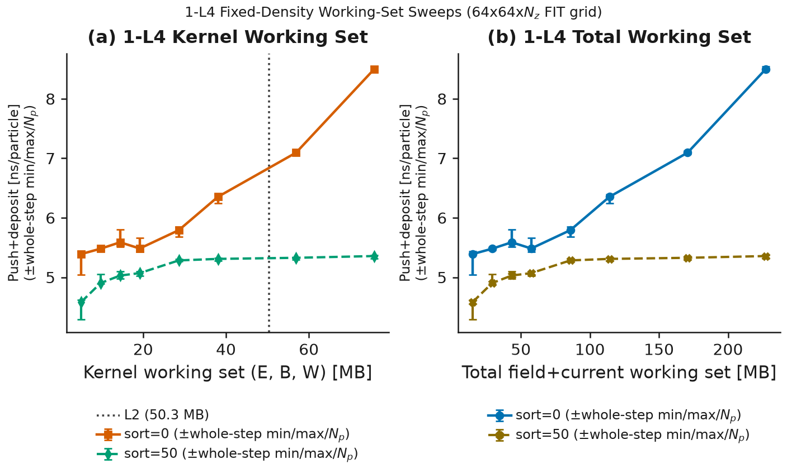

* **Figure (`img/particles_multi_gpu_working_set.png`)**: (a) 1-L4 per-particle push and deposit time across the fixed-density longitudinal grid sweep vs the kernel working set (`E`, `B_n`, `Wx`, `Wy`, `Wz`) with the L2 cache size marked, comparing unsorted (`sort_every=0`) and cell-sorted execution; (b) the same sweep plotted against the total field and current working set.

Generated by `examples/022_particles_two_stream_instability.py` (metrics written to `examples/022_particles_two_stream_instability.json`):

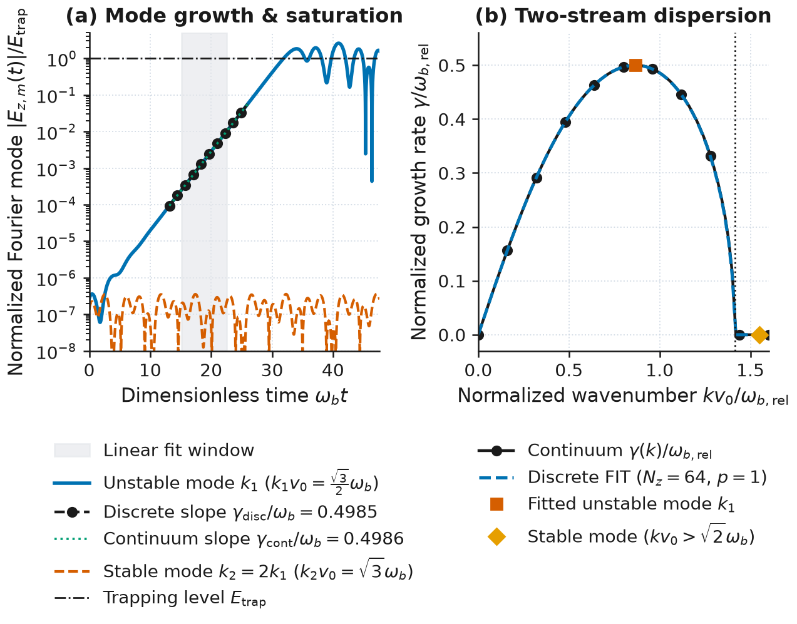

* **Figure (`img/particles_two_stream_growth.png`)**: (a) Normalised Fourier amplitude $|E_{z,1}(t)|/E_\text{trap}$ of the seeded unstable mode $k_1 v_0 = (\sqrt{3}/2)\,\omega_b$ on a log scale, with the linear fit window (shaded; start set by the decay of the fast $\omega_+$ oscillation, end by $\alpha_\text{sat} E_\text{trap}$), the fitted points, the discrete and continuum slopes, the stable mode $k_2 = 2k_1$ and the trapping level; (b) growth rate $\gamma(k)/\omega_{b,\text{rel}}$ of the continuum and discrete FIT ($N_z = 64$, $p = 1$) dispersion relations, with the fitted unstable mode and the stable mode marked. Fitted, discrete and continuum rates are in `metrics` of the JSON.

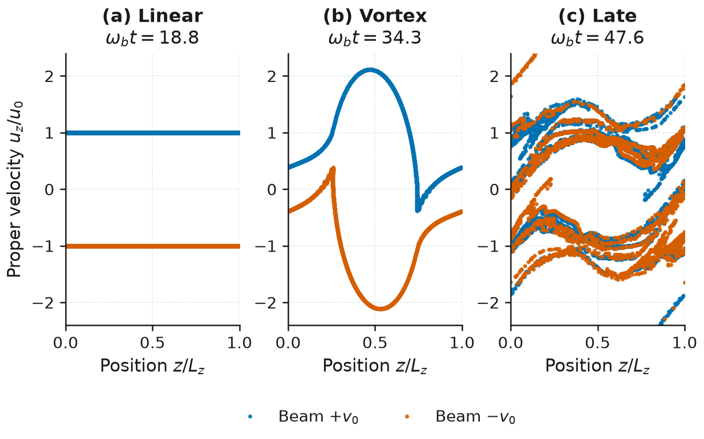

* **Figure (`img/particles_two_stream_phase_space.png`)**: Longitudinal phase space $(z/L_z,\,u_z/u_0)$ of the two counter-streaming beams in (a) the linear phase, (b) at saturation (trapping vortex) and (c) late in the nonlinear phase.

Generated by `examples/021_particles_numerical_cherenkov.py` (metrics written to `examples/021_particles_numerical_cherenkov.json`; Cloud Batch, 1 NVIDIA T4):

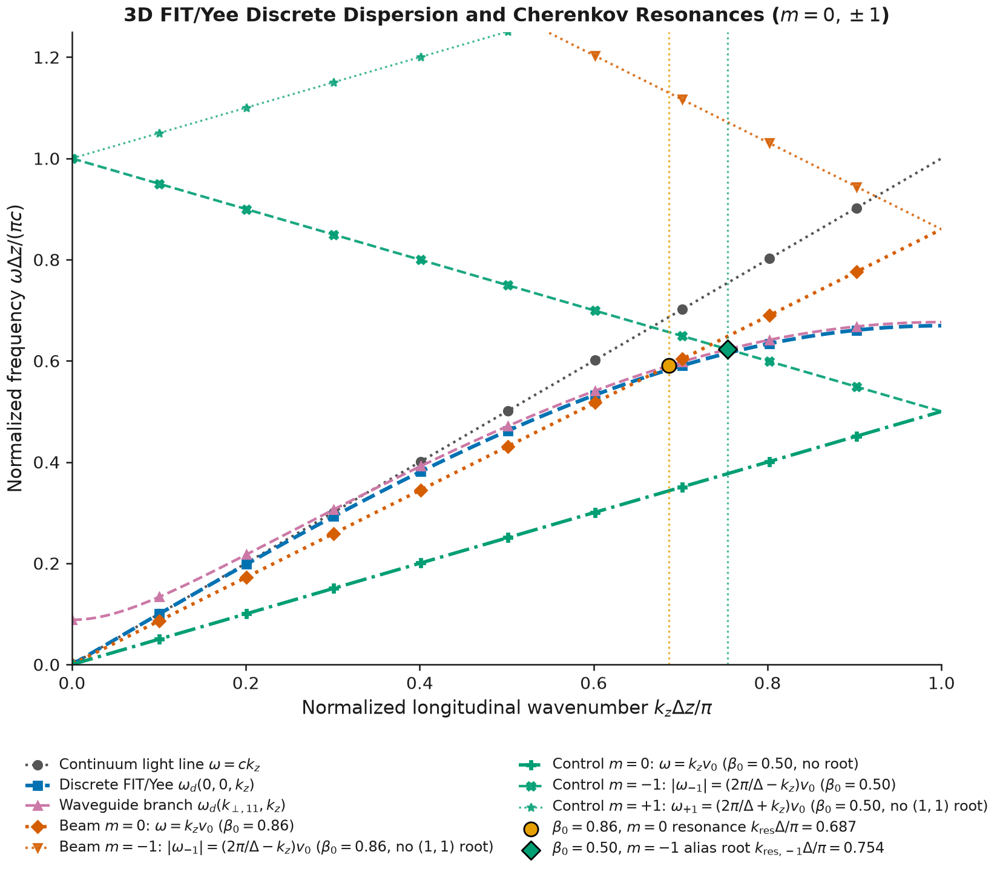

* **Figure (`img/particles_numerical_cherenkov_dispersion.png`)**: Discrete FIT/Yee dispersion $\omega_d(k_z)$ on axis and on the hollow-pipe $(1,1)$ waveguide branch, against the continuum light line and the beam lines $\omega = (k_z + 2\pi m/\Delta)v_0$ for $m = 0, \pm 1$ at $\beta_0 = 0.86$ and for the sub-$v_\text{min}$ control at $\beta_0 = 0.50$. Marked: the predicted $m = 0$ resonance of the fast beam and the $m = -1$ alias resonance of the control.

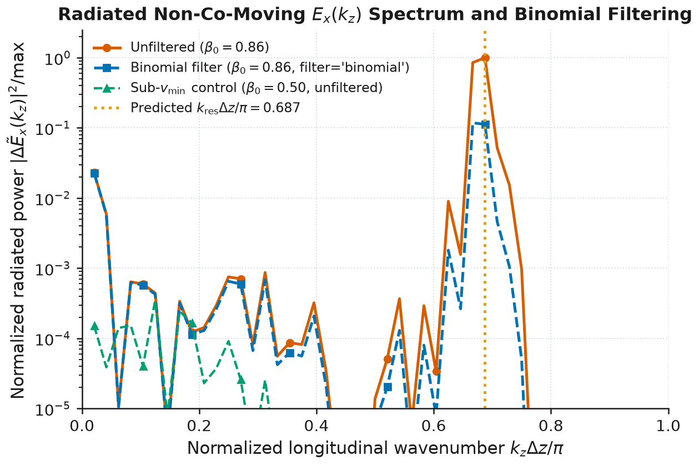

* **Figure (`img/particles_numerical_cherenkov_spectrum.png`)**: Radiated (non-co-moving) $|\Delta\tilde{E}_x(k_z)|^2$ spectrum of the $\beta_0 = 0.86$ beam without and with the compensated 1-2-1 binomial current filter, and of the sub-$v_\text{min}$ control in the $m = 0$ frame, with the predicted resonance marked. Predicted and measured peak bins, the filter power ratio and the control's $m = -1$ alias peak are in the JSON.

Generated by `examples/025_particles_phase_space_diagnostics.py --benchmark` (metrics written to `examples/025_particles_phase_space_diagnostics.json`; Cloud Batch, 1 NVIDIA L4):

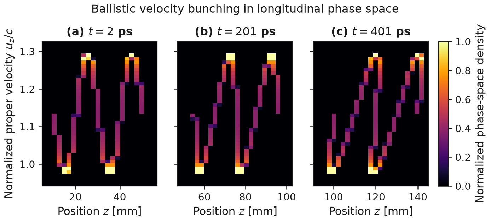

* **Figure (`img/particles_phase_space_bunching.png`)**: `PhaseSpaceMonitor` $(z,\,u_z)$ histograms of a velocity-modulated drifting electron beam at three times, showing ballistic bunching; colour is the normalised weighted phase-space density.

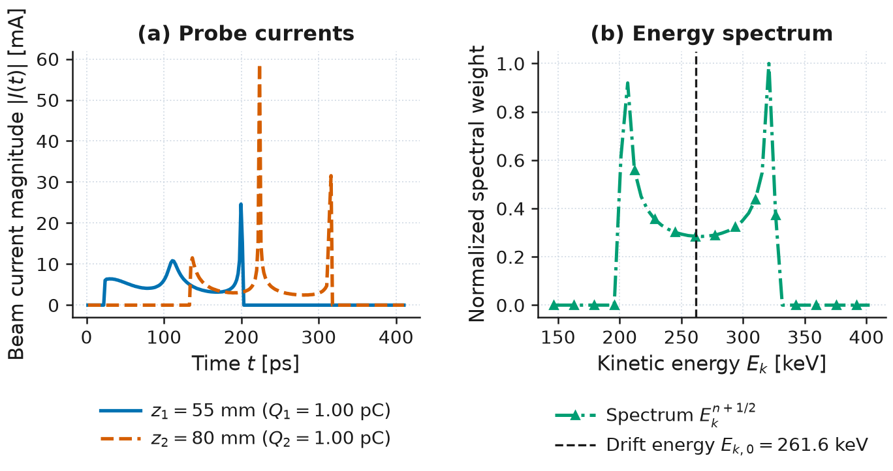

* **Figure (`img/particles_current_probes_and_spectrum.png`)**: (a) Beam current $|I(t)|$ from two `PlaneCurrentProbe`s at $z_1 = 55$ mm and $z_2 = 80$ mm, each with its total transmitted charge; (b) `EnergySpectrumMonitor` kinetic-energy spectrum at the half-step level $E_k^{n+1/2}$, with the drift energy marked. The JSON also holds the emittance checks and the monitor-overhead benchmark (`benchmark`, with GPU name and versions).

Generated by `examples/020_particles_beam_energy_balance.py` (metrics written to `examples/020_particles_beam_energy_balance.json`; Cloud Batch, 1 NVIDIA L4):

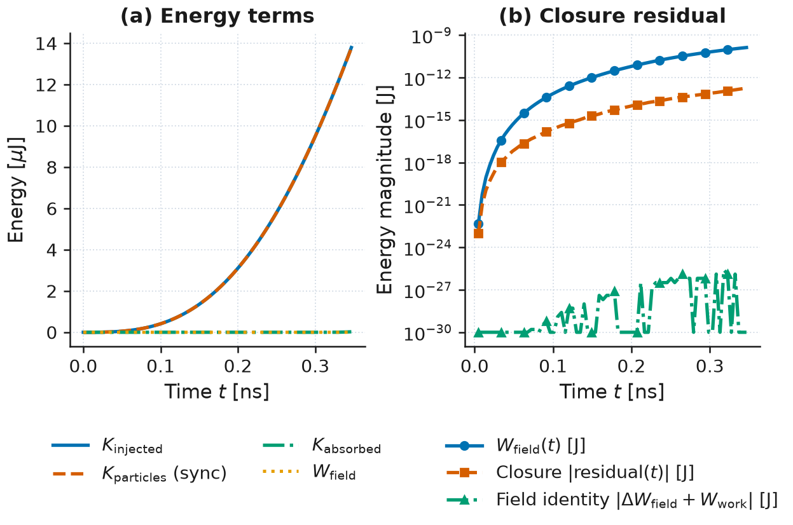

* **Figure (`img/particles_beam_energy_balance_time.png`)**: (a) Injected, particle (synchronised), absorbed and field energies vs time for an electron beam injected from a PEC cathode into a closed PEC box; (b) staggered field energy $W^n$, the total closure residual, and the discrete FIT field identity $|\Delta W_\text{field} + W_\text{work}|$, which holds to round-off.

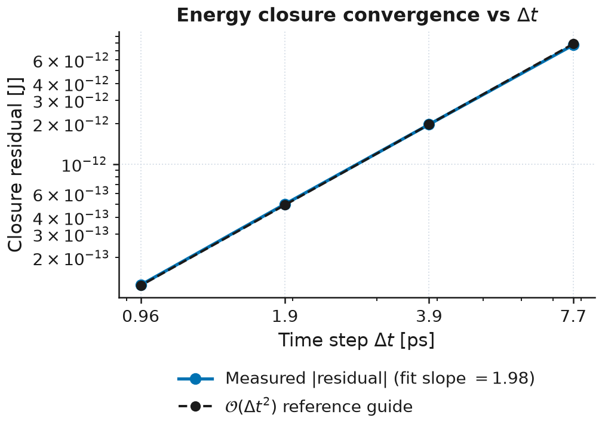

* **Figure (`img/particles_beam_energy_closure_convergence.png`)**: Total energy-closure residual vs $\Delta t$ at a fixed grid (four CFL levels, dt-independent lattice beam), with an $\mathcal{O}(\Delta t^2)$ guide; the fitted slope and the local slopes are in the JSON.

Generated by `examples/023_particles_child_langmuir_diode.py` (metrics written to `examples/023_particles_child_langmuir_diode.json`; Cloud Batch, 1 NVIDIA L4):

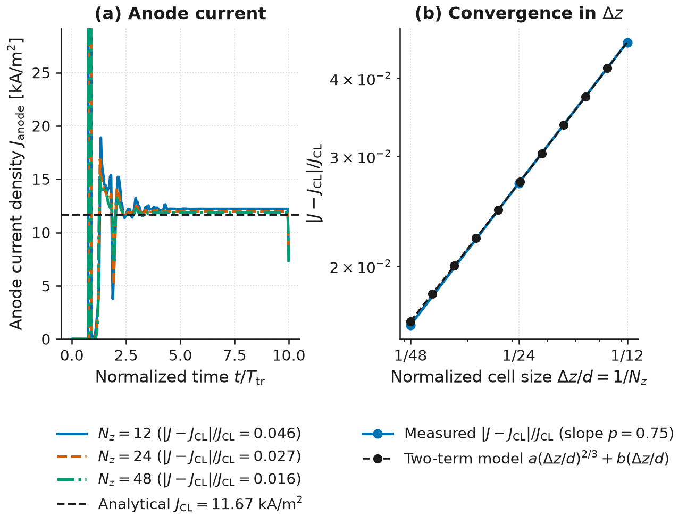

* **Figure (`img/particles_child_langmuir_current_vs_time.png`)**: (a) Anode current density vs time for a space-charge-limited planar diode at $N_z = 12, 24, 48$ against $J_\text{CL}$ (start-up spike clipped); (b) steady-current error vs $\Delta z/d$ with the two-term model $a(\Delta z/d)^{2/3} + b(\Delta z/d)$.

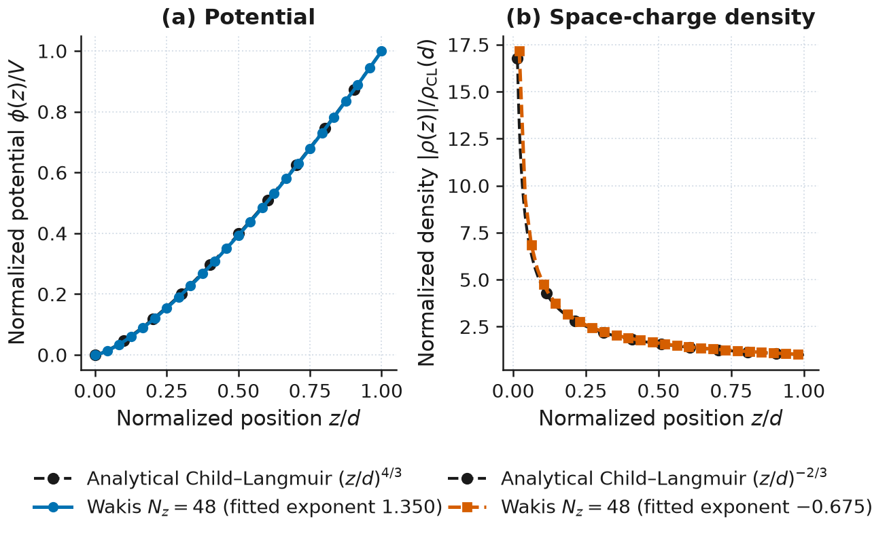

* **Figure (`img/particles_child_langmuir_profiles.png`)**: Steady potential $\phi(z)/V$ and space-charge density at $N_z = 48$ against the Child–Langmuir $(z/d)^{4/3}$ and $(z/d)^{-2/3}$ profiles.

Generated by `examples/024_particles_space_charge_waves.py` (metrics written to `examples/024_particles_space_charge_waves.json`; Cloud Batch, 1 NVIDIA A100-40GB; plotted data from the fine grid $(20, 1, 948)$):

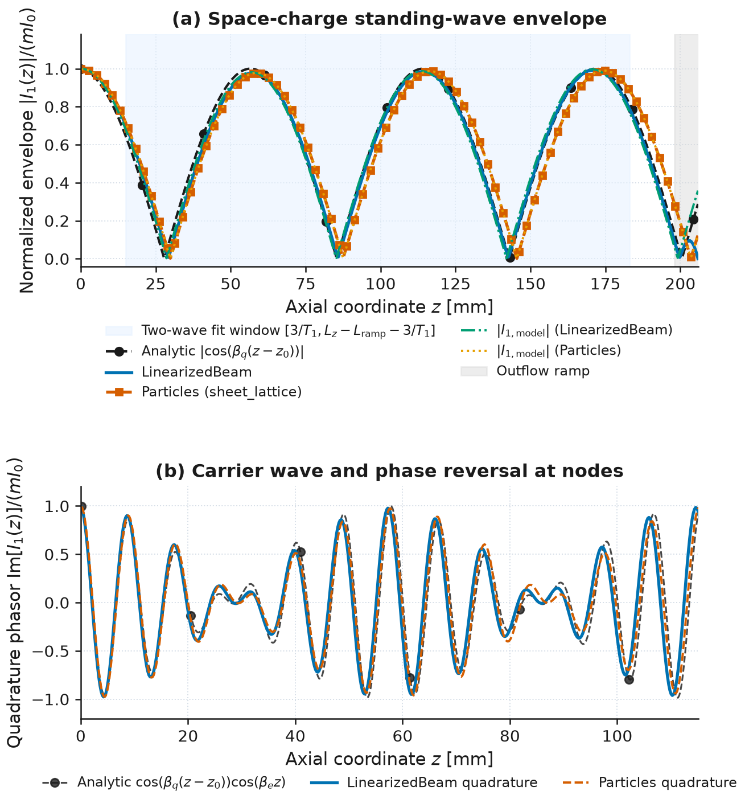

* **Figure (`img/particles_space_charge_waves_envelope.png`)**: (a) Normalised first-harmonic current envelope $|I_1(z)|/(mI_0)$ of a velocity-modulated electron beam in a PEC tunnel from `wakis.particles` (shape 2, `sheet_lattice`) and the `LinearizedBeam` fluid model, with each code's modal model $|I_{1,\mathrm{model}}|$ and the continuum curve $|\cos(\beta_q(z-z_0))|$ ($\beta_q = 54.58$ rad/m). The two codes have different discrete predictions, so their nodes do not coincide: the fitted $\beta_q$ is 55.3897 rad/m for `LinearizedBeam` (discrete modal prediction 55.3861 rad/m, residual $6.5\times10^{-5}$ within the slack $1.48\times10^{-4}$) and 54.3650 rad/m for the particles (D20 multistream prediction 54.3621 rad/m, residual $5.3\times10^{-5}$ within $7.8\times10^{-5}$). (b) Quadrature phasor $\mathrm{Im}[I_1(z)]/(mI_0)$ over one plasma wavelength $\lambda_q = 115.12$ mm, showing the carrier and its phase reversal at the envelope nodes.

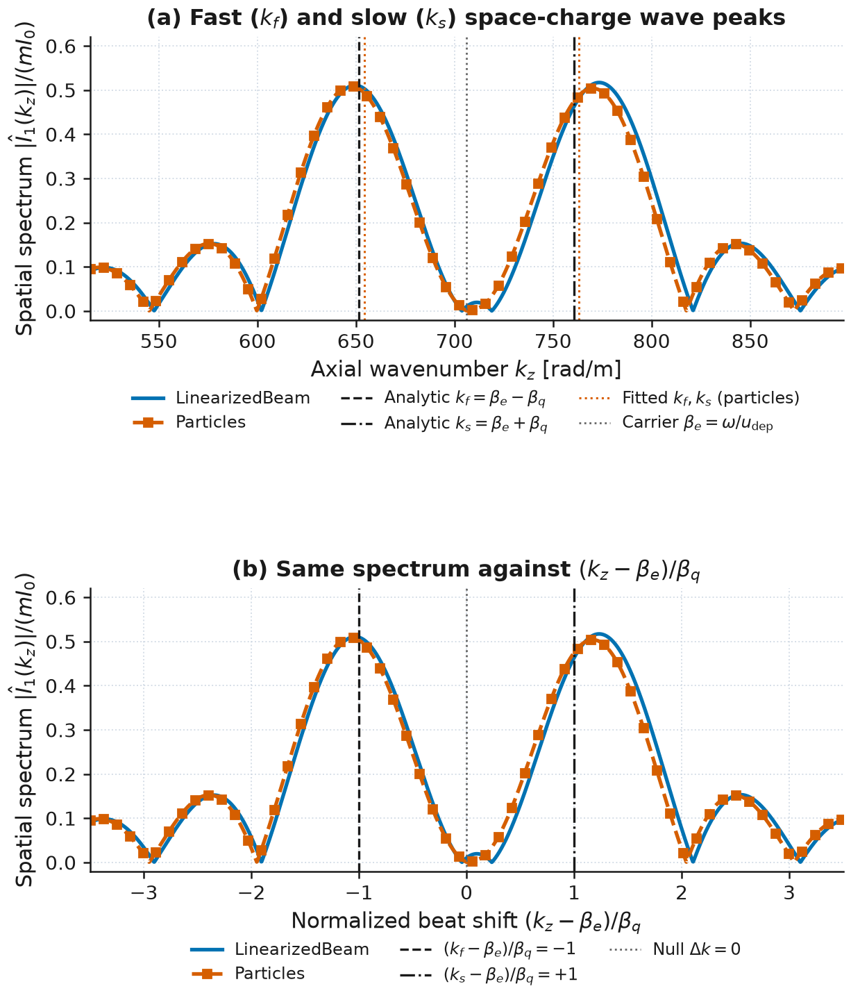

* **Figure (`img/particles_space_charge_waves_spectrum.png`)**: (a) Windowed spatial spectrum $|\hat I_1(k_z)|/(mI_0)$ of both codes, with the continuum fast and slow wave numbers $k_{f,s} = \beta_e \mp \beta_q$ and the peak positions fitted to the particle spectrum (654.29 and 763.02 rad/m, half-split 54.37 rad/m). The peak positions are for illustration only: the window resolution $2\pi/(z_\max - z_\min) \approx 37$ rad/m is coarser than the offsets shown, and the $\beta_q$ checks use the two-wave fit of panel (a) of the envelope figure. (b) The same spectra against $(k_z - \beta_e)/\beta_q$.

The JSON also holds both grids. On the coarse grid $(10, 1, 474)$ the single deterministic particle run misses its prediction by $4.95\times10^{-5}$, just above the slack $4.76\times10^{-5}$, which excludes macroparticle noise; the seed-averaged check, which includes it, passes on both grids ($5.45\times10^{-5} \le 9.70\times10^{-5}$ coarse, $5.64\times10^{-5} \le 8.47\times10^{-5}$ fine). The observed convergence order of the cross-code difference between the grids is 2.01. The measured DC depression (fine-grid seed mean 1.04754 %) agrees with the discrete model (1.04758 %) within the derived first-cell entrance bound described in the physics guide.

Generated by `studies/lb-modal-prediction/plot_figures.py` from the TD settle scan `studies/lb-modal-prediction/out/scan_<grid>.json` (`td_settle_scan.py`) and the D21 numbers `studies/lb-modal-prediction/out/d21_numbers_<grid>.json` (`d21_numbers.py`: `lb_first_pass_prediction`, `lb_error_decomposition` and the production `run_linearized_beam_drift`; Cloud Batch, n2-standard-4):

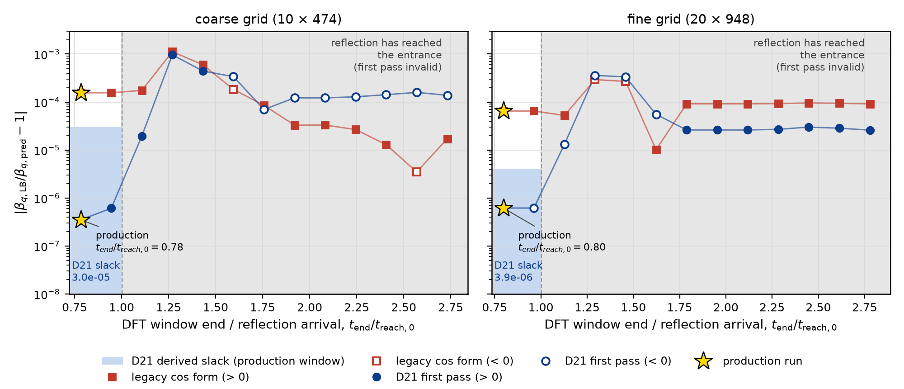

* **Figure (`img/lb_d21_settle_scan.png`)**: Residual $|\beta_{q,\mathrm{LB}}/\beta_{q,\mathrm{pred}} - 1|$ of the `LinearizedBeam` two-wave fit against the D21 first-pass prediction (circles) and the legacy cos-form prediction (squares; filled $> 0$, open $< 0$), for DFT windows ending at $t_{\mathrm{end}}/t_{\mathrm{reach},0}$, where $t_{\mathrm{reach},0}$ is the earliest arrival of the outflow reflection (upstream parasitic branch) at the entrance; (a) coarse grid $(10, 1, 474)$, (b) fine grid $(20, 1, 948)$. The shaded band is the derived D21 slack of the production window ($2.996\times10^{-5}$ coarse, $3.94\times10^{-6}$ fine, dominated by the parasitic-front bound $s_{\mathrm{front}}$). The stars are the production runs ($t_{\mathrm{end}}/t_{\mathrm{reach},0} = 0.782$ coarse, $0.797$ fine): D21 residual $+3.51\times10^{-7}$ and $-6.17\times10^{-7}$, legacy residual $+1.554\times10^{-4}$ and $+6.49\times10^{-5}$. The second window ($1.25\times$ settle, still before the arrival) stays at $\approx 6\times10^{-7}$ on both grids; once the reflection has reached the entrance (grey) the residual jumps to $\sim 10^{-3}$ and settles at the multi-bounce level ($\sim 10^{-4}$ coarse, $\sim 3\times10^{-5}$ fine), where neither first-pass model applies.

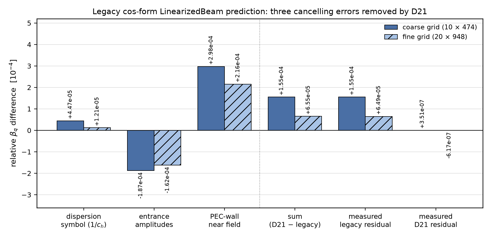

* **Figure (`img/lb_d21_error_decomposition.png`)**: `lb_error_decomposition` of the difference between the D21 and the legacy cos-form `LinearizedBeam` predictions, relative to the legacy one, coarse (solid) and fine (hatched): Crank–Nicolson dispersion symbol $1/c_h$ ($+4.47\times10^{-5}$ / $+1.21\times10^{-5}$), cos-form entrance amplitudes ($-1.873\times10^{-4}$ / $-1.621\times10^{-4}$), PEC-wall near field at $z = 0$ ($+2.977\times10^{-4}$ / $+2.155\times10^{-4}$) and their sum ($+1.551\times10^{-4}$ / $+6.55\times10^{-5}$), next to the measured residuals of the production run against the legacy prediction ($+1.554\times10^{-4}$ / $+6.49\times10^{-5}$) and against D21 ($+3.51\times10^{-7}$ / $-6.17\times10^{-7}$). The three terms partly cancel: their sum is 1.9 (coarse) to 3.3 (fine) times smaller than the PEC-wall term alone, so the legacy residual understates the size of each of its approximations.

---

## Unstructured FIT: exact adjoint and inverse design (`wakis.unstructured.adjoint`)

Generated by `studies/unstructured-adjoint/make_figures.py` from `results.json` and `fields.npz` of `shadow_focus.py` (Cloud Batch `uadj-demo-1`, n2-standard-4). The window check is `check_window.py` (`uadj-window-1`). Derivation: `docs/physicsguide_sections/unstructured_adjoint.md`. Setup: 2D TM, PEC cylinder r < 0.5 λ0, design annulus 0.5–1.25 λ0 (ε_r ∈ [1, 4] per triangle), graded triangle mesh (λ0/40 → λ0/20), radial CFS-PML, line source at (−2, 0) λ0, focus at (1.75, 0) λ0.

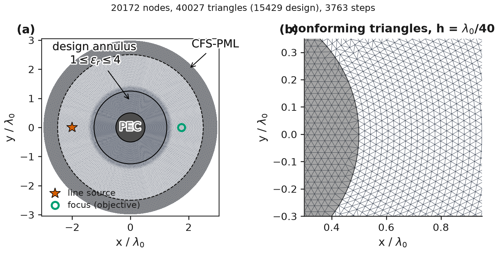

* **Figure (`studies/unstructured-adjoint/figures/00_setup_mesh.png`)**: (a) Domain with the PEC cylinder, the design annulus, the vacuum region and the PML ring (shaded), the source (star) and the focus (circle); 20172 nodes, 40027 triangles (15429 design), 3763 steps. (b) Zoom of the conforming triangles at the cylinder boundary (h = λ0/40).

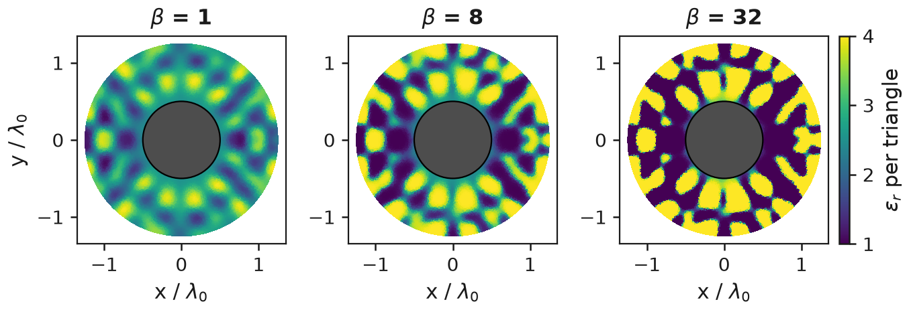

* **Figure (`studies/unstructured-adjoint/figures/01_design_evolution.png`)**: ε_r per triangle at the end of the β = 1, 8 and 32 stages (cone filter R = 0.08 λ0, tanh projection).

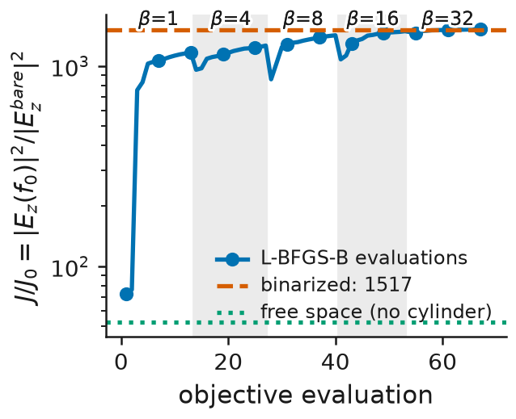

* **Figure (`studies/unstructured-adjoint/figures/02_objective.png`)**: J/J0 (focus intensity normalized by the bare cylinder on the same mesh) for each of the 68 L-BFGS-B evaluations, with the β stages shaded. Also shown: the binarized design (1517 over the optimized 60-period window; 1392 window-converged at 4–8 N_t) and the free-space level (J_free/J0 = 52.5).

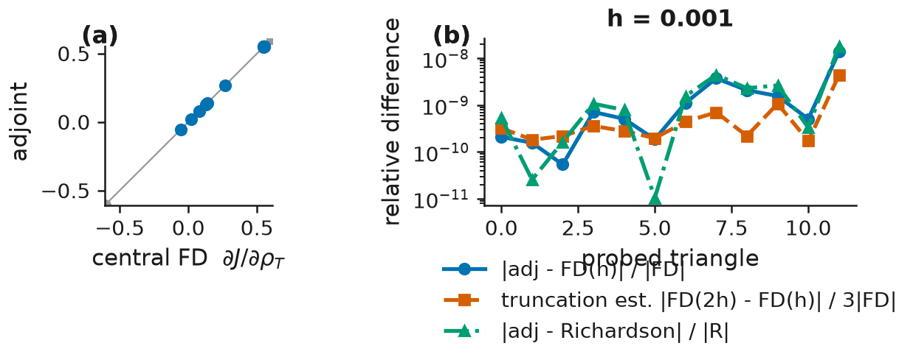

* **Figure (`studies/unstructured-adjoint/figures/03_gradient_vs_fd.png`)**: (a) Adjoint vs central-FD gradient (h = 1e-3) on 12 design triangles. (b) Relative differences, the truncation estimate |FD(2h) − FD(h)|/3 and the difference to the Richardson value. The absolute difference is 1–3e-10 for every cell, independent of |g|: the FD round-off floor.

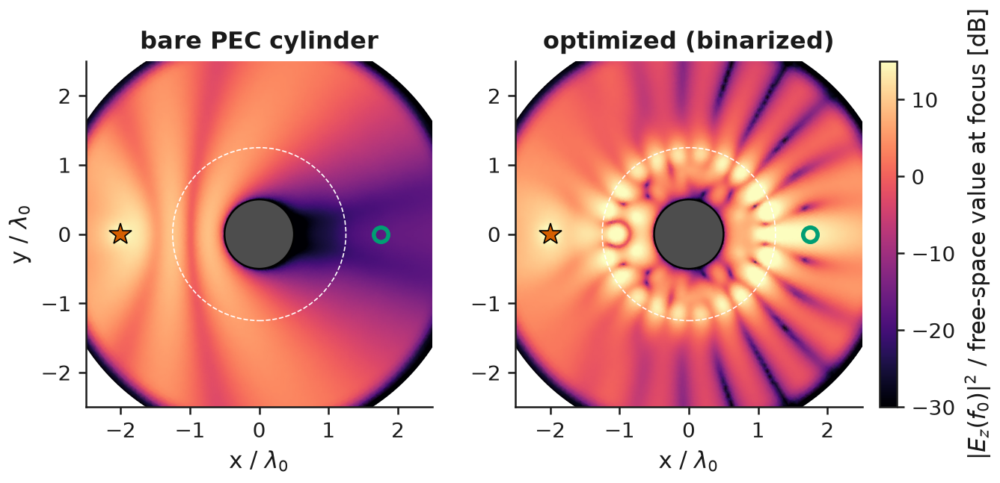

* **Figure (`studies/unstructured-adjoint/figures/04_fields.png`)**: |E_z(f0)|² in dB relative to the free-space intensity at the focus. Bare PEC cylinder (shadow at the focus: −17.2 dB) and binarized design (window-converged +14.2 dB, i.e. J/J0 = 1392).

## 4. 3D Cartesian subgridding (`wakis.subgrid3d`)

Generated by `studies/subgrid3d/plot_figures.py` from `studies/subgrid3d/results_{A,B,C}.json` (`run_study.py`; Cloud Batch jobs `sg3d-study-a-2`/`-b-2`/`-c-2`, n2-standard-8 / n2-highmem-8):

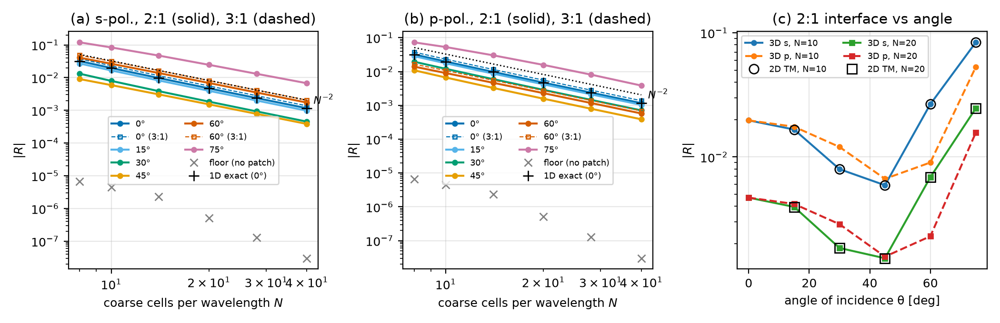

* **Figure (`img/subgrid3d_reflection.png`)**: Reflection $|R|$ of a planar 3D coarse/fine interface, from the exact time-discrete steady state in a Bloch column.
  * (a) s-polarisation and (b) p-polarisation against coarse cells per wavelength $N$, at 0–75°; 2:1 solid, 3:1 dashed. Also shown: the exact 1D closed form at normal incidence (+), the $N^{-2}$ guide and the measurement floor without a patch (×, 30°).
  * (c) $|R|$ against the angle at $N=10$ and 20, with the 2D TM result of `wakis.subgrid` (open symbols), which 3D s-polarisation reproduces to $1.5\times10^{-10}$.

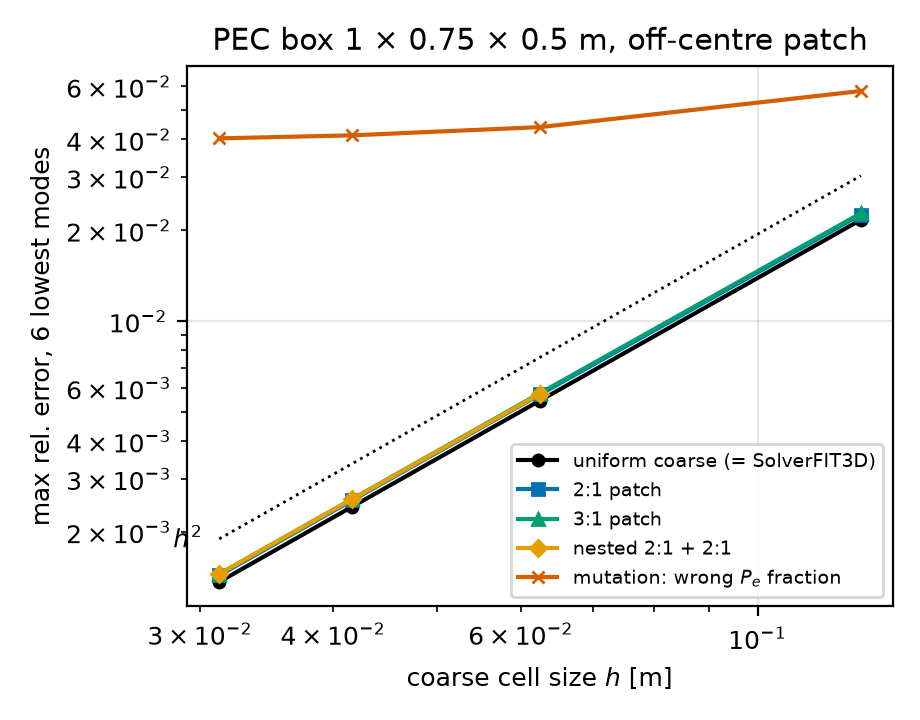

* **Figure (`img/subgrid3d_cavity_convergence.png`)**: Maximum relative error of the 6 lowest TE+TM eigenfrequencies of a $1\times0.75\times0.5$ m PEC box against the coarse cell size, for:
  * the uniform coarse grid (the `SolverFIT3D` operator);
  * an off-centre 2:1 or 3:1 patch;
  * a nested 2:1+2:1 patch;
  * the wrong-fraction mutation of $\mathbf P_e$.

  The observed orders are 1.99 / 1.99 / 1.99 / 1.98, and 0.27 for the mutation; the dotted line is the $h^2$ guide.

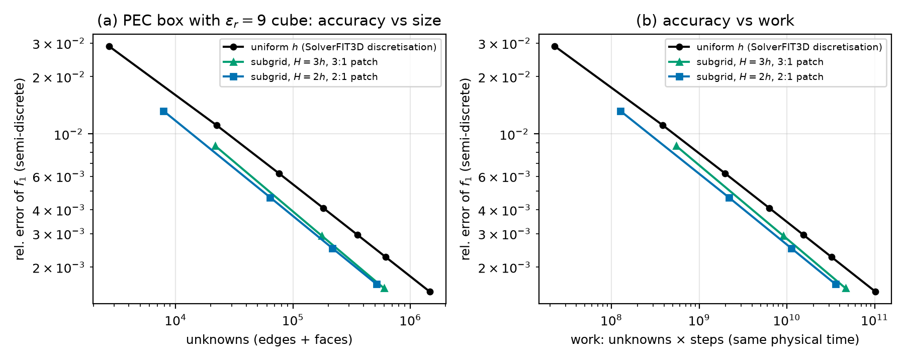

* **Figure (`img/subgrid3d_cost.png`)**: Relative error of the lowest resonance $f_1$ of a PEC box with an $\varepsilon_r=9$ cube. The resonance comes from a time-domain run (Hann-window DFT, mapped to the semi-discrete frequency); the reference $f^*=190.716$ MHz is the power-law extrapolation of the uniform arms, observed order 1.46.
  * (a) Error against unknowns (edges + faces).
  * (b) Error against work (unknowns × steps to the same physical time, each arm at $0.95\,\Delta t_\max$).
  * Arms: the uniform grid (the `SolverFIT3D` discretisation), and subgrids with $H=3h$ (3:1) or $H=2h$ (2:1) patches over the cube plus 0.1 m. At equal error the subgrid uses 1.7–2.4× fewer unknowns and 1.4–2.2× less work.

Generated by `studies/subgrid3d/plot_figures_lts.py` (`plot_cpml`) from `studies/subgrid3d/results_F.json` (`run_study_lts.py` part F; Cloud Batch job `sg3d-lts-study-f`):

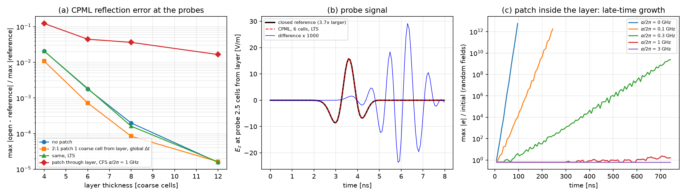

* **Figure (`img/subgrid3d_lts_cpml.png`)**: Outer-wall CPML absorption and late-time stability with subgrid patches in a box of $20^3$ coarse cells ($H=4$ cm) excited by a 1 GHz derivative-of-Gaussian current pulse, compared with a closed reference 3.7× larger.
  * (a) CPML reflection error at the probes ($\max|\text{open}-\text{reference}|/\max|\text{reference}|$ at a probe 2.5 cells from the layer) against layer thickness (4, 6, 8 and 12 coarse cells) for four variants: no patch ($2.1\times10^{-2}$ to $1.6\times10^{-5}$), a 2:1 patch one coarse cell from the layer with global $\Delta t$ ($1.1\times10^{-2}$ to $1.6\times10^{-5}$) and with LTS ($2.1\times10^{-2}$ to $1.6\times10^{-5}$), and a patch through the layer with CFS $\alpha/2\pi=1$ GHz ($1.2\times10^{-1}$ to $1.7\times10^{-2}$).
  * (b) Probe signal: $E_z$ [V/m] vs time [ns] at the probe 2.5 cells from the layer for the 6-cell CPML with LTS, the closed reference (3.7× larger) and their difference ($\times 10^3$).
  * (c) Patch inside the layer, late-time growth: $\max|e|/\text{initial}$ vs time [ns] from random initial fields (20 000 steps) for CFS shifts $\alpha/2\pi = 0$, $0.1$, $0.3$, $1$ and $3$ GHz.

Generated by `studies/subgrid3d/plot_figures_lts.py` (`plot_cost` and `plot_gpu`) from `studies/subgrid3d/results_D.json` (`run_study_lts.py` parts D and G; Cloud Batch job `sg3d-lts-cost-d` on `g2-standard-8` with one NVIDIA L4):

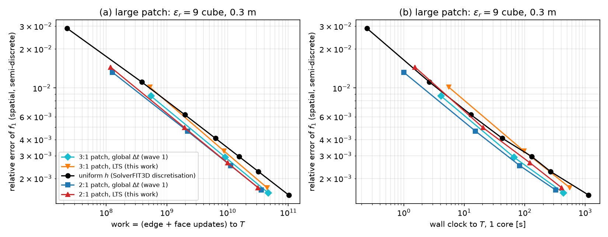

* **Figure (`img/subgrid3d_lts_cost.png`)**: Spatial (semi-discrete) relative error of the lowest resonance $f_1$ (`err_semi`) of the $1.0\times0.8\times0.6$ m PEC box with an $\varepsilon_r=9$ dielectric cube, each arm run at $0.95$ of its own $\Delta t_\max$. Series in every panel: uniform $h$ (`SolverFIT3D` discretisation, black circles), 2:1 patch with global $\Delta t$ (wave 1, blue squares), 3:1 patch with global $\Delta t$ (wave 1, cyan diamonds), 2:1 patch with LTS (red upward triangles) and 3:1 patch with LTS (orange downward triangles). Part E (small patch) is not shown: its probes do not resolve the error (guide §9g).
  * (a) Large patch ($\varepsilon_r=9$ cube, $0.3$ m; $f^*=190.717$ MHz, observed order $1.46$): `err_semi` against $\text{work} = (\text{edge} + \text{face updates}) \text{ to } T$ (300 periods).
  * (b) Large patch: `err_semi` against wall clock to $T$ on 1 core [s]. Gains at equal `err_semi` and `err_td` vs the uniform grid are tabulated in the physics guide §9g (`subgrid3d.md`, from `results_D.json`).

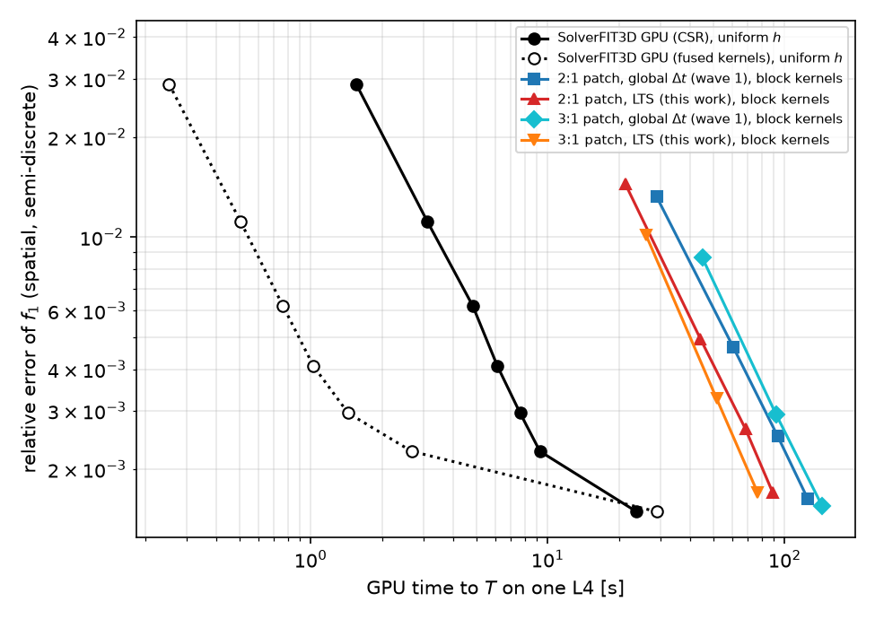

* **Figure (`img/subgrid3d_lts_gpu.png`)**: Spatial (semi-discrete) relative error of the lowest resonance $f_1$ (`err_semi`) against GPU time to $T$ on one NVIDIA L4 [s] for the large-patch problem (`results_D.json`, Cloud Batch `sg3d-lts-cost-d`), comparing `SolverFIT3D` GPU with CSR (`t_solverfit3d`, $1.56$–$23.7$ s, solid black line with filled circles) and fused kernels (`t_solverfit3d_fused`, $0.253$–$29.0$ s, dotted black line with open circles) on uniform $h$ against `SubgridLTSFIT3D` CuPy block kernels (`t_subgrid_block`) for 2:1 global $\Delta t$ ($28.8$–$125$ s, blue squares), 2:1 LTS ($21.2$–$89.0$ s, red upward triangles), 3:1 global $\Delta t$ ($45.0$–$144$ s, cyan diamonds) and 3:1 LTS ($26.0$–$76.9$ s, orange downward triangles).

Generated by `studies/unstructured-pml3d/pml3d_reflection.py plot` from `studies/unstructured-pml3d/reflection.json` and `stability.json` (Cloud Batch `pml3d-refl-v2`, n2-highmem-8; `pml3d-stab-v1`, n2-standard-4):

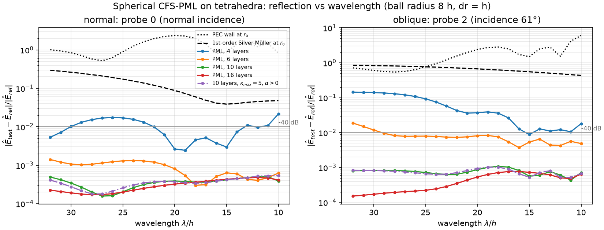

* **Figure (`img/unstructured_pml3d_reflection.png`)**: Spectral reflection $|\hat E_{test}-\hat E_{ref}|/|\hat E_{ref}|$ of the spherical CFS-PML of `UnstructuredFIT3D` (ball radius 8 h, layers dr = h, $R_{th}=10^{-8}$, $m=3$) against an identical-interior reference with 40 extra vacuum layers, for 4, 6, 10, 16 layers and $\kappa_{max}=5,\ \alpha=\omega_0/10$; baselines on the same ball: bare PEC wall and first-order Silver–Müller at $r_0$. (a) Centred z-dipole, probe at r = 7 h on the equator (normal incidence). (b) Radial dipole 1 h below the PML surface, probe at separation 60° (incidence 61° at the specular point). 10 layers: $\le 5.2\times10^{-4}$ normal, $\le 3.7\times10^{-3}$ oblique (worst probe), against 0.05–0.98 for Silver–Müller.

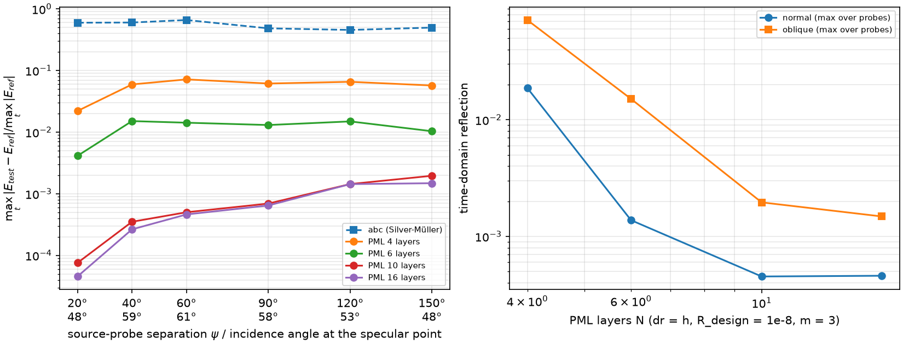

* **Figure (`img/unstructured_pml3d_angle_layers.png`)**: (a) Time-domain reflection $\max_t|E_{test}-E_{ref}|/\max_t|E_{ref}|$ vs source–probe separation ψ (tick labels give the incidence angle at the specular point, 48–61°) for Silver–Müller and 4–16 PML layers. (b) Worst-probe time-domain reflection vs the number of layers N at fixed dr: steep fall from N = 4 to 10 (discretised grading, $\sigma_{max}\,dr/c$ = 9.2 → 3.7), floor at ≈ 4.5e-4 (normal) from N = 10 to 16. (2026-11-13: the floor was the error of the vacuum-shell reference, see `unstructured_pml3d_floor_layers.png`.)

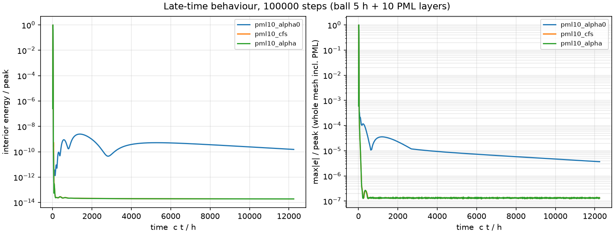

* **Figure (`img/unstructured_pml3d_late_time.png`)**: Interior energy (leapfrog-conserved form, r ≤ r0) and $\max|e|$ over the whole mesh, normalised to their peaks, over $10^5$ steps for a 10-layer PML (ball radius 5 h) with α = 0, α = ω0/10, and κ_max = 5 with α = ω0/10.

Generated by `studies/unstructured-pml3d/pml3d_floor.py plot` from `floor_before.json`/`floor_raw_before.npz` (Cloud Batch `pmlfloor-v2`, massless decision per chord) and `floor_fixed.json`/`floor_raw_fixed.npz` (`pmlfloor-v3`, per radial column), both n2-highmem-32:

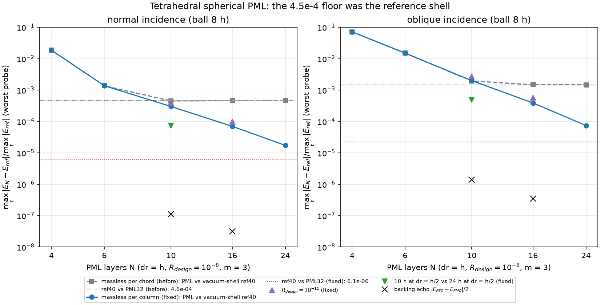

* **Figure (`img/unstructured_pml3d_floor_layers.png`)**: Worst-probe time-domain reflection $\max_t|E_N-E_{ref}|/\max_t|E_{ref}|$ against the vacuum-shell reference `ref40` vs the number of PML layers N (ball 8 h, dr = h, $R=10^{-8}$, m = 3), (a) normal, (b) oblique incidence. Grey squares: massless-edge decision per chord (before): floor 4.6e-4 (normal) / 1.5e-3 (oblique), equal to the error of `ref40` itself against a 32-layer PML (grey dash-dot). Blue circles: decision per radial column (fixed): 3.0e-4 / 7.0e-5 / 1.7e-5 at 10 / 16 / 24 layers, reference error 6.1e-6 (red dotted). Markers: $R=10^{-12}$ (worse: grading-limited), the same 10 h layer at dr = h/2 against a 24 h dr = h/2 layer (7.3e-5), and the backing-wall echo $(E_{PEC}-E_{PMC})/2$ (1e-7).

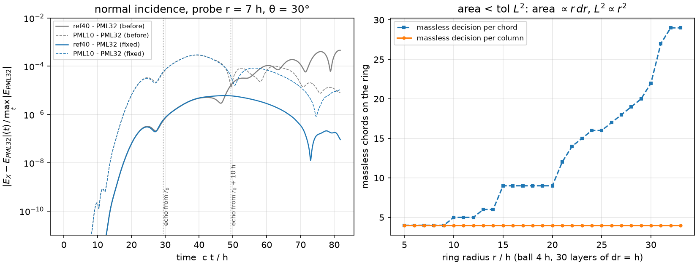

* **Figure (`img/unstructured_pml3d_floor_mechanism.png`)**: (a) Time-resolved difference to the 32-layer PML at the normal-incidence probe (r = 7 h, θ = 30°): ref40 − PML32 per chord (grey) and per column (blue), PML10 − PML32 (dashed). Before and after coincide until the wave returns from r ≈ 16 h, where the per-chord reference starts reflecting; vertical lines mark the echo times from $r_0$ and $r_0$ + 10 h. (b) Massless chords per shell ring vs radius (ball 4 h, 30 layers): per chord the count grows from 4 to 29 because area/L² ∝ dr/r; per column it stays 4.

Generated by `studies/unstructured-pml3d/pml3d_transition.py plot` from `transition.json` / `transition_signals.npz` (Cloud Batch `pmltrans-v1`, n2-highmem-16):

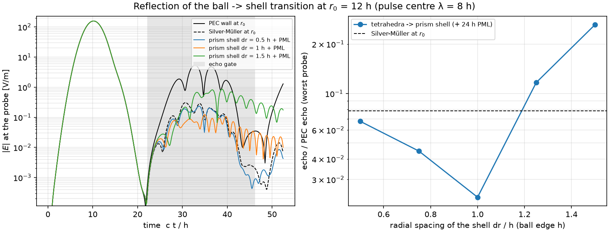

* **Figure (`img/unstructured_pml3d_transition.png`)**: (a) $|E|$ at a probe 1.5 h from the centre of a 12 h tetrahedral ball (dipole near the centre, centre wavelength 8 h) for a PEC wall at $r_0$ (calibration, |R| = 1), first-order Silver–Müller at $r_0$, and prism shells of radial spacing dr = h/2, h, 1.5 h backed by a 24 h PML; grey: the echo gate. (b) Gated echo / PEC echo (worst of 3 probes) vs dr: 0.068, 0.045, 0.023, 0.12, 0.26 for dr = 0.5–1.5 h; Silver–Müller 0.079. The transition, not the PML, sets the reflection of the truncation (2.3 % at dr = h).

Generated by `studies/unstructured-pml3d-adjoint/pml3d_inverse_design.py plot` from `design.json` / `design.npz` (Cloud Batch `pmladj-demo-v1`, n2-highmem-8):

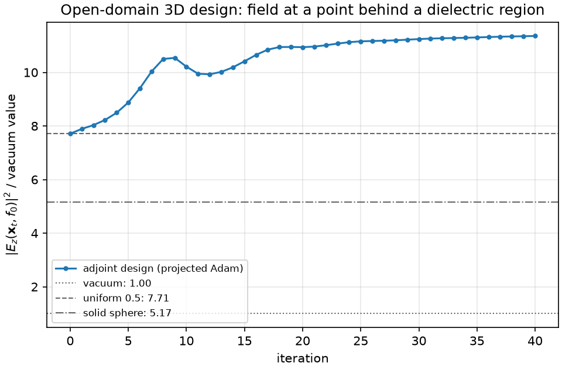

* **Figure (`img/unstructured_pml3d_adjoint_history.png`)**: Objective $|\hat E_z(\mathbf x_t,f_0)|^2$ normalised to vacuum vs projected-Adam iteration for the 3D open-domain design (tetrahedral ball radius 1.2 λ with an 8-layer spherical CFS-PML, design sphere radius 0.45 λ, ε_r ∈ [1, 4], gradients from the exact discrete adjoint including the PML states). Horizontal lines: vacuum (1), uniform ρ = 0.5 start (7.71), solid ε_r = 4 sphere (5.17). Final 11.36.

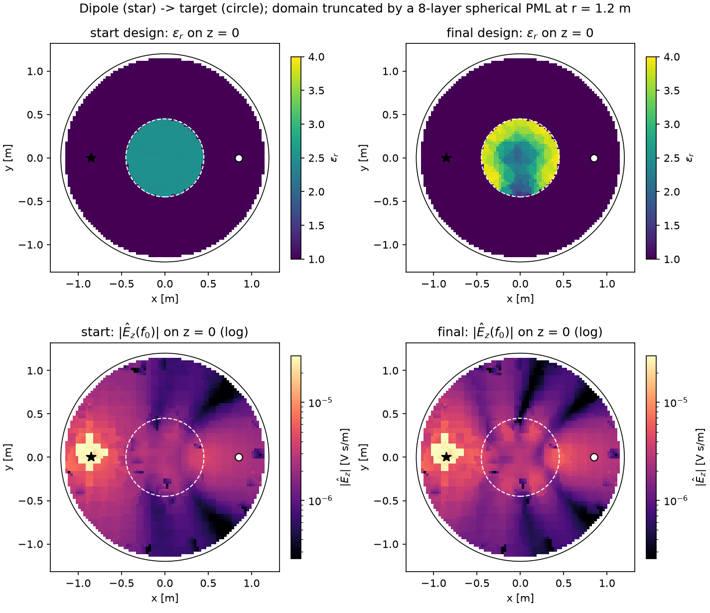

* **Figure (`img/unstructured_pml3d_adjoint_fields.png`)**: Top: ε_r on the plane z = 0 for the start and final designs (cell values at grid points; dashed: design sphere; solid: PML inner radius). Bottom: $|\hat E_z(f_0)|$ on z = 0, log scale clipped at the 2nd and 99th percentiles (the point dipole is singular). Star: dipole; circle: target.

## Hybrid Cartesian / tetrahedral FIT (`wakis.hybrid`)

Generated by `studies/hybrid-cart-tet/plot_figures.py` from `studies/hybrid-cart-tet/results_{A,B,C,D,E}*.json` (`run_study.py`, `extend_A.py`; Cloud Batch jobs `w2hyb-a`, `-a2`, `-a4`, `-b`, `-c4`, `-c5`, `-d2`, `-d3`, `-e`, `-f`; the mesh and field figures solve one N = 10 case, job `w2hyb-fig3`). See `docs/physicsguide_sections/hybrid_cart_tet.md`.

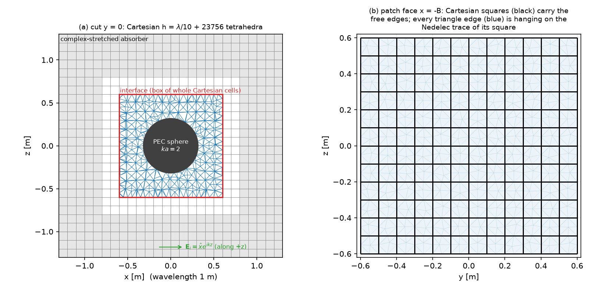

* **Figure (`studies/hybrid-cart-tet/figures/fig_hybrid_mesh.png`)**: Setup of the PEC-sphere benchmark (ka = 2, wavelength 1 m, Cartesian h = λ/10). (a) Cut y = 0: Cartesian cells (grey lines) outside the patch box (red), the cut tetrahedra (blue) around the PEC sphere (dark), the complex-stretched absorber (shaded), incidence along +z with x polarisation. (b) Corner of the patch face x = −B: the Cartesian squares (black) carry the free edge voltages; every triangle edge (blue) is a hanging edge on the Nédélec trace of its square (lattice nodes, edge midpoints and one jittered node per square).

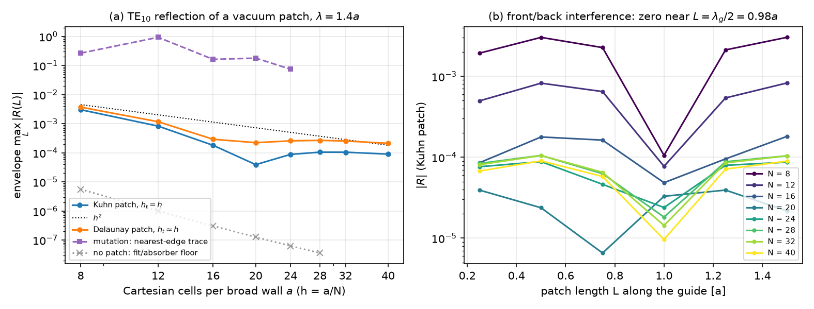

* **Figure (`studies/hybrid-cart-tet/figures/fig_hybrid_waveguide.png`)**: TE₁₀ reflection of a vacuum tetrahedral patch in a PEC guide (a = 1 m, λ = 1.4a, patch one cell from the walls). (a) Envelope over patch lengths L = 0.25…1.5a of |R(L)| (≈ 2|r| of one interface) against cells per a, for Kuhn and Delaunay patches, the `nearest` trace mutation, and the fit/absorber floor without patch. (b) |R| against L for the Kuhn patch: front and back faces cancel near L = λ_g/2.

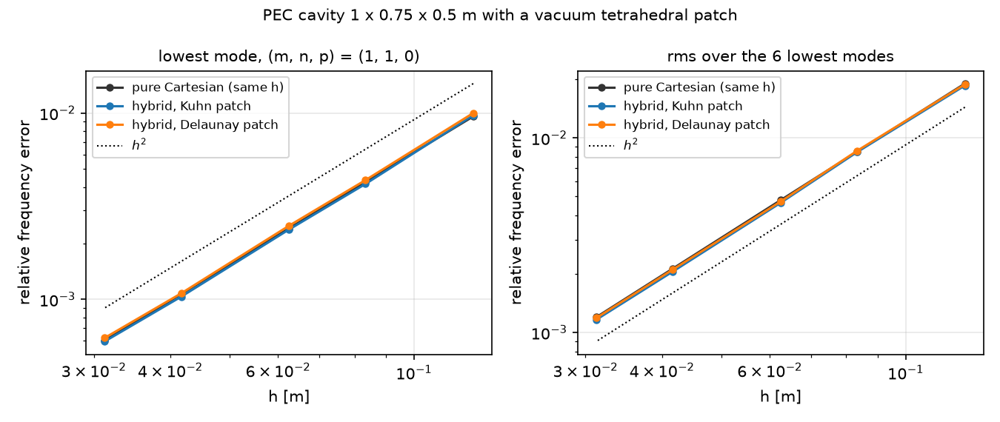

* **Figure (`studies/hybrid-cart-tet/figures/fig_hybrid_cavity.png`)**: Relative error of the PEC-cavity resonances (1 × 0.75 × 0.5 m, analytic reference) against h for the pure Cartesian grid and the hybrid with a Kuhn or Delaunay vacuum patch over the middle half of each side. (a) Lowest mode, (b) rms over the 6 lowest. All three are second order (observed 1.9–2.1) and within 7 % of each other (worst of 6 modes).

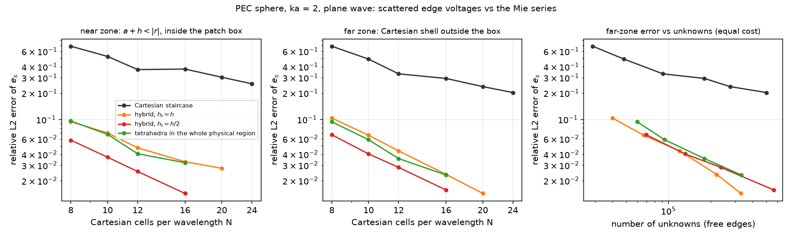

* **Figure (`studies/hybrid-cart-tet/figures/fig_hybrid_sphere.png`)**: PEC sphere, ka = 2, scattered-field formulation in the frequency domain. Relative L2 error of the scattered edge voltages against the Mie series, (a) near zone (inside the patch box, a + h < r), (b) far zone (Cartesian shell beyond the box), (c) far-zone error against the number of unknowns. Arms: Cartesian staircase; hybrid with h_t ≈ h and h_t ≈ h/2 (surface refined 2×); tetrahedra in the whole physical region (Cartesian cells only in the absorber).

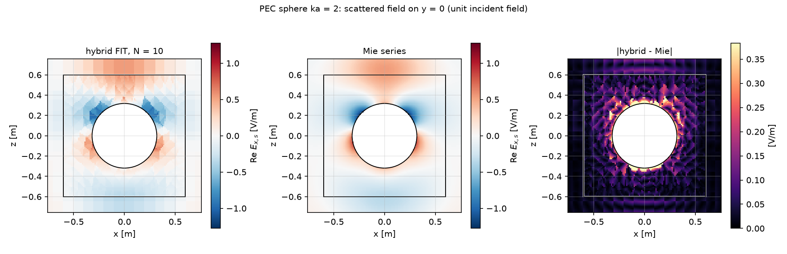

* **Figure (`studies/hybrid-cart-tet/figures/fig_hybrid_field.png`)**: Re E_x of the scattered field on y = 0 for the PEC sphere (N = 10): hybrid FIT (Whitney interpolation in the tetrahedra, nearest x-edge in the Cartesian cells), the Mie series and their difference. The box marks the interface.

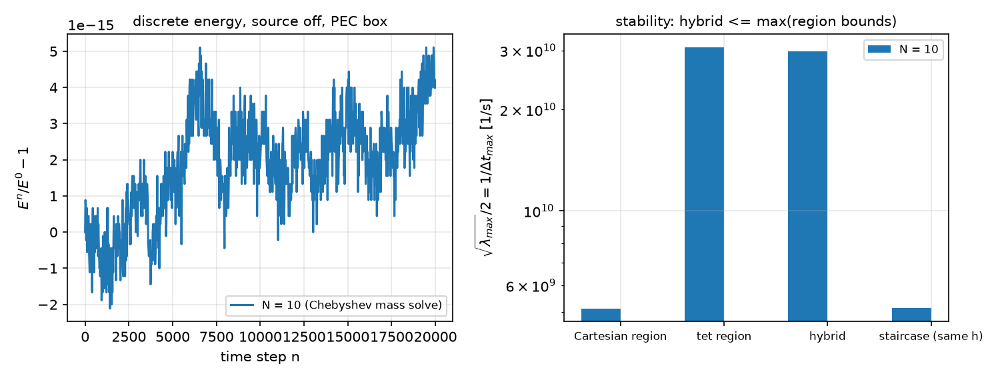

* **Figure (`studies/hybrid-cart-tet/figures/fig_hybrid_energy.png`)**: (a) Discrete energy over 20 000 leapfrog steps (source off, PEC box, sphere geometry, Chebyshev mass solve). (b) 1/Δt_max of the Cartesian region alone, the tetrahedral region alone, the hybrid, and the pure Cartesian staircase grid at the same h: the hybrid sits below the larger of the two region bounds.

Generated by `studies/hybrid-cart-tet/plot_mixed_study.py`:

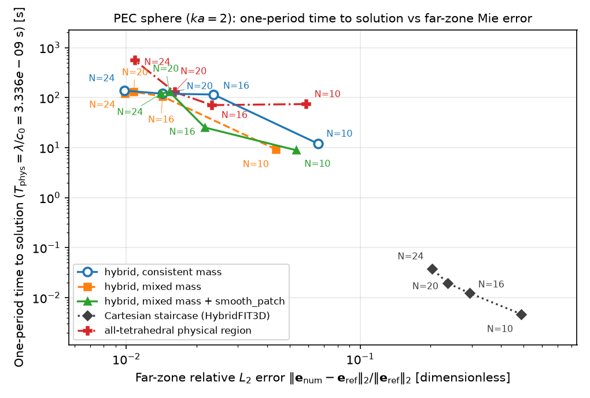

* **Figure (`studies/hybrid-cart-tet/figures/fig_hybrid_mixed_tts_vs_error.png`)**: One-period time to solution `time_to_solution_s` [s] for one optical period $T_{\mathrm{phys}} = \lambda / c_0 = 3.336\times 10^{-9}\text{ s}$ at $ka = 2.0$ ($\lambda = 1.0\text{ m}$) against the frequency-domain far-zone relative $L_2$ scattered-field error `far_zone_error` [dimensionless] for $N \in \{10, 16, 20, 24\}$: `consistent` (`far_zone_error`: $0.06598, 0.02361, 0.01428, 0.0098075$; `time_to_solution_s`: $12.01, 115.4, 120.0, 138.1\text{ s}$), `mixed` ($0.04365, 0.01425, 0.01076, 0.0098512$; $9.247, 106.1, 130.6, 120.9\text{ s}$), `mixed_smoothed` ($0.05313, 0.02166, 0.01528, 0.01408$; $8.892, 25.23, 130.6, 119.9\text{ s}$), `staircase` ($0.48889, 0.29394, 0.23725, 0.20279$; $0.004669, 0.01229, 0.01943, 0.03800\text{ s}$), and `tet` ($0.05865, 0.02320, 0.01607, 0.01084$; $74.31, 70.89, 129.7, 560.3\text{ s}$). Equal-accuracy pairs occur at $N = 16$ (`consistent` vs `tet`, `rel_error_diff` $= 0.01739$) and at $N = 24$, where `mixed` and `consistent` have about equal far-zone error ($0.0098512$ vs $0.0098075$, `rel_error_diff` $= 0.004441$).

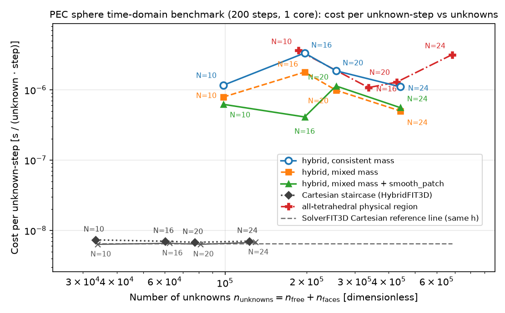

* **Figure (`studies/hybrid-cart-tet/figures/fig_hybrid_mixed_cost_per_unknown_step.png`)**: Log-log plot of one-core time-domain cost per unknown-step `cost_per_unknown_step_s` [s / (unknown $\cdot$ step)] (averaged over $200$ steps with `omp_num_threads` $= \text{"1"}$) against `n_unknowns` ($98\,455, 196\,306, 256\,113, 441\,912$ for the hybrid variants; $33\,456, 60\,336, 77\,340, 122\,748$ for `staircase`; $186\,125, 337\,310, 427\,357, 683\,820$ for `tet`) at $N \in \{10, 16, 20, 24\}$: `consistent` ($1.162\times 10^{-6}, 3.340\times 10^{-6}, 1.867\times 10^{-6}, 1.104\times 10^{-6}\text{ s}$), `mixed` ($7.892\times 10^{-7}, 1.790\times 10^{-6}, 9.883\times 10^{-7}, 5.003\times 10^{-7}\text{ s}$), `mixed_smoothed` ($6.229\times 10^{-7}, 4.119\times 10^{-7}, 1.136\times 10^{-6}, 5.573\times 10^{-7}\text{ s}$), `staircase` ($7.344\times 10^{-9}, 7.023\times 10^{-9}, 6.791\times 10^{-9}, 7.036\times 10^{-9}\text{ s}$), and `tet` ($3.629\times 10^{-6}, 1.078\times 10^{-6}, 1.286\times 10^{-6}, 3.164\times 10^{-6}\text{ s}$), with the `SolverFIT3D` Cartesian reference line (`cart_cost_per_unknown_step_s`: $6.338\times 10^{-9}, 6.572\times 10^{-9}, 6.353\times 10^{-9}, 6.792\times 10^{-9}\text{ s}$ at `cart_n_unknowns` $= 34\,074, 62\,502, 81\,288, 129\,444$). At $N = 24$, `mixed` and `consistent` have about equal far-zone error ($0.0098512$ vs $0.0098075$, `rel_error_diff` $= 0.004441$) while `mixed` reduces `cost_per_unknown_step_s` from $1.104\times 10^{-6}\text{ s}$ to $5.003\times 10^{-7}\text{ s}$.

## Unstructured FIT on the GPU (`wakis.unstructured.gpu`)

Generated by `studies/unstructured-pml3d-gpu/bench_pml3d_gpu.py plot` from `bench.json` (Cloud Batch `pmlgpu-v1`, g2-standard-8, NVIDIA L4; tests: `pmlgpu-test-v2`):

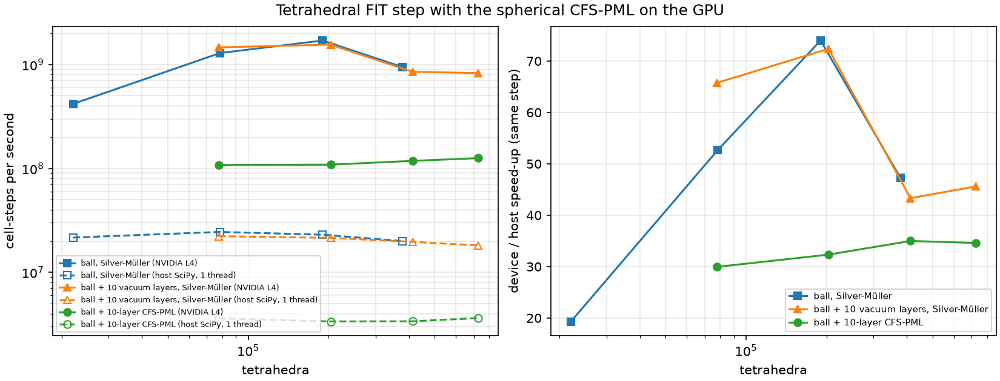

* **Figure (`img/unstructured_pml3d_gpu_throughput.png`)**: (a) Cell-steps per second vs tetrahedra for a ball with Silver–Müller, the ball + 10 vacuum prism layers with Silver–Müller (same cells as the PML case) and the ball + 10-layer CFS-PML; filled: `DeviceStepper` on an L4, open: host `one_step` (SciPy, 1 thread) on the same VM. (b) Device / host speed-up of the same step: 30–35× with the PML, 43–74× without. The PML step costs 5–14× the vacuum step (3.6–5.1× longer extended state, generic CSR stages).


Generated by `studies/unstructured-gpu/plot_figures.py studies/unstructured-gpu/out/bench_*.json` from the throughput driver `studies/unstructured-gpu/bench.py`. The Batch jobs are `ugpu-bench-a100-2` (A100-SXM4-40GB) and `ugpu-bench-l4-2` (L4); the v1 (cuSPARSE) series come from `ugpu-bench-*-1` (`*_cusparse.json`). See `docs/physicsguide_sections/unstructured_gpu.md`.


* **Figure (`img/unstructured_gpu_throughput.png`)**: (a) Time per unknown and step against problem size for the 3D tetrahedral PEC ball (`ball_mesh([0.5, 1.0], h)`, eps_r = 3, massless edges eliminated). Filled circles: `DeviceStepper` with fused kernels; open circles: v1 (cuSPARSE + elementwise); triangles: `SolverFIT3D(use_gpu=True)` with `fused=False` and `fused=True` at 6N^3 ≈ equal unknowns; grey squares: the host SciPy step, one core. A100 in blue, L4 in orange. (b) The same for 2D TM triangles. (c) Speed ratio (baseline time / `DeviceStepper` time). At 1.43e7 unknowns: 0.093 ns (A100) and 0.380 ns (L4) per unknown-step, i.e. 206× and 52× the 1-core SciPy step, 1.47× and 1.33× faster than the `SolverFIT3D` CuPy path, 1.39× and 1.06× slower than the fused Cartesian step.


* **Figure (`img/unstructured_gpu_breakdown.png`)**: Share of the device time of one step per kernel launch (CUDA events with a sync after every step, 200 steps), with one probe and a 3-frequency DFT, for the smallest and the largest 3D and 2D sizes on the A100 and the L4. The labels give the event-summed and the unsynchronised wall time per step. Small sizes (about 100 µs with monitors, 36 µs without) are launch-latency bound. At large sizes the two fused SpMV kernels take 69–80 % and the DFT monitor 19–31 %.

## Unstructured FIT: lumped and waveguide ports (`wakis.unstructured.ports3d`)

Generated by `studies/unstructured-ports3d/make_figures.py` from `studies/unstructured-ports3d/out/results.json` of `ports3d_study.py` (Cloud Batch `w2ports-study-1`, n2-standard-16; render `w2ports-figs-2`). Derivation: `docs/physicsguide_sections/unstructured_ports3d.md`. Meshes: cross-sections extruded along z into right prisms split into 3 tetrahedra (`extrude_section`), PEC walls as tagged cells, ports on the open end faces.


* **Figure (`img/unstructured_ports3d_setup.png`)**: (a) WR-90 cross-section (a = 22.86 mm, h = a/8, jittered Delaunay, PEC frame grey) with the discrete TE10 port mode (Whitney-interpolated arrows at triangle centroids) and its cutoff k_c,h a/π. (b) Side view of the 40 mm guide: z levels, port planes, ε_r = 2.2 slab (15–25 mm). (c) Coax section (2 / 4.6 mm, h = 0.8 mm) with the discrete TEM mode and a radial lumped-port edge path (orange).


* **Figure (`img/unstructured_ports3d_slab.png`)**: (a) |S11|, |S21| of the slab from two time-domain runs (markers, h = a/6 and a/24) against the continuum transfer-matrix result (lines). (b) |S11 − S11,continuum| over 8–12 GHz for h = a/4 … a/24 (second-order decrease; the deviation from the exact discrete ladder is ≤ 8.7e-10 at every h).


* **Figure (`img/unstructured_ports3d_convergence.png`)**: (a) Errors against the continuum vs h/λ0 (λ0 at 12 GHz): TE10 cutoff, straight-guide S21 phase, slab S11, coax Z0 and coax load reflection, with an h² guide. (b) Deviation of the time-domain results from the exact discrete ladder (`ExtrudedLine`): straight-guide |S11| floor and |S21 − e^{−iNθ}| (≤ 8.5e-12), slab |S − S_ladder| and unitarity (≤ 1.4e-9, truncation), coax |Γ − Γ_ladder| (≤ 1.1e-12).


* **Figure (`img/unstructured_ports3d_lumped.png`)**: (a) |S11| (R = 50 Ω) of a radial edge-path lumped port on a 10 mm coax loaded by a second 50 Ω path: DTFT of a 4 ns time-domain run (dots) vs the direct solve of the discrete-time frequency response (line); right axis: their difference (≤ 1.3e-9). (b) Input impedance with R_L = 75 Ω from the frequency-domain solve: Re Z_in − R_L ∝ f² and Im Z_in ∝ f (4.2 nH loop) as f → 0.

Generated by `studies/unstructured-ports3d/adjoint_wr90_match.py` from `out/adjoint_wr90_match.json`. Derivation: `docs/physicsguide_sections/unstructured_ports3d_adjoint.md`:


* **Figure (`studies/unstructured-ports3d/figures/adjoint_wr90_match_gradient_and_history.png`)**: (a) Absolute difference $|g_{\mathrm{adj},k} - \mathrm{FD}_k(h)|$ ($h = 10^{-3}$) across 6 sampled design tetrahedra (2 per matching layer) of the 8-layer WR-90 guide (960 tetrahedra, 144 design tetrahedra, $\varepsilon_{\mathrm{load}} = 2.6$) for $F(\rho) = |S_{21}(f_0)|^2 - |S_{11}(f_0)|^2$ at $f_0 = 10$ GHz, compared with the Richardson truncation estimate $\tau_k(h) = |\mathrm{FD}_k(2h) - \mathrm{FD}_k(h)|/3$ (max relative error $2.55\times 10^{-7}$), the bound $1.5\,\tau_k(h) + r_k(h)$, the mutation dropping the port transpose in $L^T$ (up to $53.1$ relative error), and the mutation sampling the port monitor at integer steps $t_{n+1}$ ($6.58\times 10^{-2}$ relative error). (b) 6-iteration L-BFGS-B matching trajectory at $f_0 = 10$ GHz: $|S_{21}(f_0)|^2$ rises from $0.8223$ to $0.9576$ while $|S_{11}(f_0)|$ drops from $-8.34$ dB to $-37.24$ dB.


* **Figure (`studies/unstructured-ports3d/figures/adjoint_wr90_match_spectra_and_profile.png`)**: (a) Broadband X-band reflection $|S_{11}(f)|$ (8–12 GHz) before ($\rho = 0$, unmatched $\varepsilon_r = 2.6$ load) and after 6 L-BFGS-B iterations using the exact port-augmented adjoint gradient (deep matching notch of $-37.24$ dB at $f_0 = 10$ GHz), alongside the 1D discrete ladder reference (`ExtrudedLine`) evaluated at the layer-mean permittivities. (b) Initial and optimised axial permittivity profile $\varepsilon_r(z)$ across the 20 mm guide, showing both individual design-tetrahedron values $\varepsilon_T$ and the monotonically graded layer means $\bar{\varepsilon}_r = (1.053, 1.267, 1.420)$ across the $2.5 < z < 10.0$ mm matching section.


* **Figure (`studies/unstructured-ports3d/figures/general_mesh_s11_floor.png`)**: Matched-line reflection floor $\max_f |S_{11}|$ over 8–12 GHz ($f_0 = 10$ GHz) vs cells per wavelength $\mathrm{cpw} = \lambda_0 / h$ for general 3D Delaunay tetrahedral meshes with conforming port faces (`general_mesh_accuracy.py`, `studies/unstructured-ports3d/out/general_mesh_accuracy.json`; derivation in `docs/physicsguide_sections/unstructured_ports3d_general_mesh.md`) against the `extrude_section` baseline: (a) straight WR-90 guide ($a = 22.86$ mm, $b = 10.16$ mm, $L = 20.0$ mm, $\mathrm{cpw} \in \{5.25, 7.87, 10.49, 15.74\}$), where the general-mesh floor drops from `2.3467e-02` to `3.3120e-03` with fitted log-log order $p = 1.7695$ (log RMS residual `0.0257`) while the `extrude_section` baseline stays between `3.4762e-14` and `1.8851e-12`; (b) straight coaxial TEM line ($r_{\mathrm{in}} = 2.0$ mm, $r_{\mathrm{out}} = 4.6$ mm, $L = 6.0$ mm, $\mathrm{cpw} \in \{23.06, 34.59, 46.12, 57.65\}$), where the general-mesh floor drops from `5.9155e-04` to `1.0116e-04` with fitted order $p = 1.9224$ (log RMS residual `0.0296`) while the `extrude_section` baseline stays between `2.1924e-15` and `5.5024e-14`.


* **Figure (`studies/unstructured-ports3d/figures/general_mesh_s21_phase.png`)**: Maximum transmission phase error $\max_f |\arg(S_{21} e^{i\beta L})|$ over 8–12 GHz relative to the continuum guide phase $\beta L$ vs $\mathrm{cpw} = \lambda_0 / h$ (`studies/unstructured-ports3d/out/general_mesh_accuracy.json`), with $\mathcal{O}(\mathrm{cpw}^{-2})$ order guide lines: (a) WR-90 $\text{TE}_{10}$ guide, falling from `1.5387e-01` to `1.5917e-02` rad on the general tetrahedral mesh (fitted order $p = 2.0742$, log RMS residual `0.0177`) and from `1.2219e-01` to `1.5825e-02` rad on the `extrude_section` baseline (fitted order $p = 1.8732$, log RMS residual `0.0400`); (b) coaxial TEM line, falling from `2.3795e-03` to `3.9375e-04` rad on the general mesh (fitted order $p = 2.0017$, log RMS residual `0.0461`) and from `2.8940e-03` to `4.9563e-04` rad on the `extrude_section` baseline (fitted order $p = 1.9684$, log RMS residual `0.0461`).

## Unstructured FIT on MPI ranks (`wakis.unstructured.mpi`)

Generated by `studies/unstructured-mpi/plot_figures.py` from `studies/unstructured-mpi/out/correctness.json` (`correctness.py`) and `out/scaling.json` (`scaling.py`). Batch jobs: `w2-mpi-scaling-1` (correctness, strong scaling P = 1–16, LU baseline) and `w2-mpi-scaling-2` (fused baseline, P = 32, weak scaling, partitioners). Both ran on n2-standard-32: 16 physical cores, 32 hyperthreads. Each record in `scaling.json` names its Batch job. See `docs/physicsguide_sections/unstructured_mpi.md`.


* **Figure (`img/unstructured_mpi_correctness.png`)**:
  * (a) Energy-norm difference between the 4-rank `LocalCluster` and the serial LU `one_step`, per step, for 3D tetrahedra (3,555 cells, 248 massless edges, Debye medium, ABC). Also shown: the derived bound `gpu.agreement_bound`, the drop-one-halo-entry mutation, and the state norm. The measured difference stays ≤ 5.6e-6 of the bound. The mutation reaches 1.3e5 × the bound. Against the fused host step and, on a mesh without massless edges, against `one_step` the difference is exactly 0 (not plotted on the log axis).
  * (b, c) Cell partitions into 8 parts of the same mesh by METIS and RCB (cells with |z| < h/2): 549 vs 735 cut faces.


* **Figure (`img/unstructured_mpi_strong_scaling.png`)**: Strong scaling on 1,764,494 tetrahedra (19,938 massless edges) on n2-standard-32.
  * (a) Speed-up, each against a baseline measured on the same VM:
    * VM 1 (circles): 1–16 ranks against the serial LU `one_step` (102.8 ms/step). The LU step does more arithmetic than the ranks, so this is not an equal-work ratio.
    * VM 2 (orange): 8, 16 (three partitioners) and 32 ranks against the serial fused step with the ranks' arithmetic (58.5 ms/step). 32 ranks run at 6.33 ms, i.e. 9.2×.
  * The same partition took 9.58 ms (VM 1) and 6.4–6.7 ms (VM 2) at 16 ranks: VM-to-VM variance is that large.
  * (b) Time per step split into compute and halo exchange (max over ranks).


* **Figure (`img/unstructured_mpi_weak_scaling.png`)**: Weak scaling with about 84–94k tetrahedra per rank (VM 2).
  * (a) Time per step for P ranks, with the serial LU and fused steps on the same mesh: 1.96 ms at 1 rank, 5.72 ms at 16, 12.24 ms at 32.
  * (b) Weak efficiency t(1)/t(P), about 34 % at 16 ranks on one node, and speed-up/P against the fused serial step.
  * Most of the loss is in per-rank compute: 1.95 → 5.28 ms at equal per-rank work. Shared memory bandwidth is the likely cause (hypothesis, not measured).


* **Figure (`img/unstructured_mpi_comm_volume.png`)**:
  * (a) Halo doubles received per step (all ranks) against the partition surface in cut faces, for every run with P ≥ 2. Fit: 3.75 doubles per cut face (range 3.2–4.1).
  * (b) Cut faces and time per step for METIS, RCB and RIB at 8 and 16 ranks on the strong-scaling mesh (VM 2). Times are within ±5 %, although METIS cuts 8–22 % fewer faces.

## CAD meshes and the tetrahedral time step (`wakis.unstructured.cad`, `.quality`, `.improve`)

Generated by `studies/unstructured-cadmesh/plot_cadmesh.py` from `studies/unstructured-cadmesh/results/*.json` written by `cadmesh_study.py` (Cloud Batch `cadmesh-study-4` (bounds, improve), `cadmesh-muontet-2`, `cadmesh-cart-{4,3,2p5,2}mm-1`, `cadmesh-timing-1`; figures rendered in `cadmesh-figs-1`). Derivation and discussion: `docs/physicsguide_sections/unstructured_cadmesh.md`.


* **Figure (`img/unstructured_cadmesh_setup.png`)**: (a) Muon-cooling cavity from `tests/stl/006_muonCavity.stp` (vacuum half cells selected by STEP label; copper body and beryllium windows dropped and treated as PEC), cpw 15 at f_max = 1 GHz, tetrahedra cut at y = 0, coloured by the element step bound $\Delta t_T/\Delta t_{\max}$ (log scale), worst element marked. (b) Layered pillbox STEP (a = d = 0.1 m, $\varepsilon_r=4$ layer 0 < z < 30 mm), per-material sizes from cpw 15 in each material. (c) Pillbox, cpw 20: element step bound vs radius ratio for the Voronoi (circles) and Whitney (triangles) Hodge; colour = log10 of the element energy of the dt-limiting eigenvector.


* **Figure (`img/unstructured_cadmesh_bounds.png`)**: (a) $\sqrt{\lambda/\lambda_{\max}}$ of the element bound (markers), the edge-rate lower bound $\max_e K_{ee}/M_{ee}$ (black ticks) and Gershgorin (x, Voronoi) for ten meshes (CAD pillbox, layered pillbox, muon cavity at cpw 10/20; `ball_mesh` h = 0.25, 0.15), Voronoi (blue, stiffness-proportional mass split) and Whitney (orange); dotted: the derived $\sqrt 6$ Voronoi guarantee. (b) Energy share of the dt-limiting mode on the 1 % of elements with the smallest $\Delta t_T$.


* **Figure (`img/unstructured_cadmesh_improve.png`)**: Same CAD, same f_max and cpw, solver defaults (Voronoi, `massless_tol` 1e-2): gmsh Delaunay output without optimization (blue), gmsh's default optimizer (orange), plus Netgen's (grey), and Delaunay + `improve_dt` with CAD-surface sliding (green). (a) $c\,\Delta t_{\max}/\bar h$. (b) rms relative error of the resonances vs analytic (pillbox: TM010, TE111 ×2, TM110 ×2; layered: TM01 transverse-resonance root). (c) Serial wall time per simulated ns at cpw 20, relative to the Delaunay baseline (one process, one BLAS thread, median of 5 interleaved repetitions).


* **Figure (`img/unstructured_cadmesh_muon.png`)**: Relative deviation of the TM010-like (a) and second (b) resonance of the muon cavity from the Cartesian conformal-PEC FIT reference $f^*$ ($h^2$ extrapolation, h = 3, 2.5, 2 mm; black squares: the Cartesian runs), against the mesh size: tetrahedral eigenmodes with the Voronoi Hodge on the Delaunay mesh (blue), after `improve_dt` (green; stars: time-domain ring-down) and with the Whitney Hodge (purple), cpw 10–40 at f_max = 1 GHz.


* **Figure (`docs/img/steiner_rim_zoom.png`)**:
  * **Generating command**: `python studies/unstructured-cadmesh/steiner_study.py --out studies/unstructured-cadmesh/results/steiner.json && python studies/unstructured-cadmesh/plot_steiner.py`
  * **Data file**: `studies/unstructured-cadmesh/results/steiner.json` (`mode: "synthetic"`, key paths `rim_zoom.{radius_m,v0_xy,v1_xy,v_opp_xy,v_apex1_xy,v_apex2_xy,midpoint_xy,projected_xy,sagitta_m,steiner_cad_deviation_m,tau_m,voronoi_offset_before_m,voronoi_offset_after_m}`, `synthetic_rim_cases[0].paths.{w3_flips,w4_auto,w4_cad_projector,analytic}.steiner_nodes_xy`, `synthetic_rim_cases[0].paths[*].{n_steiner_inserted,max_steiner_cad_deviation_m}`)
  * **Setup**: Synthetic circular-rim tetrahedral mesh (`radius_m = 0.1` m, `n_rim = 16` regular $16$-gon vertices on $r = a = 0.1\;\text{m}$, `18` vertices, `32` tetrahedra; gmsh-free deterministic fallback since `gmsh` is not installed on this machine) with 16 non-Delaunay triangular faces incident to the locked circular rim curve (`voronoi_offset_before_m = -2.011056e-3` m).
  * **Caption**: Three-panel $(x, y)$ view of non-Delaunay faces incident to a locked circular rim curve ($r = a = 0.1\;\text{m}$, black dashed arc) before and after `split_edge_steiner` (`wakis.unstructured.steiner`). (a) Single-face zoom before repair showing the locked rim chord $(v_0, v_1)$, the two incident rim tetrahedra sharing $f = (v_0, v_1, v_{\mathrm{opp}})$, the unprojected chord midpoint $\mathbf{m}$ (`sagitta_m = 1.921472e-3` m off the circle), and the negative dual Voronoi face offset (`voronoi_offset_before_m = -2.011056e-3` m). (b) Same rim section after `split_edge_steiner` with `feature_curve_projector`: the locked chord is split into $(v_0, v_{\mathrm{new}})$ and $(v_{\mathrm{new}}, v_1)$ with $v_{\mathrm{new}} = \mathbf{p}$ projected onto $r = a$ (`steiner_cad_deviation_m = 0.0 <= tau_m = 1e-8` m), partitioning the two incident tetrahedra into four daughter tetrahedra with strictly positive dual Voronoi face offsets (`voronoi_offset_after_m = +1.374701e-2` m). (c) Full circular rim cross-section comparing `wave-3 flips` (`split_project=None`, `0` Steiner nodes, `16` stuck negative faces remaining) against `w4 auto` (`FeatureCurveProjector`), `w4 CAD projector` (`CadSplitProjector`), and `analytic` (`_analytic_pillbox_projector`), each inserting `n_steiner_inserted = 16` Steiner nodes directly on $r = a = 0.1\;\text{m}$ (`max_steiner_cad_deviation_m = 0.0` m) and clearing all `16` negative faces (`n_neg_faces_after = 0`).


* **Figure (`docs/img/steiner_dt_ratios.png`)**:
  * **Generating command**: `python studies/unstructured-cadmesh/steiner_study.py --out studies/unstructured-cadmesh/results/steiner.json && python studies/unstructured-cadmesh/plot_steiner.py`
  * **Data file**: `studies/unstructured-cadmesh/results/steiner.json` (`mode: "synthetic"`, key paths `synthetic_rim_cases[0].paths.{before_improve_dt,repair_false,w3_flips,w4_auto_sweeps0,w4_auto,w4_cad_projector_sweeps0,w4_cad_projector,analytic}.{n_neg_faces,n_neg_solver_guard,dt_max_s,dt_ratio_vs_repair_false,dt_ratio_vs_w3}`, `recorded_repair_suite.cases[*].{name,cpw,n_neg_faces_initial,n_neg_faces_norepair,n_neg_faces_repaired,n_neg_guard_initial,n_neg_guard_norepair,n_neg_guard_repaired,dt_max_initial,dt_max_norepair,dt_max_repaired,dt_ratio_repaired_to_norepair,dt_ratio_repaired_to_initial,n_flips_23,n_flips_32,n_splits}`)
  * **Setup**: Comparison of all repair paths on the synthetic cylinder-rim mesh (`synthetic_rim`, `32 -> 64` tetrahedra) alongside the recorded 6-case STEP CAD benchmark suite (`pillbox`, `layered`, `muon` at `cpw = 10, 15` from `studies/unstructured-cadmesh/results/repair.json`, embedded in `steiner.json` under `recorded_repair_suite`).
  * **Caption**: (a) Negative dual-face counts (`Mnu_diag < 0`, top bars) and solver guard interior negative-face counts (bottom hatched bars) across all 7 meshes: on the synthetic cylinder rim, `before` (`16 / 16`), `repair=False` (`16 / 16`), and `wave-3 flips` (`split_project=None`, `16 / 16`) leave all 16 rim-locked negative faces unresolved, whereas `w4 auto`, `w4 CAD projector`, and `analytic` each insert `16` projected Steiner nodes on $r = a$ and drive both counts to `0 / 0`; across the 6 STEP CAD meshes (`pillbox`, `layered`, `muon` at `cpw = 10, 15`), node movement alone (`repair=False`) leaves `4–42` total negative faces (`2–21` interior solver-guard violations), while topological repair reduces the solver-guard count to `0` on all 6 meshes (`0–5` boundary-only negative faces). (b) Maximum explicit leapfrog time step $\Delta t_{\max}$ normalized by $\Delta t_{\max}(\text{repair=False})$: on the synthetic cylinder rim, pure projected Steiner splitting (`n_sweeps=0`) raises $\Delta t_{\max}$ from $3.257\times 10^{-11}\;\text{s}$ (`0.785x`) to $3.383\times 10^{-11}\;\text{s}$ (`0.816x`, `+3.9%` over `wave-3 flips` without moving existing vertices), and combined with node relocation (`n_sweeps=6`) reaches $\Delta t_{\max} = 4.651\times 10^{-11}\;\text{s}$ across `w4 auto`, `w4 CAD projector`, and `analytic` (`1.121x` vs `repair=False` at $4.149\times 10^{-11}\;\text{s}$, and `1.428x` vs `wave-3 flips` at $3.257\times 10^{-11}\;\text{s}$); on the 6 STEP CAD meshes, repaired meshes achieve $\Delta t_{\max}/\Delta t_{\max}(\text{repair=False}) \in [0.955, 1.077]$ (`1.261x–1.763x` vs the initial Delaunay mesh) with zero interior solver-guard violations.

## 3D curvilinear hexahedral FIT (`wakis.curvilinear`)

Generated by `studies/curvilinear3d/figures_hexmesh.py` from `studies/curvilinear3d/results/hexmesh_study.json` (written by `studies/curvilinear3d/study_hexmesh.py`) and the mesh generators in `wakis/curvilinear/mappings3d.py`. Derivation and discussion: `docs/physicsguide_sections/curvilinear3d.md`.


* **Figure (`studies/curvilinear3d/figures/hexmesh_convergence.png`)**:
  * **Script**: `studies/curvilinear3d/figures_hexmesh.py`
  * **Data file**: `studies/curvilinear3d/results/hexmesh_study.json` (generated by `studies/curvilinear3d/study_hexmesh.py`)
  * **Caption**: Log-log convergence of relative cavity eigenfrequency error $|\omega_{\text{disc}} - \omega_{\text{ana}}|/\omega_{\text{ana}}$ vs mesh spacing $h$ [m] for `CurvilinearFIT3D` (`CurvFIT`, `_pec_reconstruction='constrained'`, blue), `SolverFIT3D` conformal (`Conf.`, `conformal='pec'`, green), and `SolverFIT3D` staircase (`Stair.`, `conformal=False`, vermilion) at matching unknown counts, with solid lines and filled circles for the first mode in each panel (`TM010`, `TE_l1`), dashed lines and open squares for the second mode (`TE111`, `TM_l1`), and dotted $\mathcal{O}(h)$ and dash-dotted $\mathcal{O}(h^2)$ reference slope lines. (a) 5-block butterfly cylinder (`a = 1.0 m`, `L = 1.2 m`, `n = 4, 6, 8, 12`, `n_unknowns = 748, 2754, 6808, 23940`): `CurvilinearFIT3D` reaches `+1.1607e-03` on `TM010` (least-squares order `1.69`, two-level order `1.83`) and `-1.1708e-03` on `TE111` (least-squares order `2.15`, two-level order `2.11`), matching `SolverFIT3D conformal` (`-1.1647e-03` with LS order `2.09` and `-8.1589e-04` with LS order `2.07` at `N_cart = 22`), whereas `SolverFIT3D staircase` stalls at `-5.0587e-02` (LS order `0.35`) and `-3.3899e-02` (LS order `-0.92`). (b) 7-block cubed-sphere ball (`a = 1.0 m`, `n = 6, 8, 12, 16`, `n_unknowns = 4350, 10408, 35484, 84560`): `CurvilinearFIT3D` converges monotonically to `+2.7221e-03` on `TE_l1` (LS order `1.89`, two-level order `1.95`) and `+5.1375e-03` on `TM_l1` (LS order `1.95`, two-level order `1.97`), while `SolverFIT3D conformal` reaches `-9.7500e-04` (LS order `1.32`, two-level `-0.64`) and `-1.1495e-03` (LS order `3.01`, two-level `-6.89` at `N_cart = 37`) and `SolverFIT3D staircase` gives `-6.4904e-02` (LS order `0.57`) and `-5.5586e-02` (LS order `-2.31`).


* **Figure (`studies/curvilinear3d/figures/hexmesh_meshes.png`)**:
  * **Script**: `studies/curvilinear3d/figures_hexmesh.py`
  * **Data file**: `studies/curvilinear3d/results/hexmesh_study.json` (mesh generators `butterfly_disk_nodes` and `cubed_sphere_ball_nodes` in `wakis/curvilinear/mappings3d.py`)
  * **Caption**: Two $(x, y)$ wireframe cross-sections of the multi-block conforming hexahedral meshes with outer PEC walls, sharp octant nodes (`effective_sharp_nodes`, where $\mathbf{D}_c = \mathbf{0}$, plotted as orange diamonds), and $0.5\;\text{m}$ scale bars. (a) Transverse $(x, y)$ cross-section at $z = 0$ of the 5-block butterfly cylinder `butterfly_disk_nodes(4, a=1.0, length=1.2)` ($n = 4$, $a = 1.0\;\text{m}$, $L = 1.2\;\text{m}$, `748` unknown edges, `32` sharp octant nodes total on the circular rims $r = a, z \in \{0, 1.2\}\;\text{m}$, with the `16` rim nodes at $z = 0$ shown). (b) Equatorial $(x, y)$ hexahedral slice at $z = 0$ (superimposed on the faint $(x, y)$ projection of all outer boundary shell edges) of the 7-block equidistant gnomonic cubed-sphere ball `cubed_sphere_ball_nodes(6, a=1.0)` ($n = 6$, $a = 1.0\;\text{m}$, `4350` unknown edges, `8` sharp octant cube-corner nodes corresponding to `24` sharp octants on $r = a$).


* **Figure (`docs/img/curvilinear3d_bn_wall_diagnosis.png`)**:
  * **Generating command**: `python studies/curvilinear3d/bn_wall_diagnosis.py --out studies/curvilinear3d/results/bn_wall_diagnosis.json && python studies/curvilinear3d/plot_w4_diagnostics.py`
  * **Data file**: `studies/curvilinear3d/results/bn_wall_diagnosis.json` (`quick: false`, key paths `max_m0_globally`, `max_m1_minus_g_globally`, `{sphere_nodes,cubed_sphere_ball_nodes,butterfly_disk_nodes}.runs[*].octants.one_wall_octants.{max_m1,max_g}`, `{sphere_nodes,cubed_sphere_ball_nodes,butterfly_disk_nodes}.runs[*].m3.{TM_lowest,TE_lowest}.per_class.smooth_wall.{max_m3_nv,max_m3_exact}`, `{sphere_nodes,cubed_sphere_ball_nodes,butterfly_disk_nodes}.orders`)
  * **Setup**: Full-mode (`quick=false`) magnetic wall boundary normal audit on `sphere_nodes(N, N, N, a=1.0)` ($N \in \{4, 6, 8, 12, 16\}$), `cubed_sphere_ball_nodes(N, a=1.0)` ($N \in \{4, 6, 8\}$), `butterfly_disk_nodes(N, a=1.0, length=1.2)` ($N \in \{4, 6, 8\}$), and the flat-wall control `perturbed_box_nodes(6, 5, 4)` (`max_m0 = max_m1 = max_g = 0.0`).
  * **Caption**: (a) Log-log convergence of the 1-wall octant node-normal magnetic residual $m_1 = |\mathbf{B}_{h,c}\cdot\hat{\mathbf{n}}_v|/\|\mathbf{B}_{h,c}\|$ (solid curves, filled markers) and the facet-to-node normal angle bound $g = \|\hat{\mathbf{n}}_v \times \hat{\mathbf{n}}_f\|$ (dashed curves, open markers) vs block resolution $N$ alongside an $\mathcal{O}(N^{-1})$ guide: across all boundary octants of all meshes, $m_0 = |\mathbf{B}_{h,c}\cdot\hat{\mathbf{n}}_f|/\|\mathbf{B}_{h,c}\| \le 2.384\times 10^{-16}$ (`max_m0_globally`) and $m_1 - g \le 0$ (`max_m1_minus_g_globally = 0.0`), with 1-wall $m_1$ and $g$ decaying at first order (`0.9307` on `sphere_nodes` from $0.2652 \to 0.0731$, `0.8414`/`0.8387` on `cubed_sphere_ball_nodes` from $0.3029 \to 0.1688$/$0.1691$, and `0.9782`/`0.9929` on `butterfly_disk_nodes` from $0.1894$/$0.1951 \to 0.0962$/$0.0980$). (b) Log-log decay of the smooth-wall cavity eigenmode node-averaged normal residual $m_3 = |\mathbf{B}_v\cdot\hat{\mathbf{n}}|/\max_w\|\mathbf{B}_w\|$ ($\mathbf{b} = \mathbf{C}_u\mathbf{W}_{\varepsilon,u}\mathbf{d}$) vs $N$ with $\mathcal{O}(N^{-1})$, $\mathcal{O}(N^{-2})$, and $\mathcal{O}(N^{-3})$ guides: on `cubed_sphere_ball_nodes`, lowest $\text{TM}$ $m_3(\hat{\mathbf{n}}_v)$ decays from $5.012\times 10^{-3}$ ($N=4$) to $6.395\times 10^{-4}$ ($N=8$, LS order `3.0188`), lowest $\text{TE}$ $m_3(\hat{\mathbf{n}}_v)$ decays from $6.920\times 10^{-3}$ to $2.018\times 10^{-3}$ (LS order `1.7714`), and $\text{TE}$ $m_3(\hat{\mathbf{n}}_{\mathrm{exact}})$ decays from $8.091\times 10^{-2}$ to $2.106\times 10^{-2}$ (LS order `1.9430`); on `butterfly_disk_nodes`, $\text{TM}_{010}$ $m_3$ decays from $1.832\times 10^{-2}$ to $6.930\times 10^{-3}$ (LS order `1.3961`) and $\text{TE}_{111}$ $m_3$ from $6.518\times 10^{-3}$ to $3.147\times 10^{-3}$ (LS order `1.0378`); on `sphere_nodes` ($N=4\to 16$), $\text{TM}$ $m_3(\hat{\mathbf{n}}_v)$ decays from $1.501\times 10^{-2}$ to $5.344\times 10^{-3}$ (LS order `0.7228`) and $\text{TE}$ $m_3(\hat{\mathbf{n}}_v)$ from $2.228\times 10^{-2}$ to $6.092\times 10^{-3}$ (LS order `0.8994`).


* **Figure (`docs/img/curvilinear3d_perturbed_box_order.png`)**:
  * **Generating command**: `python studies/curvilinear3d/perturbed_box_order.py --out studies/curvilinear3d/results/perturbed_box_order.json && python studies/curvilinear3d/plot_w4_diagnostics.py`
  * **Data file**: `studies/curvilinear3d/results/perturbed_box_order.json` (`quick: false`, key paths `D`, `D_drop_only`, `legacy_two_level_F2_k1_to_2`, `F1_study_window_6_8_12_16`, `F1_study_window_drop_only`, `{F1,F2,F3}.{ns,signed_errors_amp,signed_errors_yee_amp0,signed_errors_dist,ls_order_amp,ls_order_yee_amp0,ls_order_dist}`)
  * **Setup**: Full-mode (`quick=false`) $\text{TE}_{101}$ eigenfrequency error decomposition $e(\mathrm{amp}) = e_{\mathrm{Yee}}(0) + e_{\mathrm{dist}}$ on the perturbed PEC box $[0, 1.0]\times[0, 0.7]\times[0, 0.8]\;\text{m}^3$ ($\omega_{\mathrm{ana}} = 1.50765688\times 10^9\;\text{rad/s}$) across families `F1` ($(n,n,n)$ cell-scaled $\mathrm{amp}=0.3$, $n \in \{4, 6, 8, 12, 16, 24\}$), `F2` ($(4k,3k,4k)$ cell-scaled $\mathrm{amp}=0.3$, $n = 4k \in \{4, 8, 12, 16, 24\}$), and `F3` ($(n,n,n)$ fixed physical diffeomorphism matched to `F1` at $n=6$, $n \in \{6, 8, 12, 16, 24\}$).
  * **Caption**: Log-log convergence of the total error magnitude $|e(\mathrm{amp})|$ (blue circles), the negative second-order Yee dispersion component $|-e_{\mathrm{Yee}}(0)|$ (green open squares), and the positive mesh-distortion shift $+e_{\mathrm{dist}} = e(\mathrm{amp}) - e_{\mathrm{Yee}}(0)$ (vermilion triangles) vs grid resolution $n$ with $\mathcal{O}(n^{-2})$, $\mathcal{O}(n^{-3.5})$, and $\mathcal{O}(n^{-1.5})$ guides. (a) On `F1` ($n \in \{4, 6, 8, 12, 16, 24\}$), constrained PEC reconstruction (`_pec_reconstruction="constrained"`) gives `D = 1.974416` on $n \in \{6, 8, 12, 16\}$ and `LS(e) = 1.981613` over $n \in [4, 24]$ (`|e(amp)| = 2.490e-2 -> 7.117e-4`), with $|-e_{\mathrm{Yee}}(0)|$ decaying at `LS = 1.996136` (`2.550e-2 -> 7.138e-4`) and $+e_{\mathrm{dist}}$ decaying at `LS = 3.247677` (`6.022e-4 -> 2.119e-6`, `3.517161` on $\{6, 8, 12, 16\}$); by contrast, the pre-fix `_pec_reconstruction="drop_only"` rule (purple diamonds and ochre inverted triangles) inflates $+e_{\mathrm{dist}}$ at $n=6$ by `10.14x` (`3.228e-3` vs `3.184e-4`, `LS = 2.807907`) and lowers the four-point slope to `D_drop_only = 1.795576`. (b) On `F2` ($n = 4k \in \{4, 8, 12, 16, 24\}$), `LS(e) = 1.987856` (two-level $k=1\to 2$ slope `1.999214`), `LS(e_Yee) = 1.995853`, and `LS(e_dist) = 2.901954` (`3.854e-4 -> 2.227e-6`, local orders rising from `3.5099` to `3.8589` for $n \ge 8$). (c) On `F3` ($n \in \{6, 8, 12, 16, 24\}$, fixed physical displacement), `LS(e) = 2.012530`, `LS(e_Yee) = 1.997754`, and $+e_{\mathrm{dist}}$ decays from `3.184e-4` to `3.422e-5` (`LS = 1.621745`, local orders rising from `1.1343` to `1.8728` toward second order).

## Local time stepping on 3D tetrahedral meshes (`wakis.unstructured.lts3d`)

Generated by `python studies/unstructured-lts3d/plot_figures.py` from `studies/unstructured-lts3d/results/bounds.json`, `studies/unstructured-lts3d/results/accuracy.json`, `studies/unstructured-lts3d/results/timing.json`, and `studies/unstructured-lts3d/results/stability.json` (written by `python studies/unstructured-lts3d/run_study.py --part all`). Derivation and discussion: `docs/physicsguide_sections/unstructured_lts3d.md`.


* **Figure (`docs/img/lts3d_levels.png`)**:
  * **Generating command**: `python studies/unstructured-lts3d/plot_figures.py`
  * **Data file**: `studies/unstructured-lts3d/results/bounds.json` (from `python studies/unstructured-lts3d/run_study.py --part bounds`)
  * **Setup**: Geometrically graded PEC cavity (`C1_graded_box`), jittered uniform PEC cavity (`C2_uniform_box`), and optional CAD pillbox (`C3_pillbox_delaunay`) evaluated with `hodge="voronoi"` and `hodge="whitney"` under multi-level LTS (`ratios=[2, 2]`).
  * **Caption**: (a) Mid-plane cross-section of the graded tetrahedral box coloured by assigned LTS level (level 0 coarse $\Delta t$, level 1 buffer/fine $\Delta t/2$, level 2 finest $\Delta t/4$). (b) Histogram of element stability bounds $\Delta t_T / \Delta t_{\mathrm{global}}$ with the level-1 and level-2 threshold cuts marked. Measured values are recorded in `studies/unstructured-lts3d/results/bounds.json`.


* **Figure (`docs/img/lts3d_cost.png`)**:
  * **Generating command**: `python studies/unstructured-lts3d/plot_figures.py`
  * **Data file**: `studies/unstructured-lts3d/results/accuracy.json` and `studies/unstructured-lts3d/results/timing.json` (from `python studies/unstructured-lts3d/run_study.py --part accuracy` and `--part timing`)
  * **Setup**: PEC cavity resonance ladders on `C1_graded_box`, `C2_uniform_box`, `C3_pillbox_delaunay`, and `C4_pillbox_gmsh` across global leapfrog (`G`), `improve_dt` node relocation (`G-imp`), increased `massless_tol` (`G-ml3e-2`, `G-ml1e-1`), automatic and fixed-ratio LTS (`L`, `L-dt*`, `L-imp`), and Whitney global/LTS arms (`GW`, `LW-element`, `LW-edge_rate`).
  * **Caption**: Log-log time-domain resonance frequency error $|f_{\mathrm{TD}} / f_{\mathrm{exact}} - 1|$ vs wall time per simulated nanosecond [s/ns] across mesh ladders for every arm and baseline, annotated with the equal-error comparison status from `studies/unstructured-lts3d/results/accuracy.json`.


* **Figure (`docs/img/lts3d_stability.png`)**:
  * **Generating command**: `python studies/unstructured-lts3d/plot_figures.py`
  * **Data file**: `studies/unstructured-lts3d/results/stability.json` (from `python studies/unstructured-lts3d/run_study.py --part stability`)
  * **Setup**: Graded tetrahedral cavity (`C1_graded_box`) swept over coarse time steps $\Delta t / \Delta t_{\mathrm{global}}$ with `ratios=[2]`, plus long-time modified-energy trajectories for certified LTS, `interface` and `drop_buffer` mutations, and an unstable step above $\Delta t_{\mathrm{LTS}}$.
  * **Caption**: (a) Spectral stability factor $\rho = (\Delta t/2)\sqrt{\lambda_{\max}(S_0, M)}$ and maximum level positivity margin $\max_l \tau_{l-1}^2 \mu_l / x_+$ vs $\Delta t / \Delta t_{\mathrm{global}}$, with the derived global-limit threshold marked. (b) Relative modified-energy drift $|E^{n+1/2} - E_0|/|E_0|$ for certified LTS vs `interface` and `drop_buffer` mutations. (c) Unstable step above $\Delta t_{\mathrm{LTS}}$: the state norm diverges exponentially while the indefinite modified energy remains algebraically conserved to round-off. Measured values are recorded in `studies/unstructured-lts3d/results/stability.json`.

## Adaptive tetrahedral refinement (`wakis.unstructured.adapt`)

Generated by `python studies/unstructured-adapt/run_adapt_study.py --arm all --out studies/unstructured-adapt/results && python studies/unstructured-adapt/merge_results.py --indir studies/unstructured-adapt/results --out studies/unstructured-adapt/results/adapt_study.json && python studies/unstructured-adapt/plot_adapt_study.py --results studies/unstructured-adapt/results/adapt_study.json --outdir docs/img`. Derivation and discussion: `docs/physicsguide_sections/unstructured_adapt.md`.


* **Figure (`docs/img/unstructured_adapt_mesh.png`)**:
  * **Generating command**: `python studies/unstructured-adapt/run_adapt_study.py --arm all --out studies/unstructured-adapt/results && python studies/unstructured-adapt/merge_results.py --indir studies/unstructured-adapt/results --out studies/unstructured-adapt/results/adapt_study.json && python studies/unstructured-adapt/plot_adapt_study.py --results studies/unstructured-adapt/results/adapt_study.json --outdir docs/img`
  * **Data file**: `studies/unstructured-adapt/results/adapt_study.json` (`meta.quick: false`, `meta.memory_budget_bytes: 2000000000`, key paths `arms.residual.initial_mesh_cut.{z_m,n_cells_3d,n_dofs_3d,n_triangles,level_min_3d,level_max_3d,cell_level_counts_3d,xy_m,triangles,level_T}`, `arms.residual.adapted_mesh_cut.{z_m,n_cells_3d,n_dofs_3d,n_triangles,level_min_3d,level_max_3d,cell_level_counts_3d,xy_m,triangles,level_T}`)
  * **Setup**: Re-entrant PEC L-prism cavity $\Omega = ((-1, 1)^2 \setminus [0, 1]\times[-1, 0]) \times (0, 0.6)\;\text{m}^3$ ($\omega = 3\pi/2$, singularity exponent $\alpha = 2/3$) on `l_prism_mesh(5, 3, height_m=0.6)` before and after 9 Dörfler residual-adaptive longest-edge bisection iterations (`theta = 0.5`, `max_dofs = 49006` under the $2.0\;\text{GB}$ memory budget), sliced on the horizontal mesh plane $z = 0.2\;\text{m}$.
  * **Caption**: Horizontal cut view at $z = 0.2\;\text{m}$ of the L-prism tetrahedral mesh coloured by exact 3D longest-edge bisection refinement level $\ell_T = \log_2(V_0 / V_T)$ ($V_0 = 1/750\;\text{m}^3$). (a) Initial mesh (`arms.residual.initial_mesh_cut`: `n_cells_3d = 1350` tetrahedra, `n_dofs_3d = 1193` free-edge DOFs, `n_triangles = 150` cut triangles, all at $\ell_T = 0$) with the re-entrant corner $(0, 0)$ marked by an orange circle and a $0.5\;\text{m}$ scale bar in the missing quadrant. (b) Final residual-adapted mesh at iteration 9 (`arms.residual.adapted_mesh_cut`: `n_cells_3d = 37020` tetrahedra, `n_dofs_3d = 41817` DOFs, `n_triangles = 954` cut triangles, $\ell_T \in [3, 9]$ with 3D level counts `{'3': 1008, '4': 7608, '5': 21324, '6': 4608, '7': 624, '8': 840, '9': 1008}`). (c) Zoom $[-0.25, 0.25]^2\;\text{m}^2$ around the re-entrant corner $(0, 0)$ showing isotropic longest-edge bisection grading up to $\ell_T = 9$ ($h_{\min} = 2.50 \times 10^{-2}\;\text{m}$ vs initial $h_0 = 0.20\;\text{m}$).


* **Figure (`docs/img/unstructured_adapt_convergence.png`)**:
  * **Generating command**: `python studies/unstructured-adapt/run_adapt_study.py --arm all --out studies/unstructured-adapt/results && python studies/unstructured-adapt/merge_results.py --indir studies/unstructured-adapt/results --out studies/unstructured-adapt/results/adapt_study.json && python studies/unstructured-adapt/plot_adapt_study.py --results studies/unstructured-adapt/results/adapt_study.json --outdir docs/img`
  * **Data file**: `studies/unstructured-adapt/results/adapt_study.json` (`meta.quick: false`, key paths `mps_reference.k2_per_m2`, `slope_summary`, `equal_dof_ratios.vs_uniform.{residual,zz,random0}`, `equal_dof_ratios.vs_residual.{random0,random1,random2,geometric}`, `arms.{uniform,residual,zz,geometric,random0,random1,random2,theta03,theta07}.{history,slope_fit,slope_fit_energy,slope_fit_eta2}`)
  * **Setup**: Fundamental $\text{TM}_{z0}$ mode of the PEC L-prism ($k^2 = 9.6397239608\;\text{m}^{-2}$, $f_{\mathrm{ref}} = 0.148140\;\text{GHz}$ from 32-term MPS `l_shape_dirichlet_eigenvalue`) run to the largest DOF budget fitting under the $2.0\;\text{GB}$ per-process memory cap: `uniform` generations $0..5$ ($N = 1\,193 \to 49\,006$ DOFs, $1\,350 \to 43\,200$ cells; generation 6 has $86\,400$ cells and requires $5.10\;\text{GB}$ estimated SuperLU memory) and adaptive/control arms (`residual`, `zz`, `geometric`, `random0`–`random2`, `theta03`, `theta07`) with `max_dofs = 49006`.
  * **Caption**: (a) Log-log convergence of the squared $H(\mathrm{curl})$ energy error $|||\mathbf{e}|||^2 = \|\nabla\times(\mathbf{u}-\mathbf{u}_h)\|^2 + k^2\|\mathbf{u}-\mathbf{u}_h\|^2$ (solid curves, filled markers) and squared error indicators $\eta_{\mathrm{res}}^2, \eta_{\mathrm{ZZ}}^2$ (dashed curves, open markers) vs free-edge DOFs $N$ alongside $N^{-4/9}$ (P1 uniform asymptotic) and $N^{-2/3}$ (P2 adaptive optimal) guides (`A2′` experiment): over the second half of the `residual` run (`it = 5..9`, $N = 8\,386 \to 41\,817$), $|||\mathbf{e}|||^2$ decays with slope `-0.6629` (`7.2715e-1 -> 6.6307e-2 m^-2`) and $\eta_{\mathrm{res}}^2$ with slope `-0.6549` (`2.5377e1 -> 2.0084 m^-2`), matching the asymptotic 3D rate $-2/3 = -0.6667$; on `uniform` generations `2..5` ($N = 5\,738 \to 49\,006$), the uniform arm is still **pre-asymptotic** between smooth bulk decay ($-2/3$) and corner-singular decay ($-4/9 = -0.4444$), with energy slope `-0.5632` (`7.2715e-1 -> 7.3538e-2 m^-2`) and $\eta_{\mathrm{res}}^2$ slope `-0.5888` (`2.5377e1 -> 2.0090 m^-2`), leaving a 5-generation slope gap of `-0.0997` on $|||\mathbf{e}|||^2$ and `-0.0661` on $\eta^2$ (which is why `test_a2_prime_energy_and_indicator_slopes` is a strict `xfail`). (b) Relative eigenvalue error $|k_h^2 - k^2|/k^2$ vs DOFs $N$ across all L-prism arms (`A1`/`A2`): at $N = 41\,817$, `residual` ($\theta = 0.5$) reaches $2.2222 \times 10^{-3}$ vs $3.8015 \times 10^{-3}$ for interpolated `uniform` (`1.711x` gain; $|||\mathbf{e}|||^2$ ratio `1.291x`) and beats `random0` at $N = 41\,601$ by `1.707x` (`1.615x` in $|||\mathbf{e}|||^2$), while `zz` ($\theta = 0.5$) exhibits Babuška–Osborn sign cancellation at `it = [5, 6, 10]` (`+9.4775e-7` at `it=9` to `-2.7137e-4` at `it=10`) yet beats `uniform` in the sign-free norms at $N = 37\,799$ (`en2` ratio `1.144x`, `curl2` ratio `1.657x`).


* **Figure (`docs/img/unstructured_adapt_effectivity.png`)**:
  * **Generating command**: `python studies/unstructured-adapt/run_adapt_study.py --arm all --out studies/unstructured-adapt/results && python studies/unstructured-adapt/merge_results.py --indir studies/unstructured-adapt/results --out studies/unstructured-adapt/results/adapt_study.json && python studies/unstructured-adapt/plot_adapt_study.py --results studies/unstructured-adapt/results/adapt_study.json --outdir docs/img`
  * **Data file**: `studies/unstructured-adapt/results/adapt_study.json` (`meta.quick: false`, key paths `arms.box.levels[*].{n_dofs,theta_res,theta_zz}`, `arms.box.level_ratios.{L1_over_L0,L2_over_L1}.{theta_res_ratio,theta_zz_ratio}`, `arms.{uniform,residual,zz,geometric}.history[*].{n_dofs,theta_res,theta_zz,eigenvalue_effectivity}`)
  * **Setup**: Energy-norm effectivity $\theta_{\mathrm{res}} = \eta_{\mathrm{res}} / |||\mathbf{u} - \mathbf{u}_h|||$ and curl-recovery effectivity $\theta_{\mathrm{ZZ}} = \eta_{\mathrm{ZZ}} / \|\mu_r^{-1/2}\nabla\times(\mathbf{u} - \mathbf{u}_h)\|$ evaluated on the PEC box $(0.7, 0.5, 0.3)\;\text{m}$ ($\text{TM}_{110}$, `kuhn_mesh((7, 5, 3), 0.1)` at levels `L0–L2`, $N = 636, 5\,058, 43\,692$ free-edge DOFs, $630, 5\,040, 40\,320$ cells) and on the L-prism ($\text{TM}_{z0}$, `uniform`, `residual`, and `zz` arms up to $N = 49\,006$ DOFs).
  * **Caption**: (a) Semilog-x plot of $\theta_{\mathrm{res}}$ and $\theta_{\mathrm{ZZ}}$ vs free-edge DOFs $N$: on the smooth PEC box (`E3`), $\theta_{\mathrm{res}} = 6.173, 5.826, 5.830$ (`L2/L1` ratio `1.0007`) and $\theta_{\mathrm{ZZ}} = 1.083, 1.035, 1.013$ (`L2/L1` ratio `0.9784`); on the singular L-prism, $\theta_{\mathrm{res}}$ stays in $[5.16, 5.91]$ (`5.908 -> 5.227` on `uniform`, `5.908 -> 5.504` on `residual`, `5.908 -> 5.763` on `zz`) and $\theta_{\mathrm{ZZ}}$ stays near unity in $[1.05, 1.15]$ (`1.148 -> 1.130` on `uniform`, `1.148 -> 1.066` on `residual`, `1.148 -> 1.048` on `zz`). (b) Log-log plot of the L-prism indicator-to-eigenvalue error ratio $\eta_{\mathrm{res}}^2 / |k_h^2 - k^2|$ vs DOFs $N$: the ratio remains strictly above the reliability bound $\ge 1$ (`58.3–221.3` on `uniform` and `93.9–256.8` on `residual`), while exhibiting sharp upward spikes on `zz` (up to $3.65 \times 10^5$ at $N = 25\,903$) and `geometric` (up to $8.07 \times 10^3$ at $N = 10\,654$) where $k_h^2 - k^2 = \|\nabla\times\mathbf{e}\|^2 - k^2\|\mathbf{e}\|^2$ passes through zero.

## 3D Cartesian subgridding: dispersive and subpixel media (`wakis.subgrid3d.media`)

Generated by `python studies/subgrid3d/media/plot_media.py --in studies/subgrid3d/media --out docs/img` from `studies/subgrid3d/media/media.json` (written by `python studies/subgrid3d/media/run_media.py --out studies/subgrid3d/media`). Derivation and discussion: `docs/physicsguide_sections/subgrid3d_media.md`.


* **Figure (`docs/img/subgrid3d_media_slab_convergence.png`)**:
  * **Generating command**: `python studies/subgrid3d/media/plot_media.py --in studies/subgrid3d/media --out docs/img`
  * **Data file**: `studies/subgrid3d/media/media.json` (keys `slab.d6_dispersive` and `slab.c2_subpixel`, generated by `python studies/subgrid3d/media/run_media.py --out studies/subgrid3d/media`)
  * **Setup**: (a–b) PEC cavity $[0, 0.38]\times[0, 0.31]\times[0, 0.90]\text{ m}$ (`slab.d6_dispersive.box_m`) with a dispersive slab $0 < z < z_s = 0.30\text{ m}$ (`slab.d6_dispersive.z_s_m`) crossed by a 2:1 subgrid patch on cells $(s\dots 2s,\; s\dots 2s,\; s\dots 5s)$ ($s = N_z / 9$, $N_z \in \{9, 18, 27\}$, `slab.d6_dispersive.nz_list`, fine axial step $h_z = H_z/2 \in \{0.05, 0.025, 0.01667\}\text{ m}$, `slab.d6_dispersive.hz_fine_m`) for lossless Lorentz ($\varepsilon_\infty = 1$, $\Delta\varepsilon = 6$, $f_0 = 520\text{ MHz}$) and lossless Drude ($\varepsilon_\infty = 1$, $f_p = 380\text{ MHz}$) media on the 3 lowest fundamental modes (`slab.d6_dispersive.lbl_lor`: `TE_10, TE_01, TM_11`). (c) PEC cavity $[0, 1.0]\times[0, 0.7]\times[0, 0.9]\text{ m}$ (`slab.c2_subpixel.box_m`) with a non-node-plane $\varepsilon_r = 4.0$ dielectric slab $0 < z < z_s = 0.361\,c = 0.3249\text{ m}$ (`slab.c2_subpixel.z_s_m`) crossing a 2:1 patch across $N_z \in \{9, 13, 17, 21, 27\}$ (`slab.c2_subpixel.nz_list`, $h_z \in [0.01667, 0.05]\text{ m}$, `slab.c2_subpixel.hz_fine_m`).
  * **Caption**: (a) Transverse–axial $(x, z)$ cross-section schematic at $y = b/2$ showing the coarse cells ($H_z = c / N_z$), the 2:1 patch ($h_z = H_z / 2$), the hanging-edge patch boundary where row-sum lumping $M_k = |P|^T(m_{p,k}\circ |P|\mathbf{1})$ acts, the D6 slab interface $z_s = 0.30\text{ m}$, and the C2 sub-cell cut $z_s = 0.361\,c$. (b) Log-log convergence of the 3-mode mean relative frequency error vs $h_z$ [m] against the exact 1D shooting reference (`slab.d6_dispersive.vac_1d_err` $= 2.322\times 10^{-14}$) and against the uniform fine `SubgridFIT3D` baseline (`== SolverFIT3D` at step $h_z$), with $\mathcal{O}(h_z^2)$ and $\mathcal{O}(h_z)$ guides: Lorentz vs 1D drops from `2.953e-02` to `7.308e-03` to `3.242e-03` (`slab.d6_dispersive.err_lor_1d`, pairwise orders `2.015, 2.004` in `ord_lor_1d`, LS slope `2.011` in `ls_ord_lor_1d`) and vs uniform fine from `2.284e-02` to `5.611e-03` to `2.486e-03` (`err_lor_fine`, pairwise orders `2.025, 2.007` in `ord_lor_fine`, LS slope `2.019` in `ls_ord_lor_fine`); Drude vs 1D drops from `3.529e-02` to `8.935e-03` to `3.983e-03` (`err_dru_1d`, pairwise orders `1.981, 1.993` in `ord_dru_1d`, LS slope `1.985` in `ls_ord_dru_1d`) and vs uniform fine from `2.686e-02` to `6.778e-03` to `3.020e-03` (`err_dru_fine`, pairwise orders `1.986, 1.994` in `ord_dru_fine`, LS slope `1.989` in `ls_ord_dru_fine`), whereas omitting the hanging-edge row-sum factor (`mutate="lump_no_rowsum"`) degrades Lorentz to `5.304e-02 -> 2.212e-02 -> 1.373e-02` (`err_lor_mut`, orders `1.262, 1.177` in `ord_lor_mut`) and stalls Drude at `1.152e-01 -> 1.830e-01 -> 1.825e-01` (`err_dru_mut`, orders `-0.667, 0.007` in `ord_dru_mut`). (c) Mean relative error across the 4 lowest modes (`slab.c2_subpixel.modes`: `TE_10, TM_11, TE_01, TE_11`) vs $h_z$ [m] for the non-node-plane $\varepsilon_r = 4$ slab: Kottke subpixel averaging (`averaging="subpixel"`) decreases monotonically from `1.082e-02` to `4.553e-03, 2.751e-03, 2.140e-03, 1.055e-03` (`slab.c2_subpixel.err_sub`, LS slope `2.032` in `ls_sub`), beating staircase (`averaging="staircase"`: `2.361e-02, 1.943e-02, 6.695e-03, 1.577e-02, 5.494e-03` in `err_st`, LS slope `1.187` in `ls_st`) and the swapped harmonic/arithmetic projection mutation (`mutate="swap_projection"`: `1.750e-02, 5.275e-03, 1.567e-02, 2.626e-03, 3.384e-03` in `err_mut`, LS slope `1.466` in `ls_mut`) at every resolution.


* **Figure (`docs/img/subgrid3d_media_dispersive_cube.png`)**:
  * **Generating command**: `python studies/subgrid3d/media/plot_media.py --in studies/subgrid3d/media --out docs/img`
  * **Data file**: `studies/subgrid3d/media/media.json` (key `dispersive.rows` and `dispersive.references_hz`, generated by `python studies/subgrid3d/media/run_media.py --out studies/subgrid3d/media`)
  * **Setup**: PEC cavity $1.0\times 0.8\times 0.6\text{ m}$ at coarse grid counts $N_x \in \{5, 10, 15\}$ ($H_x \in \{0.20, 0.10, 0.0667\}\text{ m}$, fine step $h_x = H_x/2 \in \{0.10, 0.05, 0.0333\}\text{ m}$; the largest configuration fitting within the 2000 MB `memguard` cap, since $N_x=20$ `uniform_fine` requires 2283 MB RSS in 3D `splu`) comparing `uniform_fine` (`SubgridFIT3D` without patch at step $h_x$, identical to `SolverFIT3D`), `patch_r2` (2:1 patch over the inclusion), and `uniform_coarse` (step $H_x = 2h_x$) for Lorentz ($\varepsilon_\infty = 1.5$, $\Delta\varepsilon = 2.5$, $f_0 = 340\text{ MHz}$) and Drude ($\varepsilon_\infty = 1.5$, $f_p = 240\text{ MHz}$) inclusions.
  * **Caption**: Relative error $|f_1 - f_*|/f_*$ of the fundamental cavity mode against Richardson-extrapolated references (`dispersive.references_hz`: `localized_lorentz = 2.1784e+08` Hz, `localized_drude = 1.0156e+08` Hz, `exterior_limited_lorentz = 2.0426e+08` Hz, `exterior_limited_drude = 1.0200e+08` Hz). (a) Localized cube ($3.3\%$ of box volume) vs state unknowns $n_{\mathrm{state}}$ [DOF] and (b) vs time-domain work per nanosecond $n_{\mathrm{state}}/\Delta t$ [DOF/ns]: at $N_x = 15$, Lorentz `patch_r2` uses $4.24\times$ fewer state unknowns (`n_state = 18732` vs `79500`), $4.33\times$ less work per ns (`work_per_ns = 2.998e+05` vs `1.298e+06`), and $3.53\times$ less wall time per ns (`wall_per_ns_s = 2.449e-03` vs `8.633e-03` s) at relative error `rel_err_ref = 7.472e-03` (`rel_diff_uniform_fine = 5.296e-03` vs `uniform_fine` `rel_err_ref = 2.188e-03`). (c) Honest regime (`exterior_limited`, $20\%$ block where the 2:1 hanging-edge interface sits directly on the dielectric jump while global $\Delta t$ is fine-limited): at $N_x = 15$, `patch_r2` has `rel_err_ref = 6.769e-03` (Lorentz) and `3.382e-02` (Drude) at `work_per_ns = 3.065e+05` and `3.050e+05` DOF/ns, which does not improve accuracy per unit work over `uniform_fine` (`rel_err_ref = 2.017e-03` and `5.412e-03`).


* **Figure (`docs/img/subgrid3d_media_subpixel_sphere.png`)**:
  * **Generating command**: `python studies/subgrid3d/media/plot_media.py --in studies/subgrid3d/media --out docs/img`
  * **Data file**: `studies/subgrid3d/media/media.json` (key `sphere.rows`, `sphere.f_ref_hz`, and `sphere.orders`, generated by `python studies/subgrid3d/media/run_media.py --out studies/subgrid3d/media`)
  * **Setup**: PEC cavity $1.0\times 0.85\times 0.75\text{ m}$ (`sphere.sphere.box_m`) containing an $\varepsilon_r = 4.0$ dielectric sphere of radius $R = 0.22\text{ m}$ centred at $(0.48, 0.43, 0.37)\text{ m}$ (`sphere.sphere.center_m`) enclosed in a 2:1 subgrid patch across coarse grid counts $N_x \in \{6, 8, 10, 12, 16, 20\}$ (fine step $h \in [0.025, 0.0833]\text{ m}$, `n_free` from `487` to `36958`).
  * **Caption**: (a) Log-log convergence of the 4-mode mean relative eigenfrequency error `rel_err_mean` vs fine patch cell step $h$ [m] against Richardson-extrapolated reference frequencies (`sphere.f_ref_hz`: `195.534, 211.821, 225.825, 291.230` MHz), comparing `staircase` ($n_{\mathrm{sub}}=1$) against Kottke subpixel averaging with dual-volume moment normal ($n_{\mathrm{sub}} \in \{2, 4, 6\}$) and analytic radial normal ($n_{\mathrm{sub}}=4$), with $\mathcal{O}(h)$ and $\mathcal{O}(h^2)$ guides. Across $N_x = 6 \to 20$, `staircase` drops from `2.897e-02` to `5.869e-03` with least-squares order `sphere.orders.staircase = 1.267`, whereas `subpixel_nsub4_momentN` drops from `2.674e-02` to `2.588e-03` with order `sphere.orders.subpixel_nsub4_momentN = 1.821` (`subpixel_nsub2_momentN`: `3.265e-03`, order `1.614`; `subpixel_nsub6_momentN`: `2.535e-03`, order `1.834`; `subpixel_nsub4_exactN`: `2.388e-03`, order `1.818`). (b) Mode-by-mode relative error `rel_err_modes` vs coarse grid count $N_x$ for `staircase` (dashed grey circles) vs `subpixel_nsub4_momentN` (solid blue triangles) across all four cavity modes.

## 3D Cartesian subgridding: CFS-CPML with patches in the layer (`wakis.subgrid3d.pml`)

Generated by `python studies/subgrid3d/cpml_patches/plot_cpml_patches.py --in studies/subgrid3d/cpml_patches --out docs/img` from `studies/subgrid3d/cpml_patches/cpml_patches.json` (written by `python studies/subgrid3d/cpml_patches/run_cpml_patches.py --out studies/subgrid3d/cpml_patches`). Derivation and discussion: `docs/physicsguide_sections/subgrid3d_cpml_patches.md`.


* **Figure (`docs/img/subgrid3d_cpml_patches_spectrum.png`)**:
  * **Generating command**: `python studies/subgrid3d/cpml_patches/plot_cpml_patches.py --in studies/subgrid3d/cpml_patches --out docs/img`
  * **Data file**: `studies/subgrid3d/cpml_patches/cpml_patches.json` (keys `spectrum.t1_geometries`, `spectrum.re_over_smax`, and `spectrum.diagnosis_fine`, generated by `python studies/subgrid3d/cpml_patches/run_cpml_patches.py --out studies/subgrid3d/cpml_patches`)
  * **Setup**: Exact semi-discrete generator $G$ (`cpml_generator`) at $\alpha/(2\pi) = 10\text{ MHz}$ ($R_0 = 10^{-6}$, $m = 3$, $\sigma_{\max} = 5.177\times 10^{10}\text{ s}^{-1}$ in `spectrum.sigma_max`) across all 11 T1 geometries (`spectrum.t1_geometries`) plus the $8\times 5\times 5$ $+x$-layer configurations (`8x5x5_into`, `8x5x5_thru` in `spectrum.re_over_smax`), comparing `sigma_sampling="fine"` against Candidate C1 (`sigma_sampling="coarse_cell"`).
  * **Caption**: **Note: patches inside the CPML layer remain refused by default (`allow_patches=False`, raising `ValueError`) and the T1 full-matrix spectrum gate `test_t1_cpml_patches_spectrum` is marked strict `xfail`.** (a) Normalized generator growth rate $\max\operatorname{Re}\lambda(G)/\sigma_{\max}$ per geometry with stable ($\le 10^{-6}\sigma_{\max}$, green) vs unstable ($> 10^{-6}\sigma_{\max}$, red for `fine` and hatched orange for C1 strict `xfail`) marked against the $10^{-6}\sigma_{\max}$ threshold. Fine sampling (`sigma_sampling="fine"`) is spectrally unstable across every patched geometry (`re_fine_10m` from `5.262e-03` on `x/y/z_into_2to1` to `7.871e-03` on `tube_2to1`; `8x5x5_into = 5.372e-03`, `8x5x5_thru = 5.443e-03` in `spectrum.re_over_smax`). Candidate C1 (`sigma_sampling="coarse_cell"`) stabilises `nopatch_x` (`1.673e-15`), `x_into_2to1` (`5.453e-09`), `y_into_2to1` (`5.872e-09`), `z_into_2to1` (`4.400e-09`), `tube_2to1` (`3.514e-09`), `x_through_3to1` (`2.748e-09`), `corner_xy_2to1` (`3.631e-09`), and `8x5x5_into` (`5.565e-09` $\le 10^{-6}$), while 3D patches coupling a coarse-to-fine cutoff step into the deepest backing cells remain spectrally unstable above $10^{-6}\sigma_{\max}$ (`x_into_3to1 = 1.883e-04`, `x/y/z_through_2to1 = 4.111e-04` at $1.953\text{ GHz}$ in `spectrum.t1_geometries`, and `8x5x5_thru = 1.633e-05` in `spectrum.re_over_smax.patch_through_coarse_cell`). (b) Modal energy localisation of the unstable eigenvector under `sigma_sampling="fine"` (`spectrum.diagnosis_fine`): `32.1%` (`0.3209`) in coarse block 0 and `67.9%` (`0.6791`) in patch block 1 (`block_energy_share`), with `94.1%` (`0.9408`, `interface_face_share_of_b`) of magnetic face energy on faces touching interface-parent edges, `62.2%` (`0.6220`, `interface_edge_share_of_e`) of electric edge energy on interface-parent edges, and `55.7%` / `40.4%` (`depth_quartile_share[0:2]`) in the first two layer depth quartiles.


* **Figure (`docs/img/subgrid3d_cpml_patches_reflection.png`)**:
  * **Generating command**: `python studies/subgrid3d/cpml_patches/plot_cpml_patches.py --in studies/subgrid3d/cpml_patches --out docs/img`
  * **Data file**: `studies/subgrid3d/cpml_patches/cpml_patches.json` (keys `reflection` and `spectrum.reflection_variants_re_over_smax`, generated by `python studies/subgrid3d/cpml_patches/run_cpml_patches.py --out studies/subgrid3d/cpml_patches`)
  * **Setup**: 3D open-box pulse reflection benchmark on an $n_{\mathrm{int}}^3 = 20^3$ interior domain ($[-0.4, 0.4]^3\text{ m}$, $H = 0.04\text{ m}$) surrounded by $n_{\mathrm{pml}} \in \{4, 6, 8, 12\}$ coarse CPML cells on all 6 faces, driven by a $1\text{ GHz}$ Gaussian-modulated $J_z$ dipole over $t \in [0, 8.0]\text{ ns}$ and compared against a $3.7\times$ larger reflection-free reference box ($n_{\mathrm{ref,total}} = 74$) at two off-centre probes (`err = max(err_probes)`).
  * **Caption**: **Note: patches inside the CPML layer remain refused by default (`allow_patches=False`, strict `xfail` in `test_t1_cpml_patches_spectrum`).** (a) Grouped bar chart of the reflection table `err` across $n_{\mathrm{pml}} \in \{4, 6, 8, 12\}$ (`reflection[*].err`) for four configurations: `nopatch` (uniform `SubgridLTSFIT3D`, spectrally stable with $\max\operatorname{Re}\lambda/\sigma_{\max} = 6.239\times 10^{-15}$ in `spectrum.reflection_variants_re_over_smax.nopatch`, dropping from `2.067e-02` to `1.790e-03, 1.991e-04, 1.558e-05`), `patch_near` (2:1 patch stopping 1 coarse cell outside the CPML, default-allowed and spectrally stable at `7.337e-15`, dropping from `1.016e-02` to `6.466e-04, 8.263e-05, 1.588e-05`), `patch_through_c1_alpha0` (hatched red bar, explicitly labelled as the **spectrally unstable row** with $\max\operatorname{Re}\lambda/\sigma_{\max} = 1.657\times 10^{-5} > 10^{-6}$ in `spectrum.reflection_variants_re_over_smax.patch_through_c1_alpha0`, stalling at `1.427e-02, 6.437e-03, 3.685e-03, 1.925e-03` due to late-time mode growth), and `patch_through_alpha1GHz` (C1 with $\alpha/(2\pi) = 1\text{ GHz}$, spectrally stable at `2.451e-09` but suffering low-frequency reflection `1.209e-01, 4.133e-02, 3.530e-02, 1.672e-02`). (b) Honest time-domain reflection waveform $|e_{\mathrm{open}}(t) - e_{\mathrm{ref}}(t)|/\max|e_{\mathrm{ref}}|$ at $n_{\mathrm{pml}} = 12$ (`reflection[12..15]`): `nopatch` and `patch_near` decay to $1.56\times 10^{-5}$ and $1.59\times 10^{-5}$, whereas `patch_through_alpha1GHz` reflects low frequencies (`1.672e-02`) and `patch_through_c1_alpha0` grows exponentially after $t \approx 5\text{ ns}$ (`1.925e-03`).

## 3D Cartesian subgridding: distributed-memory MPI (`wakis.subgrid3d.mpi`)

Generated by `python studies/subgrid3d/mpi/plot_scaling.py --in studies/subgrid3d/mpi --out docs/img` from `studies/subgrid3d/mpi/scaling.json` (written by `mpirun --allow-run-as-root -n 8 python studies/subgrid3d/mpi/scaling.py --out studies/subgrid3d/mpi` across $P \in \{1, 2, 4, 8\}$ up to the 8 physical cores / 16 logical CPUs of this machine; $P = 16$ full scaling study TBD). Derivation and discussion: `docs/physicsguide_sections/subgrid3d_mpi.md`.


* **Figure (`docs/img/subgrid3d_mpi_correctness.png`)**:
  * **Generating command**: `python studies/subgrid3d/mpi/plot_scaling.py --in studies/subgrid3d/mpi --out docs/img`
  * **Data file**: `studies/subgrid3d/mpi/scaling.json` (key `runs`, generated by `mpirun --allow-run-as-root -n 8 python studies/subgrid3d/mpi/scaling.py --out studies/subgrid3d/mpi`)
  * **Setup**: `DistributedSubgridFIT3D` at $P \in \{1, 2, 4, 8\}$ (`p_list`, up to the 8 physical cores / 16 logical CPUs of this machine; $P = 16$ full scaling study TBD) on the two loaded-cavity problems of `studies/subgrid3d/run_study_lts.py`: Part D (`case="big"`, $H = 0.05\text{ m}, r = 2$, $63,966$ unknowns in `cases.big.global.unknowns`) and Part E (`case="small"`, $H = 0.025\text{ m}, r = 2$, $202,744$ unknowns in `cases.small.global.unknowns`), under both global $\Delta t$ (`kind="global"`) and multi-level LTS (`kind="lts"`) with weighted recursive coordinate bisection (`method="rcb"`) and whole-block greedy assignment (`method="blocks"`).
  * **Caption**: (a) Bitwise-equality panel (`runs[*].bitwise_20_steps == True` and `runs[*].max_abs_diff_20_steps == 0.0` across all 32 runs, plotted at floor $10^{-20}$) and Higham global energy `Allreduce` relative difference $|\Delta\mathcal{E}|/\mathcal{E}$ (`runs[*].energy_rel_diff_20_steps`, bounded by `1.12e-16` on `big global`, `1.51e-16` on `big lts`, `2.44e-16` on `small global`, and `2.09e-16` on `small lts`, vs $2u = 2^{-52} = 2.22\times 10^{-16}$) against the serial `SubgridLTSFIT3D(kernels="csr")` reference after 20 coarse steps. (b) Weighted work imbalance $\max_r W_r / \bar{W}$ (`runs[*].imbalance`) vs MPI ranks $P$: weighted `rcb` stays at `1.0000` (`1.0004` on `big lts` at $P = 8$, `big_lts_rcb_p8_imbalance`), whereas whole-block assignment (`blocks`) cannot subdivide the 2:1 patch block and grows to `2.9520 / 5.9041` (`big global`), `3.3970 / 6.7941` (`big lts`), `3.5224 / 7.0448` (`small global`), and `3.1467 / 6.2933` (`small lts`) at $P = 4 / P = 8$. (c) Total halo unknowns across ranks `halo_e_sum + halo_b_sum + halo_lts_sum` under `rcb` vs $P$, reaching `7423` (`big global`), `13182` (`big lts`), `14438` (`small global`), and `18287` (`small lts`) at $P = 8$.


* **Figure (`docs/img/subgrid3d_mpi_scaling.png`)**:
  * **Generating command**: `python studies/subgrid3d/mpi/plot_scaling.py --in studies/subgrid3d/mpi --out docs/img`
  * **Data file**: `studies/subgrid3d/mpi/scaling.json` (keys `cases`, `runs`, and `*_steps_per_s` / `*_speedup`, generated by `mpirun --allow-run-as-root -n 8 python studies/subgrid3d/mpi/scaling.py --out studies/subgrid3d/mpi`)
  * **Setup**: Strong-scaling benchmark over 40 timed coarse steps (`n_steps_bench = 40`) across $P \in \{1, 2, 4, 8\}$ on this 8-physical-core (16-logical-CPU) machine ($P = 16$ full scaling study TBD), compared directly against the serial `SubgridLTSFIT3D(kernels="csr")` baseline on the same VM, mesh, and $\Delta t$ (`cases.big.global.serial_steps_per_s = 2016.82`, `cases.big.lts.serial_steps_per_s = 812.83`, `cases.small.global.serial_steps_per_s = 631.34`, `cases.small.lts.serial_steps_per_s = 417.95`).
  * **Caption**: Top row: throughput [coarse steps/s] vs MPI ranks $P \in \{1, 2, 4, 8\}$ on (left) Part D (`big`, $63,966$ unknowns) and (right) Part E (`small`, $202,744$ unknowns), with horizontal dash-dot lines marking the serial `SubgridLTSFIT3D(kernels="csr")` throughput and dotted lines showing ideal linear scaling $P \times \text{serial}$. Bottom row: speedup `runs[*].speedup_vs_serial` relative to serial `SubgridLTSFIT3D(kernels="csr")`. On Part D (`big`), weighted `rcb` scales from `1580.89` ($P=1$) to `2588.56` ($P=2$), `3784.30` ($P=4$, `1.88x` serial), and `3664.77` steps/s ($P=8$, `1.82x` serial) under global $\Delta t$ (`big_global_rcb_p*_steps_per_s`), and from `725.78` ($P=1$) to `814.52` ($P=2$), `1681.42` ($P=4$, `2.07x` serial), and `1811.84` steps/s ($P=8$, `2.23x` serial) under LTS (`big_lts_rcb_p*_steps_per_s`), whereas `blocks` stalls near `1.02x` (global) and `0.94x` (LTS) due to whole-block imbalance. On the larger Part E (`small`, $202,744$ unknowns), `rcb` reaches `622.84, 1085.52, 1911.18, 1795.57` steps/s (`0.99x, 1.72x, 3.03x, 2.84x` serial) under global $\Delta t$ (`small_global_rcb_p*_steps_per_s`) and `385.70, 609.24, 959.79, 1108.78` steps/s (`0.92x, 1.46x, 2.30x, 2.65x` serial) under LTS (`small_lts_rcb_p*_steps_per_s`), saturating single-node shared DRAM bandwidth by $P = 4\text{--}8$ on this 8-physical-core machine (full scaling study TBD on $\ge 16$ physical cores).


