# 📚 Physics guide

This section provides the theoretical foundations behind Wakis, offering a clear and concise explanation of the physics principles and numerical methods that power the simulation engine.

We begin by revisiting Maxwell’s equations in their integral form and explaining how they are discretized using the Finite Integration Technique (FIT) on a structured Cartesian grid. The formulation naturally leads to Maxwell Grid Equations (MGEs), which are solved in time using a leapfrog scheme. The fields and material properties are represented on a Yee-type staggered lattice, and anisotropic or spatially varying materials are handled via sparse metric tensors.

Boundary conditions (PEC, PMC, periodic, Mur ABC, PML, and CPML) are discussed along with the treatment of sources and initial conditions. We also highlight how the solver supports geometry import and sub-pixel smoothing for embedded CAD models.

Finally, we cover the implementation aspects, including GPU acceleration with CuPy and parallelization with mpi4py, enabling high-resolution 3D simulations across multiple devices.

```{contents}
:depth: 3
```

## 1. Introduction

### 🎯 Motivation

In modern accelerators, precise knowledge of beam-coupling impedance and wakefields is essential to ensure beam quality, mitigate heating, and optimize component design. Analytical methods, while powerful, often fall short for realistic 3D geometries — this is where full electromagnetic solvers like Wakis become indispensable.

### 📖 Background

The evaluation of **beam-coupling impedance** and **wakefields** is fundamental to the design and operation of particle accelerators. As charged particle bunches traverse beamline components, they interact with material boundaries and geometric discontinuities, generating electromagnetic fields collectively known as **wakefields**.

These wakefields can:
- Degrade beam quality and cause **coherent instabilities**
- Induce **energy spread** and **emittance growth**
- Lead to **beam-induced heating** and **power loss** in accelerator components

In the **frequency domain**, the response of a structure to the passing beam is quantified by its **beam-coupling impedance** — a complex-valued function that encapsulates how each device stores and dissipates electromagnetic energy. The inverse Fourier transform of this impedance yields the **wake function**, describing the time-domain interaction between successive charged particles.

Accurate computation of the impedance and wake function is essential for:
- Predicting **collective beam dynamics**, such as instabilities and bunch deformation
- Estimating **power deposition** and guiding the **mechanical design** of beamline components

```{seealso}
* **🎯 Beam dynamic simulations**

To simulate collective beam dynamics and stability using impedance models, you can use the CERN-developed Python package [**Xsuite**](https://github.com/xsuite/xsuite), an open-source macroparticle tracking simulation code suite.
```

```{seealso}
* **💡 Beam Induced Heating**

The **dissipated power** due to beam-induced heating can be estimated using [BIHC](https://github.com/ImpedanCEI/BIHC), a tool within the Wakis ecosystem. It takes as input the impedance profile of a device and the beam spectrum, returning power loss predictions that are critical for **vacuum design**, **cooling**, and **material compliance**.
```


#### Analytical vs Numerical Approaches


Analytical methods offer elegant and accurate solutions for the beam-coupling impedance of **simplified geometries**. These are invaluable for physical insight and quick estimates in idealized cases such as:

- **Resistive wall pipes**
  Analytical expressions exist for round and elliptical beam pipes, characterizing impedance due to finite wall conductivity [Yokoya, 1993](https://cds.cern.ch/record/248630), [Migliorati et al., 2019](https://cds.cern.ch/record/2705426).

- **RF cavities**
  Resonant mode impedance and wake contributions can be calculated using modal expansion or equivalent circuits [Hofmann & Zotter, 1990](https://cds.cern.ch/record/196446), [Jensen, 2014](https://cds.cern.ch/record/1982429).

- **Tapers and step transitions**
  Important for matching sections and bellows, these can be described with slowly varying cross-section approximations [Yokoya, 1990](https://cds.cern.ch/record/210347), [Stupakov, 2007](https://link.aps.org/doi/10.1103/PhysRevSTAB.10.094401), [Palumbo et al., 1994](https://arxiv.org/abs/physics/0309023).


However, real-world accelerator components like:
- Beam Position Monitors (BPMs)
- Injection kickers
- RF-shielded bellows
- Complex collimators or cavities

...often have **no analytical solution**. These must be addressed through **full 3D numerical simulations** of Maxwell’s equations [Maxwell, 1865](https://royalsocietypublishing.org/doi/10.1098/rstl.1865.0008), using finite differences, finite elements, or finite integration.

```{tip}
* **🧑‍🏫 Why Use Time-Domain Solvers?**

Wakis employs a **time-domain approach** using the Finite Integration Technique (FIT), which offers key benefits:
- **Broadband response** in a single simulation
- Natural support for transient excitation (e.g., Gaussian bunch)
- Efficient use of explicit solvers with GPU and MPI support

This makes Wakis well-suited for impedance characterization across a **wide frequency range**, complementing frequency-domain solvers like CST or HFSS.

For a broader overview of impedance modeling, see [Metral et al., 2020](https://cds.cern.ch/record/2743945).
```


## 3. Electromagnetic Formulation

### ⚡🧲 Maxwell's Equations (Integral Form)

Wakis numerically solves Maxwell's equations in their **integral form**, which is fundamental to the Finite Integration Technique (FIT). This approach preserves the physical laws in their conservative form and naturally fits the discretization on structured grids.

The time-domain integral form of Maxwell's equations is:

```math
\begin{align}
\oint_{\partial A} \mathbf{E}\cdot \mathrm{d}\mathbf{s} &= -\iint_{A}\frac{\partial \mathbf{B}}{\partial t}\cdot \mathrm{d}\mathbf{A} \tag{1a}\\[6pt]
\oint_{\partial A} \mathbf{H}\cdot \mathrm{d}\mathbf{s} &= \iint_{A}\left(\frac{\partial \mathbf{D}}{\partial t} + \mathbf{J}\right)\cdot \mathrm{d}\mathbf{A} \tag{1b}\\[6pt]
\iint_{\partial V} \mathbf{B}\cdot \mathrm{d}\mathbf{A} &= 0 \tag{1c}\\[6pt]
\iint_{\partial V} \mathbf{D}\cdot \mathrm{d}\mathbf{A} &= \iiint_{V}\rho\, \mathrm{d}V \tag{1d}\\[6pt]
\mathbf{D} = \varepsilon \mathbf{E},\quad
\mathbf{B} &= \mu \mathbf{H},\quad
\mathbf{J} = \sigma \mathbf{E} + \rho\mathbf{v} \tag{1e}
\end{align}
```

These laws describe:

- The evolution of electric $`\mathbf{E}`$ and magnetic $`\mathbf{H}`$ fields over time via their circulation around surfaces (Eqs. 1a–1b) and fluxes (magnetic flux density $`\mathbf{B}`$, electric displacement field $`\mathbf{D}`$)
- The coupling to sources through current density $`\mathbf{J}`$ and charge density $`\rho`$ (Eqs. 1b, 1d),
- The absence of magnetic monopoles (Eq. 1c),
- And the constitutive relations of the materials (Eq. 1e), which relate the physical fields to the medium’s electromagnetic properties: permittivity $`\varepsilon`$, permeability $`\mu`$, and conductivity $`\sigma`$, with $`\mathbf{v}`$ denoting the velocity of moving charges.

In these equations, $`\varepsilon`$, $`\mu`$, $`\sigma`$ can be considered tensors and frequency independent. To account for frequency or time dependency, the multiplication should be exchanged for a convolution $`\ast`$.

### 🧱 Discretization with the Finite Integration Technique (FIT)

Wakis discretizes the integral form of Maxwell's equations using the **Finite Integration Technique (FIT)** on a structured three-dimensional Cartesian grid.

```math
N_\text{cells} = N_x \times N_y \times N_z
```

This approach maps:
- Line integrals → to grid **edges**
- Surface integrals → to grid **faces**
- Volume integrals → to grid **cells**


The resulting discretization yields the **Maxwell Grid Equations (MGE)**, which evolve the fields on a **staggered Yee-like lattice**. Specifically:
- $`\vec{E}`$ and $`\vec{H}`$ components are stored on **edges**
- $`\vec{D}`$ and $`\vec{B}`$ components are defined on **faces**
- Scalar quantities such as charge density reside at **cell centers**

This structure ensures that discrete curl, divergence, and gradient operators obey their continuous counterparts' conservation properties, which is critical for numerical stability and accuracy. By adopting the **Yee staggered grid** formulation and initially charge-free conditions, the divergence equations (1c–1d) are **satisfied implicitly** by construction.


#### Maxwell Grid Equations (MGE)

Following the FIT numerical method, the continuous Maxwell equations are converted into discrete update rules for the electric and magnetic fields:

```math
\begin{align}
\mathbf{C}\mathbf{D}_s \, \mathbf{e} &= -\mathbf{D}_A \, \frac{\partial (\mathbf{M}_{\mu} \mathbf{h})}{\partial t}  \tag{2a} \\[6pt]
\widetilde{\mathbf{C}}\widetilde{\mathbf{D}}_s \, \mathbf{h} &= \widetilde{\mathbf{D}}_A \left( \frac{\partial (\mathbf{M}_{\varepsilon} \mathbf{e})}{\partial t} + \mathbf{M}_{\sigma} \mathbf{e} + \mathbf{j}_{\text{src}} \right)  \tag{2b} \\[6pt]
\end{align}
```

Where:
- $`\mathbf{C}`$ is the discrete **curl matrix**
- $`\mathbf{C}^T`$ is its transpose (used for magnetic curl)
- $`\mathbf{D}_s`$, $`\widetilde{\mathbf{D}}_s`$, $`\mathbf{D}_A`$, and $`\widetilde{\mathbf{D}}_A`$ are diagonal matrices representing cell edge lengths and face areas in the primal and dual~($`\sim`$) grids.
- The electromagnetic fields $`\mathbf{e}, \mathbf{h}, \mathbf{j}`$ are stored in memory as **1D vectors** of length $`\{3N_\text{cells}\}`$ stored in **lexicographic order**, encapsulated in the `Field` class.


The numerical method is implemented in `SolverFIT3D` class. The curl matrices are $`\{3N_{cells}\times3N_{cells}\}`$  sparse matrices with bands of +1 and -1. They are implemented efficiently in Wakis using `scipy.sparse` CSR format. The diagonal matrices also benefit from the `scipy.sparse.diags` object for optimized storage.

The electromagnetic fields are stored in a `numpy`-based `Field` object in Wakis:
- Supports `.toarray()` and `.fromarray()` for optimized modification during the time-stepping
- `.from_matrix()`, `.to_matrix()` to go from 1d to 3d matrix,automatically reshaped to the simulation grid dimensions.
- Interoperates with CuPy and MPI through magic methods and flags.
- `.inspect()` and other handy plotting methods
- Custom magic methods for multiplication, addition, division: `__div__`, `__add__`, `__mul__`
- `__getitem__`, `__setitem__` Getters and setters to access the 3D coordinates on-the-fly: apply intial conditions, sources, save states...

```{tip}
Thank's to the `Field` class, fields are stored in memory-continuous arrays for optimized performance, but can be accessed as a 3D matrix.
```

Some examples on how to access and operate `Field`s:
```python
# modify field slice in z-direction
solver.E[100, 20:30, :, 'z'] = 0.

# access cell value of the 123456th cell in lexico-graphic order
solver.H[123456]

# sum or multiply two field objects, keeping the Field
E_tot = solver_1.E + solver_2.E

# Calculate the energy (T_00)
T_00 = 0.5*(solver.E.get_abs()**2 + solver.H.get_abs()**2)

# Inspect the 3 components of the field in one line
solver.J.inspect()
```

This formulation enables stable, explicit time stepping and modular extensions to lossy media, materials, and sources.

#### Material tensors and grid information

Wakis distinguishes between **primal** and **dual** grid geometries as part of its Finite Integration Technique (FIT) formulation. The grid operations are implemented in Wakis' `GridFIT3D` class. Each quantity is mapped to a geometric entity and stored as a sparse diagonal matrix to enable fast, memory-efficient computations:

| Quantity                  | Description                                    |
|--------------------------|------------------------------------------------|
| $`\mathbf{M}_\varepsilon^{-1}`$ | Diagonal matrix of inverse permittivities              |
| $`\mathbf{M}_\mu^{-1}`$    | Diagonal matrix of inverse permeabilities      |
| $`\mathbf{M}_\sigma`$      | Diagonal matrix of electrical conductivities   |
| $`\mathbf{D}_s`$, $`\widetilde{\mathbf{D}}_s`$, $`\mathbf{D}_A`$, and $`\widetilde{\mathbf{D}}_A`$ | Edge lengths and face areas (primal/dual) |

To support **anisotropic materials** and **imported geometries**, Wakis stores the raw material data in structured `Field` objects — similar to 3D tensors — where values can be specified independently along the **x, y, and z directions** for each cell.

Before time-stepping, these directional fields are assembled into the corresponding **sparse diagonal matrices** using `scipy.sparse.diags`. This preserves the **locality of FIT updates** while enabling efficient CPU and GPU execution.

Wakis also supports spatially varying media, embedded materials from CAD imports, and subpixel smoothing, ensuring accurate representation of complex geometries and composite structures.

#### Grid conventions

**Staggering.** The primary grid has nodes $`x_0 < x_1 < \dots`$ (`grid.x`, likewise $`y`$, $`z`$), primary edge lengths $`L_i = x_{i+1}-x_i`$ and edge midpoints $`x_{i+1/2}`$ (`solver.x`). The curl matrix $`\mathbf{C}`$ is built from forward differences (`Px`, `Py`, `Pz`), which fixes where the sample $`(i,j,k)`$ of each component lives:

| sample $`(i,j,k)`$ | along $`x`$ | along $`y`$ | along $`z`$ |
|---|---|---|---|
| $`E_x`$, $`J_x`$ | $`x_{i+1/2}`$ | $`y_j`$ | $`z_k`$ |
| $`E_y`$, $`J_y`$ | $`x_i`$ | $`y_{j+1/2}`$ | $`z_k`$ |
| $`E_z`$, $`J_z`$ | $`x_i`$ | $`y_j`$ | $`z_{k+1/2}`$ |
| $`H_x`$ | $`x_i`$ | $`y_{j+1/2}`$ | $`z_{k+1/2}`$ |
| $`H_y`$ | $`x_{i+1/2}`$ | $`y_j`$ | $`z_{k+1/2}`$ |
| $`H_z`$ | $`x_{i+1/2}`$ | $`y_{j+1/2}`$ | $`z_k`$ |

i.e. $`E_c`$ sits at the edge midpoint along $`c`$ and on the nodes transversally, $`H_c`$ on the node along $`c`$ and at the midpoints transversally. Along one axis (here $`x`$, domain $`[x_\text{min}, x_\text{max}]`$ meshed with $`N`$ cells):

```text
 index i:     0         1               N-1         N      (ghost)
 nodes:    x_0=xmin    x_1    ...    x_{N-1}    x_N=xmax    x_{N+1}
             |----------|---- ... ------|----------|- - - - - -|
 E_y,E_z,H_x o          o               o          o
 E_x,H_y,H_z      *          *     ...       *           (*)
 dual length  L_0/2   (L_0+L_1)/2  (L_{N-2}+L_{N-1})/2  L_{N-1}/2
```

**Dual lengths.** The dual edge through node $`i`$ joins the neighbouring midpoints, $`\tilde L_i = (L_{i-1}+L_i)/2`$ (`grid.tL`), and the dual areas are products of dual and primary lengths (`grid.itA` stores their inverse). The first and last node of an axis get half a cell, $`L_0/2`$ and $`L_{N-1}/2`$: their dual cells end on the boundary. These are the lengths in Ampère's law $`\widetilde{\mathbf{C}}\widetilde{\mathbf{D}}_s\mathbf{h}`$, in the source normalization of `CurrentSource` and in the `FluxMonitor` area elements [Weiland, 1977; Weiland, 1996].

**Boundaries on the domain bounds.** By default (`GridFIT3D(..., boundary_at_domain_edge=True)`) one ghost cell is appended beyond $`x_\text{max}`$ on every axis, so the field arrays hold $`N+1`$ samples along each axis (`grid.Nx = N + 1`) and the last index is the boundary node $`x_N = x_\text{max}`$:
- **PEC** (and the PEC-terminated PML/CPML) zeroes the tangential E on the nodes $`x_0`$ and $`x_N`$: a PEC box meshed with $`N`$ cells is exactly $`N\Delta x`$ wide.
- **PMC** is the natural boundary of FIT and needs no masking: the tangential E on $`x_0`$ (or $`x_N`$) integrates H over the half dual cell $`L/2`$, and the tangential H just outside the domain is zero. This is exact by image symmetry ($`H_\parallel`$ odd about the wall), so the wall sits on $`x_0`$ (or $`x_N`$).
- **ABC** (Mur) updates the tangential E on $`x_0`$ and $`x_N`$.
- The ghost samples beyond $`x_N`$ ($`E_x`$, $`H_y`$, $`H_z`$ at $`x_{N+1/2}`$) have $`1/\varepsilon = 1/\mu = 0`$, so they stay zero and never couple to the domain; the forward difference of the last sample of a grid line does not wrap into the next line.
- On a **periodic/Bloch** axis `SolverFIT3D` removes the ghost cell from the grid (in place, `GridFIT3D.remove_edge_ghost`), so the axis keeps $`N`$ samples; the forward difference of sample $`N-1`$ wraps to sample 0, the period is $`x_\text{max}-x_\text{min}`$ and $`\tilde L_0 = (L_{N-1}+L_0)/2`$. Such a grid cannot be reused with non-periodic faces on that axis.
- With MPI only the last rank carries the $`z`$ ghost cell; `mpi_gather` and `mpi_gather_asField` return `grid.NZ_samples` $`= N_z+1`$ samples along $`z`$, the same layout as a serial run, and MPI runs reproduce the serial fields to round-off.

Verification (`tests/test_026_grid_conventions.py`): the TM$`_{110}`$ frequency of an empty PEC box matches the leapfrog dispersion relation $`\frac{2}{c\Delta t}\sin\frac{\omega\Delta t}{2} = \sqrt{\sum_a \left(\frac{2}{\Delta_a}\sin\frac{\pi\Delta_a}{2\ell_a}\right)^2}`$ with $`\ell_a`$ the *domain* lengths to $`10^{-5}`$, and the continuum error converges at second order; PEC/PMC quarter-wave resonators ($`f=c/4d`$) and a box with PEC $`x`$/PMC $`y`$ walls ($`f=c/2a`$) match their discrete relations to $`10^{-5}`$; on a mesh graded by a factor 3 the TM$`_{110}`$ error converges at second order (−0.65 %, −0.16 %, −0.04 % at 12, 24, 48 cells), and the discrete energy $`\tfrac12\sum\varepsilon V_e (E^n)^2 + \tfrac12\sum \mu V_h H^{n-1/2}H^{n+1/2}`$ of the closed cavity is constant to round-off.

**Legacy convention** (`boundary_at_domain_edge=False`, used by the wake/meshing regression tests 001, 007, 013 and 014 and to reproduce results of earlier Wakis versions): $`N`$ samples per axis and the last index is a ghost layer, so the high-side PEC/ABC/CPML walls sit on $`x_{N-1} = x_\text{max} - L_{N-1}`$ (a PEC guide meshed with $`N`$ cells is $`(N-1)\Delta x`$ wide; a high-side PMC face also behaves as a PEC on $`x_{N-1}`$ because $`\tilde L_{N-1} = 0`$ freezes the tangential E there, and a low-side PMC sits on $`x_{1/2}`$); $`\tilde L_i = (L_i + L_{i+1})/2`$ is centred on node $`i+1`$, which makes the error of a graded mesh first order (+4.9 %, +2.5 %, +1.2 % for the case above). With MPI the legacy high $`z`$ wall sits on $`z_\text{max}`$ for one rank but one cell below it for several ranks. For the embedded-boundary cavity of test 001 (a 50 mm square box, $`f_{110} = c/(\sqrt2\,a) = 4.240`$ GHz without beam pipes) the dominant impedance peak moves from 4.333 GHz (legacy: the box is cut to 49 mm by the ghost layer, $`c/(\sqrt2 \cdot 49\,\text{mm}) = 4.326`$ GHz) to 4.268 GHz. Where the walls are embedded STL solids inside the domain (lossy cavity of tests 007/013) the domain-edge cell barely matters: $`|Z|`$ changes by 0.06 % and the wake potential by 3 % of its maximum.

References:
- T. Weiland, "A discretization method for the solution of Maxwell's equations for six-component fields", *Electronics and Communication (AEÜ)* **31**, 116–120 (1977).
- T. Weiland, "Time domain electromagnetic field computation with finite difference methods", *Int. J. Numer. Model.* **9**, 295–319 (1996).
- A. Taflove and S. C. Hagness, *Computational Electrodynamics: The Finite-Difference Time-Domain Method*, 3rd ed., Artech House (2005), Ch. 4 (numerical dispersion).

### 🕒 Time-Stepping Routine

Wakis uses the **Leapfrog scheme**, a second-order accurate and explicit time integrator. This method updates the magnetic and electric fields in a staggered fashion:

```math
\begin{align}
\mathbf{h}^{n+1} &= \mathbf{h}^n - \Delta t \, \widetilde{\mathbf{D}}_s \, \mathbf{M}_\mu^{-1} \, \mathbf{D}_A^{-1} \, \mathbf{C} \, \mathbf{e}^{n+0.5} \tag{3a} \\[6pt]
\mathbf{e}^{n+1.5} &= \mathbf{e}^{n+0.5} + \Delta t \, \mathbf{D}_s \, \widetilde{\mathbf{M}}_\varepsilon^{-1} \, \widetilde{\mathbf{D}}_A^{-1} \, \widetilde{\mathbf{C}} \, \mathbf{h}^n
- \widetilde{\mathbf{M}}_\varepsilon^{-1} \, \mathbf{j}_{\text{src}}^n
- \widetilde{\mathbf{M}}_\varepsilon^{-1} \, \widetilde{\mathbf{M}}_\sigma \, \mathbf{e}^{n+0.5} \tag{3b}
\end{align}
```

Where:
- $`\mathbf{C}`$ and $`\widetilde{\mathbf{C}}`$ are discrete curl matrices on the primal and dual grids
- $`\mathbf{D}_s`$, $`\mathbf{D}_A`$ are diagonal matrices containing metric coefficients (edge lengths and face areas)
- Material properties enter through $`\mathbf{M}_\mu`$, $`\mathbf{M}_\varepsilon`$, and $`\mathbf{M}_\sigma`$

The timestep $`\Delta t`$ is constrained by:
- The **Courant–Friedrichs–Lewy (CFL)** condition
- Material relaxation times (for dispersive or lossy media)

Most matrix operations are precomputed and cached, enabling large-scale simulations with modest memory usage (~20M cells in <8 GB RAM/GPU).

### 🔌 Sources and Initial Conditions

Wakis allows arbitrary initial conditions on $`\vec{E}`$, $`\vec{H}`$, and $`\vec{J}`$. Sources can be defined in multiple ways:
- **User-defined time-dependent callbacks** placed after each step
- **Predefined source types**: Gaussian beams, dipoles, plane waves, laser pulses, available in `sources.py`

```{tip}
#### ⚙️ Source callbacks

A source callback can be easily created as:
- A function like `def update(solver, time)` placed in a `for` loop after each step `solver.one_step()`.
- a class with the method `Source.update(solver, time)`, passed to the `solver.emsolve()` routine.
```

#### Example: Gaussian Beam Current $`J_z`$

A rigid Gaussian bunch current is modeled as a line distribution:

```math
\mathbf{J}_z(x_{\text{src}}, y_{\text{src}}, \vec{z}) =
\frac{q \beta c}{\sqrt{2\pi} \sigma_z} \,
\exp\left( -\frac{(\vec{s} - s_0)^2}{2\sigma_z^2} \right)
```

with:
- $`\vec{s} = \vec{z} - \beta c t`$: beam-frame coordinate
- $`s_0 = z_{\min} - \beta c t_{\text{inj}}`$: center of bunch
- $`q`$ the charge in $`\text{nC}`$
- $`\sigma_z`$ the bunch length in $`\text{m}`$

This supports both **ultra-relativistic** ($`\beta \approx 1`$) and **low-beta** scenarios.

To avoid parasitic fields interacting with the Perfect Matched Layer (PML) boundary, particle beams are only injected into the physical domain, excluding the PML region. To mitigate the divergence error fields that arise from this truncation, a Total-Field/Scattered-Field (TF/SF) formulation is applied [M.C. Balk et al., 2006].

The computational domain is divided into total-field and scattered-field regions, with the TF/SF boundary offset by one cell from the CPML interface. The beam is injected strictly within the total-field region, where the total field is defined as:

```math
E^t = E^s + E^i
```

At the boundary, the curl operator is modified to add or subtract the incident fields, rendering the boundary transparent to field propagation. For ultrarelativistic beams, incident transverse electric fields are pre-calculated using a 2D Poisson solver and dynamically scaled by the instantaneous longitudinal current density during time integration.

#### Soft current sources: `CurrentSource`

Sources that overwrite a field value every timestep (*hard* sources, e.g. `Dipole`, `Pulse` or `PlaneWave` with `field='E'`) pin the field at the source cells. Any wave scattered back onto them is reflected as if by a small obstacle, which spoils antenna, scattering and resonance calculations. A *soft* source instead prescribes an impressed electric current density $`\mathbf{J}_s`$, which only adds a forcing term to Ampère's law [Taflove & Hagness, 2005; Oskooi & Johnson, 2013]:

```math
\widehat{\mathbf{e}}^{\,n+1} = \widehat{\mathbf{e}}^{\,n} + \Delta t\, \mathbf{M}_{\varepsilon}^{-1}\left(\widetilde{\mathbf{C}}\,\widehat{\mathbf{h}}^{\,n+1/2} - \mathbf{j}_s^{\,n+1/2}\right)
```

The field equations stay linear in $`\mathbf{J}_s`$, so the source is transparent to incoming fields and the fields of several sources superpose. `CurrentSource` evaluates its time profile at $`t + \Delta t/2`$, the time level at which $`\mathbf{j}`$ enters the update. It adds only the change of its current since the previous step, so it coexists with the ohmic current $`\sigma\mathbf{E}`$ and with other sources sharing the same edges.

**Normalization.** The amplitude is integrated over the directions in which the source has zero size. For a point source along $`c`$ on edge $`i`$, the current density is

```math
J_{s,c} = \frac{I\ell\; s(t)}{L_{c,i}\,\widetilde{A}_{c,i}},
```

where $`I\ell`$ [A m] is the current moment of a Hertzian dipole, $`L_{c,i}`$ is the primary edge length and $`\widetilde{A}_{c,i}`$ the dual facet area pierced by the edge, both taken from the (possibly non-uniform) mesh. The radiated fields are therefore independent of the mesh. In free space such a dipole radiates [Jackson, 1999, Ch. 9]

```math
P = \frac{\eta_0 k^2 |I\ell|^2}{12\pi},
```

which Wakis reproduces to second order in the mesh size; see `tests/test_017_current_sources.py`. Line, sheet and volume sources have amplitudes in A, A/m and A/m², respectively. An optional `amp_func(x, y, z)` shapes the spatial profile, e.g. a mode profile or a phase gradient.

**Time profiles.**
- `GaussianSource(frequency, fwidth)`: $`s(t) = \frac{1}{\omega_0}\frac{d}{dt}\left[g(t)\sin\omega_0\tau\right]`$ with $`g(t)=e^{-\tau^2/2\sigma_t^2}`$, $`\sigma_t = 1/(2\pi f_w)`$, $`\tau = t - t_0`$. Its spectrum is Gaussian with standard deviation $`f_w`$, and `fourier_transform(f)` returns it analytically for normalizing frequency-domain results. Taking the time derivative makes $`\int s\,dt = 0`$. A Gaussian-modulated cosine would deposit a small net charge, leaving a static dipole field that never decays and corrupts Fourier transforms of the fields.
- `ContinuousSource(frequency, ramp_time)`: a sinusoid switched on with a $`\sin^2`$ ramp to avoid broadband transients.
- `CustomSource(func)`: an arbitrary user-defined $`s(t)`$.

`SolverFIT3D.emsolve` accepts a single source or a list of sources.

References:
- A. Taflove and S. C. Hagness, *Computational Electrodynamics: The Finite-Difference Time-Domain Method*, 3rd ed., Artech House (2005).
- A. Oskooi and S. G. Johnson, "Electromagnetic wave source conditions", in *Advances in FDTD Computational Electrodynamics*, Artech House (2013), [arXiv:1301.5366](https://arxiv.org/abs/1301.5366).
- J. D. Jackson, *Classical Electrodynamics*, 3rd ed., Wiley (1999).

### 📡 Frequency-domain monitors: `DFTMonitor` and `FluxMonitor`

Frequency-domain quantities are obtained from a single broadband run by accumulating running discrete Fourier transforms of the time-domain fields [Taflove & Hagness, 2005; Oskooi et al., 2010]:

```math
\mathbf{F}(f) = \sum_n \mathbf{F}(t_n)\, e^{-2\pi i f t_n}\, \Delta t ,
```

which approximates the continuous transform with the same convention as `GaussianSource.fourier_transform`, so spectra can be divided by the source spectrum directly. Each sample is transformed at its own position and time level: after the step starting at $`t = n\Delta t`$, the electric field (and $`\mathbf{J}`$) is known at $`t_n = (n+1)\Delta t`$ and the magnetic field at $`t_n = (n+\tfrac12)\Delta t`$. Because radiated power is the small real part of a large reactive near-field quantity, mis-centring by half a step introduces errors of order $`\omega \Delta t`$ times the reactive power.

`DFTMonitor(frequencies, components, center, size)` stores the transform of any $`E`$, $`H`$ or $`J`$ component on a point, line, plane or volume, at the components' native staggered locations.

`FluxMonitor(frequencies, center, size)` computes the Poynting flux spectrum through a plane (one zero `size` entry; positive along $`+\hat{n}`$) or out of a closed box (all entries non-zero; positive outwards):

```math
\Phi(f) = \operatorname{Re}\sum_{\text{faces}} \sum_{\text{samples}} \left[E_b(f)\, H_c^*(f) - E_c(f)\, H_b^*(f)\right] \Delta A ,
```

for a face normal to $`a`$ with tangential directions $`(b, c)`$ in cyclic order. The tangential $`E`$ samples lie on the grid plane nearest to the requested position. The $`H`$ components, which share their in-plane position with the $`E`$ component they multiply but are staggered half a cell along the normal, are averaged from both sides onto that plane. The area element of each product is the primary edge length of the $`E`$ component times the dual width in the other tangential direction, the same metric used by the curl operators. On a closed box, samples on the edges shared by two faces receive half weight (trapezoidal rule); without this, the energy is over-counted by several percent for small boxes.

By Parseval's theorem the energy crossing the surface is $`2\int_0^\infty \Phi(f)\,df`$. For a source with spectrum $`S(f)`$, the time-averaged power at frequency $`f`$ under harmonic excitation of unit amplitude is $`P(f) = \Phi(f)/(2|S(f)|^2)`$. The tests in `tests/test_018_flux_monitors.py` verify that:
- the flux out of a box around a dipole equals the work done by the source, $`-\operatorname{Re}[E(f)\,I\ell^*(f)]`$, to 0.1% (discrete Poynting theorem), independently of the box size;
- it matches the Hertzian dipole power to second order in the mesh size;
- slab transmission and reflection follow the Airy formula with $`R+T=1`$ to $`10^{-5}`$.

**Discrete Poynting theorem in the time domain.** Because the dual curl is the transpose of the primary curl, the leapfrog scheme conserves the energy $`W^n = \tfrac12\sum \varepsilon V_e (E^n)^2 + \tfrac12\sum \mu V_h H^{n-1/2}H^{n+1/2}`$ exactly. Restricted to a box (control volumes $`V_e`$, $`V_h`$ cut by the box faces, i.e. weights 1/2 on the faces and 1/4 on the edges), the balance per step is

```math
\frac{W^{n+1}-W^n}{\Delta t} + \Phi^{n+1/2} + \sum \sigma E^n \bar E\, V_e = -\sum J^{n+1/2}\bar E\, V_e, \qquad \bar E = \tfrac12(E^n + E^{n+1}),
```

where $`\Phi^{n+1/2}`$ is exactly the surface sum used by `FluxMonitor` (tangential $`\bar E`$ on the face nodes times $`H^{n+1/2}`$ averaged across the face, trapezoidal weights on the box edges) and the ohmic term carries the explicit $`\sigma E^n`$ of the update. `tests/test_029_energy_balance.py` verifies the identity to $`10^{-14}`$ in a conducting medium where radiation and ohmic loss each take about half of the work done by a dipole, and the plane-wave attenuation $`\alpha = -\operatorname{Im}k`$, $`k = \omega\sqrt{\mu_0\varepsilon_0(1 - i\sigma/\omega\varepsilon_0)}`$, to 1 %.

With MPI, each rank accumulates the samples in its own subdomain. `FluxMonitor.get_flux` sums over ranks, whereas `DFTMonitor.get_field` returns rank-local samples.

References:
- A. F. Oskooi, D. Roundy, M. Ibanescu, P. Bermel, J. D. Joannopoulos and S. G. Johnson, "MEEP: A flexible free-software package for electromagnetic simulations by the FDTD method", *Comput. Phys. Commun.* **181**, 687 (2010), [doi:10.1016/j.cpc.2009.11.008](https://doi.org/10.1016/j.cpc.2009.11.008).

### 🛰️ Near-to-far-field transformation: `Near2FarMonitor`

**Surface equivalence.** If a closed surface $`S`$ encloses all sources and scatterers, the field outside $`S`$ equals the field radiated in the unbounded background medium by the equivalent surface currents [Balanis 2016, Sec. 12.2; Taflove & Hagness 2005, Ch. 8]

```math
\mathbf{J}_s = \hat{n}\times\mathbf{H}, \qquad \mathbf{M}_s = -\hat{n}\times\mathbf{E},
```

with $`\hat{n}`$ the outward normal. `Near2FarMonitor` is a `FluxMonitor` on a closed box, so the tangential DFT samples, the half-cell averaging of $`H`$ onto the $`E`$ plane and the trapezoidal area weights are exactly those of the flux computation. For a face normal to $`a`$ the sample of $`E_b`$ carries the product $`E_b H_c`$; at this point the currents are $`J_b\,\Delta A = -w\,H_c`$ and $`M_c\,\Delta A = -w\,E_b`$, where $`w = \pm\Delta A`$ is the signed weight of that product in $`\Phi(f)`$ (and similarly for $`E_c H_b`$). No further interpolation is needed.

**Radiation vectors.** With the $`e^{+j\omega t}`$ convention implied by the $`e^{-2\pi i f t}`$ DFT kernel, the far-field radiation vectors are [Balanis 2016, Sec. 12.3]

```math
\mathbf{N}(\hat{r}) = \sum_p \mathbf{J}_p\,\Delta A_p\, e^{+jk\,\mathbf{r}'_p\cdot\hat{r}}, \qquad
\mathbf{L}(\hat{r}) = \sum_p \mathbf{M}_p\,\Delta A_p\, e^{+jk\,\mathbf{r}'_p\cdot\hat{r}},
```

with $`k = \omega\sqrt{\varepsilon_r\mu_r}/c`$ and $`\eta = \eta_0\sqrt{\mu_r/\varepsilon_r}`$ of the background (default: the solver background). The far field is $`\mathbf{E} = \mathbf{F}(\hat r)\,e^{-jkR}/R`$ with

```math
\mathbf{F} = -\frac{jk}{4\pi}\left[\eta\,(\mathbf{N} - (\mathbf{N}\cdot\hat r)\hat r) + \mathbf{L}\times\hat r\right], \quad
E_\theta = -\frac{jk e^{-jkR}}{4\pi R}(L_\phi + \eta N_\theta), \quad
E_\phi = \frac{jk e^{-jkR}}{4\pi R}(L_\theta - \eta N_\phi),
```

and $`\mathbf{H} = \hat r\times\mathbf{E}/\eta`$. The sums are vectorized over frequencies, surface points and directions, chunked to bound memory. The continuum $`k`$ is used in the phase; the mismatch with the discrete dispersion relation is $`O((k\Delta)^2)`$ per unit of electrical box size.

**Ground planes.** For a box face lying on an infinite PEC plane (e.g. the $`z_{min}`$ boundary), the face is dropped and each remaining current element is accompanied by its image: tangential electric and normal magnetic currents are reversed [Balanis 2016, Sec. 4.7]. The result is valid in the half-space containing the box.

**Antenna metrics** [Balanis 2016, Ch. 2; IEEE Std 145-2013]:
- radiation intensity $`U(\theta,\phi) = R^2|\mathbf{E}|^2/\eta = |\mathbf{F}|^2/\eta`$;
- radiated power $`P_{rad} = \oint U\,d\Omega`$, evaluated with Gauss–Legendre quadrature in $`\cos\theta`$ and the uniform rule in $`\phi`$ (exact for the band-limited patterns of a finite source; default order $`\max(24, kR_{max}+16)`$), over the physical half-space when a ground plane is set;
- directivity $`D = 4\pi U/P_{rad}`$, gain $`G = 4\pi U/P_{in}`$ and radiation efficiency $`e_{rad} = P_{rad}/P_{in} = G/D`$, where the accepted power $`P_{in}`$ is supplied by the user, e.g. the source work $`-\operatorname{Re}[E(f)I\ell^*(f)]`$ or the flux through a box tightly around the feed;
- co-/cross-polarization with Ludwig's third definition: $`E_{co} = E_\theta\cos\phi - E_\phi\sin\phi`$, $`E_{cross} = E_\theta\sin\phi + E_\phi\cos\phi`$ for an $`x`$ reference [Ludwig 1973];
- circular components $`E_{R,L} = (E_\theta \pm jE_\phi)/\sqrt2`$ and axial ratio $`AR = (|E_R|+|E_L|)/\big||E_R|-|E_L|\big|`$;
- half-power beamwidth from a pattern cut by linear interpolation of the $`-3`$ dB points.

All quantities share the normalization of $`\Phi(f)`$ (no factor 1/2); ratios such as $`D`$, $`G`$ and $`e_{rad}`$ are normalization free.

**Validation** (`tests/test_021_near2far.py`, 20–30 cells per wavelength, CPML):
- Hertzian dipole: pattern $`\propto\sin\theta`$ to 0.6%, $`D(90°)`$ and $`D_{max}`$ equal to 1.5 within 1%, absolute $`|E_\theta|`$ to 1.2%, HPBW 90°, $`P_{rad}`$ equal to the box flux to 0.3%.
- Dipole at height $`h`$ above a PEC ground plane: pattern equals the free-space pattern times $`|2\cos(kh\cos\theta)|`$ (vertical) or $`|2\sin(kh\cos\theta)|`$ (horizontal) to 0.6%; $`P_{rad}`$ equals the source work to 0.6% and follows the image-theory ratio below to 2%. Ludwig-3 components of the horizontal dipole are checked analytically.
- The local density of states (source work, no near-to-far transformation) near the ground plane matches, for $`u = 2kh`$,

```math
\frac{P_\perp(h)}{P_0} = 1 + 3\left[\frac{\sin u}{u^3} - \frac{\cos u}{u^2}\right], \qquad
\frac{P_\parallel(h)}{P_0} = 1 - \frac32\left[\frac{\sin u}{u} + \frac{\cos u}{u^2} - \frac{\sin u}{u^3}\right],
```

which follow from adding the field of the image dipole at the source, $`P = -\tfrac12\operatorname{Re}[(E_{self}+E_{image})\,I\ell^*]`$, using the exact Hertzian dipole fields [Balanis 2016, Sec. 4.2] (cf. the ground effects of Balanis 2016, Sec. 4.7).
- Purcell factor of a dipole midway between two PEC plates a gap $`d`$ apart. The images lie at distances $`md`$ ($`m \neq 0`$) with equal signs (perpendicular dipole) or signs $`(-1)^m`$ (parallel dipole). Summing the mutual terms above with the Fourier series of the Bernoulli polynomials, $`\sum_m \cos(mx)/m^2 = \pi^2/6 - \pi x/2 + x^2/4`$, $`\sum_m \sin(mx)/m^3 = \pi^2x/6 - \pi x^2/4 + x^3/12`$ and $`\sum_m \sin(mx)/m = (\pi - x)/2`$ for $`0 < x < 2\pi`$ [Abramowitz & Stegun 1964, Sec. 23.1], gives

```math
\frac{P_\perp}{P_0} = \frac{3\pi}{2kd}\quad (0<kd<2\pi), \qquad
\frac{P_\parallel}{P_0} = \frac{3\pi}{2kd}\left[1 + \left(\frac{\pi}{kd}\right)^2\right]\quad (\pi<kd<3\pi),
```

and $`P_\parallel = 0`$ for $`kd<\pi`$, the single-mode (TEM, resp. TE$`_1`$+TM$`_1`$) results of the waveguide mode sum. The simulation agrees to 0.03 at $`kd/\pi = 1.15`$–$`1.75`$. Both PEC plates lie on the domain bounds (see *Grid conventions*).

**Differentiability.** The far field is linear in the recorded spectra: for each frequency, $`\mathbf{F}(\hat r_i) = \sum_p G_{ip}\,[\,-w_p H_p,\ -w_p E_p\,]`$ with $`G_{ip}`$ the dense kernel $`-\tfrac{jk}{4\pi} e^{jk\mathbf{r}'_p\cdot\hat r_i}`$ times the projections $`\eta(\mathbb{1}-\hat r_i\hat r_i^T)\hat e_{J,p}`$ and $`\hat e_{M,p}\times\hat r_i`$. `Near2FarMonitor.surface_currents()` returns the points, axes and current elements, so objectives such as $`D(\hat r_0) = 4\pi|\mathbf F(\hat r_0)|^2 / \sum_i w_i|\mathbf F(\hat r_i)|^2`$ can be written in JAX on top of the DFT data.

References:
- C. A. Balanis, *Antenna Theory: Analysis and Design*, 4th ed., Wiley (2016), Ch. 2, 4, 6 and 12.
- A. Taflove and S. C. Hagness, *Computational Electrodynamics: The Finite-Difference Time-Domain Method*, 3rd ed., Artech House (2005), Ch. 8.
- A. C. Ludwig, "The definition of cross polarization", *IEEE Trans. Antennas Propag.* **21**(1), 116–119 (1973).
- IEEE Standard for Definitions of Terms for Antennas, IEEE Std 145-2013.
- M. Abramowitz and I. A. Stegun, *Handbook of Mathematical Functions*, NBS (1964), Sec. 23.1.

### 🔔 Resonances by harmonic inversion: `harminv` and `ResonanceMonitor`

After a broadband excitation has ended, a field probe in a resonator or open cavity rings down as a sum of damped exponentials, one per resonance in the band (the eigenmode content of CST, or Harminv in Meep):

```math
x(t) = \sum_k a_k\, e^{2\pi i \tilde f_k t}, \qquad \tilde f_k = f_k + i g_k, \qquad Q_k = \frac{f_k}{2 g_k} .
```

The phasor convention is that of the rest of Wakis ($`e^{+i\omega t}`$), so decaying modes have $`\operatorname{Im}\tilde f_k = g_k > 0`$; the field decays as $`e^{-2\pi g_k t}`$ (`Resonances.decay_rate` $`= 2\pi g_k`$) and the stored energy as $`e^{-\omega_k t/Q_k}`$. A real signal contains each mode at $`\pm f_k`$; only $`f_k`$ inside the window is returned, and the real signal is $`2\operatorname{Re}[a_k e^{2\pi i\tilde f_k t}]`$. Fourier transforming the ring-down resolves $`f_k`$ only to $`\sim 1/T`$ for a record of length $`T`$ and gives $`Q`$ only through a Lorentzian fit to a record much longer than the decay time; harmonic inversion fits the model directly and reaches round-off precision for noiseless signals, independently of $`T`$ as long as the modes are resolved by the information content of the signal.

**Filter diagonalization** (`method="fdm"`, default) [Wall & Neuhauser, 1995; Mandelshtam & Taylor, 1997]. With samples $`c_n = x(t_0 + n\Delta t)`$, $`n = 0\dots 2M+2`$, the signal is written as $`c_n = \sum_k d_k u_k^n`$, $`u_k = e^{2\pi i\tilde f_k\Delta t}`$, i.e. as an autocorrelation $`c_n = (\Phi_0, \hat U^n \Phi_0)`$ of a propagator $`\hat U`$ with eigenvalues $`u_k`$. In a basis of $`K`$ windowed Fourier vectors with $`z_j = e^{2\pi i\varphi_j\Delta t}`$, $`\varphi_j`$ uniform in the window (spacing $`\approx 1/(1.1\,(M+1)\Delta t)`$, a little finer than the Fourier resolution of the half record), the matrix elements

```math
U^{(p)}_{jj'} = \sum_{n,m=0}^{M} z_j^{-n} z_{j'}^{-m}\, c_{n+m+p}, \qquad p = 0, 1, 2,
```

have closed forms costing $`O(N)`$ per basis vector [Mandelshtam & Taylor, 1997]. The generalized eigenproblem $`U^{(1)}B_k = u_k U^{(0)}B_k`$ gives the $`u_k`$; with $`B_k^T U^{(0)} B_k = 1`$ the amplitudes are $`d_k = (\sum_j B_{jk} \sum_{n=0}^M c_n z_j^{-n})^2`$, and the error estimate compares $`u_k^2`$ with $`B_k^T U^{(2)} B_k`$, reported as a frequency error $`|B_k^TU^{(2)}B_k/u_k^2 - 1|/(4\pi\Delta t)`$. $`U^{(0)}`$ is often near-singular (more basis vectors than modes), so Wakis solves the eigenproblem in the span of its singular vectors above `rcond` times the largest singular value (a regularization of the original method; set `rcond` near the relative noise level). The cost is $`O(NK + K^3)`$, so long, finely sampled FDTD records need no decimation. Modes outside the window leak into it; the basis extends 10 % beyond the window to keep modes near the edges accurate.

**Matrix pencil** (`method="pencil"`) [Hua & Sarkar, 1990]: the Hankel matrix $`Y_{jl} = c_{j+l}`$ with $`L+1`$ columns ($`L \approx 0.4N`$) has rank equal to the number of exponentials; the right singular vectors $`V`$ (rank set by `rcond`) satisfy $`V_{2} = V_{1}T^{-1}\operatorname{diag}(u)T`$ for the blocks without the last/first row, so the $`u_k`$ are the eigenvalues of $`V_1^+ V_2`$ and the amplitudes follow from least squares. The cost is $`O(N^3)`$: use it for short (decimated) records or as an independent cross-check. Its error column is the Cramér–Rao bound of a single undamped tone [Rife & Boorstyn, 1974] with the fit residual as noise, a rough guide only.

Modes outside $`[f_\text{min}, f_\text{max}]`$, with error above `max_rel_error` times the window width, or with amplitude below `min_rel_amplitude` times the largest are discarded (spurious fits of noise have large errors and small amplitudes).

**Usage in simulations.** `ResonanceMonitor(component, center, size, t_start)` records one component (or the sum over a small region) at its native time level after every step for $`t \ge t_\text{start}`$; start after the source has ended so that the record is a free ring-down. Place the probe away from nodal lines of the modes of interest and excite with a source whose spectrum covers the band. For high-$`Q`$ modes a record of a few periods of the beat between neighbouring modes suffices; low-$`Q`$ modes need the record to start before they have decayed below the noise.

**Validation** (`tests/test_028_resonances.py`):
- synthetic signals (two modes $`0.3/T`$ apart, i.e. below the Fourier resolution, plus a $`Q=200`$ mode): both methods recover $`f`$ to $`10^{-10}`$, $`Q`$ to $`10^{-6}`$ and the complex amplitudes to $`10^{-8}`$; with white noise of $`10^{-5}`$ of the peak the isolated mode keeps $`f`$ to $`10^{-8}`$ and $`Q`$ to $`10^{-4}`$, and the close pair stays separated;
- PEC box $`100\times80\times60`$ mm, 5 mm cells: all 8 modes with $`E_z \ne 0`$ in 2–5 GHz match the leapfrog dispersion relation (including $`\Delta t`$) to $`10^{-9}`$ (observed $`\sim 10^{-12}`$), and $`Q > 10^9`$;
- the same box filled with $`\sigma = 10^{-3}`$ S/m: each mode obeys the exact discrete relation $`z^2 + (\Omega^2\Delta t^2 - 2 + s)z + 1 - s = 0`$, $`z = e^{2\pi i\tilde f\Delta t}`$, $`s = \sigma\Delta t/\varepsilon_0`$, obtained by eliminating $`H`$ from the updates with the explicit loss term $`\sigma E^n`$ ($`Q`$ to $`10^{-6}`$), and the continuum $`Q = \omega\varepsilon_0/\sigma`$ to $`O(s) = 5\cdot10^{-4}`$;
- a square PEC cavity loaded with a dielectric slab whose face lies between grid nodes (exact transcendental reference): with subcell averaging of $`\varepsilon`$ the error falls at second order ($`-0.23\,\%, -0.060\,\%, -0.017\,\%`$ at 15, 30, 60 cells), staircasing is first order and ten times larger;
- radiation-limited TM$`_{4}`$ whispering-gallery mode of a 2D dielectric disk ($`n=3`$, $`R = 100`$ mm) against the exact complex root of $`n J_4'(nkR)/J_4(nkR) = H_4^{(2)\prime}(kR)/H_4^{(2)}(kR)`$ ($`f = 0.9902`$ GHz, $`Q = 164.2`$): with subcell averaging of $`\varepsilon`$ the errors are $`-0.34\,\%, -0.13\,\%, -0.08\,\%`$ in $`f`$ and $`+2.6\,\%, +0.85\,\%, +0.5\,\%`$ in $`Q`$ at 6, 4, 3 mm (second order), from a 60 ns record ($`\approx`$ one decay time); a Lorentzian fit to the spectrum of a 400 ns ring-down agrees with harminv to $`5\cdot10^{-4}`$ in $`Q`$.

**Differentiability.** The extracted $`\tilde f_k`$ are smooth functions of the recorded samples away from mode crossings, but the eigen-decomposition is not part of the adjoint layer. For inverse design of resonances, use objectives on DFT data instead (e.g. $`|E(f_0)|^2`$ near the target frequency, or the ratio of field energy at $`f_0`$ to the source spectrum) and use `harminv` to analyse the optimized structure.

References:
- M. R. Wall and D. Neuhauser, "Extraction, through filter-diagonalization, of general quantum eigenvalues or classical normal mode frequencies from a small number of residues or a short-time segment of a signal. I. Theory and application to a quantum-dynamics model", *J. Chem. Phys.* **102**, 8011–8022 (1995), [doi:10.1063/1.468999](https://doi.org/10.1063/1.468999).
- V. A. Mandelshtam and H. S. Taylor, "Harmonic inversion of time signals and its applications", *J. Chem. Phys.* **107**, 6756–6769 (1997), [doi:10.1063/1.475324](https://doi.org/10.1063/1.475324).
- Y. Hua and T. K. Sarkar, "Matrix pencil method for estimating parameters of exponentially damped/undamped sinusoids in noise", *IEEE Trans. Acoust., Speech, Signal Process.* **38**(5), 814–824 (1990), [doi:10.1109/29.56027](https://doi.org/10.1109/29.56027).
- D. C. Rife and R. R. Boorstyn, "Single-tone parameter estimation from discrete-time observations", *IEEE Trans. Inf. Theory* **20**(5), 591–598 (1974), [doi:10.1109/TIT.1974.1055282](https://doi.org/10.1109/TIT.1974.1055282).
- D. M. Pozar, *Microwave Engineering*, 4th ed., Wiley (2012), Sec. 6.3 (rectangular cavity modes and $`Q`$ of a lossy filling).

### 🌈 Dispersive materials (auxiliary differential equations)

Metals at optical frequencies, Lorentz dielectrics and lossy RF substrates have a frequency-dependent permittivity. `DispersiveMaterial` models it as a sum of poles plus a static conductivity:

```math
\varepsilon_r(\omega) = \varepsilon_\infty + \sum_p \chi_p(\omega) + \frac{\sigma}{i\omega\varepsilon_0},
\qquad
\chi^{\mathrm{L}}(\omega) = \frac{\Delta\varepsilon\,\omega_0^2}{\omega_0^2-\omega^2+i\gamma\omega},\quad
\chi^{\mathrm{D}}(\omega) = -\frac{\omega_p^2}{\omega^2-i\gamma\omega},\quad
\chi^{\mathrm{Deb}}(\omega) = \frac{\Delta\varepsilon}{1+i\omega\tau},
```

for Lorentz (`Lorentz(delta_eps, omega_0, gamma)`), Drude (`Drude(omega_p, gamma)`, the Lorentz pole with $`\omega_0 = 0`$ and $`\Delta\varepsilon\,\omega_0^2 \to \omega_p^2`$) and Debye (`Debye(delta_eps, tau)`) poles. Angular frequencies are in rad/s (`wakis.materials.EV` converts eV to rad/s) and $`\tau`$ in s.

**Sign convention.** Wakis transforms time signals with the kernel $`e^{-i\omega t}`$ (`DFTMonitor`, `GaussianSource.fourier_transform`), so phasors follow $`x(t) = \operatorname{Re}[X e^{+i\omega t}]`$ and a passive medium has $`\operatorname{Im}\varepsilon_r \le 0`$. Optical tables quoting $`\tilde n = n + i k`$ ($`k \ge 0`$) use the opposite convention; `eps_from_nk(n, k)` returns $`(n - ik)^2`$.

**Time-domain model.** Each pole has a polarization $`P_p`$ obeying an auxiliary differential equation (ADE) [Taflove & Hagness, 2005, ch. 9],

```math
\ddot P_p + \gamma_p \dot P_p + \omega_{0,p}^2 P_p = \varepsilon_0 \Delta\varepsilon_p\,\omega_{0,p}^2 E \quad\text{(Lorentz/Drude)},\qquad
\tau_p \dot P_p + P_p = \varepsilon_0 \Delta\varepsilon_p E \quad\text{(Debye)},
```

and enters Ampère's law as a polarization current:

```math
\varepsilon_0\varepsilon_\infty \dot E = \nabla\times H - J - \sigma E - \sum_p \dot P_p .
```

**Discretization.** The polarizations live on the same edges and integer time levels as $`E`$. Second-order poles use central differences at $`t^n`$, which gives the explicit update

```math
P^{n+1} = \alpha P^n + \xi P^{n-1} + \zeta E^n,\quad
\alpha = \frac{2-\omega_0^2\Delta t^2}{1+\gamma\Delta t/2},\;
\xi = \frac{\gamma\Delta t/2-1}{1+\gamma\Delta t/2},\;
\zeta = \frac{\varepsilon_0\Delta\varepsilon\,\omega_0^2\Delta t^2}{1+\gamma\Delta t/2},
```

the polarization form of the Lorentz ADE [Taflove & Hagness, 2005, ch. 9]. Debye poles and the conductivity use the trapezoidal (Crank–Nicolson) rule centred at $`t^{n+1/2}`$, $`P^{n+1} = \kappa P^n + \beta(E^{n+1}+E^n)`$ with $`\kappa = (1-\Delta t/2\tau)/(1+\Delta t/2\tau)`$ and $`\beta = \varepsilon_0\Delta\varepsilon\,(\Delta t/2\tau)/(1+\Delta t/2\tau)`$, so they impose no timestep restriction (unlike the explicit conductivity of non-dispersive materials, which requires $`\Delta t < \varepsilon/\sigma`$). Ampère's law at $`t^{n+1/2}`$,

```math
\varepsilon_0\varepsilon_\infty\frac{E^{n+1}-E^n}{\Delta t} = (\tilde C H)^{n+1/2} - J^n - \sigma\frac{E^{n+1}+E^n}{2} - \sum_p \frac{P_p^{n+1}-P_p^n}{\Delta t},
```

is then solved locally for $`E^{n+1}`$ (a scalar division per edge). In Wakis this is implemented as a correction applied after the unchanged non-dispersive step (any backend: standard, CPML, MKL, GPU, MPI): from the provisional $`E^\star`$ computed with the solver's $`\varepsilon_s`$, the curl contribution is recovered exactly as $`\Delta t(\tilde C H - J)/\varepsilon_0 = \varepsilon_{r,s}(E^\star - E^n)`$, so CPML and TFSF terms are carried along. Only the dispersive edges are touched (index arrays and a few auxiliary arrays per pole); non-dispersive simulations are unaffected.

**Interfaces and mixtures.** An edge with fill fraction $`w`$ gets the arithmetic mean $`\varepsilon_r^{\mathrm{eff}} = (1-w)\varepsilon_{r,\mathrm{bg}} + w\,\varepsilon_r(\omega)`$, which is again a pole model: $`\varepsilon_\infty \to (1-w)\varepsilon_{r,\mathrm{bg}} + w\varepsilon_\infty`$ and all pole strengths and $`\sigma`$ scaled by $`w`$. `add_dispersive_material` uses $`w = 1/2`$ for tangential edges lying on a box face (second-order interface treatment, as in the slab test of the flux monitors); STL solids use the subpixel volume fraction already used for `ieps`.

**Discrete permittivity.** With $`z = e^{i\omega\Delta t}`$ the scheme behaves exactly like a Yee scheme with the vacuum operator $`\tilde\Omega = 2\sin(\omega\Delta t/2)/\Delta t`$ in a medium of permittivity

```math
\varepsilon_d(\omega) = \varepsilon_\infty + \sum_{\mathrm{L}} \frac{\Delta\varepsilon\,\omega_0^2}{\omega_0^2-\tilde\Omega^2+i\gamma\sin(\omega\Delta t)/\Delta t}
+ \sum_{\mathrm{Deb}} \frac{\Delta\varepsilon}{1+2i\tau\tan(\omega\Delta t/2)/\Delta t}
+ \frac{\sigma\cos(\omega\Delta t/2)}{i\tilde\Omega\varepsilon_0},
```

returned by `DispersiveMaterial.epsilon_discrete(f, dt)`; $`\varepsilon_d = \varepsilon_r + O(\Delta t^2)`$.

**Stability.** For a lossless Drude pole the coupled Yee–ADE scheme is stable iff $`(\omega_p\Delta t/2)^2 + C^2 \le \varepsilon_\infty`$, and for a lossless Lorentz pole iff $`(\omega_0\Delta t/2)^2 \le (\varepsilon_\infty - C^2)/(\varepsilon_s - C^2)`$, with $`C = c\Delta t\sqrt{\sum_i \Delta x_i^{-2}} \le 1`$ the vacuum Courant number and $`\varepsilon_s = \varepsilon_\infty+\Delta\varepsilon`$ (Wakis derivation from the discrete dispersion relation $`\tilde\Omega^2\varepsilon_d = c^2\tilde K^2`$, requiring all roots on the unit circle for $`c^2\tilde K^2\Delta t^2/4 \in [0, C^2]`$). Damping only helps. For general multi-pole models, `DispersiveMaterial.is_stable(dt, courant)` evaluates the spectral radius of the single-mode amplification matrix over all grid wavenumbers; `add_dispersive_material` raises if the solver's $`\Delta t`$ is unstable. In practice the poles must be time-resolved ($`\omega_0\Delta t, \omega_p\Delta t \lesssim 1`$), which is always the case for optical metals meshed at a few nm; the default `cfln=0.5` leaves margin for strong poles (e.g. silicon's 0.3 µm Sellmeier pole requires $`\Delta t \lesssim 8\times10^{-17}`$ s).

**Material library and fitting** (`wakis/material_library.py`). `dispersive_lib` (populated by `wakis.material_library`) provides 62 canonical optical and RF dispersive materials (160 keys including lowercase chemical-formula and shorthand aliases). Metadata for any entry can be queried with `wakis.material_library.info(name)` (returning citation, model type, validity wavelength range in µm, relative RMS fit error if fitted, and ADE stability at the reference optical step $`\Delta t = 5\times10^{-17}`$ s / 50 as and Courant number $`C = 0.5`$), and all registered names can be listed with `wakis.material_library.list_materials(include_aliases=False, category=None)`. For uniaxial crystals (registered as `'<name> o'` and `'<name> e'`), `wakis.material_library.uniaxial_crystal(name, axis='z')` returns the $`(\varepsilon_x, \varepsilon_y, \varepsilon_z)`$ permutation of `(o, o, e)` for a crystal optic axis along `x`, `y`, or `z` (note that `SolverFIT3D.add_dispersive_material` and `wakis.tensor_dispersive` currently take a single scalar `DispersiveMaterial` per solid/box). A Sellmeier term $`B\lambda^2/(\lambda^2 - C^2)`$ is mapped to a lossless Lorentz pole with $`\Delta\varepsilon = B`$, $`\omega_0 = 2\pi c/C`$, $`\gamma=0`$. `fit_poles(f, eps, n_lorentz, n_drude, n_debye)` fits tabulated data from the CC0 `refractiveindex.info` database by nonlinear least squares on the relative complex error; every parameter is optimized through its logarithm, so the fitted model is passive ($`\operatorname{Im}\varepsilon_r\le 0`$ for all $`\omega`$) and causal by construction.

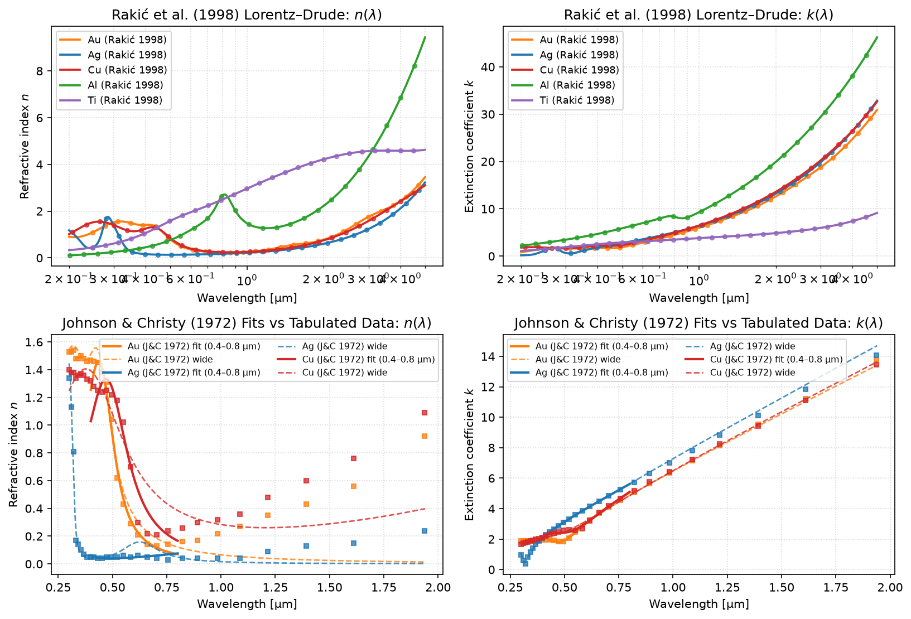

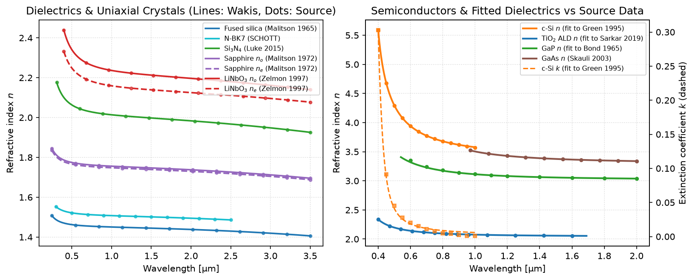

| Material (`aliases`) | Model | Range [µm] | Source | Fit error | Stability (`dt = 50 as`, `C = 0.5`) |
|---|---|---|---|---|---|
| `alas` (`aluminium arsenide`, `aluminum arsenide`) | Sellmeier | 0.56–2.2 | Fern & Onton, *J. Appl. Phys.* **42**, 3499 (1971) | — (formula) | Stable ($\Delta t_{\max}\approx 122$ as) |
| `aln e` (`aluminium nitride e`, `aluminum nitride e`) | Sellmeier | 0.22–5.0 | Pastrňák & Roskovcová, *Phys. Status Solidi* **14**, K5 (1966) | — (formula) | Stable ($\Delta t_{\max}\approx 158$ as) |
| `aln o` (`aluminium nitride o`, `aluminum nitride o`) | Sellmeier | 0.22–5.0 | Pastrňák & Roskovcová, *Phys. Status Solidi* **14**, K5 (1966) | — (formula) | Stable ($\Delta t_{\max}\approx 168$ as) |
| `aluminium` (`aluminum`, `al`, `aluminium rakic`, `al rakic`) | Lorentz–Drude (Rakić) | 0.2–12.4 | Rakić et al., *Appl. Opt.* **37**, 5271 (1998) | — (formula) | Stable ($\Delta t_{\max}\approx 88.5$ as) |
| `bab2o4 e` (`bbo e`, `beta-bab2o4 e`) | Sellmeier | 0.188–5.2 | Tamošauskas et al., *Opt. Mater. Express* **8**, 1410 (2018) | — (formula) | Stable ($\Delta t_{\max}\approx 57.2$ as) |
| `bab2o4 o` (`bbo o`, `beta-bab2o4 o`) | Sellmeier | 0.188–5.2 | Tamošauskas et al., *Opt. Mater. Express* **8**, 1410 (2018) | — (formula) | Unstable at 50 as (UV pole at 62.7 nm); stable for $\Delta t \le 43$ as |
| `beryllium` (`be`, `beryllium rakic`, `be rakic`) | Lorentz–Drude (Rakić) | 0.2–12.4 | Rakić et al., *Appl. Opt.* **37**, 5271 (1998) | — (formula) | Stable ($\Delta t_{\max}\approx 65.5$ as) |
| `bk7` (`nbk7`, `n-bk7`, `schott bk7`) | Sellmeier | 0.3–2.5 | SCHOTT Optical Glass Catalog (2017) | — (formula) | Stable ($\Delta t_{\max}\approx 57.2$ as) |
| `c-si` (`crystalline silicon`, `si green`) | Lorentz (fit) | 0.4–1.0 | Green & Keevers, *Prog. Photovolt.* **3**, 189 (1995) | 0.0025 | Stable ($\Delta t_{\max}\approx 72.1$ as) |
| `caco3 e` (`calcite e`) | Sellmeier | 0.204–2.172 | Ghosh, *Opt. Commun.* **163**, 95 (1999) | — (formula) | Stable ($\Delta t_{\max}\approx 81.2$ as) |
| `caco3 o` (`calcite o`) | Sellmeier | 0.204–2.172 | Ghosh, *Opt. Commun.* **163**, 95 (1999) | — (formula) | Stable ($\Delta t_{\max}\approx 108$ as) |
| `caf2` (`calcium fluoride`) | Sellmeier | 0.23–9.7 | Malitson, *Appl. Opt.* **2**, 1103 (1963) | — (formula) | Unstable at 50 as (UV pole at 50.3 nm); stable for $\Delta t \le 39$ as |
| `cawo4 e` (`calcium tungstate e`) | Sellmeier | 0.45–4.0 | Bond, *J. Appl. Phys.* **36**, 1674 (1965) | — (formula) | Stable ($\Delta t_{\max}\approx 77.5$ as) |
| `cawo4 o` (`calcium tungstate o`) | Sellmeier | 0.45–4.0 | Bond, *J. Appl. Phys.* **36**, 1674 (1965) | — (formula) | Stable ($\Delta t_{\max}\approx 76.5$ as) |
| `cdte` (`cadmium telluride`) | Sellmeier | 0.86–2.5 | Marple, *J. Appl. Phys.* **35**, 539 (1964) | — (formula) | Stable ($\Delta t_{\max}\approx 565$ as) |
| `cellulose` (—) | Sellmeier | 0.4368–1.052 | Sultanova et al., *Acta Phys. Pol. A* **116**, 585 (2009) | — (formula) | Stable ($\Delta t_{\max}\approx 66.5$ as) |
| `chromium` (`cr`, `chromium rakic`, `cr rakic`) | Lorentz–Drude (Rakić) | 0.2–12.4 | Rakić et al., *Appl. Opt.* **37**, 5271 (1998) | — (formula) | Stable ($\Delta t_{\max}\approx 81.2$ as) |
| `copper` (`cu`, `copper rakic`, `cu rakic`) | Lorentz–Drude (Rakić) | 0.2–12.4 | Rakić et al., *Appl. Opt.* **37**, 5271 (1998) | — (formula) | Stable ($\Delta t_{\max}\approx 88.5$ as) |
| `copper jc` (`cu jc`) | Lorentz–Drude (fit) | 0.4–0.8 | Johnson & Christy, *Phys. Rev. B* **6**, 4370 (1972) | 0.0850 | Stable ($\Delta t_{\max}\approx 345$ as) |
| `copper jc wide` (`cu jc wide`) | Lorentz–Drude (fit) | 0.3–1.94 | Johnson & Christy, *Phys. Rev. B* **6**, 4370 (1972) | 0.1179 | Stable ($\Delta t_{\max}\approx 225$ as) |
| `diamond` (`c`) | Sellmeier | 0.226–0.76 | Peter, *Z. Phys.* **15**, 358 (1923) | — (formula) | Unstable at 50 as (UV pole at 106 nm); stable for $\Delta t \le 42$ as |
| `fr4` (`fr-4`) | Debye (fit) | $1.50\times10^4$–$3.00\times10^6$ (0.1–20 GHz) | Djordjević et al., *IEEE Trans. EMC* **43**, 662 (2001) | 0.0013 | Unconditionally stable Crank–Nicolson Debye update ($C \le 1$) |
| `fused silica` (`sio2`, `silica`) | Sellmeier | 0.21–6.7 | Malitson, *J. Opt. Soc. Am.* **55**, 1205 (1965) | — (formula) | Stable ($\Delta t_{\max}\approx 51.2$ as) |
| `gaas` (`gallium arsenide`) | Sellmeier | 0.97–17.0 | Skauli et al., *J. Appl. Phys.* **94**, 6447 (2003) | — (formula) | Stable ($\Delta t_{\max}\approx 345$ as) |
| `gan e` (`gallium nitride e`) | Sellmeier | 0.35–10.0 | Barker & Ilegems, *Phys. Rev. B* **7**, 743 (1973) | — (formula) | Stable ($\Delta t_{\max}\approx 10$ fs) |
| `gan o` (`gallium nitride o`) | Sellmeier | 0.35–10.0 | Barker & Ilegems, *Phys. Rev. B* **7**, 743 (1973) | — (formula) | Stable ($\Delta t_{\max}\approx 245$ as) |
| `gap` (`gallium phosphide`) | Lorentz (fit) | 0.54–4.0 | Bond, *J. Appl. Phys.* **36**, 1674 (1965) | 0.0053 | Stable ($\Delta t_{\max}\approx 88.5$ as) |
| `germanium` (`ge`) | Sellmeier | 2.5–12.0 | Barnes & Piltch, *J. Opt. Soc. Am.* **69**, 178 (1979) | — (formula) | Stable ($\Delta t_{\max}\approx 455$ as) |
| `gold` (`au`, `gold rakic`, `au rakic`) | Lorentz–Drude (Rakić) | 0.2–12.4 | Rakić et al., *Appl. Opt.* **37**, 5271 (1998) | — (formula) | Unstable at 50 as (UV pole at 13.32 eV); stable for $\Delta t \le 47$ as |
| `gold jc` (`au jc`) | Lorentz–Drude (fit) | 0.4–0.8 | Johnson & Christy, *Phys. Rev. B* **6**, 4370 (1972) | 0.0445 | Stable ($\Delta t_{\max}\approx 340$ as) |
| `gold jc wide` (`au jc wide`) | Lorentz–Drude (fit) | 0.25–1.94 | Johnson & Christy, *Phys. Rev. B* **6**, 4370 (1972) | 0.0795 | Stable ($\Delta t_{\max}\approx 210$ as) |
| `inp` (`indium phosphide`) | Sellmeier | 0.95–10.0 | Pettit & Turner, *J. Appl. Phys.* **36**, 2081 (1965) | — (formula) | Stable ($\Delta t_{\max}\approx 585$ as) |
| `linbo3 e` (`lithium niobate e`) | Sellmeier | 0.4–5.0 | Zelmon et al., *J. Opt. Soc. Am. B* **14**, 3319 (1997) | — (formula) | Stable ($\Delta t_{\max}\approx 68.5$ as) |
| `linbo3 o` (`lithium niobate o`) | Sellmeier | 0.4–5.0 | Zelmon et al., *J. Opt. Soc. Am. B* **14**, 3319 (1997) | — (formula) | Stable ($\Delta t_{\max}\approx 65.5$ as) |
| `mgf2 e` (`magnesium fluoride e`) | Sellmeier | 0.2–7.0 | Dodge, *Appl. Opt.* **23**, 1980 (1984) | — (formula) | Unstable at 50 as (UV pole at 36.8 nm); stable for $\Delta t \le 30$ as |
| `mgf2 o` (`magnesium fluoride o`) | Sellmeier | 0.2–7.0 | Dodge, *Appl. Opt.* **23**, 1980 (1984) | — (formula) | Unstable at 50 as (UV pole at 43.4 nm); stable for $\Delta t \le 35$ as |
| `nickel` (`ni`, `nickel rakic`, `ni rakic`) | Lorentz–Drude (Rakić) | 0.2–12.4 | Rakić et al., *Appl. Opt.* **37**, 5271 (1998) | — (formula) | Stable ($\Delta t_{\max}\approx 72.1$ as) |
| `palladium` (`pd`, `palladium rakic`, `pd rakic`) | Lorentz–Drude (Rakić) | 0.2–12.4 | Rakić et al., *Appl. Opt.* **37**, 5271 (1998) | — (formula) | Stable ($\Delta t_{\max}\approx 108$ as) |
| `platinum` (`pt`, `platinum rakic`, `pt rakic`) | Lorentz–Drude (Rakić) | 0.2–12.4 | Rakić et al., *Appl. Opt.* **37**, 5271 (1998) | — (formula) | Unstable at 50 as (UV pole at 9.249 eV); stable for $\Delta t \le 49$ as |
| `pmma` (`polymethyl methacrylate`, `acrylic`) | Sellmeier | 0.4368–1.052 | Sultanova et al., *Acta Phys. Pol. A* **116**, 585 (2009) | — (formula) | Stable ($\Delta t_{\max}\approx 65.5$ as) |
| `polycarbonate` (`pc`) | Sellmeier | 0.4368–1.052 | Sultanova et al., *Acta Phys. Pol. A* **116**, 585 (2009) | — (formula) | Stable ($\Delta t_{\max}\approx 81.2$ as) |
| `polystyrene` (`ps`) | Sellmeier | 0.4368–1.052 | Sultanova et al., *Acta Phys. Pol. A* **116**, 585 (2009) | — (formula) | Stable ($\Delta t_{\max}\approx 78.5$ as) |
| `quartz e` (`crystalline sio2 e`, `sio2 e`) | Sellmeier | 0.198–2.0531 | Ghosh, *Opt. Commun.* **163**, 95 (1999) | — (formula) | Stable ($\Delta t_{\max}\approx 74.5$ as) |
| `quartz o` (`crystalline sio2 o`, `sio2 o`) | Sellmeier | 0.198–2.0531 | Ghosh, *Opt. Commun.* **163**, 95 (1999) | — (formula) | Stable ($\Delta t_{\max}\approx 74.5$ as) |
| `ro4350b` (`rogers ro4350b`) | Debye (fit) | $1.50\times10^4$–$3.00\times10^6$ (0.1–20 GHz) | Rogers Corp. / Djordjević et al., *IEEE Trans. EMC* **43**, 662 (2001) | 0.0003 | Unconditionally stable Crank–Nicolson Debye update ($C \le 1$) |
| `sapphire e` (`al2o3 e`) | Sellmeier | 0.2–5.0 | Malitson & Dodge, *J. Opt. Soc. Am.* **62**, 1405 (1972) | — (formula) | Unstable at 50 as (UV pole at 74.0 nm); stable for $\Delta t \le 43$ as |
| `sapphire o` (`al2o3 o`) | Sellmeier | 0.2–5.0 | Malitson & Dodge, *J. Opt. Soc. Am.* **62**, 1405 (1972) | — (formula) | Unstable at 50 as (UV pole at 72.7 nm); stable for $\Delta t \le 43$ as |
| `si3n4` (`silicon nitride`, `sin`, `si3n4 luke`) | Sellmeier | 0.31–5.504 | Luke et al., *Opt. Lett.* **40**, 4823 (2015) | — (formula) | Stable ($\Delta t_{\max}\approx 72.1$ as; IR pole at 1239.8 µm is benign) |
| `si3n4 philipp` (`silicon nitride philipp`) | Sellmeier | 0.207–1.24 | Philipp, *J. Electrochem. Soc.* **120**, 295 (1973) | — (formula) | Stable ($\Delta t_{\max}\approx 76.5$ as) |
| `silicon` (`si`) | Sellmeier | 1.357–11.04 | Salzberg & Villa, *J. Opt. Soc. Am.* **47**, 244 (1957) | — (formula) | Stable ($\Delta t_{\max}\approx 72.1$ as; IR pole at 1104 µm is benign) |
| `silver` (`ag`, `silver rakic`, `ag rakic`) | Lorentz–Drude (Rakić) | 0.2–12.4 | Rakić et al., *Appl. Opt.* **37**, 5271 (1998) | — (formula) | Unstable at 50 as (UV pole at 20.29 eV); stable for $\Delta t \le 38$ as |
| `silver jc` (`ag jc`) | Lorentz–Drude (fit) | 0.4–0.8 | Johnson & Christy, *Phys. Rev. B* **6**, 4370 (1972) | 0.0095 | Stable ($\Delta t_{\max}\approx 245$ as) |
| `silver jc wide` (`ag jc wide`) | Lorentz–Drude (fit) | 0.3–1.94 | Johnson & Christy, *Phys. Rev. B* **6**, 4370 (1972) | 0.0986 | Stable ($\Delta t_{\max}\approx 268$ as) |
| `tio2 ald` (`titanium dioxide ald`) | Lorentz (fit) | 0.4–1.69 | Sarkar et al., *ACS Appl. Mater. Interfaces* **11**, 13752 (2019) | 0.0001 | Stable ($\Delta t_{\max}\approx 88.5$ as) |
| `tio2 e` (`rutile e`) | Sellmeier | 0.43–1.53 | DeVore, *J. Opt. Soc. Am.* **41**, 416 (1951) | — (formula) | Stable ($\Delta t_{\max}\approx 315$ as) |
| `tio2 o` (`rutile o`) | Sellmeier | 0.43–1.53 | DeVore, *J. Opt. Soc. Am.* **41**, 416 (1951) | — (formula) | Stable ($\Delta t_{\max}\approx 285$ as) |
| `titanium` (`ti`, `titanium rakic`, `ti rakic`) | Lorentz–Drude (Rakić) | 0.2–12.4 | Rakić et al., *Appl. Opt.* **37**, 5271 (1998) | — (formula) | Stable ($\Delta t_{\max}\approx 65.5$ as) |
| `tungsten` (`w`, `tungsten rakic`, `w rakic`) | Lorentz–Drude (Rakić) | 0.2–12.4 | Rakić et al., *Appl. Opt.* **37**, 5271 (1998) | — (formula) | Unstable at 50 as (UV pole at 7.498 eV); stable for $\Delta t \le 43$ as |
| `y2o3` (`yttria`) | Sellmeier | 0.25–9.6 | Nigara, *Jpn. J. Appl. Phys.* **7**, 404 (1968) | — (formula) | Stable ($\Delta t_{\max}\approx 78.5$ as) |
| `yag` (`y3al5o12`) | Sellmeier | 0.4–5.0 | Zelmon et al., *Appl. Opt.* **37**, 4933 (1998) | — (formula) | Stable ($\Delta t_{\max}\approx 54.5$ as) |
| `zns` (`zinc sulfide`) | Sellmeier | 0.405–13.0 | Debenham, *Appl. Opt.* **23**, 2238 (1984) | — (formula) | Stable ($\Delta t_{\max}\approx 685$ as) |
| `znse` (`zinc selenide`) | Sellmeier | 0.54–18.2 | Connolly et al., *Proc. SPIE* **0181**, 141 (1979) | — (formula) | Stable ($\Delta t_{\max}\approx 94.5$ as) |

**Validation** (`tests/test_025_dispersive.py`, `tests/test_057_material_library.py`): Lorentz, Drude (across the plasma edge) and conductive Debye slabs reproduce the analytic Fabry–Pérot reflectance and transmittance with $`\varepsilon(\omega)`$ to $`<10^{-2}`$ (Drude: $`2\times10^{-3}`$) with second-order convergence in the cell size; a spatially uniform field reproduces $`\varepsilon_d(\omega)`$ to $`10^{-8}`$; the stability check matches the closed-form limits; a lossless Lorentz medium stays bounded for $`4\times10^4`$ steps; fits recover generating parameters to $`10^{-6}`$; all 62 library entries match their source formulas ($`\le 10^{-6}`$ relative in $`n`$) or source tabulated data ($`\le`$ stated fit error) at $`\ge 20`$ wavelengths across their validity ranges, fail under a 1% perturbation of their dominant pole coefficient, and satisfy passivity ($`\operatorname{Im}\varepsilon\le 0`$) everywhere.

References:
- A. Taflove and S. C. Hagness, *Computational Electrodynamics: The Finite-Difference Time-Domain Method*, 3rd ed., Artech House (2005), ch. 9.
- A. D. Rakić, A. B. Djurišić, J. M. Elazar and M. L. Majewski, "Optical properties of metallic films for vertical-cavity optoelectronic devices", *Appl. Opt.* **37**, 5271–5283 (1998), [doi:10.1364/AO.37.005271](https://doi.org/10.1364/AO.37.005271).
- P. B. Johnson and R. W. Christy, "Optical constants of the noble metals", *Phys. Rev. B* **6**, 4370–4379 (1972), [doi:10.1103/PhysRevB.6.4370](https://doi.org/10.1103/PhysRevB.6.4370).
- I. H. Malitson, "Interspecimen comparison of the refractive index of fused silica", *J. Opt. Soc. Am.* **55**, 1205–1208 (1965), [doi:10.1364/JOSA.55.001205](https://doi.org/10.1364/JOSA.55.001205).
- C. D. Salzberg and J. J. Villa, "Infrared refractive indexes of silicon, germanium and modified selenium glass", *J. Opt. Soc. Am.* **47**, 244–246 (1957).
- M. A. Green and M. J. Keevers, "Optical properties of intrinsic silicon at 300 K", *Prog. Photovolt.: Res. Appl.* **3**, 189–192 (1995).
- T. Skauli et al., "Improved dispersion relations for GaAs and applications to nonlinear optics", *J. Appl. Phys.* **94**, 6447–6455 (2003).
- K. Luke, Y. Okawachi, M. R. E. Lamont, A. L. Gaeta and M. Lipson, "Broadband mid-infrared frequency comb generation in a $\mathrm{Si_3N_4}$ microresonator", *Opt. Lett.* **40**, 4823–4826 (2015).
- H. R. Philipp, "Optical properties of silicon nitride", *J. Electrochem. Soc.* **120**, 295–300 (1973).
- N. Sultanova, S. Kasarova and I. Nikolov, "Dispersion properties of optical polymers", *Acta Phys. Pol. A* **116**, 585–587 (2009).
- G. Tamošauskas, G. Beresnevičius, D. Gadonas and A. Dubietis, "Transmittance and phase matching of BBO crystal in the 3–5 µm range", *Opt. Mater. Express* **8**, 1410–1418 (2018).
- D. E. Zelmon, D. L. Small and D. Jundt, "Infrared corrected Sellmeier coefficients for congruently grown lithium niobate", *J. Opt. Soc. Am. B* **14**, 3319–3322 (1997).
- G. Ghosh, "Dispersion-equation coefficients for the refractive index and birefringence of calcite and quartz crystals", *Opt. Commun.* **163**, 95–102 (1999).
- I. H. Malitson and M. J. Dodge, "Refractive index and birefringence of synthetic sapphire", *J. Opt. Soc. Am.* **62**, 1405 (1972).
- A. R. Djordjević, R. M. Biljić, V. D. Likar-Smiljanić and T. K. Sarkar, "Wideband frequency-domain characterization of FR-4 and time-domain causality", *IEEE Trans. Electromagn. Compat.* **43**, 662–667 (2001).

#### 🧲 Dispersive permeability

Soft ferrites (NiZn, MnZn), magnetic metamaterials and RF absorbers exhibit a frequency-dependent, lossy and possibly anisotropic permeability $\mu(\omega)$. `DispersiveMaterial` models diagonal magnetic dispersion alongside (or independently of) electric dispersion via `mu_inf`, `mu_poles`, and `sigma_m`:

```math
\mu_r(\omega) = \mu_\infty + \sum_p \chi_{m,p}(\omega) + \frac{\sigma_m}{i\omega\mu_0},
\qquad
\chi_m^{\mathrm{L}}(\omega) = \frac{\Delta\mu\,\omega_0^2}{\omega_0^2-\omega^2+i\gamma\omega},\quad
\chi_m^{\mathrm{D}}(\omega) = -\frac{\omega_p^2}{\omega^2-i\gamma\omega},\quad
\chi_m^{\mathrm{Deb}}(\omega) = \frac{\Delta\mu}{1+i\omega\tau},
```

using the same pole classes (`Lorentz(delta_eps, omega_0, gamma)`, `Drude(omega_p, gamma)`, `Debye(delta_eps, tau)`), where `delta_eps` represents the magnetic susceptibility strength $\Delta\mu$ when passed in `mu_poles`, and $\sigma_m$ $[\Omega/\text{m}]$ is the magnetic conductivity.

**Time-domain model and exact duality with the electric ADE.** Each magnetic pole introduces a reduced magnetization $m_p$ ($M_p = \mu_0 m_p$, with the same units $[\text{A/m}]$ as $H$) obeying

```math
\ddot m_p + \gamma_p \dot m_p + \omega_{0,p}^2 m_p = \Delta\mu_p\,\omega_{0,p}^2 H \quad\text{(Lorentz/Drude)},\qquad
\tau_p \dot m_p + m_p = \Delta\mu_p H \quad\text{(Debye)},
```

which enters Faraday's law as a magnetization current:

```math
\mu_0\mu_\infty \dot H = -\nabla\times E - M_{\mathrm{src}} - \sigma_m H - \mu_0 \sum_p \dot m_p .
```

On the staggered Yee/FIT grid, $H$ and $m_p$ live on dual-grid edges and half-integer time levels $t^{n-1/2}$. Discretizing by exact duality with `_ade_coefficients` ($E^n \to H^{n-1/2}$, $\varepsilon_\infty \to \mu_\infty$, $\sigma/\varepsilon_0 \to \sigma_m/\mu_0$) — explicit central differences at $t^{n-1/2}$ for Lorentz/Drude poles and the Crank–Nicolson trapezoidal rule centred at $t^n$ for Debye poles and $\sigma_m$ — yields

```math
m^{n+1/2} = \alpha m^{n-1/2} + \xi m^{n-3/2} + \zeta H^{n-1/2},\qquad
m_{\mathrm{Deb}}^{n+1/2} = \kappa m_{\mathrm{Deb}}^{n-1/2} + \beta\left(H^{n+1/2}+H^{n-1/2}\right),
```

with $\alpha = (2-\omega_0^2\Delta t^2)/(1+\gamma\Delta t/2)$, $\xi = (\gamma\Delta t/2-1)/(1+\gamma\Delta t/2)$, $\zeta = \Delta\mu\,\omega_0^2\Delta t^2/(1+\gamma\Delta t/2)$, $\kappa = (1-\Delta t/2\tau)/(1+\Delta t/2\tau)$, and $\beta = \Delta\mu(\Delta t/2\tau)/(1+\Delta t/2\tau)$. From the provisional $H^\star$ produced by the unmodified non-dispersive $H$ step (with solver inverse permeability $\mu_s^{-1}$, including any impressed magnetic current $M_{\mathrm{src}}$ and TFSF terms), the curl contribution is recovered locally as $-\Delta t(\nabla\times E + M_{\mathrm{src}})/\mu_0 = \mu_{r,s}(H^\star - H^{n-1/2})$ and corrected in place before the $E$ update (and before ` _mpi_communicate(self.H)` in MPI runs so halo exchanges carry the physical $H^{n+1/2}$).

**Dual-grid registration and diagonal anisotropy.** Dual edges have their own staggered coordinates: $H_x$ at $(x_i, y_j+\Delta y_j/2, z_k+\Delta z_k/2)$, $H_y$ at $(x_i+\Delta x_i/2, y_j, z_k+\Delta z_k/2)$, and $H_z$ at $(x_i+\Delta x_i/2, y_j+\Delta y_j/2, z_k)$. `add_dispersive_material(material, center, size)` selects dual edges inside the box and assigns weight $w = 1/2$ to tangential $H$ edges lying on a box face. Diagonal anisotropy is specified by passing a 3-tuple `mu_inf=(mu_x, mu_y, mu_z)`, a dictionary `mu_poles={'x': [...], 'y': [...], 'z': [...]}`, and/or a 3-tuple `sigma_m=(sigma_mx, sigma_my, sigma_mz)`; each active $H$ component then forms its own ADE group.

**Discrete permeability and conserved energy.** Substituting a harmonic plane wave $H^{n-1/2} \propto e^{i\omega(n-1/2)\Delta t}$ gives the exact discrete permeability (`DispersiveMaterial.mu_discrete(f, dt)`):

```math
\mu_d(\omega) = \mu_\infty + \sum_{\mathrm{L}} \frac{\Delta\mu\,\omega_0^2}{\omega_0^2-\tilde\Omega^2+i\gamma\sin(\omega\Delta t)/\Delta t}
+ \sum_{\mathrm{Deb}} \frac{\Delta\mu}{1+2i\tau\tan(\omega\Delta t/2)/\Delta t}
+ \frac{\sigma_m\cos(\omega\Delta t/2)}{i\tilde\Omega\mu_0},
```

which satisfies $\mu_d(\omega) = \mu_r(\omega) + O(\Delta t^2)$ and equals `epsilon_discrete(f, dt)` of the dual electric material to machine precision. In a closed PEC cavity with a Lorentz-$\mu$ medium, the exact discrete quadratic energy

```math
\mathcal{E}^n = \frac{1}{2}\langle E^n, M_E E^n\rangle + \frac{1}{2}\langle H^{n+1/2}, M_H\mu_\infty H^{n-1/2}\rangle
+ \frac{1}{2\Delta\mu\,\omega_0^2}\left\langle\frac{m^{n+1/2}-m^{n-1/2}}{\Delta t}, M_H\frac{m^{n+1/2}-m^{n-1/2}}{\Delta t}\right\rangle
+ \frac{1}{2\Delta\mu}\langle m^{n+1/2}, M_H m^{n-1/2}\rangle,
```

with $M_E = \operatorname{diag}(L\tilde A/\varepsilon)$ and $M_H = \operatorname{diag}(\mu_0 A\tilde L)$, satisfies the exact one-step energy balance

```math
\mathcal{E}^n - \mathcal{E}^{n-1} = -\frac{\gamma\Delta t}{\Delta\mu\,\omega_0^2}\left\langle \frac{m^{n+1/2}-m^{n-3/2}}{2\Delta t}, M_H \frac{m^{n+1/2}-m^{n-3/2}}{2\Delta t}\right\rangle \le 0,
```

conserving $\mathcal{E}^n$ to round-off ($\sim 10^{-14}$) when $\gamma = 0$ and decaying monotonically at every step when $\gamma > 0$.

**Joint electric–magnetic stability.** In a medium with both electric and magnetic poles, `DispersiveMaterial.is_stable(dt, courant)` builds the companion amplification matrix of a plane wave at normalized grid wavenumber $s = c\Delta t|\tilde{\mathbf{K}}|/2 \in [0, C]$ coupling $(E, P_{\mathrm{L}}, P_{\mathrm{L}}^{\mathrm{old}}, P_{\mathrm{Deb}})$ and $(H, m_{\mathrm{L}}, m_{\mathrm{L}}^{\mathrm{old}}, m_{\mathrm{Deb}})$ across one full step $\mathbf{y}^{n+1} = \mathbf{M}_{\mathrm{E}}^{-1}\mathbf{N}_{\mathrm{E}}\mathbf{M}_{\mathrm{H}}^{-1}\mathbf{N}_{\mathrm{H}}\mathbf{y}^n$, checking all three polarization pairs $(E_a, H_b)$ when the medium is diagonally anisotropic. For a purely magnetic material this reduces to the exact dual of the electric stability condition.

**Natural ferromagnetic resonance and Snoek's law.** In an unmagnetized polycrystalline ferrite (such as NiZn or MnZn ferrite tiles used in accelerator cavities and RF loads), internal anisotropy fields $H_a$ provide a restoring torque on the domain magnetization $M_s$. Small-signal precession around $H_a$ is governed by the linearized Landau–Lifshitz–Gilbert equation averaged over random grain orientations, which takes the Lorentz form above with resonance frequency $\omega_0 = \gamma_g\mu_0 H_a$ ($f_r = \omega_0/2\pi$) and static susceptibility $\Delta\mu = \mu_s - \mu_\infty = \frac{2}{3}M_s/H_a$. Eliminating the anisotropy field $H_a$ yields **Snoek's law** [Snoek, 1948]:

```math
(\mu_s - 1)\, f_r = \frac{2}{3}\frac{\gamma_g \mu_0 M_s}{2\pi},
```

where $\gamma_g/(2\pi) \approx 28\ \text{GHz/T}$ is the electron gyromagnetic ratio. Because saturation magnetization $\mu_0 M_s$ is bounded by material chemistry ($\sim 0.3\text{–}0.5\ \text{T}$ in spinels), increasing the low-frequency permeability $\mu_s$ through composition or sintering necessarily lowers the natural resonance frequency $f_r$ at which magnetic losses $-\mu''(f)$ peak. At lower frequencies where domain-wall relaxation dominates over spin precession, the overdamped limit ($\omega_0\to\infty$ with $\gamma/\omega_0^2 = \tau$) reduces to the Debye pole (`Debye(delta_mu, tau)`).

| Lorentz ferrite $\mu'(f), -\mu''(f)$ and Snoek's limit | Ferrite slab $R(f), T(f)$ vs analytic transfer matrix |
| --- | --- |
| 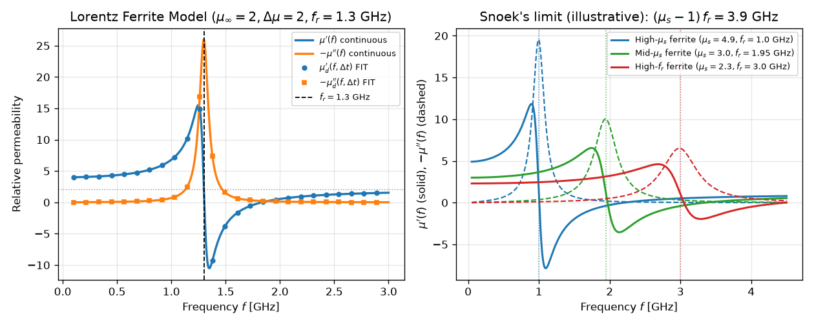 | 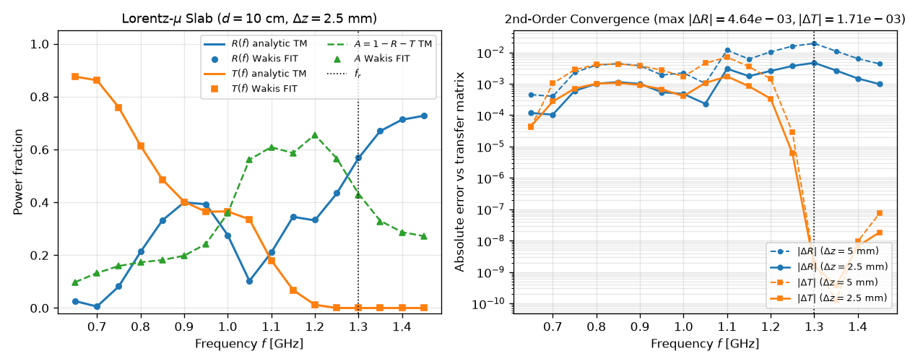 |

**Adjoint transposition.** Because the magnetic ADE correction is local, linear and explicit, its exact conjugate transpose (`_DispersiveTranspose(..., field="H", prefix="m", s_key="mu_s")`) is applied in `AdjointStepper._base_step` between the reversed $E$ half-step and the reversed $H$ half-step. The one-step dot-product identity $\langle U x, y\rangle = \langle x, U^H y\rangle$ holds to $\sim 10^{-14}$ across PEC, CPML and complex Bloch boundaries.

**Limits & failure modes:**
- **No gyrotropic (off-diagonal Polder tensor) response:** Biased ferrites under an external DC magnetic field $\mathbf{H}_0$ have a non-reciprocal, antisymmetric permeability tensor $\boldsymbol{\mu}(\omega)$ with off-diagonal $\pm i\kappa(\omega)$ coupling $H_x \leftrightarrow H_y$. `DispersiveMaterial` only supports diagonal tensors ($\mu_{xx}, \mu_{yy}, \mu_{zz}$).
- **No saturation, hysteresis, or nonlinearity:** The ADE updates are strictly linear in $H$; B–H curve saturation, remanence, and power-dependent FMR linewidth broadening are not modelled.
- **No subpixel (Kottke) averaging of $\mu$ yet:** For STL solids with `conformal='all'` or `'tensor'`, subcell harmonic/arithmetic tensor averaging is currently implemented for $\varepsilon$ only. When a solid has `material.has_magnetic`, Wakis emits a `UserWarning` and falls back to plain cell-volume-fraction weighting on $H$.
- **Unsupported steppers in Milestone A:** `scheme='tete'`, `fused=True` (fused GPU kernels), and `SubgridFIT2D` raise `NotImplementedError` when a magnetic dispersive material is registered.

**Validation** (`tests/test_056_dispersive_mu.py`, `examples/008_dispersive_mu_slab.py`): `mu_discrete` and `is_stable` agree with the dual electric material to $10^{-14}$; a spatially uniform magnetic current reproduces $\mu_d(\omega)$ to $10^{-8}$; Lorentz-$\mu$, Debye-$\mu$ (with $\sigma_m$), and mixed $(\varepsilon(\omega), \mu(\omega))$ slabs match the exact transfer-matrix reflectance and transmittance with second-order grid convergence; an impedance-matched $\varepsilon(\omega) = \mu(\omega)$ slab suppresses $|R|$ by orders of magnitude with $O(\Delta z)$ dual-grid interface convergence; a diagonal $\mu_{xx}(\omega)$ slab affects only the polarization with $H\parallel\hat{\mathbf{x}}$ while the orthogonal polarization matches vacuum to $10^{-14}$; a lossless Lorentz-$\mu$ PEC cavity conserves the discrete energy $\mathcal{E}^n$ to $<10^{-12}$ over $10^4$ steps and splits each bare cavity mode into two branches matching $k_{mnp}^2 = (\tilde\Omega/c)^2\mu_d(\omega)$ via `harminv` to $<10^{-4}$; adjoint dot-product tests reach $10^{-14}$ and design gradients match finite differences to $<10^{-5}$.

References:
- J. L. Snoek, "Dispersion and absorption in magnetic ferrites at frequencies above one Mc/s", *Physica* **14**(4), 207–217 (1948), [doi:10.1016/0031-8914(48)90038-X](https://doi.org/10.1016/0031-8914(48)90038-X).
- D. M. Pozar, *Microwave Engineering*, 4th ed., Wiley (2012), Ch. 9 (ferrite materials and gyromagnetic resonance).
- A. Taflove and S. C. Hagness, *Computational Electrodynamics: The Finite-Difference Time-Domain Method*, 3rd ed., Artech House (2005), Ch. 9.

### 🔋 Lumped elements, discrete ports and S-parameters

**Lumped elements.** `LumpedElement(component, center, size, R, L, C)` places a resistor, inductor and/or capacitor (in parallel) across a gap between two conductors. It occupies a box of primary edges along `component`: edges along the axis are in series, edges side by side are in parallel. With $`\ell`$ the gap length and $`A`$ the cross-section of the box (so that $`\ell A = \sum_e \Delta l_e \Delta \tilde A_e`$ over the edges, with $`\Delta l_e`$ the primary edge length and $`\Delta \tilde A_e`$ the dual face area), the element is the uniform block material

```math
\sigma = \frac{\ell}{R A}, \qquad \varepsilon_C = \frac{C \ell}{A}, \qquad \frac{\partial J_L}{\partial t} = \Gamma E, \quad \Gamma = \frac{\ell}{L A},
```

whose voltage $`V = -\sum_e g_e E_e`$, with $`g_e = \Delta l_e \Delta \tilde A_e / A`$, and current reproduce $`I = V/R + \frac{1}{L}\int V dt + C\, dV/dt`$ [Piket-May et al., 1994; Taflove & Hagness, 2005]. $`V`$ is the potential of the high-coordinate end of the gap minus the low end. On each element edge the update of Ampère's law becomes

```math
(\varepsilon + \varepsilon_C)\frac{E^{n+1} - E^n}{\Delta t} = (\tilde{C} H)^{n+1/2} - J^{n+1/2} - \sigma \frac{E^{n+1} + E^n}{2} - J_L^{n+1/2}, \qquad J_L^{n+1/2} = J_L^{n-1/2} + \Delta t\, \Gamma E^n .
```

The resistive current is averaged in time (semi-implicit), which is stable for any $`R`$; the explicit form $`\sigma E^n`$ is unstable once $`\sigma \Delta t / \varepsilon > 2`$, which is reached by ordinary resistors in millimetre cells. Solving for $`E^{n+1}`$ and writing $`E^* = E^n + \Delta t\,\varepsilon^{-1}(\tilde{C}H - J)`$ for the result of the unmodified solver step:

```math
E^{n+1} = a\, E^n + b\,(E^* - E^n), \qquad \alpha = \frac{\sigma \Delta t}{2(\varepsilon + \varepsilon_C)}, \quad a = \frac{1-\alpha}{1+\alpha}, \quad b = \frac{\varepsilon}{(\varepsilon + \varepsilon_C)(1+\alpha)} .
```

Wakis implements this as a local, linear correction applied by the element right after `one_step` (`post_step`), while $`J_L`$ and any source current enter the solver's `J` before the step (`update`). The step functions themselves are untouched, so the element works with every backend (standard, MKL, CPML, GPU). The inductor update is explicit, like a Drude current; it is stable while $`\Delta t \sqrt{\Gamma/\varepsilon} \ll 2`$, which holds for nanohenry inductors in millimetre cells. The parallel elements are an adaptation to the FIT edge formulation; series RLC branches are not implemented.

**Discrete port.** `LumpedPort(src_time, component, center, size, impedance=Z0, amplitude=V_s)` is a resistor $`Z_0`$ in parallel with a soft current source $`I_s(t) = V_s s(t)/Z_0`$ (Norton form of a voltage source with internal impedance $`Z_0`$). The port records the time-centred voltage $`\bar V^{n+1/2} = (V^n + V^{n+1})/2`$ and the current delivered into the structure out of the positive terminal, $`I^{n+1/2} = I_s^{n+1/2} - \bar V^{n+1/2}/Z_0`$, both at $`t_{n+1/2}`$. These are the exact discrete charges flowing through the source and resistor, so charge is conserved and the displacement current of the gap cell is attributed to the structure; with this choice, the impedance of a uniform line seen from a port node is $`Z/\cos(\beta\Delta z/2)`$, i.e. second-order accurate. Their Fourier transforms $`X(f) = \sum_n X^{n+1/2} e^{-2\pi i f t_{n+1/2}} \Delta t`$ give

```math
Z_\text{in} = \frac{V}{I}, \qquad a = \frac{V + Z_0 I}{2\sqrt{Z_0}}, \qquad b = \frac{V - Z_0 I}{2\sqrt{Z_0}}, \qquad S_{11} = \frac{b}{a} = \frac{Z_\text{in} - Z_0}{Z_\text{in} + Z_0},
```

the power waves of Kurokawa (1965) for a real reference impedance; $`|a|^2 - |b|^2`$ is the power delivered to the structure. By construction $`a = \sqrt{Z_0}\, I_s / 2`$, the wave launched by the source. For $`N`$ ports, `wakis.sparameters.s_matrix` runs $`N`$ simulations, each driving one port $`j`$ while the others are passive matched terminations, and returns $`S_{ij} = b_i / a_j`$. All quantities are plain arrays computed from the recorded time series by the formulas above.

**Touchstone.** `write_touchstone` and `read_touchstone` store S-parameters in the Touchstone v1 `.sNp` format (frequency in Hz, real/imaginary pairs, two-port order $`S_{11}, S_{21}, S_{12}, S_{22}`$, one matrix row per line for more ports); `to_skrf_network` converts to a scikit-rf `Network` when scikit-rf is installed.

**Energy-decay stopping criterion.** `emsolve(Nt, ..., stop_when_energy_decayed=1e-4)` stops once all sources have ended (`end_time`) and the field energy

```math
W = \frac12 \sum_e \varepsilon_e E_e^2 \Delta l_e \Delta\tilde A_e + \frac12 \sum_f \mu_f H_f^2 \Delta \tilde l_f \Delta A_f
```

has decayed below the given fraction of its maximum (-40 dB here), as the steady-state energy criterion of commercial FIT solvers. Truncating the DFT then changes the spectra by a relative amount of order $`\sqrt{W/W_\text{max}}`$ or less.

**Validation** (`tests/test_022_lumped_ports.py`): a port in the middle of a matched parallel-plate line ($`Z = \eta_0 d/w`$) measures $`Z_\text{in} = Z/2`$ to 0.5% at 30 cells per wavelength and the discrete-line value $`Z/(2\cos(\beta\Delta z/2))`$ to 0.2%; shunt resistors from $`Z/1000`$ to $`10Z`$ give $`\Gamma = (R\|Z - Z)/(R\|Z + Z)`$ to $`1.3\times10^{-3}`$; de-embedded inductors and capacitors match $`j\omega L`$ and $`1/(j\omega C)`$ to 1%; a parallel LC tank is transparent at $`1/(2\pi\sqrt{LC})`$; a two-port S-matrix matches the ABCD-matrix result and is reciprocal; the -40 dB criterion stops after 1/8 of the steps with a $`3\times10^{-5}`$ change in $`Z_\text{in}`$.

References:
- M. Piket-May, A. Taflove and J. Baron, "FD-TD modeling of digital signal propagation in 3-D circuits with passive and active loads", *IEEE Trans. Microw. Theory Techn.* **42**(8), 1514 (1994), [doi:10.1109/22.297814](https://doi.org/10.1109/22.297814).
- A. Taflove and S. C. Hagness, *Computational Electrodynamics: The Finite-Difference Time-Domain Method*, 3rd ed., Artech House (2005).
- K. Kurokawa, "Power waves and the scattering matrix", *IEEE Trans. Microw. Theory Techn.* **13**(2), 194 (1965), [IEEE Xplore 1125964](https://ieeexplore.ieee.org/document/1125964).
- Touchstone File Format Specification, Rev. 1.1, EIA/IBIS Open Forum (2002).

### 🔀 Magnetic currents, waveguide modes and mode ports

#### Magnetic current sources: `MagneticCurrentSource`

An impressed magnetic current density $`\mathbf{M}`$ [V/m²] enters Faraday's law as the dual of $`\mathbf{J}`$ in Ampère's law [Harrington, 1961]:

```math
\mu\,\partial_t \mathbf{H} = -\nabla\times\mathbf{E} - \mathbf{M},
\qquad
\widehat{\mathbf{h}}^{\,n+1/2} = \widehat{\mathbf{h}}^{\,n-1/2} - \Delta t\, \mathbf{M}_{\mu}^{-1}\left(\mathbf{C}\,\widehat{\mathbf{e}}^{\,n} + \mathbf{m}_s^{\,n}\right).
```

The leapfrog H update from $`(n-\tfrac12)\Delta t`$ to $`(n+\tfrac12)\Delta t`$ is centred at $`n\Delta t`$, so $`\mathbf{M}`$ is sampled at $`t = n\Delta t`$ (the time passed to `source.update`), whereas $`\mathbf{J}`$ is sampled at $`t + \Delta t/2`$. $`\mathbf{M}`$ lives on the H samples (on the node along its own direction, at cell midpoints transversally). `MagneticCurrentSource` mirrors `CurrentSource`: the amplitude is integrated over the zero-size directions with the dual edge length along the current and the primary widths transversally, so a point, line, sheet and volume source have units of V m, V, V/m and V/m². `solver.M` is allocated by the first magnetic source; otherwise the H update is unchanged.

**Huygens sheets.** By the equivalence principle [Harrington, 1961; Taflove & Hagness, 2005, Ch. 5], the surface currents $`\mathbf{K} = \hat{\mathbf{n}}\times\mathbf{H}_{inc}`$ and $`\mathbf{M}_s = -\hat{\mathbf{n}}\times\mathbf{E}_{inc}`$ on a surface radiate the incident field on the side $`\hat{\mathbf{n}}`$ points to and cancel it on the other side. On the staggered grid this is exactly the total-field/scattered-field correction: $`\mathbf{K}`$ sits on the E plane $`z_0`$ and carries $`\mathbf{H}_{inc}`$ of the H plane $`z_0 - \Delta z/2`$ at time $`t+\Delta t/2`$, and $`\mathbf{M}_s`$ sits on that H plane and carries $`\mathbf{E}_{inc}(z_0, t)`$. For a plane wave $`E_x = s(t - z/c)`$ along $`+z`$ this gives $`K_x(t) = -s(t + \Delta t/2 + \Delta z/2c)/\eta_0`$ and $`M_{s,y}(t) = -s(t)`$. `tests/test_023_modes.py` checks that such a sheet radiates a broadband pulse with backward/forward flux below $`10^{-3}`$ (observed: $`\sim10^{-11}`$–$`10^{-9}`$ with CPML, $`\le 3\times10^{-6}`$ with Mur ABC, limited by the boundary reflection) for 35–170 cells per wavelength.

#### Waveguide mode solver: `solve_modes`

For a guide that is uniform along the normal $`a`$ of a grid plane (transverse axes $`b, c`$ with $`\hat b\times\hat c = \hat a`$), fields of the 3D scheme vary as $`e^{i(\omega t - \beta a)}`$. The forward difference of a sample on the $`a`$-nodes and the backward difference of a sample on the $`a`$-midpoints then both reduce to $`-i\tilde\beta`$, with

```math
\tilde\beta = \frac{2}{\Delta a}\sin\frac{\beta\Delta a}{2},\qquad
\tilde\omega = \frac{2}{\Delta t}\sin\frac{\omega\Delta t}{2},
```

when the half-cell phase is absorbed in the amplitudes of the midpoint samples ($`E_a`$, $`H_b`$, $`H_c`$), and the leapfrog time derivative reduces to $`i\tilde\omega`$ [Taflove & Hagness, 2005, Ch. 4]. With $`U_b, U_c`$ the primary forward differences (node to midpoint, divided by $`L`$) and $`V_b, V_c`$ the dual backward differences (divided by $`\tilde L`$), exactly as in the curl matrices $`\mathbf{C}`$ and $`\widetilde{\mathbf{C}}`$, eliminating $`E_a = (V_b H_c - V_c H_b)/(i\tilde\omega\varepsilon_a)`$ and $`H_a = -(U_b E_c - U_c E_b)/(i\tilde\omega\mu_a)`$ gives

```math
\tilde\beta\begin{pmatrix}H_b\\H_c\end{pmatrix} = Q\begin{pmatrix}E_b\\E_c\end{pmatrix},\quad
Q = \frac{1}{\tilde\omega}\begin{pmatrix} V_b\mu_a^{-1}U_c & -\tilde\omega^2\varepsilon_c - V_b\mu_a^{-1}U_b\\ \tilde\omega^2\varepsilon_b + V_c\mu_a^{-1}U_c & -V_c\mu_a^{-1}U_b\end{pmatrix},
```

```math
\tilde\beta\begin{pmatrix}E_b\\E_c\end{pmatrix} = P\begin{pmatrix}H_b\\H_c\end{pmatrix},\quad
P = \frac{1}{\tilde\omega}\begin{pmatrix} -U_b\varepsilon_a^{-1}V_c & \tilde\omega^2\mu_c + U_b\varepsilon_a^{-1}V_b\\ -\tilde\omega^2\mu_b - U_c\varepsilon_a^{-1}V_c & U_c\varepsilon_a^{-1}V_b\end{pmatrix},
```

and the eigenproblem $`\tilde\beta^2\,\mathbf{e} = PQ\,\mathbf{e}`$ for the transverse E samples. This is the Yee-mesh finite-difference mode solver of Zhu & Brown [2002], here built from Wakis' own material tensors (`ieps`, `imu`), metric lengths ($`L`$, $`\tilde L`$) and boundary masks: PEC (and the PEC-terminated CPML/PML faces) removes the tangential E samples on the walls, PMC is the natural boundary (as in 3D, see *Grid conventions*), periodic axes wrap, conductors with `ieps = 0` remove their E samples, and the ghost samples beyond the last node are excluded. A port `size` smaller than the domain puts electric walls on the port edges (e.g. to exclude CPML layers). The eigenvalues closest to $`n_{max}^2\tilde\omega^2/c^2`$ are found with shift-invert Arnoldi (`scipy.sparse.linalg.eigs`), and $`\beta = (2/\Delta a)\arcsin(\tilde\beta\Delta a/2)`$. Because the same discrete operators are used, a mode is an exact eigenmode of the 3D time stepping of a uniform guide: the TE10 propagation constant matches the discrete dispersion relation $`(\tilde\omega/c)^2 = \tilde k_x^2 + \tilde\beta^2`$ to $`10^{-9}`$ and the continuum $`\sqrt{k^2-(\pi/a)^2}`$ to grid-dispersion accuracy; the TE0 effective index of a dielectric slab converges at second order to the solution of $`\tan(\kappa d/2) = \gamma/\kappa`$ [Snyder & Love, 1983].

**Power normalization.** The `FluxMonitor` (and the discrete Poynting theorem of the Yee scheme) pairs the E plane with H averaged from the two neighbouring H planes, which for a mode is $`\bar{\mathbf{h}} = \mathbf{h}\cos(\beta\Delta a/2)`$. Modes are normalized to unit time-averaged power,

```math
\tfrac12\operatorname{Re}\sum \left(e_b\,\bar h_c^* - e_c\,\bar h_b^*\right)\Delta A = 1\ \text{W},
```

with the `FluxMonitor` area elements. The PEC walls sit on the domain bounds: a guide meshed with $`N`$ cells has width $`N\Delta`$ (legacy grids, `boundary_at_domain_edge=False`: $`(N-1)\Delta`$).

Assumptions and limits: lossless isotropic materials uniform along $`a`$ within one cell of the plane, a locally uniform mesh along $`a`$, and serial (non-MPI) runs. Only propagating modes ($`\tilde\beta^2 > 0`$) are returned.

#### Mode source and mode decomposition: `ModeSource`, `ModeMonitor`

`ModeSource` is a Huygens sheet whose incident field is the mode $`(\mathbf{e}, \mathbf{h})`$ computed at the source frequency, with the time profile $`s(t)`$: $`\mathbf{K} = \hat{\mathbf{a}}\times\mathbf{h}\,s(t + \Delta t/2 + \tau)`$ on the E plane and $`\mathbf{M}_s = -n\,\hat{\mathbf{a}}\times\mathbf{e}\,s(t)`$ on the H plane behind it, with $`n=\pm1`$ the direction and $`\tau = \beta\Delta a/(2\omega)`$ the phase delay of the half cell between the planes [Oskooi & Johnson, 2013]. At the mode frequency the injection is exact to round-off; away from it the mode profile, the wave impedance and the phase velocity change, and a backward wave of relative amplitude $`\sim |\Delta Z/2Z|`$ leaks (e.g. TE10 with a mode at $`1.5f_c`$: $`3\times10^{-5}`$ at $`1.5f_c`$, $`1.4\times10^{-2}`$ at $`1.45 f_c`$, $`8\times10^{-2}`$ at $`1.3f_c`$). The launched transverse field is $`\mathbf{E}_t = A\,s(t)\,\mathbf{e}`$, so the forward mode amplitude is $`a_+(f) = A\,S(f)`$ and a time-harmonic source of amplitude $`A`$ [√W] carries $`A^2`$ W.

`ModeMonitor` projects the Fourier-transformed transverse fields on a plane ($`\mathbf{H}`$ averaged as in `FluxMonitor`) on the modes solved at each monitored frequency, using the orthogonality relation of lossless guides $`\tfrac12\int \mathbf{e}_m\times\bar{\mathbf{h}}_n^*\cdot\hat{\mathbf{a}}\,dA = \delta_{mn}`$ [Snyder & Love, 1983; Pozar, 2012]:

```math
a_\pm = \frac14\sum\left[\left(\mathbf{E}\times\bar{\mathbf{h}}^*\right)\pm\left(\mathbf{e}^*\times\bar{\mathbf{H}}\right)\right]\cdot\hat{\mathbf{a}}\,\Delta A,
```

so that $`\mathbf{E}_t = \sum (a_+ + a_-)\,\mathbf{e}`$ and $`\bar{\mathbf{H}}_t = \sum (a_+ - a_-)\,\bar{\mathbf{h}}`$. The amplitudes have units of √W·s; $`|a_\pm|^2/|S|^2`$ is the time-harmonic power in the mode and a single forward mode gives the `FluxMonitor` flux $`\Phi = 2|a_+|^2`$ exactly. S-parameters between ports and modes follow as ratios of amplitudes, e.g. $`S_{21} = a_+^{(2)}/a_+^{(1)}`$.

Validation (`tests/test_023_modes.py`, PEC guide $`a = 20\Delta`$, CPML ends): downstream $`|a_+|^2 = |S|^2`$ within $`0.7\%`$ over $`1.3`$–$`1.7 f_c`$ ($`5\times10^{-5}`$ at the mode frequency), flux $`= 2|a_+|^2`$ to $`10^{-8}`$, residual backward amplitude (CPML reflection) $`<1.3\times10^{-4}`$; TE20 injection excites no TE10.

**Differentiability.** All terms are linear in the fields: the M term transposes like the J term ($`\mathbf{h} \mathrel{-}= \Delta t\,\mathbf{M}_\mu^{-1}\mathbf{m}`$, adjoint source on the adjoint H update), and $`a_\pm`$ are linear functionals of the DFT fields with fixed weights $`\tfrac14\bar{\mathbf{h}}^*\Delta A`$ and $`\tfrac14\mathbf{e}^*\Delta A`$, so $`\partial|a_\pm|^2/\partial\mathbf{E}^*`$ and $`\partial|a_\pm|^2/\partial\mathbf{H}^*`$ give the adjoint DFT sources directly. The dependence of the mode profile on the permittivity of the port plane is not differentiated.

References:
- R. F. Harrington, *Time-Harmonic Electromagnetic Fields*, McGraw-Hill (1961).
- Z. Zhu and T. G. Brown, "Full-vectorial finite-difference analysis of microstructured optical fibers", *Opt. Express* **10**, 853 (2002), [doi:10.1364/OE.10.000853](https://doi.org/10.1364/OE.10.000853).
- A. W. Snyder and J. D. Love, *Optical Waveguide Theory*, Chapman & Hall (1983).
- D. M. Pozar, *Microwave Engineering*, 4th ed., Wiley (2012).
- A. Taflove and S. C. Hagness, *Computational Electrodynamics: The Finite-Difference Time-Domain Method*, 3rd ed., Artech House (2005), Ch. 4 (numerical dispersion) and Ch. 5 (incident wave source conditions, TF/SF).
- A. Oskooi and S. G. Johnson, "Electromagnetic wave source conditions", arXiv:1301.5366 (2013).

### 🎯 Total-field/scattered-field plane-wave source: `TFSFSource`

`TFSFSource` launches an axis-aligned plane wave into a box. Inside the box the solver holds the total field $`\psi = \psi^{inc} + \psi^{sca}`$; outside it holds only the scattered field. The incident field is

```math
\mathbf{E}^{inc}(\mathbf{r},t) = A\, s\!\left(t - \frac{\hat{\mathbf{k}}\cdot(\mathbf{r}-\mathbf{r}_0)}{v}\right)\hat{\mathbf{p}},\qquad
\mathbf{H}^{inc} = \frac{\hat{\mathbf{k}}\times\mathbf{E}^{inc}}{\eta},\qquad v = \frac{c}{\sqrt{\varepsilon_r}},\ \eta = \sqrt{\frac{\mu_0}{\varepsilon_0\varepsilon_r}},
```

with $`\mathbf{r}_0`$ on the box face where the wave enters. A scatterer of any material (conformal, tensor-averaged, dispersive, lossy) inside the box sees the plane wave. A closed `FluxMonitor` outside the box measures the scattered power, and one inside measures the extinction minus scattering, i.e. minus the absorbed power. So $`\sigma_{sca}(f) = \Phi_{sca}(f)/\Phi_{inc}(f)`$, with $`\Phi_{inc}`$ from `incident_flux_density(f)`.

```python
src = wakis.TFSFSource(wakis.sources.GaussianSource(f0, df), size=(Lx, Ly, Lz),
                       direction="+z", polarization="x")
src.prepare(solver)                       # snaps the box to grid nodes
(x0, x1), (y0, y1), (z0, z1) = src.box_bounds()
scat = wakis.FluxMonitor(f, size=(x1 - x0 + 6 * h, ...))   # box in the SF region
solver.emsolve(Nt, source=[src], monitors=[scat])
sigma_sca = scat.get_flux() / src.incident_flux_density(f)  # [m^2]
```

**The equivalence principle, continuous and discrete.** Oskooi & Johnson [2013, §4.2.1] write Maxwell's equations as $`\mathcal{M}\psi = \partial_t(\psi + \chi*\psi) + \xi`$ for the six-vector $`\psi = (\mathbf{E},\mathbf{H})`$ and currents $`\xi = (\mathbf{J},\mathbf{K})`$. The field that equals $`\psi^{inc}`$ in a region $`\Omega`$ and vanishes outside solves the source-free equations away from $`\partial\Omega`$. On $`\partial\Omega`$ its jump creates a surface delta function in $`\mathcal{M}\psi`$, which the surface currents of their Eq. (4.4) cancel:

```math
\mathbf{J}_s = \hat{\mathbf{n}}\times\mathbf{H}^{inc},\qquad \mathbf{K}_s = -\hat{\mathbf{n}}\times\mathbf{E}^{inc}\qquad(\hat{\mathbf{n}}\ \text{the inward normal}).
```

They also note: "Essentially the same derivation applied to the discretized curl operator, M, yields the source terms in the total-field/scattered field approach [1], with the source currents being a discrete or “Kronecker” delta function" (p. 68; [1] is Taflove & Hagness). Repeating that derivation on the FIT matrices gives the form Wakis implements.

Write the solver step (see *Time-Stepping Routine*) as

```math
\mathbf{h}^{n+1/2} = \mathbf{h}^{n-1/2} - \Delta t\,\mathbf{A}\,\mathbf{e}^{n},\qquad
\mathbf{e}^{n+1} = \mathbf{e}^{n} + \Delta t\,\mathbf{B}\,\mathbf{h}^{n+1/2} - \Delta t\,\mathbf{M}_\varepsilon^{-1}\mathbf{j}^{n+1/2},
```

with $`\mathbf{A} = \mathbf{D}_A^{-1}\mathbf{M}_\mu^{-1}\mathbf{C}\mathbf{D}_s`$ and $`\mathbf{B} = \mathbf{M}_\varepsilon^{-1}\tilde{\mathbf{D}}_A^{-1}\mathbf{C}^{T}\tilde{\mathbf{D}}_s`$. Let $`\mathbf{P}_e`$ and $`\mathbf{P}_h`$ be the diagonal 0/1 matrices that select the total-field samples: an E or H sample belongs to the box if its position (edge midpoint or node, see *Grid conventions*) lies in the closed box. The stored state is

```math
\mathbf{u} = \mathbf{P}\,\psi^{tot} + (\mathbf{1}-\mathbf{P})\,\psi^{sca} = \psi^{tot} - (\mathbf{1}-\mathbf{P})\,\psi^{inc}.
```

Two assumptions are made:
1. $`\psi^{tot}`$ obeys the solver update everywhere.
2. $`\psi^{inc}`$ obeys the background update $`\mathbf{A}_0, \mathbf{B}_0`$, which equals $`\mathbf{A}, \mathbf{B}`$ on every row that couples across $`\partial\Omega`$ (homogeneous background at the box surface).

Then for H rows inside the box $`\mathbf{u}`$ must be updated with $`\mathbf{A}\psi^{tot} = \mathbf{A}\mathbf{u} + \mathbf{A}(\mathbf{1}-\mathbf{P}_e)\psi^{inc}`$. For rows outside, $`\psi^{sca} = \psi^{tot}-\psi^{inc}`$ gives $`\mathbf{A}\mathbf{u} - \mathbf{A}\mathbf{P}_e\psi^{inc}`$. Combining both cases:

```math
\boxed{\ \mathbf{h}^{n+1/2} \mathrel{+}= -\Delta t\,\big(\mathbf{P}_h\mathbf{A} - \mathbf{A}\mathbf{P}_e\big)\,\mathbf{e}^{inc,n},\qquad
\mathbf{e}^{n+1} \mathrel{+}= \Delta t\,\big(\mathbf{P}_e\mathbf{B} - \mathbf{B}\mathbf{P}_h\big)\,\mathbf{h}^{inc,n+1/2}\ }
```

These are the commutators of the curl operators with the region masks. They are nonzero only where $`\mathbf{A}`$ or $`\mathbf{B}`$ couples a sample inside the box to one outside, i.e. on the two sample layers at the box surface. They are the discrete equivalent currents: $`-\Delta t\,\mathbf{M}_\mu^{-1}\mathbf{k}_s`$ with $`\mathbf{k}_s = \mathbf{D}_A^{-1}(\mathbf{P}_h\mathbf{C}-\mathbf{C}\mathbf{P}_e)\mathbf{D}_s\,\mathbf{e}^{inc}`$, and $`-\Delta t\,\mathbf{M}_\varepsilon^{-1}\mathbf{j}_s`$ with $`\mathbf{j}_s = -\tilde{\mathbf{D}}_A^{-1}(\mathbf{P}_e\mathbf{C}^T-\mathbf{C}^T\mathbf{P}_h)\tilde{\mathbf{D}}_s\,\mathbf{h}^{inc}`$. For a single face these reduce to $`\mathbf{K}_s = -\hat{\mathbf{n}}\times\mathbf{E}^{inc}`$ on the H plane half a cell outside the face and $`\mathbf{J}_s = \hat{\mathbf{n}}\times\mathbf{H}^{inc}`$ on the E plane of the face. The box edges and corners need no special treatment, because the commutator handles any mask.

**Exact discrete cancellation.** Substituting $`\mathbf{u} = 0`$ outside and $`\mathbf{u} = \psi^{inc}`$ inside shows that the scattered region stays exactly zero, and the total field stays exactly $`\psi^{inc}`$, provided $`\psi^{inc}`$ satisfies the discrete background update on the total-field rows. That is the condition Oskooi & Johnson state in §4.2.2: "even if the incident field ψ⁺ solves the exact Maxwell's equations, it will not solve the discretized Maxwell's equations without modification" (p. 69). `TFSFSource` therefore uses an auxiliary 1D FIT line (their "bootstrap" idea, done on the fly). Its construction:
- It runs along the propagation axis $`a`$, with nodes at the 3D nodes and with $`\Delta l_i = x_{i+1}-x_i`$ and $`\Delta\tilde l_i = (\Delta l_{i-1}+\Delta l_i)/2`$, the same arrays as the 3D grid. Graded meshes along $`a`$ are therefore reproduced bit-for-bit.
- It uses the 3D $`\Delta t`$ and the background $`\varepsilon`$, $`\mu`$.
- Its time levels are those of the 3D step: e at $`n\Delta t`$, h at $`(n+\tfrac12)\Delta t`$.

A field uniform in the transverse directions has zero transverse differences, so the 3D curl of $`(E_p(a), H_q(a))`$ reduces exactly to the 1D one:

```math
H_q^{n+1/2}\big|_{i+1/2} = H_q^{n-1/2}\big|_{i+1/2} - \frac{\Delta t\, s}{\mu\,\Delta l_i}\left(E_p^n|_{i+1} - E_p^n|_i\right),\qquad
E_p^{n+1}\big|_i = E_p^{n}\big|_i - \frac{\Delta t\, s}{\varepsilon\,\Delta\tilde l_i}\left(H_q^{n+1/2}|_{i+1/2} - H_q^{n+1/2}|_{i-1/2}\right),
```

with $`s = \epsilon_{qap}`$ (Levi-Civita) and $`H_q = \pm s E_p/\eta`$ for propagation along $`\pm a`$. The line is driven by its own 1D TF/SF boundary one cell upstream of the box entry plane, using the analytic $`s(t)`$. One cell is the closest position at which the sample $`H_q|_{i_0-1/2}`$, which the 3D E correction reads, is still an ordinary total-field sample of the line. Both ends end in 96-cell graded matched absorbers ($`\sigma_m/\mu = \sigma_e/\varepsilon`$, cubic grading).

The corrections are precomputed as two sparse matrices, from line samples to the surface rows. They are built from the grid lengths, $`\mathbf{C}`$ and the solver's `imu`. Each step the source:
1. adds $`-\Delta t(\mathbf{P}_h\mathbf{A}-\mathbf{A}\mathbf{P}_e)\mathbf{e}^{inc,n}`$ to H before the step. This term is independent of the fields, so adding it before the curl update is identical to adding it after.
2. advances the line H to $`n+\tfrac12`$.
3. writes the equivalent current $`\mathbf{j}_s(\mathbf{h}^{inc,n+1/2})`$ into `solver.J` (only the change since the previous step, as `CurrentSource` does).
4. advances the line E to $`n+1`$.

The H correction must use $`\mathbf{e}^{inc}`$ at $`n\Delta t`$ and the E correction $`\mathbf{h}^{inc}`$ at $`(n+\tfrac12)\Delta t`$. Using $`\mathbf{e}^{inc,n+1}`$ instead is the classic half-step TF/SF leakage bug, and the tests check that it fails loudly.

**Outputs and normalization.** The entry-plane values are recorded every step: E at $`(n+1)\Delta t`$ on the entry node, and H at $`(n+\tfrac12)\Delta t`$ averaged from the two neighbouring dual samples, as `FluxMonitor` does. `incident_fields(f)` returns their DFTs with the monitor convention $`F(f) = \sum_n F(t_n)e^{-2\pi i f t_n}\Delta t`$. `incident_flux_density(f)` returns $`\Phi_{inc} = \hat{\mathbf{k}}\cdot\operatorname{Re}(\mathbf{E}\times\mathbf{H}^*) = |E|^2\cos(k\Delta l/2)/\eta`$ per m², in the units of `FluxMonitor.get_flux()` per m², so that cross-sections are plain ratios. The entry-plane spectrum differs from $`A\,S(f)`$ only by the grid dispersion over the one cell between injection and entry plane, $`\sim(k\Delta l)^3/24`$ rad. The 3D sees exactly the recorded field.

**Validation** (`tests/test_039_tfsf_planewave.py`):
- *Vacuum leakage.* In an empty domain, $`\max|\psi_{SF}|/\max|\psi_{TF}|`$ over the run (E and $`\eta_0`$H) is $`6\times10^{-16}`$–$`1.2\times10^{-15}`$ in float64. This holds for all six directions and both polarizations, on uniform grids and on grids graded along the axis (cell sizes $`0.62`$–$`1.38\,h`$). With CPML it is $`2\times10^{-15}`$ (float64) and $`6\times10^{-7}`$ (float32).
- *Mutation tests.* These show the leakage test can fail. Using $`\mathbf{e}^{inc,n+1}`$ in the H correction (half-step error) gives leakage 0.31. Shifting $`E^{inc}`$ one cell against $`H^{inc}`$ gives 0.92. Shifting both by one cell on a graded grid gives 0.98. On a uniform grid a common shift is only a translated discrete plane wave, and its leakage stays at $`10^{-15}`$.
- *Total field.* Inside the box the total field equals the line field to $`10^{-12}`$ relative.
- *Energy, lossless.* For an $`\varepsilon_r = 4`$ sphere, the net flux through a closed box inside the TF region is $`<3\times10^{-8}`$ of the incident power on a box face.
- *Energy, lossy.* For a lossy sphere ($`\sigma = 0.05`$ S/m), the absorbed power $`-\Phi_{tot}`$ equals the volume Ohmic loss $`\sum\sigma|E(f)|^2\Delta V`$ to $`3\times10^{-4}`$.
- *Mie.* The cross-section of a conformal sphere approaches Mie theory: +6.5–7.5 % at 3.5 cells per radius, +4.8–5.4 % at 4.9 cells.
- *Inverse design.* The adjoint gradient of the scattered flux with respect to a design block inside the box matches central finite differences to $`10^{-10}`$, because the source is an additive forcing independent of the fields.

The study `studies/tfsf/` compares this with Huygens face sheets driven by the continuum incident field, as in hand-built Meep TF/SF sources. With the exact staggered registration (J on the face carries $`H^{inc}`$ half a cell outside, K there carries $`E^{inc}`$ of the face node), the only error left is the dispersion mismatch: the leaked power falls as $`(kh)^4`$, $`1.4\times10^{-4}`$ of the face power at 20 cells per wavelength. Referencing both sheets to the face plane adds the half-cell offset: the power then falls as $`(kh)^2`$, $`5\times10^{-2}`$ at 20 cells per wavelength. The same sheets driven by the 1D-line values leak at round-off, which shows that the commutator corrections are exactly the discrete equivalent currents.

**Limits & Failure Modes.**
- *Axis-aligned incidence only.* Oblique incidence needs a discrete plane wave with the 3D grid's anisotropic dispersion; Tan & Potter [2010] and Ch. 3 of Taflove, Oskooi & Johnson (eds.) [2013], cited in Oskooi & Johnson §4.2.2, describe the discrete plane-wave line for this. Not implemented.
- *Homogeneous, lossless, non-magnetic background at the box surface.* Every sample in the correction stencil must carry the background `ieps`, `imu = 1/μ0` and `sigma = 0`; otherwise the source raises. Objects may cross the scattered-field region, but the incident field is not computed for them. For a layered background (substrate) or a waveguide, $`\psi^{inc}`$ is not a 1D plane wave.
- *Box inside the non-PML region.* Each box face must be at least one node from the domain edge, or $`n_{pml}+1`$ nodes from a (C)PML face. Along a periodic axis transverse to the propagation, a box covering the whole period has no faces on that axis (normal incidence on periodic structures). The propagation axis cannot be periodic, and Bloch phases are not supported.
- *Box snapping.* The faces snap to the nearest grid nodes; `box_bounds()` returns the faces used. Place flux monitors from these bounds, at least one node inside or outside. A monitor face that coincides with the TF/SF surface or cuts a staircased object gives meaningless net fluxes (observed: $`2\times10^{-2}`$ instead of $`10^{-8}`$).
- *Source truncation.* A `GaussianSource` cut at $`5\sigma_t`$ has a small DC component that leaves a static field of $`\sim3\times10^{-7}`$ in the line and the total-field region. This is a property of the incident pulse, not leakage; use `cutoff=8` for cleaner spectra.
- *Not supported.* MPI (raises `NotImplementedError`), complex Bloch fields with $`k\neq0`$, and the legacy beam TF/SF of `source_type='tfsf'` (independent).
- *Cost.* Two sparse products on the surface rows (O(box surface)) and a 1D line of $`(N_a + 200)`$ samples per step: about 1 % per step on a $`64^3`$ CPML grid with a $`32^3`$ box on CPU.

References:
- A. Oskooi and S. G. Johnson, "Electromagnetic wave source conditions", Ch. 4 in A. Taflove, A. Oskooi and S. G. Johnson (eds.), *Advances in FDTD Computational Electrodynamics: Photonics and Nanotechnology*, Artech House (2013), [arXiv:1301.5366](https://arxiv.org/abs/1301.5366): Eq. (4.4) and §4.2.1 (equivalence principle), §4.2.2 (discretization and dispersion of equivalent currents).
- D. E. Merewether, R. Fisher and F. W. Smith, "On implementing a numeric Huygens' source scheme in a finite difference program to illuminate scattering bodies", *IEEE Trans. Nucl. Sci.* **27**(6), 1829 (1980).
- A. Taflove and S. C. Hagness, *Computational Electrodynamics: The Finite-Difference Time-Domain Method*, 3rd ed., Artech House (2005), Ch. 5.
- J. B. Schneider, "Plane waves in FDTD simulations and a nearly perfect total-field/scattered-field boundary", *IEEE Trans. Antennas Propag.* **52**(12), 3280 (2004).
- T. Tan and M. Potter, "FDTD discrete planewave (FDTD-DPW) formulation for a perfectly matched source in TFSF simulations", *IEEE Trans. Antennas Propag.* **58**(8), 2641 (2010).
- C. F. Bohren and D. R. Huffman, *Absorption and Scattering of Light by Small Particles*, Wiley (1983) (Mie coefficients used in the tests).

### 🧊🔚 Boundary Conditions

Wakis supports several boundary condition (BC) types:
- **PEC (Perfect Electric Conductor)**: masks tangential electric-field degrees of freedom, enforcing $`\vec{E}_{\parallel} = 0`$ at the selected face. All non-periodic faces lie on the domain bounds.
- **PMC (Perfect Magnetic Conductor)**: enforces $`\vec{H}_{\parallel} = 0`$ on the face. It is the natural boundary of FIT (half dual cell on the boundary node, zero H outside), so no masking is needed; legacy grids mask the tangential H samples instead (see *Grid conventions*).
- **Periodic**: pairs the low and high faces of an axis and closes the corresponding FIT derivative stencil (`Px`, `Py`, or `Pz`) across that seam. The curl matrix is then rebuilt from the corrected derivative matrices and the periodic dual metrics are updated. A periodic face must be paired with the opposite face. Serial periodic boundaries are available in all three directions; longitudinal periodic MPI requires cyclic ghost exchange and is intentionally not enabled yet.
- **ABC**: a first-order Mur radiation condition for selected domain faces.
- **PML**: a finite, graded, electrically lossy layer terminated by the usual electric boundary mask.
- **CPML**: a convolutional absorbing layer that adds auxiliary curl-correction fields.
- **Bloch**: a periodic axis whose wrap-around coupling carries the phase $`e^{ik_aL}`$ of a prescribed Bloch wavevector (complex fields); see below.

#### Mur ABC implementation

The `abc` boundary applies the first-order Mur radiation condition to the
tangential electric field on any selected low or high face. It approximates the
one-way wave equation normal to that face,

```math
\frac{\partial E_t}{\partial t} + v\frac{\partial E_t}{\partial n} = 0,
```

where $`E_t`$ is a tangential electric-field component, $`n`$ is the outward face
normal, and the wave speed is taken from the homogeneous background material,

```math
v = \frac{1}{\sqrt{\varepsilon_{\mathrm{bg}}\mu_{\mathrm{bg}}}}.
```

For a low face, Wakis updates the boundary plane after the usual electric and
magnetic field step as

```math
E_t^{n+1}(0) = E_t^n(1) + r_{\mathrm{lo}}
\left[E_t^{n+1}(1) - E_t^n(0)\right],
```

and, for the corresponding high face,

```math
E_t^{n+1}(N_z-1) = E_t^n(N_z-2) + r_{\mathrm{hi}}
\left[E_t^{n+1}(N_z-2) - E_t^n(N_z-1)\right].
```

The face-local coefficient uses the adjacent normal cell spacing, $`\Delta x`$,
$`\Delta y`$, or $`\Delta z`$ as appropriate,

```math
r = \frac{v\Delta t - \Delta z}{v\Delta t + \Delta z}.
```

Only the previous boundary and adjacent-interior tangential-electric-field
planes are stored, so the additional memory scales with the active boundary
area rather than the domain volume. This implementation leaves the FIT curl
topology and metric operators unchanged. It assumes a homogeneous background
material at the absorbing boundary and cannot be combined with PML or CPML
faces. When ABC faces are selected on more than one axis, they share edges;
Wakis emits a warning because those edge values currently follow the explicit
`x`, `y`, then `z` face-update order. It is most appropriate for waves close to
normal incidence. CPML remains the preferred absorber for oblique, broadband,
low-frequency, or evanescent fields.

#### PML implementation

An ideal PML is impedance matched to the adjacent medium while attenuating outgoing waves. For an interface between media A and B, the reflection coefficient is

```math
\Gamma = \frac{\eta_B - \eta_A}{\eta_B + \eta_A},
```

where $`\eta = \sqrt{\mu/\varepsilon}`$ is the wave impedance. In a matched electric-and-magnetic lossy medium, the damping rates satisfy

```math
\frac{\sigma_{\mathrm{el}}}{\varepsilon}
= \frac{\sigma_{\mathrm{mag}}}{\mu}.
```

This preserves the impedance while introducing attenuation. Equivalently, a PML can be formulated through complex coordinate stretching [Gedney et al., 2000]:

```math
s = 1 + \frac{\sigma}{j\omega\varepsilon_0}.
```

The current Wakis `pml` boundary is a deliberately simple adiabatic absorber rather than a complete matched, stretched-coordinate PML. It adds a geometrically graded artificial electric conductivity to the PML cells and uses the regular electric-current update. The inverse permittivity in those cells is set to the vacuum value, and no corresponding artificial magnetic conductivity is applied. Consequently, its effectiveness depends on layer thickness and the low-conductivity ramp; it is not expected to be reflectionless, especially for oblique incidence, broadband pulses, or non-vacuum material at the interface.

#### CPML implementation

Convolutional PML (CPML) improves absorption of grazing-incidence, low-frequency, and evanescent fields by using a complex-frequency-shifted coordinate stretch [Gedney et al., 2000]:

```math
s = \kappa + \frac{\sigma}{\alpha + j\omega\varepsilon_0}.
```

Here $`\kappa \geq 1`$ scales the coordinate stretch, $`\sigma`$ is the graded conductivity, and $`\alpha`$ is a non-negative frequency-shift parameter. Wakis constructs $`\sigma`$, $`\kappa`$, and $`\alpha`$ on both primal and dual field locations with a polynomial distance profile. It converts them into recursion coefficients and stores only the CPML auxiliary fields needed to correct curl terms inside each boundary layer.

CPML is therefore distinct from the scalar `pml` path: it does not modify the bulk material conductivity tensor to absorb waves, and its auxiliary convolution fields make it the preferred absorbing boundary for the beam and TF/SF workflows. As with all finite layers, its practical reflection level still depends on the number of cells and the selected profile parameters.


#### Bloch-periodic (Floquet) boundaries

A structure that repeats with lattice vector $`\mathbf{L}`$ (a metasurface or grating unit cell, a photonic crystal) supports fields that repeat up to a phase, the Floquet-Bloch condition [Yeh, Yariv & Hong, 1977; Taflove & Hagness, 2005]:

```math
\mathbf{F}(\mathbf{r} + \mathbf{L}) = \mathbf{F}(\mathbf{r})\, e^{i\,\mathbf{k}\cdot\mathbf{L}} ,
```

where $`\mathbf{k}`$ is the Bloch wavevector. A single unit cell then represents the infinite periodic structure for the chosen $`\mathbf{k}`$. In Wakis, `bc_low`/`bc_high = 'bloch'` on an axis together with `k_bloch=(kx, ky, kz)` [rad/m] applies this condition with $`L`$ the domain length along that axis. `k_bloch = 0` reduces to `'periodic'`.

**Discretization.** A periodic axis has no ghost layer: the forward difference of the last sample wraps to the first one. For a Bloch axis the wrapped sample carries the phase $`p = e^{ik_aL}`$; e.g. for $`x`$,

```math
(\mathbf{P}_x f)_{N_x-1} = p\, f_0 - f_{N_x-1}
```

(for $`N_x = 1`$ the cell couples to itself, $`(p-1) f_0`$). The primary curl $`\mathbf{C}`$ is assembled from these complex $`\mathbf{P}_a`$. The dual curl, which acts on $`H`$ and needs the sample *before* the first one, $`f_{-1} = f_{N_x-1}\,e^{-ik_aL}`$, is exactly the Hermitian transpose:

```math
\widetilde{\mathbf{C}} = \mathbf{C}^{H} \quad(=\mathbf{C}^{T} \text{ for real } \mathbf{C}).
```

Wakis always builds the dual operators with $`\mathbf{C}^H`$ (also in the CPML derivative operators), so real simulations are unchanged. The leapfrog scheme with $`\mathbf{C}`$ and $`\mathbf{C}^H`$ conserves the same discrete energy as the real scheme and has the same CFL limit. Using $`\mathbf{C}^T`$ instead would be inconsistent and unstable. This is a direct transcription of the continuous Bloch condition onto the FIT stencil, i.e. the "direct field" periodic boundary of FDTD [Taflove & Hagness, 2005].

**Complex fields.** For $`\mathbf{k} \neq 0`$ the phase is complex, so the fields must be complex: pass `dtype=np.complex128` (or `np.complex64`). Material tensors and $`\Delta t`$ keep the matching real precision. Complex fields cost about twice the memory and work of real ones. Real-field behaviour and performance are unchanged when Bloch faces are not used.

**Which part is physical.** The update operator has complex coefficients only through the Bloch phase. Its complex conjugate solves the same problem with $`-\mathbf{k}`$. Hence $`\operatorname{Re}\mathbf{F}(t) = (\mathbf{F}+\mathbf{F}^*)/2`$ is a real, physical field: the superposition of the $`+\mathbf{k}`$ and $`-\mathbf{k}`$ Bloch solutions of the infinite structure. It is *not* itself Bloch-periodic with $`\mathbf{k}`$. The cleaner reading is in the frequency domain. Wakis' monitors use $`F(f) = \int F(t)e^{-2\pi i f t}dt`$, i.e. phasors with time dependence $`e^{+2\pi i f t}`$. Each spectral component $`\mathbf{F}(\mathbf{r}, f)`$ of a complex Bloch run is the phasor of a physical time-harmonic field $`\operatorname{Re}[\mathbf{F}(\mathbf{r}, f)e^{2\pi i f t}]`$ that satisfies the Bloch condition with $`\mathbf{k}`$. For $`f>0`$ its tangential phase varies as $`e^{i(2\pi f t + \mathbf{k}\cdot\mathbf{r})}`$, so its phase fronts travel along $`-\mathbf{k}`$. For $`f<0`$ they travel along $`+\mathbf{k}`$. A real source time profile (e.g. `GaussianSource`) excites both signs of $`f`$ with conjugate-symmetric spectra, as in Meep's complex-field mode [Oskooi et al., 2010]. Positive and negative frequencies are two independent mirror-image waves with the same angle $`|\sin\theta|`$. For mirror-symmetric structures (or quantities like band frequencies, which satisfy $`\omega(\mathbf{k}) = \omega(-\mathbf{k})`$ by time reversal) they give identical results. Wakis' convention is therefore: **report results at $`f > 0`$, and interpret them as waves with tangential wavevector $`-\mathbf{k}_\text{bloch}`$** (or equivalently pass $`-\mathbf{k}`$ to describe a wave travelling along $`+\mathbf{k}`$). With complex fields the flux spectra at $`\pm f`$ are independent and the energy is $`\int_{-\infty}^{\infty}\Phi(f)\,df`$.

**Oblique incidence.** A plane wave hitting a periodic cell (normal $`z`$) at polar angle $`\theta`$ and azimuth $`\phi`$ has tangential wavevector $`\mathbf{k}_\parallel = n k_0 \sin\theta\,(\cos\phi, \sin\phi, 0)`$. It is launched by a sheet `CurrentSource` spanning the cell, with `amp_func = exp(1j k_par . r)`, in a complex simulation with `k_bloch = k_par` and absorbing (CPML) faces along $`z`$. Phase matching fixes $`\mathbf{k}_\parallel`$, not $`\theta`$. A broadband pulse therefore probes a different angle at each frequency:

```math
\theta(f) = \arcsin\frac{c\,|\mathbf{k}_\parallel|}{2\pi f n},
```

and frequencies below the cutoff $`f_c = c|\mathbf{k}_\parallel|/(2\pi n)`$ are evanescent (`wakis.bloch.incidence_angle` and `k_parallel` implement these relations). Near $`f_c`$ the normal group velocity vanishes and these components linger in the cell. Use a source band that stays clear of $`f_c`$, or run long enough for them to decay; otherwise their truncation leaks into the DFT. Results at a fixed angle need one run per frequency, or interpolation over several $`\mathbf{k}_\parallel`$.

**Validation** (`tests/test_024_bloch.py`):
- A cell of length $`L`$ and a supercell of length $`2L`$ (phase $`e^{2ikL}`$) with Bloch-phased sources agree to round-off, with $`\mathbf{F}(x+L) = \mathbf{F}(x)e^{ikL}`$ (complex128: $`10^{-12}`$; complex64: $`10^{-4}`$). With $`\mathbf{C}^T`$ instead of $`\mathbf{C}^H`$ this fails.
- The normal wavenumber of a Bloch-phased sheet wave matches the scheme's discrete dispersion relation to $`10^{-3}`$. Its angle matches $`\theta(f)`$ to $`0.1^\circ`$.
- s- and p-polarized reflectance of an $`n = 2`$ half-space at $`22^\circ`$–$`36^\circ`$ (fixed $`k_\parallel`$) matches the Fresnel equations within 0.6% at $`\geq 44`$ cells per wavelength. The error is second order in the mesh size.
- The bands of a 1D photonic crystal ($`n = 1.5/3`$ half-period layers, 80 cells per period) match the Yeh–Yariv–Hong dispersion relation
```math
\cos(kL) = \cos(k_1 d_1)\cos(k_2 d_2) - \tfrac12\left(\tfrac{n_1}{n_2}+\tfrac{n_2}{n_1}\right)\sin(k_1d_1)\sin(k_2d_2)
```
within 0.2% for the first four bands.

**Limitations.** Bloch faces along the MPI-decomposed $`z`$ axis are not supported (as for periodic). GPU and MKL backends receive complex sparse matrices but are untested. Plotting routines expect real fields: plot `np.real(...)` of the field arrays. The `'pml'` and Mur `'abc'` faces are not designed for oblique Bloch waves; use `'cpml'`.

**Adjoint.** The Bloch step is linear, with update matrices $`\mathbf{A}_H = \Delta t\,\mathbf{M}_\mu^{-1}\mathbf{C}`$ (for $`H`$) and $`\mathbf{A}_E = \Delta t\,\mathbf{M}_\varepsilon^{-1}\mathbf{C}^H`$ (for $`E`$), where the metric/material matrices are real and diagonal. For a real objective of complex fields, the discrete adjoint runs backwards in time with the Hermitian transposes $`\mathbf{A}_H^H = \Delta t\,\mathbf{C}^H\mathbf{M}_\mu^{-1}`$ and $`\mathbf{A}_E^H = \Delta t\,\mathbf{C}\,\mathbf{M}_\varepsilon^{-1}`$. These are the same Bloch curls with the same $`\mathbf{k}`$: the adjoint $`E`$ is driven by $`\mathbf{C}^H`$ (the dual curl, which carries the conjugate phase $`e^{-ikL}`$ on the wrap-around) and the adjoint $`H`$ by $`\mathbf{C}`$ (phase $`e^{+ikL}`$), with the diagonal metrics applied before rather than after the curl. The plain transpose $`\mathbf{A}^T = \overline{\mathbf{A}^H}`$, used by holomorphic/JAX-style complex transposes, corresponds instead to the scheme with $`-\mathbf{k}`$.

References:
- P. Yeh, A. Yariv and C.-S. Hong, "Electromagnetic propagation in periodic stratified media. I. General theory", *J. Opt. Soc. Am.* **67**, 423–438 (1977), [doi:10.1364/JOSA.67.000423](https://doi.org/10.1364/JOSA.67.000423).
- A. Taflove and S. C. Hagness, *Computational Electrodynamics: The Finite-Difference Time-Domain Method*, 3rd ed., Artech House (2005), chapter on periodic structures.
- A. F. Oskooi et al., "MEEP: A flexible free-software package for electromagnetic simulations by the FDTD method", *Comput. Phys. Commun.* **181**, 687 (2010), [doi:10.1016/j.cpc.2009.11.008](https://doi.org/10.1016/j.cpc.2009.11.008).


### 🌈 Diffraction orders of periodic structures: `DiffractionMonitor`

**Floquet (Rayleigh) expansion.** In a homogeneous region above or below a structure that is periodic with periods $`P_b, P_c`$ along the transverse axes $`(b, c)`$ of a plane normal to $`a`$ ($`x, y`$ for a $`z`$-normal plane), the field of a Bloch-periodic solution is a discrete sum of plane waves, the diffraction orders [Petit 1980; Moharam & Gaylord 1981]:

```math
\mathbf{E}(\mathbf{r}) = \sum_{m,n} \left[\mathbf{E}^{\uparrow}_{mn} e^{i k_{a,mn} a} + \mathbf{E}^{\downarrow}_{mn} e^{-i k_{a,mn} a}\right] e^{i \mathbf{k}_{t,mn}\cdot\mathbf{r}}, \qquad
\mathbf{k}_{t,mn} = \mathbf{k}_\text{inc} + 2\pi\left(\tfrac{m}{P_b}, \tfrac{n}{P_c}\right),
```

with $`k_{a,mn} = \sqrt{n^2 k_0^2 - |\mathbf{k}_{t,mn}|^2}`$. Orders with real $`k_{a,mn}`$ propagate at the polar angle $`\sin\theta_{mn} = |\mathbf{k}_{t,mn}|/(n k_0)`$ (grating equation); the others are evanescent. Order labels refer to physical waves $`e^{i(\mathbf{k}\cdot\mathbf{r}-\omega t)}`$, as in RCWA codes such as fmmax and S4. For real periodic fields $`\mathbf{k}_\text{inc} = 0`$. For complex Bloch fields, following the Bloch convention above, the spectral component at $`f>0`$ is the wave with $`\mathbf{k}_\text{inc} = -\mathbf{k}_\text{bloch}`$, and the one at $`f<0`$ its mirror image with $`+\mathbf{k}_\text{bloch}`$. Since the DFT phasors of Wakis have time dependence $`e^{+2\pi i f t}`$, the order $`(m, n)`$ appears in the monitor data with the spatial phase $`e^{i\mathbf{q}\cdot\mathbf{r}}`$, $`\mathbf{q} = -\operatorname{sign}(f)\,\mathbf{k}_t`$. The complex amplitudes returned keep the $`e^{+2\pi i f t}`$ convention of the other monitors: conjugate them to compare phases with an $`e^{-i\omega t}`$ code.

**Discrete transform and Parseval.** `DiffractionMonitor(frequencies, center, size)` is a `FluxMonitor` plane spanning the whole unit cell, so it accumulates the same samples: $`E_b`$ and $`\bar H_c`$ ($`H_c`$ averaged across the plane) at the $`b`$-edge midpoints, $`E_c`$ and $`\bar H_b`$ at the $`c`$-edge midpoints. Each sampled component $`F`$ is transformed at its own sample positions $`\mathbf{r}_j`$ (a uniform transverse mesh with $`N_b \times N_c`$ cells is required):

```math
\hat F_{mn} = \frac{1}{N_b N_c}\sum_j F(\mathbf{r}_j)\, e^{-i\mathbf{q}_{mn}\cdot\mathbf{r}_j}.
```

The Bloch condition makes $`F(\mathbf{r}_j)e^{-i\mathbf{q}_{00}\cdot\mathbf{r}_j}`$ exactly periodic on the samples, so this is an exact DFT and the $`N_bN_c`$ orders of one DFT period represent the samples exactly. Because the area elements of `FluxMonitor` are uniform ($`\Delta A = A/N_bN_c`$, $`A = P_bP_c`$) and $`E_b`$, $`\bar H_c`$ share their positions, Parseval's theorem turns the monitor flux into a sum over orders,

```math
\Phi(f) = \sum_{m,n} \Phi_{mn}, \qquad \Phi_{mn} = A\,\operatorname{Re}\left[\hat E_{b}\hat{\bar H}_{c}^{*} - \hat E_{c}\hat{\bar H}_{b}^{*}\right]_{mn},
```

exactly (`get_power()['net']`; verified to $`10^{-15}`$ relative).

**Up/down and TE/TM split with the discrete plane waves.** Let $`\hat{\mathbf{k}}`$ be the unit vector of the physical tangential wavevector of the order (the $`b`$ axis at normal incidence) and $`\hat{\mathbf{s}} = \hat{\mathbf{a}}\times\hat{\mathbf{k}}`$, and project the tangential transforms on them: $`E_k, E_s, \bar H_k, \bar H_s`$. In the uniform FIT mesh, a plane wave $`e^{i(\mathbf{q}\cdot\mathbf{r} + \omega t)}`$ is an exact solution when the continuous wavenumbers are replaced by the discrete ones [Taflove & Hagness 2005, Ch. 4]

```math
\Omega = \frac{2}{\Delta t}\sin\frac{\omega\Delta t}{2},\quad K_d = \frac{2}{\Delta_d}\sin\frac{q_d\Delta_d}{2},\quad K_a^2 = \Omega^2\varepsilon\mu - K_b^2 - K_c^2 ,
```

with $`k_a = (2/\Delta_a)\arcsin(K_a\Delta_a/2)`$, and the transverse fields of each polarization are tied by real admittances: for the wave travelling along $`\pm\hat{\mathbf{a}}`$ ("up"/"down"), TE ($`\mathbf{E}\parallel\hat{\mathbf{s}}`$) has $`H_k = \mp Y_\text{TE}E_s`$ and TM ($`\mathbf{H}\parallel\hat{\mathbf{s}}`$) has $`H_s = \pm Y_\text{TM}E_k`$, with

```math
Y_\text{TE} = \frac{K_a}{|\Omega|\mu},\qquad Y_\text{TM} = \frac{|\Omega|\varepsilon}{K_a},
```

independently of the sign of $`f`$. The average of $`H`$ across the plane (half a cell on each side) multiplies it by $`\gamma = \cos(k_a\Delta_a/2) = \sqrt{1 - (K_a\Delta_a/2)^2}`$. Writing the sampled fields as the sum of an up and a down wave and solving the $`2\times2`$ systems gives the power-normalized amplitudes

```math
a^{\uparrow\downarrow}_{s} = \tfrac12\sqrt{A\gamma Y_\text{TE}}\left(E_s \mp \frac{\bar H_k}{\gamma Y_\text{TE}}\right),\qquad
a^{\uparrow\downarrow}_{p} = \tfrac12\sqrt{A\gamma Y_\text{TM}}\left(E_k \pm \frac{\bar H_s}{\gamma Y_\text{TM}}\right).
```

For a propagating order the cross terms between the up and down waves cancel because the admittances are real, so $`\Phi_{mn} = |a^\uparrow_s|^2 + |a^\uparrow_p|^2 - |a^\downarrow_s|^2 - |a^\downarrow_p|^2`$ exactly, and TE and TM carry orthogonal powers. The amplitudes are in √(W s²): $`|a|^2`$ is in the units of `FluxMonitor.get_flux` (for a harmonic source of amplitude $`S(f)`$, the time-averaged power is $`|a|^2/2|S|^2`$). Order efficiencies are ratios $`|a|^2/\Phi_\text{inc}`$, so the source spectrum cancels. Their phases are those of $`E_s`$ and of $`E_k`$ (the TM field along $`\hat{\mathbf{p}}`$, whose tangential part points along $`+\hat{\mathbf{k}}`$ for both directions), referred to the plane and to the transverse origin of the coordinates. Evanescent orders are not decomposed (zero amplitudes; their contribution remains in `'net'`). Orders are returned on the smallest box of $`(m, n)`$ containing every order propagating at some monitored frequency (`orders`, `propagating`); `order_angles()` gives $`\theta_{mn}`$ and the azimuth of $`\mathbf{k}_t`$ from the continuum relation.

**Discrete or continuum $`k_a`$.** The identity $`\sum\Phi_{mn} = \Phi`$ and the power balance up − down = net hold for any real admittance, but only the discrete $`K_a`$, $`\Omega`$ and $`\gamma`$ make the split exact for the waves of the scheme. With the continuum $`k_a`$, $`\omega`$ and no $`\gamma`$, a single up-going wave leaks a spurious down-going wave of relative power $`\sim(k\Delta)^4`$: measured above the lamellar grating below, $`3.9\times10^{-5}`$ ($`0`$ order) and $`1.6\times10^{-5}`$ ($`\pm1`$) at 20 cells per wavelength, $`2.4\times10^{-6}`$ and $`1.0\times10^{-6}`$ at 40, against $`\leq 8\times10^{-9}`$ (the CPML reflection) with the discrete relations. Wakis uses the discrete relations.

**Polarization conventions.** TE (s) has $`\mathbf{E}\parallel\hat{\mathbf{s}} = \hat{\mathbf{a}}\times\hat{\mathbf{k}}`$, perpendicular to the plane of incidence; TM (p) has $`\mathbf{H}\parallel\hat{\mathbf{s}}`$. At normal incidence the plane of incidence is degenerate and $`\hat{\mathbf{k}} = \hat{\mathbf{b}}`$ is used, so that for a $`z`$-normal plane TE is $`E_y`$ and TM is $`E_x`$, as in invrs-gym and fmmax at zero azimuth. (fmmax's "TE"/"TM" amplitudes are the $`H_x`$/$`H_y`$ components of each order. They coincide with s/p for planes of incidence containing $`x`$ and differ otherwise; invrs-gym's grating efficiencies sum the two output polarizations of each order, which is basis independent and equals `get_power()['up'/'down']`.) Circular amplitudes are

```math
a_L = \frac{a_p + i\,d\,\sigma\,a_s}{\sqrt2},\qquad a_R = \frac{a_p - i\,d\,\sigma\,a_s}{\sqrt2},
```

with $`d = +1`$ (up) or $`-1`$ (down) and $`\sigma = \operatorname{sign}(f)`$ for the $`e^{+2\pi i f t}`$ phasors. $`L`$ is positive helicity (the field rotates counter-clockwise about the propagation direction, i.e. by the right-hand rule) and $`R`$ negative helicity: the optics convention [Born & Wolf 1999], which matches the RHCP/LHCP basis of the invrs-gym meta-atom library for its transmitted waves. $`|a_L|^2 + |a_R|^2 = |a_s|^2 + |a_p|^2`$.

**Normalization.** The incident flux is most simply the up-going $`(0,0)`$ power on a second monitor between the source and the structure, which also measures the reflected orders as down-going waves in the same run; alternatively use the flux of a reference run without the structure. Powers are fluxes, so transmission into a medium different from the incidence medium needs no impedance factor (invrs-gym's library rescales its amplitudes by $`\sqrt{n_\text{sub}/n_\text{amb}}`$ for the same reason). A sheet `CurrentSource` spanning the cell launches the incident plane wave in both directions; give it the phase profile $`e^{i\mathbf{k}_\text{bloch}\cdot\mathbf{r}}`$ at oblique incidence.

**Validation** (`tests/test_033_diffraction.py`; fmmax 1.7.1 references from `benchmarks/diffraction_fmmax_reference.py`, run in the invrs-gym environment, converged to $`<6\times10^{-5}`$ in the number of Fourier orders):
- Dielectric slab ($`n=1.5`$) in a 3D periodic cell with the $`(\pm1, 0)`$ orders open: only $`(0,0)`$ carries power ($`<10^{-20}`$), it is TM for an $`E_x`$ sheet, $`T`$ matches the Airy formula within $`1.7\times10^{-3}`$ at $`\geq17`$ cells per wavelength in the slab, $`R+T = 1`$ within $`5\times10^{-6}`$, $`\sum_{mn}\Phi_{mn} = \Phi`$ to $`10^{-15}`$, and the down-going wave above the slab (CPML reflection) is $`<10^{-10}`$ of the incident.
- Lamellar grating (period $`1.5\lambda_0`$, teeth $`\varepsilon=4`$, height $`0.5\lambda_0`$, fill 0.5, on $`\varepsilon=2.25`$, incidence from the substrate; 5 reflected and 3 transmitted orders at normal incidence). Maximum absolute efficiency error against fmmax at 20, 40, 80 cells per $`\lambda_0`$: TE $`2.0\times10^{-2}`$, $`5.1\times10^{-3}`$, $`1.3\times10^{-3}`$; TM $`2.3\times10^{-2}`$, $`5.6\times10^{-3}`$, $`1.3\times10^{-3}`$ (second order). At 80 cells/$`\lambda_0`$:

| | fmmax | Wakis |
|---|---|---|
| TE, $`R_0`$, $`R_{\pm1}`$, $`R_{\pm2}`$ | 0.21484, 0.10495, 0.02761 | 0.21612, 0.10393, 0.02777 |
| TE, $`T_0`$, $`T_{\pm1}`$ | 0.12414, 0.19795 | 0.12409, 0.19807 |
| TM, $`R_0`$, $`R_{\pm1}`$, $`R_{\pm2}`$ | 0.02369, 0.04904, 0.04949 | 0.02398, 0.04899, 0.05030 |
| TM, $`T_0`$, $`T_{\pm1}`$ | 0.07843, 0.35040 | 0.07709, 0.35012 |

- Same grating at $`15^\circ`$ incidence in the substrate (complex Bloch fields, $`\mathbf{k}_\text{bloch} = -\mathbf{k}_\parallel`$; reflected orders $`-2\ldots1`$, transmitted $`-2\ldots0`$): maximum error $`2.2\times10^{-2}`$, $`5.1\times10^{-3}`$, $`1.2\times10^{-3}`$ (TE) and $`1.8\times10^{-2}`$, $`4.5\times10^{-3}`$, $`1.1\times10^{-3}`$ (TM) at 20, 40, 80 cells/$`\lambda_0`$; e.g. TE $`T_{-1}`$ = 0.44775 vs 0.44821, TM $`R_1`$ = 0.18890 vs 0.18981. The $`f<0`$ spectrum reproduces the mirror-image incidence ($`\eta_m(-f) = \eta_{-m}(f)`$ to $`10^{-9}`$), and the specular order leaves at $`15^\circ`$.
- Half-wave plate ($`n_x=1.5`$, $`n_y=1.2`$): an $`E_x - iE_y`$ sheet in a complex run launches pure $`L`$ at $`f>0`$ and pure $`R`$ at $`f<0`$ ($`<10^{-14}`$ of the other handedness); the transmitted $`L`$/$`R`$ powers follow $`|t_x \pm t_y|^2/4`$ (Airy amplitudes) within $`10^{-3}`$, with 99.99 % conversion at the design frequency.

**Adjoint.** The amplitudes are linear functionals of the DFT accumulators already returned by `FluxMonitor` as raw outputs (`'E0'`, `'H0'`, `'E1'`, `'H1'` = $`E_b`$, $`\bar H_c`$, $`E_c`$, $`\bar H_b`$), with fixed weights (DFT matrices, projections and admittances, which depend only on the homogeneous medium at the plane). No new transposed update is needed: the adjoint sources are those of `FluxMonitor` driven by the cotangents of these arrays. `wakis.inverse.diffraction_orders(raw, monitor, polarization)` evaluates the same formulas in JAX, so efficiency objectives such as $`|a^\uparrow_{s,(1,0)}|^2/\Phi_\text{inc}`$ are differentiated exactly; the gradient agrees with finite differences to $`\sim10^{-8}`$ for real periodic and complex Bloch fields.

**Limitations.** The medium on and next to the plane must be homogeneous, isotropic and lossless (no dispersive material), the transverse mesh uniform and the mesh spacing along the normal equal on both sides of the plane. Place the plane far enough from the structure for the evanescent orders to decay if propagating-order sums are compared with the flux. With MPI only planes normal to $`z`$ are supported (untested), and the GPU path is untested.

References:
- R. Petit (ed.), *Electromagnetic Theory of Gratings*, Springer (1980).
- M. G. Moharam and T. K. Gaylord, "Rigorous coupled-wave analysis of planar-grating diffraction", *J. Opt. Soc. Am.* **71**, 811–818 (1981), [doi:10.1364/JOSA.71.000811](https://doi.org/10.1364/JOSA.71.000811).
- V. Liu and S. Fan, "S4: A free electromagnetic solver for layered periodic structures", *Comput. Phys. Commun.* **183**, 2233–2244 (2012), [doi:10.1016/j.cpc.2012.04.026](https://doi.org/10.1016/j.cpc.2012.04.026).
- A. Taflove and S. C. Hagness, *Computational Electrodynamics: The Finite-Difference Time-Domain Method*, 3rd ed., Artech House (2005), Ch. 4 (numerical dispersion).
- M. Born and E. Wolf, *Principles of Optics*, 7th ed., Cambridge University Press (1999).
- fmmax (Fourier modal method in JAX, MIT), https://github.com/facebookresearch/fmmax; invrs-gym, https://github.com/invrs-io/gym.

### 📐 Oblique incidence at constant angle and Floquet ports: `wakis.floquet`

**The $`k_\parallel`$–$`\omega`$ picture.** A single time-domain Bloch simulation fixes the tangential Bloch wavevector $`\mathbf{k}_\parallel = k_\parallel(\cos\phi, \sin\phi, 0)`$ across the entire pulse bandwidth (the spectral-FDTD formulation of [Aminian & Rahmat-Samii, 2006]). In the $`(k_\parallel, f)`$ plane, one Bloch run samples a **vertical line** $`k_\parallel = \text{const}`$, along which the incidence angle in a medium of refractive index $`n`$ varies with frequency as

```math
\theta(f) = \arcsin\!\left(\frac{c\,k_\parallel}{2\pi f n}\right), \qquad \omega = \frac{c\,k_\parallel}{n\sin\theta}.
```

Conversely, a curve of **constant incidence angle** $`\theta`$ is a **slanted ray** through the origin, $`k_\parallel(f; \theta) = (2\pi f n / c)\sin\theta`$. To obtain broadband reflectance, transmittance, diffraction-order efficiencies, and Floquet-port S-parameters at one or more constant angles $`\theta \in [\theta_{\min}, \theta_{\max}]`$ over a frequency band $`[f_{\min}, f_{\max}]`$, `wakis.floquet` (`FloquetCell`, `AngleSweep`, `resample_constant_angle`) covers the target $`(\theta, f)`$ wedge with a uniform grid of $`N_k`$ vertical fixed-$`k_\parallel`$ lines:

```math
k_{\parallel,\min} = \frac{2\pi f_{\min} n}{c}\sin\theta_{\min}, \qquad
k_{\parallel,\max} = \frac{2\pi f_{\max} n}{c}\sin\theta_{\max}, \qquad
\Delta k_\parallel = \frac{k_{\parallel,\max} - k_{\parallel,\min}}{N_k - 1}.
```

| $`(k_\parallel, f)`$ sampling & constant-$`\theta`$ rays | Constant-$`\theta`$ grating efficiencies vs RCWA |
| :---: | :---: |
| 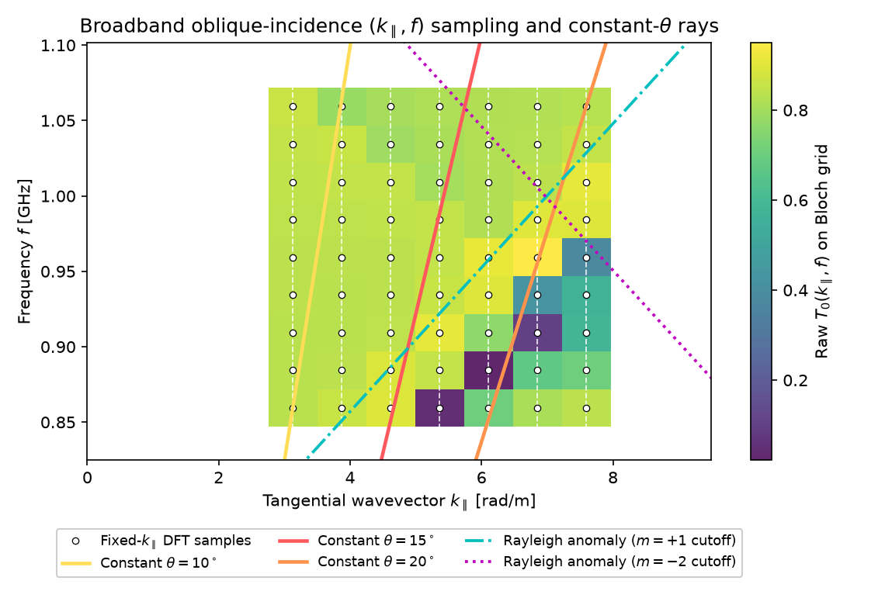 | 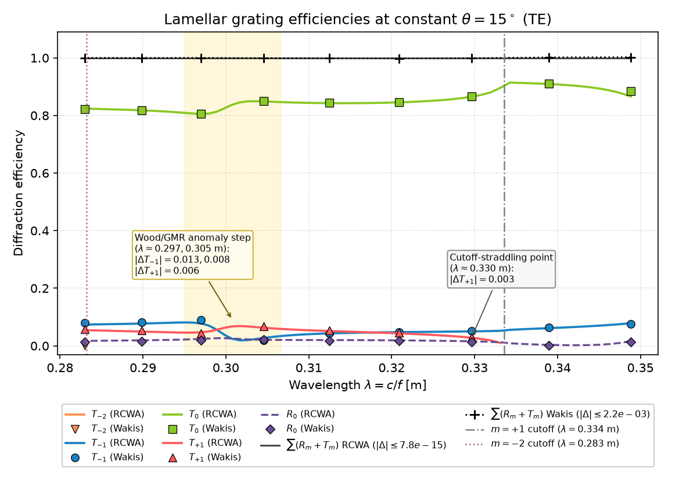 |

*Figures generated by `examples/011_oblique_grating.py` for a lossless lamellar dielectric grating ($`P = 1.5\lambda_0 = 0.45\text{ m}`$, $`h = 0.25\lambda_0 = 0.075\text{ m}`$, $`\varepsilon_\text{ridge} = 2.25`$ in air, TE incidence at $`\theta = 15^\circ`$, $`N_k = 7`$, `run_time_cycles = 120`). Summing over all propagating orders ($`m \in \{-2, -1, 0, +1, +2\}`$), the total energy $`\sum_m (R_m + T_m)`$ equals $`1.000000`$ for 1D RCWA (maximum residual $`7.8\times 10^{-15}`$) and lies in $`[0.9981, 1.0022]`$ for Wakis (maximum residual $`2.2\times 10^{-3}`$). Interpolated points adjacent to Rayleigh/Wood anomalies have larger per-order interpolation errors: across the $`m = -2`$ guided-mode resonance Fano step at $`\lambda \approx 0.297\text{ m}`$ and $`0.305\text{ m}`$ ($`|\Delta T_{-1}| = 1.3\times 10^{-2}`$ and $`8.1\times 10^{-3}`$, $`|\Delta T_{+1}| = 6.0\times 10^{-3}`$ at $`0.305\text{ m}`$) and on the $`m = +1`$ cutoff-straddling interval at $`\lambda \approx 0.330\text{ m}`$ ($`|\Delta T_{+1}| = 2.6\times 10^{-3}`$).*

**Constant-angle resampling and cubic error bound.** Each $`k_\parallel`$ task is an independent standard Bloch simulation that records the complex order amplitudes and powers on `DiffractionMonitor` planes at the target frequencies $`f_j`$. Because the tasks share no state, `AngleSweep.run(processes=...)` executes them in parallel via `multiprocessing`, while `AngleSweep.cli()` provides `--list-tasks`, `--task <id> --output <file.npz>`, and `--collect <files...>` for cluster/batch array jobs. At each fixed frequency $`f_j`$ and target angle $`\theta`$, `resample_constant_angle` evaluates the target wavevector $`k_\text{target} = (2\pi f_j n / c)\sin\theta`$ by 4-point cubic Lagrange interpolation on the uniform $`k_\parallel`$ grid (with local phase-slope gauge alignment for complex amplitudes). For a smooth response $`g(k_\parallel)`$, the pointwise interpolation error is fourth-order in $`\Delta k_\parallel`$:

```math
\left|g(k_\text{target}) - P_3(k_\text{target})\right| \le C_4\,(\Delta k_\parallel)^4 \max_{k_\parallel}\left|\frac{\partial^4 g}{\partial k_\parallel^4}\right|, \qquad
C_4 = \begin{cases} \tfrac{3}{128} & \text{(interior interval)}, \\[2pt] \tfrac{1}{24} & \text{(boundary interval)}. \end{cases}
```

`sampling_density` reports $`\Delta k_\parallel`$, the equivalent mid-band angular step $`\Delta\theta = \Delta k_\parallel / (n k_0 \cos\theta)`$, and the error factors $`C_4(\Delta k_\parallel)^4`$. Two strict invariants protect the resampling near cutoffs:
1. **No extrapolation:** if $`k_\text{target} \notin [k_{\parallel,\min}, k_{\parallel,\max}]`$, `resample_constant_angle` returns `NaN` rather than extrapolating past the sampled $`k_\parallel`$ range.
2. **Rayleigh-anomaly masking and cutoff-straddling interpolation:** diffraction orders turn from evanescent to propagating along the hyperbolic Rayleigh (Wood) cutoff curves $`|\mathbf{k}_\parallel + \mathbf{G}_{mn}| = n_\text{out} k_0`$, where $`k_{z,mn} = \sqrt{n_\text{out}^2 k_0^2 - |\mathbf{k}_\parallel + \mathbf{G}_{mn}|^2}`$ has a square-root branch point. `resample_constant_angle` masks non-propagating samples, returns `NaN` on any grid interval $`[k_i, k_{i+1}]`$ straddling an order appearance/disappearance, and shifts the 4-point cubic stencil inside the contiguous propagating segment away from the branch-point endpoint. In `AngleSweepResult.resample()`, when an order is propagating in the continuum at $`k_\text{target}`$ (`kz > 0`) inside a cutoff-straddling interval $`[k_i, k_{i+1}]`$, its efficiency is interpolated in the normal wavenumber $`q = k_{z,mn}(k_\parallel)`$ anchored by the exact threshold zero $`\eta_{mn}(q = 0) = 0`$ at the Rayleigh cutoff, and the interior orders' stencil sum is reconciled with the raw FDTD total energy at each $`k_\parallel`$ node.

**Floquet ports and generalized S-matrix.** `FloquetPort` wraps a `DiffractionMonitor` in the homogeneous lower (`side="below"`, port 1) or upper (`side="above"`, port 2) half-space of a unit cell. Each propagating Floquet harmonic $`i = (\text{port}, m, n, \text{pol})`$ with $`\text{pol} \in \{\text{TE}, \text{TM}\}`$ (represented by `FloquetMode`) is normalized to unit time-averaged power across the unit-cell area $`A = P_x P_y`$ using the discrete FIT wave admittances of `DiffractionMonitor`, and its phase is de-embedded from the monitor plane $`z_\text{mon}`$ to a stated port reference plane $`z_\text{ref}`$ via the discrete normal wavenumber $`k_{a,mn} = (2/\Delta_a)\arcsin\!\sqrt{1 - \gamma_{mn}^2}`$:

```math
a_i(f) = w^\text{in}_i(f)\,e^{\mp i\,\operatorname{sign}(f)\,k_{a,mn}(z_\text{ref} - z_\text{mon})}, \qquad
b_i(f) = w^\text{out}_i(f)\,e^{\pm i\,\operatorname{sign}(f)\,k_{a,mn}(z_\text{ref} - z_\text{mon})}.
```

Exciting the cell in incident mode $`j`$ with complex amplitude $`a_j(f)`$ yields the generalized scattering-matrix column $`S_{ij}(f) = b_i(f)/a_j(f)`$ (`s_parameters_from_ports`), and `floquet_s_matrix` assembles the full multi-mode matrix $`\mathbf{S}(f)`$. For a lossless reciprocal structure:
- **Passivity / unitarity:** energy conservation gives $`\sum_i |S_{ij}(f)|^2 = 1`$ for every incident column $`j`$, and full orthogonality $`\mathbf{S}^\dagger(f)\mathbf{S}(f) = \mathbf{I}`$ across all propagating port modes.
- **Lorentz reciprocity:** with the canonical unit-modulus basis sign factor on negative tangential wavevectors ($`\mathbf{k}_{t,\tilde{i}}(-\mathbf{k}_0) = -\mathbf{k}_{t,i}(+\mathbf{k}_0)`$, where $`\tilde{i} = (\text{port}_i, -m_i, -n_i, \text{pol}_i)`$), the scattering matrix obeys $`S_{ij}(+\mathbf{k}_0) = S_{\tilde{j}\tilde{i}}(-\mathbf{k}_0)`$ (`reciprocal_s_matrix`).

**Design rationale vs split-field FDTD.** Broadband oblique incidence in FDTD can be approached in two ways:
1. **Split-field / sine–cosine oblique FDTD** [Roden et al., 1998]: transforms Maxwell's equations into auxiliary field variables at a fixed angle $`\theta`$ so a single time-domain run covers a frequency band at constant $`\theta`$. However, the modified update equations introduce $`\sin\theta`$-dependent cross-derivatives that alter the time-stepping stencil, require specialized PML formulations, and degrade the Courant stability limit as $`\Delta t \propto \cos^2\theta / (1 + \sin\theta)`$ (vanishing at grazing incidence).
2. **Fixed-$`k_\parallel`$ Bloch sweep + resampling (`wakis.floquet`):** reuses the standard, verified complex-field FIT Bloch solver (`SolverFIT3D` + `DiffractionMonitor`) completely unchanged. Each $`k_\parallel`$ run preserves the full 3D FIT Courant step $`\Delta t`$ regardless of angle, uses standard CPML absorbers, and is embarrassingly parallel across $`k_\parallel`$ tasks.

**Limits & failure modes:**
- **Cost scaling with $`N_k`$:** total work scales linearly with the number of $`k_\parallel`$ runs $`N_k`$. Narrow bands or small angular ranges need only $`N_k = 4\text{–}7`$ runs, whereas wide bands spanning large angular ranges require proportionally more $`k_\parallel`$ samples to maintain a target $`\Delta k_\parallel`$.
- **Grazing angles ($`\theta \to 90^\circ`$):** near the light line $`k_\parallel \to n k_0`$, the angular Jacobian $`\partial\theta/\partial k_\parallel = 1/(n k_0 \cos\theta)`$ diverges so many $`k_\parallel`$ samples are required to resolve a given $`\Delta\theta`$. Simultaneously, the normal group velocity $`v_{gz} = (c/n)\cos\theta \to 0`$, requiring longer time integration and thicker CPML layers to absorb grazing waves.
- **Rayleigh (Wood) anomalies and guided-mode resonances:** when a diffraction order grazes ($`k_{a,mn} = 0`$), its square-root branch point in $`k_\parallel`$ breaks $`C^4`$ smoothness and its vanishing normal group velocity (or coupling to leaky guided-mode resonances in the grating layer) causes long-lived ringing in the time domain. Sufficient integration time (`run_time_cycles`) is required so resonant fields decay before the DFT ends, and interpolated points adjacent to a Rayleigh cutoff or guided-mode resonance Fano step exhibit larger per-order errors (e.g. $`|\Delta T_{-1}| \approx 0.008\text{–}0.013`$ at $`\lambda \approx 0.305, 0.297\text{ m}`$ and $`|\Delta T_{+1}| \approx 0.003`$ at $`\lambda \approx 0.330\text{ m}`$ in `examples/011_oblique_grating.py` with $`N_k = 7`$) unless $`\Delta k_\parallel`$ is refined locally.

**Validation** (`tests/test_061_oblique_floquet.py`):
- Dielectric slab ($`\varepsilon_r = 2.25`$, $`d = 8\text{ cm}`$) over $`1.0\text{–}1.3\text{ GHz}`$ at constant $`\theta = 30^\circ`$ and $`60^\circ`$ (TE & TM, $`N_k = 7`$): $`R(f)`$, $`T(f)`$, and complex $`S_{11}(f)`$ match the analytical transfer matrix (`slab_rt`) within $`6\times10^{-3}`$; TM reflection vanishes at Brewster's angle $`\theta_B = \arctan(1.5) \approx 56.31^\circ`$ ($`R_\text{TM} < 10^{-3}`$); total internal reflection from $`n_1 = 1.5 \to n_2 = 1.0`$ at $`\theta = 52^\circ > \theta_c = 41.81^\circ`$ gives $`R = 1`$ within $`2\times10^{-3}`$ and `NaN`-masked transmission; shifting the resampling index by 1 (`index_shift=1`) fails as required.
- Lossless sinusoidal and lamellar gratings: $`\sum_{m}(R_m + T_m) = 1`$ within $`6\times10^{-3}`$; order angles match the grating equation to $`10^{-12}\text{ rad}`$; first-order efficiencies of a shallow sinusoidal grating ($`a = 0.15\Delta z`$) match Rayleigh perturbation theory (`rayleigh_sinusoidal_grating`); broadband constant-angle efficiencies of a lamellar grating match 1D RCWA (`rcwa_1d_grating`, cross-checked against `fmmax` 1.7.1 to $`2\times10^{-4}`$) within $`4\times10^{-3}`$.
- Cubic interpolation convergence: refining $`N_k = 5 \to 9 \to 17`$ reduces the constant-$`\theta`$ error by $`>14\times`$ per halving of $`\Delta k_\parallel`$ (fourth-order $`\mathcal{O}(\Delta k_\parallel^4)`$).
- Generalized $`6\times6`$ Floquet S-matrix ($`m \in \{-1, 0, +1\}`$ on ports 1 & 2) of an asymmetric dielectric grating: at the coarse test grid $`(N_x=24, N_z=100)`$ ($`\Delta x \approx \lambda_0/14.5`$, $`\Delta z \approx \lambda_0/33`$, 6 cells across the grating thickness), unitarity holds to $`\|\mathbf{S}^\dagger\mathbf{S} - \mathbf{I}\|_\infty = 1.3\times10^{-3}`$ and Lorentz reciprocity to $`|S_{ij}(+k_{x0}) - S_{\tilde{j}\tilde{i}}(-k_{x0})| < 10^{-3}`$. The slight column-power deviation $`\sum_i |S_{ij}|^2 = 1.0013`$ ($`+1.3\times 10^{-3}`$) arises from second-order FIT spatial dispersion across the 6-cell grating thickness and finite DFT window ($`+8.8\times 10^{-4}`$ on the net monitor flux ratio) plus evanescent $`|m| \ge 2`$ near-field reactive cross-flux ($`-4.1\times 10^{-4}`$) at monitors placed $`0.31\lambda_0`$ from the grating faces when restricting $`\mathbf{S}`$ to propagating modes; doubling the grid resolution to $`(N_x=48, N_z=200)`$ reduces $`|\sum_i |S_{ij}|^2 - 1|`$ by more than $`3\times`$ to $`4.2\times 10^{-4}`$.

References:
- A. Aminian and Y. Rahmat-Samii, "Spectral FDTD: a novel computational technique for the analysis of periodic structures", *IEEE Trans. Antennas Propag.* **54**(6), 1818–1825 (2006), [doi:10.1109/TAP.2006.875484](https://doi.org/10.1109/TAP.2006.875484).
- J. A. Roden, S. D. Gedney, M. P. Kesler, J. G. Maloney, and P. H. Harms, "Time-domain analysis of periodic structures at oblique incidence: orthogonal and nonorthogonal FDTD implementations", *IEEE Trans. Microw. Theory Tech.* **46**(4), 420–427 (1998), [doi:10.1109/22.664143](https://doi.org/10.1109/22.664143).
- M. G. Moharam, E. B. Pommet, E. B. Grann, and T. K. Gaylord, "Stable implementation of the rigorous coupled-wave analysis for surface-relief gratings: enhanced transmittance matrix approach", *J. Opt. Soc. Am. A* **12**(5), 1077–1086 (1995), [doi:10.1364/JOSAA.12.001077](https://doi.org/10.1364/JOSAA.12.001077).

### 📥🗿 Geometry Importing & Embedded Boundaries

Wakis integrates with [**PyVista**](https://docs.pyvista.org/) to import CAD geometries in `.STL`, `.STEP`, or `.OBJ` formats. The mesh is overlaid onto the simulation domain and mapped onto the Cartesian grid using:
- `pyvista`'s surface collision algorithm, based on VTK optimized ray-tracing, allows to detect where the input geometry intersects the primal and dual grids.
- Assignment of material properties ($`\varepsilon_r`$, $`\mu_r`$, $`\sigma`$) in $`x`$, $`y`$, and $`z`$ to the intersected cells using a first-order subpixel smoothing, inspired by the open-source solver MEEP (MIT).

| STL geometry | Imported material mask |
| ----- | ---- |
|       |      |

Future versions aim to include a more advanced meshing algorithm for improved fidelity near corners and edges.

### 🟢 Conformal FIT: partially filled cells, subpixel dielectrics and thin sheets

Staircased cell masks move a curved or oblique boundary by up to a cell. The resulting error in resonant frequencies, phase and impedances is first order in the cell size $`\Delta`$. `GridFIT3D(conformal=...)` and `GridFIT3D(sheets=...)` instead keep the boundary inside the cells. They change only the metric and material coefficients of the FIT update, so the time step stays linear in the fields. All of it is opt-in, and the default staircase path and its regression data are unchanged. The implementation is in `wakis/conformal.py`.

**Geometry.** For every STL solid (triangulated, oriented outwards) Wakis computes exact intersections with the grid for the polygonal surface:

- the sections of the surface with the node planes $`w=w_k`$, as oriented segments with the solid on their left;
- for each primary edge, the length inside the solid along its grid line. With the crossings $`c_m`$ of the line and $`s_m=\pm1`$ for entering or leaving, the inside length up to $`x`$ is $`F(x)=\sum_m s_m (x-c_m)_+`$, evaluated with cumulative sums;
- for each primary face, the area inside the solid, from Green's theorem $`A = \tfrac12\oint (u\,dv - v\,du)`$ over the boundary of (section ∩ face). This boundary is the section contour split at the grid lines, plus the inside parts of the face sides, which contribute $`\Delta u\,\ell_\text{right} + \Delta v\,\ell_\text{top}`$ in face-local coordinates;
- for each E edge, the volume fraction of the solid in its dual cell. It is integrated exactly in $`x,y`$ (section areas) and with `conformal_subsamples` midpoint planes along $`z`$, which is exact for geometry extruded along $`z`$.

Degenerate positions, such as faces on node planes or vertices on grid lines, are resolved by evaluating the geometry with two opposite shifts of $`10^{-7}\Delta`$. The maximum of the two results (or the minimum, for holes in a PEC background) makes surfaces belong to the conductor. A 100³ grid with a sphere of $`8\times10^4`$ triangles takes about 1.3 s of geometry work plus 1.2 s for the stability estimate below.

**Conformal PEC (Dey–Mittra / PBA type).** Faraday's law on a face is integrated only over its part outside the conductor. With $`\ell_e`$ the open part of the edge length $`L_e`$ and $`A_f`$ the open part of the face area,

```math
\mu A_f \frac{d H_f}{dt} = -\sum_{e\in\partial f} \pm\, \ell_e E_e ,
```

that is, `solver.L` holds $`\ell_e`$ and `solver.iA` holds $`1/A_f`$, while the dual (E) update is unchanged. Edges with $`\ell_e=0`$ get `ieps = 0`. With a PEC background (`bg='pec'`) the conductor is everything outside the non-PEC solids, so an accelerator cavity given as a vacuum STL is conformal too. This is the locally conformal FDTD of Dey and Mittra [Dey & Mittra, 1997], written in FIT form as in the Perfect Boundary Approximation [Krietenstein et al., 1998]. Overlapping PEC solids are combined with the maximum of their covered lengths and areas, which is an approximation of the union.

**Stability treatment (Wakis choice).** A small open area $`A_f`$ makes the face "stiff" and, with $`\ell`$ of order $`\Delta`$, reduces the stable time step without bound. The update can be written as $`\mathbf H' = \mathbf H - \Delta t\,\mathbf A\mathbf E`$, $`\mathbf E' = \mathbf E + \Delta t\,\mathbf B\mathbf H'`$ with $`\mathbf B\mathbf A = \mathbf D_1\mathbf C^H\mathbf D_2\mathbf G\,\mathbf C\mathbf D_4`$, where $`\mathbf D_1 = \varepsilon^{-1}/\tilde A`$, $`\mathbf D_2 = \tilde L`$, $`\mathbf D_4 = \ell`$ and $`\mathbf G = \mu^{-1}\cdot`$(inverse face areas). This product is similar to the Hermitian positive semi-definite $`\mathbf R\mathbf C^H\mathbf D_2\mathbf G\mathbf C\mathbf R`$, $`\mathbf R=(\mathbf D_4\mathbf D_1)^{1/2}`$, as long as $`\mathbf D_2\mathbf G`$ is symmetric positive semi-definite. The leapfrog is then stable for $`\Delta t < 2/\sqrt{\lambda_\max}`$, with a conserved discrete energy. Wakis keeps this structure and replaces $`\operatorname{diag}(1/A_f)`$ by

```math
\mathbf G = \mathbf T^T \operatorname{diag}(1/\hat A)\,\mathbf T,\qquad \hat A = \mathbf T A .
```

Here a face is unstable when $`A_f < \tfrac12\,\theta\,\max_e(\ell_e h_{\perp,e})`$, with $`h_{\perp,e}`$ the face size perpendicular to edge $`e`$. This is the criterion of the legacy Wakis ECT solver, used here with $`\theta=0.5`$. An unstable face sends its flux to stable in-plane neighbours along its longest open edge, with weights $`(2,-1)`$ to the first and second neighbour. Its field is then the linear extrapolation $`H_u = 2H_1 - H_2`$, a uniform field is reproduced exactly, and the second-order convergence of Dey–Mittra is kept. Plain cell merging (weight 1) costs an $`O(\Delta)`$ error: the TE11 error of a circular cavity at 96 cells across went from $`6\times10^{-5}`$ to $`1.2\times10^{-3}`$. Faces without stable neighbours fall back to the area $`\theta A_\text{stab}`$.

The time step is then $`\Delta t = \min(\Delta t_\text{default}, \texttt{cfln}\cdot 2/\sqrt{\lambda_\max})`$. $`\lambda_\max`$ is computed with Lanczos iterations (with a 1 % margin, see *Tensor subpixel averaging* for the recurrence) and stored in `solver.conformal_dt_max`. A user-given `dt` above the limit triggers a warning. In the tests the limit is 0.85–1.0 times the Yee limit for curved PEC (0.86 for the sphere, independent of resolution), so with the default `cfln=0.5` the step is reduced by at most about 15 %. For the patch template it is 0.67 times the Yee limit (thin substrate cells and the sheet-edge correction of faces next to the edge, see below).

**Conformal dielectrics (`conformal=True` or `'all'`).** On each E edge the inverse permittivity is the diagonal of the anisotropic subpixel average [Farjadpour et al., 2006; Kottke et al., 2008]

```math
\varepsilon^{-1}_{cc} = n_c^2\,\langle\varepsilon^{-1}\rangle + (1-n_c^2)\,\langle\varepsilon\rangle^{-1},
```

with $`\langle\cdot\rangle`$ the volume average over the dual cell of the edge and $`\mathbf n`$ the normal of the nearest surface triangle. Later solids replace earlier ones where they overlap: $`f_j \leftarrow f_j(1-f_k)`$. The conductivity is averaged arithmetically, and `imu` keeps the cell masks. FIT has one E component per edge, so the off-diagonal terms $`n_xn_y(\langle\varepsilon^{-1}\rangle-\langle\varepsilon\rangle^{-1})`$ are dropped. The method is therefore second order when $`\mathbf E`$ is parallel or normal to the interface (dielectric rod in a cavity, TM0: errors $`1.2\times10^{-4}`$, $`3.5\times10^{-5}`$, $`3\times10^{-6}`$ at 24/48/96 cells, against $`2\times10^{-2}`$, $`5\times10^{-3}`$, $`1.6\times10^{-3}`$ for the staircase). It is only first order for $`\mathbf E`$ crossing a curved interface obliquely: for the TE1 mode of the same cavity the error is $`4.6\times10^{-3}`$, $`2.1\times10^{-3}`$, $`1.0\times10^{-3}`$, comparable to the staircase. `conformal='pec'` keeps the conformal PEC and assigns each dielectric edge the material with the largest share of its dual cell.

**Thin PEC sheets.** A sheet is a planar zero-thickness polygon (`sheets={name: PolyData}`, `rectangle_sheet`, or an STL solid with material `'sheet'`). It must lie on a node plane normal to x, y or z; oblique sheets are not supported. The open lengths and areas of the edges and faces in its plane are computed from the polygon outline as above, so a sheet edge between nodes cuts its edges and faces partially. This coverage alone still leaves the edge $`0.15`$–$`0.37\,\Delta`$ too far out, depending on its position between the nodes, because the field at a knife edge is singular, $`\propto r^{-1/2}`$. The empirical one-third-cell rule of `patch_antenna` comes from this offset.

**Knife-edge correction (Wakis adaptation of the static-field corrections of [Shorthouse & Railton, 1992]).** Near a straight sheet edge along $`t`$, with $`s`$ pointing away from the metal and $`w`$ normal to the sheet, the static field is $`F=\sqrt{\zeta}`$, $`\zeta = s + i w`$, with the branch cut on the metal. $`\operatorname{Re}F`$ is the potential of the field with charge at the edge, and also $`E_t`$ of the field with current along the edge; $`\operatorname{Im}F`$ is its stream function. Every material coefficient within 1.5 cells of an axis-aligned sheet edge is scaled by the ratio of its exact voltage-to-flux relation for $`F`$ to the standard FIT one:

| quantity | exact relation used | factor on |
| --- | --- | --- |
| $`E_s`$, $`E_w`$ (charge at the edge) | $`e = \Delta\operatorname{Re}F`$ along the edge, $`d = \Delta\operatorname{Im}F`$ across its dual face | `ieps` |
| $`E_t`$ (current along the edge) | $`e = \operatorname{Re}F`$ at the node, $`d = \iint_{\tilde A}\operatorname{Re}F`$ (closed form) | `ieps` |
| $`H_s`$, $`H_w`$ faces | $`b = \Delta\operatorname{Re}F`$ along the face, $`h = \Delta\operatorname{Im}F`$ along its dual edge | inverse face area |

Dual faces and edges keep their FIT position. Where one crosses the sheet, the principal branch goes around the tip, so the discrete Gauss and Ampère laws exclude the charge and current on the sheet piece inside the dual cell. With this convention the static singular field solves the discrete equations exactly. Unstable faces next to the edge redistribute their flux with the ratio of the knife-edge fields instead of the linear extrapolation. Objects at the sheet corners (beyond the ends of an edge) are not corrected, except $`E_t`$ edges that reach beyond the corner: these are corrected on the part beside the sheet. The factors are kept in `solver.conformal_ieps_factor`, so that materials written later (templates) are corrected the same way. `sheet_edge_correction=False` disables the correction.

In a PEC box with a fin, the effective edge position is within $`0.004\Delta`$ of the physical one for any position of the edge between nodes when the charge is at the edge, against $`0.15`$–$`0.37\Delta`$ without the correction. When the current runs along the edge it is within $`0.02`$–$`0.04\Delta`$, against $`0.12`$–$`0.33\Delta`$. The correction is exact only for the singular term. Regular fields near the edge, such as a uniform $`E_w`$ through a sheet that does not perturb it, see $`O(\Delta^2)`$ perturbations of the order of $`10^{-3}`$ at 15 cells across a cavity. At patch corners the field has a stronger singularity, which is not modelled. In a 3D air patch (2 mm cells, sweep of the patch width) the corrected resonance still moves by up to 1 % when a non-radiating edge approaches a node from below. The sweep of the length, where the radiating edges carry the charge, is smooth. This residual edge-position dependence is the main limitation of the sheet model.

**Differentiability.** All conformal quantities are fixed coefficients: $`\ell`$ in `solver.Ds`, the non-diagonal $`\mathbf G`$ in `solver.iDa` (and in the CPML derivative operators), and the corrected `ieps`. The update stays linear. `AdjointStepper` transposes the solver's own operators, so the adjoint remains exact, including the non-diagonal redistribution (dot-product identity $`\le 10^{-13}`$ relative for PEC and CPML in `tests/test_028_conformal.py`). The geometry itself (STL, sheet outline) is not differentiated. A `MaterialGrid` design region overlapping conformal dielectrics or sheet edges would overwrite their `ieps`; keep design regions away from them.

**Limitations.** `use_mpi` is untested; each rank computes its own geometry. GPU is untested. SIBC and PML are rejected (CPML works). `save_to_h5` and `mpi_gather_asGrid` do not carry `conformal`/`sheets`. The permeability is not averaged. Merged faces assume a uniform $`\mu`$. The ±shift convention makes edges and faces lying exactly on a PEC surface closed.

**Legacy cell masks (corrected 2026-10-19).** `_apply_stl_materials` first writes the legacy staircase: a cell with any of its 8 nodes inside a PEC solid gets `ieps = 0` on its lower-corner edges, which thickens the solid by up to a cell towards −x, −y, −z (upstream behaviour, issue #92). The conformal step then rewrites `ieps` and `sigma` on every edge from the conformal geometry (PEC solids enter only through $`\ell`$; edges with $`\ell = 0`$ get `ieps = 0`). Until 2026-10-19 this rewrite ran only when a dielectric solid was present or the background was PEC. With PEC-only STL solids in a non-PEC background (also with `sheets` only), the legacy zeros survived on edges with $`\ell > 0`$, and the conformal PEC was worse than the staircase and first order: TM010 of a PEC tube $`+5.8`$ %, $`+2.8`$ % at 8/16 cells per radius (staircase $`+4.8`$ %, $`+2.2`$ %); B4 dipole resonance −6.0 % at $`h_t = a`$. Fixed: $`-2.3\times10^{-3}`$, $`-5.5\times10^{-4}`$ (order 2.1), `tests/test_048_conformal_pec_mask.py`. Reviving the open edges lowers the stable step of PEC-only geometries slightly (rotated box: 0.96 → 0.86 of the Yee limit; sphere: 0.97 → 0.88), inside the 0.85–1.0 range quoted above.

**Validation** (`tests/test_028_conformal.py`, all in the time domain with a matrix-pencil fit of the ring-down and the leapfrog dispersion removed):

| Case | Mesh | Reference | Staircase / plain | Conformal |
| --- | --- | --- | --- | --- |
| PEC sphere, TM11 ($`x=2.7437`$) | 16/24/32 cells across $`2a`$ | analytic | −12 %, −10 %, −8 % (1st order) | $`3.1\times10^{-3}`$, $`9.2\times10^{-4}`$, $`4.8\times10^{-4}`$ (order 2.6) |
| PEC circular cavity TE11/TM01 (2D, eigenvalues) | 24/48/96 across $`2.4b`$ | analytic | 13 %, 6.6 %, 3.4 % | $`1.1\times10^{-3}`$, $`2.5\times10^{-4}`$, $`6\times10^{-5}`$ (order 2) |
| Rod-loaded cavity TM0, $`\varepsilon_r=4`$ | 24/48/96 | Bessel matching | $`2\times10^{-2}`$ … $`1.6\times10^{-3}`$ ('pec') | $`1.2\times10^{-4}`$ … $`3\times10^{-6}`$ ('all') |
| Fin in a PEC box, edge at 51 mm | 2 mm (edge mid-cell) / 1 mm (on node) | fine-mesh Richardson | $`4.5`$/$`5.4\times10^{-3}`$ and $`2.1`$/$`3.0\times10^{-3}`$ | $`1.1\times10^{-4}`$/$`9\times10^{-6}`$ and $`6.2`$/$`1.9\times10^{-4}`$ |
| Patch template, FR-4, 15/20/30 cells/λ (slow) | edges between nodes | Δ→0 extrapolation −2.3 % vs TLM | −7.3/−6.0 % at 20/30 (no correction), −2.5/−2.7 % (empirical $`\Delta/3`$) | −3.4/−2.4/−3.1 % (`thin_sheet=True`, no correction) |
| PEC STL tube in vacuum, TM010 (non-PEC background, PEC-only solids; `test_048`) | 8/16 cells per radius | analytic | $`+4.8\times10^{-2}`$, $`+2.2\times10^{-2}`$ | $`-2.3\times10^{-3}`$, $`-5.5\times10^{-4}`$ (order 2.1; before the 2026-10-19 fix $`+5.8`$/$`+2.8\times10^{-2}`$, order 1.05) |
| Stability: PEC ball + rod + sheet, 20 000 steps | 14×12×12 | bounded energy | — | no growth |

References:
- S. Dey and R. Mittra, "A locally conformal finite-difference time-domain (FDTD) algorithm for modeling three-dimensional perfectly conducting objects", *IEEE Microwave and Guided Wave Letters* **7**(9), 273–275 (1997).
- B. Krietenstein, R. Schuhmann, P. Thoma and T. Weiland, "The Perfect Boundary Approximation technique facing the big challenge of high precision field computation", *Proc. LINAC'98*, Chicago, pp. 860–862 (1998), [JACoW TH4041](https://epaper.kek.jp/l98/PAPERS/TH4041.PDF).
- A. Farjadpour, D. Roundy, A. Rodriguez, M. Ibanescu, P. Bermel, J. D. Joannopoulos, S. G. Johnson and G. W. Burr, "Improving accuracy by subpixel smoothing in the finite-difference time domain", *Opt. Lett.* **31**, 2972–2974 (2006), [doi:10.1364/OL.31.002972](https://doi.org/10.1364/OL.31.002972).
- C. Kottke, A. Farjadpour and S. G. Johnson, "Perturbation theory for anisotropic dielectric interfaces, and application to subpixel smoothing of discretized numerical methods", *Phys. Rev. E* **77**, 036611 (2008), [doi:10.1103/PhysRevE.77.036611](https://doi.org/10.1103/PhysRevE.77.036611).
- D. B. Shorthouse and C. J. Railton, "The incorporation of static field solutions into the finite difference time domain algorithm", *IEEE Trans. Microwave Theory Tech.* **40**(5), 986–994 (1992).

### 🧊 Tensor subpixel averaging: `conformal='tensor'` and `MaterialGrid(smoothing='tensor')`

The diagonal average of `conformal='all'` is first order whenever $`\mathbf E`$ crosses a curved or oblique dielectric interface, because it drops the off-diagonal entries of the averaged tensor. `conformal='tensor'` keeps them. It is opt-in; without it every code path, operator and regression result is unchanged. The implementation is in `wakis/tensor_averaging.py`.

**Averaged tensor** [Farjadpour et al., 2006; Kottke et al., 2008]. For a pixel cut by a planar interface with unit normal $`\mathbf n`$ and fill fraction $`f`$, the effective inverse permittivity that makes the first-order perturbation of the eigenfrequencies vanish is

```math
\mathbf T = \langle\varepsilon^{-1}\rangle\,\mathbf n\mathbf n^T + \langle\varepsilon\rangle^{-1}(\mathbf I - \mathbf n\mathbf n^T)
= \langle\varepsilon\rangle^{-1}\mathbf I + a\,\mathbf n\mathbf n^T,\qquad a = \langle\varepsilon^{-1}\rangle - \langle\varepsilon\rangle^{-1} \ge 0 .
```

Every E edge $`e`$ (component $`c`$) has its own pixel, the dual cell of `conformal='all'`, with $`f_e`$, $`\mathbf n_e`$ and $`a_e`$. Its diagonal entry $`T_{cc}(e)`$ is exactly the 'all' value, kept in `solver.ieps`.

**Symmetric corner (octant) operator (Wakis construction).** The off-diagonal entries couple $`E_c`$ to the other two D components, which live on other edges. Each primary cell is split into eight octants, one per corner. The octant at a corner contains one x, one y and one z edge: the three edges leaving that corner into the cell. With $`\mathbf W = \operatorname{diag}(\ell\tilde A)`$ the energy weights of the E edges (open length times dual area), the material operator is

```math
\mathbf E = \mathbf N\mathbf D,\qquad \mathbf N = \operatorname{diag}(\varepsilon^{-1}) + \mathbf W^{-1}\mathbf S,\qquad
S_{ab} = \sum_{o\ni a,b} \frac{V_o}{8}\,s_o\,\tfrac12\big(T_{ij}(a) + T_{ij}(b)\big),
```

for the edges $`a`$ (component $`i`$) and $`b`$ (component $`j\ne i`$) of each octant $`o`$ of a cell of volume $`V_o`$. For a uniform $`T_{ij}`$ this is $`E_i \mathrel{+}= T_{ij}\,\overline{D_j}`$, with $`\overline{D_j}`$ the average of the four $`D_j`$ around the $`E_i`$ edge. That is the off-diagonal interpolation of Meep [Farjadpour et al., 2006; Oskooi et al., 2010]. Averaging $`T_{ij}`$ over the two edges makes $`\mathbf S`$, and so $`\mathbf W\mathbf N`$, symmetric, as in the symmetric FDTD schemes for anisotropic dielectrics [Werner & Cary, 2007]. The pixel tensors come from the conformal geometry: $`f_e`$ is the exact dual-cell fraction and $`\mathbf n_e`$ the normal of the nearest surface triangle.

**Positive definiteness and stability.** With the per-octant share $`d_{o,e} = \varepsilon^{-1}_e W_e/\tilde V_e`$ of the diagonal ($`\tilde V_e = \sum_{o\ni e} V_o/8`$),

```math
\mathbf W\mathbf N = \sum_o \frac{V_o}{8}\,\mathbf P_o^T\big(\mathbf D_o + s_o\mathbf t_o\big)\mathbf P_o + \operatorname{diag}\big(\mathbf W\varepsilon^{-1} - \textstyle\sum_o \tfrac{V_o}{8}\mathbf P_o^T\mathbf D_o\mathbf P_o\big),
```

where $`\mathbf P_o`$ picks the three octant edges, $`\mathbf D_o = \operatorname{diag}(d_o)`$ and $`\mathbf t_o`$ is the off-diagonal $`3\times3`$ block. The last term is zero for edges inside the domain and non-negative at partial (conformal PEC) edges. The scale $`s_o\le1`$ is reduced only where $`\lambda_\min(\mathbf D_o^{-1/2}\mathbf t_o\mathbf D_o^{-1/2}) < -0.99`$, so every octant block is positive definite and $`\mathbf W\mathbf N`$ is SPD. Couplings to edges with $`\varepsilon^{-1}=0`$ (PEC, ghost cells) are dropped. In all tests $`s_o = 1`$ everywhere ($`\lambda_\max \le 0.4`$). Then the update $`\mathbf H' = \mathbf H - \Delta t\mathbf A\mathbf E`$, $`\mathbf E' = \mathbf E + \Delta t\,\mathbf N\tilde{\mathbf A}^{-1}\mathbf C^H\tilde{\mathbf L}\mathbf H'`$ conserves a discrete energy and is stable for $`\Delta t < 2/\sqrt{\lambda_\max(\mathbf B\mathbf A)}`$. $`\mathbf B\mathbf A`$ is similar to a Hermitian PSD matrix, so its eigenvalues are real. With $`\mathbf N = \mathbf W^{-1}(\mathbf W\operatorname{diag}(\varepsilon^{-1}) + \mathbf S)`$, $`\mathbf S = \mathbf W\mathbf K`$ Hermitian, the nonzero eigenvalues of $`\mathbf B\mathbf A = \mathbf N\tilde{\mathbf A}^{-1}\mathbf C^H\tilde{\mathbf L}\mathbf G\mathbf C\mathbf L`$ equal those of $`\mathbf P\mathbf Q`$ (cyclic permutation), $`\mathbf P = \mathbf L\mathbf N\tilde{\mathbf A}^{-1} = \tilde{\mathbf A}^{-1}(\mathbf W\operatorname{diag}(\varepsilon^{-1}) + \mathbf S)\tilde{\mathbf A}^{-1}`$ and $`\mathbf Q = \mathbf C^H\tilde{\mathbf L}\mathbf G\mathbf C`$, both Hermitian PSD ($`\mathbf L\mathbf W^{-1} = \tilde{\mathbf A}^{-1}`$). $`\mathbf P\mathbf Q`$ is self-adjoint in the $`\mathbf P`$-semi-inner product, and the Lanczos recurrence for $`\mathbf P^{1/2}\mathbf Q\mathbf P^{1/2}`$ needs only products with $`\mathbf P`$ and $`\mathbf Q`$: $`\beta_{j+1}\mathbf r_{j+1} = \mathbf Q\mathbf z_j - \alpha_j\mathbf r_j - \beta_j\mathbf r_{j-1}`$, $`\mathbf z_j = \mathbf P\mathbf r_j`$, $`\alpha_j = \mathbf z_j^H\mathbf Q\mathbf z_j`$, $`\beta_{j+1}^2 = \tilde{\mathbf r}^H\mathbf P\tilde{\mathbf r}`$ [Saad, *Numerical Methods for Large Eigenvalue Problems*, 2nd ed., SIAM 2011, ch. 6] (`wakis._lanczos`; for the diagonal case $`\mathbf P`$ is diagonal and this is the usual Lanczos for $`\mathbf R\mathbf C^H\mathbf D_2\mathbf G\mathbf C\mathbf R`$). It stops when the residual estimate of the largest Ritz pair is below $`10^{-3}\theta`$ (the ARPACK criterion), runs only on the edges with $`P_{ee}>0`$, stores five vectors and uses multi-threaded sparse products (or CuPy with `use_gpu`). Converged tightly it agrees with Arnoldi iterations on $`\mathbf B\mathbf A`$ itself to $`10^{-9}`$ (test); at the default tolerance both scatter by $`\sim10^{-5}`$. $`\Delta t = \min(\Delta t_\text{default}, \texttt{cfln}\cdot 2/\sqrt{\lambda_\max})`$ (`solver.conformal_dt_max`). A cheap a-priori bound also holds: each octant block is at most $`(1+\mu_\max)\mathbf D_o`$, $`\mu_\max = \max_o \lambda_\max(s_o\mathbf D_o^{-1/2}\mathbf t_o\mathbf D_o^{-1/2}) < 2`$, so the tensor step is stable at $`\Delta t_\text{diag}/\sqrt{1+\mu_\max} > 0.57\,\Delta t_\text{diag}`$. With the default `cfln = 0.5` the time step is therefore never reduced by the tensor; it was unchanged in all tests.

**Time step (Wakis construction).** $`\mathbf N`$ differs from the diagonal only on the coupled edges $`R`$, so the step is the solver's own diagonal step followed by a local correction:

```math
\mathbf E^* = \mathbf E^n + \Delta t\,\varepsilon^{-1}(\mathbf C^H\ldots\mathbf H - \mathbf J),\qquad
\mathbf E^{n+1}_R = \mathbf E^*_R + \mathbf K'(\mathbf E^*_R - \mathbf E^n_R),\qquad
K'_{ab} = \frac{S_{ab}}{W_a\,\varepsilon^{-1}_b} .
```

This works for every backend and step variant (NumPy/MKL, CuPy with `cupyx` sparse, CPML, TFSF, conductivity, Bloch phases on wrapped couplings), costs one sparse product on $`|R|`$ edges per step and keeps the step linear. With MPI the couplings reach one $`z`$ layer into the ghost layers; the E ghost layers are exchanged once more after the correction. Couplings to edges of dispersive (ADE) groups are dropped, so dispersive solids keep the diagonal average and the corrections act on disjoint edges.

**Adjoint.** The correction is linear in $`(\mathbf E^*, \mathbf E^n)`$, so `AdjointStepper` adds its transpose:

```math
\boldsymbol\lambda_{E^*,R} = (\mathbf I + \mathbf K'^H)\boldsymbol\lambda_{E^{n+1},R},\qquad \boldsymbol\lambda_{E^n,R} \mathrel{+}= -\mathbf K'^H\boldsymbol\lambda_{E^{n+1},R} .
```

The dot-product identity holds to $`10^{-17}`$ relative (PEC and CPML). For the gradient, the step is $`\mathbf E^{n+1} = \mathbf E^n + \mathbf N\mathbf g^n`$ with $`\mathbf g^n = \Delta t(\ldots)`$ the increment of $`\mathbf D`$, recorded on the design and coupled edges. Then $`\partial F/\partial\varepsilon^{-1}_a = \sum_n \lambda^{n+1}_a g^n_a`$ and $`\partial F/\partial S_{ab} = \sum_n (\lambda^{n+1}_a g^n_b/W_a + \lambda^{n+1}_b g^n_a/W_b)`$, with $`\boldsymbol\lambda^{n+1}`$ the adjoint of the corrected $`\mathbf E^{n+1}`$.

**Density designs: `MaterialGrid(..., smoothing='tensor')` (Wakis adaptation).** For a density $`\rho`$ (normally filtered and projected) the design edges take, instead of the arithmetic interpolation, the averaged tensor of a pixel with fill fraction $`f_e = \operatorname{clip}(\mathbf P\rho, 0, 1)`$ and normal from the density gradient $`\mathbf g_e = \mathbf G\rho`$ (trilinear interpolation of nodal central differences):

```math
\mathbf T_e = \frac{\mathbf I}{\langle\varepsilon\rangle} + a\,\mathbf m\mathbf m^T,\quad
\mathbf m = \frac{\mathbf g}{\sqrt{|\mathbf g|^2+\delta^2}},\quad
\langle\varepsilon\rangle = \varepsilon_\min + \Delta\varepsilon f,\quad
\langle\varepsilon^{-1}\rangle = \frac{1-f}{\varepsilon_\min} + \frac{f}{\varepsilon_\max},
```

with $`\delta = 10^{-2}/h_\text{design}`$, so that $`\mathbf m`$ is the unit normal at an interface ($`|\mathbf g|\sim 1/h`$) and goes smoothly to zero (isotropic arithmetic mean) in uniform regions. Using the density as fill fraction and its gradient as normal is the idea of Meep's `MaterialGrid(do_averaging=True)` [Oskooi et al., 2010; Hammond et al., 2021]. The subpixel-smoothed projection of [Hammond et al., 2025] goes further and also derives the fill fraction from the filtered density and its gradient; it is not implemented here. $`\mathbf T_e`$ enters as above: diagonal in `ieps`, off-diagonals through the corner couplings. The map $`\rho\mapsto(\varepsilon^{-1}, \mathbf S)`$ is smooth, and `MaterialGrid.vjp` applies the exact chain rule through $`f`$ ($`\partial\langle\varepsilon\rangle^{-1}/\partial f = -\Delta\varepsilon/\langle\varepsilon\rangle^2`$, $`\partial\langle\varepsilon^{-1}\rangle/\partial f = 1/\varepsilon_\max - 1/\varepsilon_\min`$) and $`\mathbf m`$ ($`\partial m_i/\partial g_k = \delta_{ik}/\sqrt q - g_ig_k/q^{3/2}`$, $`q = |\mathbf g|^2+\delta^2`$). The octant scales $`s_o`$ are treated as constants, which is exact as long as no octant is clamped (`solver.tensor_operator.n_clamped == 0`). The finite-difference check agrees to $`\le 10^{-6}`$ relative. `apply` raises if $`\Delta t`$ exceeds the a-priori bound above (never with `cfln` $`\le 0.5`$).

**Limitations.** One E component per edge remains: the D components of the corner reconstruction lie on both sides of the interface in a cut cell. Some modes therefore still converge at first order, but with a much smaller constant. The prototype study found the same for every Cartesian variant; only interface-conforming meshes remove it. Dispersive pixels get the diagonal of the averaged tensor at every frequency, without couplings (see "Dispersive subpixel averaging" below for why). The MPI adjoint does not support the tensor correction. `field_energy` still uses the diagonal permittivity. The geometry (normals, fill fractions of STL solids) is not differentiated. Memory: $`\mathbf K'`$ has about 5.3 nonzeros per coupled edge and about 14 per primary cell touching an anisotropic edge (2.6 coupled edges per such cell; dielectric sphere at 16–32 cells across). In CSR that is about 0.2 kB per interface cell, plus one stored increment per coupled edge and step in an adjoint run.

**Validation** (`tests/test_035_tensor_averaging.py`; leapfrog dispersion removed, eigenvalues of the discrete operators as a cross-check):

| Case | Mesh | Reference | `'all'` (diagonal) | `'tensor'` |
| --- | --- | --- | --- | --- |
| 2D rod in a square PEC box, $`\varepsilon_r=6`$, TE dipole mode (eigenvalues) | 32/64/128/192 cells across | Delaunay FIT with interface nodes, Richardson | $`2.7, 1.2, 0.43, 0.16\times10^{-3}`$ | $`1.3, 1.4, 0.48, 0.26\times10^{-4}`$ |
| same, TE $`n=0`$ mode ($`\mathbf E`$ tangential, oblique to the grid) | 32/64/128/192 | same | $`6.6, 3.9, 2.0, 1.35\times10^{-3}`$ (order 0.8) | $`2.1, 0.50, 0.17, 0.089\times10^{-3}`$ (order 1.6) |
| same, TE mode 4 | 32/64/128/192 | same | $`1.05, 0.53, 0.25, 0.16\times10^{-3}`$ | $`6.8, 2.4, 0.87, 0.47\times10^{-4}`$ |
| same, TM (E$`_z`$) | 32 | same | $`5.7\times10^{-5}`$ | identical time series |
| 3D dielectric sphere ($`\varepsilon_r=6`$, radius $`b/2`$) in a PEC sphere, TM$`_1`$ (two probes, max) | 16/24/32/48/64 cells across $`2b`$ | Riccati–Bessel matching | $`1.4, 0.96, 0.71, 0.48, 0.37\times10^{-2}`$ (1st order) | $`2.9, 0.82, 0.80, 0.39, 0.31\times10^{-4}`$ (at the level of the PEC wall error and the grid splitting of the degenerate mode) |
| same, TE$`_1`$ ($`\mathbf E`$ tangential to the sphere, oblique to the grid) | 16/24/32/48 | same | $`7.3, 6.8, 5.9, 4.3\times10^{-3}`$ (order 0.5) | $`7.2, 3.3, 1.8, 0.81\times10^{-3}`$ (order 2) |
| Stability: dielectric ball and rod, PEC ball, sheet; 20 000 steps | 14×12×12 | bounded energy | — | no growth |
| Adjoint dot product, PEC and CPML | 14×12×12 | $`\langle U x,y\rangle = \langle x,U^Ty\rangle`$ | — | $`\sim10^{-17}`$ |
| `MaterialGrid(smoothing='tensor')` gradient vs central differences | 9×9 design, 2D TE | $`h=10^{-5}`$ | — | $`\le 10^{-6}`$ |

References:
- A. Oskooi, D. Roundy, M. Ibanescu, P. Bermel, J. D. Joannopoulos and S. G. Johnson, "Meep: A flexible free-software package for electromagnetic simulations by the FDTD method", *Comput. Phys. Commun.* **181**, 687–702 (2010), [doi:10.1016/j.cpc.2009.11.008](https://doi.org/10.1016/j.cpc.2009.11.008).
- G. R. Werner and J. R. Cary, "A stable FDTD algorithm for non-diagonal, anisotropic dielectrics", *J. Comput. Phys.* **226**(1), 1085–1101 (2007).
- A. Hammond, A. Oskooi, S. G. Johnson and S. Ralph, "Photonic topology optimization with semiconductor-foundry design-rule constraints", *Opt. Express* **29**(15), 23916–23938 (2021), [doi:10.1364/OE.431188](https://doi.org/10.1364/OE.431188).
- A. M. Hammond, A. Oskooi, I. M. Hammond, M. Chen, S. E. Ralph and S. G. Johnson, "Unifying and accelerating level-set and density-based topology optimization by subpixel-smoothed projection", [arXiv:2503.20189](https://arxiv.org/abs/2503.20189) (2025).
- Farjadpour et al. (2006) and Kottke et al. (2008): see "Conformal FIT" above.

### 🪙 Dispersive subpixel averaging: metals and dispersive dielectrics at interfaces

Kottke averaging (sections above) is derived for frequency-independent media. A cell cut by the surface of a metal or of a Lorentz/Debye dielectric needs the averaged permittivity at every frequency. Before this section was implemented, conformal modes averaged only $`\varepsilon_\infty`$ and put the poles on the staircased cell mask. This is also what Meep does: "Meep only does subpixel averaging of the *instantaneous* (i.e., infinite frequency) part of $`\varepsilon`$ and $`\mu`$. The dispersive part is not averaged at all" (Meep documentation, *Subpixel Smoothing*, "What about Dispersive Materials?"). For a Drude metal with $`\varepsilon_\infty=1`$ in vacuum, that is the staircase. The implementation is in `wakis/tensor_dispersive.py`. It is used automatically for STL solids with a `DispersiveMaterial` when `conformal='all'` or `'tensor'`, and by `MaterialGrid(material=..., smoothing='tensor')`.

**Averaged permittivity of a dispersive pixel.** A pixel with fill fractions $`f_m`$ (background included) and interface normal $`\mathbf n`$ is a laminate on the pixel scale. The tangential field sees the parallel combination and the normal field the series combination [Kottke et al., 2008]:

```math
\varepsilon_t(\omega) = \sum_m f_m\varepsilon_m(\omega),\qquad
\frac{1}{\varepsilon_n(\omega)} = \sum_m \frac{f_m}{\varepsilon_m(\omega)},\qquad
T_{cc}(\omega) = \frac{n_c^2}{\varepsilon_n(\omega)} + \frac{1-n_c^2}{\varepsilon_t(\omega)} .
```

$`\varepsilon_t`$ is again a pole model, with the pole strengths scaled by $`f_m`$. $`1/\varepsilon_n`$ is not: its poles are the zeros of $`\sum_m f_m/\varepsilon_m`$, which depend on $`f`$. For a Drude metal ($`\varepsilon_\infty`$, $`\omega_p`$, $`\gamma`$) in a dielectric $`\varepsilon_d`$ it is a Lorentz pole (Wakis derivation):

```math
\varepsilon_n(\omega) = \frac{\varepsilon_d\varepsilon_\infty}{A} + \frac{f\,\varepsilon_d^2\omega_p^2/A^2}{\Omega^2-\omega^2+i\gamma\omega},\qquad
A = f\varepsilon_d + (1-f)\varepsilon_\infty,\quad \Omega^2 = \frac{(1-f)\,\omega_p^2}{A} .
```

Here $`f`$ is the metal fraction. Re-fitting such effective poles per cell is the route of the dispersive contour-path method [Mohammadi et al., 2008], which uses Z-transforms. For multi-pole metals (gold: one Drude and five Lorentz poles) it needs a root search per cell, and the effective numerators are no longer of Lorentz form.

**Sub-capacitor network (Wakis construction).** Wakis instead realizes the series combination directly. This is the auxiliary-field idea of splitting the normal field per medium; Deinega and Valuev [2007] split $`E`$ into a parallel part and two normal parts, each driving its own polarization current (method as summarized by Hamm et al. [2014]). On edge $`c`$, $`T_{cc}(\omega)`$ is the elastance of capacitors in series that share the edge's displacement $`D`$:

- one series capacitor per dispersive material $`m`$, weight $`c_k = n_c^2 f_m`$, with the material's own model;
- one tangential capacitor, weight $`c_k = 1-n_c^2`$, with the mixed model $`\varepsilon_t`$ (static part $`\sum_m f_m\varepsilon_{\infty,m}`$, poles of material $`m`$ with multiplier $`\mu = f_m`$).

Each capacitor has a voltage $`u_k`$ and polarizations $`p`$ driven by $`u_k`$ through the unchanged ADEs of `wakis.dispersive`, so the edge field is the sum of the capacitor voltages:

```math
\frac{D}{\varepsilon_0} = \varepsilon_{\infty,k}\,u_k + \sum_p \mu_{kp}\,p_{kp},\qquad
E_c = \sum_k c_k u_k\ (+\ \text{static series terms of non-dispersive media}) .
```

Inside a material ($`f=1`$, no normal) a single tangential capacitor remains, identical to the bulk ADE update. Series capacitors of non-dispersive media are static and stay in `ieps`. The instantaneous part $`\sum_k c_k/\varepsilon_{\infty,k}`$ is exactly the $`\varepsilon_\infty`$-averaged `ieps` that `wakis.conformal` already computes. The network therefore adds only the dynamic remainder, as a local correction after the unchanged solver step (any backend):

```math
\Delta Q_k = \sum_e b_{ke}\,\frac{D_e^{n+1}-D_e^n}{\varepsilon_0} = \sum_e b_{ke}\,\varepsilon_{r,s,e}(E^*_e-E^n_e),\qquad
E^{n+1}_e = E^*_e + \sum_k c_{ek}\Big(u_k^{n+1}-u_k^n-\frac{\Delta Q_k}{\varepsilon_{\infty,k}}\Big).
```

$`u^{n+1}`$ follows from the discretization of Section "Dispersive materials" applied to each capacitor. Lorentz and Drude poles are explicit, $`p^{n+1} = \alpha p^n+\xi p^{n-1}+\zeta u^n`$. Debye poles and the conductivity use the trapezoidal rule, which gives one scalar division per capacitor:

```math
u^{n+1} = \frac{(\varepsilon_\infty-\mu\beta-\mu\hat\sigma)\,u^n + \Delta Q - \sum_L\mu(p_L^{n+1}-p_L^n) - \sum_D\mu(\kappa-1)p_D^n}{\varepsilon_\infty+\mu\beta+\mu\hat\sigma} .
```

The discrete edge permittivity is then the exact Kottke combination of the *discrete* bulk permittivities $`\varepsilon_d(\omega)`$ of `DispersiveMaterial.epsilon_discrete`. For lossless Drude and Lorentz media the whole scheme equals the continuous-time one at the frequency $`2\sin(\omega\Delta t/2)/\Delta t`$, which the validation below uses to remove the leapfrog error exactly. The update is linear in $`(E^*, E^n, u, p)`$. Its transpose, in `AdjointStepper` through `NetworkTranspose`, is

```math
\lambda_{u'} = \lambda_{u}^{\mathrm{ext}} + \mathbf C^T\lambda_{E'} + \textstyle\sum_D\beta\lambda_{p_D'},\quad
\lambda_{\mathrm{acc}} = \lambda_{u'}/\mathrm{den},\quad
\lambda_{E^*} \mathrel{+}= \varepsilon_{r,s}\mathbf B^T\big(\lambda_{\mathrm{acc}} - \mathbf C^T\lambda_{E'}/\varepsilon_\infty\big),
```

with the pole multipliers transposed as in `_DispersiveTranspose`. Memory: 1.3–1.4 capacitors per edge with a dispersive share (sphere at 16–24 cells across). That is about 65 B per such edge for a one-pole material and 170 B for gold (6 poles), and the run time goes up by 15 % (Drude) to 40 % (gold) for a sphere filling 6 % of the box.

**Passivity and stability (Wakis proof sketch).** Write the state as the displacements $`\mathbf D`$ (edges), $`\mathbf H`$, the capacitor polarizations $`\mathbf P`$ and velocities. The stored electric energy is

```math
U = \tfrac12\mathbf D^T\mathbf R\,\mathbf D + \sum_k \frac{V_k}{2}\Big[\frac{(q_k - \sum_p\mu_{kp}P_{kp})^2}{\varepsilon_0\varepsilon_{\infty,k}} + \sum_p\frac{\mu_{kp}\,\omega_{0,p}^2}{\varepsilon_0 S_p}P_{kp}^2\Big],\qquad q_k = \mathbf b_k\cdot\mathbf D,
```

where $`\mathbf R\succeq 0`$ is the static elastance of the non-dispersive series parts (diagonal) and $`V_k`$ the capacitor's share of the dual volume. Every term is a positive semi-definite quadratic form, so the semi-discrete system is passive whenever every material is ($`\gamma,\tau,\sigma\ge0`$, $`S_p = \Delta\varepsilon\,\omega_0^2`$ or $`\omega_p^2 \ge 0`$). In the lossless case the update is exactly the leapfrog of $`\ddot{\mathbf X} = -\mathbf M^{-1}\nabla^2U\,\mathbf X`$ for $`\mathbf X = (\mathbf D,\mathbf P)`$: the D rows come from the curl–curl operator, and the P rows are the explicit central-difference ADEs. $`\mathbf M^{-1} = \operatorname{diag}(\mathbf C^H\tilde{\mathbf D}\ldots\mathbf C,\ \varepsilon_0 S_p/\mu)`$ is symmetric positive semi-definite, so $`\mathbf M^{-1}\nabla^2 U`$ has real non-negative eigenvalues. The step is stable iff $`\Delta t^2\lambda_{\max}/4 \le 1`$. A capacitor holds poles of total strength $`\Omega_k^2 = \sum_p\mu_p S_p/\varepsilon_{\infty,k}`$, and for the parallel mixture this is a weighted mediant bounded by the materials' bulk $`\Omega_m^2 = \sum_p S_p/\varepsilon_{\infty,m}`$. The bounds $`(q-\sum P)^2 \le (1+\theta)q^2 + (1+\theta^{-1})(\sum\mu S)(\sum P^2/\mu S)`$ split $`U`$ into a field part, which is at most $`(1+\theta)`$ times the static ($`\varepsilon_\infty`$-averaged) operator, and independent oscillators. Optimizing $`\theta`$ gives the sufficient condition

```math
r^2 + \frac{(\Delta t\,\Omega_{\max}/2)^2}{1-(\Delta t\,\omega_{0,\max}/2)^2} \le 1,\qquad r = \frac{\Delta t}{\Delta t_\text{static}},
```

with $`\Delta t_\text{static}`$ the Lanczos/Arnoldi limit of the $`\varepsilon_\infty`$-averaged conformal operators (`solver.conformal_dt_max`). For a single lossless Drude pole in bulk this is exactly the sharp condition $`(\omega_p\Delta t/2)^2 + C^2 \le \varepsilon_\infty`$ of Section "Dispersive materials". The weights $`c_k`$ and fractions $`f`$ cancel, so subpixel averaging never tightens the time step beyond the bulk materials. `DispersiveNetwork.stability_bound` evaluates the condition, and the solver raises if it fails. Damping ($`\gamma`$, central differences) and the trapezoidal Debye and conductivity terms only remove energy. For Debye and $`\sigma`$ this is shown numerically (decay test below), not by the bound. The energy argument needs the network to be a sum of positive forms $`\mathbf b_k\mathbf b_k^T`$ ($`\mathbf C = \mathbf W^{-1}\mathbf B^T\operatorname{diag}(V)`$). The diagonal network has this form; the full tensor below does not.

**Why dispersive pixels get no off-diagonal couplings (Wakis analysis).** The full averaged tensor is $`\mathbf T(\omega) = z_t(\mathbf I-\mathbf n\mathbf n^T) + z_n\mathbf n\mathbf n^T`$, with $`z_t = 1/\varepsilon_t`$ and $`z_n = 1/\varepsilon_n`$. For one pixel it is positive real. The Cartesian operator of `conformal='tensor'`, however, takes the diagonal of each edge from that edge's own pixel and the off-diagonal entries from averages over neighbouring pixels. In an octant block the elastance $`z_t(f_a)`$ of pixel $`a`$ then multiplies the coefficient matrix $`\begin{pmatrix}1-n_a^2 & -n_an_b/2\\ -n_an_b/2 & 0\end{pmatrix}`$, which is indefinite. Where $`z_t(f_a)`$ has a pole, the block is not positive real. That happens at the mixture's epsilon-near-zero frequency $`(1-f_a)\varepsilon_1 + f_a\varepsilon_2(\omega)=0`$, which exists in some cut cell at every frequency where a metal has $`\operatorname{Re}\varepsilon<0`$. Equivalently, the off-diagonal coefficient $`a = z_n - z_t`$ alone has $`\operatorname{Im}a = -f\operatorname{Im}\varepsilon_2\,(|\varepsilon_2|^{-2}-|\varepsilon_t|^{-2}) < 0`$ (active) whenever $`|\varepsilon_t|<|\varepsilon_2|`$.

This was tested directly. `studies/tensor-dispersive/coupled.py` adds the dispersive off-diagonals $`T_{ij}(\omega)`$ to the corner couplings with the same capacitor engine (linear, exact transpose). On short runs it reproduces the static full-tensor accuracy for a Lorentz rod (second order: $`-1.9\times10^{-3}`$ at 32 cells to $`-8.5\times10^{-5}`$ at 192, against $`+6.1\times10^{-3}`$ to $`+1.8\times10^{-3}`$ for the diagonal). But in the 24–32 cell rod of the long-run tests, the field grows exponentially:

| Medium | Growth of $`\lVert E\rVert`$ |
| --- | --- |
| Lossless Drude | $`10^{32}`$ in $`2\times10^4`$ steps |
| Lossy Drude ($`\gamma = 0.05\,\omega_p`$) | $`10^{56}`$ in $`5\times10^4`$ steps |
| Lossless Lorentz | $`10^{39}`$ in $`5\times10^4`$ steps |

It is bounded for Debye and for a strongly damped Lorentz pole. Positive-real alternatives that share one tensor per octant are first order and less accurate than the diagonal. Two were tested on the frozen-$`\varepsilon`$ eigenvalues of the dielectric rod of `tests/test_035` (TE $`n=0`$): the exact octant fraction and normal ($`1.0\times10^{-2}`$, $`6.4\times10^{-3}`$, $`3.5\times10^{-3}`$, $`1.7\times10^{-3}`$ at 32–256 cells), and the average of the two edge tensors ($`1.5\times10^{-2}`$, $`7.7\times10^{-3}`$, $`3.9\times10^{-3}`$ at 32–128). The edge-pixel tensor gives $`-2.1\times10^{-3}`$ to $`-5.8\times10^{-5}`$ and the diagonal $`6.7\times10^{-3}`$ to $`1.0\times10^{-3}`$. The prototype reproduces the Wakis `'all'`/`'tensor'` numbers of `test_035` to two digits. A passive coupling needs the cross terms of the tangential part, $`-z_t n_in_j`$, to be carried by a positive form whose diagonal mixes the tangential elastances of pixels offset along the normal by half a cell. For a smooth field, full coupling forces a 50 % mixture, a series (harmonic) average across the interface instead of the parallel one, which is first order. Dispersive pixels therefore keep the provably passive diagonal, and non-dispersive pixels in `'tensor'` mode keep their full tensor.

**Accuracy for metals.** Kottke averaging rests on first-order perturbation theory, and its error constant contains $`1/\varepsilon_t`$ and $`\varepsilon_n`$. For $`\operatorname{Re}\varepsilon_m<0`$ these diverge in cells whose fraction is near the mixture's ENZ ($`\varepsilon_t = 0`$) or series pole ($`1/\varepsilon_n = 0`$). Such cells are local resonators near the frequencies of interest. The plasmon error therefore converges only at first order and not monotonically with the mesh. For dielectric-like media (Debye, Lorentz below resonance) the network has the accuracy of the static diagonal average. Okada and Cole [2012] report the same shift of surface-plasmon resonances by interpolated effective permittivities. For second-order plasmonics, use the interface-conforming `wakis.unstructured` solver ($`1.3\times10^{-5}`$ on the Drude rod below).

**Validation** (`tests/test_038_tensor_dispersive.py`; studies in `studies/tensor-dispersive/`, 2D on 8 CPU cores and 3D on the L4 GPU of the project VM). Frequencies are from harmonic inversion of the ring-down after a symmetric dipole pulse, with the leapfrog error removed. "Cells" means cells inside the cavity (rod) or in the box (sphere).

| Case | Reference | Staircase | Previous `'all'` ($`\varepsilon_\infty`$ only, = Meep) | Dispersive diagonal (this) |
| --- | --- | --- | --- | --- |
| 2D lossless Drude rod, $`k_pa=4`$, $`b=a/2`$, PEC cavity, TE $`n=1`$ plasmon ($`\varepsilon=-0.20`$); cells 1.5k / 6.0k / 10.6k / 23.9k / 42.5k / 95.7k | Bessel matching | $`+0.13`$ (spurious dominant mode), $`-5.2\times10^{-3}`$, $`+2.5\times10^{-3}`$, $`+9.7\times10^{-4}`$, $`+8.8\times10^{-4}`$, $`-1.5\times10^{-4}`$ | $`-1.5\times10^{-2}`$, $`+1.4\times10^{-2}`$, $`+1.5\times10^{-2}`$, $`+1.0\times10^{-2}`$, $`+7.7\times10^{-3}`$, $`+6.5\times10^{-3}`$; spurious modes of comparable amplitude | $`-1.0\times10^{-2}`$, $`-3.9\times10^{-3}`$, $`-2.9\times10^{-3}`$, $`-2.1\times10^{-3}`$, $`-1.7\times10^{-3}`$, $`-1.2\times10^{-3}`$; one dominant mode |
| 2D lossless Lorentz rod ($`\varepsilon(\omega_\text{ref})=6`$, test_035 geometry), TE $`n=0`$; 32/64/128/192 cells across | Delaunay FIT, Richardson | — | $`-4.2\times10^{-2}`$, $`-2.1\times10^{-2}`$, $`-1.0\times10^{-2}`$, $`-6.7\times10^{-3}`$ | $`+6.1\times10^{-3}`$, $`+3.6\times10^{-3}`$, $`+1.8\times10^{-3}`$, $`+1.2\times10^{-3}`$ (= static diagonal Kottke, order 1) |
| Conductive Debye slab, faces 0.3 cells off the nodes, $`R(f)`$ 0.6–1.4 GHz | Fabry–Pérot | $`1.6\times10^{-2}`$ | — | $`2.9\times10^{-3}`$ |
| 3D lossless Drude sphere ($`b=a/2`$, $`k_pa=6`$) in a PEC sphere; 16/24/32/48 cells across $`2b`$ (47k–1.2M cells), GPU | Riccati–Bessel matching | TM$`_1`$ ($`ka=4.52995`$): none at 16, $`+9.2\times10^{-3}`$ at 24, $`-9.9\times10^{-3}`$ at 48 (crowded spectrum, not run at 32) | TM$`_1`$: $`-1.4\times10^{-3}`$, —, $`+1.4\times10^{-2}`$, — (crowded) | TM$`_1`$ (weakly excited): $`-1.7\times10^{-2}`$, $`-9.9\times10^{-4}`$, $`-6.0\times10^{-3}`$, $`+3.4\times10^{-4}`$ (erratic); TM$`_3`$ ($`ka=5.29458`$, dominant): $`-3.1\times10^{-3}`$, $`-1.8\times10^{-3}`$, $`-1.9\times10^{-3}`$, $`-8.5\times10^{-4}`$ |
| 3D isolated lossless Drude sphere ($`k_p=4`$ m$`^{-1}`$, $`b=0.2`$ m), dipole LSPR with CPML, 16/24/32 cells across $`2b`$ (1.7M/5.8M/13.8M cells), GPU | complex Mie pole of $`a_1`$, $`kb = 0.4287+0.0110i`$ (quasi-static $`0.462`$) | 24 cells: $`\operatorname{Re}k`$ $`+1.8\times10^{-2}`$, $`\operatorname{Im}k`$ 86 % low (previous `'all'` identical) | — | $`\operatorname{Re}k`$: $`+5.6\times10^{-3}`$, $`-9.1\times10^{-4}`$, $`-1.7\times10^{-2}`$ (not monotone); $`\operatorname{Im}k`$ (radiative damping) 45–62 % low, independently of the domain size (0.75/1.5 m), the CPML thickness (10/30 cells) and the mesh (unresolved, see limitations) |
| Bulk (filled box), Drude + Lorentz + Debye + $`\sigma`$ | old ADE | — | — | identical to rounding |
| Long runs, $`5\times10^4`$ steps: lossless Drude, Lorentz, Drude + Lorentz | bounded | — | — | max/min of $`\lVert E\rVert`$ < 3 |
| Lossy (Drude, Lorentz, Debye, $`\sigma`$) | decaying | — | — | $`<0.1`$ of initial after $`3\times10^4`$ steps, never above |
| Adjoint dot product, `'all'`/`'tensor'`, PEC/CPML, all pole types | $`\langle Ux,y\rangle = \langle x,U^Ty\rangle`$ | — | — | $`\le 5\times10^{-17}`$; $`>10^{-8}`$ with one transposed coefficient perturbed by $`10^{-3}`$ |
| `MaterialGrid(material=Drude+Lorentz+Debye+σ, smoothing='tensor')`, 9×9 design, PEC/CPML | central differences, $`h=10^{-5}`$ | — | — | $`2\times10^{-10}`$ to $`9\times10^{-9}`$ |

For the Drude rod, the time-domain staircase results here differ from the "Wakis staircase" column of the unstructured-FIT table ($`2.8\times10^{-3}`$ at 42.5k). That table used a different source and probe and picked the strongest mode in a crowded spectrum. With the dipole filter used here, the staircase spectrum is dominated by spurious modes up to 64 cells (strongest mode $`+13`$ %), and from 96 cells on it settles at $`\sim9\times10^{-4}`$. The new diagonal converges monotonically, but slowly (order 0.7–1 in $`h`$): at 42.5k and 95.7k cells it is 4.6 and 5.2 times more accurate than the previous `'all'`, but 2 and 8 times less accurate than the staircase. The staircase error changes sign and is not monotone. For a lossless plasmon, Kottke averaging does not beat a fine staircase; its benefits are a clean spectrum at coarse meshes, monotone convergence, and smooth dependence on the geometry, which matters for gradients.

**`MaterialGrid(material=M, smoothing='tensor')`.** The design edges get the diagonal network of a pixel between `eps_min` and `M`, with fraction $`f = \operatorname{clip}(\mathbf P\rho)`$ and normal $`\mathbf m`$ from the density gradient (as in "Tensor subpixel averaging"). Each edge has a tangential capacitor ($`c=1-m_c^2`$, $`\varepsilon_\infty = (1-f)\varepsilon_\min + f\varepsilon_{\infty,M}`$, $`\mu=f`$) and a series capacitor ($`c = m_c^2 f`$). `ieps` holds the static Kottke value with $`\varepsilon_{\infty,M}`$. No off-diagonal couplings are created. The design parameters enter the step only through `ieps`, $`c`$, $`\varepsilon_\infty`$ and $`\mu`$, so `AdjointSimulation` records $`\Delta Q`$, $`u^n`$, $`u^{n+1}`$ and the pole sums $`L=\sum_L(p'-p)`$ and $`D_s=\sum_D(\kappa-1)p`$ per capacitor and step, and accumulates

```math
\frac{\partial F}{\partial c} = \sum_n\lambda_E\Big(u'-u-\frac{\Delta Q}{\varepsilon_\infty}\Big),\quad
\frac{\partial F}{\partial\varepsilon_\infty} = \sum_n\Big[\lambda_{u'}\frac{u-u'}{\mathrm{den}} + \lambda_E\frac{c\,\Delta Q}{\varepsilon_\infty^2}\Big],\quad
\frac{\partial F}{\partial\mu} = \sum_n\lambda_{u'}\frac{-L_s u - L - D_s - L_s u'}{\mathrm{den}},
```

plus $`\partial F/\partial\,\mathtt{ieps} = \sum_n\lambda_E\varepsilon_0\Delta Q`$. Here $`L_s = \sum_D\beta + \sigma\Delta t/2\varepsilon_0`$ and $`\lambda_{u'}`$ is the total adjoint of the new capacitor voltage. The chain rule through $`f`$ and $`\mathbf m`$ follows `MaterialGrid._network_vjp`. The stored record takes $`5\times2\times8`$ B per design edge and step.

**Limitations and failure modes.**

- First order for metals, with a non-monotone error (resonant cut cells). No off-diagonal couplings on dispersive pixels (proved non-passive, observed unstable).
- One normal per edge (the last solid cutting the dual cell); several dispersive solids in one cell are mixed with the conformal overlap rule.
- Not covered:
  - MPI: each rank builds the network of its slab, as the ADE groups do.
  - The MPI adjoint.
  - Bloch phases (the network is real).
  - `field_energy`, which omits the capacitor energies.
  - Gradients of STL geometry.
- A dispersive tensor design cannot be combined with conformal dispersive solids in the same solver. Its design edges carry no couplings, even where $`\rho`$ selects the dielectric.
- The radiative damping of the open Drude sphere comes out ~45 % below the Mie pole for every setting tried, while its real part agrees to $`10^{-3}`$. The cause is not identified (a check against a non-dispersive dielectric sphere is the next step); use the real parts only.
- `conformal='pec'` and staircase grids keep the previous behaviour: poles on the cell mask, with the edges of the face weighted 1/2 by `add_dispersive_material`.

References:
- A. Deinega and I. Valuev, "Subpixel smoothing for conductive and dispersive media in the finite-difference time-domain method", *Opt. Lett.* **32**(23), 3429–3431 (2007), [doi:10.1364/OL.32.003429](https://doi.org/10.1364/OL.32.003429).
- A. Mohammadi, H. Nadgaran and M. Agio, "Contour-path effective permittivities for the two-dimensional finite-difference time-domain method", *Opt. Express* **13**(25), 10367–10381 (2005), [doi:10.1364/OPEX.13.010367](https://doi.org/10.1364/OPEX.13.010367).
- A. Mohammadi, T. Jalali and M. Agio, "Dispersive contour-path algorithm for the two-dimensional finite-difference time-domain method", *Opt. Express* **16**(10), 7397–7406 (2008), [doi:10.1364/OE.16.007397](https://doi.org/10.1364/OE.16.007397).
- J. Hamm, F. Renn and O. Hess, "Dispersive media subcell averaging in the FDTD method using corrective surface currents", *IEEE Trans. Antennas Propag.* **62**(2), 832–838 (2014), [doi:10.1109/TAP.2013.2292073](https://doi.org/10.1109/TAP.2013.2292073), [arXiv:1303.1403](https://arxiv.org/abs/1303.1403).
- A. Okada and D. Cole, "Effective permittivity for FDTD calculation of plasmonic materials", *Micromachines* **3**(1), 168–179 (2012), [doi:10.3390/mi3010168](https://doi.org/10.3390/mi3010168).
- C. F. Bohren and D. R. Huffman, *Absorption and Scattering of Light by Small Particles*, Wiley (1983), ch. 4 (Mie coefficients of a sphere).
- Kottke et al. (2008): see "Conformal FIT"; the ADE discretization: see "Dispersive materials".

#### ⏱️ Time-varying media and photonic time crystals: `wakis.time_varying`

When material parameters change in time—at an abrupt temporal interface $\varepsilon_r(t) = \varepsilon_1 \to \varepsilon_2$, in a temporal slab ($\varepsilon_1 \to \varepsilon_2 \to \varepsilon_1$), under periodic modulation $\varepsilon_r(t) = \bar{\varepsilon}_r(1 + m\cos\Omega t)$ (a photonic time crystal, PTC), or during rapid plasma creation $\omega_p(t)$—spatial translation invariance in a homogeneous region preserves the wavevector $\mathbf{k}$ while breaking time-translation invariance (frequency conversion and non-conservation of electromagnetic energy) [Morgenthaler, 1958; Mendonça & Shukla, 2002; Galiffi et al., 2022].

**Temporal boundary conditions ($\mathbf{D}$ and $\mathbf{B}$ continuity).** Integrating Ampère–Maxwell's and Faraday's laws over an infinitesimal interval $[t_0 - \delta t,\, t_0 + \delta t]$ across a temporal jump at $t_0$ in a source-free, finite-conductivity medium gives

```math
\mathbf{D}(t_0^+) - \mathbf{D}(t_0^-) = \lim_{\delta t\to 0}\int_{t_0-\delta t}^{t_0+\delta t}\bigl(\nabla\times\mathbf{H} - \sigma(t)\mathbf{E}\bigr)\,dt = \mathbf{0},\qquad
\mathbf{B}(t_0^+) - \mathbf{B}(t_0^-) = -\lim_{\delta t\to 0}\int_{t_0-\delta t}^{t_0+\delta t}\nabla\times\mathbf{E}\,dt = \mathbf{0}.
```

Because bounded $\mathbf{E}$ and $\mathbf{H}$ have finite spatial curls, the fluxes $\mathbf{D} = \varepsilon_0\varepsilon_r(t)\mathbf{E} + \mathbf{P}$ and $\mathbf{B} = \mu_0\mu_r(t)\mathbf{H}$ are continuous across a temporal interface, whereas $\mathbf{E}$ and $\mathbf{H}$ jump instantaneously as $E(t_0^+) = (\varepsilon_1/\varepsilon_2)E(t_0^-)$ and $H(t_0^+) = (\mu_1/\mu_2)H(t_0^-)$.

**Time-level centering and $\mathbf{D}$-conserving FIT update.** On the leapfrog grid:
- $\mathbf{E}^n$, $\mathbf{D}^n = \varepsilon_0\varepsilon_{\text{eff}}(t^n)\mathbf{E}^n$, and Drude/Lorentz auxiliary polarizations $\mathbf{p}_k^n = \mathbf{P}_k^n/\varepsilon_0$ live at integer times $t^n = n\Delta t$.
- $\mathbf{H}^{n+1/2}$, $\mathbf{B}^{n+1/2} = \mu_0\mu_{\text{eff}}(t^{n+1/2})\mathbf{H}^{n+1/2}$, and $\sigma(t^{n+1/2})$ live at half-integer times $t^{n+1/2} = (n + \tfrac{1}{2})\Delta t$.

Let $E^\star$ be the provisional electric field returned by the underlying non-dispersive step with static reference permittivity $\varepsilon_s = 1/(\varepsilon_0\,\text{ieps})$, so $\Delta d_{\text{curl}} = \varepsilon_s(E^\star - E^n) = \frac{\Delta t}{\varepsilon_0}\bigl[(\widetilde{\mathbf{C}}\mathbf{H})^{n+1/2} - \mathbf{J}_{\text{src}}^{n+1/2}\bigr]$. Integrating $\partial_t\mathbf{D} + \sigma(t)\mathbf{E} = \nabla\times\mathbf{H} - \mathbf{J}_{\text{src}}$ over $[t^n, t^{n+1}]$ yields (`TimeVaryingMixin._one_step_time_varying`, Wakis adaptation of the conservative flux form to the `DispersiveMixin` post-step wrapper):

```math
\varepsilon_{\text{eff}}(t^{n+1})E^{n+1} - \varepsilon_{\text{eff}}(t^n)E^n + \hat{s}^{n+1/2}(E^{n+1} + E^n) + w\sum_k(p_k^{n+1} - p_k^n) = \Delta d_{\text{curl}},\qquad \hat{s}^{n+1/2} = \frac{w\,\sigma(t^{n+1/2})\Delta t}{2\varepsilon_0},
```

where $\varepsilon_{\text{eff}}(t) = (1 - w)\varepsilon_{\text{bg}} + w\,\varepsilon_r(t)$. Across a lossless dielectric switch ($\sigma = 0$, no poles), $D^{n+1} = D^n + \varepsilon_0\Delta d_{\text{curl}}$ holds to machine precision, and in the static limit ($\varepsilon_r, \sigma$ constant) the update reduces identically to `DispersiveMixin._one_step_dispersive`. For a `TimeVaryingDrude` pole, newborn electrons at an ionization front are created at rest ($\mathbf{J}_p$ continuous), governed by $\ddot{p}_k + \gamma(t)\dot{p}_k + \omega_0^2(t)p_k = \omega_p^2(t)E$ [Wilks et al., 1988; Mendonça, 2001].

**Temporal Fresnel coefficients, energy, and wave action.** A forward wave $\propto e^{i(kz - \omega_1 t)}$ in $(\varepsilon_1, \mu_1)$ encountering an abrupt switch to $(\varepsilon_2, \mu_2)$ at $t_0$ converts to $\omega_2 = \omega_1(n_1/n_2)$ and splits into forward ($+k$, time-refracted) and backward ($-k$, time-reflected) waves (`temporal_fresnel_coefficients`) [Morgenthaler, 1958; Mendonça & Shukla, 2002; Galiffi et al., 2022]:

```math
\tau_D = \frac{D_+}{D_0} = \frac{1}{2}\!\left(1 + \frac{\eta_1}{\eta_2}\right),\quad
\rho_D = \frac{D_-}{D_0} = \frac{1}{2}\!\left(1 - \frac{\eta_1}{\eta_2}\right),\quad
\tau_E = \frac{\varepsilon_1}{\varepsilon_2}\tau_D,\quad
\rho_E = \frac{\varepsilon_1}{\varepsilon_2}\rho_D,
```

with $\eta_i = \sqrt{\mu_i/\varepsilon_i}$ and $n_i = \sqrt{\varepsilon_i\mu_i}$. Total electromagnetic energy changes by $W_2/W_1 = \frac{1}{2}\bigl(\frac{\varepsilon_1}{\varepsilon_2} + \frac{\mu_1}{\mu_2}\bigr)$, whereas the wave action $(W_+ - W_-)/\omega_2 = W_1/\omega_1$ is conserved. A double temporal interface ($\varepsilon_1 \to \varepsilon_2 \to \varepsilon_1$ of duration $\Delta t_{\text{slab}}$) forms a temporal Fabry–Pérot cavity with phase $\phi = \omega_2\Delta t_{\text{slab}}$ (`temporal_slab_coefficients`) [Moussa et al., 2023].

**Photonic time crystals (Floquet/Mathieu momentum gap).** Under periodic modulation $\varepsilon_r(t) = \bar{\varepsilon}_r(1 + m\cos\Omega t)$, eliminating $H^{n+1/2}$ from the $\mathbf{D}$-conserving FIT leapfrog yields the exact symplectic central difference of Hill's equation:

```math
\frac{D_k^{n+1} - 2D_k^n + D_k^{n-1}}{\Delta t^2} + \frac{c_0^2\tilde{K}^2}{\varepsilon_r(t^n)}D_k^n = 0,\qquad \tilde{K} = \frac{2}{\Delta z}\sin\!\left(\frac{k\Delta z}{2}\right).
```

Counter-propagating modes $\pm k$ couple parametrically around $\omega_0(k_c) \approx \Omega/2$, opening a momentum band gap of width $\Delta k / k_c = m/2 + \mathcal{O}(m^2)$ in which $\operatorname{Re}\omega_F(k) = \Omega/2$ is locked and $\gamma(k) = \operatorname{Im}\omega_F(k)$ reaches $\gamma_{\max} = m\Omega/8 + \mathcal{O}(m^3)$ (`ptc_floquet_bandstructure`, `ptc_mathieu_gap_analytic`) [Lyubarov et al., 2022; Galiffi et al., 2022].

**Limitations:** Serial CPU only (`use_gpu=False`, `use_mpi=False`, `scheme='yee'`, `fused=False`); explicit Courant stability requires $\max_t\bigl(v_{\max}(t)\Delta t\sqrt{\Delta x^{-2}+\Delta y^{-2}+\Delta z^{-2}}\bigr) \le 1$ at all times $t$.

References:
- F. R. Morgenthaler, "Velocity modulation of electromagnetic waves", *IRE Trans. Microw. Theory Tech.* **6**(2), 167–172 (1958), [doi:10.1109/TMTT.1958.1124533](https://doi.org/10.1109/TMTT.1958.1124533).
- J. T. Mendonça and P. K. Shukla, "Time refraction and time reflection: two basic concepts", *Phys. Scr.* **65**(2), 160–163 (2002), [doi:10.1238/Physica.Regular.065a00160](https://doi.org/10.1238/Physica.Regular.065a00160).
- E. Galiffi, R. Tirole, S. Yin, H. Li, S. Vezzoli, P. A. Huidobro, M. G. Silveirinha, R. Sapienza, A. Alù and J. B. Pendry, "Photonics of time-varying media", *Adv. Photonics* **4**(1), 014002 (2022), [doi:10.1117/1.AP.4.1.014002](https://doi.org/10.1117/1.AP.4.1.014002), [arXiv:2111.08640](https://arxiv.org/abs/2111.08640).
- M. Lyubarov, Y. Lumer, A. Dikopoltsev, E. Lustig, Y. Sharabi and M. Segev, "Amplified emission and lasing in photonic time crystals", *Science* **377**(6604), 425–428 (2022), [doi:10.1126/science.abo3324](https://doi.org/10.1126/science.abo3324), [arXiv:2201.12116](https://arxiv.org/abs/2201.12116).
- H. Moussa, G. Xu, S. Yin, E. Galiffi, Y. Ra'di and A. Alù, "Observation of temporal reflection and broadband frequency translation at photonic time interfaces", *Nat. Phys.* **19**, 863–868 (2023), [doi:10.1038/s41567-023-01975-y](https://doi.org/10.1038/s41567-023-01975-y), [arXiv:2208.07236](https://arxiv.org/abs/2208.07236).
- S. C. Wilks, J. M. Dawson and W. B. Mori, "Frequency up-conversion of electromagnetic radiation with use of an overdense plasma", *Phys. Rev. Lett.* **61**(3), 337–340 (1988), [doi:10.1103/PhysRevLett.61.337](https://doi.org/10.1103/PhysRevLett.61.337).

### 🔺 Unstructured FIT: triangles, tetrahedra and the Voronoi dual

The Cartesian solver represents a curved material interface either as a staircase (first order) or, with `conformal=True`, by partially filled cells. Its subpixel permittivity is diagonal, so it is only first order when $`\mathbf E`$ crosses a curved interface obliquely (TE modes of a dielectric rod, plasmonic surfaces). `wakis.unstructured` instead uses a mesh whose faces follow the interfaces: triangles in 2D and tetrahedra in 3D, each cell filled with one material. Body-fitted structured (nonorthogonal) FIT is the other route to curved boundaries [Schuhmann & Weiland, 2000; Cooke et al., 2006]; for curved interfaces a simplicial mesh keeps a diagonal material matrix and a Yee-like time step. `wakis.unstructured` is a separate solver core (`UnstructuredFIT2D`, `UnstructuredFIT3D`) and does not change `SolverFIT3D`.

**Grid doublet.** FIT is defined on any cell complex, not only on Cartesian grids [Clemens & Weiland, 2001]. The primal grid $`G`$ is the simplicial mesh (nodes, edges, faces, cells). The dual grid $`\tilde G`$ is its circumcentric (Voronoi) dual: dual nodes at the cell circumcentres, a dual edge through every primal face (circumcentre to circumcentre) and a dual face around every primal edge (the polygon of the circumcentres of the cells around that edge). Each dual edge is orthogonal to its primal face, and each dual face to its primal edge. This orthogonal "Delaunay–Voronoi grid doublet" is what keeps the material matrices diagonal [Clemens & Weiland, 2001]. Triangular FIT of this kind goes back to [van Rienen & Weiland, 1985]; on tetrahedra it is the Yee-like scheme of [Bossavit & Kettunen, 1999].

**Maxwell grid equations.** With $`\mathbf e`$ the voltages on the oriented primal edges, $`\mathbf b`$ the magnetic fluxes through the primal faces, $`\mathbf C`$ the face–edge incidence matrix (discrete curl), $`\mathbf D`$ the cell–face incidence matrix (discrete divergence) and $`\mathbf G`$ the edge–node incidence matrix (discrete gradient):

```math
\frac{d\mathbf b}{dt} = -\mathbf C\,\mathbf e,\qquad
\mathbf M_\varepsilon \frac{d\mathbf e}{dt} = \mathbf C^T\mathbf M_\nu\,\mathbf b - \mathbf j,\qquad
\mathbf D\,\mathbf C = 0,\quad \mathbf C\,\mathbf G = 0 .
```

The incidence matrices are integer and mesh independent, so $`\mathbf D\mathbf b = 0`$ holds to round-off at every step. Only the Hodge (material) matrices carry metric and material:

```math
M_\varepsilon[e] = \frac{\varepsilon_0}{L_e}\sum_{T\ni e}\varepsilon_T\,\tilde A_{e,T},\qquad
M_\nu[f] = \frac{1}{A_f}\sum_{T\ni f}\frac{\tilde h_{f,T}}{\mu_0\mu_T}.
```

Here $`L_e`$ and $`A_f`$ are the primal edge length and face area, $`\tilde A_{e,T}`$ is the part of the dual face of $`e`$ inside cell $`T`$ (two right triangles $`m_e`$–$`c_f`$–$`c_T`$ per face of $`T`$ through $`e`$), and $`\tilde h_{f,T}`$ is the part of the dual edge of $`f`$ inside $`T`$ (the signed distance from the face circumcentre $`c_f`$ to $`c_T`$). The permittivities add in parallel over the dual face, because tangential $`\mathbf E`$ is continuous. The reluctivities add in series along the dual edge, because normal $`\mathbf B`$ is continuous. Both are exact for interfaces made of mesh faces. When a circumcentre lies outside its cell (the cell is not well-centred), the pieces are signed. On edges where materials meet, the dual face is therefore split by clipping its pieces against the angular sectors of the cells around the edge in the bisector plane, which gives the exact area in each material (Wakis choice, `SimplexMesh._clip_interface_dual_areas`).

2D uses the same construction per unit length: TM has $`E_z`$ on the nodes with mass $`\varepsilon_0\sum_T\varepsilon_T\tilde A_{n,T}`$ and stiffness weights $`\sum_T \tilde h_{e,T}/(\mu_0\mu_T L_e)`$. TE has $`H_z`$ on the nodes, the electric flux $`d_e`$ through the primal edges, and the dual-edge voltage $`v_e=\sum_T \tilde h_{e,T}\,E_{e,T}`$ with $`E_{e,T}=d_e/(L_e\varepsilon_0\varepsilon_T)`$. The normal $`D`$ is continuous across the edge, so $`1/\varepsilon`$ is averaged in series along the dual edge, which is the correct interface condition when $`\mathbf E`$ crosses the interface. The weights $`\tilde h_{e,T}/L_e = \tfrac12\cot\theta_T`$ are the cotangent (P1 finite-element) weights.

**Delaunay requirement and fallbacks.** Summed over all cells, $`\tilde A_e`$ and $`\tilde h_f`$ are non-negative for interior objects of a Delaunay mesh (empty circumspheres). `SimplexMesh.diagnostics()` reports negative or tiny dual measures and cells that are not well-centred. The solvers refuse non-positive masses. Fallbacks:
- 2D, `hodge="barycentric"`: lumped barycentric node masses $`A_T/3`$ (positive on any mesh). The cotangent stiffness is the exact element stiffness (the symmetric Whitney Hodge [Schuhmann, Schmidt & Weiland, 2002] projected on node differences reduces to it) and is positive semi-definite on any mesh. The scheme stays stable for $`\Delta t < 2/\sqrt{\lambda_\max(\mathbf M^{-1}\mathbf K)}`$ and converges on non-Delaunay meshes (test with jittered nodes and flipped edges).
- 3D, `hodge="whitney"`: the consistent Whitney 1-form and 2-form mass matrices (exact integrals of products of barycentric coordinates; non-diagonal, positive definite on any mesh; the lowest-order Nédélec element, cf. the consistent tetrahedral material operators of [Cinalli et al., 2004]). The explicit update then needs one sparse solve with $`\mathbf M_\varepsilon`$ per step (factorized once).

**Degenerate Voronoi faces and the time step.** 3D Delaunay meshes contain edges whose Voronoi face is nearly degenerate (nearly co-spherical node sets), even when the cell quality is good. A tiny $`\tilde A_e`$ gives a tiny capacitance and collapses the explicit time step ($`\Delta t\,c/h \approx 0.002`$–$`0.02`$ in the tests). Edges with $`\tilde A_e < \tau L_e^2`$ (default $`\tau = 10^{-2}`$, `massless_tol`) are therefore treated as massless (Wakis choice). Their voltages $`\mathbf e_s`$ follow from the quasi-static constraint $`(\mathbf C^T\mathbf M_\nu\mathbf b)_s = 0`$, i.e. $`\mathbf K_{ss}\mathbf e_s = -\mathbf K_{sf}\mathbf e_f`$ with $`\mathbf K = \mathbf C^T\mathbf M_\nu\mathbf C`$ (sparse LU, factorized once). The eliminated system is a Schur complement, still symmetric positive semi-definite, so the leapfrog keeps a conserved energy. The time step rises to $`\Delta t\,c/h\approx 0.13`$–$`0.17`$ ($`h`$ = lattice spacing of `ball_mesh`; the Cartesian Yee limit is $`0.58`$). The neglected capacitance changes the dielectric-sphere modes by $`4`$–$`7\times10^{-4}`$ at $`\tau = 10^{-2}`$ ($`h = a/7`$ to $`a/10`$). This is small against the TM1 error but comparable to the TE1 error, whose field is tangential on the interface where most massless edges are. $`\tau = 3\times10^{-3}`$ halves this shift at a 40 % smaller time step.

**Time stepping and stability.** Leapfrog, $`\mathbf b^{n+1/2} = \mathbf b^{n-1/2} - \Delta t\,\mathbf C\mathbf e^n`$, then $`\mathbf e^{n+1}`$ from Ampère's law with the sources at $`t^{n+1/2}`$. $`\Delta t = \mathrm{cfl}\cdot2/\sqrt{\lambda_{\max}}`$, with $`\lambda_\max`$ of $`\mathbf M_\varepsilon^{-1}\mathbf K`$ from Lanczos iterations (`scipy.sparse.linalg.eigsh`). Conductivity and absorbing-boundary conductances are integrated semi-implicitly (average of $`\mathbf e^n`$ and $`\mathbf e^{n+1}`$). Every update is local and linear.

**Boundaries.** PEC: the voltages of all boundary edges are zero (removed from the unknowns). PMC is natural: the dual faces and edges end on the boundary. The first-order Silver–Müller condition $`\mathbf H_t = \hat{\mathbf n}\times\mathbf E/\eta`$ closes the open dual face of every boundary edge with its boundary segment $`\tilde\ell_e`$ (the in-face distances from $`m_e`$ to the circumcentres of the adjacent boundary faces). This adds a conductance $`\tilde\ell_e/(\eta L_e)`$ on boundary edges; in 2D TM it is $`\ell_n/\eta`$ on boundary nodes and in TE $`\eta\,\ell_n`$. It is exact at normal incidence and reflects a few percent on the curved outer boundaries tested. A CFS-PML is planned (`docs/unstructured_roadmap.md`).

**Sources and monitors.** A point dipole $`I\ell(t)\,\hat{\mathbf d}\,\delta(\mathbf r-\mathbf r_0)`$ is projected on the edges of its tetrahedron with the Whitney functions, $`i_e = I\ell\,\hat{\mathbf d}\cdot\mathbf W_e(\mathbf r_0)`$. This is the Galerkin projection, so the radiated field does not depend on the mesh size. In 2D the analogous projections use P1 hat functions (TM line current, TE magnetic line current) and Raviart–Thomas functions (TE in-plane dipole). Distributed currents use $`i_e = \tilde A_e\,\mathbf J(m_e)\cdot\hat{\mathbf t}_e`$. Probes interpolate with the same functions, and DFT monitors accumulate $`\sum_n u^n e^{-i\omega t_n}\Delta t`$ as `DFTMonitor` does.

**Dispersive media.** Drude, Lorentz and Debye poles use the ADEs and coefficients of `wakis.dispersive` (same conventions, $`e^{+i\omega t}`$). In 3D and in 2D TM the dispersive part of a dual face (fraction $`\tilde A_{e,m}/\tilde A_e`$ in material $`m`$) carries its own polarization in parallel with the rest. This is the edge update of `DispersiveMixin` with the fill fraction replaced by the exact dual-face fraction. In 2D TE every dual-edge segment inside a dispersive triangle carries its own field $`E_{e,T}`$ and polarization. The normal $`D`$ is shared, so $`E_{e,T}^{n+1} = (d_e/(L_e\varepsilon_0) - \sum p^{n+1})/\varepsilon_\infty`$ (series), which is exact for a field crossing a metal surface. `UnstructuredFIT2D.dispersive_eigenmode` solves the nonlinear eigenproblem $`\mathbf K(\omega)\mathbf u = \omega^2\mathbf M\mathbf u`$ by a secant iteration on the frequency.

**Eigenmodes.** `eigenmodes(n, f_target)` solves $`\mathbf K\mathbf e=\omega^2\mathbf M_\varepsilon\mathbf e`$ by shift-invert Lanczos (SuperLU of $`\mathbf K-\sigma\mathbf M_\varepsilon`$, $`\sigma = (2\pi f_\text{target})^2`$). The static null space $`\mathbf e=\mathbf G\phi`$ is projected out $`\mathbf M_\varepsilon`$-orthogonally inside the operator (discrete Poisson solve), so it is never returned. The `n` modes closest to $`\sigma`$ are returned; choose $`\sigma`$ so that $`\omega^2 < 2\sigma`$ for the wanted modes.

**Mesh generation.** `disk_mesh` and `ball_mesh` (pure Python) place nodes on every interface (rings, or Fibonacci points on spheres) and on a hexagonal or body-centred-cubic lattice elsewhere. They triangulate with `scipy.spatial.Delaunay`, smooth with optimal-Delaunay (ODT) sweeps [Chen & Xu, 2004], and remove lattice nodes inside the diametral ball of any shell triangle. The shell triangles are then Delaunay faces, so every interface is exactly a union of mesh faces. By default each interior interface is moved radially so that its polygon (polyhedron) encloses the exact area (volume) of its circle (sphere). This removes the leading geometric error of the inscribed polygon while keeping second order; the outer 3D boundary stays inscribed. For general geometry, `gmsh_mesh` drives the external generator gmsh (GPL; imported only when called, never a dependency) and reads its `.msh` file with meshio. Any meshio-readable file can be loaded with `SimplexMesh.read` (cell tags from `gmsh:physical`).

**Memory and run time** (measured on a 32-core VM): mesh, solver and time stepping use about 2.1 kB per tetrahedron. A leapfrog step costs about 45 ns per tetrahedron (single process, SciPy sparse). A shift-invert eigensolve adds the SuperLU fill-in, about 0.3 GB at 1.5×10⁴ tetrahedra and 1.7 GB at 4.5×10⁴. `wakis.unstructured.estimate_memory(mesh, eigen=True)` returns the calibrated estimate.

**Validation** (`tests/test_034_unstructured_*.py`; the convergence studies ran on the VM). "Cells" counts triangles or tetrahedra for the unstructured solver and Cartesian cells inside the cavity for Wakis (one Cartesian cell ≈ two triangles or about five tetrahedra in unknowns).

| Case | Unstructured FIT (cells: error) | Wakis staircase | Wakis conformal |
| --- | --- | --- | --- |
| 2D rod ($`\varepsilon_r=6`$, $`b=a/2`$) in PEC cavity, TM (E tangential) | 705: $`1.2\times10^{-4}`$; 2 860: $`2.5\times10^{-5}`$; 11 540: $`5.6\times10^{-6}`$; 46 269: $`1.2\times10^{-6}`$ (order 2) | 665: $`7.5\times10^{-2}`$ … 42 539: $`9.8\times10^{-3}`$ (order 1) | 665: $`1.3\times10^{-4}`$; 10 635: $`1.2\times10^{-5}`$; 42 539: $`1.2\times10^{-5}`$ |
| 2D rod, TE (E crosses the interface) | 705: $`2.0\times10^{-4}`$; 2 860: $`4.7\times10^{-5}`$; 11 540: $`1.6\times10^{-5}`$; 46 269: $`4.4\times10^{-6}`$ (order 2) | 665: 0.11 … 42 539: $`1.5\times10^{-2}`$ (order 1) | 665: $`4.9\times10^{-3}`$; 2 659: $`2.2\times10^{-3}`$; 10 635: $`1.2\times10^{-3}`$; 42 539: $`5.7\times10^{-4}`$ (order 1) |
| 2D rod with inscribed rings (as in the `nfit-study` prototype) | TM and TE: 2 860: $`4.4\times10^{-4}`$; 46 269: $`2.7\times10^{-5}`$ (order 2) | | |
| 2D rod, barycentric fallback | TM 46 269: $`1.9\times10^{-6}`$; TE: $`4.3\times10^{-6}`$ (order 2) | | |
| 2D lossless Drude rod ($`k_p a = 4`$), TE $`n=1`$ mode ($`ka = 3.64691`$, $`\varepsilon(\omega)=-0.20`$) | eigen: 705: $`7.4\times10^{-4}`$; 2 860: $`2.2\times10^{-4}`$; 11 540: $`4.8\times10^{-5}`$; 46 269: $`1.3\times10^{-5}`$ (order 2). Time domain + harmonic inversion: $`9.4\times10^{-4}`$, $`2.1\times10^{-4}`$, $`5.8\times10^{-5}`$ (0.5 s, 1.5 s, 5.4 s) | 665: $`8.5\times10^{-3}`$; 2 659: $`3.7\times10^{-3}`$; 10 635: $`2.6\times10^{-3}`$; 42 539: $`2.8\times10^{-3}`$ (stalls) | 665: $`8.9\times10^{-3}`$; 2 659: $`1.2\times10^{-3}`$; 10 635: $`5.7\times10^{-3}`$; 42 539: $`6.3\times10^{-3}`$ (no convergence) |
| 3D PEC sphere, TE11 ($`ka=4.4934`$, triplet mean) | 2 355: $`-1.6\times10^{-2}`$; 12 293: $`-5.7\times10^{-3}`$; 44 579: $`-2.0\times10^{-3}`$; 73 555: $`-1.4\times10^{-3}`$ (order 2.2 in $`h`$) | | |
| 3D PEC sphere, TM11 ($`ka=2.7437`$) | $`\le 3.4\times10^{-4}`$ from 12 293 tetrahedra on (dispersion and inscribed-wall errors cancel; $`-2.7\times10^{-3}`$ at 1 339) | | |
| 3D $`\varepsilon_r=4`$ sphere ($`b=a/2`$) in PEC sphere, TM1 (E crosses the surface, $`ka=2.16342`$) | 2 116: $`-9.9\times10^{-3}`$; 11 548: $`-3.4\times10^{-3}`$; 42 124: $`-1.2\times10^{-3}`$; 69 892: $`-7.9\times10^{-4}`$ (order 2.0 in $`h`$) | 5 438: 0.14; 43 506: $`7.2\times10^{-2}`$; 103 124: $`5.6\times10^{-2}`$ | 5 438: $`5.9\times10^{-3}`$; 43 506: $`3.0\times10^{-3}`$; 103 124: $`2.3\times10^{-3}`$ (order 1 in $`h`$) |
| same, TE1 ($`ka=3.02433`$) | $`\le 2.5\times10^{-3}`$ on all meshes, $`1.5\times10^{-3}`$ at 69 892 (not monotone: massless-edge capacitance and mesh noise; $`6\times10^{-4}`$ at 36 056 with `massless_tol=0`) | 12 891: $`6.3\times10^{-3}`$; 103 124: $`4.4\times10^{-2}`$ | 12 891: $`3.4\times10^{-3}`$; 103 124: $`2.1\times10^{-3}`$ |
| 3D cavity filled with a lossless Drude plasma ($`k_pa=3`$) | TM11 triplet at $`\omega^2=\omega_c^2+\omega_p^2`$ within $`6\times10^{-4}`$ (time domain, leapfrog error) | | |
| Discrete identities, stability | $`\max\vert \mathbf D\mathbf b\vert /\max\vert \mathbf b\vert  \approx 2\times10^{-14}`$; energy bounded over $`5\times10^4`$ (2D) and $`10^4`$ (3D) steps; time-domain resonances match the eigen-solver to $`2\times10^{-5}`$ after the exact leapfrog correction $`\sin(\omega_{td}\Delta t/2)=\omega\Delta t/2`$ | | |
| 2D line source, Silver–Müller boundary at $`3\lambda`$ (16 nodes/λ) | $`\vert E_z\vert `$ within 8 % of the exact $`H_0^{(2)}`$ Green's function at 4 radii (PEC: errors up to 100 %) | | |

The unstructured mesh is second order in both polarizations. Where $`\mathbf E`$ crosses a curved interface it is more accurate than the Cartesian conformal method at equal cell counts, and the gap grows with refinement. At about $`4.5\times10^4`$ cells: 2D TE rod $`4.4\times10^{-6}`$ against $`5.7\times10^{-4}`$ (130×), Drude plasmon $`1.3\times10^{-5}`$ against $`6\times10^{-3}`$, and 3D TM1 $`1.2\times10^{-3}`$ against $`3.0\times10^{-3}`$ (2.5×). For tangential $`\mathbf E`$ (2D TM) the Cartesian conformal method is about as accurate per cell up to $`10^4`$ cells. A triangle carries about half the unknowns of a square cell (TM: one node per two triangles), and a tetrahedron about a fifth of the unknowns of a Cartesian cell (three edges). A 3D step costs 45 ns per tetrahedron. The time step is $`\Delta t\,c/h\approx0.12`$–$`0.17`$ ($`h`$ = lattice spacing), against $`0.58`$ for the Cartesian grid.


**Differentiability.** The update is linear with fixed sparse operators: $`\mathbf C`$, the diagonal $`\mathbf M_\nu`$, the diagonal coefficients of `CapacitiveUpdate` and, when present, the fixed Schur complement of the massless edges. The adjoint is the transposed leapfrog (see the roadmap), and frequency-domain outputs are plain arrays from the DFT data. The derivative of the Hodge with respect to a cell permittivity is the fixed sparse map $`\partial M_\varepsilon[e]/\partial\varepsilon_T = \varepsilon_0\tilde A_{e,T}/L_e`$ (`mesh.dual_area_partial`).

**Limitations.** No PML yet (first-order absorbing boundary only). No GPU or MPI. The 3D time step is about 4 times below the Cartesian Yee step at equal lattice spacing. Dispersive eigenmodes exist only in 2D TE; 3D dispersive cases run in the time domain. Polyhedral PEC walls stay inscribed. The eigensolver uses SuperLU, whose fill-in limits it to about $`10^5`$ tetrahedra.

References:
- M. Clemens and T. Weiland, "Discrete electromagnetism with the Finite Integration Technique", *Progress In Electromagnetics Research* **32**, 65–87 (2001).
- U. van Rienen and T. Weiland, "Triangular discretization method for the evaluation of RF-fields in cylindrically symmetric cavities", *IEEE Trans. Magn.* **21**(6), 2317–2320 (1985).
- A. Bossavit and L. Kettunen, "Yee-like schemes on a tetrahedral mesh, with diagonal lumping", *Int. J. Numer. Model.* **12**(1/2), 129–142 (1999).
- R. Schuhmann and T. Weiland, "The nonorthogonal finite integration technique applied to 2D- and 3D-eigenvalue problems", *IEEE Trans. Magn.* **36**(4), 897–901 (2000).
- R. Schuhmann, P. Schmidt and T. Weiland, "A new Whitney-based material operator for the finite integration technique on triangular grids", *IEEE Trans. Magn.* **38**(2), 409–412 (2002).
- M. Cinalli, F. Edelvik, R. Schuhmann and T. Weiland, "Consistent material operators for tetrahedral grids based on geometric principles", *Int. J. Numer. Model.* **17**, 487–507 (2004).
- S. J. Cooke, R. Shtokhamer, A. A. Mondelli and B. Levush, "A finite integration method for conformal, structured-grid, electromagnetic simulation", *J. Comput. Phys.* **215**, 321–347 (2006).
- L. Chen and J. Xu, "Optimal Delaunay triangulations", *J. Comput. Math.* **22**(2), 299–308 (2004).
- A. Taflove and S. C. Hagness, *Computational Electrodynamics: The Finite-Difference Time-Domain Method*, 3rd ed., Artech House (2005).

### ⏱️ Local time stepping (LTS) for the unstructured leapfrog

**Why.** An explicit leapfrog is stable for $`\Delta t < 2/\sqrt{\lambda_\max(\mathbf M^{-1}\mathbf K)}`$, and $`\lambda_\max`$ is set by the smallest (or most strongly coupled, or least massive) cells. On a graded mesh the whole domain then pays the time step of the finest region. In the graded Mie-cylinder meshes (`studies/mie-cylinder-graded`) the size field keeps equal cells per *local* wavelength: $`h_\text{in}`$ inside the $`n=2`$ cylinder, $`h_\text{out}=2h_\text{in}`$ in the far vacuum. Both regions have the same local step limit, about twice that of the thin vacuum band of size $`h_\text{in}`$ around the cylinder, which alone sets the global $`\Delta t`$. `UnstructuredFIT2D(..., lts=2)` lets that band take two half steps while everything else takes one step of $`2\Delta t`$.

**Second-order form.** Eliminating the edge fluxes from the 2D leapfrog (TM: $`\mathbf v^{n+1/2}=\mathbf v^{n-1/2}-\Delta t\,\mathbf G\mathbf y^n`$, $`\mathbf M(\mathbf y^{n+1}-\mathbf y^n)=\Delta t\,\mathbf G^T\mathbf S\mathbf v^{n+1/2}`$; TE is the same with the roles of the half and integer levels swapped) gives

```math
\mathbf y^{n+1}-2\mathbf y^n+\mathbf y^{n-1} = -\Delta t^2\,\mathbf A\,\mathbf y^n,\qquad \mathbf A=\mathbf M^{-1}\mathbf K,\quad \mathbf K=\mathbf G^T\mathbf S\mathbf G,
```

with $`\mathbf y`$ = $`E_z`$ (TM) or $`H_z`$ (TE) on the free nodes, $`\mathbf M`$ the diagonal node mass and $`\mathbf S`$ the diagonal edge stiffness (`solver.stiff`).

**Diaz–Grote LTS** [Diaz & Grote, 2009]. Let $`\mathbf P`$ be the diagonal 0/1 projector on the fine nodes $`F`$. Exactly, $`\mathbf y(t_n+\tau)+\mathbf y(t_n-\tau)`$ is twice the even solution $`\mathbf w(\tau)`$ of $`\mathbf w''=-\mathbf A\mathbf y`$. Freeze the coarse part of the force at $`t_n`$ and keep the fine part live:

```math
\mathbf w''(\tau) = -\mathbf A(\mathbf I-\mathbf P)\,\mathbf y^n-\mathbf A\mathbf P\,\mathbf w(\tau),\qquad \mathbf w(0)=\mathbf y^n,\ \mathbf w'(0)=0,\qquad \mathbf y^{n+1}=-\mathbf y^{n-1}+2\mathbf w(\Delta t).
```

Integrating $`\mathbf w`$ with $`p`$ leapfrog substeps of $`\Delta t/p`$ gives $`\mathbf w(\Delta t)=\mathbf y^n-\tfrac{\Delta t^2}{2}\mathbf A\,r(\mathbf X)\,\mathbf y^n`$ with $`\mathbf X=\Delta t^2\mathbf P\mathbf A`$, i.e.

```math
\boxed{\ \mathbf y^{n+1}-2\mathbf y^n+\mathbf y^{n-1}=-\Delta t^2\,\mathbf A\,r(\mathbf X)\,\mathbf y^n\ }
```

with $`r`$ a polynomial of degree $`p-1`$, $`r(0)=1`$. The p-substep leapfrog for a scalar mode $`\lambda`$ inside $`F`$ gives $`x\,r(x) = 2-2T_p(1-x/2p^2)`$, $`x=\Delta t^2\lambda`$ ($`T_p`$ the Chebyshev polynomial). For $`p=2`$: $`r(\mathbf X)=\mathbf I-\mathbf X/16`$, one extra product with the rows of $`\mathbf A`$ on $`F`$ per coarse step.

**Stabilization.** For $`\nu=0`$, $`x\,r(x)`$ reaches the stability bound 4 at interior points ($`x=8`$ for $`p=2`$): modes inside $`F`$ at mid-spectrum are marginal, and coupled modes near the interface can exceed the bound. This is the instability "at certain time steps" that Grote, Michel & Sauter [2021] remove with a stabilized LTS. Wakis uses the damped Chebyshev polynomial of leapfrog–Chebyshev schemes [Carle, Hochbruck & Sturm, 2020] (Wakis choice of the exact form; the form used in [Grote, Michel & Sauter, 2021] was not checked against it):

```math
x\,r(x) = 2-2\,\frac{T_p(\delta-\beta x)}{T_p(\delta)},\qquad \delta=1+\frac{\nu}{p^2},\quad \beta=\frac{T_p(\delta)}{2T_p'(\delta)} .
```

$`\beta`$ gives $`r(0)=1`$ (consistency). For $`\delta-\beta x\in[-1,\delta]`$, $`0\le x\,r(x)\le 2+2/T_p(\delta)<4`$, so modes inside $`F`$ keep a margin; the range is $`x\le 2(1+\delta)T_p'(\delta)/T_p(\delta)`$ ($`16\to 14.94`$ for $`p=2`$, $`\nu=0.15`$, i.e. the fine substep may use 96.6 % of its own limit). Default $`\nu=0.15`$: $`\max x\,r(x)=3.735`$, $`\rho\ge0.966`$. $`r(\mathbf X)\mathbf y`$ is evaluated with the three-term recurrence of the divided difference $`D_k(s)=(T_k(\delta)-T_k(s))/(\delta-s)`$: $`\mathbf d_{k+1}=2\delta\mathbf d_k-2\beta\mathbf X\mathbf d_k+2T_k(\delta)\mathbf y-\mathbf d_{k-1}`$, $`\mathbf d_0=0`$, $`\mathbf d_1=\mathbf y`$, $`r(\mathbf X)\mathbf y=2\beta\,\mathbf d_p/T_p(\delta)`$. Off $`F`$, $`\mathbf X\mathbf d=0`$, so $`\mathbf d_k=D_k(\delta)\mathbf y`$ in closed form and only the rows of $`\mathbf A`$ on $`F`$ (columns: $`F`$ and its first neighbours, the implicit buffer) are touched: $`p-1`$ sparse products of size $`\approx 7|F|`$.

**Energy and stability (proof).** $`\mathbf K\,r(\mathbf X)=\sum_j c_j\Delta t^{2j}\mathbf K(\mathbf P\mathbf M^{-1}\mathbf K)^j`$, and $`\big(\mathbf K(\mathbf P\mathbf M^{-1}\mathbf K)^j\big)^T=(\mathbf K\mathbf M^{-1}\mathbf P)^j\mathbf K=\mathbf K(\mathbf P\mathbf M^{-1}\mathbf K)^j`$ because $`\mathbf P`$ and $`\mathbf M`$ are diagonal. So $`\mathbf K_p=\mathbf K\,r(\mathbf X)`$ is symmetric, and the LTS is an ordinary leapfrog with the symmetric stiffness $`\mathbf K_p`$. Multiplying the scheme by $`(\mathbf y^{n+1}-\mathbf y^{n-1})^T\mathbf M`$ telescopes into the conserved quantity

```math
E^{n+1/2}=\tfrac12\Big[\mathbf w^T\big(\mathbf M-\tfrac{\Delta t^2}{4}\mathbf K_p\big)\mathbf w+\bar{\mathbf y}^T\mathbf K_p\bar{\mathbf y}\Big],\qquad \mathbf w=\frac{\mathbf y^{n+1}-\mathbf y^n}{\Delta t},\ \bar{\mathbf y}=\frac{\mathbf y^{n+1}+\mathbf y^n}{2}
```

(`lts.modified_energy`; the energy of the time-differentiated field). It is a norm, and the scheme is stable, iff $`\mathbf K_p\succeq0`$ and $`\rho=\tfrac{\Delta t}{2}\sqrt{\lambda_\max(\mathbf M^{-1}\mathbf K_p)}<1`$. Wakis does not rely on an a-priori CFL bound: at setup it computes $`\rho`$ by Lanczos on the symmetric $`\mathbf M^{-1/2}\mathbf K_p\mathbf M^{-1/2}`$ (`lts.stability_ratio`) and accepts the partition only if $`\rho\le\rho_\max=0.98`$. Leapfrog dispersion then holds mode by mode, $`\sin(\omega\Delta t/2)=\tfrac{\Delta t}2\sqrt{\lambda(\mathbf M^{-1}\mathbf K_p)}`$, which is how the tests compare LTS and global eigenfrequencies.

**First-order form.** The solver keeps its (node field, edge flux) state; only the flux update changes: TM $`\mathbf v\mathrel{-}=\Delta t\,\mathbf G\,r(\mathbf X)\mathbf u`$, TE $`\mathbf v\mathrel{+}=\Delta t\,(\mathbf G\,r(\mathbf X)\mathbf u-\dots)`$, implemented as $`\mathbf G\mathbf u+\mathbf G_{:,F}\,\delta\mathbf u_F`$ (`_grad`). Sources, the scattered-field plane wave, node losses and monitors are unchanged and run at the coarse step.

**Partition.** Node rates $`g_n=\sum_m|K_{nm}|/M_n`$ (Gershgorin: $`\max_n g_n\ge\lambda_\max`$) are scaled so that $`\max g_n=\lambda_\max`$; node $`n`$ is fine if $`\Delta t^2 g_n>4`$. The node-local estimate cannot resolve a few % of CFL margin, so a repair loop follows: while $`\rho>\rho_\max`$, if the top Lanczos mode lives mostly on $`F`$ and its buffer, $`F`$ grows by one layer of neighbours; otherwise (a mode of the coarse region itself) $`\Delta t`$ shrinks by $`0.995\,\rho_\max/\rho`$. On the graded Mie meshes this gives $`\Delta t=1.94`$–$`1.97\times`$ the global step with 5–23 % of the nodes fine (`solver.lts_info`).

**Adjoint.** The step is linear and $`r(\mathbf X)^T=r(\mathbf X^T)`$, $`\mathbf X^T=\Delta t^2\mathbf K\mathbf M^{-1}\mathbf P`$, evaluated with the same recurrence (`LocalTimeStepping.apply_T`). `lts.linear_step` / `lts.linear_step_T` are the source-free step and its exact transpose; the dot-product test holds to $`10^{-15}`$ (tests).

**Cost.** Per coarse step: one full step plus $`p-1`$ products with $`\mathbf A_{F,:}`$ and one with $`\mathbf G_{:,F}`$. With fine fraction $`f`$ and $`\Delta t_\text{LTS}=s\,\Delta t`$, the work relative to global stepping is about $`(1+c\,(p-1)f)/s`$ with $`c\approx0.5`$.

**Cartesian graded grids (`SolverFIT3D`, not implemented).** The same polynomial applies to $`\mathbf e''=-\mathbf M_\varepsilon^{-1}\mathbf C^T\mathbf M_\nu\mathbf C\,\mathbf e`$ with $`\mathbf P`$ on edges: $`\mathbf h^{n+1/2}=\mathbf h^{n-1/2}-\Delta t\,\mathbf M_\mu^{-1}\mathbf C\,r(\mathbf X)\mathbf e^n`$. Needed: the rows of $`\mathbf M_\varepsilon^{-1}\mathbf C^T\mathbf M_\nu\mathbf C`$ on $`F`$ as a sparse matrix (CuPy for GPU), the Lanczos check on the 3D operator, CPML and dispersive/conformal ADE edges kept outside $`F`$ (or stepped at the fine rate), and the MPI halo extended by one layer for the extra product. On a rectilinear grid the local limit depends on $`1/\Delta x^2+1/\Delta y^2+1/\Delta z^2`$, so every cell on a fine strip is fine: only ~22 % of the cells of the graded Mie grid are coarse in both directions, so LTS would save about 10 % there. The larger Cartesian use case is conformal small cells (cut cells with small $`\tilde A_e`$), which LTS would place in $`F`$ instead of reducing the global step.

**Tetrahedra (`UnstructuredFIT3D`, not implemented).** With the diagonal Voronoi Hodge the construction is identical on edges ($`\mathbf K=\mathbf C^T\mathbf M_\nu\mathbf C`$). Two complications: the massless-edge Schur complement makes $`\mathbf K`$ non-local (each product needs the sparse LU solve), so $`F`$ must avoid edges coupled to massless edges or the Schur complement must be restricted to $`F`$; and the Whitney Hodge has a non-diagonal $`\mathbf M_\varepsilon`$, for which $`\mathbf P\mathbf M^{-1}`$ is not local and $`\mathbf K_p`$ loses its symmetry unless the mass is lumped on $`F`$.

**Limits & failure modes.**
- Two levels only: $`p`$ is any integer, but a single coarse/fine ratio. Meshes with a continuum of sizes would need the multi-level recursion [Diaz & Grote, 2015].
- Dispersive media: Lorentz and Drude poles are allowed, Debye poles are refused. With these poles the polarization at $`t^{n+1}`$ depends only on past fields, so in the second-order form it is a force frozen over the coarse step, like a source. The LTS operator is built from the $`\varepsilon_\infty`$ Hodge. The poles are stepped at the coarse $`\Delta t`$, so $`\omega_p\Delta t`$ must pass the von Neumann check of `DispersiveMaterial.is_stable` at the LTS ratio $`\rho`$; the solver enforces this. For Rakić gold at $`h = 4`$ nm this allows $`p = 2`$ but not $`p = 3`$. There is no energy proof for the coupled system. It is checked numerically instead: the dense one-step amplification matrix (fields and ADE states) of a Drude rod inside $`F`$ has spectral radius $`1 + O(10^{-7})`$ (round-off, the same as global stepping) for TE and TM, lossless and lossy. Removing the fine substeps gives 1.8. A too-fast pole is refused.
- Lossy nodes or edges in $`F`$ (ABC, absorber) are refused at setup, since the loss is not part of the energy proof. The radial CFS-PML is allowed only if $`F`$, its buffer and their edges lie outside the layer (checked); the PML layer itself steps at the coarse $`\Delta t`$.
- Sources inside $`F`$ are sampled at the coarse step: second order, but a pulse with spectral content near the fine Nyquist rate is aliased. Monitors also record at the coarse rate.
- The coarse step is $`\le p\times`$ the global step and the fine substep uses at most 96.6 % ($`\nu=0.15`$, $`p=2`$) of its limit; $`\rho\ge0.966`$ is the floor set by the damped polynomial.
- The time error in the coarse region grows with the larger step (about $`(\Delta t_\text{LTS}/\Delta t)^2\approx4\times`$ the global time error in the cavity tests, still second order). Where the spatial error dominates (the Mie meshes) the total error is unchanged; where the time error dominates, LTS loses accuracy.
- $`\nu=0`$ (the unstabilized Diaz–Grote polynomial) gives $`\rho=1`$ to Lanczos precision: the modified energy is still conserved, but it is no longer a norm and the field energy beats up to ~300× (study figure b).
- The partition is node based. A 2D triangle mesh with a few slivers produces small isolated $`F`$ sets; the repair loop handles their interface modes but each Lanczos check costs a few hundred operator products at setup.

References:
- J. Diaz and M. J. Grote, "Energy conserving explicit local time stepping for second-order wave equations", *SIAM J. Sci. Comput.* **31**(3), 1985–2014 (2009), doi:10.1137/070709414.
- M. J. Grote and T. Mitkova, "Explicit local time-stepping methods for Maxwell's equations", *J. Comput. Appl. Math.* **234**(12), 3283–3302 (2010), doi:10.1016/j.cam.2010.04.028.
- M. J. Grote and T. Mitkova, "High-order explicit local time-stepping methods for damped wave equations", *J. Comput. Appl. Math.* **239**, 270–289 (2013), doi:10.1016/j.cam.2012.09.046.
- J. Diaz and M. J. Grote, "Multi-level explicit local time-stepping methods for second-order wave equations", *Comput. Methods Appl. Mech. Engrg.* **291**, 240–265 (2015), doi:10.1016/j.cma.2015.03.027.
- M. J. Grote, M. Mehlin and S. A. Sauter, "Convergence analysis of energy conserving explicit local time-stepping methods for the wave equation", *SIAM J. Numer. Anal.* **56**(2), 994–1021 (2018), doi:10.1137/17M1121925.
- M. J. Grote, S. Michel and S. A. Sauter, "Stabilized leapfrog based local time-stepping method for the wave equation", *Math. Comp.* **90**(332), 2603–2643 (2021), doi:10.1090/mcom/3650.
- C. Carle, M. Hochbruck and A. Sturm, "On leapfrog-Chebyshev schemes", *SIAM J. Numer. Anal.* **58**(4), 2404–2433 (2020), doi:10.1137/18M1209453.
- Related lead (not read; authors per search result only): "Local time-integration for Friedrichs' systems", arXiv:2503.05282 (2025), leapfrog-based local integration with a scaled and shifted Chebyshev filter, covering Maxwell.
- S. Piperno, "Symplectic local time-stepping in non-dissipative DGTD methods applied to wave propagation problems", *ESAIM: M2AN* **40**(5), 815–841 (2006), doi:10.1051/m2an:2006035.
- E. Montseny, S. Pernet, X. Ferrières and G. Cohen, "Dissipative terms and local time-stepping improvements in a spatial high order Discontinuous Galerkin scheme for the time-domain Maxwell's equations", *J. Comput. Phys.* **227**(14), 6795–6820 (2008), doi:10.1016/j.jcp.2008.03.032.
- R. A. Chilton and R. Lee, "Conservative and provably stable FDTD subgridding", *IEEE Trans. Antennas Propag.* **55**(9), 2537–2549 (2007), doi:10.1109/TAP.2007.904092.
- J.-P. Bérenger, "A Huygens subgridding for the FDTD method", *IEEE Trans. Antennas Propag.* **54**(12), 3797–3804 (2006), doi:10.1109/TAP.2006.886519.

### 🔷 Polygonal FIT: hybrid square/triangle meshes and Voronoi cells

`wakis.unstructured.PolyMesh` and `PolygonFIT2D` extend the 2D unstructured FIT from triangles to cells that are arbitrary simple polygons: triangles, rectangles, Voronoi polygons, or any mix of them. In 2D every unknown lives on a node or an edge (TM: $`E_z`$ on nodes and $`b_e`$ through edges; TE: $`H_z`$ on nodes and $`d_e`$ through edges), so the topology needs only the edge–node incidence $`\mathbf G`$. Cells enter only through the Hodge (material) operators.

**Dual geometry.** Each cell $`C`$ has a dual point $`c_C`$. The dual edge of primal edge $`e`$ inside $`C`$ is the segment from $`c_C`$ to its foot $`x_{e,C}`$ on the line of $`e`$, with signed length $`h_{e,C}`$ (positive when $`c_C`$ is on the cell side). The foot position $`s_{e,C}`$ is measured along $`e`$ from its first node. The dual cell of node $`n`$ inside $`C`$ is the quadrilateral $`(n, x_{e_1,C}, c_C, x_{e_2,C})`$, of area $`A_{n,C}=\tfrac12\sum_{e\ni n} s^{(n)}_{e,C}\,h_{e,C}`$. These pieces tile each cell exactly, for any choice of $`c_C`$.

**Orthogonality.** The diagonal Hodge is consistent when the dual edge crosses $`e`$ as one straight segment perpendicular to it, i.e. when both cells of $`e`$ have the same foot ($`s_{e,C_1}=s_{e,C_2}`$). `PolyMesh.orthogonality_defect` $`=|s_{e,C_1}-s_{e,C_2}|/L_e`$ measures this. It is zero for:
- Delaunay triangles with circumcentres (feet at the edge midpoints): `PolygonFIT2D` then reproduces `UnstructuredFIT2D` to round-off (test);
- rectangles with their centres (midpoints);
- **hybrids of the two**: the shared edges between a square and a triangle have midpoint feet on both sides. So a square bulk joined to a Delaunay triangle patch is orthogonal everywhere, with no special interface treatment;
- **Voronoi polygons with their generators as dual points.** Neighbouring generators are mirror images across the shared Voronoi edge, so the dual edge is the Delaunay edge. Its foot is the midpoint of the generator pair, not of the Voronoi edge. Then $`h_{e,C}=|p_i-p_j|/2>0`$ and the node masses are Delaunay triangle areas, positive for every point set. The well-centredness condition of the triangle-primal mesh never arises.

**Maxwell grid equations** (per unit length, $`w_C=1/(\mu_0\mu_C)`$ for TM and $`1/(\varepsilon_0\varepsilon_C)`$ for TE):

```math
\dot{\mathbf b}=-\mathbf G\mathbf e_z,\quad \mathbf M_\varepsilon\dot{\mathbf e}_z=\mathbf G^T\mathbf S\,\mathbf b-\mathbf i;\qquad
\dot{\mathbf d}=\mathbf G\mathbf h_z-\mathbf i_e,\quad \mathbf M_\mu\dot{\mathbf h}_z=-\mathbf G^T\mathbf S\,\mathbf d-\mathbf k,
```

with diagonal node masses $`M_\varepsilon[n]=\varepsilon_0\sum_C\varepsilon_C A_{n,C}`$ (and $`M_\mu`$ likewise). Only the node mass is inverted, so the edge Hodge $`\mathbf S`$ only needs to be symmetric positive (semi)definite, not diagonal:
- `hodge="orthogonal"`: $`S_{ee}=\sum_C w_C h_{e,C}/L_e`$ (series average along the dual edge, the exact interface condition for the normal flux);
- `hodge="mfd"` (any convex polygons): the mimetic inner product $`\mathbf M_C=\mathbf R\mathbf R^T/|C|+\gamma(\mathbf I-\mathbf N(\mathbf N^T\mathbf N)^{-1}\mathbf N^T)`$ per cell, with $`N_e=L_e\mathbf n_e^T`$, $`R_e=(\mathbf m_e-\mathbf x_C)^T`$ and $`\gamma=\operatorname{tr}(\mathbf R\mathbf R^T)/(|C|\,n_C)`$. Since $`\mathbf R^T\mathbf N=|C|\mathbf I`$ (divergence theorem), $`\mathbf M_C\mathbf N=\mathbf R`$: the matrix is exact for uniform fields and SPD [Brezzi, Lipnikov & Shashkov, 2005]. The node masses then use the median dual (centroid and edge midpoints). On triangles $`\mathbf G\mathbf u`$ is uniform in each cell, so the stability term never acts and the stiffness equals the cotangent one; only the masses differ (test). On randomly distorted quadrilaterals (where the diagonal Hodge is rejected as non-orthogonal) cavity modes converge at second order. This is the same family as the geometric/cell-method constitutive matrices of the Codecasa–Specogna–Trevisan group (see `notes/lit/fit_meshing_sota.md`); it is not new.

The leapfrog is stable for $`\Delta t<2/\sqrt{\lambda_\max(\mathbf M^{-1}\mathbf G^T\mathbf S\mathbf G)}`$, with $`\lambda_\max`$ from Lanczos.

**Hybrid meshes** (`hybrid_circles_mesh`). Axis-aligned squares fill the bulk ($`h_\text{out}`$) and the inside of every circular scatterer ($`h_\text{in}`$). Squares are removed where they come within the patch distance of an interface, leaving a staircase-bounded hole. The hole is filled with a Delaunay triangle patch built from the square nodes on the staircase (fixed), an area-preserving ring on each interface and staggered graded rings. Ring points stay outside the circumcircles of the squares, which keeps every staircase edge a Delaunay edge (verified by an exact area check). A few Laplacian sweeps then smooth the free points. Optionally (`gap_cells`), narrow gaps are refined: $`h\le\max(h_\min,w/n_\text{gap})`$ with $`w`$ the local gap width. With `outer_radius`, the domain is a disk with a thin $`h_\text{out}`$ triangle annulus at the boundary, so that a first-order ABC can be used on the same domain as the triangle arms. This is the mesh-level analogue of the hybrid FDTD/FETD methods [Rylander & Bondeson, 2000]. Here the junction needs no special treatment: the same FIT operators apply on both sides and the dual is orthogonal across the shared edges. A related FE construction that reduces to FIT on rectangles is [Egger & Radu, arXiv:2209.10432].

**Voronoi-primal meshes** (`voronoi_disk_mesh`). The generators sit on staggered rings, which gives hexagonal cells, and on a hexagonal lattice in the core. Each interface circle is straddled by a mirrored pair of rings at $`r_k\mp\delta`$ with equal angles. The Voronoi edge of each pair lies on the circle's tangent, so the cells conform to the interface (tangent polygon, area-preserving radius $`\rho=r\sqrt{\pi/(n\tan(\pi/n))}`$). Mirrored seeding is the idea behind conforming Voronoi meshers such as VoroCrust [Abdelkader et al., 2020]. The outer boundary is a mirrored pair whose outer cells are discarded. Nearly cocircular generators produce very short Voronoi edges with a huge $`h/L`$, which set the global time step. Options:
- `lloyd`: Lloyd sweeps of the free generators;
- `collapse`: edges shorter than `collapse`$`\cdot|p_i-p_j|`$ are collapsed to a point. This is the $`L\to0`$ limit of their stiffness (equal node values). It moves the merged vertex by at most $`L/2`$ and leaves the neighbouring edges orthogonal only to $`O`$(`collapse`). The study uses `collapse=0.1`, `lloyd=10`; 6–17 % of the edges then have an orthogonality defect.

**Absorbing boundaries.** First-order Silver–Müller on boundary nodes. On a square region of squares there is also a split-field (Berenger) PML: the node field splits as $`u=u_x+u_y`$, where $`u_x`$ collects the contributions of the $`x`$-directed edges ($`G_x^T`$) and is damped by $`s_x(x)`$, and the flux of an $`x`$-directed edge is damped by the same $`s_x`$ (matched, $`\sigma/\varepsilon=\sigma^*/\mu`$). The profile is cubic, with $`s_\max=(m+1)\,c\ln(1/R_0)/(2d)`$. On a point-source pulse, a 12-cell layer reflects 0.4 % of the direct signal; without the magnetic (edge) loss it reflects 24 % (test).

**Plane-wave source** (scattered field, as `UnstructuredFIT2D.add_plane_wave`). TM uses the node current $`(M_\varepsilon-\varepsilon_0\varepsilon_bA_n)\,\dot E_\text{inc}`$. TE puts $`-(1-\varepsilon_b/\varepsilon_C)\,\mathbf g_{e,C}\cdot\mathbf E_\text{inc}`$ on each dual-edge segment of a scatterer cell. Here $`\mathbf g_{e,C}`$ is the segment vector, $`c_C\to`$ foot ($`=h_{e,C}\mathbf n_e`$, orthogonal Hodge) or centroid $`\to`$ midpoint (the vector that makes the mimetic matrix exact, $`\mathbf M_C\mathbf N=\mathbf R`$). **Dispersive and lossy scatterers** (new): the auxiliary equations must see the total field.
- In TM the nodes touching such cells are advanced in total-field form ($`u_\text{tot}=u_s+E_\text{inc}`$, with the background current $`\varepsilon_0\varepsilon_bA_n\dot E_\text{inc}`$).
- In TE each dispersive segment is driven by $`D_n=d_e/L_e+\varepsilon_0\varepsilon_bE_\text{inc}\cdot\mathbf n_e`$ and contributes $`h_{e,C}(E_{e,C}-E_\text{inc}\cdot\mathbf n_e)`$.

A Drude cylinder ($`\varepsilon_\infty=4`$, $`\omega_p=1.37\times10^{16}`$ s⁻¹, $`a=30`$ nm) reproduces the series $`Q_\text{sca}`$ to 1.4 % RMS (TE, through the localized surface plasmon resonance (LSPR) at 320 nm) and 0.8 % (TM). Dropping the $`\varepsilon_b E_\text{inc}`$ term gives > 10 % error (test).

**Interpolation.** Probes use mean-value coordinates [Floater, 2003], which reproduce linear fields on any polygon. Points within round-off of an edge use the 1D edge weights; this avoids a 0/0 that turned results into NaN on the cloud machines.

**Numerical dispersion at equal unknowns** (`studies/mie-cylinder-polyfit/dispersion.py`, Bloch analysis, derived). The table gives the worst-angle phase-velocity error at 3000 unknowns per $`\lambda^2`$:

| lattice (unknowns per area) | semi-discrete | leapfrog at 0.95 CFL | $`c\Delta t/h`$ |
|---|---|---|---|
| squares, $`3/h^2`$ | $`1.6\times10^{-3}`$ | $`9.0\times10^{-4}`$ | 0.672 |
| equilateral triangles, $`4.62/h^2`$ | $`1.9\times10^{-3}`$ | $`3.8\times10^{-4}`$ | 0.776 |
| regular hexagons (Voronoi primal), $`1.92/h^2`$ | $`7.9\times10^{-4}`$ | $`3.2\times10^{-4}`$ | 0.672 |

At equal unknowns the honeycomb (hexagonal primal) has half the semi-discrete error of squares or triangles. In the leapfrog, the temporal error partly cancels the spatial one on triangles and hexagons, but less so on squares.

**Mie benchmark** ($`n=2`$, $`x=2`$–10, results in `studies/mie-cylinder-polyfit/README.md`): at 1 % RMS Q_sca error, on the same domain (disk + ABC) as graded triangles, the hybrid needs 1.40×/1.34× fewer unknowns and 1.22×/1.13× less work (TM/TE). On the same square + PML domain as graded conformal Cartesian it needs 1.40×/1.25× fewer unknowns and 1.28×/1.06× less work. Its time per unknown-step is 0.73–0.84× that of the triangle solver on the same machine. Against the best triangle baseline (compact disk with radial CFS-PML) it is equal in TM work and 1.14× worse in TE, because the split PML forces a square domain. The Voronoi mesh needs 1.95× fewer unknowns and 1.87× less work than graded triangles in TM, but misses 1 % in TE (1.02 % at res 40). On the plasmonic cases (B2, B3; `studies/benchmark-polygon`) the hybrid matches graded triangles in TE and is cheapest to 0.1 % on the Au TM case. Its gap refinement reaches a 5 % gap-enhancement error on the 2 nm dimer with at least 2.6× fewer unknowns than the triangle baseline's first converged rung.

#### Limits & Failure Modes
- **Non-orthogonal meshes.** The diagonal Hodge is only consistent on orthogonal pairs, and the solver refuses meshes with defect > `ortho_tol`. The Voronoi arm deliberately overrides this (`ortho_tol=inf`) after edge collapse. The local $`O`$(`collapse`) inconsistency is the most likely cause of its slower convergence at fine resolution (see the study).
- **Mimetic Hodge.** The constant $`\gamma`$ is a choice. On rectangles the mimetic matrix is about 1.7× less accurate than the diagonal Hodge (cavity test), so prefer `orthogonal` whenever the mesh allows it. Dispersive TE needs the orthogonal Hodge. Non-convex cells are not supported, and the median-dual masses can be negative on them.
- **Global time step.** The hybrid inner squares have $`h_\text{in}`$, so $`\Delta t`$ equals that of the graded Cartesian grid. Gap refinement lowers $`\Delta t`$ for the whole mesh (local time stepping is a separate branch).
- **PML.** Split-field only, and only on axis-aligned edges (the square bulk). It is not a CFS-PML, so evanescent and grazing waves at low frequency are absorbed less well (a 10-cell layer reflects ≈ 2 % at $`x=2`$ in the study). Use `bc='pec'` behind it; the ABC loss is not applied on PML nodes.
- **Mesh generators** handle circles only (any number, including narrow gaps). The Voronoi generator handles concentric circles only. Edge collapse can degenerate a cell when `collapse` > 0.3 (it raises).
- **Plane wave:** PEC and magnetic scatterers are not supported. Conductivity is supported in TM only (TE: use a Drude pole).
- **Fast structured path:** not used. A NumPy stencil update on squares costs 3.3–4.5 ns per unknown-step against 4.9–6.3 ns for the sparse incidence update on the same grid (1.4–1.5×, three n2 machines; 1.5× on a laptop). It would apply only to the square part of a hybrid run, beside the source, DFT and PML costs, so the expected gain is ≈ 1.2×. That did not justify a second code path with interface bookkeeping (decision recorded).
- **Gap refinement:** `gap_cells` fixes the cells across a gap, independent of the bulk h. A convergence ladder must scale it, otherwise the gap error stalls (B3, 2 nm gap: 1.1 % then 2.9 %).

References:
- T. Rylander and A. Bondeson, "Stable FEM-FDTD hybrid method for Maxwell's equations", *Comput. Phys. Commun.* **125**, 75–82 (2000).
- H. Egger and B. Radu, "A Yee-like finite element scheme for Maxwell's equations on hybrid grids", arXiv:2209.10432 (2022).
- F. Brezzi, K. Lipnikov and M. Shashkov, "Convergence of mimetic finite difference methods for diffusion problems on polyhedral meshes", *SIAM J. Numer. Anal.* (2005).
- M. S. Floater, "Mean value coordinates", *Comput. Aided Geom. Des.* **20**(1), 19–27 (2003).
- A. Abdelkader et al., "VoroCrust: Voronoi meshing without clipping", *ACM Trans. Graph.* **39**(3) (2020), arXiv:1902.08767.
- J.-P. Berenger, "A perfectly matched layer for the absorption of electromagnetic waves", *J. Comput. Phys.* **114**, 185–200 (1994).

### 📐 Quadtree squares with a conforming triangle band (subtri)

`wakis.unstructured.subtri` (`subtri_circles_mesh`, `SubTriFIT2D`) combines the 2:1-balanced quadtree Cartesian
refinement of `wakis.subgrid.QuadMesh` with the orthogonal square/triangle hybrid of `PolygonFIT2D`
[Rylander & Bondeson, 2000; Venkatarayalu et al., 2007]. In `hybrid_circles_mesh`, the uniform outer and inner square
grids force the interface band to bridge $`h_\text{out}`$ to $`h_\text{in}`$ with graded triangles; in `wakis.subgrid`,
hanging-node squares refine locally by powers of 2 in the bulk, but curved interfaces crossing squares require subpixel
averaging that drops to first order when $`\mathbf E`$ crosses a curved metal boundary. The `subtri` construction uses
each mesh where its Hodge operator is exact:

- **Quadtree Cartesian squares** (2:1 balanced, refinement ratio 2 per level, $`L \ge 0`$ levels from coarse spacing
  $`H = 2^L h`$ down to finest spacing $`h`$, graded with margin $`\text{grade}\cdot s`$, default $`\text{grade} = 2`$) fill
  the background bulk and the scatterer interiors.
- **Finest squares inside scatterers:** by default (`inner_fine=True`), all quadtree cells intersecting a scatterer
  disk are refined to the finest level $`h`$, so dispersive metals and high-index interiors are resolved at spacing $`h`$.
- **Conforming Delaunay triangle band:** only finest-level squares within $`\pm\,\text{band}\cdot h`$ (default
  $`\text{band} = 2`$) of a circular material interface—together with finest-level squares in narrow inter-circle gaps
  where the local target size $`\max(h_\min, (d_1 + d_2)/\text{gap\_cells}) < h`$ (default $`h_\min = h/8`$)—are removed
  and replaced by a conforming Delaunay triangle band (`scipy.spatial.Delaunay` with 4 Laplacian smoothing sweeps on
  free vertices) whose interface rings enclose the exact circle areas.
- **Split-field PML on coarse squares:** outside the physical box $`[-L_\text{in}, L_\text{in}]^2`$, `pml_cells` layers
  of unrefined coarse squares of size $`H`$ carry the Berenger split-field PML [Berenger, 1994], terminated by PEC
  (`bc="pec"`).

**Discretization and operator composition.** The primary scalar field $`\mathbf u`$ ($`E_z`$ in TM, $`H_z`$ in TE) is stored
on the master (free) nodes (`solver.free`, excluding PEC-fixed and hanging nodes). Each hanging node $`h`$ on a
coarse/fine quadtree side is constrained by linear interpolation of the master nodes along its side, with multi-level
2:1 chains composed in `QuadMesh.P`:

```math
\tilde u_h = \sum_a P_{ha}\,u_a, \qquad \sum_a P_{ha} = 1, \quad P_{ha} \ge 0, \qquad \tilde{\mathbf u} = \mathbf P\,\mathbf u .
```

Here $`\mathbf P`$ (`solver.Pf`, obtained by restricting the full $`n_\text{nodes} \times n_\text{nodes}`$ prolongation
matrix to the free columns) maps the master-node vector $`\mathbf u`$ to the full nodal field $`\tilde{\mathbf u}`$
(`solver.node_field`). Every leaf cell side is its own primal edge in `PolyMesh`: along a coarse/fine quadtree
interface, the coarse side of length $`2s`$ (a single-cell edge in `mesh.interface_edges`) and the two collinear fine
sides of length $`s`$ are distinct edges, each owned by its leaf cell.

With $`\mathbf G`$ the integer edge–node incidence matrix of the composite `PolyMesh`, the restricted discrete gradient is

```math
\mathbf K = \mathbf G\,\mathbf P
```

(stored as `solver.G`, with exact transpose `solver.GT` $`= \mathbf K^T = \mathbf P^T \mathbf G^T`$). The edge Hodge is
diagonal (`hodge="orthogonal"`),

```math
\mathbf S = \operatorname{diag}(s_e), \qquad s_e = \sum_{C \ni e} w_C\,\frac{h_{e,C}}{L_e}, \qquad w_C = \begin{cases} (\mu_0\mu_C)^{-1} & \text{(TM)}, \\ (\varepsilon_0\varepsilon_C)^{-1} & \text{(TE)}, \end{cases}
```

where $`L_e`$ is the length of edge $`e`$ and $`h_{e,C}`$ is the signed distance from the circumcentre of cell $`C`$ to $`e`$
(half the side length on a square; the signed circumcentre-to-edge distance on a triangle). At every edge $`e`$ shared
between a finest-level square and a band triangle, both the square centre and the triangle circumcentre project onto
the midpoint of $`e`$ ($`s_{e,C_1} = s_{e,C_2} = L_e/2`$, `orthogonality_defect` $`< 10^{-6}`$). The dual edge is therefore
orthogonal to $`e`$ and the diagonal Hodge $`\mathbf S`$ is exact across the square/triangle junction, exactly as in
`hybrid_circles_mesh`.

Let $`m_i = \varepsilon_0 \sum_{C \ni i} \varepsilon_C A_{i,C}`$ (TM) or $`\mu_0 \sum_{C \ni i} \mu_C A_{i,C}`$ (TE) denote
the dual-area material integral on mesh node $`i`$. The master-node mass is lumped via `_lump` (`solver.mass`) as

```math
\mathbf d = \mathbf P^T \mathbf m, \qquad \mathbf D = \operatorname{diag}(\mathbf P^T \mathbf m) .
```

Because $`\mathbf m > 0`$ on live cells, $`\mathbf P \ge 0`$, and every master node has $`P_{aa} = 1`$, the lumped mass
matrix $`\mathbf D`$ is diagonal and strictly positive.

The construction rule that makes the quadtree prolongation and the polygonal Hodge compose cleanly is enforced in
`subtri_circles_mesh`: only finest-level ($`L`$) squares are removed to form the hole, every kept square touching the
hole closure is at level $`L`$, and no hole-boundary vertex is a hanging node. Consequently, triangles only touch
finest-level squares and no triangle vertex is a hanging node, so

```math
\mathbf P_\text{raw} = \begin{pmatrix} \mathbf P_q & \mathbf 0 \\ \mathbf 0 & \mathbf I_\text{tri} \end{pmatrix}, \qquad \mathbf P\big|_\text{band} = \mathbf I .
```

Hanging-node constraints act exclusively between axis-aligned squares, while the Delaunay triangle band sees the
identity prolongation $`\mathbf P = \mathbf I`$.

**Stability theorem.** On a lossless, source-free mesh without PML (`linear_step`), the TM leapfrog updates the
dual-edge magnetic flux $`\mathbf v^{n+1/2}`$ and the master-node electric field $`\mathbf u^n`$ by

```math
\mathbf v^{n+1/2} = \mathbf v^{n-1/2} - \Delta t\,\mathbf K\,\mathbf u^n, \qquad
\mathbf D\,\mathbf u^{n+1} = \mathbf D\,\mathbf u^n + \Delta t\,\mathbf K^T \mathbf S\,\mathbf v^{n+1/2}
```

(TE is analogous, $`\mathbf D\,\mathbf u^{n+1} = \mathbf D\,\mathbf u^n - \Delta t\,\mathbf K^T \mathbf S\,\mathbf v^{n+1/2}`$
followed by $`\mathbf v^{n+3/2} = \mathbf v^{n+1/2} + \Delta t\,\mathbf K\,\mathbf u^{n+1}`$). Eliminating $`\mathbf v`$
gives the second-order wave update

```math
\mathbf u^{n+1} - 2\mathbf u^n + \mathbf u^{n-1} = -\Delta t^2\,\mathbf A\,\mathbf u^n, \qquad
\mathbf A = \mathbf D^{-1} \mathbf K^T \mathbf S\,\mathbf K .
```

*Theorem.* For any prolongation matrix $`\mathbf P \ge 0`$ with $`\mathbf D = \operatorname{diag}(\mathbf P^T \mathbf m) \succ 0`$
and any diagonal $`\mathbf S \succ 0`$, the operator $`\mathbf A = \mathbf D^{-1}\mathbf K^T \mathbf S \mathbf K`$ with
$`\mathbf K = \mathbf G \mathbf P`$ is self-adjoint and positive semi-definite in the $`\mathbf D`$ inner product
$`\langle \mathbf x, \mathbf y \rangle_{\mathbf D} = \mathbf x^T \mathbf D \mathbf y`$. The staggered quadratic form

```math
E^n = \frac{1}{2}(\mathbf u^n)^T \mathbf D\,\mathbf u^n + \frac{1}{2}(\mathbf v^{n-1/2})^T \mathbf S\,\mathbf v^{n+1/2}
```

is an exact invariant of the leapfrog step ($`E^{n+1} = E^n`$), and is positive definite on $`(\mathbf u^n, \mathbf v^{n+1/2})`$
if and only if $`\Delta t^2 \lambda_\max(\mathbf A) < 4`$.

*Proof.* The stiffness matrix $`\mathbf K_\text{stiff} = \mathbf K^T \mathbf S \mathbf K = \mathbf P^T \mathbf G^T \mathbf S \mathbf G \mathbf P`$
is symmetric and satisfies $`\mathbf x^T \mathbf K_\text{stiff} \mathbf x = \|\mathbf S^{1/2}\mathbf K \mathbf x\|_2^2 \ge 0`$.
For any $`\mathbf x, \mathbf y`$,

```math
\langle \mathbf x, \mathbf A \mathbf y \rangle_{\mathbf D} = \mathbf x^T \mathbf D (\mathbf D^{-1} \mathbf K^T \mathbf S \mathbf K \mathbf y) = \mathbf x^T \mathbf K^T \mathbf S \mathbf K \mathbf y = \langle \mathbf A \mathbf x, \mathbf y \rangle_{\mathbf D},
```

so $`\mathbf A`$ is self-adjoint and positive semi-definite in the $`\mathbf D`$ inner product, with real spectrum
$`\lambda(\mathbf A) = \lambda(\mathbf D^{-1/2}\mathbf K^T \mathbf S \mathbf K \mathbf D^{-1/2}) \ge 0`$. Taking the
Euclidean inner product of $`\mathbf D(\mathbf u^{n+1} - \mathbf u^n) = \Delta t\,\mathbf K^T \mathbf S \mathbf v^{n+1/2}`$
with $`\frac{1}{2}(\mathbf u^{n+1} + \mathbf u^n)`$ and substituting
$`\mathbf K \mathbf u^n = -(\mathbf v^{n+1/2} - \mathbf v^{n-1/2})/\Delta t`$ and
$`\mathbf K \mathbf u^{n+1} = -(\mathbf v^{n+3/2} - \mathbf v^{n+1/2})/\Delta t`$ gives

```math
\frac{1}{2}(\mathbf u^{n+1})^T \mathbf D\,\mathbf u^{n+1} - \frac{1}{2}(\mathbf u^n)^T \mathbf D\,\mathbf u^n
= \frac{\Delta t}{2}(\mathbf K \mathbf u^{n+1} + \mathbf K \mathbf u^n)^T \mathbf S\,\mathbf v^{n+1/2}
= -\frac{1}{2}(\mathbf v^{n+3/2} - \mathbf v^{n-1/2})^T \mathbf S\,\mathbf v^{n+1/2} .
```

Since $`\mathbf S`$ is symmetric, $`(\mathbf v^{n+3/2})^T \mathbf S \mathbf v^{n+1/2} = (\mathbf v^{n+1/2})^T \mathbf S \mathbf v^{n+3/2}`$,
so rearranging yields $`E^{n+1} = E^n`$. Eliminating $`\mathbf v^{n-1/2} = \mathbf v^{n+1/2} + \Delta t\,\mathbf K \mathbf u^n`$
and completing the square in $`\mathbf v^{n+1/2}`$ gives the algebraic identity

```math
E^n = \frac{1}{2}(\mathbf u^n)^T \!\left(\mathbf D - \frac{\Delta t^2}{4}\mathbf K^T \mathbf S \mathbf K\right)\! \mathbf u^n
+ \frac{1}{2}\!\left(\mathbf v^{n+1/2} + \frac{\Delta t}{2}\mathbf K \mathbf u^n\right)^{\!T} \mathbf S \!\left(\mathbf v^{n+1/2} + \frac{\Delta t}{2}\mathbf K \mathbf u^n\right) .
```

Because $`\mathbf S \succ 0`$, the second term is non-negative and vanishes only on the subspace
$`\mathbf v^{n+1/2} = -\frac{\Delta t}{2}\mathbf K \mathbf u^n`$. Thus $`E^n`$ is a positive-definite norm on the state if
and only if $`\mathbf D - \frac{\Delta t^2}{4}\mathbf K^T \mathbf S \mathbf K \succ 0`$, which is equivalent to
$`\Delta t^2 \lambda_\max(\mathbf A) < 4`$. $`\square`$

Hence the leapfrog is unconditionally energy-conserving and stable up to the CFL limit
$`\Delta t_\max = 2/\sqrt{\lambda_\max(\mathbf A)}`$ for *any* $`\mathbf P \ge 0`$ with the same $`\mathbf P`$ on both sides
($`\mathbf K = \mathbf G \mathbf P`$ and $`\mathbf K^T = \mathbf P^T \mathbf G^T`$). It is the Galerkin symmetry between
prolongation and restriction, not the interpolation weights, that gives stability; the linear interpolation weights
$`(1/2, 1/2)`$ give consistency. A mutant that scales a hanging-node row of $`\mathbf P`$ to sum to $`1.1`$ violates
partition of unity but preserves $`\mathbf K^T = (\mathbf G \mathbf P)^T`$, and still conserves $`E^n`$ to machine
precision; a one-sided $`(1, 0)`$ injection mutant also remains stable, but drops to first-order accuracy.

**Local time stepping.** Because $`\mathbf K_\text{stiff} = \mathbf K^T \mathbf S \mathbf K`$ is symmetric and $`\mathbf D`$
is diagonal, the two-level stabilized leapfrog–Chebyshev scheme of the "Local time stepping (LTS) for the unstructured
leapfrog" section (`wakis.unstructured.lts.build_lts`, [Diaz & Grote, 2009; Grote, Michel & Sauter, 2021]) applies
directly (`SubTriFIT2D(..., lts=p)`). At setup (`_setup_lts`), the fine master-node set $`F`$ (`lts.F`) is selected from
the scaled Gershgorin row rates $`g_i = \sum_j |(K_\text{stiff})_{ij}| / D_i`$ of $`\mathbf A`$ ($`\Delta t_c^2 g_i > 4\theta`$,
followed by the Lanczos repair loop until $`\rho \le \rho_\max = 0.98`$). In `subtri` meshes, $`F`$ captures the narrow-gap
triangles and the finest interface band, while the remaining master nodes advance with the coarse step
$`\Delta t = p\,\Delta t_\text{fine}`$.

In first-order form (`_grad`), the flux step replaces $`\mathbf K \mathbf u`$ by

```math
\mathbf K\,r(\mathbf X)\,\mathbf u = \mathbf K\,\mathbf u + \mathbf K_{:,F}\,\delta\mathbf u_F, \qquad
\mathbf X = \Delta t^2 \mathbf P_F \mathbf D^{-1} \mathbf K_\text{stiff},
```

where $`\mathbf P_F`$ is the $`0/1`$ diagonal projector onto $`F`$, $`r(\mathbf X)`$ is the damped Chebyshev polynomial of
degree $`p-1`$, and $`\mathbf K_{:,F}`$ (`solver._G_F`) holds the columns of $`\mathbf K`$ in $`F`$. Exactly as in the LTS
section, $`\mathbf K_\text{stiff}\,r(\mathbf X) = \sum_j c_j \Delta t^{2j} \mathbf K_\text{stiff}(\mathbf P_F \mathbf D^{-1} \mathbf K_\text{stiff})^j`$
is symmetric because $`\mathbf P_F`$ and $`\mathbf D`$ are diagonal, so the modified energy (`lts.modified_energy`) is
conserved whenever $`\rho = \frac{\Delta t}{2}\sqrt{\lambda_\max(\mathbf D^{-1}\mathbf K_\text{stiff}\,r(\mathbf X))} < 1`$.

In the benchmark arm (`SubTriArm` with `lts="auto"`), the step ratio $`p`$ is chosen per mesh from $`\{2, 3, 4\}`$
(compared against global stepping $`p = 1`$) by minimizing the unknown-weighted work rate (`lts_work_per_step() / dt`):

```math
\frac{W_\text{step}}{\Delta t} = \frac{N_\text{unknowns} + (p - 1)\big(|F| + |E_F|\big)}{\Delta t},
```

where $`N_\text{unknowns} = |\text{free}| + N_\text{edges}`$ and $`|E_F|`$ is the number of edges incident to $`F`$
(non-zero rows of $`\mathbf K_{:,F}`$). Each candidate $`p`$ is subject to `check_dispersive_stability` for the explicit
ADE of any dispersive metal at the *coarse* time step $`\Delta t`$ and Courant ratio $`\rho`$ (since the auxiliary
polarization poles are advanced once per coarse step); candidates that violate the ADE stability bound or push $`F`$ into
the PML are skipped.

**Exact adjoint.** On a lossless, non-dispersive solver without PML, the leapfrog step is a linear map
$`(\mathbf u, \mathbf v) \mapsto (\mathbf u_1, \mathbf v_1)`$ implemented in pure functional form by `linear_step`. Its
exact Euclidean transpose `linear_step_T` pulls back a co-state $`(\bar{\mathbf u}_1, \bar{\mathbf v}_1) \mapsto (\bar{\mathbf u}, \bar{\mathbf v})`$
using $`\mathbf K^T = (\mathbf G \mathbf P)^T`$ (`solver.GT`) and $`r(\mathbf X)^T = r(\mathbf X^T)`$ (`solver.lts.apply_T`):

```math
\begin{aligned}
\text{TM:}\quad \bar{\mathbf v} &= \bar{\mathbf v}_1 + \Delta t\,\mathbf S \mathbf K \mathbf D^{-1}\bar{\mathbf u}_1, &\qquad
\bar{\mathbf u} &= \bar{\mathbf u}_1 - \Delta t\,r(\mathbf X)^T \mathbf K^T \bar{\mathbf v}, \\
\text{TE:}\quad \bar{\mathbf u} &= \bar{\mathbf u}_1 + \Delta t\,r(\mathbf X)^T \mathbf K^T \bar{\mathbf v}_1, &\qquad
\bar{\mathbf v} &= \bar{\mathbf v}_1 - \Delta t\,\mathbf S \mathbf K \mathbf D^{-1}\bar{\mathbf u} .
\end{aligned}
```

The discrete adjoint dot-product identity $`\langle \mathcal A \mathbf x, \mathbf y \rangle = \langle \mathbf x, \mathcal A^T \mathbf y \rangle`$
holds to machine precision (relative residual $`\sim 10^{-17}`$).

**Verification** (`tests/test_subtri.py`):
- **Linear exactness:** $`\mathbf G \mathbf P`$ reproduces the exact edge differences of a linear field across all edges (including edges incident to hanging nodes) to $`< 10^{-12}`$ relative error; perturbing one hanging-node weight in $`\mathbf P`$ raises the error above $`10^{-3}`$.
- **Energy conservation:** relative drift of the staggered leapfrog energy is $`< 10^{-15}`$ over $`2\times 10^4`$ `one_step()` calls ($`3.7\times 10^{-16}`$ in TM, $`1.9\times 10^{-15}`$ in TE) and $`< 10^{-10}`$ over $`10^5`$ steps; perturbing a single entry of $`\mathbf G^T`$ (`solver.GT`) by $`1\%`$ breaks $`\mathbf K^T = (\mathbf G \mathbf P)^T`$ symmetry and produces a relative energy drift of $`\sim 3\text{–}6\times 10^{-4}`$.
- **PEC cavity with a virtual interface circle:** on $`[-a, a]^2`$ with a virtual circle of radius $`0.45a`$ ($`L = 1`$, $`\text{band} = 2`$), the maximum relative error of the 4 lowest TM eigenfrequencies at $`h = a/6, a/12, a/24, a/48`$ is $`1.21\times 10^{-2}`$, $`5.36\times 10^{-3}`$, $`1.70\times 10^{-3}`$, and $`4.54\times 10^{-4}`$ (observed convergence order $`1.66`$ from $`a/12 \to a/24`$, then $`1.90`$ from $`a/24 \to a/48`$); the $`(1, 0)`$ hanging-node injection mutant degrades the orders to $`0.68`$ and $`1.09`$.
- **Spurious interface reflection:** for a point-source pulse in vacuum impinging on a two-level ($`L = 2`$, $`h = H/4`$) refinement patch and triangle band at coarse spacings $`H = \lambda/8, \lambda/12, \lambda/16`$, the peak reflected signal relative to the direct pulse is $`R = 1.61\times 10^{-2}`$, $`5.91\times 10^{-3}`$, and $`3.73\times 10^{-3}`$, with fitted log–log slope $`2.14`$; the $`(1, 0)`$ injection mutant gives slope $`1.15`$.
- **Adjoint dot-product test:** $`|\langle \mathcal A \mathbf x, \mathbf y \rangle - \langle \mathbf x, \mathcal A^T \mathbf y \rangle| / (\|\mathcal A \mathbf x\|\,\|\mathbf y\|) \le 1.3\times 10^{-17}`$ across TM and TE, both with and without two-level LTS; mutants that omit $`\mathbf P`$ in the transpose or omit `lts.apply_T` fail with residuals of $`5\times 10^{-4}`$ to $`9\times 10^{-3}`$.

#### Limits & Failure Modes
- **Pre-asymptotic rates from moving coarse/fine boundaries.** The hanging-node interface is first-order consistent locally (truncation error $`O(h)`$ along the coarse/fine side). Although the global error is second order in the cavity and reflection tests above, pre-asymptotic rates below $`2`$ occur on refinement ladders where the quadtree level boundaries shift across the domain as $`h`$ decreases (e.g. $`1.66`$ before reaching $`1.90`$ in the cavity test).
- **Piecewise-constant materials on squares (staircase).** Squares carry a single cell tag with no subpixel averaging: every curved material interface, dielectric as well as metallic, must sit inside the conforming triangle band. A mesh in which a curved material interface crosses squares is first order.
- **Triangle quality and tiny dual edges.** The Delaunay band is smoothed by constrained Laplacian sweeps, but near-cocircular vertices in narrow inter-cylinder gaps can still produce near-degenerate Voronoi dual edges (down to $`\sim 0.001\,h`$). These shrink the global CFL step $`\Delta t_\max`$ and can make the least-squares edge-flux patch reconstruction ill-conditioned; `subtri_circles_mesh` emits a `RuntimeWarning` whenever the minimum dual-edge length falls below $`0.05\,h`$.
- **Two-level LTS only.** The Chebyshev LTS partitioning has a single fine/coarse step ratio $`p`$, not one time-step level per quadtree refinement level. Intermediate quadtree levels either advance with the coarse step $`\Delta t`$ or are absorbed into the fine set $`F`$.
- **Dispersive ADE stepped at the coarse $`\Delta t`$.** Auxiliary polarization poles are updated once per coarse step, so the admissible LTS ratio $`p`$ is constrained by the explicit ADE stability limit at $`\Delta t = p\,\Delta t_\text{fine}`$: for Rakić Au/Ag models this limits the usable $`p`$ (e.g. $`p = 4`$ is rejected on some B3 dimer meshes), and TM Debye poles are not supported with LTS (`NotImplementedError`).
- **Split-field PML restricted to coarse squares.** The Berenger split-field PML requires axis-aligned coarse squares of size $`H`$: no hanging nodes, triangle edges, or LTS fine/buffer nodes may lie inside or touch the PML layer (`ValueError` at setup). All quadtree refinement and grading margins must fit strictly inside the inner PML box $`[-L_\text{in}, L_\text{in}]^2`$.
- **2D circular interfaces only.** The mesher `subtri_circles_mesh` is 2D and supports non-overlapping circular interfaces only; general smooth curves require a signed-distance hole mask and a curve-arclength ring generator.
- **LTS work accounting.** The cost metric `lts_work_per_step()` reports the unknown-weighted operation count $`N_\text{unknowns} + (p - 1)(|F| + |E_F|)`$ per coarse step rather than hardware FLOPs or memory traffic; wall-clock runtime (`run_s`, `setup_s`) is recorded separately.

References:
- J. Diaz and M. J. Grote, "Energy conserving explicit local time stepping for second-order wave equations", *SIAM J. Sci. Comput.* **31**(3), 1985–2014 (2009), doi:10.1137/070709414.
- M. J. Grote, S. Michel and S. A. Sauter, "Stabilized leapfrog based local time-stepping method for the wave equation", *Math. Comp.* **90**(332), 2603–2643 (2021), doi:10.1090/mcom/3650.
- T. Rylander and A. Bondeson, "Stable FEM-FDTD hybrid method for Maxwell's equations", *Comput. Phys. Commun.* **125**, 75–82 (2000).
- N. V. Venkatarayalu, R. Lee, Y.-B. Gan and L.-W. Li, "A stable FDTD subgridding method based on finite element formulation with hanging variable", *IEEE Trans. Antennas Propag.* **55**(3), 907–915 (2007).
- J.-P. Berenger, "A perfectly matched layer for the absorption of electromagnetic waves", *J. Comput. Phys.* **114**, 185–200 (1994).

### 🌀 Curvilinear FIT: body-fitted O-grids and multi-block meshes (time domain)

`wakis.curvilinear` is a 2D time-domain FIT solver (`CurvilinearFIT2D`, TM and TE) on structured, body-fitted quadrilateral meshes: O-grids around round objects, optionally joined to a Cartesian outer block. It is the nonorthogonal FIT (NFIT) of [Holland, 1983; Schuhmann & Weiland, 2000] in matrix form: the topological operators are those of every FIT grid, and only the material (Hodge) matrix sees the metric.

**Unknowns and grid equations.** Per unit length in $`z`$, as in `UnstructuredFIT2D`: TM has $`E_z`$ on the nodes and the magnetic flux $`b_e`$ through every primal edge (times $`\hat z`$); TE has $`H_z`$ on the nodes and the electric flux $`d_e`$:

```math
\text{TM: } \dot{\mathbf b} = -\mathbf G\mathbf e,\quad \mathbf M\dot{\mathbf e} = \mathbf G^T\mathbf W\mathbf b;\qquad
\text{TE: } \dot{\mathbf d} = \mathbf G\mathbf h,\quad \mathbf M\dot{\mathbf h} = -\mathbf G^T\mathbf W\mathbf d .
```

$`\mathbf G`$ is the integer edge–node incidence. $`\mathbf M`$ is diagonal (lumped dual areas times $`\varepsilon`$ or $`\mu`$). $`\mathbf W`$ maps fluxes to dual-edge voltages. Because $`\mathbf W`$ is assembled in the flux→voltage direction, the explicit leapfrog never inverts a non-diagonal matrix: the only "inverse" in the scheme is the diagonal $`\mathbf M^{-1}`$. This is the observation of [Schuhmann & Weiland, 2000] that the NFIT interpolation formulas *are* the inverse material matrices.

**The Hodge as a sum of field components.** Each cell contributes components $`q`$ with a reconstruction row $`\mathbf r_q`$ (one Cartesian or normal component of $`\mathbf B`$ or $`\mathbf D`$ from the fluxes of the cell's sides), a weight $`w_q`$ (area) and a material $`p_q`$ ($`\mu`$ for TM, $`\varepsilon`$ for TE):

```math
\mathbf W=\sum_q \frac{w_q}{p_q}\,\mathbf r_q^T\mathbf r_q,\qquad
\tfrac12\mathbf b^T\mathbf W\mathbf b=\sum_q \frac{w_q}{2p_q}(\mathbf r_q\mathbf b)^2 \approx \int\frac{|\mathbf B|^2}{2\mu}\,dA .
```

$`\mathbf W`$ is therefore symmetric positive semi-definite *by construction*, which is the stability property [Schuhmann & Weiland, 2000] attribute to the "symmetric evaluation" of the metric. Two cell types:

- *General quadrilateral* (straight sides; core of the O-grid, circle-to-square transition block). At each of the 4 corners the in-plane vector is reconstructed from the fluxes of the two sides meeting there: with length-weighted side normals $`\mathbf N_1,\mathbf N_2`$, $`\mathbf B_c = [\mathbf N_1\ \mathbf N_2]^{-T}(b_1, b_2)`$, exact for a uniform field; weight $`A/4`$. $`\mathbf W`$ then couples the two edges at each corner: about 7 non-zeros per row (banded on a structured block). On rectangles the coupling vanishes and $`\mathbf W`$ is the diagonal standard-FIT matrix (tested).
- *Polar sector* $`r_0<r<r_1`$, $`\theta_0<\theta<\theta_1`$ (exact arcs). The cell is orthogonal, so each side contributes one normal component $`b_e/L_e`$ on its half dual edge: diagonal, i.e. standard FIT in cylindrical coordinates with exact arc lengths and sector areas. Node areas are the exact quarter-sector shares.

The flux through an edge depends only on its end points ($`b_e = A_z(j)-A_z(i)`$ in TM; likewise $`d_e`$ from $`H_z`$ in TE), so a chord in one cell and an arc in the neighbouring cell describe the same unknown. Polar and general cells can therefore be mixed freely. Material interfaces are rings of the mesh: a cell holds one material, normal $`B`$ ($`D`$) is continuous across the shared edge, and $`1/p`$ is averaged in series along the dual edge, which is the correct interface condition for TE where $`\mathbf E`$ crosses the interface (no subpixel averaging needed).

**Time stepping and stability.** Standard leapfrog. With a symmetric $`\mathbf W`$ the quantity $`\tfrac12\mathbf b^{n+1/2}\!\cdot\!\mathbf W\mathbf b^{n+1/2}+\tfrac12\mathbf e^{n+1}\!\cdot\!\mathbf M\mathbf e^{n}`$ (TM; TE analogous) is conserved exactly; it is positive for $`\Delta t<2/\sqrt{\lambda_\max}`$ with $`\lambda_\max`$ of $`\mathbf M^{-1}\mathbf G^T\mathbf W\mathbf G`$ (Lanczos). Measured: relative drift $`7\times10^{-16}`$ over 1500 steps; with an asymmetric $`\mathbf W`$ (mutation) the energy drifts or the run blows up.

**Mesh generation** (`ogrid_mesh`, `ogrid_cartesian_mesh`, `radial_nodes`). The O-grid has a "butterfly" core inside $`r_t`$: a square of $`n_\theta/4\times n_\theta/4`$ cells and four transition blocks (linear transfinite interpolation) to the circle $`r_t`$, then polar rings whose radii are graded and contain every interface, extraction circle and PML boundary exactly. The four singular nodes of the core (valence 3) have 135° corners. Laplacian smoothing moves them towards 120° but shrinks the nearby cells and *lowers* the time step (0.72 → 0.39 $`c\Delta t/h`$ at 300 sweeps), so it is off by default. The number of transition layers is chosen so that the layer thickness on the square's diagonal is about one core cell. For the Mie cylinder the core sits inside the dielectric ($`r_t=0.9a`$), where the wave is slower, so it does not limit $`\Delta t`$: $`c\Delta t/h_\text{in}=0.68`$–$`0.71`$ against the 2D Yee limit $`0.95/\sqrt2=0.67`$ of the Cartesian grid at the same $`h_\text{in}`$. In a vacuum core the core cells limit $`\Delta t`$ to about $`0.4\,h/c`$.

The multi-block mesh adds a transition block from the outer polar circle to a square (straight-sided general cells) and a Cartesian frame of rectangles outside it, conforming node by node at the square.

**Radial PML.** Complex coordinate stretching [Chew & Weedon, 1994] in polar coordinates, $`\tilde r=r+\frac1{i\omega}\int_{r_0}^r\sigma\,dr'`$, gives $`s_r = 1+\sigma/(i\omega)`$ along $`r`$ and $`s_\varphi=\tilde r/r = 1+\bar\sigma/(i\omega)`$, $`\bar\sigma=\frac1r\int_{r_0}^r\sigma`$, along $`\varphi`$ [Teixeira & Chew, 1997]. In FIT language stretching only rescales lengths, so on the diagonal (polar) cells of the layer a node mass gets the factor $`s_r s_\varphi`$ and an edge Hodge entry $`s_\perp/s_\parallel`$ ($`s_\parallel`$ along the edge). With $`e^{+i\omega t}`$ this gives local auxiliary updates: per PML edge $`\dot h+\sigma_\parallel h = c_e(\dot b+\sigma_\perp b)`$ (Crank–Nicolson), per PML node $`M(\dot e + (\sigma_r+\bar\sigma)e + \sigma_r\bar\sigma\,\psi)=(\mathbf G^T\mathbf h)`$ with $`\dot\psi=e`$. The Cartesian PML of the multi-block mesh is the same with $`(s_x,s_y)`$. Profile $`\sigma=\sigma_\max\xi^3`$, $`\sigma_\max = 4c\ln(10^6)/(2d)`$. PML edges must have diagonal Hodge rows (checked). Reflection of a point-source pulse against a large-domain reference: $`2\times10^{-4}`$ (10 cells of $`\lambda/20`$), $`1.2\times10^{-5}`$ (20 cells), $`5\times10^{-5}`$ (12 cells of $`\lambda/12`$, test); without the $`s_\varphi`$ factor (a Cartesian-style stretch on a curved layer) $`6`$–$`7\times10^{-3}`$.

**Plane-wave source** (scattered field). The incident field enters only through the constitutive relation of non-background cells, $`D_s = D-\varepsilon_0\varepsilon_bE_\text{inc}`$. TM: the node update runs on the total field $`e_s+E_\text{inc}`$ at nodes touching the scatterer, with the source term $`\varepsilon_0\varepsilon_bA_n\dot E_\text{inc}`$. TE: every Hodge component $`q`$ in the scatterer computes $`E_{\text{tot},q}`$ from $`D_{s,q}+\varepsilon_0\varepsilon_b\,\mathbf E_\text{inc}\cdot\hat{\mathbf n}_q`$ at its quadrature point and contributes $`E_{\text{tot},q}-\mathbf E_\text{inc}\cdot\hat{\mathbf n}_q`$ to the voltages. Both forms hold unchanged for dispersive scatterers: the ADE simply acts on the total field.

**Dispersive media.** Drude/Lorentz/Debye poles with the ADE coefficients of `wakis.dispersive`. TM: the node update `CapacitiveUpdate` with the exact dispersive fraction of each node area (as in `UnstructuredFIT2D`). TE: each Hodge component of a dispersive cell carries its own $`E_q`$ and polarization, $`E_q^{n+1}=(D_q/\varepsilon_0-\sum p^{n+1})/\varepsilon_\infty`$, and $`\mathbf W`$ for the stability estimate uses $`\varepsilon_\infty`$. Lorentz cylinder ($`\varepsilon=4.05`$–$`6.73`$, lossy, $`x=2`$–$`10`$): Q_sca RMS error 1.9 % / 0.9 % (TM, res 14/20) and 2.4 % / 1.1 % (TE) against the series with the same $`\varepsilon(\omega)`$.

**Validation and cost** (`tests/test_046_curvilinear_nfit.py`, study `studies/mie-cylinder-nfit/`, one Batch run per n2-standard-2):

| Case | Curvilinear FIT (O-grid) | Best baseline |
| --- | --- | --- |
| Rod ($`\varepsilon_r=6`$, $`b=a/2`$) in a PEC cavity, first 4 modes, TM/TE | RMS error $`7.4\times10^{-4}`$ / $`9.1\times10^{-4}`$ at $`n_\theta=128`$, $`1.3\times10^{-4}`$ / $`1.5\times10^{-4}`$ at 256 (orders 1.1 → 2.5, pre-asymptotic) | |
| Empty square cavity on the multi-block mesh (O-grid + transition + Cartesian), TM | first 6 modes within 1 % at 708 cells | analytic |
| Energy, 1500 steps, symmetric $`\mathbf W`$ / asymmetric mutant | drift $`7\times10^{-16}`$ / $`>10^{-4}`$ or blow-up | |
| Radial PML, 10 cells of $`\lambda/20`$; 20 cells; no $`s_\varphi`$ | $`2\times10^{-4}`$; $`1.2\times10^{-5}`$; $`6.3\times10^{-3}`$ | |
| B1 Mie cylinder $`n=2`$, x = 2–10, 1 % RMS Q_sca (3000 fs window), TM | 158k unknowns, $`1.7\times10^{10}`$ work, 319 s | graded triangles + PML: 244k, $`3.3\times10^{10}`$, 561 s; Cartesian graded conformal: 366k, $`5.1\times10^{10}`$, 1406 s |
| same, TE | 176k, $`2.0\times10^{10}`$, 297 s | triangles: 215k, $`2.7\times10^{10}`$, 470 s; Cartesian: 307k, $`3.9\times10^{10}`$, 1138 s |
| B2 Au nanocylinder TE (LSPR), 0.1 % Q_ext NRMS | 19.6k unknowns, $`1.05\times10^{9}`$ work, 31 s (radial $`h/2`$, outer $`\le 2h`$; tuned on B2) | uniform triangles: 88k, $`2.6\times10^{9}`$, 64–72 s |
| B3 Au dimer, 5 % gap enhancement (9-point stencil) | 14k / 23k / 56k unknowns (g = 10/5/2 nm) | graded triangles: below 5 % from 6k / 7k / 35k |
| Coated cylinder (20 nm, $`n=3.5`$ shell), 1 % RMS | TM 165k, TE 248k | triangles: TM 191k, TE 221k; Cartesian sub-cell: stalls at 1.1 % / 3.4 % |

A structured body-fitted mesh wins where the geometry is radial: about 1.2–1.6× fewer unknowns and 1.3–1.9× less work than graded triangles on the dielectric cylinder, and 4.5× fewer unknowns with 2.5× less work than uniform triangles on the plasmonic cylinder. It loses where a feature needs local refinement in the angular direction (dimer gap: 3–8× worse than graded triangles), because refinement in a structured block runs along whole grid lines.


**3D extension (not implemented).** Everything above carries over to curvilinear hexahedra: the topological curl and divergence of the structured block are unchanged; the edge and face Hodges are sums over the 8 corners of each hexahedron of $`\mathbf r_q^T\mathbf r_q\,w_q/p_q`$ with the field vector reconstructed from the 3 edges (or 3 faces) meeting at the corner (Schuhmann–Weiland's banded NFIT matrices, ~19 non-zeros per row); a hexahedron with orthogonal corners reduces to standard FIT. Directly relevant to Wakis's users: body-fitted O-grids of round beam pipes, tapers and elliptical cavity cells (accelerator cavities), where the staircase or cut-cell wall is the dominant wake-impedance error; extruding the 2D O-grid along $`z`$ (prisms of polar sectors and butterfly cores) gives a beam-pipe mesh whose $`z`$ lines stay orthogonal, so only the transverse Hodge is non-diagonal and a moving-window/wake solver needs no change in $`z`$. Open questions: the butterfly core on the beam axis (the beam passes through it; its 135° cells cost a factor ~2 in $`\Delta t`$ in vacuum unless the core is enlarged or the axis region uses smaller cells with local time stepping), conforming joins to the Cartesian Wakis grid (the multi-block construction above), and GPU kernels for the banded Hodge.

**Limits & failure modes.**
- *Geometry class.* An O-grid is natural for round (or smoothly star-shaped) bodies, coatings and concentric layers; clusters of round bodies need one box per body (B3 dimers: boxes must tile a rectangle, implemented for equal cylinders on a line). Corners, re-entrant shapes and arbitrary CAD need an unstructured mesher (triangles) or block decomposition by hand; there is no automatic multi-block mesher.
- *Time step.* Cells shrink towards the core: a vacuum core limits $`c\Delta t/h`$ to about 0.4; Laplacian smoothing of the core makes it worse. Thin radial layers (a 20 nm shell, a 0.5 nm gap layer) reduce $`\Delta t`$ in proportion to their optical thickness. The azimuthal spacing grows with $`r`$ (fixed $`n_\theta`$), so a large outer O-grid is under-resolved azimuthally ($`2.5\,h_\text{in}`$ at $`r = 2.5a`$ in the baseline domain) — use a compact domain or the multi-block Cartesian outer block.
- *Area bookkeeping.* A ring where exact arcs (polar cells) meet straight chords (core or transition cells) double-counts or misses the circular segments, $`O((h/r)^2)`$ relative (0.13 % of the cylinder area at $`h=a/10`$ in the dimer mesh). Second order is kept, but the constant can be lowered by giving those cells curved sides.
- *Corner Hodge on skewed cells* is consistent (exact for uniform fields) but its error constant grows with skew; the rod-in-cavity convergence is pre-asymptotic (orders 1.1, 1.5, 2.5 from $`n_\theta=32`$ to 256).
- *PML* only on diagonal-Hodge cells (polar rings or rectangles); the radial PML needs the $`s_\varphi`$ factor (without it the reflection is 100× larger). Evanescent fields are not absorbed (standard PML limit).
- *Not implemented:* PEC objects with the plane-wave source, magnetic media with the plane wave, TE conductivity (use a Drude pole), local time stepping, GPU, adjoint (the update is linear with fixed sparse operators, so the transposed leapfrog applies as for `UnstructuredFIT2D`).

References:
- R. Holland, "Finite-difference solution of Maxwell's equations in generalized nonorthogonal coordinates", *IEEE Trans. Nucl. Sci.* **30**(6), 4589–4591 (1983).
- R. Schuhmann and T. Weiland, "The nonorthogonal finite integration technique applied to 2D- and 3D-eigenvalue problems", *IEEE Trans. Magn.* **36**(4), 897–901 (2000).
- S. J. Cooke, R. Shtokhamer, A. A. Mondelli and B. Levush, "A finite integration method for conformal, structured-grid, electromagnetic simulation", *J. Comput. Phys.* **215**, 321–347 (2006).
- W. C. Chew and W. H. Weedon, "A 3D perfectly matched medium from modified Maxwell's equations with stretched coordinates", *Microw. Opt. Technol. Lett.* **7**(13), 599–604 (1994).
- F. L. Teixeira and W. C. Chew, "Systematic derivation of anisotropic PML absorbing media in cylindrical and spherical coordinates", *IEEE Microw. Guided Wave Lett.* **7**(11), 371–373 (1997).

### 🔲 Local Cartesian refinement (subgridding): `wakis.subgrid`

A rectilinear grid that must resolve a small feature (a thin fin, a nanogap, a metal surface) carries the fine spacing along every row and column that crosses it. In the graded Mie study, 78 % of the cells of the graded grid were fine along at least one axis. Subgridding refines only the cells near the feature: a coarse Cartesian grid holds nested patches refined by an integer ratio $`r`$ (2 or 3), recursively (quadtree, `max_level` levels). `wakis.subgrid` is a 2D prototype (TM and TE). The 3D plan is at the end of this section.

**Mesh** (`QuadMesh`). Every leaf cell is an axis-aligned rectangle. Its corners lie on the lattice that splits each coarse interval into $`r^{L}`$ parts, so the topology is exact integer arithmetic, and the coarse grid may itself be graded. Where a coarse leaf borders finer leaves, the fine corners inside a coarse side are *hanging nodes*. They are not unknowns. Each takes the linear interpolant of the two end nodes of that side, which is the trace of the coarse cell's bilinear field. This keeps the scalar field continuous. The constraints form the prolongation $`\mathbf P`$ (all nodes × free nodes, rows sum to 1, $`\mathbf u_\text{all} = \mathbf P\mathbf u`$). Edges are the sides of the leaf cells. Along an interface, the coarse side and the $`r`$ collinear fine sides are *different* edges, each belonging to its own cell. Balance (no side touches leaves two levels finer) is enforced by refining offending cells.

**Grid equations.** Both polarizations use one scalar node field $`u`$ and one edge flux $`f`$ per unit length. In TM, $`u=E_z`$ and $`f_e = L_e\mu(\mathbf H\times\hat{\mathbf t})_z`$; the node mass comes from $`\varepsilon`$ and the edge Hodge from $`\mu`$. In TE, $`u=H_z`$ and $`f_e = L_e\varepsilon(\hat{\mathbf t}\times\mathbf E)_z`$; the node mass comes from $`\mu`$ and the edge Hodge from $`\varepsilon`$. With $`\mathbf G`$ the edge–node incidence of the composite mesh and $`\mathbf K = \mathbf G\mathbf P`$:

```math
\mathbf f^{n+1/2} = \mathbf f^{n-1/2} - \Delta t\,\mathbf K\mathbf u^n,\qquad
\mathbf D(\mathbf u^{n+1}-\mathbf u^n) = \Delta t\,\mathbf K^T\mathbf W\mathbf f^{n+1/2},
```

with $`\mathbf D = \mathbf P^T\mathbf m`$ and $`\mathbf W`$ diagonal. Here $`\mathbf m`$ holds the dual-cell masses of all nodes (a quarter of each adjacent cell), and $`\mathbf D`$ is the row-sum lumping of $`\mathbf P^T\,\mathrm{diag}(\mathbf m)\,\mathbf P`$, which uses $`\mathbf P\mathbf 1 = \mathbf 1`$. The edge Hodge is $`W_e = L^*_e/(\mu L_e)`$, with $`L^*_e`$ the sum of the half widths of the cells that own the edge. On a uniform grid this is exactly Yee/FIT. On the composite mesh it is the conforming bilinear ($`Q_1`$) finite-element scheme with trapezoidal lumping of mass and stiffness and hanging-node constraints. The coarse-to-fine map $`\mathbf P`$ and the fine-to-coarse map $`\mathbf P^T`$ are therefore exact transposes, a Galerkin interface operator in the spirit of [Venkatarayalu et al., 2007] and [Chilton & Lee, 2007]. Three properties follow:

- **Stability.** $`\mathbf D^{-1}\mathbf K^T\mathbf W\mathbf K`$ is self-adjoint and positive semi-definite in the $`\mathbf D`$ inner product. The leapfrog conserves $`\mathcal E = \tfrac12\mathbf f^{n+1/2}\cdot\mathbf W\mathbf f^{n+1/2}+\tfrac12\mathbf u^n\cdot\mathbf D\mathbf u^{n+1}`$ exactly. It is stable iff $`\Delta t < 2/\sqrt{\lambda_\max}`$, and $`\lambda_\max`$ is computed at setup by Lanczos. Over $`10^5`$ steps on a 3-level mesh with dielectrics crossing both interfaces, $`\mathcal E`$ stays constant to $`2\times10^{-15}`$. Two mutations break it. A non-transposed restriction, where hanging nodes inject into the coarse update, grows by $`10^{12}`$ within 4 000 steps even at half the CFL limit. A time step 2 % above the computed limit also diverges.
- **Second order.** Cavity eigenfrequencies with an off-centre patch converge at order 2.0, and their errors lie between those of the coarse and the fine grid. The interface reflection falls as $`N^{-2}`$ ($`N`$ = coarse cells per wavelength) at every angle, for both 2:1 and 3:1. At 2:1 it is 0.47 % at normal incidence, 0.19 % at 30° and 0.69 % at 60° for $`N = 20`$, and 5 % at 75°. The mutation in which a hanging node copies one neighbour instead of interpolating is first order: the reflection falls only as $`N^{-1}`$, and the eigenvalue convergence order drops below 1.
- **Exact adjoint.** Every update is linear with fixed sparse matrices. `linear_step_T` is the exact transpose of a step and passes the dot-product test to $`10^{-13}`$; a transpose that omits $`\mathbf P`$ fails it.

The reflection is measured in the frequency domain. The leapfrog steady state satisfies $`(\mathbf K^H\mathbf W\mathbf K - \tilde\omega^2\mathbf D)\mathbf u = \mathbf b`$ exactly, with $`\tilde\omega = 2\sin(\omega\Delta t/2)/\Delta t`$. A strip two coarse cells high with Bloch phase $`e^{-ik_y L_y}`$ represents an infinite straight interface (`wakis.subgrid.interface.bloch_reflection`). The fit uses the exact discrete wavenumber of the coarse grid, so the result contains no coarse-grid dispersion, and the floor of the measurement without an interface is below $`10^{-5}`$.

**Materials (sub-pixel).** Cells cut by an interface are sampled with $`n_\text{sub}\times n_\text{sub}`$ points per quarter cell and per half strip. TM node masses average $`\varepsilon`$ arithmetically, because $`E_z`$ is tangential to every interface. For the TE edge Hodge, $`D_n`$ is continuous across a strip and $`E_t`$ along it. Each column $`k`$ across the edge therefore gives $`R_k=\int dn/\varepsilon`$ (series), and the columns combine in parallel: $`W_e = 1/(\varepsilon_0 L_e\,\overline{R_k^{-1}})`$. The background is a lossless dielectric $`\varepsilon_b`$ (vacuum by default).

**Sources, PML, dispersion.** The plane wave enters in scattered-field form, so no TF/SF box is needed.
- TM: $`-\mathbf P^T[(\mathbf m-\mathbf m_b)\circ(\mathbf u_\text{inc}^{n+1}-\mathbf u_\text{inc}^n)]`$, the discrete time derivative.
- TE: the constitutive relation $`E_s = D_s/\varepsilon - (1-\varepsilon_b/\varepsilon)E_\text{inc}`$ integrated over each column, $`g = W f - c_e E_{\text{inc},n}`$.

A Bérenger split-field PML (cubic grading) fills the coarse frame. Drude and Lorentz poles use the ADEs of `wakis.dispersive`, driven by the total field. In TM they sit on the nodes, mixed by the area fraction of the dual cell (exact, since $`E_z`$ is tangential). In TE they sit on the edges, with the series-per-column rule given in the limits below. A Lorentz cylinder reproduces the dispersive series to 9.5 % RMS at res 10 and 5 % at res 14 (`test_052`); without the pole dynamics the error is more than 3× larger.

**Local time stepping.** The interface operator is symmetric, so the stabilized leapfrog–Chebyshev LTS of `wakis.unstructured.lts` (sibling branch `feature/unstructured-lts`; [Diaz & Grote, 2009], with damping) applies without change: `SubgridFIT2D(..., lts=p)` feeds the flux update with $`r(\mathbf X)\mathbf u`$. With $`p=2`$ on the Mie benchmark, only the fine *vacuum* band takes two sub-steps (4–11 % of the nodes). The dielectric (where $`v=c/2`$) and the coarse grid take the coarse step. The step count halves, and the stability ratio is 0.975–0.98 (computed by Lanczos at setup). The dielectric then runs at about twice its previous Courant number, and the leapfrog's temporal dispersion cancels more of the spatial dispersion. This *also* halves the Mie error. The effect is generic: the triangle LTS study sees the same, and global-$`\Delta t`$ runs at Courant 0.5, 0.7 and 0.95 give 2.36 %, 2.31 % and 2.20 %. It is not specific to subgridding.

**Benchmark (B1, Mie cylinder n = 2, x = 2–10).** Global $`\Delta t`$, a 2:1 patch on the coarse cells within $`a+2h_\text{in}`$, and $`h_\text{out}=2h_\text{in}`$: the same fine band and coarse size as the graded arms. To reach 1 % RMS error in TM (TE), the compact subgrid needs:
- 175k (164k) unknowns and $`7.2\times10^9`$ ($`6.5\times10^9`$) unknown-steps;
- against graded triangles with the radial PML, 240k (245k) unknowns and $`1.07\times10^{10}`$ ($`1.11\times10^{10}`$): 1.4–1.5× fewer unknowns and 1.5–1.7× less work;
- against the compact graded rectilinear grid, 362k (347k) unknowns and $`1.67\times10^{10}`$ ($`1.56\times10^{10}`$): 2.1× fewer unknowns and 2.3–2.4× less work.

With LTS ($`p=2`$) the subgrid reaches 1 % with 88k (105k) unknowns and $`1.4\times10^9`$ ($`1.8\times10^9`$) unknown-steps, in 16 s (22 s) on one core. Tables, wall times and the LTS caveat are in `studies/mie-cylinder-subgrid`.

**Plasmonic and gap benchmarks** (`studies/subgrid-benchmarks`, shared store arms `subgrid-2to1*`). Against graded conformal Cartesian, the subgrid needs:
- 1.8–2× fewer unknowns for 1 % Q_ext error on the Au/Ag nanocylinder in TE (B2);
- 1.5–3.8× fewer for a 10 % gap-enhancement error on the Au dimer (B3);
- 16–52× fewer on a Si nanogap dimer with a 2–5 nm gap (S1), with LTS 50–200× less time.

Against graded triangles it is on par on S1 at 5 % but 4–5× more expensive on B2/B3 TE. There E crosses curved metal surfaces, and the diagonal sub-pixel Hodge converges at first order in h.

**Limits & failure modes.**
- **Spurious interface reflection.** It is second order but not zero: 2 % at 10 coarse cells per wavelength at normal incidence, rising toward grazing incidence (14 % at 75° for $`N=10`$). Keep strong fields and resonant features at least a few fine cells away from level jumps, and keep at least about 10 coarse cells per local wavelength.
- **Ratio.** Ratios above 3 were not tested; reflection grows mildly from 2:1 to 3:1 (+20 %). Multi-level meshes are balanced automatically; unbalanced meshes are resolved recursively but are not validated.
- **Time step.** With global $`\Delta t`$ the smallest cell sets the step everywhere. Without LTS, subgridding reduces unknowns but not steps.
- **LTS with dispersive media.** The ADE runs at the coarse step. With the Rakić Au/Ag models, whose Lorentz poles reach $`\omega_0 \approx 2\times10^{16}`$ rad/s, the coarse step of $`p=4`$ fails the ADE stability check or, in some runs, diverges, even though the Lanczos check of the lossless operator passes. LTS is therefore not usable for the plasmonic benchmarks until the ADE of the fine set is sub-stepped as well.
- **Local time stepping.** The LTS is two-level (one ratio $`p`$). A deep multi-level patch puts all levels below the coarse CFL into $`F`$. Its stability proof covers the lossless, source-free system: the PML must stay outside $`F`$ and its buffer (checked), and with ADE media inside $`F`$ stability is only tested, not proven.
- **Materials.** The TE Hodge is diagonal: the series/parallel strip rule is exact for interfaces aligned with the grid and first order for oblique ones, as with the diagonal conformal averaging of `SolverFIT3D`. For dispersive TE media every column of a cut edge carries its own metal-segment field and polarization, in series with the host: $`E_m = ((g + b\,p/\varepsilon_\infty)/R - p)/\varepsilon_\infty`$ and $`g = Wf - W\varepsilon_0\sum_k w_k b_k p_k/(\varepsilon_\infty R_k) - c_e E_\text{inc}`$. This is exact for a flat metal surface aligned with the grid and passive by construction. A setup guard checks $`b_k/\varepsilon_\infty \le R_k`$, because inconsistent column data made the semi-discrete system active during development. At curved metal surfaces the error is still first order. On B2-Au-TE the error falls from 5.1 % to 1.6 % as h goes from 4 nm to 1 nm, about as accurate per h as the conformal Cartesian arm, while body-fitted triangles reach 0.2 % at 1 nm.
- **PML.** The split-field PML is not covered by the energy proof. It runs only on the coarse frame and is not included in `linear_step_T`, so its adjoint, and those of the ADE and the sources, remain to be written.
- **Performance.** This is a SciPy-sparse prototype: about 15–25 ns per unknown-step on one core, including the per-step DFT on the extraction circles. There is no GPU or MPI path.

**Photonic integrated circuit geometry, mode ports, monitors and S-parameters (`SubgridPhotonicCircuit`).** The 2D effective-index photonics kit (`wakis.templates.photonics`) maps to `polarization="TE"` in `SubgridFIT2D`: `PhotonicCircuit(two_d=True)` sets $\varepsilon_z^{-1}=0$ on a single-layer periodic-$z$ grid, decoupling the in-plane electric / out-of-plane magnetic $(E_x, E_y, H_z)$ subsystem (`TE_z`), where the `SubgridFIT2D` node scalar is $u = H_z$ and the edge fluxes represent $D_y$ on $x$-edges ($g_x = L_y^* E_y$) and $-D_x$ on $y$-edges ($g_y = -L_x^* E_x$). `PolySlabGeometry` adapts `PolySlab` lists to the sub-pixel material sampler using vectorized point-in-polygon winding tests and signed distance to polygon edges (`refine_boxes`, `refine_near_polygons`, `choose_refinement`). Soft node and edge current sources (`SubgridFIT2D.add_current`) enter `one_step`, `linear_step` and `linear_step_T` identically with an exact transpose (`<u1, ub1> + <f1, fb1> + <q1, qb1> = <u, ub> + <f, fb> + <q, qb>`). `solve_port_modes_2d` solves the discrete 1D Yee waveguide eigenproblem on port cross-sections (handling coarse/fine transition nodes when a refinement patch runs along the waveguide core), `SubgridModeSource` injects a unidirectional mode via two staggered transverse sheets, and `SubgridModeMonitor`, `SubgridDFTMonitor` and `SubgridFluxMonitor` accumulate running DFTs to extract $a_\pm(\omega)$, Poynting flux and complex S-parameters in `SubgridPhotonicCircuit.run_s_parameters` (also accessible via `PhotonicCircuit(..., backend="subgrid")`, with `lts=p` passthrough).

**Extension to 3D (`SolverFIT3D`, plan).**
- **Mesh.** `GridFIT3D` keeps its non-uniform coarse tensor grid and gains an octree of refined boxes, nested and balanced, of ratio 2 or 3.
- **Unknowns.** In 3D, $`\mathbf e`$ lives on edges. Hanging *edges* on a coarse face take the Nédélec trace of the coarse face: fine edge voltages are fixed fractions of the parallel coarse edge, and of the coarse face's neighbouring edges for transverse fine edges inside the face. This yields $`\mathbf P_e`$ (all fine and coarse edges × free edges). The curl becomes $`\mathbf C\mathbf P_e`$, Ampère uses $`\mathbf P_e^T`$, and the masses are row-sum lumped, $`\mathbf M_\varepsilon = \mathbf P_e^T\mathbf m_\varepsilon`$.
- **Properties.** The same proof gives energy conservation, CFL stability and an exact transpose, as in the hexahedral hanging-variable FETD of Venkatarayalu et al. $`\mathbf D\mathbf b = 0`$ holds for the fine faces because $`\mathbf b`$ is updated from $`\mathbf C\mathbf P_e\mathbf e`$.
- **Data layout.** Keep each patch as a dense Cartesian block (one Yee update kernel per block) and apply $`\mathbf P_e`$ and $`\mathbf P_e^T`$ as thin sparse coupling operators on the block surfaces only. This keeps the GPU kernels and the existing conformal/tensor material code per block.
- **MPI.** Assign whole blocks to ranks (the coarse slab decomposition plus patch ownership by centre). Only the surface couplings and the coarse halos are exchanged, and patches that straddle a slab boundary are split on coarse-cell lines.
- **LTS.** Two-level Chebyshev LTS per patch level (substeps $`p=r^\ell`$) needs one extra product of the fine block operator per substep, which also maps onto block kernels.
- **Cost.** The leading cost is the coarse-fine surface (about $`6 r^2`$ edges per coarse face).
- **Validation.** Repeat the cavity energy, dot-product and Bloch-reflection tests of this section in 3D before any physics runs.

References:
- P. Thoma and T. Weiland, "A consistent subgridding scheme for the finite difference time domain method", *Int. J. Numer. Model.* **9**(5), 359–374 (1996).
- W. Podebrad, M. Clemens and T. Weiland, "New flexible subgridding scheme for the finite integration technique", *IEEE Trans. Magn.* **39**(3), 1662–1665 (2003).
- J.-P. Bérenger, "A Huygens subgridding for the FDTD method", *IEEE Trans. Antennas Propag.* **54**(12), 3797–3804 (2006).
- R. A. Chilton and R. Lee, "Conservative and provably stable FDTD subgridding", *IEEE Trans. Antennas Propag.* **55**(9), 2537–2549 (2007).
- N. V. Venkatarayalu, R. Lee, Y.-B. Gan and L.-W. Li, "A stable FDTD subgridding method based on finite element formulation with hanging variable", *IEEE Trans. Antennas Propag.* **55**(3), 907–915 (2007).
- F. Collino, T. Fouquet and P. Joly, "Conservative space-time mesh refinement methods for the FDTD solution of Maxwell's equations", *J. Comput. Phys.* **211**(1), 9–35 (2006).
- F. Bekmambetova, X. Zhang and P. Triverio, "A dissipative systems theory for FDTD with application to stability analysis and subgridding", *IEEE Trans. Antennas Propag.* **65**(2), 751–762 (2017); 3D: **66**(12), 7156–7170 (2018).
- Y. Cheng et al., "A stable FDTD subgridding scheme with SBP-SAT for transient TM analysis", *J. Comput. Phys.* **494**, 112510 (2023).
- J. Diaz and M. J. Grote, "Energy conserving explicit local time stepping for second-order wave equations", *SIAM J. Sci. Comput.* **31**(3), 1985–2014 (2009).

### 🎓 High-order time-domain schemes: nodal DGTD on curved triangles and the Cartesian (2,4) scheme

**Why.** Yee/FIT is second order in space and time. Its phase velocity error is $`\delta v/v \approx -(kh)^2/24`$ per axis (the leapfrog adds $`+(\omega\Delta t)^2/24`$). For a resonator, the phase error accumulates over $`Q`$ round trips and shows up as a shifted resonance. In the Mie studies, for $`x = ka > 6`$ the error of both conformal Cartesian and triangular FIT is dominated by these bulk shifts, not by the interface. Halving the error costs $`2^{d/2}\cdot 2^{1/2}`$ more work in $`d = 2`$ dimensions (unknowns × steps $`\propto h^{-3}`$). A scheme of order $`q`$ needs $`h \propto \varepsilon^{1/q}`$, so its cost to reach a small target $`\varepsilon`$ falls like $`\varepsilon^{-3/q}`$ instead of $`\varepsilon^{-3/2}`$. `wakis.highorder` holds two 2D prototypes that test this. Both are separate solver cores and do not change FIT.

**Nodal DGTD (`DGTD2D`).** Both polarizations are one system for $`(u, v_x, v_y)`$ with coefficients $`(a, b)`$:

```math
a\,\partial_t u = \partial_x v_y - \partial_y v_x,\qquad
b\,\partial_t v_x = -\partial_y u,\qquad
b\,\partial_t v_y = \partial_x u ,
```

with TM: $`u = E_z`$, $`\mathbf v = \mathbf H`$, $`a = \varepsilon`$, $`b = \mu`$, and TE: $`u = H_z`$, $`\mathbf v = -\mathbf E`$, $`a = \mu`$, $`b = \varepsilon`$ (duality).

- **Discretization.** On every triangle, the fields are polynomials of degree $`p`$ in a nodal (Lagrange) basis on Warburton's warp-and-blend nodes [Warburton, 2006]. The derivatives are exact on the polynomial space. Elements couple only through a numerical flux on their faces. This is the strong form of [Hesthaven & Warburton, 2002; 2008]:

```math
\mathbf M_J \frac{d q}{dt} = \mathbf M_J\,\nabla\!\cdot\!F(q) + \oint \ell\,\mathbf n\cdot(F^* - F^-)\,ds .
```

- **Upwind flux.** Projected on the face normal, the system is the 1D pair $`a\,\partial_t u = \partial_\xi H_\tau`$, $`b\,\partial_t H_\tau = \partial_\xi u`$, with $`H_\tau = n_x v_y - n_y v_x`$ the tangential component. Its characteristics are $`u \mp Z H_\tau`$ with $`Z = \sqrt{b/a}`$. Solving the Riemann problem between the media $`(-)`$ and $`(+)`$ (continuity of $`u^*`$ and $`H_\tau^*`$) gives

```math
H_\tau^* - H_\tau^- = \frac{Z^+\,[H_\tau] + \alpha\,[u]}{Z^+ + Z^-},\qquad
u^* - u^- = \frac{Y^+\,[u] + \alpha\,[H_\tau]}{Y^+ + Y^-},
```

  with $`[f] = f^+ - f^-`$ and $`Y = 1/Z`$. $`\alpha = 1`$ is the exact upwind flux for piecewise-constant media; it dissipates only unresolved modes. $`\alpha = 0`$ is the impedance-weighted central flux, which conserves energy. The flux couples only *tangential* fields, which are continuous across every interface. The normal-field jump of TE at a dielectric or metal interface is therefore free inside the discretization, with no averaging.
- **Curved elements.** Faces that are chords of a mesh circle are curved isoparametrically. The element nodes move by the Szabó–Babuška blend $`\mathbf d = 4\lambda_i\lambda_j\,\boldsymbol\delta(\xi)/(1-\xi^2)`$, with $`\xi = \lambda_j - \lambda_i`$ and $`\boldsymbol\delta`$ the arc-minus-chord displacement of the edge. The blend is smooth, so the polynomial interpolant of the map converges at order $`p+1`$. The metric terms come from the interpolated map at the nodes. The $`J`$-weighted mass matrix and the face mass matrices with the varying line Jacobian come from Gauss cubature, so every curved element has its own lift matrix.
  - The first version blended radially from the opposite vertex: $`\mathbf d = (\lambda_i+\lambda_j)\,\Delta(t)`$, $`t = \lambda_j/(\lambda_i+\lambda_j)`$. That map is only Lipschitz at the opposite vertex, and it cut the circular-cavity convergence of $`p = 4`$ from about 5 to about 2. `test_curved_elements_restore_high_order` guards this.
- **Time stepping.** The 5-stage, 4th-order, 2N-storage Runge–Kutta of [Carpenter & Kennedy, 1994]. $`\Delta t`$ is set from the spectral radius of the semi-discrete operator, computed by ARPACK on the matrix-free operator, times the scheme's imaginary-axis limit $`\beta \approx 3.34`$ and a CFL factor. On the same mesh $`\Delta t \propto h/p^2`$, so high $`p`$ pays in steps what it saves in unknowns.
- **Absorbing boundaries.** The first-order Silver–Müller condition (zero exterior state in the flux) is used on a disk, with the reflections de-embedded by the harmonic extraction. The other option is a complex-frequency-shifted stretched-coordinate PML in a rectangular frame:
  - $`1/s_q = 1 - \sigma_q/(s+\alpha+\sigma_q)`$ acts on each weak derivative $`\partial_q f`$ through an auxiliary field $`\Psi`$ with $`\dot\Psi = \sigma_q\,\partial_q f - (\sigma_q+\alpha)\Psi`$;
  - the weak derivative includes the lifted flux term, split by components: $`v^* - v^- = \hat{\mathbf t}\,(H_\tau^*-H_\tau^-)`$;
  - four auxiliary fields live on the PML elements only.

  A first version without the CFS shift and with direct $`\sigma`$ damping of $`\mathbf v`$ gave an $`O(1)`$ low-frequency error in a 1000 fs Mie run.
- **Plane-wave source.** The scattered-field formulation $`a\,\partial_t u_s = \partial_x v_{s,y} - \partial_y v_{s,x} - (a - a_b)\,\partial_t u_{inc}`$, plus the analogous source for $`\mathbf v`$ in TE. It is a volume source on the nodes of the non-background elements. It is exact for curved elements because the flux only sees continuous tangential components.
- **Dispersive media.** `DispersiveMaterial` with Lorentz/Drude ($`\dot J = -\gamma J - \omega_0^2 P + \varepsilon_0 S\,E`$, $`\dot P = J`$), Debye and conductivity. The poles are driven by the *total* field $`E_s + E_{inc}`$ and are integrated by the same RK scheme. The ADE is solved without a time-discrete permittivity (no $`\sin(\omega\Delta t/2)`$ factors): the time error is RK4's $`O(\Delta t^4)`$.
- **Adjoint compatibility.** The semi-discrete system $`\dot X = A X + f(t)`$ is linear. `operator_matrix()` assembles $`A`$ exactly as a sparse matrix by probing the matrix-free operator with a distance-2 colouring of the elements: about $`n_{colours}\cdot N_p\cdot n_{fields}`$ applications, independent of the mesh size. The discrete adjoint of an LSRK step is the same scheme applied to $`A^T`$ in reverse. `test_operator_matrix_and_adjoint_dot_product` checks $`\langle y, S x\rangle = \langle S^T y, x\rangle`$ to $`10^{-12}`$; a mutation (using $`A`$ instead of $`A^T`$) fails. This is a different structure from FIT's leapfrog adjoint (it needs the stage vectors, i.e. 5 states per step to checkpoint), but it is equally exact.
- **GPU suitability.** All work is dense element-local GEMMs ($`[D_r; D_s]\,(N_p\times 3K)`$, lift $`N_p\times 3N_{fp}`$) plus gathers, which is the textbook GPU pattern. Arithmetic intensity grows with $`p`$, so DG is *more* GPU-friendly than FIT's memory-bound sparse updates. The numpy prototype runs on one CPU core.

**Cartesian (2,4) (`FDTD24`).** The Yee staggering with the fourth-order staggered difference

```math
\partial_x f\big|_{i+1/2} \approx \frac{1}{h}\Big[\tfrac98\,(f_{i+1}-f_i) - \tfrac1{24}\,(f_{i+2}-f_{i-1})\Big],
```

[Yefet & Petropoulos, 2001; Hwang & Cangellaris, 2003] gives a spatial phase error of $`-\tfrac{3}{640}(kh)^4`$. The leapfrog stability limit drops by $`6/7`$ ($`\max|\text{symbol}| = 9/8 + 1/24`$).

- **Time error.** With leapfrog, the time error $`+(\omega\Delta t)^2/24`$ dominates the (2,4) spatial error at practical CFL numbers. At 14 cells per dielectric wavelength it is about 7 times larger. Option `time_scheme='lsrk4'` integrates the same semi-discrete operator, including the CPML auxiliaries in ADE form, with LSRK4.
  - Yoshida's 4th-order symplectic composition [Yoshida, 1990] was tried and abandoned: its negative sub-step turns the CPML into an amplifier, and the run went unstable.
- **Interfaces.** Sub-pixel averaging is the Hwang–Cangellaris/Farjadpour type. TM uses the area-averaged $`\varepsilon`$ ($`E_z`$ is tangential). TE uses the diagonal of the averaged inverse tensor, $`(\varepsilon^{-1})_{ii} = n_i^2\langle\varepsilon^{-1}\rangle + (1-n_i^2)/\langle\varepsilon\rangle`$. Both are at best second order, so the interface caps the (2,4) scheme at second order once the bulk error is gone. The study measures where that happens.
- **Source and loss.** The scattered-field source is written in constitutive form: $`E_s = \kappa D_s/\varepsilon_0 + (\kappa - 1)E_{inc}`$ with $`\kappa = \varepsilon_{\rm eff}^{-1}`$. A conductivity is handled by Crank–Nicolson on $`D_s`$, driven by the total field. PEC walls use image ghosts (integer-point fields odd, half-point fields even), so the wide stencil keeps 4th order at a PEC wall.
- **Adjoint and GPU.** Every update is a sum of difference operators and diagonal scalings, so it is linear and transposable like Yee, and it is as GPU-friendly as Yee: the stencil is twice as wide, the memory traffic per cell is the same, and there are about 1.5 times as many flops.

**Results** (study `studies/highorder-mie/`, benchmark arms in `studies/highorder-bench/`). The numbers are in the study README: unknowns, work and uncontended time to reach 2 %, 1 % and 0.1 % RMS error in $`Q_{sca}`$, against the best second-order baselines (graded triangle FIT with PML, graded conformal Cartesian FIT).

#### Limits & Failure Modes

- **Straight-sided DG elements are second order at curved interfaces.** With polygonal interfaces, DG at $`p = 4`$ stalls at about 3 % RMS on the Mie cylinder (B1), the same as a coarse FIT mesh. High order needs the geometry to high order too. Curved elements are supported for circles only (any number, including the outer boundary). General curves need a CAD projection.
- **Cost per unknown.** A DG unknown costs 5 RHS evaluations per step and dense element operations, with $`\Delta t \propto h/p^2`$. Measured on one n2 core, it is 150–300 ns per unknown-step on one n2 core vs 17–35 ns for the numpy Yee/(2,4) leapfrog and ~19 ns for triangle FIT. DG wins only where its error per unknown falls much faster, at tight tolerances or electrically large problems; the study quantifies the crossover. At loose tolerances (a few %), graded FIT is cheaper.
- **Time step set by the smallest element.** Global RK has no local time stepping. A small element at a gap or a thin feature sets $`\Delta t`$ for the whole mesh (B3 gaps).
- **Upwind dissipation.** $`\alpha = 1`$ damps unresolved modes, which is welcome, but it also damps resolved high-Q resonances slightly. $`\alpha = 0`$ conserves energy but leaves spurious modes undamped.
- **Mesh quality.** The force-equilibrium mesher (`circles_mesh`) keeps circle chords Delaunay through a node clearance. It does not handle circles that touch or overlap. A gap narrower than the local $`h`$ is forced to one element across.
- **PML.** It is rectangular and needs vacuum or background in the frame. Its reflection is set by the element resolution of the $`\sigma`$ profile (about $`10^{-3}`$ field error for 2 elements of $`p = 3`$; under $`10^{-4}`$ for 4). No curved elements may lie inside it.
- PML late-time growth: fine-mesh runs with the rectangular CFS-PML (p = 3 at λ_d/6, p = 4 at λ_d/4) grow after several hundred fs; halving the CFL does not help and the same meshes without PML are stable, so the instability is in the discrete PML (open question; use the de-embedded ABC disk for long windows).
- **(2,4) scheme.** The sub-pixel averaging is second order at best. The diagonal TE tensor drops the off-diagonal terms, so TE is first order near oblique interfaces. With leapfrog the scheme is second order in time; it needs LSRK4 or a small CFL to be 4th order. Its benefit disappears once the interface error dominates. Metals were not implemented in `FDTD24`; the mixed-cell averaging problem of conformal Cartesian metals is unchanged.

References:
- J. S. Hesthaven and T. Warburton, "Nodal high-order methods on unstructured grids I. Time-domain solution of Maxwell's equations", *J. Comput. Phys.* **181**, 186–221 (2002), doi:10.1006/jcph.2002.7118.
- J. S. Hesthaven and T. Warburton, *Nodal Discontinuous Galerkin Methods: Algorithms, Analysis, and Applications*, Springer (2008), doi:10.1007/978-0-387-72067-8.
- T. Warburton, "An explicit construction of interpolation nodes on the simplex", *J. Eng. Math.* **56**, 247–262 (2006), doi:10.1007/s10665-006-9086-6.
- M. H. Carpenter and C. A. Kennedy, "Fourth-order 2N-storage Runge–Kutta schemes", NASA TM-109112 (1994).
- M. Ainsworth, "Dispersive and dissipative behaviour of high order discontinuous Galerkin finite element methods", *J. Comput. Phys.* **198**, 106–130 (2004), doi:10.1016/j.jcp.2004.01.004.
- K. Busch, M. König and J. Niegemann, "Discontinuous Galerkin methods in nanophotonics", *Laser Photonics Rev.* **5**, 773–809 (2011), doi:10.1002/lpor.201000045.
- W. J. Gordon and C. A. Hall, "Construction of curvilinear co-ordinate systems and applications to mesh generation", *Int. J. Numer. Methods Eng.* **7**, 461–477 (1973), doi:10.1002/nme.1620070405.
- A. Yefet and P. G. Petropoulos, "A staggered fourth-order accurate explicit finite difference scheme for the time-domain Maxwell's equations", *J. Comput. Phys.* **168**, 286–315 (2001), doi:10.1006/jcph.2001.6691.
- K.-P. Hwang and A. C. Cangellaris, "Computational efficiency of Fang's fourth-order FDTD schemes", *Electromagnetics* **23**, 89–102 (2003), doi:10.1080/02726340390159450.
- K.-P. Hwang and A. C. Cangellaris, "Effective permittivities for second-order accurate FDTD equations at dielectric interfaces", *IEEE Microw. Wireless Compon. Lett.* **11**, 158–160 (2001), doi:10.1109/7260.916329.
- Z. Zhao and G. W. Wei, "High-order FDTD methods via derivative matching for Maxwell's equations with material interfaces", *J. Comput. Phys.* **200**, 60–103 (2004), doi:10.1016/j.jcp.2004.03.008.
- H. Yoshida, "Construction of higher order symplectic integrators", *Phys. Lett. A* **150**, 262–268 (1990), doi:10.1016/0375-9601(90)90092-3.
- J. A. Roden and S. D. Gedney, "Convolution PML (CPML)", *Microw. Opt. Technol. Lett.* **27**, 334–339 (2000).
- F. Rapetti and A. Bossavit, "Whitney forms of higher degree", *SIAM J. Numer. Anal.* **47**, 2369–2386 (2009), doi:10.1137/070705489 (the high-order FIT route, not implemented; see the study README).

### 📏 Benchmark suite: plasmonic cylinders, a gap dimer and a dipole

`wakis.benchmarks` collects cases that every mesh and scheme can be scored on with the same references, metrics and cost accounting. The cases, the arm interface and the baseline arms are described in `wakis/benchmarks/README.md`; baselines are in `studies/benchmarks/`. This section derives the three new pieces: the multi-cylinder reference, the dispersive scattered-field source on triangles, and the thin-wire reference.

#### Multiple scattering by parallel cylinders (T-matrix with Graf's theorem)

In the exp(−iωt) convention, around cylinder $`j`$ (centre $`\mathbf r_j`$, radius $`a_j`$) the exciting and scattered scalar fields ($`E_z`$ for TM, $`H_z`$ for TE) are

```math
u_{\mathrm{exc},j}=\sum_n a^j_n J_n(k\rho_j)e^{in\theta_j},\qquad u_{s,j}=\sum_n b^j_n H^{(1)}_n(k\rho_j)e^{in\theta_j},\qquad b^j_n=-c^j_n a^j_n,
```

with $`c_n`$ the single-cylinder Mie coefficient. Graf's addition theorem (DLMF 10.23.7) re-expands the wave scattered by cylinder $`l`$ about $`\mathbf r_j`$ for $`\rho_j<d_{jl}`$:

```math
H_m(k\rho_l)e^{im\theta_l}=\sum_n H_{m-n}(kd_{jl})e^{i(m-n)\phi_{jl}}J_n(k\rho_j)e^{in\theta_j},
```

where $`(d_{jl},\phi_{jl})`$ is the polar form of $`\mathbf r_j-\mathbf r_l`$. The plane wave $`e^{ik(x\cos\phi+y\sin\phi)}`$ gives $`a^{j,\mathrm{inc}}_n=e^{i\mathbf k\cdot\mathbf r_j}i^ne^{-in\phi}`$, and the coupled system is $`b^j+C^j\sum_{l\ne j}T^{jl}b^l=-C^ja^{j,\mathrm{inc}}`$.

The raw coefficients span hundreds of orders of magnitude. $`a_n`$ grows like $`(2/kd)^{|n|}`$ and $`b_n`$ decays like $`(ka/2)^{|n|}`$, so the raw system loses all accuracy for $`N\gtrsim20`$ in a close dimer. Rescaling to surface amplitudes $`\alpha_n=a_nJ_n(ka_j)`$ and $`\beta_n=b_nH_n(ka_j)`$ gives $`O(1)`$ diagonal factors $`c_nH_n/J_n`$ and translation blocks of size $`\sim(4a_ja_l/d^2)^{|n|}\le1`$. The rescaled system is well conditioned up to $`N=60`$, the largest order before $`H_{2N}`$ overflows. The multipole series of two cylinders converges like $`q^N`$ with the bipolar ratio $`q=(d/2-x_0)/(d/2+x_0)`$, $`x_0=\sqrt{d^2/4-a^2}`$. For $`a=20`$ nm and $`g=2`$ nm this gives $`q\approx0.57`$, and the gap field converges to $`10^{-6}`$ at $`N=60`$.

The cross sections follow from the far-field amplitude $`f(\theta)=\sum_je^{-ik\hat r\cdot\mathbf r_j}\sum_nb^j_n(-i)^ne^{in\theta}`$:
- $`C_\mathrm{sca}=\frac{2}{\pi k}\oint|f|^2d\theta`$;
- $`C_\mathrm{ext}=-\frac4k\,\mathrm{Re}\,f(\phi)`$ (optical theorem).

The absorption of each cylinder follows independently from its local power balance, $`C^j_\mathrm{abs}=-\frac4k\sum_n[\mathrm{Re}(\bar a^j_nb^j_n)+|b^j_n|^2]`$.

Tests (`tests/test_bench_multicylinder.py`):
- Graf's identity holds to $`10^{-12}`$.
- A single offset cylinder reproduces the series to $`10^{-10}`$.
- Lossless clusters satisfy $`C_\mathrm{ext}=C_\mathrm{sca}`$, and lossy ones satisfy $`\sum_jC^j_\mathrm{abs}=C_\mathrm{ext}-C_\mathrm{sca}`$ to $`10^{-9}`$.
- The solution is reciprocal, $`f(\theta;\phi)=f(\phi+\pi;\theta+\pi)`$.
- The large-separation limit is recovered.
- A mutated translation phase breaks the energy balance. Reciprocity alone does *not* catch it: the mirrored operator is still symmetric.

#### Dispersive scatterers in the scattered-field formulation (triangles)

The incident wave $`(\mathbf E_i,\mathbf H_i)`$ solves Maxwell's equations in the lossless host, $`\partial_t(\varepsilon_0\varepsilon_b\mathbf E_i)=\nabla\times\mathbf H_i`$. In a dispersive cell the total field obeys $`\partial_t\mathbf D=\nabla\times\mathbf H`$ with $`\mathbf D=\varepsilon_0\varepsilon_\infty\mathbf E+\mathbf P[\mathbf E]`$, and the poles are driven by the **total** field. Write $`\mathbf E=\mathbf E_s+\mathbf E_i`$, $`\mathbf H=\mathbf H_s+\mathbf H_i`$ and $`\mathbf D_s=\mathbf D-\varepsilon_0\varepsilon_b\mathbf E_i`$. Then

```math
\partial_t\mathbf D_s=\nabla\times\mathbf H_s,\qquad \mathbf D_s=\varepsilon_0\varepsilon_\infty\mathbf E_s+\varepsilon_0(\varepsilon_\infty-\varepsilon_b)\mathbf E_i+\mathbf P[\mathbf E_s+\mathbf E_i].
```

The equivalent current is therefore $`\mathbf J_\mathrm{eq}=\varepsilon_0(\varepsilon_\infty-\varepsilon_b)\partial_t\mathbf E_i+\partial_t\mathbf P[\mathbf E_s+\mathbf E_i]`$. The incident field polarises the metal, and that polarisation current radiates the scattered field.

**TM** ($`E_z`$ on nodes, tangential everywhere). The node update $`C_0(u'-u)+c\sum_p(p'-p)=\Delta t\,r`$ of the total field, with $`u=u_s+E_i`$, becomes the existing source $`i_n=(C_0-\varepsilon_0\varepsilon_bA_n)(E_i^{n+1}-E_i^n)/\Delta t`$. The only addition is that the ADEs are driven by $`u_s^n+E_i^n`$; Debye poles additionally use $`u'+u`$ at levels $`n+1`$ and $`n`$.

**TE** (in-plane $`E`$, crossing interfaces). Each dual-edge segment $`(e,T)`$ of a dispersive triangle carries the total normal field $`E_{e,T}`$. The flux $`d_e`$ of $`\mathbf D_s`$ gives the total normal displacement $`D_n/\varepsilon_0=d_e/(\varepsilon_0L_e)+\varepsilon_bE_{i,n}(m_{e,T})`$. The segment ADE is then the total-field one, and the curl sees only the scattered voltage $`v_e=\sum_Th_{e,T}(E_{e,T}-E_{i,n})`$. Here $`E_{i,n}=\mathbf E_i\cdot\mathbf n_e`$ at the segment midpoint, evaluated at level $`n`$ for the voltage and $`n+1`$ for the segment update.

The incident field at all targets comes from a tabulated pulse with linearly interpolated delays (`DelayTable`). Absorbed power is checked independently through $`P_\mathrm{abs}=\frac{\omega\varepsilon_0}{2}\int(-\mathrm{Im}\,\varepsilon)|\mathbf E|^2dA`$:
- TM uses the dispersive node areas.
- TE uses $`\sum h_{e,T}L_e|E_{e,T}|^2`$. For a uniform field this equals $`\int|\mathbf E|^2dA`$ on any triangle.

On the Rakić gold cylinder this power equals the exact $`C_\mathrm{abs}`$ within 3 % at $`h=a/5`$. Driving the poles with the scattered field only (the mutation) gives errors above 30 % (`tests/test_bench_dispersive_planewave.py`).

The radial CFS-PML of `UnstructuredFIT2D` now accepts dispersive interiors. Its explicit step routes the interior dispersive dofs through their ADE updates; the layer itself must stay non-dispersive.

#### Thin-wire dipole reference (Hallén's equation)

In the exp(+jωt) convention, $`E_z=(\partial_z^2+k^2)A_z/(j\omega\mu\varepsilon)`$, and the tangential field vanishes on the wire except across the feed. A uniform generator field $`-V/g`$ over $`|z|<g/2`$ gives

```math
\int_{-L/2}^{L/2}I(z')\frac{e^{-jkR}}{R}dz'=C\cos kz-j\frac{4\pi V}{\eta}\,G_g(z),\qquad R=\sqrt{(z-z')^2+a^2},
```

with $`G_g(z)=\sin k|z|\sin(kg/2)/(kg)`$ outside the gap and $`(1-\cos(kg/2)\cos kz)/(kg)`$ inside. As $`g\to0`$ this tends to the delta-gap $`\tfrac12\sin k|z|`$.

Discretization:
- piecewise-linear current with $`I=0`$ at the ends;
- matching at the interior nodes and one end;
- the $`1/R`$ part integrated analytically ($`\int T/R=\sqrt{u^2+a^2}+\dots\,\mathrm{asinh}(u/a)`$), the remainder by Gauss quadrature.

Checks (`tests/test_bench_thin_wire.py`):
- The radiated power of the computed current equals $`\mathrm{Re}(VI^*)/2`$ to $`2\times10^{-3}`$.
- The λ/2 impedance tends to the induced-EMF value $`73.1+j42.5`$ Ω as $`a\to0`$ (Balanis, *Antenna Theory*, sec. 4.6 and eqs. 8-60).
- The B4 resonance is stable to $`0.1`$ % for $`N=150`$–$`300`$.

#### Limits & Failure Modes

- **Reduced-kernel MoM.** It is ill-posed for segments shorter than the radius: the reactance oscillates, as seen at $`a=0.01\lambda`$ with $`N\ge100`$. Keep $`\Delta\gtrsim a`$, or use the exact kernel. Even at $`\Delta\approx1.5a`$ the reactance drifts by about 1 Ω over $`N=150`$–$`300`$; B4 reports this spread.
- **Delta-gap feed.** The input reactance does not converge, because the gap capacitance grows as $`\Delta\to0`$. Benchmark Z_in only with a finite gap, the same one in the reference and in the arm.
- **Power balance is blind to reactive errors.** It tests the radiating part of the solution only. A wrong reactive kernel term still conserves power, as the mutation test shows. Reactive errors are caught by the induced-EMF limit and N-convergence tests instead.
- **De-embedding needs symmetry.** Boundary-reflection de-embedding needs a diagonal S-matrix, i.e. a rotationally symmetric scatterer centred on the origin. For the dimer (B3), arms must absorb well; `boundary_reflection` reports the residual.
- **Weak lossless scatterers.** Q_ext − Q_sca is a small difference of nearly equal terms, set by the phase error of the outer mesh. Use Q_sca or the volume absorption to check them.
- **Metal–host averaging.** Subpixel averaging of a metal and its host produces mixed-cell permittivities that cross zero or have poles inside the band. Conformal Cartesian TE then converges non-monotonically: B2-Au-TE gives 2.3 %, 2.0 %, 2.9 % and 1.3 % Q_ext NRMS at h = 4, 2.9, 2 and 1.4 nm.
- **Legacy STL staircase on wires.** The legacy staircase marks every cell touched by the solid (any of its 8 nodes inside) and zeroes the cell's lower-corner edges. This thickens a wire by up to a cell, biased towards −x/−y; the B4 dipole then resonates 6.2 % low at h_t = a. Use conformal PEC (fixed in 8d58fec; B4 f_res within 0.05–0.13 % of the MoM/NEC reference for h_z = 1 mm) or edge-wise assignment (`conformal='edges'` in the B4 arm, as `wakis.templates`; −1.2 … −1.7 %).

### 🧱 Prism FIT: extruded triangle meshes (`PrismFIT3D`)

Planar devices are layered in $`z`$ (substrate, core, cladding, metal films) and have arbitrary shapes in the plane: waveguides, rings, metasurface pillars, patch antennas, printed circuits. The Cartesian grid staircases or sub-pixel-averages the curved in-plane boundaries, and a tetrahedral mesh resolves them but pays for the unstructured third direction. `wakis.unstructured.PrismFIT3D` takes the tensor product of a 2D triangle mesh with a 1D, possibly non-uniform, $`z`$ grid. It is exact-topology FIT, with a conforming in-plane geometry, a structured $`z`$ direction and diagonal material matrices. The idea of an unstructured planar grid times layers goes back to the planar generalized Yee algorithm of Gedney and Lansing for MMICs [Gedney & Lansing, 1995; Gedney, Lansing & Rascoe, 1996]. The generalized Yee algorithm uses a non-orthogonal dual with interpolation; here the dual is the orthogonal Voronoi one, as in [Hano & Itoh, 1996] and the Delaunay–Voronoi FIT of [Clemens & Weiland, 2001].

**Cell complex.** Let the triangle mesh have nodes $`n`$, edges $`e`$ and triangles $`t`$, with incidences $`\mathbf G_2`$ (edge–node) and $`\mathbf C_2`$ (triangle–edge), and let the levels be $`z_0<\dots<z_K`$. The primal objects and their fields are:

| primal object | field | dual object (Hodge) |
| --- | --- | --- |
| horizontal edge $`(e, l)`$ | $`e_h`$ [V] | 2D dual edge $`h_e`$ × $`\Delta z^*_l`$ |
| vertical edge $`(n, k+\tfrac12)`$ | $`e_v`$ [V] | 2D Voronoi cell $`A_n`$ × (layer) |
| triangle face $`(t, l)`$ | $`b_z`$ [Wb] | vertical segment $`\Delta z^*_l`$ |
| vertical quad $`(e, k+\tfrac12)`$ | $`b_q`$ [Wb] | 2D dual edge $`h_e`$ at mid-layer |
| prism $`(t, k+\tfrac12)`$ | material | — |

Here $`\Delta z^*_l`$ is the dual spacing at level $`l`$, the half-sum of the adjacent layers. The curl is a Kronecker assembly:

```math
\mathbf C = \begin{pmatrix} \mathbf C_2\otimes\mathbf I_L & 0\\ \mathbf I_{E}\otimes\mathbf S & \mathbf G_2\otimes\mathbf I_K\end{pmatrix},\qquad
\mathbf G = \begin{pmatrix} \mathbf G_2\otimes\mathbf I_L\\ \mathbf I_N\otimes(-\mathbf S)\end{pmatrix},
```

where $`\mathbf S`$ ($`K\times L`$) is the level difference, $`S_{k,k}=1`$ and $`S_{k,k+1}=-1`$, with wrap-around for periodic $`z`$. Then $`\mathbf C\mathbf G = 0`$ and $`\mathbf D\mathbf C = 0`$ hold exactly, because $`\mathbf C_2\mathbf G_2 = 0`$ and $`\mathbf S + (-\mathbf S) = 0`$. The time step never forms $`\mathbf C`$: it is two sparse products with $`K`$ right-hand sides ($`\mathbf C_2 e_h`$ and $`\mathbf G_2 e_v`$ on $`(n_\text{2D}\times K)`$ arrays) and two contiguous differences along $`z`$. The $`z`$ direction is as cheap as in a Cartesian code, and the sparse index overhead is amortized over the layers. On one core of a Cloud Batch n2 machine the step costs 7–12 ns per unknown (all edge and face dofs), the same range as `SolverFIT3D` counted the same way (6 dofs per cell: 5–11 ns); the gain of the prism layout is in unknowns, not in the cost per unknown.

**Hodge matrices.** The 2D Voronoi dual edge of $`e`$ is perpendicular to $`e`$, and the $`z`$ dual is perpendicular to the levels. Every dual edge is therefore parallel to its primal face normal and every dual face perpendicular to its primal edge, so the Hodge matrices are diagonal. Each prism holds one material and every interface is a union of primal faces. The capacitance of an edge sums $`\varepsilon`$ over the parts of its dual face in each prism (parallel averaging). This is exact for the tangential $`E`$ that a conforming edge carries, including edges on the surface of the rod and on the levels between layers. The reluctance of a face sums $`h/\mu`$ over the parts of its dual edge (series averaging), which is exact for the normal $`B`$:

```math
C_{e,l} = \frac{\varepsilon_0}{L_e}\sum_{t}\sum_{k\in\{l-1,l\}} \varepsilon_{t,k}\,h_{e,t}\,\frac{\Delta z_k}{2},\qquad
C_{n,k} = \frac{\varepsilon_0}{\Delta z_k}\sum_t \varepsilon_{t,k}A_{n,t},
```
```math
\nu_{t,l} = \frac{1}{A_t}\sum_{k\in\{l-1,l\}}\frac{\Delta z_k/2}{\mu_0\mu_{t,k}},\qquad
\nu_{e,k} = \frac{1}{L_e\,\Delta z_k}\sum_t\frac{h_{e,t}}{\mu_0\mu_{t,k}} .
```

**Nearly cocircular triangles.** A horizontal edge has a capacitance proportional to its 2D dual length, $`h_e = \tfrac{L_e}{2}(\cot\alpha_1+\cot\alpha_2)`$. A right angle opposite an edge makes $`h_e\to 0`$, and the in-plane curl then gives that edge a frequency $`\omega^2\sim L_e/(A_t h_e)\to\infty`$. This does not happen in the 2D TE solver, whose $`H_z`$ lives on the nodes and where a short dual edge only weakens a stiffness. On the ring/lattice meshes of `disk_mesh`, about 1.5 % of the edges have $`h_e/L_e<0.05`$; they cut the stable time step by 5–14× (prism $`c\,\Delta t/h = 0.04`$ instead of 0.36 on an ideal hexagonal lattice). Two remedies are combined:

1. ODT smoothing (`wakis.unstructured.smoothing.odt_smooth`, Chen & Xu 2004). Interface and boundary nodes stay fixed, and free nodes move to the area-weighted mean of their triangles' circumcentres, which drives the mesh towards equilateral triangles.
2. Merging (`PrismMesh(merge_tol=0.05)`, `PolygonComplex2D`). The two triangles of a non-interface edge with $`h_e\le`$ `merge_tol` $`L_e`$ become one polygonal cell (default `merge_tol = 0.05`). For $`h_e = 0`$ the quadrilateral is cocircular, its Voronoi dual node is unique, and the complex stays exactly orthogonal. For small $`h_e`$ the merge is an $`O(h_e/L_e)`$ perturbation of the dual. The cell–edge incidence of the polygon is the sum of the two triangle rows, so the removed edge cancels in the horizontal curl. A merged edge keeps its vertical quad: its horizontal voltage is replaced by the path sum through one of its two triangles (a "virtual voltage", so $`\mathbf C\mathbf G = 0`$ still holds), which keeps the node (TM) Laplacian exact.

On the rod-cavity mesh at $`h = a/10`$, merging with `merge_tol = 0.05` raises $`c\Delta t/h`$ from 0.04 to about 0.2 and does not degrade accuracy (0.68 % RMS of 20 resonances at $`h = a/10`$, 0.35 % at $`a/14`$). Negative quad reluctances are set to zero (no energy, still stable); only the horizontal-edge capacitance needs the `dual_floor` clamp.

**Boundaries and sources.**

- *$`z`$ ends:* PEC (tangential $`e_h=0`$ on the end levels), PMC (natural, half dual cells) or periodic.
- *Lateral boundary:* PEC, PMC or the first-order Silver–Müller ABC. The ABC is a conductance $`l_\text{surf}/(\eta L)`$ on the boundary edges: $`\Delta z^*`$ for horizontal edges, half the adjacent boundary edges for vertical ones.
- *Lateral absorber:* the matched lossy annulus of the 2D solver, $`\sigma_e/\varepsilon = \sigma_m/\mu = s(r)`$, Crank–Nicolson averaged.
- *z PML:* a Berenger split field. The $`z`$-derivative parts of $`e_h`$ and $`b_q`$ (the only fields with a $`\partial_z`$) decay at $`s(z)`$ in the PML layers. Because prism edges are either in-plane or vertical, the uniaxial stretching needs no tensor coupling. The matched condition holds in any medium, so slabs and waveguides may run into the PML.
- *Sources:* point dipoles on the prism Whitney functions (2D Whitney times linear in $`z`$; $`\lambda_n/\Delta z`$ for vertical edges) and distributed currents.
- *Lumped ports:* a Norton resistor block on vertical edges, semi-implicit and stable for any $`R`$.
- *Dispersive media:* the ADEs of `wakis.dispersive`, through the same local capacitive update as the triangle/tetrahedron solvers, with the vacuum capacitance of the dispersive part of each dual face.
- *Monitors and GPU:* running DFTs, energy, $`\mathbf D\mathbf b`$ and a shift-invert eigensolver with the gradient null space projected out. `use_gpu=True` runs the step with CuPy sparse products; it is lossless or lossy, with absorbers and PML, and has no dispersive media yet.

**Exactness checks.** The discrete energy $`W^n = \tfrac12 e^n\mathbf M_\varepsilon e^n + \tfrac12 b^{n-1/2}\mathbf M_\nu b^{n+1/2}`$ is constant to $`10^{-16}`$, and $`\mathbf D b = 0`$ to round-off. One periodic layer reproduces the eigenfrequencies of the 2D triangle TM solver to $`10^{-9}`$: $`e_v`$ is $`E_z`$ on the nodes and $`b_q`$ the in-plane flux of the edges. The in-plane horizontal edges with $`b_z`$ on the triangles form the *edge-based* 2D TE scheme. It is the dual of the solver's node-based TE ($`H_z`$ on nodes) and exact for the tangential $`E`$ at interfaces.

**Validation: dielectric rod in a PEC cavity.** A rod (radius $`b`$, $`\varepsilon`$) spanning a closed circular PEC cavity (radius $`a`$, height $`h`$) is the 3D analogue of the shared cylinder benchmark. The relation $`k^2 = k_t^2 + (p\pi/h)^2`$ holds only for homogeneous filling or for $`p = 0`$, where only TM modes exist. For $`p\ge1`$ the rod couples $`E_z`$ and $`H_z`$ into hybrid HE/EH modes. Their exact wavenumbers solve the continuity of $`E_\varphi`$ and $`H_\varphi`$ at $`r = b`$ with $`E_z(a) = E_\varphi(a) = 0`$:

```math
\Big(\frac{\beta n}{b}\Big)^2\Big(\frac1{k_1^2}-\frac1{k_2^2}\Big)^2
= k^2\Big(\frac{P}{k_1^2}-\frac{Q_H}{k_2^2}\Big)\Big(\frac{\varepsilon P}{k_1^2}-\frac{Q_E}{k_2^2}\Big),
```

with $`\beta = p\pi/h`$, $`k_1^2 = \varepsilon k^2-\beta^2`$ and $`k_2^2 = k^2-\beta^2`$. $`P`$ is the logarithmic derivative of $`J_n(k_1 r)`$ at $`b`$; $`Q_E`$ and $`Q_H`$ are those of the outer radial functions $`J_n(k_2r)Y_n(k_2a)-Y_n(k_2r)J_n(k_2a)`$ and $`\partial_a[\,\cdot\,]`$. This is `wakis.unstructured.analytic.rod_cavity_hybrid`, evaluated in a pole-free form that continues to modified Bessel functions for $`k_i^2<0`$. It reproduces the empty cavity to $`10^{-14}`$ and `rod_in_cavity` (TM) for $`p = 0`$. The naive $`k_t^2+\beta^2`$ list is off by more than 2 % RMS for $`\varepsilon = 4`$. With $`\varepsilon = 4`$, $`b = a/2`$ and $`h = a`$, the prism solver's 20 lowest modes converge at second order: 0.68 % RMS at $`h = a/10`$ and 0.35 % at $`a/14`$, observed order 1.88. Series-averaging the interface edges (the mutation test) is 1.7–1.9× worse.

**Limits & failure modes.**

- *Extrusion only.* Geometry must be $`z`$-invariant within each layer: vertical sidewalls. Sloped sidewalls, spheres and general 3D shapes need tetrahedra or the Cartesian conformal solver. Layer boundaries must be levels. A thin layer forces a thin $`\Delta z`$ everywhere in the plane, and $`\Delta t`$ shrinks with it, since the leapfrog time step depends on the smallest $`\Delta z`$ and the smallest in-plane dual edges.
- *2D mesh quality governs $`\Delta t`$; merging must stay small.* Without smoothing and merging, near-right angles collapse the time step. Merging is a local $`O(h_e/L_e)`$ change of the dual geometry: with `merge_tol = 0.15` the Si ring showcase merges whole bands of nearly square cells inside the strip and its resonances converge to values 0.4–0.7 % too high (a resolution-independent bias, found against the BOR reference); with 0.05 (default) the bias is below the discretization error. Interface edges are never merged.
- *First-order lateral absorber.* The matched isotropic annulus plus ABC is not a PML. It reflects several percent at low $`kr`$ (as in 2D), so open problems need a generous absorber or the closed-box/resonance formulation. Only the $`z`$ direction has a true (split-field) PML, and the split-field PML has the known weak instabilities of Berenger's formulation for long runs [Bécache & Joly, 2002].
- *Sources and probes on merged polygons* lose the removed edge's contribution: an error of order the merge tolerance at that point only.
- *No Bloch phase in $`z`$ yet* (periodic only at $`k_z = 0`$). No dispersive media on the GPU or inside the PML.

### Surface impedance boundary condition (SIBC)

When the metal walls are very good conductors and the skin depth is much smaller than the grid spacing, it becomes inefficient (and inaccurate) to resolve the fields inside the conductor volume. Instead of using a volumetric conductivity, Wakis can model such metals with a **Leontovich surface impedance boundary condition (SIBC)** applied only on the surface cells. This can be disabled in the solver by turning `use_sibc=False`

**🔍 Algorithm explanation**

Starting from the imported solid mask of the full volume, our algorithm tags the **surface of solid regions** by computing the gradient magnitude of a scalar field (e.g. material mask) and converting it to a boolean mask. It uses [PyVista's Gradient filter](https://docs.pyvista.org/api/core/_autosummary/pyvista.datasetfilters.compute_derivative):

The surface is identified where the gradient of the scalar field is non-zero:

$`\|\nabla \phi\| = \sqrt{ (\partial_x \phi)^2 + (\partial_y \phi)^2 + (\partial_z \phi)^2 }`$

Cells where $`\|\nabla \phi\| > 0`$ are marked as surface.

| SIBC  float  | SIBC bool                                                                             | No SIBC                                                                             |
| --- | ----------------------------------------------------------------------------------- | ----------------------------------------------------------------------------------- |
|     |  |  |

**See also:**
<details>
<summary> Maximum conductivity resolvable w/o a Leontovich boundary</summary>

To accurately model a conducting material volumetrically in FIT/FDTD, the **skin depth**

$`\displaystyle \delta = \sqrt{\frac{2}{2\pi f_{\max}\,\mu_0\,\sigma}}`$

must be resolved by the grid. A common requirement is at least **3 cells per skin depth**, i.e.

$`\displaystyle \delta \gtrsim 3\Delta_n`$

where $`(\Delta_n)`$ is the grid spacing normal to the wall, considered as $`\sqrt{2}\cdot \text{min}(\Delta x, \Delta y, \Delta z)`$. Substituting the skin-depth expression and solving for $`\sigma`$ gives the maximum conductivity that can be volumetrically resolved at a target frequency $`f_{\max}`$:

$`\displaystyle \sigma_{\max} = \frac{10}{\pi f_{\max}\,\mu \Delta_n^2}`$

Materials with $`\sigma > \sigma_{\max}`$ have a skin depth too small to be captured by the mesh and should be modeled using a **Leontovich (surface impedance) boundary condition** instead of volumetric conductivity.
</details>


<details>
<summary> Surface parameters for the Leontovich (SIBC) boundary</summary>

For a good conductor, the Leontovich surface impedance has the form

$`\displaystyle Z_s = (1+j)\sqrt{\dfrac{\omega\mu}{2\sigma}}`$

meaning that the resistive and reactive parts are equal (a $`45^\circ`$ phase).
In the SIBC implementation, we approximate $`Z_s`$ by its magnitude-based form

$`\displaystyle Z_s \approx \sqrt{\pi f_{\max}\mu / \sigma}`$

and define an equivalent **surface admittance**

$`\displaystyle Y_s = 1/Z_s`$

To embed this into the time-domain FIT update, we convert $`Y_s`$ into effective
surface parameters:
- **surface conductivity:** $`\sigma_s = 1/Z_s`$
- **surface permittivity term:** $`\varepsilon_s = 1/Z_s`$

Both appear with the same magnitude because the $`45^\circ`$ impedance angle implies
equal real and imaginary parts in the admittance. These values are applied only to
boundary edges or cells marked as SIBC, replacing the volumetric response of the metal.

</details>


### 🚀 GPU and MPI Parallelization

Wakis supports heterogeneous architecture computing thanks to open-source packages like:
- **GPU acceleration** using [**CuPy**](https://cupy.dev/) and `cupyx.scipy.sparse`
- Drop-in replacement of NumPy/SciPy operations when `use_gpu=True`
- **MPI parallelization** using [**mpi4py**](https://mpi4py.readthedocs.io/)
- Efficient longitudinal domain decomposition with ghost-cell synchronization
- Seamless integration with **multi-GPU** setups using both `cupy` and `mpi4py` memory passing protocols

```{note}
#### 👩‍💻 Developer Notes about Wakis
- Fully open-source and available on [GitHub](https://github.com/ImpedanCEI/wakis)
- Packaged on [PyPI](https://pypi.org/project/wakis/)
- Documented with `Sphinx` and hosted on `ReadTheDocs`: [https://wakis.readthedocs.io/](https://wakis.readthedocs.io/)
- Includes **CI/CD**, with end-to-end tests running nightly on GitHub actions, tagged **versioned releases**, and numerous **ready-to-run examples** in both Python scripts and notebooks, inluding a dedicated [playground](https://github.com/ImpedanCEI/CEI-logo) repository.
```

### 🎯 Adjoint method and inverse design

Inverse design optimizes many parameters, here the permittivity of every edge of a design region, to maximize an objective $`F`$ of the simulated fields [Molesky et al., 2018]. In photonics, computational inverse design and adjoint shape optimization applied to electromagnetic design were pioneered by Owen D. Miller's group at Yale ([millergroup.yale.edu](https://millergroup.yale.edu)) and collaborators [Miller, 2012; Lalau-Keraly et al., 2013], who extended the framework to high-NA achromatic metalenses [Chung & Miller, 2020], community validation benchmarks for photonics inverse design [Chen et al., 2024], and fundamental computational bounds on light–matter interactions via local conservation laws and sparse quadratically constrained quadratic programs (QCQPs) [Kuang & Miller, 2020; Gertler et al., 2025]. Finite differences would need one simulation per parameter; the adjoint method gives the full gradient $`dF/d\boldsymbol\rho`$ from one forward and one adjoint (backward-in-time) simulation [Giles & Pierce, 2000]. As in automatic-differentiation frameworks for Maxwell solvers [Hughes et al., 2019], the solver gradient is exposed as a vector-Jacobian product that composes with automatically differentiated parametrizations and objectives. Wakis differentiates the *discrete* time stepping itself (discretize-then-differentiate), so the gradient is exact for the simulated fields up to rounding, not an approximation of the continuous gradient. This is a Wakis implementation of the standard discrete adjoint of a linear explicit time integrator.

**Forward step.** With the state $`\mathbf x^n = (\widehat{\mathbf h}^{n-1/2}, \widehat{\mathbf e}^{n})`$, $`\mathbf A`$ = `tDsiDmuiDaC`, $`\mathbf B = \mathbf D_\varepsilon \mathbf K`$ = `itDaiDepsDstC` ($`\mathbf D_\varepsilon = \mathrm{diag}(\varepsilon^{-1})`$ = `ieps`) and $`\mathbf S = \mathrm{diag}(\Delta t\,\sigma\varepsilon^{-1})`$ for ohmic loss, the leapfrog step of Section *Time-Stepping Routine* is

```math
\mathbf h' = \mathbf h - \Delta t\,\mathbf A\,\mathbf e, \qquad
\mathbf e' = (\mathbf 1 - \mathbf S)\,\mathbf e + \Delta t\,\mathbf B\,\mathbf h' - \Delta t\,\mathbf D_\varepsilon \mathbf j_s ,
```

i.e. $`\mathbf x^{n+1} = \mathbf U \mathbf x^n + \mathbf b^n`$ with $`\mathbf U`$ independent of time and of the sources.

**Adjoint step.** For the Lagrangian $`F - \sum_n \boldsymbol\lambda^{n+1}\cdot(\mathbf x^{n+1} - \mathbf U\mathbf x^n - \mathbf b^n)`$, stationarity with respect to $`\mathbf x^n`$ gives $`\boldsymbol\lambda^n = \mathbf U^T \boldsymbol\lambda^{n+1} + \partial F/\partial \mathbf x^n`$, run backwards from $`\boldsymbol\lambda^{N_t} = \partial F/\partial \mathbf x^{N_t}`$. Transposing the two half steps in reverse order:

```math
\boldsymbol\lambda_h = \boldsymbol\lambda_h' + \Delta t\,\mathbf B^T \boldsymbol\lambda_e', \qquad
\boldsymbol\lambda_e = (\mathbf 1 - \mathbf S)\,\boldsymbol\lambda_e' - \Delta t\,\mathbf A^T \boldsymbol\lambda_h .
```

The objective sensitivities are added to $`\boldsymbol\lambda'`$ *before* the transposed step that consumes them: those of $`\mathbf e`$ sampled at $`(n+1)\Delta t`$ and of $`\mathbf h`$ sampled at $`(n+\tfrac12)\Delta t`$ belong to the state after step $`n`$.

**Parameter gradient.** $`\varepsilon^{-1}`$ enters a step only as a factor of the electric increment, $`\mathbf q^n = \mathbf e^{n+1} - \mathbf e^n = \Delta t\,\mathbf D_\varepsilon(\mathbf K \mathbf h' - \mathbf j_s - \sigma \mathbf e^n)`$ (also with CPML, where the auxiliary terms are inside the same bracket). Hence, for each design edge $`i`$,

```math
\frac{dF}{d\varepsilon^{-1}_i} = \operatorname{Re}\sum_{n=0}^{N_t-1} \overline{\lambda_{e^*,i}^{n+1}}\, \frac{q_i^n}{\varepsilon^{-1}_i},
```

where $`\boldsymbol\lambda_{e^*}`$ is the adjoint of the electric field produced by the solver step itself, before the lumped and dispersive corrections below (it equals $`\boldsymbol\lambda_e^{n+1}`$ on edges without such corrections, which is always the case on design edges). The conjugate and real part are only active for complex fields. The forward run stores $`q^n_i/\varepsilon^{-1}_i`$ on the design edges only ($`N_t \times N_\text{design}`$ values, optionally in float32), which avoids storing or recomputing the whole field history.

**Monitor objectives.** Every frequency-domain output is a running DFT of a fixed sparse linear functional of the state after each step,

```math
X_m(f) = \sum_{n=0}^{N_t-1} w_n(f)\, (\mathbf W \mathbf x^{n+1})_m, \qquad w_n(f) = \Delta t\, e^{-2\pi i f (n\Delta t + \tau)},
```

with $`\tau = \Delta t`$ for $`\mathbf e`$ and $`\Delta t/2`$ for $`\mathbf h`$. `AdjointSimulation.forward` returns these accumulators ("raw outputs") and the adjoint run adds $`\mathbf W^H\big(\sum_f \overline{w_n(f)}\, G_m(f)\big)`$ to $`\boldsymbol\lambda^{n+1}`$, where $`G = \partial F/\partial\operatorname{Re}X + i\,\partial F/\partial\operatorname{Im}X`$ (the real part for real fields: $`\partial F/\partial x^n = \operatorname{Re}(w_n \bar G)`$). The sampling matrices $`\mathbf W`$ are: a selection of samples (`DFTMonitor`, the tangential E of `FluxMonitor`, `Near2FarMonitor` and `ModeMonitor`); the average $`\tfrac12(\mathbf h_\text{above} + \mathbf h_\text{below})`$ of the two H planes around the surface (their H accumulators); for a lumped element, the row $`-\tfrac12 g_e`$ of the voltage $`\bar V^{n+1/2} = -\sum_e g_e (E_e^n + E_e^{n+1})/2`$ sampled at $`\tau = \Delta t/2`$, where the $`E^n`$ half is a functional of the state after step $`n-1`$ ($`\tau = 3\Delta t/2`$, not sampled after the last step, $`E^0 = 0`$), and the row $`-(A/\ell)\, g_e`$ of the inductor current $`I_L`$ on the state $`J_L^{n+1/2}`$. Flux $`\Phi = \sum \operatorname{Re}(E\bar H)\,w`$, mode amplitudes $`a_\pm = \tfrac14\sum(E\times\bar{\mathbf h} \pm \bar{\mathbf e}\times H)\cdot\hat a\,\Delta A`$, the far field (linear in the surface currents $`-wH`$, $`-wE`$) and the port current $`I = I_s - V/Z_0`$ (or $`V/R + I_L + 2\pi i f C V`$ for an element) are explicit functions of the raw outputs, written in JAX (`flux`, `mode_amplitudes`, `farfield`, `power_waves`), so automatic differentiation provides $`G`$ for objectives such as mode transmission, directivity or $`|S_{21}|^2`$. JAX's cotangent of a complex output is $`\bar G`$, which the JAX binding conjugates. Mode profiles are not differentiated (port planes must lie outside the design).

**CPML.** The convolutional variables $`\psi`$ are part of the state. Each curl term of `_one_step_cpml` has the form $`H_T \leftarrow H_T - \Delta t\,\mu_T^{-1} s\,(D E_S + \psi')`$ with $`\psi' = b\,\psi + c\,(D E_S)|_\text{face}`$ (and analogously for $`E`$ with $`\varepsilon^{-1}`$ and the dual operators). With $`\kappa = -\Delta t\,\mu^{-1}\boldsymbol\lambda_h`$, the transposed term is

```math
\tilde\mu = \mu_\psi' + s\,\kappa_T|_\text{face}, \qquad
\mu_\psi = b\,\tilde\mu, \qquad
\boldsymbol\lambda_{e,S} \mathrel{+}= D^T\!\left(s\,\kappa_T + c\,\tilde\mu|^\text{scatter}_\text{face}\right),
```

applied to the electric half step first (using $`\nu = \Delta t\,\varepsilon^{-1}\boldsymbol\lambda_e'`$) and then to the magnetic one.

**Complex (Bloch) fields.** With complex states the step is complex-linear, $`\mathbf x' = \mathbf U\mathbf x`$ with $`\mathbf U`$ built from the Bloch curls $`\mathbf C`$ and $`\mathbf C^H`$ and real diagonal metrics. A real objective is a function of the real pair $`(\operatorname{Re}\mathbf x, \operatorname{Im}\mathbf x)`$; with the multiplier $`\boldsymbol\lambda = \partial F/\partial\operatorname{Re}\mathbf x + i\,\partial F/\partial\operatorname{Im}\mathbf x`$, the real transpose of the pair map is the Hermitian transpose, $`\boldsymbol\lambda^n = \mathbf U^H\boldsymbol\lambda^{n+1}`$: every sparse operator is replaced by its conjugate transpose (`A.conj().T`), the real coefficients ($`\varepsilon^{-1}`$, $`\sigma`$, CPML $`b`$, $`c`$, lumped and ADE coefficients) are unchanged, and the dot-product identity holds for the complex inner product $`\langle\mathbf a,\mathbf b\rangle = \sum\bar a_k b_k`$. Since $`\varepsilon^{-1}`$ is real, $`dF/d\varepsilon^{-1} = \operatorname{Re}\sum_n \bar\lambda\, q/\varepsilon^{-1}`$ (above). Positive and negative frequencies are independent outputs.

**Impressed currents.** $`\mathbf j_s`$, the magnetic current $`\mathbf m`$ ($`\mathbf h' = \mathbf h - \Delta t\,\mathbf A\mathbf e - \Delta t\,\mathbf D_\mu\mathbf m`$) and the J/M sheets of `ModeSource` are in $`\mathbf b^n`$: they do not depend on the state and drop out of $`\mathbf U^H`$. Nothing design-dependent enters them as long as the mode-source plane lies outside the design region (the mode profile is solved once from the permittivity of that plane).

**Lumped elements.** Each element modifies its edges $`e`$ after the solver step (Section *Lumped elements*): $`J_L' = J_L + \Delta t\,\Gamma E_e`$ enters $`\mathbf j`$ before the step, $`E^*_e`$ is the solver result and $`E'_e = a E_e + b (E^*_e - E_e)`$. The inductor current $`J_L`$ is part of the state. Transposing in reverse order, with $`\lambda'`$ the multipliers after the step:

```math
\lambda_{e^*,e} = b\,\lambda'_{E,e}, \qquad
\lambda_{J_L} = \lambda'_{J_L} - \Delta t\,\varepsilon^{-1}_e\,\lambda_{e^*,e}, \qquad
\lambda_{E,e} \mathrel{+}= (a-b)\,\lambda'_{E,e} + \Delta t\,\Gamma\,\lambda_{J_L},
```

where the solver-step transpose is applied to $`(\lambda'_H, \lambda_{e^*})`$; the second relation is the transpose of the $`-\Delta t\,\varepsilon^{-1}\mathbf j`$ term. The port source current is in $`\mathbf b^n`$. `AdjointSimulation` runs the forward loop of `emsolve` (`update`, `one_step`, `post_step`, monitors).

**Dispersive media.** On the edges of a dispersive group (Section *Dispersive materials*) the correction is $`\mathrm{acc} = (E^*_e - E_n)\varepsilon_s + a_1 E_n - w\sum_L(p'_L - p_L) - w\sum_D(\kappa-1)p_D`$, $`p'_L = \alpha p_L + \xi p_{L,\text{old}} + \zeta E_n`$, $`p'_{L,\text{old}} = p_L`$, $`E'_e = \mathrm{acc}/d`$, $`p'_D = \kappa p_D + \beta(E'_e + E_n)`$, with $`E_n = E^n_e`$ and the polarizations in the state. The transpose is

```math
\begin{aligned}
\lambda_\text{acc} &= \Big(\lambda'_{E,e} + \sum_D \beta\lambda'_{p_D}\Big)/d, \qquad \lambda_{e^*,e} = \varepsilon_s\,\lambda_\text{acc},\\
\lambda_{p_D} &= \kappa\lambda'_{p_D} - w(\kappa-1)\lambda_\text{acc}, \qquad \tilde\lambda_L = \lambda'_{p_L} - w\lambda_\text{acc},\\
\lambda_{p_L} &= \alpha\tilde\lambda_L + \lambda'_{p_{L,\text{old}}} + w\lambda_\text{acc}, \qquad \lambda_{p_{L,\text{old}}} = \xi\tilde\lambda_L,\\
\lambda_{E,e} &\mathrel{+}= (a_1 - \varepsilon_s)\lambda_\text{acc} + \sum_D\beta\lambda'_{p_D} + \sum_L\zeta\tilde\lambda_L .
\end{aligned}
```

**Dispersive design.** `MaterialGrid(..., material=disp)` makes the fill fraction $`w = \mathbf P\rho`$ of a dispersive material over the background $`\varepsilon_\text{min}`$ the design variable (as a partially filled edge of `add_dispersive_material`): $`\varepsilon_e = (1-w)\varepsilon_\text{min} + w\varepsilon_\infty`$, $`a_1 = \varepsilon_e - w s`$, $`d = \varepsilon_e + w s`$ with $`s = \sigma\Delta t/(2\varepsilon_0) + \sum_D\beta`$, and the pole terms scale with $`w`$. $`w`$ enters only the correction, so

```math
\frac{dF}{dw_i} = \operatorname{Re}\sum_n \overline{\lambda_{\text{acc},i}^{n+1}}\Big[(\Delta\varepsilon - s)E^n_i - \sum_L (p'_L - p'_{L,\text{old}})_i - \sum_D(\kappa-1)p_{D,i}^n - (\Delta\varepsilon + s)E^{n+1}_i\Big],
```

$`\Delta\varepsilon = \varepsilon_\infty - \varepsilon_\text{min}`$ (derivative of acc minus $`E' \partial d/\partial w`$); the bracket is stored per step on the design edges, and $`dF/d\rho = \mathbf P^T dF/dw`$. Stability is checked for the pure material; intermediate $`w`$ mixes two stable media, which is stable in all tested cases but not proven.

**Design parametrization.** `MaterialGrid` maps a density $`\rho \in [0,1]`$ on a regular design grid to $`\varepsilon_r = \varepsilon_\text{min} + (\varepsilon_\text{max}-\varepsilon_\text{min})\,\mathbf P\rho`$ on the design edges, with $`\mathbf P`$ the sparse trilinear interpolation matrix, so

```math
\frac{dF}{d\rho} = (\varepsilon_\text{max}-\varepsilon_\text{min})\,\mathbf P^T\!\left[\frac{dF}{d\varepsilon^{-1}} \cdot \left(-\frac{1}{\varepsilon_0\varepsilon_r^2}\right)\right].
```

Filtering and projection are written in JAX: `conic_filter` [Bourdin, 2001], `gaussian_filter` and `tanh_projection` [Wang et al., 2011], so that jax.grad composes them with the simulation (`jax_simulation`, a `jax.custom_vjp` around the NumPy solver).

**GPU and MPI.** The adjoint runs on the backend of the forward solver. With `use_gpu=True` the adjoint variables, the transposed operators $`\mathbf A^H`$, $`\mathbf B^H`$ (CuPy CSR matrices), the CPML, lumped and dispersive coefficients, the monitor adjoint sources and the stored increments $`q^n/\varepsilon^{-1}`$ all stay on the GPU, in float64 like the forward run, so the GPU gradient is as exact as the CPU one. When $`N_t N_\text{design}`$ stored values would exceed half of the free GPU memory, they are kept in host memory instead (one row copied per step; `store_on_host` forces either choice), and `store_dtype=np.float32` halves them.

With MPI, each of the $`P`$ ranks holds a slab of $`z`$-planes plus one ghost plane on each interior side, and the forward step is, on the stacked local arrays,

```math
\mathbf x' = \mathbf R\,\mathbf X_E\,\mathbf L_E\,\mathbf X_H\,\mathbf L_H\,\mathbf Q\,\mathbf x ,
```

where $`\mathbf Q`$ copies each owned plane into the ghost plane of the neighbouring rank, $`\mathbf L_H`$ and $`\mathbf L_E`$ are the local half steps (they read the ghost planes), $`\mathbf X_H`$ and $`\mathbf X_E`$ are the ghost exchanges of `SolverFIT3D._mpi_communicate` (the ghost values computed locally are discarded and replaced by the owner's values) and $`\mathbf R`$ keeps the owned planes. The output is ghost-consistent, so this is the exact global step $`\mathbf U`$, and

```math
\mathbf U^T = \mathbf Q^T\,\mathbf L_H^T\,\mathbf X_H^T\,\mathbf L_E^T\,\mathbf X_E^T\,\mathbf R^T .
```

$`\mathbf R^T`$ extends by zeros, $`\mathbf L^T`$ are the local transposed half steps above, and $`\mathbf Q^T`$ and $`\mathbf X^T`$ are both the reverse exchange: the adjoint held on each ghost plane is sent to the rank that owns the plane, added there and zeroed. The transposed step therefore performs, in reverse order of the forward exchanges, a reverse exchange of $`\boldsymbol\lambda_h`$ after $`\mathbf B^H`$ ($`\mathbf X_H^T`$) and of $`\boldsymbol\lambda_e`$ after $`\mathbf A^H`$ ($`\mathbf Q^T`$); a reverse exchange of the incoming $`\boldsymbol\lambda`$ also moves to their owners the adjoint sources of monitor samples read on ghost planes (e.g. the H average of a flux plane on a subdomain interface). Each rank stores the increments of the design edges it owns, so $`dF/d\rho = \sum_r \mathbf P_r^T (\cdot)`$ is summed over the ranks, and the monitor outputs of all ranks are concatenated along their sample axis (in rank order, i.e. along $`z`$ for a `DFTMonitor`) so that every rank evaluates the same objective. This is the standard transposition of a halo exchange in a distributed linear operator, written out for the Wakis update order.

**Fused GPU kernels.** On a solver built with `fused=True` (`wakis/gpu_fused.py`, see `docs/performance.md`) the forward step evaluates, per edge $`i`$ of component $`T`$, the two derivative terms $`p_a = (\mathbf D_a \mathbf e_{S_a})_i`$ and $`p_b = (\mathbf D_b \mathbf e_{S_b})_i`$ from one merged sparse row, updates the $`\psi`$ entries owned by that edge and the field. The transposed step uses the same split: for the electric half step, with $`\nu = \Delta t\,\varepsilon^{-1}\boldsymbol\lambda_e`$,

```math
\tilde\mu_a = \mu_{\psi_a}' + \nu_i,\quad \tilde\mu_b = \mu_{\psi_b}' - \nu_i,\qquad
\beta_{a,i} = \nu_i + c_a\tilde\mu_a,\quad \beta_{b,i} = -\nu_i + c_b\tilde\mu_b,\qquad
\mu_{\psi} = b\,\tilde\mu,
```

then $`\boldsymbol\lambda_h \leftarrow \boldsymbol\lambda_h' + [\mathbf D_a^H\;\mathbf D_b^H]\,[\boldsymbol\beta_a;\boldsymbol\beta_b]`$ with the stored transpose of the merged rows (and the same for the magnetic half step with $`\kappa = -\Delta t\,\mu^{-1}\boldsymbol\lambda_h`$ and the loss factor on $`\boldsymbol\lambda_e`$). This is algebraically the transposed step above (only the order of floating-point additions differs), so the fused adjoint is exact to rounding: the dot-product test gives $`<10^{-12}`$ relative on PEC, lossy, periodic, CPML, mixed, Bloch, tensor-averaged and dispersive solvers, and fails for a $`10^{-3}`$ change of one transposed entry (`tests/test_049_gpu_fused.py`).

**Validation** (`tests/test_020_adjoint.py`): the dot-product identity $`\langle \mathbf U\mathbf x, \mathbf y\rangle = \langle \mathbf x, \mathbf U^T\mathbf y\rangle`$ holds to $`\sim 10^{-17}`$ relative to $`\sum|U x||y|`$ for PEC, periodic, lossy and CPML steps; adjoint gradients match central finite differences to $`10^{-8}`$–$`10^{-10}`$ with $`h=10^{-4}`$, and the difference scales as $`h^2`$, i.e. it is the finite-difference truncation error. `tests/test_026_adjoint_features.py` repeats the dot-product test against the real time loop (element `update`, `one_step`, `post_step`), including the auxiliary states, for magnetic currents, lumped R/L/C elements and ports (PEC and CPML), Lorentz + Drude + Debye media with conductivity (PEC and CPML) and complex Bloch fields (PEC and CPML): $`\le 1.4\times10^{-16}`$ relative. Finite-difference checks ($`h = 10^{-4}`$) of jax.grad through flux, far-field intensity, mode amplitudes ($`a_+`$, $`a_-`$, with a `ModeSource`), DFT fields with a magnetic source, $`|S_{21}|^2`$ plus a lumped RLC current, a dispersive medium beside the design, a dispersive design material and Bloch fields (including $`-f_0`$) agree to $`10^{-10}`$–$`2\times10^{-8}`$ relative. Both files pass unchanged with `--gpu` (L4 GPU, same float64 tolerances). `tests/test_032_mpi_adjoint.py` (run under `mpiexec -n 2`, 4 and 8) checks the distributed transposed step with the global inner product ($`\le 10^{-17}`$ relative, PEC with loss and periodic $`x`$, $`y`$) and an `AdjointSimulation` whose design region, DFT line and flux planes cross the subdomain interfaces: outputs, objective and gradient equal the serial run to $`\le 5\times10^{-15}`$ relative and a central finite difference to $`1.3\times10^{-10}`$. Without the reverse exchanges the same tests fail by $`1.5\times10^{-3}`$ (dot product) and 35% (gradient).

**Limitations.** The adjoint supports CPU and GPU runs with PEC/PMC/periodic/Bloch/CPML boundaries, ohmic loss, dispersive media, lumped elements and ports, and electric, magnetic and mode sources. With MPI it supports the standard step (tested with PEC and periodic $`x`$, $`y`$ boundaries and ohmic loss) with `DFTMonitor` and `FluxMonitor` objectives; CPML, lumped elements, dispersive media, `ModeMonitor`, `Near2FarMonitor` and `LumpedReadout` raise `NotImplementedError` under MPI. ABC (Mur), PML, TFSF injection and SIBC raise `NotImplementedError`, as do `J` components of `DFTMonitor`, lumped elements sharing edges with each other or with dispersive media, and design regions overlapping lumped elements or (other) dispersive media. Only isotropic $`\varepsilon`$ (or the fill fraction of one dispersive material) is designed; mode profiles and $`\Delta t`$ must not depend on the design.

#### Memory ladder: checkpointing and time reversal

The gradient needs one design-edge *row* per step during the backward sweep: $`q^n/\varepsilon^{-1}`$ (or the ADE sensitivity, or the sub-capacitor terms of a dispersive tensor design), in decreasing $`n`$. Storing them costs $`N_t N_\text{design}`$ values. The ceviche WDM challenge at $`r=1`$ needs 92.7 GB in float32 (56 587 steps × 409 600 design edges). A 3D lens is in the same range. `AdjointSimulation(memory=...)` (module `wakis.inverse.memory`) offers four ways to obtain the rows. Only the first three are exact.

| `memory` | Rows obtained by | Memory | Extra forward steps | Exact? |
|---|---|---|---|---|
| `'store'` (default) | stored in the forward run | $`N_t N_d`$ | 0 | yes |
| `'checkpoint'` | replay from binomial snapshots | $`s\,S + (b+1) N_d`$ | $`\le b\,t(\lceil N_t/b\rceil - 1, s)`$ | yes, bitwise |
| `'reverse'` | reversed leapfrog from the final state | $`N_t \times`$ (interface layers + source supports) $`+\,3S`$ | 0 | yes; round-off 1e-15 |
| `'nyquist'` | every $`d`$-th row, Lanczos-sinc interpolation | $`N_t N_d/d`$ | 0 | **no** (approximate, opt-in) |

Here $`S`$ is the size of one snapshot, $`s`$ the number of snapshot slots and $`b`$ the block length. `'auto'` stores the rows when they fit in `memory_budget_gb`; otherwise it picks `'checkpoint'` with the $`(s, b)`$ that `plan_checkpoints` finds for the budget.

**Checkpointing.** Step $`n`$ is a deterministic function of the state $`\mathbf x^n`$. That state includes the fields, the CPML $`\psi`$, the conduction current bookkeeping $`J`$/$`J_\text{old}`$, the ADE polarizations, the sub-capacitor network, the lumped-element currents and recorded signals, and the internal state of each source: incremental $`J_\text{old}`$, the TF/SF incident line, and the mode-source terms. `SolverState` copies all of it. Replaying step $`n`$ from a restored $`\mathbf x^n`$ therefore performs the same floating-point operations in the same order and gives the same row bit for bit. The steps are grouped into blocks of $`b`$ steps. The rows of one block are recorded during replay and consumed in reverse order. The blocks are reversed by the binomial schedule of Griewank & Walther's `revolve` [Griewank & Walther, 2000]: with $`s`$ slots (counting the one that holds the start state), $`l`$ blocks are reversed with

```math
t(l,s) = r\,l - \binom{s+r}{s+1} + l,\qquad r = \min\{r : \tbinom{s+r}{s} \ge l\}
```

forward block evaluations. This is revolve's `numforw` count plus the $`l`$ recording passes. The first advance is $`\binom{s+r-2}{s}`$, clipped to the feasible range $`[\,l-\binom{s-1+r}{s-1},\ \binom{s+r-1}{s}\,]`$. This rule and the closed form equal a brute-force dynamic-programming optimum for all $`l<120`$, $`s\le 6`$ (`tests/test_045`). A halving rule fails the same check. Step 0 initializes the sources (mode solves, TF/SF line), so its row is kept and the snapshots start at $`\mathbf x^1`$; that first snapshot is persistent, so `vjp` can run several times per forward. The forward run lays down the first descent of the schedule and records the last block, which the backward sweep needs first. Rows are kept in the solver's precision, so the gradient equals `'store'` with `store_dtype=float64` bitwise.

**Time reversal.** Without loss, dispersion, lumped elements or tensor averaging, the step on the interior edges $`I`$ (those not in a CPML slab) is exactly invertible:

```math
\mathbf e^n_I = \mathbf e^{n+1}_I - \Delta t\,(\mathbf B\,\mathbf h^{n+1/2} - \varepsilon^{-1}\mathbf j^n)_I,\qquad
\mathbf h^{n-1/2}_I = \mathbf h^{n+1/2}_I + \Delta t\,(\mathbf A\,\mathbf e^n + \mu^{-1}\mathbf m^n)_I - \mathbf h_c^n|_I ,
```

where $`\mathbf h_c`$ is the H correction that a `TFSFSource` adds before the step. The CPML is dissipative and cannot be reversed. The rows of $`\mathbf B`$ on $`I`$ read $`\mathbf h`$ on $`I`$ and on the layer $`G_H`$ just outside it; $`\mathbf A`$ reads $`\mathbf e`$ on $`I\cup G_E`$. Each forward step therefore records $`\mathbf h^{n+1/2}[G_H]`$, $`\mathbf e^n[G_E]`$ and the impressed $`\mathbf j^n`$, $`\mathbf m^n`$, $`\mathbf h_c^n`$ on their supports. These are surfaces, not volumes. FDTDX [Mahlau et al., 2024/2026] records the same kind of data: the field values at the boundary between the PML and the inner volume. The idea was first demonstrated by Tang et al. (2023). TorchFDTD (arXiv 2609.30039 v1) offers both checkpoint replay and reversal for lossless problems. The backward sweep starts from the final state and steps each row out as $`(\mathbf e^{n+1}-\mathbf e^n)_d/\varepsilon^{-1}_d`$. No forward step is recomputed: each adjoint step is paired with one reversed step, which costs about as much as a forward step. If the problem has loss, dispersion, lumped elements, tensor averaging, an unknown source type or MPI, `'reverse'` warns and falls back to `'checkpoint'`.

**Approximate storage.** `'nyquist'` (needs `decimation`) keeps every $`d`$-th row and interpolates the rest with a 6-lobe Lanczos-windowed sinc. Park, Miller & Chung (arXiv 2607.08159) store forward fields at Nyquist intervals for band-limited objectives and report more than 100× storage reduction. Lossy compression with error control is the corresponding approach in full-waveform inversion [Kukreja et al., 2022]: ZFP up to about 100× with minor effect on convergence. Neither is exact, so neither is a default, and claim C5 does not cover them.

**Validation** (`tests/test_045_adjoint_memory.py`; CPU on an n2/g2 VM and GPU on an L4):
- Checkpointing with three settings ($`s=3`$; $`s=2, b=11`$; $`s=5, b=1`$) and a repeated `vjp`, over 14 physics cases: CPML, PEC with loss, flux, near-to-far, mode source/monitor, magnetic current, lumped RLC and ports, dispersive medium, dispersive design, Bloch, tensor smoothing (PEC and CPML), dispersive tensor network, and TF/SF. Every replayed row equals the forward row bitwise (`verify_replay`), and the gradient equals `'store'` bitwise. The exception is the ModeSource case, whose forward run is not reproducible between runs because ARPACK starts from a random vector; there the gradient agrees to $`<10^{-12}`$ and the observed run-to-run spread is 2e-17.
- Time reversal agrees with `'store'` to $`3\times10^{-16}`$ to $`2\times10^{-15}`$ relative (max over the design) on the lossless cases. These are CPML, flux, near-to-far, mode, magnetic current, Bloch and TF/SF.
- Mutation checks:
  - Scaling one recorded H or E interface-layer step by 1.5 changes the gradient by $`7\times10^{-3}`$, and one source-current step by $`3\times10^{-5}`$.
  - Leaving the CPML $`\psi`$ or the source state out of the snapshot makes replayed rows differ.
  - Halving splits are measurably suboptimal.
- Measured memory (tracemalloc, forward + `vjp`, 2D CPML, $`N_t=1200`$): checkpointing saves 6.77 MB, against the 6.80 MB predicted from `memory_stats`; on the L4 the CuPy pool hook measures 6.74 MB. In the ceviche-bend-sized study, the measured peak is the prediction plus a constant 0.10 GB of solver arrays (`studies/adjoint-memory`). There, checkpointing cuts the gradient memory 12–60× for 1.5–1.9× the wall time, and `reverse` costs 1.22×. All suites pass on CPU and GPU: 40 tests, plus 47 adjoint regression tests on the GPU.

**Round-off of the reversed leapfrog.** The gradient error relative to `'store'` stays at $`(0.3`$–$`5)\times10^{-15}`$ from $`N_t=250`$ to $`64\,000`$, both in the open CPML domain and in a closed lossless PEC cavity (`studies/adjoint-memory/roundoff.png`). That is below the random-walk estimate $`\epsilon\sqrt{N_t}`$. The reversed map is the inverse of a neutrally stable (unit-modulus) map, so local rounding errors are neither amplified nor damped, and they enter the gradient through a DFT-weighted sum.

**Limits & Failure Modes.**
- Checkpointing is bitwise only if the forward step is deterministic. Mode solves with random starts (ARPACK) or non-deterministic GPU reductions (atomics in CuPy sparse kernels, if any) make the forward itself irreproducible at the 1e-17 level; replay is then exact relative to *its own* run. State added to the solver or to a new source class must be visible to `SolverState`: array, container and scalar attributes of sources are captured generically, solver attributes by name. The `verify_replay` test detects omissions.
- Time reversal is exact only for a lossless interior. Any $`\sigma>0`$ (including a lossy background), dispersive media, lumped elements, tensor averaging, PEC/CPML design overlap or MPI falls back. The records grow as $`N_t \times`$ surface area. For a 3D lens with a TF/SF box, the TF/SF face currents dominate (26 GB at $`N_t=4000`$ in the projection), so checkpointing is the better rung there. Recomputing the design-independent source terms by a source-only replay instead of recording them would remove that term (not implemented).
- The reversal is tested in float64 only. In float32 the round-off floor rises to about 1e-7 and its growth with $`N_t`$ is untested.
- `'nyquist'` aliases when the decimation is too coarse: with $`d=40`$ on the test case the gradient error exceeds 1e-2. It also has edge effects at the start and end of the run. Use it only as a labelled approximation.
- `plan_checkpoints` minimizes recomputed steps, not wall time. Restoring a snapshot from host memory, or holding snapshots on the GPU, is not costed.

References:
- M. B. Giles and N. A. Pierce, "An introduction to the adjoint approach to design", *Flow, Turbulence and Combustion* **65**, 393–415 (2000).
- O. D. Miller, "Photonic Design: From Fundamental Solar Cell Physics to Computational Inverse Design", PhD thesis, UC Berkeley (2012), [arXiv:1308.0212](https://arxiv.org/abs/1308.0212).
- C. M. Lalau-Keraly, S. Bhargava, O. D. Miller and E. Yablonovitch, "Adjoint shape optimization applied to electromagnetic design", *Opt. Express* **21**, 21693 (2013), [doi:10.1364/OE.21.021693](https://doi.org/10.1364/OE.21.021693).
- S. Molesky, Z. Lin, A. Y. Piggott, W. Jin, J. Vučković and A. W. Rodriguez, "Inverse design in nanophotonics", *Nat. Photonics* **12**, 659–670 (2018), [doi:10.1038/s41566-018-0246-9](https://doi.org/10.1038/s41566-018-0246-9).
- T. W. Hughes, I. A. D. Williamson, M. Minkov and S. Fan, "Forward-mode differentiation of Maxwell's equations", *ACS Photonics* **6**, 3010–3016 (2019), [arXiv:1908.10507](https://arxiv.org/abs/1908.10507).
- H. Chung and O. D. Miller, "High-NA achromatic metalenses by inverse design", *Opt. Express* **28**, 6945 (2020), [doi:10.1364/OE.385440](https://doi.org/10.1364/OE.385440).
- Z. Kuang and O. D. Miller, "Computational Bounds to Light–Matter Interactions via Local Conservation Laws", *Phys. Rev. Lett.* **125**, 263607 (2020), [doi:10.1103/PhysRevLett.125.263607](https://doi.org/10.1103/PhysRevLett.125.263607).
- M. Chen, R. E. Christiansen, J. A. Fan, G. Işiklar, J. Jiang, S. G. Johnson, W. Ma, O. D. Miller, A. Oskooi, M. F. Schubert, F. Wang, I. A. D. Williamson, W. Xue and Y. Zhou, "Validation and characterization of algorithms and software for photonics inverse design", *J. Opt. Soc. Am. B* **41**, A161 (2024), [doi:10.1364/JOSAB.506412](https://doi.org/10.1364/JOSAB.506412).
- L. Gertler, Z. Kuang, C. Christie, H. Li and O. D. Miller, "Many photonic design problems are sparse QCQPs", *Sci. Adv.* **11**, eadl3237 (2025), [doi:10.1126/sciadv.adl3237](https://doi.org/10.1126/sciadv.adl3237).
- B. Bourdin, "Filters in topology optimization", *Int. J. Numer. Methods Eng.* **50**, 2143–2158 (2001), [doi:10.1002/nme.116](https://doi.org/10.1002/nme.116).
- F. Wang, B. S. Lazarov and O. Sigmund, "On projection methods, convergence and robust formulations in topology optimization", *Struct. Multidiscip. Optim.* **43**, 767–784 (2011), [doi:10.1007/s00158-010-0602-y](https://doi.org/10.1007/s00158-010-0602-y).
- A. Griewank and A. Walther, "Algorithm 799: revolve: an implementation of checkpointing for the reverse or adjoint mode of computational differentiation", *ACM Trans. Math. Softw.* **26**, 19–45 (2000), [doi:10.1145/347837.347846](https://doi.org/10.1145/347837.347846).
- Y. Mahlau, F. Schubert, K. Bethmann et al., "A flexible framework for large-scale FDTD simulations: open-source inverse design for 3D nanostructures", [arXiv:2412.12360](https://arxiv.org/abs/2412.12360); Y. Mahlau, F. Schubert, L. Berg and B. Rosenhahn, "FDTDX: High-Performance Open-Source FDTD Simulation with Automatic Differentiation", *J. Open Source Softw.* (2026), [doi:10.21105/joss.08912](https://doi.org/10.21105/joss.08912).
- R. Tang, J. Lim, M. Ossiander, X. Yin and F. Capasso, "Time Reversal Differentiation of FDTD for Photonic Inverse Design", *ACS Photonics* **10**, 4140–4150 (2023), [doi:10.1021/acsphotonics.3c00694](https://doi.org/10.1021/acsphotonics.3c00694).
- H. Park, "TorchFDTD", [arXiv:2609.30039](https://arxiv.org/abs/2609.30039) (v1, 2026).
- M. Park, O. D. Miller and H. Chung, "Nyquist-Sampled Time-Domain Adjoint FDTD for Memory-Efficient Broadband Nanophotonic Inverse Design", [arXiv:2607.08159](https://arxiv.org/abs/2607.08159) (2026).
- N. Kukreja, J. Hückelheim, M. Louboutin, J. Washbourne, P. H. J. Kelly and G. J. Gorman, "Lossy checkpoint compression in full waveform inversion: a case study with ZFPv0.5.5 and the overthrust model", *Geosci. Model Dev.* **15**, 3815–3829 (2022), [doi:10.5194/gmd-15-3815-2022](https://doi.org/10.5194/gmd-15-3815-2022).

### 🔲 Subpixel-smoothed projection (SSP)

Density-based topology optimization maps the design variables $\rho$ to a filtered field $\tilde\rho = k * \rho$ and then to a projected density $\hat\rho = P_{\beta,\eta}(\tilde\rho)$, with the tanh projection $P_{\beta,\eta}(x) = [\tanh\beta\eta + \tanh\beta(x-\eta)]/[\tanh\beta\eta + \tanh\beta(1-\eta)]$ [Wang et al., 2011]. As $\beta\to\infty$ the design becomes binary, but $dP/d\tilde\rho$ goes to zero everywhere except on the level set $\tilde\rho=\eta$, where it diverges. The optimizer then gets either no gradient or an ill-conditioned one. This is why $\beta$ is raised in stages ("$\beta$-continuation") and why the last stages of our invrs-gym pipeline use a straight-through estimator (STE). The subpixel-smoothed projection of Hammond et al. [2025] removes the root cause. The binary design $\hat\rho$ is discontinuous in *space*, while the interface it describes moves smoothly with $\rho$. Smoothing $\hat\rho$ over a ball of radius $R \approx \Delta x/2$ around each sample therefore gives a density that is binary except within $R$ of interfaces and is a smooth function of the interface position, even at $\beta = \infty$.

**Derivation.** $\tilde\rho$ varies on the filter scale $\tilde R \gg \Delta x$, so inside the smoothing ball it is linear, $\tilde\rho(\mathbf x') \approx \tilde\rho(\mathbf x) + \nabla\tilde\rho\cdot(\mathbf x'-\mathbf x)$. The level set $\tilde\rho = \eta$ is then a plane at signed distance

$$
d = \frac{\eta - \tilde\rho(\mathbf x)}{\|\nabla\tilde\rho(\mathbf x)\|}
$$

($d>0$ on the void side). For $\beta=\infty$ the convolution of the step $\hat\rho$ with a radial kernel $k(r)$ of support $R$ is the kernel-weighted fill of the half-space beyond that plane, a function $F(d)$ alone (Eq. 9 of the paper). Choosing the parabolic kernel $k \propto 1-(r/R)^2$: the kernel mass in a slab at height $s$ is $A(s) = 2\pi\int_s^R k(r)\,r\,dr \propto (R^2-s^2)^2$, so $F(d) = \int_d^R A / \int_{-R}^R A$, i.e.

$$
F(d) = \tfrac12 - \tfrac{15}{16}u + \tfrac58 u^3 - \tfrac{3}{16}u^5, \qquad u = d/R \in [-1,1],
$$

with $F = 1$ for $u\le-1$ and $0$ for $u\ge1$. $F' = -\tfrac{15}{16R}(1-u^2)^2$ and $F''$ vanish at $u=\pm1$, so $F$ is $C^2$ and $F(-d) = 1-F(d)$. (`tests/test_060` checks this kernel-to-$F$ identity by direct quadrature of Eq. 9 to $2\times10^{-4}$, and that a top-hat kernel gives a different $F$.) For finite $\beta$ the paper defines

$$
\hat{\tilde\rho} = \begin{cases}
(1-F)\,P\big(\tilde\rho - R g F\big) + F\,P\big(\tilde\rho + R g (1-F)\big), & |d| < R,\\
P(\tilde\rho), & \text{otherwise},
\end{cases}\qquad g = \|\nabla\tilde\rho\|.
$$

Three properties follow by algebra and are what make it a drop-in projection:
- $\beta\to0^+$ ($P$ is the identity): $\hat{\tilde\rho} = \tilde\rho - RgF(1-F) + RgF(1-F) = \tilde\rho$, so there is no projection.
- $\beta=\infty$: the "minus" point has $\tilde\rho - RgF - \eta = -g\,(d + RF(d))$. Its derivative in $d$ is $1 - \tfrac{15}{16}(1-u^2)^2 \ge \tfrac1{16}$ and it vanishes at $d=-R$, so the minus point is always on the void side ($P=0$). Likewise the plus point is always on the solid side ($P=1$). Hence $\hat{\tilde\rho} = F(d)$: exactly the smoothed fill fraction, and exactly 0 or 1 farther than $R$ from the level set.
- **Same threshold:** for $\eta=\tfrac12$, $\hat{\tilde\rho} > \tfrac12 \Leftrightarrow \tilde\rho > \tfrac12$ for every $\beta$ (at $d=0$, $F=\tfrac12$, and $P$ is antisymmetric about $\tfrac12$). Thresholding, length-scale repair and imageruler measurement therefore see the same binary design as with the tanh projection.

**Sample spacing and the frozen gradient.** At $\beta=\infty$, a straight interface moving by $x_0$ through samples of spacing $\Delta x$ changes the material sum at the rate

$$
\frac{dM}{dx_0} = \sum_i \frac{15}{16R}\big(1-u_i^2\big)^2, \qquad u_i = \frac{x_i - x_0}{R},
$$

whose average over one cell is exactly 1 (the area rate of the true interface; Poisson summation of $\int F' = -1$). If $2R < \Delta x$, interface positions midway between samples have no sample within $R$ and the gradient is exactly zero: the paper's reason for $R = 0.55\,\Delta x$. The rate is not uniform, though. For $R = 0.55\,\Delta x$ it ripples between 0.10 (midway) and 1.70 (on a sample). With $R = 0.75\,\Delta x$ it ripples between 0.77 and 1.25, and with $R = \Delta x$ between 0.94 and 1.06 (figure (b) of `studies/ssp`). A larger $R$ trades a thicker gray layer for a more uniform shape derivative.

**Implementation.**
- `wakis.inverse.smoothed_projection` (JAX) and `wakis.inverse.projection.smoothed_projection` (NumPy, with the explicit vector-Jacobian product `smoothed_projection_vjp`) act on a regular grid. $\nabla\tilde\rho$ is taken by central differences (wrapped on periodic axes).
- The VJP has two paths: the pointwise partials $\partial\hat{\tilde\rho}/\partial\tilde\rho$ and $\partial\hat{\tilde\rho}/\partial g$ (through $F$, $d$ and the two projected points), and the transpose of the difference stencil applied to $(\partial\hat{\tilde\rho}/\partial g)\, \nabla\tilde\rho/g$.
- The zero-gradient case uses the double-`where` guard, so plateaus give finite gradients.
- `MaterialGrid(..., projection_beta=β, projection_eta, projection_radius)` evaluates SSP at every E edge. The input `rho` is then the filtered density; $\tilde\rho$ is interpolated by $\mathbf P$, its gradient by the matrices $\mathbf G_k = \mathbf P\mathbf D_k$ of the tensor smoothing, and $R = 0.55$ times the largest mesh step of the design box.
- The result $f$ replaces $\mathbf P\rho$ as the fill fraction (permittivity, dispersive weight, or the tensor fill with the normal $\mathbf G\rho/|\mathbf G\rho|$), and $dF/d\rho = \mathbf P^T(\partial_{\tilde\rho} f \odot dF/df) + \sum_k \mathbf G_k^T(\partial_g f\, (\mathbf G_k\rho)/g \odot dF/df)$.
- The gray layer is therefore one *mesh* cell even when the design grid is coarser or finer than the mesh. For the out-of-plane field of 2D (Ez) problems, $\mathbf E$ is tangential to every interface, so the arithmetic mean $\varepsilon = \varepsilon_\text{min} + \Delta\varepsilon\, F$ of a gray edge is the correct effective medium of the sub-cell interface.
- In the invrs-gym bridge (`invrs_wakis.lengthscale`, branch `ssp`) SSP acts on the gym pixel grid ($R = 0.55$ px). The gradient there comes from the filter evaluated one pixel beyond the design, so boundary pixels see the same padded surroundings as the filter.

**Validation** (`tests/test_060_subpixel_projection.py`, invrs-wakis `tests/test_ssp.py`):
- The hand-written NumPy VJP equals `jax.vjp` of the independent JAX version to $10^{-13}$ and central differences to $10^{-6}$ ($\beta = 4, 32, \infty$; periodic and anisotropic spacing). A $16/17$ error in $F'$ breaks the finite-difference match.
- `MaterialGrid` SSP gradients from the exact adjoint match central differences of the full simulation to $<10^{-5}$ (measured $10^{-7}$–$10^{-9}$) for isotropic (Ez) and tensor-smoothed (TE) designs at $\beta = 8, 16, \infty$. Dropping the $\|\nabla\tilde\rho\|$ path of the VJP breaks the match.
- latent → conic filter → SSP(∞) → `jax_simulation`: `jax.grad` equals the NumPy chain (adjoint → SSP VJP → filter pullback) to $10^{-10}$ and finite differences to $10^{-5}$.
- A straight level set moved by a fraction of a cell at $\beta=\infty$ changes the simulated objective, and the adjoint $dF/dx_0$ matches its finite difference to $10^{-4}$. With the step projection ($R\to0$) the objective is constant within the cell and the gradient is exactly zero.
- The interface-motion rate equals the analytic sum above to $10^{-12}$. With $R = 0.45$ px it vanishes for some positions.
- Convergence to the binary design: for a disk on 32–512 px grids, the gray-pixel fraction and the $L^1$ distance to the binary indicator fall as $O(\Delta x)$ (fitted order $1\pm0.1$). With tanh at $\beta=32$, about 6 % of the pixels stay gray at every resolution.

**Limits & failure modes.**
- **Topology changes.** Where two interfaces approach within $\sim R$, or $\tilde\rho$ has a saddle or extremum on the level set, $g\to0$, $|d|\to\infty$ and SSP falls back to $P(\tilde\rho)$. At $\beta=\infty$ the fallback is the step, which is discontinuous and has zero gradient. So at $\beta=\infty$ SSP does shape optimization (fixed topology): holes cannot nucleate and merging features jump. The paper's schedule (a few finite-$\beta$ stages, then $\infty$) is needed.
- **Non-uniform convergence in $\beta$.** At such saddle points $|\hat{\tilde\rho}_\beta - \hat{\tilde\rho}_\infty|$ stays $O(1)$ for every finite $\beta$. It converges in the mean, not uniformly (`test_limits_and_threshold`).
- **Shape-derivative ripple.** With $R = 0.55\,\Delta x$ the gradient with respect to interface position varies 17× with the sub-cell position (see above). Optimizers see a modulated, not a uniform, shape gradient. $R \ge 0.75\,\Delta x$ reduces the ripple to ±25 %.
- **Linearization error.** $F(d)$ assumes a planar interface within $R$. Curvature radius $\rho_c$ gives $O(R/\rho_c)$ errors in the fill. These are small when the filter radius is several $\Delta x$ (the usual case), large for 1–2 px features.
- **The gray layer is real material.** The simulated design is $\varepsilon(F)$ on one cell per interface. A binary (thresholded) evaluation, such as the official invrs-gym evaluator or a staircased fabrication mask, differs from it by the staircasing error, $O(\Delta x)$ in the interface position. For the 2D Ez case the gray layer is the more accurate model of the smooth shape, but the score is computed on the staircase. Our pipeline closes this gap with a final STE stage that simulates the repaired binary design and back-propagates the SSP gradient.
- **Not a length-scale constraint.** SSP does not impose minimum widths. The filter makes small features unlikely, and `repair` (imageruler morphology) guarantees them. SSP leaves both unchanged because it has the same threshold.

References:
- A. M. Hammond, A. Oskooi, I. M. Hammond, M. Chen, S. E. Ralph and S. G. Johnson, "Unifying and accelerating level-set and density-based topology optimization by subpixel-smoothed projection", *Opt. Express* **33**, 33620 (2025), [arXiv:2503.20189](https://arxiv.org/abs/2503.20189) (Eqs. 7–12 and Appendix A verified against the arXiv v3 text; implemented from the equations).
- F. Wang, B. S. Lazarov and O. Sigmund, "On projection methods, convergence and robust formulations in topology optimization", *Struct. Multidiscip. Optim.* **43**, 767–784 (2011).

### 🧰 Design templates: setup rules and design formulas

`wakis.templates` (user guide: [templates.md](templates.md)) builds complete simulations from a declarative description. It adds no new field update; this section documents the automatic setup rules, the material assignment on the FIT edges and the closed-form design formulas used to configure and validate the templates.

**Setup rules.** The cell size in a material $`(\varepsilon_r, \mu_r)`$ is $`\Delta \le c/(f_\text{max}\sqrt{\varepsilon_r\mu_r}\,N)`$ with $`N`$ cells per wavelength; the leapfrog phase error per wavelength is $`\approx(\pi/N)^2/6`$ for small $`\Delta`$ [Taflove & Hagness, 2005, Ch. 4], 0.4 % for $`N=20`$. Mesh axes are piecewise uniform with nodes on all structure faces and lumped-port gaps (a tensor-product mesh): each interval between faces gets the size required by the densest material whose extent covers it, at least `min_cells_per_feature` cells, and the size field is limited to grow by a factor `grading` per cell. The distance to the CPML is $`\lambda(f_\text{min})/4`$ and the CPML has $`\max(10, \lambda(f_\text{min})/(8\Delta))`$ cells (polynomial grading of order 4, $`R_0 = 10^{-8}`$). The run stops with the energy criterion of `emsolve(stop_when_energy_decayed=...)`.

**Material assignment.** Solids are written directly into the inverse-permittivity tensor at the staggered E-edge positions (E along its edge midpoint, on the nodes transversally). PEC removes every edge in the closed solid (`ieps = 0`), so a zero-thickness box is a metal sheet and a zero-radius cylinder a wire along one line of edges. Dielectric edges lying on a face get the arithmetic mean of the two permittivities (tangential $`\mathbf E`$ continuous), as in `add_dispersive_material`; on periodic axes faces on the cell boundary are matched with their periodic image. Dispersive boxes use the ADE update of `add_dispersive_material` on their interior edges, while their face edges keep the averaged permittivity at the band centre. The STL import of `GridFIT3D` is not used because its cell masks attach a cell to the three edges leaving its lower corner, which cannot represent zero-thickness metal.

**Graded meshes (workaround).** The update of an E sample on node $`i`$ needs the dual edge length centred on that node, $`\tilde L_i = (x_{i+1}-x_{i-1})/2`$. `GridFIT3D` currently stores $`\tilde L_i = (x_{i+2}-x_i)/2`$, i.e. the dual length of node $`i+1`$, which is exact only on uniform meshes; on a graded mesh it acts as a local material error of the order of the grading ratio minus one. `Simulation.build` overwrites `grid.tL` and `grid.itA` with the node-centred values (unchanged on uniform meshes) and meshes periodic axes uniformly. With this correction a slab on a graded mesh reproduces the Airy transmittance to 0.016, as on a uniform mesh, instead of 0.059.

**Metal sheet edges.** The field of a zero-thickness PEC sheet ending on a mesh node fringes as if the sheet extended about a third of a cell further. For a patch antenna this lowers the resonance at first order in the cell size (observed: $`\delta \approx 0.37\Delta`$ per edge from a two-mesh study). `patch_antenna` therefore meshes the patch smaller by $`\Delta/3`$ per edge (`edge_correction`); this empirical correction is a Wakis choice validated by the mesh study below, not a published method. `patch_antenna(thin_sheet=True)` replaces it by a conformal sheet of the physical patch size with the knife-edge correction (see "Conformal FIT"), which needs no empirical parameter: −3.4 %, −2.4 % and −3.1 % vs TLM at 15, 20 and 30 cells/λ. This is within about 1 % of the Δ→0 extrapolation (−2.3 %), against −6 to −7 % for the uncorrected staircased patch, but not better than the empirical correction (−2.5 %, −2.7 %). The remaining scatter comes from the patch corners and from the edges carrying current along them (see "Conformal FIT"), so `thin_sheet` stays opt-in.

**Patch antenna (transmission-line model)** [Balanis, 2016, Sec. 14.2]. For substrate permittivity $`\varepsilon_r`$ and height $`h`$, design frequency $`f_r`$:

```math
W = \frac{c}{2f_r}\sqrt{\frac{2}{\varepsilon_r+1}},\qquad
\varepsilon_\text{eff} = \frac{\varepsilon_r+1}{2} + \frac{\varepsilon_r-1}{2}\left(1+12\frac{h}{W}\right)^{-1/2},
```

```math
\frac{\Delta L}{h} = 0.412\,\frac{(\varepsilon_\text{eff}+0.3)(W/h+0.264)}{(\varepsilon_\text{eff}-0.258)(W/h+0.8)},\qquad
L = \frac{c}{2f_r\sqrt{\varepsilon_\text{eff}}} - 2\Delta L ,
```

the fringing extension $`\Delta L`$ being Hammerstad's formula. The edge resistance is $`R_\text{in}(0) = 1/(2(G_1+G_{12}))`$ with

```math
G_1 = \frac{I_1}{120\pi^2},\quad I_1 = \int_0^\pi \left[\frac{\sin(\tfrac{k_0W}{2}\cos\theta)}{\cos\theta}\right]^2\sin^3\theta\,d\theta,\qquad
G_{12} = \frac{1}{120\pi^2}\int_0^\pi \left[\frac{\sin(\tfrac{k_0W}{2}\cos\theta)}{\cos\theta}\right]^2 J_0(k_0L\sin\theta)\sin^3\theta\,d\theta,
```

and a probe or inset feed at distance $`y_0`$ from the radiating edge sees $`R_\text{in}(y_0) = R_\text{in}(0)\cos^2(\pi y_0/L)`$. The two-slot directivity is $`D = D_0\,2/(1+g_{12})`$ with $`D_0 = (k_0W)^2/I_1`$ and $`g_{12} = G_{12}/G_1`$. These are engineering approximations: the TLM resonance is typically within a few percent of measurements, and the edge resistance is less accurate.

**Dipole (induced EMF)** [Balanis, 2016, Sec. 8.5]. A centre-fed dipole of length $`l`$ and radius $`a`$ with sinusoidal current has $`Z_\text{in} = (R_r + jX_m)/\sin^2(kl/2)`$,

```math
R_r = \frac{\eta}{2\pi}\Big\{C + \ln kl - \text{Ci}(kl) + \tfrac12\sin kl\,[\text{Si}(2kl)-2\text{Si}(kl)] + \tfrac12\cos kl\,[C+\ln(kl/2)+\text{Ci}(2kl)-2\text{Ci}(kl)]\Big\},
```

```math
X_m = \frac{\eta}{4\pi}\Big\{2\text{Si}(kl) + \cos kl\,[2\text{Si}(kl)-\text{Si}(2kl)] - \sin kl\,[2\text{Ci}(kl)-\text{Ci}(2kl)-\text{Ci}(2ka^2/l)]\Big\},
```

with $`C`$ Euler's constant; $`l=\lambda/2`$ gives $`73.1+42.5j\,\Omega`$, and the reactance vanishes at $`l\approx0.47`$–$`0.48\lambda`$ for thin wires.

**Waveguides.** TE10 cutoff $`f_c = c/(2a)`$ and $`\beta = \sqrt{k^2-(\pi/a)^2}`$ [Pozar, 2012, Ch. 3]. A thin symmetric inductive diaphragm of opening $`d`$ is approximately a shunt susceptance $`B/Y_0 = -(\lambda_g/a)\cot^2(\pi d/2a)`$, so $`S_{11} = -jb/(2+jb)`$ [Marcuvitz, 1951; Pozar, 2012].

**Thin films.** Normal-incidence $`R`$ and $`T`$ of a slab of index $`n`$ and thickness $`d`$ between media of index $`n_0`$ follow from the characteristic matrix $`\begin{pmatrix}\cos\delta & j\sin\delta/n\\ jn\sin\delta & \cos\delta\end{pmatrix}`$, $`\delta = k_0nd`$ [Born & Wolf, 1999, Sec. 1.6]; for a lossless slab in vacuum $`T = 1/(1+\tfrac14(n-1/n)^2\sin^2\delta)`$ (Airy).

**Slab waveguide.** The fundamental TE mode of a symmetric slab solves $`\tan(\kappa d/2) = \gamma/\kappa`$, $`\kappa = k_0\sqrt{n_1^2-n_\text{eff}^2}`$, $`\gamma = k_0\sqrt{n_\text{eff}^2-n_2^2}`$ [Snyder & Love, 1983].

**Validation** (`tests/test_027_templates.py`; fast tests < 25 s each):

| Template | Mesh | Reference | Result |
| --- | --- | --- | --- |
| Dielectric slab cell ($`\varepsilon_r=4`$, 10 mm, 2–12 GHz) | 20 cells/λ, graded | Airy | $`\lvert\Delta T\rvert, \lvert\Delta R\rvert < 0.017`$, $`\lvert R+T-1\rvert < 4\times10^{-3}`$ |
| PEC patch array (p = 15 mm, 12 mm patches) | 20 cells/λ | qualitative | $`R = 0.20`$ at $`0.2c/p`$, $`R = 0.995`$ at $`0.95c/p`$, $`\lvert R+T-1\rvert < 4\times10^{-4}`$ |
| WR-90, empty, 1.25–1.9 $`f_c`$ | 20 cells across $`a`$ | $`S_{21}=1`$, TE10 $`\beta`$ | $`\lvert\lvert S_{21}\rvert-1\rvert < 0.011`$, $`\lvert S_{11}\rvert < 3\times10^{-3}`$, $`\beta`$ = discrete dispersion to $`10^{-3}`$ |
| WR-90, 12 mm inductive iris | same | lossless, $`B/Y_0`$ model | $`\lvert S_{11}\rvert^2+\lvert S_{21}\rvert^2 = 1 \pm 0.015`$, $`\lvert S_{11}\rvert`$ within 0.05 of the model |
| Si slab 220 nm in SiO2, 1395–1705 nm (Sellmeier Si) | 11 cells across the core | slab eigenvalue equation | $`T = 1\pm1.3\times10^{-3}`$, $`n_\text{eff}`$ within 0.25 % |
| Half-wave dipole, zero-radius wire | 20/30 and 40/60 cells/λ | 0.47–0.48 λ, 73 Ω, 2.15 dBi | resonant $`L/\lambda`$ = 0.434/0.445 → 0.466 and 0.452/0.460 → 0.476 extrapolated; $`R_\text{in} = 72.6`$–$`72.9\,\Omega`$; $`D = 2.10`$–$`2.20`$ dBi |
| Patch, $`\varepsilon_r=2.2`$, $`h=3.2`$ mm | 15 cells/λ, 2 across $`h`$ | TLM | resonance −3.1 %, $`\lvert S_{11}\rvert = -12`$ dB, $`D = 8.0`$ dBi |
| Patch, FR-4 4.4, $`h=1.6`$ mm (slow) | 20 / 30 cells/λ, 3 / 4 across $`h`$ | TLM (resonance, 50 Ω feed), 6.0 dBi | resonance −2.5 % / −2.7 %, $`\lvert S_{11}\rvert = -11.0`$ dB, $`D = 6.4`$ / $`6.5`$ dBi |

Without the edge correction the FR-4 patch resonates 7.3 % (20 cells/λ) and 6.0 % (30 cells/λ) below the TLM value, which extrapolates to −2.3 % for $`\Delta\to0`$, consistent with the corrected results.

**Differentiability.** The templates only configure existing features; their outputs ($`S`$-parameters, flux ratios, mode amplitudes, far-field directivity) are the plain-array outputs of `LumpedPort`, `FluxMonitor`, `ModeMonitor` and `Near2FarMonitor`, whose adjoint sources are documented in their sections. The graded-mesh dual lengths enter the operators as fixed metric coefficients. The optimizer wrapper is gradient-free (`scipy.optimize`); gradient-based optimization of a template geometry would go through `wakis.inverse` with a `MaterialGrid` design region.

References:
- C. A. Balanis, *Antenna Theory: Analysis and Design*, 4th ed., Wiley (2016): Sec. 8.5 (induced-EMF dipole impedance), Sec. 14.2 (rectangular patch, transmission-line and cavity models).
- E. O. Hammerstad, "Equations for microstrip circuit design", *Proc. 5th European Microwave Conference*, 268–272 (1975), [doi:10.1109/EUMA.1975.332206](https://doi.org/10.1109/EUMA.1975.332206).
- D. M. Pozar, *Microwave Engineering*, 4th ed., Wiley (2012).
- N. Marcuvitz, *Waveguide Handbook*, MIT Radiation Laboratory Series vol. 10, McGraw-Hill (1951).
- M. Born and E. Wolf, *Principles of Optics*, 7th ed., Cambridge University Press (1999).
- A. W. Snyder and J. D. Love, *Optical Waveguide Theory*, Chapman & Hall (1983).
- A. Taflove and S. C. Hagness, *Computational Electrodynamics: The Finite-Difference Time-Domain Method*, 3rd ed., Artech House (2005).

## 4. Wake potential, impedance, and wake factors

Wakis computes beam coupling impedance from time-domain electromagnetic field simulations by evaluating the wakefields generated by a moving charged particle (or bunch) as it traverses an accelerator structure.

### 📚 Wake function and wake potential

Wakis uses $`s>0`$ for a test particle behind the source and $`v=\beta c`$ for
the beam velocity. The transverse source and test positions are
$`\mathbf r_s=(x_s,y_s)`$ and $`\mathbf r_t=(x_t,y_t)`$.

The **wake function** $`\mathbf w(\mathbf r_s,\mathbf r_t,s)`$ is the response
of the structure to a point source. It is a Green function normalized by the
source charge $`q_s`$:

```math
\mathbf w(\mathbf r_s,\mathbf r_t,s)
=\frac{1}{q_s}\int_{-\infty}^{\infty}
\left[\mathbf E(\mathbf r_t,z,t)
+v\,\mathbf e_z\times\mathbf B(\mathbf r_t,z,t)\right]
_{t=(z+s)/v}\,dz .
```

Its longitudinal component contains only $`E_z`$,

```math
w_\parallel(\mathbf r_s,\mathbf r_t,s)
=\frac{1}{q_s}\int_{-\infty}^{\infty}
E_z(\mathbf r_t,z,t=(z+s)/v)\,dz ,
```

while the transverse component contains the transverse Lorentz force. Both
are quoted in $`\mathrm{V/C}`$, or more commonly $`\mathrm{V/pC}`$. A test charge
$`q_t`$ receives an integrated voltage $`q_s w`$ and an energy change proportional
to $`q_tq_s w`$; the sign depends on the charge and wake conventions.

A simulation uses a finite bunch rather than a point source. Let
$`\lambda(s)`$ be its **charge-normalized longitudinal profile**,

```math
\int_{-\infty}^{\infty}\lambda(s)\,ds=1,
\qquad [\lambda]=\mathrm{m}^{-1}.
```

The resulting **wake potential** is the convolution

```math
W_{\parallel,\perp}(s)
=\int_{-\infty}^{\infty}
w_{\parallel,\perp}(s-s')\lambda(s')\,ds'.
```

Thus $`w`$ denotes the point-charge response and $`W`$ the response to the bunch
profile. `WakeSolver.WP`, `WPx`, and `WPy` store the latter in
$`\mathrm{V/pC}`$. This distinction follows the definitions in
[Teofili et al., *Phys. Rev. Accel. Beams* **24**, 041001 (2021)](https://doi.org/10.1103/PhysRevAccelBeams.24.041001).

Wakis obtains the transverse wake potential from the 3D longitudinal wake
potential using the Panofsky--Wenzel relation. With the $`s`$ and force signs
used in Wakis,

```math
\frac{\partial\mathbf W_\perp}{\partial s}
=-\nabla_\perp W_\parallel,
```

and therefore

```math
W_{\perp,\alpha}(s)
=-\frac{\partial}{\partial\alpha}
\int_{-\infty}^{s}W_\parallel(s')\,ds',
\qquad \alpha=x,y.
```

The transverse gradient is evaluated with second-order finite differences.

#### Transverse decomposition

Wakis supports transverse wake analysis:

```math
W_{\perp,\alpha}(\mathbf r_s,\mathbf r_t,s)
=W_{C,\alpha}(s)
+W_{D,\alpha}(s)\Delta\alpha_s
+W_{Q,\alpha}(s)\Delta\alpha_t
+\mathcal O(\lVert\mathbf r\rVert^2),
\qquad \alpha=x,y.
```

- $`W_D`$: **dipolar wake**, linear in source offset
- $`W_Q`$: **quadrupolar wake**, linear in test offset
- $`W_C`$: **coherent term**, for asymmetric geometries

They can be separated by sampling field responses at multiple
$`(x_s,y_s,x_t,y_t)`$ combinations, either by displacing the beam source or the
integration path.


### 🔁 From Wake to Impedance

Given the bunch profile $`\lambda(s)`$ and wake potential $`W(s)`$, Wakis obtains
the point-charge impedance by deconvolution. Define the spatial Fourier
transform

```math
\widetilde g(f)=\int_{-\infty}^{\infty}
g(s)e^{-i2\pi f s/v}\,ds .
```

The charge-normalized bunch spectrum $`\widetilde\lambda(f)`$ is dimensionless.
With the Wakis sign convention, the impedances are

- **Longitudinal impedance** in $`\Omega`$:

```math
Z_\parallel(f)=-\frac{\widetilde W_\parallel(f)}
{v\,\widetilde\lambda(f)}
```

- **Transverse impedance of the simulated offset** in $`\Omega`$:

```math
Z_{\perp,\alpha}(f)=i\frac{\widetilde W_{\perp,\alpha}(f)}
{v\,\widetilde\lambda(f)},
\qquad \alpha=x,y.
```

`WakeSolver.Zx` and `Zy` contain this offset-dependent transverse impedance.
For a purely dipolar wake, division by the corresponding nonzero source
offset gives the commonly quoted dipolar impedance,

```math
Z_{\perp,\alpha}^{\mathrm{dip}}(f)
=\frac{Z_{\perp,\alpha}(f)}{\Delta\alpha_s},
\qquad [Z_{\perp}^{\mathrm{dip}}]=\Omega/\mathrm m.
```

Wakis uses `numpy.fft` and zero-padding. No window is applied automatically.

### ⚖️ Loss and kick factors

The bunch **loss factor** is the bunch-profile-weighted longitudinal wake
potential:

```math
k_\parallel
=\frac{\displaystyle\int W_\parallel(s)\lambda(s)\,ds}
{\displaystyle\int\lambda(s)\,ds}.
```

Because `WakeSolver.lambdas` is normalized, the denominator is ideally one;
it is retained in the numerical implementation to account for sampling or a
truncated profile. `calc_loss_factor()` returns the signed value in
$`\mathrm{V/pC}`$.

For a source offset $`\Delta\alpha_s\ne0`$, the dipolar **kick factor** is

```math
k_{\perp,\alpha}
=\frac{1}{\Delta\alpha_s}
\frac{\displaystyle\int W_{\perp,\alpha}(s)\lambda(s)\,ds}
{\displaystyle\int\lambda(s)\,ds},
\qquad \alpha=x,y.
```

`calc_kick_factors()` returns signed $`k_x`$ and $`k_y`$ in
$`\mathrm{V/(pC\,m)}`$. A kick factor is undefined for a zero source offset, so
the corresponding result is `None`. In asymmetric structures, a coherent or
quadrupolar contribution may also be present; a single-offset division should
then not be interpreted as a pure dipolar coefficient.

### 🚄 Dispersion-free wake computation: the explicit TE/TM scheme (`scheme='tete'`)

`SolverFIT3D(..., scheme='tete')` replaces the Yee leapfrog by the explicit
TE/TM scheme of Dohlus and Zagorodnov [J. Comput. Phys. 228, 2822 (2009),
arXiv:0901.1053], the explicit successor of the implicit TE/TM scheme of
Zagorodnov and Weiland [J. Comput. Phys. 207, 69 (2005); Phys. Rev. ST
Accel. Beams 8, 042001 (2005)]. At the time step $`c\Delta t=\Delta z`$ waves
along $`z`$ propagate at exactly $`c`$, so an ultrarelativistic bunch does not
emit numerical Cherenkov radiation. The default (`scheme='yee'`) is
unchanged.

#### Why Yee radiates

In vacuum the Yee scheme obeys

```math
\frac{\sin^2(\omega\Delta t/2)}{c^2\Delta t^2}
=\frac{\sin^2(k_x\Delta x/2)}{\Delta x^2}
+\frac{\sin^2(k_y\Delta y/2)}{\Delta y^2}
+\frac{\sin^2(k_z\Delta z/2)}{\Delta z^2}.
```

Along $`z`$ the phase velocity equals $`c`$ only for $`c\Delta t=\Delta z`$, which
violates the 3D Courant limit
$`c\Delta t\le(\Delta x^{-2}+\Delta y^{-2}+\Delta z^{-2})^{-1/2}`$. For any
stable step, short waves along $`z`$ are slower than the bunch: the bunch field
(a plane-wave-like TEM "pancake") is continually re-radiated behind it. The
phase error over a length $`L`$ grows as
$`L\,\delta k\sim L\,\Delta z^2/\sigma_z^3`$ [Dohlus & Zagorodnov, eq. (12)],
so Yee needs $`\Delta z\lesssim\sigma_z^{3/2}L^{-1/2}`$ for a fixed accuracy,
while a scheme without longitudinal dispersion only needs
$`\Delta z\propto\sigma_z`$.

#### The scheme

Split the fields into the subsystems (relative to $`z`$)
$`u=(h_x,h_y,e_z)`$ ("TM") and $`v=(e_x,e_y,h_z)`$ ("TE"), and split the FIT
operators $`A=`$ `tDsiDmuiDaC` ($`\partial_t h=-Ae`$) and $`B=`$
`itDaiDepsDstC` ($`\partial_t e=Bh-\varepsilon^{-1}j`$) into their
longitudinal parts $`A_L`$, $`B_L`$ (the $`P_z`$ couplings $`e_{x,y}\leftrightarrow h_{y,x}`$) and their transverse parts ($`A_T: e_z\to h_{xy}`$,
$`A_Z: e_{xy}\to h_z`$, $`B_T: h_z\to e_{xy}`$, $`B_Z: h_{xy}\to e_z`$). One step
is a leapfrog between TE and TM in which each subsystem's transverse
dynamics is integrated with a symmetric (Störmer–Verlet) split:

```math
\begin{aligned}
l_E &= B_L h_{xy}^{n}, &
e_{xy} &\mathrel{+}= \tfrac{\Delta t}{2}\,(B_T h_z + l_E - \varepsilon^{-1}j_{xy}^{n}),\\
h_z^{n+1/2} &= h_z^{n-1/2}-\Delta t\,A_Z e_{xy}, &
e_{xy}^{n+1/2} &= e_{xy} + \tfrac{\Delta t}{2}\,(B_T h_z^{n+1/2} + l_E - \varepsilon^{-1}j_{xy}^{n}),\\
l_H &= A_L e_{xy}^{n+1/2}, &
h_{xy} &\mathrel{-}= \tfrac{\Delta t}{2}\,(A_T e_z^{n} + l_H),\\
e_z^{n+1} &= e_z^{n}+\Delta t\,(B_Z h_{xy}-\varepsilon^{-1}j_z^{n+1/2}), &
h_{xy}^{n+1} &= h_{xy} - \tfrac{\Delta t}{2}\,(A_T e_z^{n+1} + l_H).
\end{aligned}
```

This is the detailed form on p. 7 of Dohlus & Zagorodnov with the step cut
before the TE block instead of the TM block (the sequence of sub-updates is
identical). Wakis stores $`e_z,h_x,h_y`$ at integer and $`e_x,e_y,h_z`$ at
half-integer times, so $`E_z`$, the field the wake post-processing integrates,
is sampled at the same instants $`n\Delta t`$ as with Yee. The longitudinal
terms $`l_E`$, $`l_H`$ are evaluated once per step, so a step costs 4/3 of the
Yee sparse matrix-vector work (not the 5/3 of 10 independent sub-updates
quoted in the paper).

Dispersion relation in vacuum on a uniform grid [eq. (27)], verified to
$`10^{-12}`$ by the Fourier symbol of the six sub-updates and by measurement
(`tests/test_045_tete.py`):

```math
\frac{\sin^2(\omega\Delta t/2)}{c^2\Delta t^2}
=\frac{\sin^2(k_z\Delta z/2)}{\Delta z^2}
+\Big(\frac{\sin^2(k_x\Delta x/2)}{\Delta x^2}
+\frac{\sin^2(k_y\Delta y/2)}{\Delta y^2}\Big)
\Big(1-\frac{c^2\Delta t^2}{\Delta z^2}\sin^2\frac{k_z\Delta z}{2}\Big).
```

For $`k_x=k_y=0`$ and $`c\Delta t=\Delta z`$ it gives $`\omega=ck_z`$ for every
$`k_z`$ (both polarisations).

#### Stability

With the energy method (the step is $`B_e(y^{n+1}-y^n)/\Delta t+Ay^n=f`$ with
skew $`A`$), the scheme conserves the discrete energy
$`\tfrac12\langle Q_e y,y\rangle`$, $`Q_e=B_e-\tfrac{\Delta t}{2}A`$, and is
stable if $`Q_e>0`$ [Dohlus & Zagorodnov, sec. 4.4], i.e.

```math
\Delta t\le\frac{2}{\sqrt{\lambda_{\max}(B_LA_L)}},\qquad
\Delta t\le\frac{2}{\sqrt{\lambda_{\max}(B_ZA_T)}},\qquad
\Delta t\le\frac{2}{\sqrt{\lambda_{\max}(B_TA_Z)}},
```

which on a uniform staircase grid in vacuum reads [eq. (25)]

```math
c\Delta t\le\Delta z,\qquad c\Delta t\le(\Delta x^{-2}+\Delta y^{-2})^{-1/2}.
```

So the magic step needs $`\Delta z\le(\Delta x^{-2}+\Delta y^{-2})^{-1/2}`$,
e.g. $`\Delta x=\Delta y\ge\sqrt2\,\Delta z`$: the transverse mesh may be
coarser than the longitudinal one, which suits beam-pipe geometries. The
solver certifies the step with Gershgorin bounds,
$`\lambda_{\max}(XY)\le\max_i(|X||Y|\mathbf 1)_i`$, of the three operators
(`wakis.tete.gershgorin_limits`). They are tight on uniform staircase grids
(they reproduce the two conditions above) and cost one sparse product, so no
eigenvalue solve is needed; a time step above the bound raises
`ValueError`. The test suite checks that the limit is sharp: at $`0.99`$ of the
transverse limit the one-step map has spectral radius 1, at $`1.03`$ it grows.

**Conformal PEC.** The conformal grid of the Yee path sub-samples the face
areas from the STL surface and stabilises small faces by linear
extrapolation from two neighbours (weights $`2,-1`$). Both raise
$`\lambda_{\max}(B_LA_L)`$ above $`4c^2/\Delta z^2`$, and merging a small face
normal to $`x`$ or $`y`$ with a neighbour couples two $`(x,y)`$ columns, so the
bunch self-field is no longer an exact travelling solution. Measured stable
steps relative to $`\Delta z/c`$ ($`\Delta x=2\Delta z`$):

| geometry | Yee conformal operators | x/y faces merged (weight 1) | TE/TM recipe below |
|---|---|---|---|
| round pipe, $`r=5\Delta x`$, longitudinal | 0.887 | 1.000 | 1.000 |
| pillbox + pipes ($`\Delta z`$ = 0.8 mm), longitudinal | – | 0.861 (sub-sampled areas) | 1.000 |

With `scheme='tete'` the conformal setup therefore

1. gives the faces normal to $`x`$ and $`y`$ the trapezoidal open area
   $`A=\Delta z\,(l_{k}+l_{k+1})/2`$ from the open lengths of their two
   transverse edges and does not redistribute them. Every row of $`B_LA_L`$
   then sums to $`\frac{\tilde l}{\varepsilon\mu\tilde A}\big[\frac{l_{k+1}+l_k}{A_r}+\frac{l_k+l_{k-1}}{A_l}\big]=4c^2/\Delta z^2`$,
   and Gershgorin's theorem gives $`\lambda_{\max}(B_LA_L)\le4c^2/\Delta z^2`$
   for any wall shape;
2. restores the transverse (TM) stability lost by the small unmerged faces
   by scaling the rows of $`B_Z`$, i.e. $`\varepsilon^{-1}`$ of the $`e_z`$ edges next
   to them, by $`s=\min\big(1,(2/\Delta t)^2/r\big)`$, $`r=|B_Z||A_T|\mathbf 1`$
   (Gershgorin bound of $`B_ZA_T`$); if the TE limit is also too small, the
   rows of $`A_Z`$ ($`\mu^{-1}`$ of $`h_z`$) are scaled the same way (the z faces
   keep the extrapolating redistribution of the Yee path, whose absolute
   weights inflate the Gershgorin sums). Only $`e_z`$
   and $`h_z`$, which vanish in the TEM self-field, get heavier, so the
   self-field stays exact and the longitudinal operator is untouched.

The trapezoidal area is exact for walls that are invariant or linear along
$`z`$ (pipes, tapers); for faces cut by a wall normal to $`z`$ (cavity end
plates) it is a local first-order area error, and the mass scaling is a
local first-order error for fields with $`E_z`$ ($`H_z`$) next to small cut
faces. On the study pillbox ($`\Delta x=2\Delta z`$) 184 (0.8 mm) and 504
(0.4 mm) $`e_z`$ edges (smallest factors 0.43 and 0.07) and 1032 and 4772 $`h_z`$
faces (about 2 % of them; smallest factors 0.60 and 0.53) were scaled. On a
small conformal pipe the Arnoldi eigenvalues confirm the certified limits
(`tests/test_045_tete.py`). The conformal `Beam` TFSF template is built from the
solver's own operators (`Beam.tfsf_template='operator'`, the default for
TE/TM), which equals the staircase Poisson template to $`10^{-12}`$ on
staircase grids.

#### Source consistency

The self-field of a bunch with $`v=c`$ in a uniform pipe is a TEM wave
$`E_\perp=-\nabla_\perp\phi\,\lambda(z-ct)`$, $`H_\perp=\hat z\times E_\perp/Z_0`$,
$`E_z=0`$. On the grid it is an exact discrete solution of the TE/TM scheme
at $`c\Delta t=\Delta z`$ if (i) $`\phi`$ solves the discrete transverse Poisson
problem (as in the TFSF injection of `Beam`), (ii) the 1D longitudinal
leapfrog at Courant number 1 shifts any sampled profile by exactly one cell
per step, and (iii) the current that drives $`e_z`$ matches the transverse
curl of $`h`$ used in the $`e_z`$ update. Because the $`e_z`$ kick sees
$`h_{xy}`$ after one half kick, i.e. the average of $`h_{xy}`$ at $`t^n`$ and
$`t^{n+1}`$, condition (iii) requires the trapezoidal current
$`j_z^{n+1/2}=\tfrac12[j_z(t^n)+j_z(t^{n+1})]`$ instead of the midpoint value
(the difference is $`O(\Delta z^2\lambda'')`$). `Beam` uses this average in
TE/TM mode and samples the injected TFSF fields at the TE/TM time levels
($`E_\perp`$ at $`t+\Delta t/2`$, $`H_\perp`$ at $`t`$). With these, the smooth
pipe gives $`|W|\lesssim10^{-8}`$ V/pC (round-off) where Yee gives 1–170 V/pC
(table below).

The TFSF injection of `Beam` stops when the bunch centre is
`Beam.tfsf_truncation` $`\sigma_z`$ (default 5) past the downstream plane; the
truncated tail leaves a residual field of $`e^{-n^2/2}`$ of the peak
($`3.7\times10^{-6}`$ at 5). The study and tests use 8.

**Charge conservation.** The scheme conserves the modified discrete charge
$`q_e^{n+1/2}=P_x^e\frac{e_x^{n+1}+e_x^{n}}{2}+P_y^e\frac{e_y^{n+1}+e_y^n}{2}+(I+\tfrac{\Delta t^2}{4}r_0)P_z^e e_z^{n+1/2}`$ to second order
[Dohlus & Zagorodnov, eq. (35)]; a rigid beam current therefore does not
accumulate spurious static charge.

#### Exact adjoint

Every sub-update is a shear $`x_i\mathrel{+}=\alpha\,Mx_j`$ (or a diagonal loss
factor), so the step $`U`$ is linear and its Hermitian transpose is the
composition of the transposed shears in reverse order, including the z-CPML
auxiliary variables (`wakis.tete.TeteTranspose`, used by
`wakis.inverse.AdjointStepper`). The dot-product test
$`\langle Ux,y\rangle=\langle x,U^Hy\rangle`$ holds to $`\sim10^{-15}`$ (PEC, lossy,
periodic, z-CPML, complex Bloch) and fails at $`5\times10^{-7}`$ when one
transposed block is perturbed by $`10^{-3}`$. `AdjointSimulation` (design
gradients) is not supported: $`\varepsilon^{-1}`$ enters three sub-updates per
step, and the single-increment gradient formula of the Yee path does not
apply.

#### Validation (`studies/dispersion-free-wake/`)

All runs on NVIDIA L4 (`float64`, $`q=1\text{ nC}`$, $`\Delta x=\Delta y=2\Delta z`$; "Yee 0.99" = Yee at `cfln=0.99`, "Yee 0.5" = Wakis default `cfln=0.5`; wakes integrated with linear time interpolation of $`E_z`$, see note below).

**Smooth PEC pipe** ($`16\text{ mm}`$ square, $`\Delta z=0.4\text{ mm}`$, CPML + TFSF self-field; exact wake $`0`$), $`\max |W(s)|`$ [V/pC]:

| $`\sigma_z`$ | $`L = 0.05\text{ m}`$ | $`0.1\text{ m}`$ | $`0.2\text{ m}`$ | $`0.4\text{ m}`$ | $`0.8\text{ m}`$ |
|---|---|---|---|---|---|
| 1.6 mm, TE/TM | 3.7e-10 | 8.3e-10 | 1.6e-9 | 3.3e-9 | 6.5e-9 |
| 1.6 mm, Yee 0.99 | 1.18 | 2.82 | 6.08 | 12.4 | 25.1 |
| 1.6 mm, Yee 0.5 | 2.86 | 6.79 | 15.1 | 31.5 | 64.3 |
| 0.8 mm, TE/TM | 1.4e-9 | 3.1e-9 | 6.9e-9 | 1.4e-8 | 2.7e-8 |
| 0.8 mm, Yee 0.99 | 15.6 | 33.8 | 71.0 | 148 | 301 |
| 0.8 mm, Yee 0.5 | 37.6 | 78.5 | 162 | 328 | 660 |

Conformal round pipe $`r=6\text{ mm}`$, $`\sigma_z=0.8\text{ mm}`$: TE/TM 3.1e-9 ($`L=0.1\text{ m}`$) and 1.2e-8 ($`0.4\text{ m}`$); Yee 0.99 58.7 and 253; Yee 0.5 86.4 and 365 V/pC. TE/TM residuals are round-off (they grow linearly with the number of steps); $`|k_\parallel|\le 3\times10^{-10}\text{ V/pC}`$ for TE/TM.

**Closed rectangular PEC cavity** ($`32\times32\times96\text{ mm}`$, beam through the end walls, analytic modal wake, `studies/dispersion-free-wake/analytic_box.py`). Relative loss-factor error $`|k/k_\text{analytic}-1|`$:

| $`\sigma_z`$ | $`\sigma_z/\Delta z`$ | TE/TM | Yee 0.99 | Yee 0.5 |
|---|---|---|---|---|
| 3.2 mm | 4 / 8 / 24 | 9.5e-3 / 2.3e-3 / 2.6e-4 | 1.5e-2 / 3.9e-3 / 4.2e-4 | 3.4e-2 / 8.4e-3 / 9.3e-4 |
| 1.6 mm | 2 / 4 / 12 | 2.6e-2 / 5.4e-3 / 5.7e-4 | 6.5e-2 / 1.4e-2 / 1.5e-3 | 1.5e-1 / 3.1e-2 / 3.2e-3 |
| 0.8 mm | 1 / 2 / 6 | 1.0e-1 / 2.5e-2 / 2.3e-3 | 4.8e-1 / 1.0e-1 / 9.5e-3 | 1.5 / 2.7e-1 / 2.3e-2 |

Long-range wake (RMS error over $`s\in[5\sigma_z,0.29\text{ m}]`$) at $`\sigma_z=0.8\text{ mm}`$, $`\sigma_z/\Delta z=3`$: TE/TM 0.12, Yee 0.99 0.21, Yee 0.5 0.48; at $`\sigma_z=3.2\text{ mm}`$, $`\sigma_z/\Delta z=8`$: 0.033 / 0.029 / 0.057 (cavity-mode dispersion, set by the transverse mesh, dominates there: no TE/TM advantage).

**Conformal pillbox** ($`R=16\text{ mm}`$, gap $`16\text{ mm}`$, pipes $`r=5\text{ mm}`$, CPML + TFSF). Reference: finest runs, $`\Delta z=0.1\text{ mm}`$. Finest TE/TM vs finest Yee loss factors [V/pC]: $`\sigma_z=3.2\text{ mm}`$ 1.940 / 1.927; $`1.6\text{ mm}`$ 3.197 / 3.174; $`0.8\text{ mm}`$ 5.340 / 5.384; $`0.4\text{ mm}`$ 6.671 / 9.205 (Yee not converged: $`\sigma_z/\Delta z=4`$). The reference uncertainty is about 0.7 % for $`\sigma_z\ge 0.8\text{ mm}`$ (the two conformal models differ at first order). Relative error vs the finest TE/TM run:

| $`\sigma_z`$ | $`\sigma_z/\Delta z`$ | TE/TM | Yee 0.99 |
|---|---|---|---|
| 3.2 mm | 4 / 8 / 16 | 7.6e-3 / 1.1e-2 / 5.1e-3 | 2.4e-2 / 6.0e-3 / 4.4e-3 |
| 1.6 mm | 2 / 4 / 8 | 2.3e-2 / 1.1e-2 / 5.6e-3 | 1.4e-1 / 8.5e-3 / 1.1e-3 |
| 0.8 mm | 1 / 2 / 4 | 5.5e-2 / 3.3e-2 / 1.1e-2 | 2.8 / 4.2e-1 / 8.0e-2 |
| 0.4 mm | 0.5 / 1 / 2 | 1.4e-1 / 9.8e-2 / 2.1e-2 | 27 / 10 / 2.1 |

For long bunches ($`\sigma_z/\Delta z\ge 4`$) both schemes agree within the 0.7 % reference uncertainty and the TE/TM conformal recipe (trapezoidal areas, mass scaling) converges no faster than the Yee conformal model; for short bunches ($`\sigma_z/\Delta z\le 4`$) Yee errors grow to 8 %–1000 %, TE/TM stays at 1–14 %.

- **Equal work (cells $`\times`$ steps)** for a 1 % loss-factor error on the box cavity at $`\sigma_z=0.8\text{ mm}`$: TE/TM 2.0e9 ($`\sigma_z/\Delta z=3`$), Yee 0.99 3.9e10 ($`\sigma_z/\Delta z=6`$), i.e. $`19\times`$; Yee 0.5 above 7.8e10 (2.3 % there). At $`\sigma_z=3.2\text{ mm}`$ and 1e-3: TE/TM 2.1e9, Yee 0.99 about 8e9 ($`4\times`$).
- **Cost per step** (median, same grid, PEC box, $`\Delta x=\Delta y=2\Delta z`$): L4 GPU 1.05 M cells: Yee 2.85 ms, TE/TM 4.63 ms ($`1.63\times`$); 8.4 M cells: 26.1 ms vs 61.9 ms ($`2.37\times`$); CPU (SciPy, one VM core set) 1.05 M cells: 67 ms vs 117 ms ($`1.74\times`$). TE/TM takes a $`1.24\times`$ larger $`\Delta t`$ than Yee 0.99 ($`2.47\times`$ larger than Yee 0.5), so per simulated time it costs $`1.32\times`$ (GPU 1 M) to $`1.92\times`$ (GPU 8 M) of Yee 0.99. The TE/TM GPU step is not yet fused into custom kernels (the Yee step is), which explains most of the gap to the $`4/3`$ sparse-work ratio. Combined with the $`19\times`$ work saving, the wall-time saving at equal accuracy for short bunches is about $`10\times`$.
- **Post-processing.** The Wakis wake integral samples $`E_z`$ at index `int(t/dt)` (up to one step early), a first-order time error that vanishes for TE/TM at $`c\Delta t=\Delta z`$ but not for Yee. On the box at $`\sigma_z=3.2\text{ mm}`$, $`\sigma_z/\Delta z=4`$ it raises the Yee 0.99 loss-factor error from 1.5 % (interpolated) to 7.8 %. The study stores both; the tables use the interpolated values (`studies/dispersion-free-wake/wake_interp.py`).

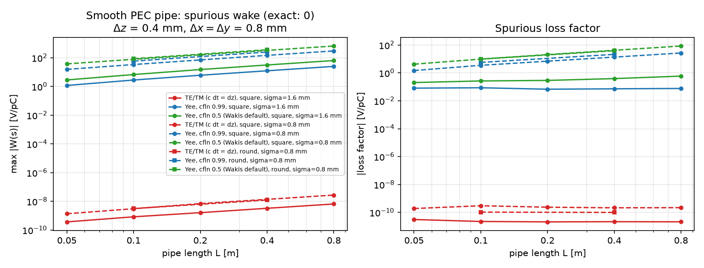

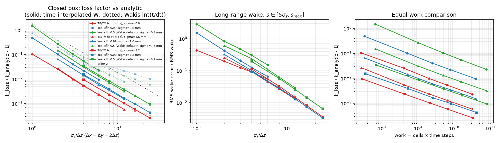

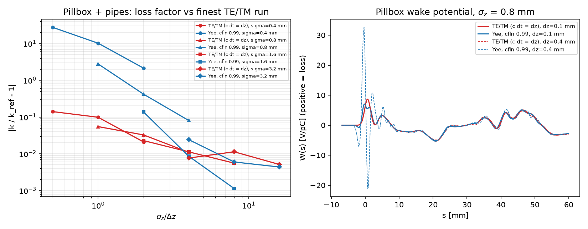

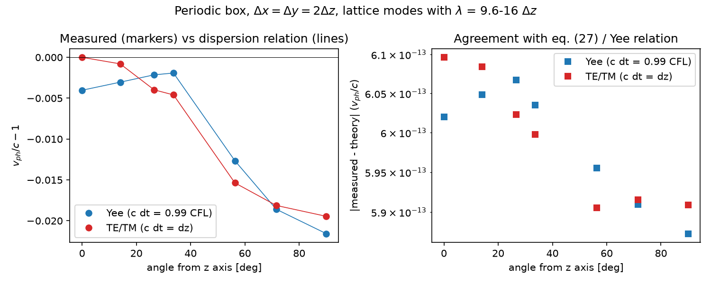

#### Limits and failure modes

- **Only the $`z`$ direction is dispersion-free.** Off-axis waves have
  dispersion comparable to Yee (larger between ~30° and 60° on
  $`\Delta x=2\Delta z`$; see `figures/dispersion_vs_angle.png`). Cavity modes
  and transverse resonances keep a second-order error in the transverse
  cell size.
- **Magic step requires $`\Delta z\le(\Delta x^{-2}+\Delta y^{-2})^{-1/2}`$**
  and a uniform $`\Delta z`$ (with a graded $`z`$ mesh the step is set by the
  smallest $`\Delta z`$ and only those cells are dispersion-free). If the
  transverse limit is smaller, the solver refuses the magic step; with an
  explicit smaller `dt` the scheme runs with longitudinal dispersion
  ($`v_{ph}<c`$, like Yee but smaller).
- **Periodic $`z`$ with an even number of cells**: the Nyquist mode
  $`k_z\Delta z=\pi`$ is a double root of the amplification polynomial at
  $`c\Delta t=\Delta z`$, so its amplitude can grow linearly (not
  exponentially) if excited (random initial fields); smooth bunches excite it
  only at round-off level.
- **Conformal grids** change the x/y face areas and the merging rule for the
  TE/TM run (see above), so Yee and TE/TM runs on the same conformal grid do
  not share exactly the same geometry model; transverse small-cell limits
  can still forbid the magic step on coarse transverse meshes.
- **Not supported** (raise `NotImplementedError`): CPML on x/y faces, PML,
  Mur ABC, SIBC, dispersive (ADE) materials, tensor averaging
  (`conformal='tensor'`), lumped elements, magnetic current sources,
  plane-wave TFSF without CPML, design gradients (`AdjointSimulation`), and
  the TE/TM adjoint with MPI. MPI forward runs are supported (z slabs, two
  ghost exchanges per step, equal to the serial run to $`10^{-10}`$).
- **Conductivity** ($`\sigma>0`$) is treated explicitly as in the Yee path
  ($`j=\sigma e`$ at the start of each sub-update); first order in time, and
  the conductivity time-constant check of the solver may lower $`\Delta t`$
  below the magic step (a warning is printed).
- **Time levels**: $`e_x,e_y,h_z`$ are stored half a step later than with Yee;
  field monitors that mix components see this half-step offset.
- **Wakis post-processing** samples $`E_z(z,t)`$ with `int(ts/dt)`
  (truncation); at $`c\Delta t=\Delta z`$ the sampling instants fall on the
  grid exactly, so round-off can shift a sample by one step for both schemes.

### 🌀 Linear plasma wakefield in a plasma-filled pipe

A rigid bunch that crosses a plasma displaces the plasma electrons, which then oscillate at the plasma frequency behind it: a plasma wakefield [Chen et al., 1985]. In the linear regime this is an ordinary dispersive-medium wakefield problem, so Wakis can compute it with the beam source of the wake solver and a Drude material (`wakis.plasma`, example `examples/007_linear_plasma_wakefield.py`, test `tests/test_037_plasma_wake.py`).

**Plasma model.** A cold, collisionless, unmagnetized electron fluid with immobile ions, linearized around the uniform density $`n_p`$, carries the current $`\partial_t \mathbf J_p = \varepsilon_0\omega_p^2\mathbf E - \nu \mathbf J_p`$ with $`\omega_p = \sqrt{n_p e^2/(\varepsilon_0 m_e)}`$ (`plasma_frequency(n)`), i.e. the Drude permittivity $`\varepsilon(\omega) = 1 - \omega_p^2/(\omega^2 - i\nu\omega)`$ of Section *Dispersive materials*. `cold_plasma(omega_p, collision_rate=0)` returns this `DispersiveMaterial`; its ADE is exactly the linearized fluid momentum equation, integrated with the scheme and stability limit given there ($`(\omega_p\Delta t/2)^2 + C^2 \le 1`$).

**Linear wake of a rigid bunch.** Let a bunch with line density $`\lambda(\xi)`$ (charge $`q = \int\lambda\,d\xi`$) move at $`v = c`$ along $`z`$ at the transverse position $`\mathbf r_0`$ inside a perfectly conducting circular pipe of radius $`a`$ filled with plasma; all fields depend on $`\mathbf r_\perp`$ and $`\xi = z - ct`$. With $`e^{i(kz - \omega t)}`$, $`\omega = kc`$, Maxwell's equations with $`\nabla\cdot(\varepsilon\mathbf E) = \rho_b/\varepsilon_0`$ give for $`E_z`$ (a short Wakis derivation of the result of [Keinigs & Jones, 1987], whose unbounded-plasma form is also reviewed in [Esarey et al., 2009])

```math
\left(\nabla_\perp^2 - k_p^2\right)\tilde E_z = \frac{i k\, k_p^2}{k^2 - k_p^2}\,\frac{\tilde\lambda(k)\,\delta(\mathbf r_\perp - \mathbf r_0)}{\varepsilon_0},
\qquad k_p = \frac{\omega_p}{c},
```

because $`\partial_z^2 + \varepsilon\,\omega^2/c^2 = -k_p^2`$ for every $`k`$ when $`v = c`$. The transverse Green function with $`g = 0`$ on the wall, $`(\nabla_\perp^2 - k_p^2) g = -2\pi\delta(\mathbf r_\perp - \mathbf r_0)`$, follows from Graf's addition theorem for $`K_0`$ [DLMF §10.44(ii)]:

```math
g(\mathbf r_\perp;\mathbf r_0) = K_0(k_p|\mathbf r_\perp - \mathbf r_0|) - \sum_{m\ge0} \epsilon_m \cos m(\phi-\phi_0)\, \frac{K_m(k_p a)}{I_m(k_p a)}\, I_m(k_p r_0)\, I_m(k_p r),
\qquad \epsilon_0 = 1,\ \epsilon_{m>0} = 2
```

(`pipe_green_function`; $`g = K_0`$ for $`a\to\infty`$). Inverting the Fourier transform with the causal prescription $`\omega \to \omega + i0`$ (poles at $`k = \pm k_p`$ below the real axis, so nothing ahead of the bunch) gives

```math
E_z(\mathbf r_\perp, \xi) = -\frac{k_p^2\, g}{2\pi\varepsilon_0}\int_\xi^\infty \lambda(\xi')\cos k_p(\xi - \xi')\,d\xi' ,
```

and Faraday's law, $`\partial_\xi(E_x - cB_y) = \partial_x E_z`$ (Panofsky–Wenzel for $`v=c`$), gives the transverse force per unit charge on a test particle moving at $`c`$,

```math
\mathbf F_\perp = \mathbf E_\perp + c\,\hat{\mathbf z}\times\mathbf B = \frac{k_p\,\nabla_\perp g}{2\pi\varepsilon_0}\int_\xi^\infty \lambda(\xi')\sin k_p(\xi' - \xi)\,d\xi' .
```

For a Gaussian bunch centred at $`\xi = 0`$ both integrals are closed-form, $`\int_\xi^\infty\lambda e^{-ik_p\xi'}d\xi' = \tfrac q2 e^{-k_p^2\sigma_z^2/2}\operatorname{erfc}\!\big((\xi + ik_p\sigma_z^2)/\sqrt2\sigma_z\big)`$ (`linear_wake`). Far behind the bunch the wake is an undamped cosine,

```math
E_z \to -\frac{q\,k_p^2\, g}{2\pi\varepsilon_0}\, e^{-k_p^2\sigma_z^2/2}\cos k_p\xi ,
```

(`wake_amplitude`). For a given bunch length and a density scan at fixed $`k_p a`$, $`k_p r`$, the amplitude $`\propto (k_p\sigma_z)^2 e^{-k_p^2\sigma_z^2/2}`$ is maximal at $`k_p\sigma_z = \sqrt2`$ [Esarey et al., 2009]. A positive bunch is decelerated ($`E_z<0`$ at its centre). In impedance language the point-charge wake per unit length is that of an undamped resonator at $`\omega_p`$ (a Wakis restatement): $`w'_\parallel(\xi) = (k_p^2 g/2\pi\varepsilon_0)\cos k_p\xi`$ behind the charge, i.e. $`R'/Q = Z_0 k_p g/(2\pi)`$ per unit length, with $`\operatorname{Re}Z_\parallel'(\omega)`$ a delta function at $`\omega_p`$ for an infinitely long pipe.

**Simulation setup and discretization.** `Beam` drives a line current $`J_z`$ in one column of grid nodes, so the simulated field is the response of the lattice transverse operator: it is singular on the beam line and differs from $`K_0`$ by $`O(h^2/r^2)`$ near it; compare at $`r \gtrsim a/4`$ or at fixed physical radii under refinement. The pipe is a vacuum STL cylinder in a PEC background (`bg='pec'`, `GridFIT3D(conformal='pec')` for cut-cell walls) and the plasma is added to every open edge with `solver.add_dispersive_material(cold_plasma(omega_p), center, size)` (box faces placed between E samples so that no edge is half-filled). Two transients must be kept out of the comparison window:
* *entrance*: a bunch with $`v=c`$ emerging from the PEC end wall into vacuum does not radiate, but at the vacuum–plasma boundary its unscreened field reorganizes into the screened one and emits transition radiation in TM modes of the plasma-filled pipe (cut-off $`\sqrt{\omega_p^2 + (c\,j_{0n}/a)^2}`$). These travel with group velocity $`<c`$ and fall behind the bunch as it advances; at a distance $`D`$ from the entrance only frequencies $`\omega \gtrsim \omega_c\sqrt{D/2|\xi|}`$ arrive within $`|\xi|`$ of the bunch, and they are suppressed by the bunch spectrum. Short bunches have more spectrum above cut-off and are the worst case: for $`k_p\sigma_z = 0.5`$ and a window of $`3\lambda_p`$, a 12 $`\lambda_p`$ pipe shows 8–17 % RMS deviation, 24 and 36 $`\lambda_p`$ pipes about 2 %, and the residual is a chirped transient that starts at $`\xi\approx-2\lambda_p`$ (over $`2\lambda_p`$ behind the bunch the deviation is 0.4–0.6 % at 48 cells per $`\lambda_p`$, but 2.3 % at 32 cells per $`\lambda_p`$, where the transient reaches closer to the bunch; see `docs/img/plasma_wake_ez.png`). The tests use a vacuum entrance of one $`\lambda_p`$, $`D \ge 15\lambda_p`$ and windows of 2–3 $`\lambda_p`$. An adiabatic density up-ramp (2 $`\lambda_p`$) did not reduce the transient.
* *exit*: stop when the bunch is about one $`\lambda_p`$ before the exit wall; nothing propagates ahead of a bunch moving at $`c`$.
The field is then read along $`z`$ at one time, $`\xi = z - z_\mathrm{bunch}(t)`$ with $`z_\mathrm{bunch} = z_\min + c(t - t_i)`$ (`Beam.ti`), $`E_z`$ on the $`z`$ midpoints at $`t^{n+1}`$ and $`H`$ half a step earlier. The Drude ADE shifts the oscillation frequency to $`2\arcsin(\omega_p\Delta t/2)/\Delta t`$ and the grid dispersion changes the effective $`k_p`$ by $`O((k_p h)^2)`$; both are below $`10^{-3}`$ at 20 cells per $`\lambda_p`$.

**Validation** (`tests/test_037_plasma_wake.py`, $`k_p a = 2`$, $`\lambda_p = 1`$ mm, cubic cells; slow cases run on an NVIDIA L4):

Errors of $`E_z(\xi)`$ behind an on-axis bunch, $`k_p\sigma_z = 1`$, 24 $`\lambda_p`$ pipe, window $`-3\lambda_p<\xi<-3\sigma_z`$: relative error of the fitted amplitude of $`A\cos(k\xi+\phi)`$ (the wavenumber error is $`\le 2\times10^{-4}`$ in all runs, decreasing with $`h`$):

| cells per $`\lambda_p`$ (per $`a`$) | staircase $`r\approx a/2`$ | staircase $`r\approx 3a/4`$ | conformal $`r\approx a/4`$ | conformal $`r\approx a/2`$ | conformal $`r\approx 3a/4`$ |
|---|---|---|---|---|---|
| 24 (7.6) | +4.9 % | +16.8 % | +2.1 % | +0.73 % | +0.26 % |
| 32 (10.2) | +2.5 % | +10.1 % | +1.0 % | +0.40 % | +0.54 % |
| 48 (15.3) | +2.3 % | +5.7 % | +0.47 % | +0.15 % | +0.11 % |
| 64 (20.4) | +1.3 % | +4.5 % | +0.26 % | +0.08 % | +0.05 % |

The staircased wall converges at first order (effective radius error $`\sim h`$, largest near the wall); with conformal PEC the error converges at second order and is dominated near the beam line by the lattice Green function ($`r = a/4`$ is only 2–5 cells). At 48 cells per $`\lambda_p`$ with conformal walls, $`k_p\sigma_z = 0.5,\ \sqrt2,\ 2`$ give amplitude errors of 0.1–0.7 % and RMS deviations of 0.1–0.6 % over two plasma periods; the wake is undamped as predicted. For an offset bunch ($`x_0 = \lambda_p/8`$), $`F_x = E_x - cB_y`$ at 6.5 cells on either side agrees to 0.8 % (48 cells per $`\lambda_p`$; at $`\lambda_p/16`$ from the beam: 5.4 %, 2.9 %, 1.6 % at 32, 48, 64 cells per $`\lambda_p`$). The CI test (20 cells per $`\lambda_p`$, < 15 s on a laptop CPU) checks 2.5 % in amplitude at $`a/2`$ and the staircase–conformal difference near the wall.


**Limits.** The model is the *linear, cold, rigid-beam* response: (i) linear plasma response, valid when the perturbed density is small, $`|\delta n| \ll n_p`$ (for a narrow bunch this requires a bunch density well below $`n_p`$ over the plasma skin depth); the results scale linearly with $`q`$; (ii) cold plasma: no thermal pressure, so the wake does not propagate and has no Landau damping (add $`\nu>0`$ for collisional damping); (iii) immobile ions, valid for times short compared with the ion plasma period; (iv) a rigid bunch at exactly $`v = c`$ (`Beam(beta=1)`, the default; the formulas above assume $`v=c`$): no beam evolution, no self-modulation, hosing, or beam loading by a witness bunch (other than as an additional prescribed source). The nonlinear blowout regime ($`n_b \gtrsim n_p`$, electron cavitation, wave breaking) needs a particle-in-cell or quasi-static code [Esarey et al., 2009].

**Relation to proton-driven (AWAKE-type) plasma wakefields.** Proton-driven plasma wakefield acceleration was proposed by [Caldwell et al., 2009]; the AWAKE experiment at CERN drives a wake with 400 GeV SPS proton bunches in a rubidium plasma about 10 m long and has accelerated externally injected electrons up to 2 GeV [Adli et al., 2018]. The linear formula above shows why the proton bunch cannot drive the wake directly: its length is many plasma wavelengths, $`k_p\sigma_z \gg 1`$, so $`e^{-k_p^2\sigma_z^2/2}`$ cancels the wake of the smooth bunch. AWAKE therefore relies on the seeded self-modulation of the long bunch into micro-bunches spaced by $`\lambda_p`$ that drive the wake resonantly [Kumar, Pukhov & Lotov, 2010]; the growth of the resulting transverse wakefields from a seed level below 15 MV/m to above 300 MV/m was observed at plasma densities of $`2.1\times10^{14}`$ and $`7.7\times10^{14}\ \mathrm{cm^{-3}}`$ [Turner et al., 2019]. Self-modulation is an instability of a *deformable* beam and is outside this rigid-beam model; Wakis can however compute the linear wake of any *prescribed* bunch train or truncated profile with the same setup (e.g. several `Beam` sources), which is the seed and the linear drive term of that process.

References:
- P. Chen, J. M. Dawson, R. W. Huff and T. Katsouleas, "Acceleration of electrons by the interaction of a bunched electron beam with a plasma", *Phys. Rev. Lett.* **54**, 693–696 (1985), [doi:10.1103/PhysRevLett.54.693](https://doi.org/10.1103/PhysRevLett.54.693).
- R. Keinigs and M. E. Jones, "Two-dimensional dynamics of the plasma wakefield accelerator", *Phys. Fluids* **30**, 252–263 (1987).
- E. Esarey, C. B. Schroeder and W. P. Leemans, "Physics of laser-driven plasma-based electron accelerators", *Rev. Mod. Phys.* **81**, 1229–1285 (2009), [doi:10.1103/RevModPhys.81.1229](https://doi.org/10.1103/RevModPhys.81.1229).
- NIST Digital Library of Mathematical Functions, §10.44(ii), Addition theorems for modified Bessel functions, [dlmf.nist.gov/10.44](https://dlmf.nist.gov/10.44).
- A. Caldwell, K. Lotov, A. Pukhov and F. Simon, "Proton-driven plasma-wakefield acceleration", *Nature Phys.* **5**, 363–367 (2009).
- N. Kumar, A. Pukhov and K. Lotov, "Self-modulation instability of a long proton bunch in plasmas", *Phys. Rev. Lett.* **104**, 255003 (2010), [doi:10.1103/PhysRevLett.104.255003](https://doi.org/10.1103/PhysRevLett.104.255003).
- E. Adli et al. (AWAKE Collaboration), "Acceleration of electrons in the plasma wakefield of a proton bunch", *Nature* **561**, 363–367 (2018), [doi:10.1038/s41586-018-0485-4](https://doi.org/10.1038/s41586-018-0485-4).
- M. Turner et al. (AWAKE Collaboration), "Experimental observation of plasma wakefield growth driven by the seeded self-modulation of a proton bunch", *Phys. Rev. Lett.* **122**, 054801 (2019), [doi:10.1103/PhysRevLett.122.054801](https://doi.org/10.1103/PhysRevLett.122.054801).


### Thin sheets (surface conductivity)

A conducting or dispersive film of thickness $`t`$ much smaller than the grid spacing can be modelled as a zero-thickness surface carrying a tangential surface current density $`\mathbf{J}_s(\omega) = \sigma_s(\omega)\,\mathbf{E}_t`$ [A/m], across which the tangential electric field is continuous and the tangential magnetic field jumps by $`\hat{\mathbf{n}} \times (\mathbf{H}^+ - \mathbf{H}^-) = \mathbf{J}_s`$ (`wakis.subcell`, `solver.add_sheet`, `SheetMaterial`, `resistive_sheet`, `graphene_sheet`, `metal_sheet`, example `examples/010_thin_sheets_and_wires.py`, test `tests/test_058_thin_sheets_and_wires.py`).

**FIT integral derivation.** Consider a sheet lying on an axis-aligned primary grid plane $`w = w_{k_0}`$ (for instance $`z = z_{k_0}`$, with tangential coordinates $`(u, v) = (x, y)`$). Every tangential primary electric edge $`e`$ on that plane (say an $`E_u`$ edge along $`\Delta u_i`$ at node $`(v_j, w_{k_0})`$) is pierced orthogonally by the dual facet $`\tilde{A}_e = \tilde{L}_{v,j}\,\tilde{L}_{w,k_0}`$. In the Finite Integration Technique, Ampère's law integrated over $`\tilde{A}_e`$ is

```math
\oint_{\partial \tilde{A}_e} \mathbf{H}\cdot d\tilde{\mathbf{s}}
= \frac{d}{dt}\int_{\tilde{A}_e} \mathbf{D}\cdot d\tilde{\mathbf{A}}
+ \int_{\tilde{A}_e} \mathbf{J}_s\,\delta(w - w_{k_0})\cdot d\tilde{\mathbf{A}} .
```

The intersection of the sheet $`w = w_{k_0}`$ with the dual facet $`\tilde{A}_e`$ is the in-plane dual edge of length $`\tilde{L}_{\text{in-plane},e} = \tilde{L}_{v,j}`$ (weighted by the subcell coverage fraction $`f_e \in [0, 1]`$ when the sheet patch covers only a fraction of $`\Delta u_i \times \tilde{L}_{v,j}`$). Integrating the Dirac delta across the normal dual edge $`\tilde{L}_{w,k_0}`$ therefore yields the total sheet current through $`\tilde{A}_e`$:

```math
I_{s,e} = \sigma_s\,E_e\,\left(f_e\,\tilde{L}_{\text{in-plane},e}\right) .
```

Dividing Ampère's integral equation by the dual facet area $`\tilde{A}_e = \tilde{L}_{\text{in-plane},e}\,\tilde{L}_{\perp,e}`$ (which Wakis applies via the diagonal inverse dual area matrix `itDa`) gives the sheet current density term in the point-form $`E_e`$ update:

```math
\frac{I_{s,e}}{\tilde{A}_e}
= \sigma_s\,E_e\,\underbrace{\left(f_e\,\tilde{L}_{\text{in-plane},e}\,\mathrm{itA}_e\right)}_{w_e = f_e / \tilde{L}_{\perp,e}} ,
```

where $`\tilde{L}_{\perp,e} = \tilde{L}_{w,k_0} = \tfrac{1}{2}(\Delta w_{k_0-1} + \Delta w_{k_0})`$ is the dual-edge length crossing the sheet. `solver.add_sheet` computes $`w_e = f_e\,\tilde{L}_{\text{in-plane},e}\,\mathrm{itA}_e`$ directly from `grid.tL` and `grid.itA` and registers the edges as a zero-thickness ADE group (`_register_sheet_group`) whose semi-implicit Crank–Nicolson update is unconditionally passive for any $`\sigma_s \ge 0`$ without reducing the Courant time step.

**Equivalence with the $`\sigma = \sigma_s / \Delta`$ volume shortcut and where the shortcut fails.**
- *When they coincide:* For a full tangential edge ($`f_e = 1`$) lying on a grid plane $`w = w_{k_0}`$ of a **uniform** grid ($`\Delta w_{k_0-1} = \Delta w_{k_0} = \Delta_\perp`$), the dual-edge length crossing the sheet is $`\tilde{L}_{\perp,e} = \Delta_\perp`$, so $`w_e\,\sigma_s = \sigma_s / \Delta_\perp`$ is algebraically identical to assigning a volumetric conductivity $`\sigma = \sigma_s / \Delta_\perp`$ to those tangential edges.
- *Where the volume shortcut fails:*
  1. **Non-uniform meshes:** When $`\Delta w_{k_0-1} \ne \Delta w_{k_0}`$, the dual facet area is $`\tilde{A}_e = \tilde{L}_{\text{in-plane},e}\,\tilde{L}_{w,k_0}`$ with $`\tilde{L}_{w,k_0} = \tfrac{1}{2}(\Delta w_{k_0-1} + \Delta w_{k_0})`$. Replacing $`1/\tilde{L}_{w,k_0}`$ by $`1/\Delta w_{k_0}`$ (single-cell volume thickness) introduces an $`O(\Delta w_{k_0} / \tilde{L}_{w,k_0} - 1)`$ error in the sheet conductance (`test_resistive_sheet_transmission_reflection`).
  2. **Edges not in the sheet plane (normal $`E_\perp`$ edges):** A voxelized slab of thickness $`\Delta_\perp`$ and isotropic bulk conductivity $`\sigma = \sigma_s/\Delta_\perp`$ also damps the normal electric field components $`E_w`$ crossing the slab, whereas a physical zero-thickness sheet carries only tangential surface current $`\mathbf{J}_s = \sigma_s \mathbf{E}_t`$ and leaves $`E_w`$ unperturbed.
  3. **Off-grid or tilted sheets:** If a sheet at $`w_0 \notin \{w_k\}`$ is distributed onto the two adjacent planes $`w_{k_0}`$ and $`w_{k_0+1}`$, those planes are separated by $`\Delta w_{k_0}`$ and form an artificial Fabry–Pérot interferometer with an $`O((k\Delta w)^2)`$ phase error (and staircasing dispersion if tilted across axes). Exactness requires that the sheet lie on a primary grid plane (use `GridFIT3D(..., snap_points=...)` to snap a grid plane to $`w_0`$, or use the unstructured/conformal solvers for curved surfaces).

**Supported sheet models (`wakis.subcell`).**
1. **Constant resistive sheet and PEC limit:** `resistive_sheet(sigma_s=..., R_s=...)` sets a constant sheet conductivity $`\sigma_s = 1/R_s`$ [S] ($`R_s`$ in $`\Omega/\text{sq}`$). Passing `sigma_s='pec'` or `sigma_s=np.inf` takes the $`\sigma_s \to \infty`$ limit by zeroing `ieps` and `E` on the tangential sheet edges and scaling the corresponding rows of `itDaiDepsDstC`, which reproduces an explicit PEC plate to machine precision (`test_pec_sheet_matches_pec_plate_to_roundoff`).
2. **Dispersive $`\sigma_s(\omega)`$ and graphene intraband Drude model:** `SheetMaterial(poles, sigma_s, chi_s_inf)` represents any sum of `Drude`, `Lorentz`, and `Debye` surface susceptibility poles $`\chi_s(\omega) = \sigma_{s,\text{disp}}(\omega)/(j\omega\varepsilon_0)`$ [m] integrated via the surface ADE of `wakis.dispersive`. For doped monolayer graphene at chemical potential $`E_F`$ [eV], temperature $`T`$ [K], and relaxation time $`\tau = 1/\gamma`$ [s], the Kubo intraband weight is
   ```math
   D = \frac{2 e^2 k_B T}{\pi\hbar^2}\ln\!\left[2\cosh\!\left(\frac{|E_F|}{2 k_B T}\right)\right]
   \xrightarrow{|E_F|\gg k_B T} \frac{e^2 |E_F|}{\pi\hbar^2},
   ```
   giving the Drude surface conductivity (`graphene_sheet(E_F, tau, T)`):
   - in Wakis's engineering phasor convention $`\exp(+j\omega t)`$ ($`\partial_t \leftrightarrow +j\omega`$):
     ```math
     \sigma_s^{(+)}(\omega) = \frac{D}{\gamma + j\omega} = \frac{-j\,e^2 |E_F|}{\pi\hbar^2(\omega - j/\tau)} ,
     ```
   - in the physics convention $`\exp(-i\omega t)`$ ($`\partial_t \leftrightarrow -i\omega`$):
     ```math
     \sigma_s^{(-)}(\omega) = \frac{D}{\gamma - i\omega} = \frac{i\,e^2 |E_F|}{\pi\hbar^2(\omega + i/\tau)} = \left[\sigma_s^{(+)}(\omega)\right]^* .
     ```
   Both conventions satisfy passivity, $`\operatorname{Re}\sigma_s(\omega) \ge 0`$.
3. **Thin metal traces ($`t \ll \delta`$ vs $`t \gg \delta`$):** `metal_sheet(sigma, thickness, mode='auto', f0=..., f_range=..., n_poles=3)` supports two physical regimes:
   - *Electrically thin trace ($`t \ll \delta`$, `mode='thin'`):* uniform current across the thickness, constant sheet resistance $`R_s = 1/(\sigma t)`$ ($`\sigma_s = \sigma t`$).
   - *Thick skin-effect regime ($`t \gg \delta`$, `mode='sibc'`):* Leontovich surface impedance
     ```math
     Z_s(\omega) = \frac{1 + j}{\sigma\,\delta(\omega)} = \sqrt{\frac{j\omega\mu_0\mu_r}{\sigma}},
     \qquad \delta(\omega) = \sqrt{\frac{2}{\omega\mu_0\mu_r\sigma}},
     \qquad \sigma_s(\omega) = \frac{1}{Z_s(\omega)} = \sqrt{\frac{\sigma}{j\omega\mu_0\mu_r}} .
     ```
     Because $`\sigma_s(\omega) \propto (j\omega)^{-1/2}`$ has a branch cut rather than a single rational pole, two passive Drude realizations are provided:
     - **Narrowband (`n_poles=1` at centre frequency $`f_0`$):** a single Drude pole with $`\gamma = \omega_0 = 2\pi f_0`$ and $`\sigma_{s,0} = \sigma\,\delta(\omega_0)`$, which matches $`\sigma_s(\omega_0) = \tfrac{1}{2}(1-j)\sigma\delta(\omega_0)`$ and $`Z_s(\omega_0)`$ **exactly** at $`f_0`$ and remains within $`5\%`$ in $`|Z_s|`$ over the $`\approx 30\%`$ fractional band $`[0.85 f_0,\,1.15 f_0]`$.
     - **Wideband (`n_poles=N` over `f_range=(fmin, fmax)`):** a Gauss–Legendre Stieltjes quadrature of the branch-cut integral $`(j\omega)^{-1/2} = \frac{2}{\pi}\int_0^\infty \frac{du}{u^2 + j\omega}`$ refined by non-negative log-least-squares over $`[f_{\min}, f_{\max}]`$. Every pole has $`\gamma_k > 0`$ and $`\omega_{p,k}^2 > 0`$ (strictly passive for all $`\omega`$), achieving $`< 2.5\%`$ relative error in $`Z_s(\omega)`$ across a $`3:1`$ frequency band with $`N = 3`$ poles (`test_metal_sheet_thin_and_sibc`).

**Validation** (`tests/test_058_thin_sheets_and_wires.py`, `examples/010_thin_sheets_and_wires.py`):
- *Free-space resistive sheet:* normal-incidence $`|t(f)|`$, $`T(f)`$, $`R(f)`$, and absorption $`A(f) = 1 - R - T`$ match $`t = 1/(1 + \eta_0\sigma_s/2)`$ and $`r = -(\eta_0\sigma_s/2)/(1 + \eta_0\sigma_s/2)`$ to $`< 0.8\%`$ in amplitude and $`< 1.5\%`$ in power for $`\eta_0\sigma_s \in \{0.5, 2, 4\}`$, including on a non-uniform mesh where $`\tilde{L}_{z,k_0} = 1.4\,\Delta z_0 \ne \Delta z_{k_0} = 1.7\,\Delta z_0`$ (where the naive uniform-grid shortcut $`\sigma_s/\Delta z_0`$ fails by $`> 25\%`$).
- *Salisbury screen:* a $`R_s = \eta_0 = 376.73\ \Omega/\text{sq}`$ sheet placed $`d = \lambda_0/4`$ in front of a PEC wall gives $`R(f_0) = 1.37\times 10^{-4}`$ at $`f_0 = 3\text{ GHz}`$ and matches $`R_{\text{analytic}}(f) = |\cot(kd)/(\cot(kd) - 2j)|^2`$ across $`1.5`$–$`4.5\text{ GHz}`$ (`max |dR| = 2.7e-2`); mutating the dual-edge length factor by $`2\times`$ spoils the impedance match to $`R(f_0) = 0.111`$.
- *Graphene Drude sheet:* time-domain FIT $`T(f)`$ and $`R(f)`$ match the analytic Drude sheet formulas to $`< 1.5\%`$ across the band while satisfying $`R(f) + T(f) < 1`$.

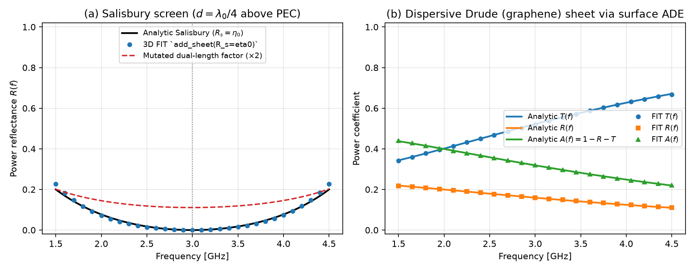

**Limits & failure modes.**
- *Axis-aligned grid plane required for zero-thickness exactness.* If `position` does not coincide with a primary grid node along the normal axis, `add_sheet` emits a `UserWarning` and snaps to the nearest grid plane $`w_{k_0}`$ ($`O(\Delta_\perp)`$ position shift). Use `GridFIT3D(..., snap_points=...)` to place a grid plane at the exact sheet coordinate.
- *High-frequency Drude plasma stability.* While pure ohmic sheet conductivity $`\sigma_s`$ and Debye poles are unconditionally stable under Crank–Nicolson averaging, explicit second-order Drude/Lorentz poles require $`\omega_{p,\text{eff}}\Delta t = (\omega_{p,s}/\sqrt{\tilde{L}_\perp})\Delta t < 2\sqrt{1 - C^2}`$; `add_sheet` checks this via `_check_dispersive_stable` and raises `ValueError` if a smaller `dt` or `cfln` is needed.
- *Skin-effect SIBC band of validity.* The 1-pole narrowband model (`n_poles=1`) has $`|Z_s| \propto \omega^{-1}`$ for $`\omega \gg \omega_0`$ and $`\text{const}`$ for $`\omega \ll \omega_0`$, so it is accurate to $`< 5\%`$ only within $`\approx \pm 15\%`$ of $`f_0`$; for broadband pulses use `f_range=(fmin, fmax)` with `n_poles >= 3`. Within the $`\mathbf{J}_s = \sigma_s \mathbf{E}_t`$ sheet topology, a thin metal trace carries the sum of the top and bottom surface currents (symmetric shunt admittance) without blocking direct transmission through the sheet plane; modelling an opaque finite-thickness shield requires either two sheets separated by a PEC core or `sigma_s='pec'`.


### Thin wires

A straight or bent wire of radius $`a \ll \Delta_\perp`$ running along primary grid edges has radial electric and azimuthal magnetic fields that vary as $`1/\rho`$ inside the four cells surrounding the wire:

```math
H_\phi(\rho) \simeq \frac{I}{2\pi\rho}, \qquad
E_\rho(\rho) \simeq \frac{q'}{2\pi\varepsilon\,\rho}, \qquad
a \le \rho \lesssim \Delta_\perp .
```

Simply setting $`E_z = 0`$ on the wire edges ignores the $`\ln(\Delta_\perp/a)`$ magnetic flux and radial electric voltage stored between $`\rho = a`$ and $`\rho = \Delta_\perp/2`$, making the simulated wire behave as if it had an effective radius $`a_{\text{eff}} \approx 0.20\,\Delta_\perp`$ independent of $`a`$ (`wakis.subcell`, `solver.add_thin_wire`, example `examples/010_thin_sheets_and_wires.py`, test `tests/test_058_thin_sheets_and_wires.py`).

**Contour-path / in-cell inductance derivation and symmetric FIT Hodge form.** Consider a wire segment along the $`z`$ axis at transverse node $`(x_i, y_j)`$ with radius $`a < \tfrac{1}{2}\min(\Delta x, \Delta y)`$. Integrating Faraday's law over the primary face $`A_{y;i,j,k} = [x_i, x_{i+1}] \times [z_k, z_{k+1}]`$ with $`E_z(x_i, y_j, z) = 0`$ on the wire surface $`\rho = a`$ gives [Umashankar, Beker & Taflove, 1987; Taflove & Hagness, Ch. 10]:

```math
\mu\,\frac{\partial}{\partial t}\int_a^{\Delta x}\! H_y(\rho)\,\Delta z\,d\rho
= \Delta z\,\big[E_z(\Delta x) - 0\big] + \int_a^{\Delta x}\!\big[E_x(z_k) - E_x(z_{k+1})\big]\,d\rho .
```

Substituting the quasi-static profile $`H_y(\rho) = H_y(\Delta x/2)\,\frac{\Delta x/2}{\rho}`$ into the flux integral yields

```math
\int_a^{\Delta x}\! H_y(\rho)\,d\rho
= H_y(\Delta x/2)\,\frac{\Delta x}{2}\ln\!\left(\frac{\Delta x}{a}\right)
= m_x\,\Delta x\,H_y(\Delta x/2),
\qquad
m_x = \frac{1}{2}\ln\!\left(\frac{\Delta x}{a}\right) .
```

In FIT operator language [Noda & Yokoyama, 2002], this contour-path integral is equivalent to multiplying the permeability on the four circulating magnetic faces around each wire segment ($`H_u(i, j, k)`$, $`H_u(i, j-1, k)`$, $`H_v(i, j, k)`$, $`H_v(i-1, j, k)`$) by $`m = \tfrac{1}{2}\ln(\Delta_\perp/a)`$, i.e. scaling their inverse permeability entries in `imu` (and the corresponding rows of `tDsiDmuiDaC`) by

```math
\mathrm{imu}_{\text{loop}} \;\leftarrow\; \frac{\mathrm{imu}_{\text{loop}}}{m},
\qquad
m = \frac{1}{2}\ln\!\left(\frac{\Delta_\perp}{a}\right) .
```

Similarly, integrating Gauss's law / the radial voltage $`\int_a^{\Delta_\perp} E_\rho(\rho)\,d\rho = m\,\Delta_\perp\,E_\rho(\Delta_\perp/2)`$ along the non-wire primary $`\mathbf{E}`$ edges incident to a wire node of degree $`d`$ ($`d = 2`$ at interior and $`90^\circ`$-bend nodes, $`d = 1`$ at wire ends where the axial fringe field enhances the tip capacitance by a factor of 2, and $`d \ge 3`$ at multi-wire junctions) scales their inverse permittivity `ieps` by [Noda & Yokoyama, 2002; Railton & Holland, 1990]

```math
\mathrm{ieps}_{\text{node}} \;\leftarrow\; w_{\text{node}}\,\mathrm{ieps}_{\text{node}},
\qquad
w_{\text{node}} = \frac{2}{d}\,m = \frac{1}{d}\ln\!\left(\frac{\Delta_\perp}{a}\right) .
```

To prevent the increased `ieps` at wire ends ($`d = 1`$, where $`w_{\text{node}} = 2m > m`$) from raising the local numerical wave speed above $`c_0`$ and violating the vacuum Courant limit, the four magnetic faces containing each scaled node edge have their `imu` bounded by $`\mathrm{imu} \leftarrow \min(\mathrm{imu},\,\mathrm{imu}_0 / w_{\text{node}})`$, so $`(\mu_{\text{eff}}\varepsilon_{\text{eff}})^{-1/2} \le c_0`$ everywhere and the standard solver time step $`\Delta t`$ stays stable without reduction.

**Lossy wires and lumped/delta-gap feeds.**
- *PEC vs lossy wire segments:* On active wire segments, `material='pec'` sets `ieps = 0` and `E = 0`. Passing `sigma` [S/m] or `R_per_m` [$`\Omega`$/m] (`R_per_m = 1 / (pi * a**2 * sigma)`) registers a semi-implicit conductive ADE update with weight $`\mathrm{itA}_e`$ and conductance per unit length $`G' = 1 / R_{\text{per\_m}}`$ [S$`\cdot`$m], which adds the wire resistance $`R\,\Delta z = R'\,\Delta z`$ in parallel with the cell capacitance while keeping the $`\ln(\Delta_\perp/a)`$ magnetic inductance around the wire.
- *Delta-gap / lumped feeds (`wakis.lumped`):* A `LumpedPort` or `LumpedElement` placed on a wire segment (either passed via `gap=port` in `solver.add_thin_wire` or attached automatically when `port._set_edges(solver)` runs via `solver._reopen_thin_wire_edges`) leaves `ieps` at its background value on the gap edge while preserving the thin-wire magnetic Hodge scaling $`1/m`$ on the four circulating $`\mathbf{H}`$ faces around the gap.

**Validation** (`tests/test_058_thin_sheets_and_wires.py`, `examples/010_thin_sheets_and_wires.py`):
- *Half-wave dipole input impedance vs Hallén MoM (`wakis.analytic.thin_wire.hallen_dipole`):* For a dipole of length $`L = 0.48\,\lambda_0`$ at $`f_0 = 1\text{ GHz}`$ ($`N_{\text{seg}} = 15`$, $`\Delta x = \Delta y = \Delta z = L/15`$) at two subcell radii $`a = \Delta/10`$ ($`\Omega = 2\ln(L/a) = 10.02`$) and $`a = \Delta/50`$ ($`\Omega = 13.24`$):
  - First resonance ($`\operatorname{Im}Z_{\text{in}} = 0`$): $`f_{\text{res}}(\Delta/10) = 0.9800\text{ GHz}`$ (Hallén MoM: $`0.9700\text{ GHz}`$, $`1.0\%`$ diff) and $`f_{\text{res}}(\Delta/50) = 0.9925\text{ GHz}`$ (Hallén MoM: $`0.9950\text{ GHz}`$, $`0.25\%`$ diff), capturing the upward resonance shift as the wire becomes thinner.
  - Input impedance at $`f_0 = 1.0\text{ GHz}`$: $`Z_{\text{FIT}}(\Delta/50) = 78.7 + 5.9j\ \Omega`$ vs Hallén MoM $`73.2 + 5.9j\ \Omega`$; reactance slope $`dX_{\text{in}}/df`$ increases by $`1.49\times`$ from $`a = \Delta/10`$ to $`a = \Delta/50`$ (MoM: $`1.45\times`$).
  - *Mutation check:* Setting `correction=False` (zeroing `ieps` on the wire without the $`\ln(\Delta/a)`$ Hodge correction) makes $`Z_{\text{in}}(f)`$ completely independent of $`a`$ ($`\|Z(\Delta/50) - Z(\Delta/10)\|_\infty = 0`$) and shifts the apparent resonance to $`0.925\text{ GHz}`$ (corresponding to the fat staircase radius $`a_{\text{eff}} \approx 0.20\,\Delta`$).
  - *Grid convergence:* Refining a fixed physical wire ($`a = 0.5\text{ mm}`$, $`L = 0.48\,\lambda_0`$) from $`N_{\text{seg}} = 9`$ to $`N_{\text{seg}} = 15`$ reduces the relative $`L^2`$ error $`\|Z_{\text{FIT}} - Z_{\text{MoM}}\|_2 / \|Z_{\text{MoM}}\|_2`$ over $`0.88`$–$`1.12\text{ GHz}`$ from $`0.172`$ to $`0.123`$.
- *Discrete energy and exact adjoint:* In a closed PEC cavity containing a lossless sheet and a PEC thin wire, the integer-time leapfrog energy invariant $`\widetilde{W}^n = \tfrac{1}{2}\langle \mathbf{E}^n, \boldsymbol{\varepsilon}\mathbf{E}^n\rangle + \tfrac{1}{2}\langle \mathbf{H}^{n-1/2}, \boldsymbol{\mu}\mathbf{H}^{n+1/2}\rangle`$ is conserved to $`< 10^{-14}`$ relative, and decays monotonically at every step when the sheet and wire are lossy (`test_energy_conservation_and_decay`). Because `add_sheet` and `add_thin_wire` modify only the linear Hodge diagonals (`ieps`, `imu`) and the linear `_dispersive_groups` ADE state, `AdjointStepper` satisfies the dot-product identity $`\langle \mathbf{U}\mathbf{x}, \mathbf{y}\rangle = \langle \mathbf{x}, \mathbf{U}^H\mathbf{y}\rangle`$ to $`\sim 10^{-15}`$ with a dispersive sheet, a thin wire, and a lumped RLC load on the wire all active simultaneously, and `AdjointSimulation.vjp` matches central finite differences ($`h = 10^{-4}`$) of a `DFTMonitor` objective with respect to a `MaterialGrid` design region next to a dispersive sheet to $`< 10^{-7}`$ relative (`test_adjoint_dot_product_and_fd_gradient`).

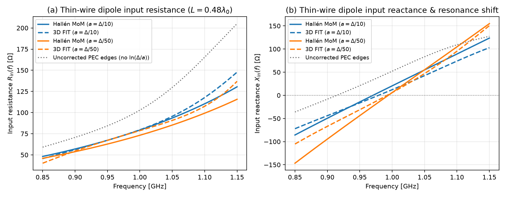

**Limits & failure modes.**
- *Radius range $`0 < a < \Delta_\perp / 2`$ (recommended $`10^{-4}\Delta_\perp \lesssim a \lesssim 0.25\,\Delta_\perp`$).* At $`a = \Delta_\perp/e^2 \approx 0.135\,\Delta_\perp`$, $`m = \tfrac{1}{2}\ln(\Delta_\perp/a) = 1`$ (the uncorrected grid-edge wire). For $`a \ge 0.5\,\Delta_\perp`$ the logarithm $`\ln(\Delta_\perp/a)`$ is non-positive or smaller than the cell half-width and `add_thin_wire` raises `ValueError`; fat wires with $`a \gtrsim 0.3\,\Delta_\perp`$ should be modelled as resolved/conformal 3D conductors instead.
- *Axis-aligned grid-edge segments only.* Each segment of `points` must lie along the $`x`$, $`y`$, or $`z`$ axis; oblique wires not aligned with grid lines require staircase approximation or an unstructured mesh.
- *Single-cell delta-gap feed capacitance.* Driving a thin wire across one grid cell of length $`\Delta z`$ imposes a gap of width $`\Delta z`$; for very fine grids ($`\Delta z \to 0`$ at fixed $`a`$), the knife-edge gap capacitance $`C_{\text{gap}} \sim \varepsilon_0 a \ln(a/\Delta z)`$ grows slowly unless the excitation is distributed over a fixed physical gap length [Taflove & Hagness, §10.4].

References:
- K. R. Umashankar, B. Beker and A. Taflove, "Calculation and experimental validation of induced currents on coupled wires in an arbitrary shaped cavity", *IEEE Trans. Antennas Propag.* **35**, 1248–1257 (1987), [doi:10.1109/TAP.1987.1144000](https://doi.org/10.1109/TAP.1987.1144000).
- A. Taflove and S. C. Hagness, *Computational Electrodynamics: The Finite-Difference Time-Domain Method*, 3rd ed., Artech House, Ch. 10 (2005).
- T. Noda and S. Yokoyama, "Thin wire representation in finite difference time domain surge simulation", *IEEE Trans. Power Del.* **17**, 840–847 (2002), [doi:10.1109/TPWRD.2002.1022813](https://doi.org/10.1109/TPWRD.2002.1022813).
- C. J. Railton and R. Holland, "The treatment of thin wires in the FDTD method", *IEEE Trans. Antennas Propag.* **38**, 1112–1119 (1990).
- G. W. Hanson, "Dyadic Green's functions and guided surface waves for a surface conductivity model of graphene", *J. Appl. Phys.* **103**, 064302 (2008), [doi:10.1063/1.2891452](https://doi.org/10.1063/1.2891452).


### Active gain media and four-level laser dynamics (`wakis.gain`)

Active optical amplifiers and lasers require coupling Maxwell's equations in the time domain to the non-equilibrium population kinetics of the gain medium so that population inversion, gain saturation, mode competition, relaxation oscillations, and spatial hole burning emerge self-consistently without linear negative-conductance blow-up. `wakis.gain` (`FourLevelGain`, `SaturableGain`, `solver.add_gain_material`, example `examples/012_fabry_perot_laser.py`, test `tests/test_063_gain_media.py`) implements two auxiliary differential equation (ADE) models coupled to `SolverFIT3D` using the same capture-before / update-after electric-field hook architecture as `wakis.dispersive`.

**Four-level two-electron atomic system (`FourLevelGain`).** Following S.-H. Chang and A. Taflove, *Opt. Express* **12**(16), 3827–3833 (2004), [doi:10.1364/OPEX.12.003827](https://doi.org/10.1364/OPEX.12.003827) [Eqs. (3)–(5); see also Nagra & York, 1998], each atom has four electronic energy levels $`E_0 < E_1 < E_2 < E_3`$ with level population densities $`N_0(\mathbf{r}, t), N_1(\mathbf{r}, t), N_2(\mathbf{r}, t), N_3(\mathbf{r}, t)`$ [m$`^{-3}`$]. Two dipole transitions are coupled to the macroscopic electric field $`\mathbf{E}(\mathbf{r}, t)`$: the lasing transition $`1 \leftrightarrow 2`$ at resonance angular frequency $`\omega_a = (E_2 - E_1)/\hbar`$ and homogeneous dephasing rate $`\gamma_a`$ [rad/s], and the optional pump transition $`0 \leftrightarrow 3`$ at $`\omega_b = (E_3 - E_0)/\hbar`$ and dephasing rate $`\gamma_b`$. Their macroscopic polarization densities $`\mathbf{P}_a`$ and $`\mathbf{P}_b`$ [C/m$`^2`$] satisfy damped harmonic oscillator equations driven by the instantaneous population differences $`(N_1 - N_2)`$ and $`(N_0 - N_3)`$:

```math
\frac{\partial^2 \mathbf{P}_a}{\partial t^2} + \gamma_a \frac{\partial \mathbf{P}_a}{\partial t} + \omega_a^2 \mathbf{P}_a = \kappa_a \big(N_1 - N_2\big)\,\mathbf{E}, \qquad
\frac{\partial^2 \mathbf{P}_b}{\partial t^2} + \gamma_b \frac{\partial \mathbf{P}_b}{\partial t} + \omega_b^2 \mathbf{P}_b = \kappa_b \big(N_0 - N_3\big)\,\mathbf{E},
```

where the classical radiative oscillator coupling constants are

```math
\kappa_a = \frac{6\pi\varepsilon_0 c^3}{\omega_a^2 \tau_{21}}, \qquad
\kappa_b = \frac{6\pi\varepsilon_0 c^3}{\omega_b^2 \tau_{30}} \qquad \left[\text{C}^2 / (\text{kg}\cdot\text{m}^3)\right].
```

The population densities evolve according to the coupled four-level rate equations with external pumping rate $`W_p`$ [s$`^{-1}`$] ($`0 \to 3`$), nonradiative/spontaneous decay lifetimes $`\tau_{32}, \tau_{30}, \tau_{21}, \tau_{10}`$ [s], and field-driven stimulated/absorption transition rates $`\frac{1}{\hbar\omega_a}\mathbf{E}\cdot\frac{\partial\mathbf{P}_a}{\partial t}`$ and $`\frac{1}{\hbar\omega_b}\mathbf{E}\cdot\frac{\partial\mathbf{P}_b}{\partial t}`$:

```math
\begin{aligned}
\frac{\partial N_3}{\partial t} &= W_p N_0 - \left(\frac{1}{\tau_{32}} + \frac{1}{\tau_{30}}\right) N_3 + \frac{1}{\hbar\omega_b}\,\mathbf{E}\cdot\frac{\partial \mathbf{P}_b}{\partial t}, \\[4pt]
\frac{\partial N_2}{\partial t} &= \frac{N_3}{\tau_{32}} - \frac{N_2}{\tau_{21}} + \frac{1}{\hbar\omega_a}\,\mathbf{E}\cdot\frac{\partial \mathbf{P}_a}{\partial t}, \\[4pt]
\frac{\partial N_1}{\partial t} &= \frac{N_2}{\tau_{21}} - \frac{N_1}{\tau_{10}} - \frac{1}{\hbar\omega_a}\,\mathbf{E}\cdot\frac{\partial \mathbf{P}_a}{\partial t}, \\[4pt]
\frac{\partial N_0}{\partial t} &= \frac{N_1}{\tau_{10}} + \frac{N_3}{\tau_{30}} - W_p N_0 - \frac{1}{\hbar\omega_b}\,\mathbf{E}\cdot\frac{\partial \mathbf{P}_b}{\partial t} .
\end{aligned}
```

When `pauli_exclusion=True` [Chang & Taflove 2004, Eqs. (5a)–(5d)], each relaxation or pumping transition $`i \to j`$ is multiplied by the Pauli blocking factor $`(1 - N_j / N_{\text{site}})`$. Summing the four rate equations gives $`\frac{\partial}{\partial t}(N_0 + N_1 + N_2 + N_3) = 0`$ identically: total atomic density $`N_{\text{total}} = \sum_{i=0}^3 N_i`$ is an exact local invariant.

**Susceptibility, sign convention, and steady-state gain saturation.** In Wakis's engineering phasor convention $`\exp(+i\omega t)`$ ($`\partial_t \leftrightarrow +i\omega`$), a frozen population state $`(N_0, N_1, N_2, N_3)`$ yields the complex relative permittivity

```math
\varepsilon_r(\omega) = \varepsilon_\infty + \chi_a(\omega) + \chi_b(\omega) + \frac{\sigma}{i\omega\varepsilon_0}, \qquad
\chi_a(\omega) = \frac{(\kappa_a / \varepsilon_0)\,(N_1 - N_2)}{\omega_a^2 - \omega^2 + i\gamma_a\omega} .
```

- *Unpumped / normal population ($`N_1 > N_2`$):* $`\operatorname{Im}\chi_a(\omega) < 0`$, so $`\mathbf{E}\cdot\dot{\mathbf{P}}_a > 0`$ (the field loses energy to the medium while promoting atoms $`1 \to 2`$), matching a passive `wakis.dispersive.Lorentz` pole with $`\Delta\varepsilon_a = \kappa_a(N_1 - N_2)/(\varepsilon_0\omega_a^2) > 0`$.
- *Population inversion ($`\Delta N_a \equiv N_2 - N_1 > 0`$):* $`\operatorname{Im}\chi_a(\omega) > 0`$, so $`\mathbf{E}\cdot\dot{\mathbf{P}}_a < 0`$ (stimulated emission amplifies the field while depleting $`N_2 \to N_1`$). At line centre $`\omega = \omega_a`$ ($`|\chi_a| \ll \varepsilon_\infty`$), the power gain coefficient $`g(\omega_a) = 2\operatorname{Im}k(\omega_a)`$ is

```math
g(\omega_a) = \sigma_{21}\,\Delta N_a, \qquad
\sigma_{21} = \frac{\kappa_a}{\varepsilon_0 c \sqrt{\varepsilon_\infty}\,\gamma_a} = \frac{6\pi c^2}{\sqrt{\varepsilon_\infty}\,\omega_a^2 \tau_{21} \gamma_a} \quad [\text{m}^2].
```

Under continuous-wave illumination of cycle-averaged optical intensity $`I = \tfrac{1}{2}c\varepsilon_0\sqrt{\varepsilon_\infty}|\mathbf{E}_0|^2`$ [W/m$`^2`$] at $`\omega_a`$, the cycle-averaged stimulated transition rate is $`W_{\text{stim}} = \sigma_{21} I / (\hbar\omega_a)`$, and the steady state of the four-level rate equations gives homogeneous saturation (`FourLevelGain.steady_state_inversion`, `FourLevelGain.saturation_intensity`):

```math
\Delta N_a(W_p, I) = \frac{\Delta N_a(W_p, 0)}{1 + I / I_{\text{sat}}}, \qquad
\Delta N_a(W_p, 0) = N_{\text{total}}\,\frac{W_p (\tau_3 / \tau_{32})(\tau_{21} - \tau_{10})}{1 + W_p\tau_3\big[1 + (\tau_{10} + \tau_{21})/\tau_{32}\big]},
```

with $`\tau_3^{-1} = \tau_{32}^{-1} + \tau_{30}^{-1}`$ and effective saturation intensity

```math
I_{\text{sat}} = \frac{\hbar\omega_a}{\sigma_{21}\,\tau_{\text{sat}}}, \qquad
\tau_{\text{sat}} = \tau_{21}\,\frac{1 + W_p\tau_3(1 + \tau_{10}/\tau_{32})}{1 + W_p\tau_3\big[1 + (\tau_{10} + \tau_{21})/\tau_{32}\big]}
\;\xrightarrow{\tau_{10},\tau_{32} \ll \tau_{21}}\; \frac{\tau_{21}}{1 + W_p\tau_{21}} .
```

Population inversion ($`\Delta N_a > 0`$) requires $`\tau_{21} > \tau_{10}`$ (upper lasing level lifetime longer than lower lasing level lifetime).

**Saturable-gain Lorentz model (`SaturableGain`).** For teaching and reduced-order amplifier studies where full four-level population dynamics are not required, `SaturableGain(omega_0, gamma, g0, I_sat)` integrates a single Lorentz polarization whose oscillator strength saturates homogeneously with the local optical intensity $`I(\mathbf{r}, t)`$ [Siegman, 1986, Chs. 2, 7]:

```math
\frac{\partial^2 \mathbf{P}}{\partial t^2} + \gamma \frac{\partial \mathbf{P}}{\partial t} + \omega_0^2 \mathbf{P}
= \varepsilon_0\,\frac{\Delta\varepsilon_0\,\omega_0^2}{1 + I / I_{\text{sat}}}\,\mathbf{E}, \qquad
\Delta\varepsilon_0 = -\frac{c\sqrt{\varepsilon_\infty}\,\gamma\,g_0}{\omega_0^2},
```

coupled to the cycle-averaging low-pass intensity filter $`\tau_I \frac{\partial I}{\partial t} + I = c\varepsilon_0\sqrt{\varepsilon_\infty}|\mathbf{E}(\mathbf{r}, t)|^2`$ (default $`\tau_I = 5 \times 2\pi/\omega_0`$, suppressing $`2\omega_0`$ carrier-wave ripple). A monochromatic plane wave propagating along $`+z`$ through a homogeneous saturable slab of length $`L`$ obeys $`dI/dz = g_0 I / (1 + I/I_{\text{sat}})`$, whose exact integral is given in closed form by the principal Lambert $`W_0`$ branch (`amplified_intensity`):

```math
\ln\!\left(\frac{I_{\text{out}}}{I_{\text{in}}}\right) + \frac{I_{\text{out}} - I_{\text{in}}}{I_{\text{sat}}} = g_0 L
\quad\Longleftrightarrow\quad
I_{\text{out}} = I_{\text{sat}}\,W_0\!\left(\frac{I_{\text{in}}}{I_{\text{sat}}}\,\exp\!\left(\frac{I_{\text{in}}}{I_{\text{sat}}} + g_0 L\right)\right) .
```

**Time-level centering, half-step coupling, and $`O(\Delta t^2)`$ discretization.** On the Yee/FIT time grid, magnetic fluxes $`\mathbf{H}^{n-1/2}`$ live at half-integer times $`t^{n-1/2} = (n - \tfrac{1}{2})\Delta t`$, whereas electric voltages $`\mathbf{E}^n`$, normalized polarizations $`\mathbf{p}_{a,b}^n = \mathbf{P}_{a,b}^n / \varepsilon_0`$, populations $`\mathbf{N}^n = (N_0^n, N_1^n, N_2^n, N_3^n)^T`$, and filtered intensity $`I^n`$ are collocated at integer times $`t^n = n\Delta t`$. Within each solver step $`n \to n+1`$:

1. *Faraday update centred at $`t^n`$:* $`\mathbf{H}^{n-1/2} \to \mathbf{H}^{n+1/2}`$ from $`\nabla \times \mathbf{E}^n`$.
2. *Polarization update centred at $`t^n`$:* Using second-order central differences for $`\partial_t^2 \mathbf{p}`$ and $`\partial_t \mathbf{p}`$,
   ```math
   \mathbf{p}_a^{n+1} = \alpha_a \mathbf{p}_a^n + \xi_a \mathbf{p}_a^{n-1} + \zeta_{a,0}\big(N_1^n - N_2^n\big)\,\mathbf{E}^n,
   ```
   with
   ```math
   \alpha_a = \frac{2 - (\omega_a\Delta t)^2}{1 + \tfrac{1}{2}\gamma_a\Delta t}, \qquad
   \xi_a = \frac{\tfrac{1}{2}\gamma_a\Delta t - 1}{1 + \tfrac{1}{2}\gamma_a\Delta t}, \qquad
   \zeta_{a,0} = \frac{(\kappa_a / \varepsilon_0)\,\Delta t^2}{1 + \tfrac{1}{2}\gamma_a\Delta t},
   ```
   and identically for $`\mathbf{p}_b^{n+1}`$ (or $`\zeta_0 / (1 + I^n/I_{\text{sat}})`$ for `SaturableGain`). The discrete susceptibility realized by this stencil at frequency $`\omega`$ (`FourLevelGain.chi_discrete`, `SaturableGain.chi_discrete`) is
   ```math
   \chi_{a,d}(\omega, \Delta t) = \frac{(\kappa_a / \varepsilon_0)\,(N_1 - N_2)}{\omega_a^2 - \widetilde{\omega}^2 + i\gamma_a \frac{\sin(\omega\Delta t)}{\Delta t}}, \qquad
   \widetilde{\omega} = \frac{2}{\Delta t}\sin\!\left(\frac{\omega\Delta t}{2}\right) = \omega + O(\Delta t^2) .
   ```
3. *Ampère update centred at the half-step $`t^{n+1/2}`$:* With edge fill fraction $`w_e \in (0, 1]`$, effective high-frequency permittivity $`\varepsilon_{e} = (1 - w_e)\varepsilon_{\text{bg}} + w_e\varepsilon_\infty`$, and semi-implicit conductivity $`\hat{\sigma}_e = \tfrac{1}{2}w_e\sigma\Delta t / \varepsilon_0`$, the non-dispersive step $`E_e^*`$ is corrected locally via
   ```math
   E_e^{n+1} = \frac{\varepsilon_{s,e}\big(E_e^* - E_e^n\big) + (\varepsilon_e - \hat{\sigma}_e)E_e^n - w_e\big(p_{a,e}^{n+1} - p_{a,e}^n\big) - w_e\big(p_{b,e}^{n+1} - p_{b,e}^n\big)}{\varepsilon_e + \hat{\sigma}_e} .
   ```
4. *Population rate update centred at the half-step $`t^{n+1/2}`$:* Evaluating the electric field and polarization current at $`t^{n+1/2}`$,
   ```math
   \mathbf{E}^{n+1/2} = \frac{\mathbf{E}^{n+1} + \mathbf{E}^n}{2}, \qquad
   \left.\frac{\partial \mathbf{P}_a}{\partial t}\right|^{n+1/2} = \varepsilon_0\,\frac{\mathbf{p}_a^{n+1} - \mathbf{p}_a^n}{\Delta t}, \qquad
   S_a^{n+1/2} = \frac{1}{\hbar\omega_a}\,\mathbf{E}^{n+1/2}\cdot\left.\frac{\partial \mathbf{P}_a}{\partial t}\right|^{n+1/2},
   ```
   the linear relaxation/pumping matrix $`\mathbf{M}`$ ($`\mathbf{1}^T\mathbf{M} = \mathbf{0}`$) is integrated by the second-order Crank–Nicolson trapezoidal rule:
   ```math
   \left(\mathbf{I} - \frac{\Delta t}{2}\mathbf{M}\right)\mathbf{N}^{n+1}
   = \left(\mathbf{I} + \frac{\Delta t}{2}\mathbf{M}\right)\mathbf{N}^n + \Delta t\,\mathbf{S}^{n+1/2}, \qquad
   \mathbf{S}^{n+1/2} = \begin{pmatrix} -S_b^{n+1/2} \\ -S_a^{n+1/2} \\ +S_a^{n+1/2} \\ +S_b^{n+1/2} \end{pmatrix} .
   ```
   Because $`\mathbf{1}^T\mathbf{M} = \mathbf{0}`$ and $`\mathbf{1}^T\mathbf{S}^{n+1/2} = 0`$, left-multiplying by $`\mathbf{1}^T`$ gives $`\mathbf{1}^T\mathbf{N}^{n+1} = \mathbf{1}^T\mathbf{N}^n = N_{\text{total}}`$ to machine precision at every step, and the precomputed $`4\times 4`$ propagators $`\mathbf{A}_{\text{rate}} = (\mathbf{I} - \tfrac{1}{2}\Delta t\mathbf{M})^{-1}(\mathbf{I} + \tfrac{1}{2}\Delta t\mathbf{M})`$ and $`\mathbf{B}_{\text{rate}} = \Delta t(\mathbf{I} - \tfrac{1}{2}\Delta t\mathbf{M})^{-1}`$ advance all gain cells in a single vectorized matrix product. In a closed PEC domain with $`\sigma = 0`$, the discrete leapfrog electromagnetic energy $`W_{\text{EM}}^n = \tfrac{1}{2}\sum\varepsilon_0\varepsilon_e (E^n)^2\Delta V_E + \tfrac{1}{2}\sum\mu_0\mu_r H^{n-1/2}H^{n+1/2}\Delta V_H`$ satisfies the exact per-step identity
   ```math
   \frac{W_{\text{EM}}^{n+1} - W_{\text{EM}}^n}{\Delta t}
   + \sum_e w_e \Delta V_{E,e}\,\mathbf{E}_e^{n+1/2}\cdot\left.\frac{\partial \mathbf{P}_e}{\partial t}\right|^{n+1/2} = 0
   ```
   to machine round-off ($`\sim 10^{-15}`$).

**1D Fabry–Pérot laser threshold, relaxation oscillations, and spatial hole burning.** In a Fabry–Pérot resonator of active length $`L_{\text{cav}}`$ bounded by mirrors of power reflectances $`R_1`$ and $`R_2`$ (such as quarter-wave distributed Bragg reflectors `dbr_reflectance`), round-trip amplitude balance $`\sqrt{R_1 R_2}\exp(g_{\text{th}} L_{\text{cav}}) = 1`$ sets the threshold power gain coefficient and threshold inversion (`fabry_perot_threshold_gain`, `FourLevelGain.threshold_pump_rate`):

```math
g_{\text{th}} = \frac{1}{2 L_{\text{cav}}}\ln\!\left(\frac{1}{R_1 R_2}\right) + \alpha_{\text{int}}, \qquad
\Delta N_{\text{th}} = \frac{g_{\text{th}}}{\sigma_{21}} .
```

Above threshold ($`r \equiv \Delta N_0(W_p)/\Delta N_{\text{th}} > 1`$), stimulated emission clamps the modal gain at $`g_{\text{th}}`$ after a train of damped relaxation oscillations at angular frequency $`\omega_{\text{RO}} \simeq \sqrt{(r - 1)/(\tau_p \tau_{\text{sat}})}`$:
- *Spatially homogenized saturation (`spatial_averaging=True`, fast carrier diffusion):* the inversion is uniform across the cavity and clamps at $`\Delta N_{\text{ss}} = \Delta N_{\text{th}}`$, giving normalized intracavity intensity $`s(r) = I_{\text{tot}}/I_{\text{sat}} = r - 1`$.
- *Local standing-wave saturation (`spatial_averaging=False`, default):* the standing-wave mode profile $`I(z) = 2 I_{\text{tot}}\sin^2(kz)`$ burns periodic spatial holes at the field antinodes while leaving the nodes undepleted:
  ```math
  \Delta N(z) = \frac{\Delta N_0(W_p)}{1 + 2 s \sin^2(kz)}, \qquad
  \Delta N_{\text{th}} = \frac{1}{\pi}\int_0^\pi \Delta N(z)\,2\sin^2\theta\,d\theta = \frac{\Delta N_0(W_p)}{s}\left(1 - \frac{1}{\sqrt{1 + 2s}}\right),
  ```
  which solves in closed form to (`fabry_perot_laser_output`, [Siegman, 1986, §8.3])
  ```math
  s(r) = \frac{4r - 1 - \sqrt{8r + 1}}{4}, \qquad
  \frac{\langle\Delta N(z)\rangle_z}{\Delta N_{\text{th}}} = \frac{r}{\sqrt{1 + 2s(r)}} = \frac{1 + \sqrt{8r + 1}}{4} \quad (r \ge 1) .
  ```
  For a symmetric cavity ($`R_1 = R_2 = R`$), the single-side output intensity exiting each mirror is $`I_{\text{out}} = \tfrac{1}{2}\ln(1/R)\,s(r)\,I_{\text{sat}}`$.

**Validation** (`tests/test_063_gain_media.py`, `examples/012_fabry_perot_laser.py`):
1. *Unpumped ground-state absorption (`test_ground_state_passive_lorentz`):* With $`W_p = 0`$ and all atoms in the lower level of the active transition, `FourLevelGain` and `SaturableGain` match the continuous $`\varepsilon(\omega)`$ and discrete $`\varepsilon_d(\omega, \Delta t)`$ of `wakis.dispersive.Lorentz` to $`1.8\times 10^{-15}`$, produce identical 3D FIT slab reflectance/transmittance time series to machine precision ($`< 10^{-13}`$), and agree with the analytic Fabry–Pérot slab formulas to $`< 5\times 10^{-3}`$ in $`T(f)`$.
2. *Small-signal single-pass amplification (`test_small_signal_gain_slab`):* In a pumped $`L = 4\ \mu\text{m}`$ slab at $`f_0 = 300\text{ THz}`$ ($`W_p = 5\times 10^8\text{ s}^{-1}`$, $`\Delta N_{\text{ss}} = 2.608\times 10^{22}\text{ m}^{-3}`$, $`g_0 = 2.198\times 10^5\text{ m}^{-1}`$, $`\exp(g_0 L) = 2.409`$), the 3D FIT single-pass power gain $`G_{\text{FIT}} = 2.412`$ and internal exponential growth rate $`g_{0,\text{FIT}} = 2.202\times 10^5\text{ m}^{-1}`$ agree with the analytic rate-equation inversion to $`0.15\%`$ ($`1.45\times 10^{-3}`$ relative error); setting $`W_p = 0`$ gives $`G = 1.000000`$.
3. *Standalone rate equations (`test_rate_equations_conservation_and_steady_state`):* For both linear and Pauli-blocked kinetics, $`\sum_{i=0}^3 N_i(t) = N_{\text{total}}`$ is conserved to $`< 10^{-14}`$ relative over 1200 steps, populations converge to `steady_state_populations()` to $`< 10^{-9}`$, and the global truncation error scales at order $`p = 2.00`$ ($`O(\Delta t^2)`$).
4. *Homogeneous saturation law (`test_saturation_law`):* Across two decades of input intensity $`I_{\text{in}}/I_{\text{sat}} \in [0.02, 5.0]`$, the steady-state 3D FIT output intensity of both `SaturableGain` and `FourLevelGain` matches the exact Lambert-$`W`$ curve `amplified_intensity` to $`0.01\%`$–$`0.49\%`$.
5. *1D DBR Fabry–Pérot laser (`test_fabry_perot_laser`, `examples/012_fabry_perot_laser.py`):* For an $`L_{\text{cav}} = 1.2\ \mu\text{m}`$ cavity ($`\lambda_0 = 1.2\ \mu\text{m}`$, $`f_0 = 249.83\text{ THz}`$, $`\Delta z = 25\text{ nm} = \lambda_0/48`$) bounded by 3-layer $`(H L H)`$ quarter-wave DBR mirrors ($`n_H = 2.0`$, $`d_H = 6\Delta z`$; $`n_L = 1.0`$, $`d_L = 12\Delta z`$; $`R = (15/17)^2 = 0.77855`$, $`g_{\text{th}} = 2.086\times 10^5\text{ m}^{-1}`$, $`W_{p,\text{th}} = 1.578\times 10^8\text{ s}^{-1}`$):
   - Cold-cavity ringdown gives $`f_{\text{cav}} = 249.46\text{ THz}`$ ($`0.15\%`$ from $`f_0`$) and $`Q_{\text{cold}} = 34.71`$.
   - Below threshold ($`W_p / W_{p,\text{th}} \in \{0, 0.5, 0.9\}`$), the seed pulse decays to $`I_{\text{out}} < 10^{-10}\text{ W/m}^2`$.
   - Above threshold ($`W_p / W_{p,\text{th}} \in \{1.5, 2.0, 2.5, 3.0\}`$), the cavity lases at $`f_{\text{lase}} = f_{\text{cav}}`$ after damped relaxation oscillations, clamping the homogenized inversion at $`\Delta N_{\text{ss}} / \Delta N_{\text{th}} \in [0.996, 1.019]`$ and matching `fabry_perot_laser_output` to $`< 5\%`$ in both the standing-wave spatial-hole-burning regime ($`R^2 > 0.999`$ linear L–I correlation) and the homogenized regime.
6. *Discrete energy accounting (`test_energy_accounting`):* In a closed PEC cavity with gain off ($`N_{\text{total}} = 0`$ or $`g_0 = 0`$) and $`\sigma = 0`$, the leapfrog field energy $`W_{\text{EM}}^n`$ is conserved to $`4.0\times 10^{-16}`$ relative, and with active gain or absorption the per-step Poynting–polarization work balance closes to $`< 10^{-13}`$.

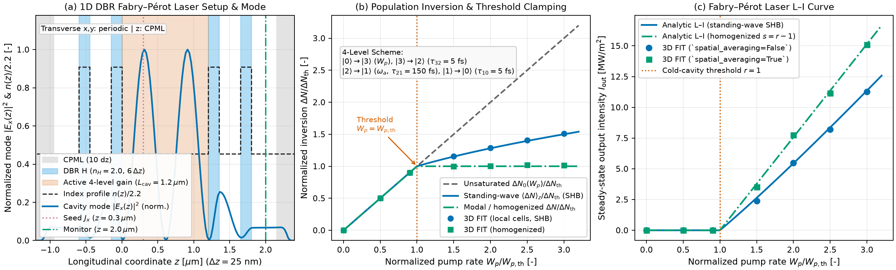

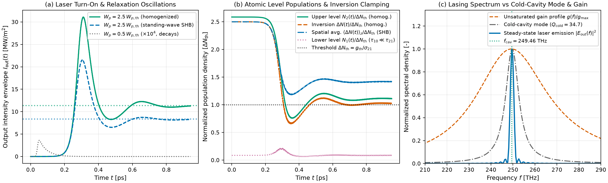

**Limits & failure modes.**
- *Stiff rate equations vs $`\Delta t`$ and oscillator Courant bound.* The central-difference polarization update requires $`\omega_{a,b}\Delta t < 2\sqrt{1 - C^2}`$ (`FourLevelGain.is_stable`); `add_gain_material` raises `ValueError` if $`\Delta t`$ does not resolve the atomic resonance. For the linear rate equations (`pauli_exclusion=False`), the Crank–Nicolson update $`\mathbf{A}_{\text{rate}} = (\mathbf{I} - \tfrac{1}{2}\Delta t\mathbf{M})^{-1}(\mathbf{I} + \tfrac{1}{2}\Delta t\mathbf{M})`$ is unconditionally A-stable and conserves $`\sum N_i = N_{\text{total}}`$ for any $`\Delta t`$, but remains guaranteed non-negative only when $`\Delta t \le 2 / \max_i |M_{ii}| \approx 2\min(\tau_{10}, \tau_{32}, \tau_{21}, W_p^{-1})`$. When fast nonradiative lifetimes $`\tau_{10}, \tau_{32}`$ are chosen comparable to $`\Delta t`$, or when `pauli_exclusion=True` (which uses the explicit second-order Heun predictor–corrector), $`\Delta t`$ must satisfy $`\Delta t < \min(\tau_{10}, \tau_{32})`$.
- *Spatial hole burning resolution.* With `spatial_averaging=False` (default), population inversion is tracked independently in every grid cell and depleted proportional to the local standing-wave intensity $`\sin^2(kz)`$. Resolving the $`\lambda_0 / (2 n_{\text{bg}})`$ spatial-hole-burning grating requires $`\ge 20`$ cells per wavelength inside the gain host ($`\ge 10`$ cells per half-wave lobe). When physical carrier diffusion or atomic thermal motion washes out the standing-wave grating on sub-wavelength scales, pass `spatial_averaging=True` to homogenize the stimulated rate across the gain region.
- *Homogeneous broadening only (inhomogeneous broadening not included).* Each transition is modelled by a single homogeneously broadened Lorentzian oscillator of linewidth $`\gamma_a`$. Doppler-broadened gas lasers or inhomogeneously broadened solid-state/quantum-dot ensembles (where spectral hole burning occurs across a Gaussian distribution of resonance frequencies $`\omega_a`$) are not captured by a single pole and require superimposing multiple detuned gain groups.
- *Spontaneous-emission noise off by default — seeding or `spontaneous_emission=True` required for lasing.* When `spontaneous_emission=False` (the default, preserving deterministic backwards compatibility), the semiclassical Maxwell–Bloch / rate equations have $`\mathbf{P}_a = \mathbf{0}`$ as an exact fixed point when $`\mathbf{E} = \mathbf{0}`$, even when $`N_2 > N_1`$ above threshold. To initiate laser oscillation in a cavity simulation, either pass `spontaneous_emission=True` (see **Noise and time scaling in gain media** below) so lasing starts from Fluctuation–Dissipation-Theorem Langevin noise, or seed the cavity with a weak broadband `CurrentSource` (e.g. a short `GaussianSource` pulse overlapping the cavity mode).
- *Supported solver backends.* `wakis.gain` is currently implemented for the CPU Yee/FIT stepper (standard, CPML, MKL, and MPI). Passing a gain material to `use_gpu=True`, `fused=True`, `scheme='tete'`, or `SubgridFIT2D` raises `NotImplementedError`.

References:
- S.-H. Chang and A. Taflove, "Finite-difference time-domain model of lasing action in a four-level two-electron atomic system", *Opt. Express* **12**(16), 3827–3833 (2004), [doi:10.1364/OPEX.12.003827](https://doi.org/10.1364/OPEX.12.003827).
- A. S. Nagra and R. A. York, "FDTD analysis of wave propagation in nonlinear absorbing and gain media", *IEEE Trans. Antennas Propag.* **46**(3), 334–340 (1998), [doi:10.1109/8.662652](https://doi.org/10.1109/8.662652).
- A. E. Siegman, *Lasers*, University Science Books, Mill Valley, CA, Chs. 2, 7, 8, 13 (1986).
- W. W. Rigrod, "Saturation effects in high-gain lasers", *J. Appl. Phys.* **36**(8), 2487–2490 (1965), [doi:10.1063/1.1714517](https://doi.org/10.1063/1.1714517).
- A. Taflove and S. C. Hagness, *Computational Electrodynamics: The Finite-Difference Time-Domain Method*, 3rd ed., Artech House, Ch. 9 (2005).

### 🔬 Semiconductor gain media (`wakis.gain_semiconductor`)

Semiconductor diode lasers and optical amplifiers differ from atomic four-level gain media in three essential physical respects [Coldren, Corzine & Mašanović, 2012; Henry, 1982; Agrawal & Dutta, 1993]:
1. Optical amplification arises from band-to-band transitions of a shared electron–hole plasma of density $`N(\mathbf{r}, t)`$ $[\text{m}^{-3}]$ driven by electrical current injection $`J(\mathbf{r}, t)`$ $[\text{A/m}^2]$ and depleted by Shockley–Read–Hall (SRH) nonradiative defects ($`A N`$), bimolecular spontaneous radiative recombination ($`B N^2`$), three-carrier Auger recombination ($`C N^3`$), stimulated emission, and ambipolar carrier diffusion ($`D\nabla^2 N`$).
2. The peak material power gain $`g(N)`$ $[1/\text{m}]$ vanishes at a finite transparency carrier density $`N_{\text{tr}} > 0`$ (where quasi-Fermi-level separation equals the photon energy $`\hbar\omega_0`$), being absorbing ($`g < 0`$) for $`N < N_{\text{tr}}`$ and amplifying ($`g > 0`$) for $`N > N_{\text{tr}}`$, with either a linear dependence $`g'(N - N_{\text{tr}})`$ (bulk active layers) or a logarithmic dependence $`g_0 \ln((N + N_s)/(N_{\text{tr}} + N_s))`$ (quantum-well active layers).
3. Because the asymmetric conduction/valence band densities of states shift the Kramers–Kronig refractive index strongly with carrier density $`N`$ near the band edge, carrier modulation produces a large amplitude–phase coupling quantified by Henry's linewidth enhancement factor $`\alpha_H \in [2, 7]`$ [Henry, 1982], which broadens the laser linewidth by $`1 + \alpha_H^2`$ and drives dynamic frequency chirp under current modulation [Koch & Bowers, 1984].

`wakis.gain_semiconductor` implements `SemiconductorGain` (and the chirp helper `adiabatic_chirp`), driven by `GainMixin` on `SolverFIT3D`.

**Carrier rate equation and stimulated field work.** In each active-region grid cell of volume $`V_m`$, the carrier density $`N(\mathbf{r}, t)`$ $[\text{m}^{-3}]$ obeys [Coldren, Corzine & Mašanović, 2012, Chs. 2 & 5]

```math
\frac{\partial N}{\partial t}
= \frac{\eta_i\,J(\mathbf{r}, t)}{q\,d}
- \left(A N + B N^2 + C N^3\right)
- R_{\text{stim}}(\mathbf{r}, t)
+ D \nabla^2 N,
```

where $`\eta_i \in [0, 1]`$ is the internal current injection efficiency, $`q`$ is the elementary charge, $`d`$ $[\text{m}]$ is the active-layer thickness, $`A`$ $[1/\text{s}]$, $`B`$ $[\text{m}^3/\text{s}]$, and $`C`$ $[\text{m}^6/\text{s}]$ are the SRH, bimolecular radiative, and Auger recombination coefficients, and $`D`$ $[\text{m}^2/\text{s}]$ is the ambipolar diffusion coefficient along the active layer (`diffusion_axes`). The stimulated emission rate per unit volume $`R_{\text{stim}}`$ $[\text{m}^{-3}\text{s}^{-1}]$ is given by the electromagnetic work done per unit volume by the resonant gain polarization poles $`\mathbf{P}_p(\mathbf{r}, t)`$ on the electric field $`\mathbf{E}(\mathbf{r}, t)`$:

```math
R_{\text{stim}}(\mathbf{r}, t)
= -\sum_p \frac{1}{\hbar\omega_p}\,\mathbf{E}(\mathbf{r}, t)\cdot\frac{\partial \mathbf{P}_p(\mathbf{r}, t)}{\partial t} .
```

When $`N > N_{\text{tr}}`$ (amplification), the polarization current $`\partial\mathbf{P}_p/\partial t`$ is anti-parallel to $`\mathbf{E}`$, so $`-\mathbf{E}\cdot\partial\mathbf{P}_p/\partial t > 0`$ delivers power from the carrier reservoir to the electromagnetic field and removes one electron–hole pair per generated photon of energy $`\hbar\omega_p`$. When $`N < N_{\text{tr}}`$ (interband absorption), $`-\mathbf{E}\cdot\partial\mathbf{P}_p/\partial t < 0`$ absorbs photons and creates electron–hole pairs ($`R_{\text{stim}} < 0`$).

**Lorentzian ADE gain poles, linear/logarithmic gain models, and bandfilling peak shift.** The resonant interband polarization $`\mathbf{P}(\mathbf{r}, t) = \varepsilon_0 \sum_p \mathbf{p}_p(\mathbf{r}, t)`$ is represented by one or more Lorentzian auxiliary differential equation (ADE) poles $`p = 1, \dots, N_p`$:

```math
\frac{\partial^2 \mathbf{p}_p}{\partial t^2}
+ \gamma_p \frac{\partial \mathbf{p}_p}{\partial t}
+ \omega_p(N)^2 \mathbf{p}_p
= S_p(N)\,\mathbf{E}, \qquad
S_p(N) = -c\,n_{\text{bg}}\,\gamma_p\,g_p(N),
```

where $`n_{\text{bg}} = \sqrt{\varepsilon_\infty}`$ is the host refractive index, $`\gamma_p`$ $[\text{rad/s}]$ is the homogeneous dephasing linewidth, $`\omega_p(N) = \omega_{0,p} + (\partial\omega_p/\partial N)(N - N_{\text{tr},p})`$ incorporates the optional bandfilling blue-shift (`domega_dN`), and the peak pole gain coefficient $`g_p(N)`$ $[1/\text{m}]$ follows either the linear model (`gain_model='linear'`) or the three-parameter logarithmic quantum-well model (`gain_model='logarithmic'`, [Coldren, Corzine & Mašanović, 2012, Eq. (4.86)]):

```math
g_p^{\text{lin}}(N) = w_p\,g_p'\,\big(N - N_{\text{tr},p}\big), \qquad
g_p^{\text{log}}(N) = w_p\,g_{0,p}\,\ln\!\left(\frac{N + N_s}{N_{\text{tr},p} + N_s}\right) .
```

**Henry linewidth enhancement factor $`\alpha_H`$ and Wakis sign convention.** In Wakis's harmonic convention $`\mathbf{E}(t) = \operatorname{Re}[\tilde{\mathbf{E}}\,e^{+i\omega t - i k z}]`$ (see `notation_glossary.md`), each pole contributes the complex susceptibility

```math
\chi_p(\omega, N) = \frac{-c\,n_{\text{bg}}\,\gamma_p\,g_p(N)}{\omega_p(N)^2 - \omega^2 + i\gamma_p\omega}, \qquad
\operatorname{Im}\chi_p\big(\omega_p(N), N\big) = +\frac{c\,n_{\text{bg}}}{\omega_p(N)}\,g_p(N),
```

so active gain ($`g_p > 0`$) corresponds to $`\operatorname{Im}\chi > 0`$ and $`n_i = \operatorname{Im}\sqrt{\varepsilon_r} > 0`$ ($`e^{-i k z} = e^{-i(\omega/c)(n_r + i n_i)z} = e^{+(\omega n_i / c)z} e^{-i(\omega n_r / c)z}`$, power gain $`g(\omega, N) = (2\omega/c)\operatorname{Im}\sqrt{\varepsilon_r(\omega, N)}`$). Increasing the carrier density $`\Delta N > 0`$ increases the gain ($`\Delta g > 0`$, $`\Delta\operatorname{Im}\chi > 0`$) while bandfilling and free-carrier plasma dispersion *reduce* the real refractive index ($`\Delta n_r < 0`$, $`\Delta\operatorname{Re}\chi < 0`$). Henry's linewidth enhancement factor [Henry, 1982] is defined as

```math
\alpha_H \equiv -\frac{\partial n_r / \partial N}{\partial n_i / \partial N}
= -\frac{\partial(\operatorname{Re}\chi)/\partial N}{\partial(\operatorname{Im}\chi)/\partial N}
= -\frac{4\pi}{\lambda_0}\,\frac{\partial n_r / \partial N}{\partial g / \partial N} > 0 .
```

Because a symmetric Lorentzian pole has $`\operatorname{Re}\chi_p(\omega_0, N) = 0`$ at line center, `SemiconductorGain` adds a real, instantaneous carrier-dependent background susceptibility $`\Delta\chi_{\text{bg}}(N)`$ (`SemiconductorGain.delta_chi_bg`):

```math
\Delta\chi_{\text{bg}}(N)
= -\alpha_H\,\operatorname{Im}\chi_{\text{poles}}(\omega_0, N) - \operatorname{Re}\chi_{\text{poles}}(\omega_0, N)
\quad\Longrightarrow\quad
\left.\frac{\partial\operatorname{Re}\chi(\omega_0, N)}{\partial N}\right|
= -\alpha_H\,\left.\frac{\partial\operatorname{Im}\chi(\omega_0, N)}{\partial N}\right| .
```

For a single-pass slab of length $`L`$, the complex transmission phasor $`\tilde{t}(\omega_0, N) \propto \exp(-i(\omega_0/c)\Delta n_c(N)L) = \exp(\tfrac{1}{2}\Delta g(N)L - i(\omega_0/c)\Delta n_r(N)L)`$ satisfies the direct phase–amplitude identity

```math
\Delta\phi_{\text{trans}}(\omega_0) = \arg\!\left(\frac{\tilde{t}(\omega_0, N + \Delta N)}{\tilde{t}(\omega_0, N)}\right)
= -\frac{\omega_0}{c}\,\Delta n_r\,L
= +\alpha_H\,\Delta\ln|\tilde{t}(\omega_0)| .
```

**Fabry–Pérot diode laser L–I curve, relaxation oscillations, and dynamic chirp.** In a Fabry–Pérot diode laser of active length $`L`$, optical confinement factor $`\Gamma`$, internal loss $`\alpha_i`$, and facet reflectances $`R_1, R_2`$ with mirror loss $`\alpha_m = \frac{1}{2L}\ln(1/(R_1 R_2))`$, round-trip gain–loss balance clamps the steady-state modal gain above threshold at $`\Gamma g(N_{\text{th}}) = \alpha_i + \alpha_m`$ (`SemiconductorGain.steady_state_laser`, [Coldren, Corzine & Mašanović, 2012, Ch. 2]):

```math
J_{\text{th}} = \frac{q\,d}{\eta_i}\left(A N_{\text{th}} + B N_{\text{th}}^2 + C N_{\text{th}}^3\right), \qquad
\eta_d = \eta_i\,\frac{\alpha_m}{\alpha_i + \alpha_m}, \qquad
I_{\text{out,tot}}(J) = \frac{\hbar\omega_0}{q}\,\eta_d\,\frac{L}{d}\,(J - J_{\text{th}}) \quad (J > J_{\text{th}}) .
```

With steady-state intracavity photon density $`S_0 = \frac{\Gamma\tau_p}{q d}\eta_i(J - J_{\text{th}})`$ and bare point-mirror photon lifetime $`\tau_p = [v_g(\alpha_i + \alpha_m)]^{-1}`$, small-signal linearization of the coupled carrier–photon rate equations around $`(N_{\text{th}}, S_0)`$ (with nonlinear gain compression $`\varepsilon_{\text{nl}} = 0`$) yields the second-order modulation transfer function (`SemiconductorGain.modulation_transfer_function`, [Coldren, Corzine & Mašanović, 2012, Ch. 5])

```math
H(\omega_m) = \frac{\omega_R^2}{\omega_R^2 - \omega_m^2 + i\omega_m\gamma_{\text{RO}}}, \qquad
\omega_R^2 = \Gamma_z\,\frac{\Gamma\,v_g\,g'(N_{\text{th}})\,S_0}{\tau_p}, \qquad
\gamma_{\text{RO}} = \frac{1}{\tau_{\text{diff}}(N_{\text{th}})} + v_g\,g'(N_{\text{th}})\,S_0,
```

where $`\tau_{\text{diff}}^{-1} = A + 2 B N_{\text{th}} + 3 C N_{\text{th}}^2`$ is the differential carrier recombination rate, and $`\Gamma_z = L / L_{\text{eff}} \le 1`$ (`L_eff` parameter on `steady_state_laser`) accounts for longitudinal field penetration into distributed Bragg reflector (DBR) mirrors ($`L_{\text{eff}} = L + 2 L_{\text{pen}} = v_g \tau_{p,\text{cold}} \ln(1/\sqrt{R_1 R_2})`$, which lengthens the cold-cavity photon lifetime to $`\tau_{p,\text{eff}} = \tau_p / \Gamma_z`$ while leaving threshold gain $`g_{\text{th}}`$ and slope efficiency $`\eta_d`$ unchanged). Because the instantaneous cavity resonance shifts with $`\Delta n_r(N)`$ as $`\Delta\nu(t) = \frac{\alpha_H}{4\pi}\Gamma v_g [g(N(t)) - g_{\text{th}}]`$ while the optical power $`P(t) \propto S(t)`$ obeys $`\frac{d\ln P}{dt} = \Gamma v_g [g(N(t)) - g_{\text{th}}]`$ (for $`\varepsilon_{\text{nl}} = 0`$ and negligible spontaneous-emission coupling into the lasing mode), eliminating $`g(N) - g_{\text{th}}`$ gives the Koch–Bowers dynamic/adiabatic chirp relation (`adiabatic_chirp`, [Koch & Bowers, 1984]):

```math
\Delta\nu(t) = \frac{\alpha_H}{4\pi}\,\frac{d\ln P(t)}{dt} .
```

**Time-level centring, discrete carrier–photon bookkeeping, and $`\alpha_H \neq 0`$ parametric energy balance.** Within each `SolverFIT3D` step $`n \to n+1`$:
1. Each pole $`\mathbf{p}_p^n \to \mathbf{p}_p^{n+1}`$ is advanced by the second-order central difference centred at $`t^n`$ using $`g_p(N^n)`$ and $`\omega_p(N^n)`$, producing the discrete susceptibility `SemiconductorGain.chi_discrete`.
2. Ampère's law advances $`\mathbf{E}^n \to \mathbf{E}^{n+1}`$ centred at $`t^{n+1/2}`$, incorporating the carrier-dependent background permittivity $`\varepsilon_\infty + \Delta\chi_{\text{bg}}(N^n)`$ and polarization currents $`(\mathbf{p}_p^{n+1} - \mathbf{p}_p^n)/\Delta t`$.
3. The stimulated emission rate per cell $`R_{\text{stim},m}^{n+1/2}`$ is evaluated at $`t^{n+1/2}`$ from $`\mathbf{E}^{n+1/2} = \tfrac{1}{2}(\mathbf{E}^{n+1} + \mathbf{E}^n)`$ and $`\partial_t\mathbf{P}_p|^{n+1/2} = \varepsilon_0(\mathbf{p}_p^{n+1} - \mathbf{p}_p^n)/\Delta t`$, weighted by the primary-edge finite volumes $`w_e \Delta V_{E,e}`$.
4. The carrier density $`N_m^n \to N_m^{n+1}`$ is advanced at $`t^{n+1/2}`$ by the implicit midpoint / Crank–Nicolson rule: the linear SRH decay $`A N`$ and finite-volume diffusion operator $`\mathbf{L}_{\text{diff}}`$ (constructed with harmonic-mean inter-cell conductances so that $`\mathbf{V}_{\text{cell}}^T \mathbf{L}_{\text{diff}} = \mathbf{0}`$ identically) are inverted via a pre-factored sparse CSC solver, followed by Newton polishing on the nonlinear $`B (N^{n+1/2})^2 + C (N^{n+1/2})^3`$ terms. Multiplying the update by $`V_m`$ and summing over all active cells gives the exact per-step particle conservation law (`solver.get_gain_bookkeeping()`):
   ```math
   \sum_m V_m\big(N_m^0 - N_m^n\big)
   + \sum_{k=0}^{n-1} \Delta t \sum_m V_m \big(R_{\text{inj},m}^{k+1/2} - R_{\text{rec},m}^{k+1/2}\big)
   = \sum_{k=0}^{n-1} \Delta t \sum_m V_m R_{\text{stim},m}^{k+1/2}
   = \frac{\Delta W_{\text{pol}\to\text{EM}}}{\hbar\omega_0} \quad (\text{single pole})
   ```
   to machine precision ($`\sim 10^{-14}`$; note that when $`J = A = B = C = 0`$, `carriers_removed` and `photons_generated` both accumulate $`R_{\text{stim},m}^{k+1/2}`$, so their agreement is an internal bookkeeping consistency check, whereas comparing the 3D FIT electromagnetic energy change $`\Delta W_{\text{EM}}`$ against $`\Delta W_{\text{pol}\to\text{EM}}`$ is an independent discrete Poynting validation).
5. When $`\alpha_H \neq 0`$ (or multi-pole / `domega_dN != 0`), the real background susceptibility $`\Delta\chi_{\text{bg}}(N^n)`$ varies in time with $`N^n`$. In the discrete Ampère step, the $`\Delta\chi_{\text{bg}}(N^n)`$ displacement current performs work $`\Delta W_{\Delta\chi}^n = -\tfrac{1}{2}\varepsilon_0 \sum_e w_e \Delta V_{E,e} \Delta\chi_{\text{bg},e}^n [(E_e^{n+1})^2 - (E_e^n)^2]`$ (`dchi_work_joules`) on the host-permittivity electromagnetic field $`W_{\text{EM}}^n`$, so the exact per-step discrete Poynting identity is
   ```math
   W_{\text{EM}}^{n+1} - W_{\text{EM}}^n = \Delta W_{\text{pol}\to\text{EM}}^n + \Delta W_{\Delta\chi}^n .
   ```
   Summing by parts over $`n`$ decomposes $`\sum_n \Delta W_{\Delta\chi}^n = W_{\Delta\chi,\text{param}} - \Delta W_{\Delta\chi,\text{stored}}`$, where $`W_{\Delta\chi,\text{stored}}^n = \tfrac{1}{2}\varepsilon_0 \sum_e w_e \Delta V_{E,e} \Delta\chi_{\text{bg},e}^n (E_e^n)^2`$ (`dchi_stored_joules`) is the reactive electrostatic energy stored in $`\Delta\chi_{\text{bg}}`$ and $`W_{\Delta\chi,\text{param}} = \tfrac{1}{2}\varepsilon_0 \sum_{n,e} w_e \Delta V_{E,e}(\Delta\chi_{\text{bg},e}^{n+1} - \Delta\chi_{\text{bg},e}^n)(E_e^{n+1})^2`$ (`dchi_parametric_joules`) is the parametric index-modulation work, which is bounded relative to the resonant stimulated work by
   ```math
   \frac{\big|W_{\Delta\chi,\text{param}}\big|}{\big|W_{\text{pol}\to\text{EM}}\big|}
   \le |\alpha_H|\,\frac{c\,n_{\text{bg}}\,g'}{\omega_0}\,\frac{u_{\text{EM},\max}}{\hbar\omega_0} .
   ```

**Validation** (`tests/test_073_semiconductor_gain.py`, `examples/015_semiconductor_fp_laser.py`):
1. *Small-signal gain spectrum (`test_small_signal_gain_spectrum_slab`):* Across 33 frequencies spanning $`193.4 \pm 18\text{ THz}`$ in a $`1.2\ \mu\text{m}`$ slab ($`\Delta z = 20\text{ nm} = \lambda_0/77.5`$), 3D FIT transmission reproduces the analytical slab transmittance $`|t_{\text{slab}}(\omega, N)|^2`$ to $`5.2\times 10^{-5}`$ (absorption, $`0.25\,N_{\text{tr}}`$), $`0.0`$ (transparency, $`1.0\,N_{\text{tr}}`$), $`1.1\times 10^{-4}`$ (linear gain, $`2.5\,N_{\text{tr}}`$), and $`6.6\times 10^{-5}`$ (logarithmic gain, $`2.5\,N_{\text{tr}}`$), with line-center gain error $`3.7\times 10^{-5}`$–$`2.3\times 10^{-3}`$.
2. *Linewidth enhancement factor $`\alpha_H`$ (`test_henry_alpha_factor_transmission`):* From the 3D FIT complex transmission ratio $`\tilde{t}(N + \Delta N)/\tilde{t}(N)`$ at $`\omega_0`$, the measured phase-to-amplitude slope $`\Delta\phi / \Delta\ln|\tilde{t}|`$ recovers $`\alpha_H \in \{2.0, 4.0, 5.0\}`$ as $`1.9991, 3.9983, 4.9996`$ (relative errors $`4.5\times 10^{-4}`$, $`4.2\times 10^{-4}`$, $`7.2\times 10^{-5}`$).
3. *1D DBR Fabry–Pérot diode laser L–I curve, slope efficiency, and relaxation-oscillation frequency (`test_fabry_perot_diode_laser_li_and_slope_efficiency`):* In a $`1.2\ \mu\text{m}`$ cavity bounded by symmetric 3-layer $`(H L H)`$ quarter-wave DBR mirrors (`n_pairs = 1, extra_high = True`, i.e. 1 $`(H, L)`$ pair + 1 extra $`H`$ layer, $`R = (15/17)^2 = 0.77855`$, $`\eta_i = 0.85`$), the 3D FIT L–I sweep recovers threshold current density $`J_{\text{th}}`$ to $`0.93\%`$, differential quantum slope efficiency $`\eta_{d,\text{FIT}} = 0.8257`$ vs $`\eta_d = 0.8500`$ ($`2.86\%`$ relative error; the $`10^{-14}`$ check of `steady_state_laser()["eta_d"]` is an API formula consistency check), and carrier clamping at $`N_{\text{th}}`$ to $`0.69\%`$ across $`r \in [1.5, 3.0]`$. For the step-bias relaxation-oscillation ringdown at $`r = 2.5`$ (3D FIT $`f_{R,\text{FIT}} = 3.3904\text{ THz}`$), two independent zero-free-parameter evaluations of DBR mirror field penetration are reported: (i) a cold-cavity ringdown (`ResonanceMonitor` + `harminv`, gain off on the identical passive 3-layer $`(H L H)`$ DBR cavity) measures $`f_{\text{cold}} = 249.65\text{ THz}`$, $`Q_{\text{cold}} = 34.732`$, $`\tau_{p,\text{cold}} = 22.1424\text{ fs}`$, and $`L_{\text{eff,cold}} = v_g\tau_{p,\text{cold}}\ln(1/R) = 1.6617\ \mu\text{m}`$ ($`\Gamma_z = L_{\text{cav}}/L_{\text{eff,cold}} = 0.7222`$), predicting $`f_{R,\text{DBR}} = 3.3823\text{ THz}`$ ($`0.24\%`$ relative error vs 3D FIT); and (ii) the asymptotic analytical quarter-wave DBR phase-penetration depth $`L_{\text{pen}} = \lambda_0 / (4(n_H - n_L)) = 0.300\ \mu\text{m}`$ gives $`L_{\text{eff,an}} = L_{\text{cav}} + 2 L_{\text{pen}} = 1.800\ \mu\text{m}`$ ($`\Gamma_{z,\text{an}} = 2/3`$), predicting $`f_{R,\text{an}} = 3.2497\text{ THz}`$ ($`4.33\%`$ relative error vs 3D FIT), whereas neglecting DBR penetration with bare $`L_{\text{eff}} = L_{\text{cav}} = 1.200\ \mu\text{m}`$ overpredicts $`f_{R,\text{bare}} = 3.9801\text{ THz}`$ by $`14.82\%`$.
4. *Modulation response and 3D FIT Koch–Bowers frequency-chirp slope (`test_modulation_response_relaxation_oscillation_and_chirp`):* In the standalone coupled rate-equation ODEs (`step_laser_rate_equations`), small-signal ringdown and sinusoidal modulation reproduce the linearized transfer function `modulation_transfer_function` to $`3.0\times 10^{-4}`$ in $`f_R`$ and $`2.7\times 10^{-6}`$ in `adiabatic_chirp` (consistency checks of the ODE integrator against its own defining equations; the $`10^{-14}`$ check on `steady_state_laser()["omega_R"]` is likewise a formula consistency check). For full-wave 3D FIT physical validation under sinusoidal current modulation above threshold in a symmetric 5-layer $`(H L H L H)`$ DBR cavity (`n_pairs = 2, extra_high = True`, i.e. 2 $`(H, L)`$ pairs + 1 extra $`H`$ layer, $`R = (63/65)^2 = 0.93941`$), demodulating $`E_x(z_{\text{out}}, t)`$ and fitting the linear regression slope $`m_{\text{chirp}}`$ of $`\Delta\nu_{\text{FIT}}(t)`$ versus $`d\ln P_{\text{FIT}}/dt`$ gives $`m_{\text{chirp}} = 0.15897`$ vs $`\alpha_H/(4\pi) = 0.15915`$ ($`0.11\%`$ relative error, $`r = 0.995`$) at $`\alpha_H = 2.0`$ and $`m_{\text{chirp}} = 0.27854`$ vs $`\alpha_H/(4\pi) = 0.27852`$ ($`5.8\times 10^{-5}`$ relative error, $`r = 0.971`$) at $`\alpha_H = 3.5`$, while flipping $`\alpha_H \to -2.0`$ reverses the slope sign ($`m_{\text{chirp}} < 0`$).
5. *Discrete Poynting conservation ($`\alpha_H = 0`$ and $`\alpha_H \neq 0`$), bookkeeping consistency, and carrier diffusion (`test_carrier_photon_conservation_and_diffusion`):* In a closed 3D FIT PEC cavity, the internal bookkeeping counters `carriers_removed` and `photons_generated` agree to $`6.5\times 10^{-14}`$ (consistency check), while the independent discrete Poynting work balance on the 3D FIT fields closes to $`3.3\times 10^{-13}`$ for $`\alpha_H = 0`$ and to $`3.3\times 10^{-13}`$ for $`\alpha_H = 3.5`$ when `dchi_work_joules` is included (with parametric index-modulation work $`W_{\Delta\chi,\text{param}} = 4.06\times 10^{-18}\text{ J} \le 1.46\times 10^{-17}\text{ J}`$ analytical bound, or $`|W_{\Delta\chi,\text{param}}|/|W_{\text{pol}\to\text{EM}}| = 1.02\times 10^{-2} \le 1.95\times 10^{-2}`$). 1D/3D Crank–Nicolson carrier diffusion conserves total carriers to $`2.7\times 10^{-16}`$ and matches analytical Fourier mode decay $`\exp(-D k^2 t)`$ to $`1.7\times 10^{-7}`$.

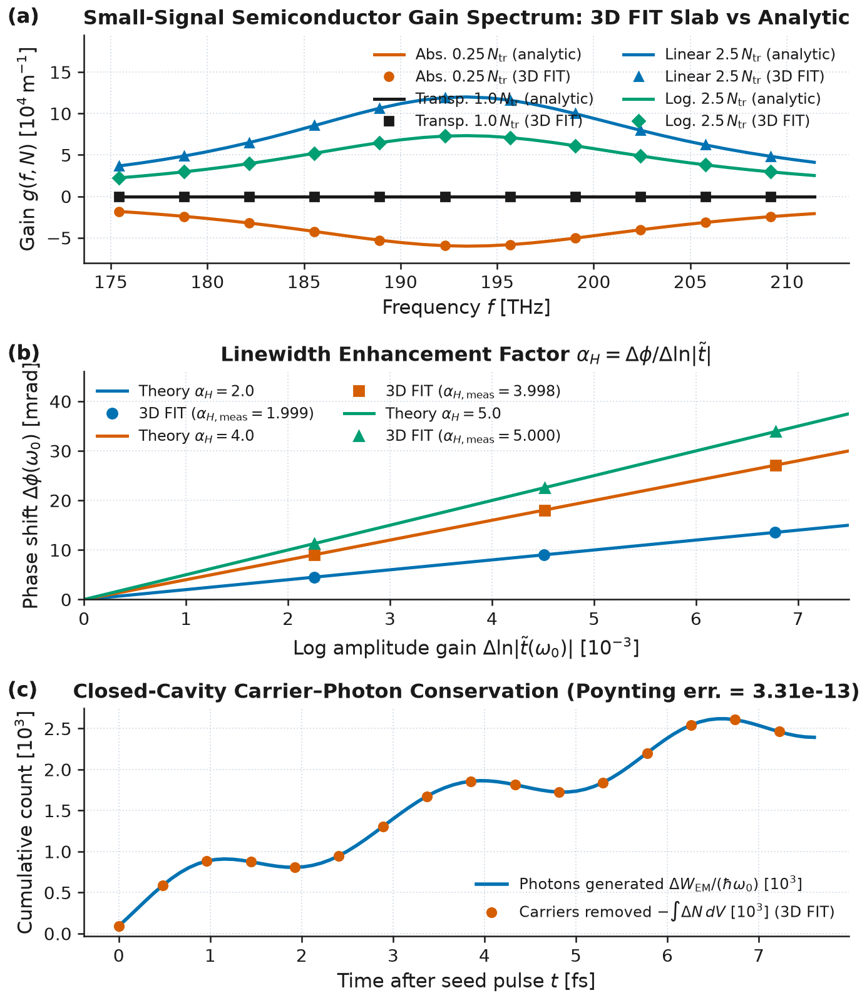

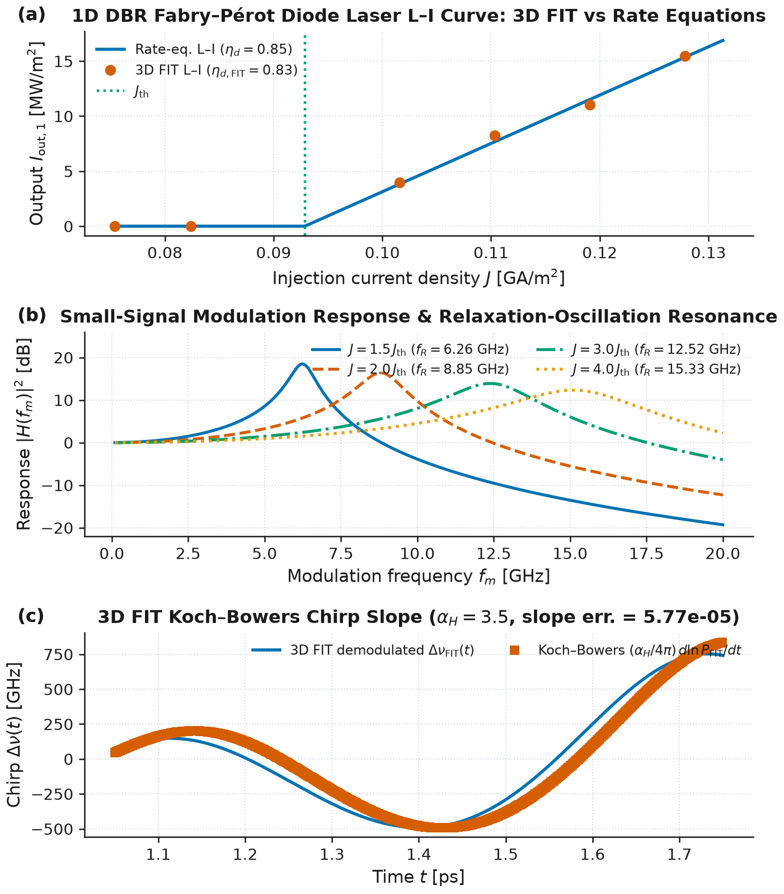

**Limits & failure modes.**
- *Lorentzian vs asymmetric microscopic semiconductor gain spectra.* A single Lorentzian pole is symmetric around $`\omega_0(N)`$, whereas microscopic semiconductor gain spectra derived from parabolic or $`\mathbf{k}\cdot\mathbf{p}`$ band structures with Fermi–Dirac occupancies exhibit a sharp low-energy band-edge cutoff at $`\hbar\omega = E_g`$ and a high-energy transparency crossing at $`\hbar\omega = \Delta E_F(N)`$. When wideband spectral asymmetry matters, pass multiple poles via `extra_poles` (e.g. a lower-energy gain pole plus a higher-energy absorbing pole) and `domega_dN > 0`.
- *Background susceptibility $`\Delta\chi_{\text{bg}}(N)`$ and Courant bound.* Because $`\Delta\chi_{\text{bg}}(N)`$ modifies the instantaneous high-frequency permittivity to $`\varepsilon_{\text{eff}}(N) = \varepsilon_\infty + \Delta\chi_{\text{bg}}(N)`$, very large carrier swings with large $`\alpha_H`$ in low-index hosts can reduce $`\varepsilon_{\text{eff}}(N)`$ toward the vacuum Courant limit $`C^2`$. Ensure $`\varepsilon_\infty + \Delta\chi_{\text{bg}}(N) > C^2`$ across the operating carrier density range (for typical III–V semiconductors with $`\varepsilon_\infty \sim 10`$–$`13`$ and $`|\Delta\chi_{\text{bg}}| \ll 1`$, this is satisfied with wide margin).
- *Nonlinear intraband gain compression ($`\varepsilon_{\text{nl}}`$) scope.* Spectral hole burning and carrier heating enter the standalone coupled rate-equation methods (`steady_state_laser`, `modulation_transfer_function`, `step_laser_rate_equations`) through the gain compression factor $`(1 + \varepsilon_{\text{nl}} S)^{-1}`$. In the full-wave 3D FIT ADE solver, gain saturation arises directly from carrier depletion via $`R_{\text{stim}} = -(\hbar\omega_0)^{-1}\mathbf{E}\cdot\partial_t\mathbf{P}`$ on the grid; sub-picosecond intraband carrier-heating dynamics are not evolved as a separate temperature equation on the 3D grid.
- *Supported solver backends.* Like `FourLevelGain` and `SaturableGain`, `SemiconductorGain` is supported on the CPU Yee/FIT stepper (standard, CPML, MKL, and MPI) and raises `NotImplementedError` for `use_gpu=True`, `fused=True`, or `scheme='tete'`.

References:
- L. A. Coldren, S. W. Corzine, and M. L. Mašanović, *Diode Lasers and Photonic Integrated Circuits*, 2nd ed., Wiley, Hoboken, NJ (2012), [doi:10.1002/9781118148167](https://doi.org/10.1002/9781118148167).
- C. H. Henry, "Theory of the linewidth of semiconductor lasers", *IEEE J. Quantum Electron.* **18**(2), 259–264 (1982), [doi:10.1109/JQE.1982.1071522](https://doi.org/10.1109/JQE.1982.1071522).
- T. L. Koch and J. E. Bowers, "Nature of wavelength chirping in directly modulated semiconductor lasers", *Electron. Lett.* **20**(25), 1038–1040 (1984), [doi:10.1049/el:19840709](https://doi.org/10.1049/el:19840709).
- G. P. Agrawal and N. K. Dutta, *Semiconductor Lasers*, 2nd ed., Van Nostrand Reinhold, New York (1993).


### Triangular and hexagonal lattices on Cartesian FIT grids (`wakis.lattices`)

Two-dimensional triangular (Bravais) and honeycomb (two-sublattice) photonic crystals have primitive lattice vectors at $`60^\circ`$, which do not align with orthogonal Cartesian faces. `wakis.lattices` (`HexagonalLattice`, `PWE2D`, `unfold_supercell_weight`, `unfold_signal_pair`, `berry_curvature_from_envelopes`, `dirac_berry_curvature`, `fill_circular_inclusions`, `fit_supercell_bands_at_k`, `fit_berry_curvature_patch`, example `examples/016_triangular_honeycomb_lattices.py`, tutorial `tutorials/06_periodic_structures/06-06_valley_hall_edge_states/`, test `tests/test_073_lattices.py`) maps triangular and honeycomb crystals onto Cartesian `GridFIT3D` meshes via their centred-rectangular supercell, provides an independent 2D plane-wave-expansion (`PWE2D`) solver, unfolds supercell bands back onto the primitive hexagonal Brillouin zone, and evaluates gauge-invariant Berry curvature and valley Chern numbers from both frequency-domain (`PWE2D`) and time-domain (`SolverFIT3D`) eigenfields.

**Primitive hexagonal cell vs centred-rectangular Cartesian supercell.** A 2D triangular Bravais lattice of pitch $`a`$ has primitive translations and reciprocal basis vectors ($`\mathbf{a}_i \cdot \mathbf{b}_j = 2\pi\delta_{ij}`$):

```math
\mathbf{a}_1 = a(1, 0), \qquad
\mathbf{a}_2 = a\!\left(\tfrac{1}{2}, \tfrac{\sqrt{3}}{2}\right), \qquad
\mathbf{b}_1 = \frac{2\pi}{a}\!\left(1, -\frac{1}{\sqrt{3}}\right), \qquad
\mathbf{b}_2 = \frac{2\pi}{a}\!\left(0, \frac{2}{\sqrt{3}}\right),
```

with primitive cell area $`\Omega_{\mathrm{prim}} = \frac{\sqrt{3}}{2}a^2`$ and high-symmetry points $`\boldsymbol{\Gamma} = (0, 0)`$, $`\mathbf{M} = \frac{2\pi}{a}(0, \frac{1}{\sqrt{3}})`$, $`\mathbf{K} = \frac{2\pi}{a}(\frac{2}{3}, 0)`$, and $`\mathbf{K}' = \frac{2\pi}{a}(-\frac{2}{3}, 0)`$. Forming the integer combinations

```math
\mathbf{A}_1 = \mathbf{a}_1 = (a, 0), \qquad
\mathbf{A}_2 = 2\mathbf{a}_2 - \mathbf{a}_1 = (0, \sqrt{3}a), \qquad
\det\begin{pmatrix} 1 & 0 \\ -1 & 2 \end{pmatrix} = 2,
```

yields an orthogonal $`a \times \sqrt{3}a`$ centred-rectangular supercell of area $`\Omega_{\mathrm{sup}} = \sqrt{3}a^2 = 2\Omega_{\mathrm{prim}}`$ containing two Bravais lattice points at $`\mathbf{R}_0 = (0, 0)`$ and $`\boldsymbol{\tau} = \mathbf{a}_2 = (\frac{1}{2}a, \frac{\sqrt{3}}{2}a)`$. For a honeycomb crystal, each Bravais point carries sublattices $`A`$ and $`B`$ separated by $`\pm\mathbf{d}_0 = \pm(0, a/\sqrt{3})`$, giving four rods/holes per rectangular supercell. For any wavevector $`\mathbf{k} = (k_x, k_y)`$ in the primitive hexagonal Brillouin zone, the Cartesian Bloch boundary conditions (`bc_low=["bloch", "bloch", "periodic"]`, `k_bloch=(k_x, k_y, 0.0)`) apply the exact face phases $`\psi(x + a, y) = e^{-i k_x a}\psi(x, y)`$ and $`\psi(x, y + \sqrt{3}a) = e^{-i k_y \sqrt{3}a}\psi(x, y)`$ on the leapfrog time grid ($`\mathbf{E}^n`$ at integer $`t^n = n\Delta t`$, $`\mathbf{H}^{n-1/2}`$ at half-integer $`t^{n-1/2}`$).

**Band unfolding via primitive-translation projection.** Because $`\Omega_{\mathrm{sup}} = 2\Omega_{\mathrm{prim}}`$, the rectangular Brillouin zone has half the area of the hexagonal Brillouin zone and folds each primitive band at $`\mathbf{k}`$ with its partner at $`\mathbf{k} + \mathbf{G}_{\mathrm{sup}}`$ ($`\mathbf{G}_{\mathrm{sup}} = (0, \frac{2\pi}{\sqrt{3}a})`$ with $`e^{i\mathbf{G}_{\mathrm{sup}}\cdot\boldsymbol{\tau}} = -1`$). Under the internal primitive translation $`\hat{T}_{\boldsymbol{\tau}}\psi(\mathbf{r}) = \psi(\mathbf{r} + \boldsymbol{\tau})`$:
- In Wakis's time-domain Bloch convention $`\psi_{\mathbf{k}}(\mathbf{r}) = e^{-i\mathbf{k}\cdot\mathbf{r}}u_{\mathbf{k}}(\mathbf{r})`$ (`wakis/bloch.py`), a true primitive Bloch state satisfies $`\psi_{\mathbf{k}}(\mathbf{r} + \boldsymbol{\tau}) = e^{-i\mathbf{k}\cdot\boldsymbol{\tau}}\psi_{\mathbf{k}}(\mathbf{r})`$, whereas a folded supercell partner satisfies $`\psi_{\mathbf{k}+\mathbf{G}_{\mathrm{sup}}}(\mathbf{r} + \boldsymbol{\tau}) = -e^{-i\mathbf{k}\cdot\boldsymbol{\tau}}\psi_{\mathbf{k}+\mathbf{G}_{\mathrm{sup}}}(\mathbf{r})`$.
- Combining two $`\boldsymbol{\tau}`$-related time-domain probe signals $`s_1(t) = \psi(\mathbf{r}_1, t)`$ and $`s_2(t) = \psi(\mathbf{r}_1 + \boldsymbol{\tau}, t)`$ as (`unfold_signal_pair`, `fit_supercell_bands_at_k`)

```math
s_{\mathrm{unfolded}}(t) = \tfrac{1}{2}\!\left[s_1(t) + e^{+i\mathbf{k}\cdot\boldsymbol{\tau}} s_2(t)\right], \qquad
s_{\mathrm{folded}}(t) = \tfrac{1}{2}\!\left[s_1(t) - e^{+i\mathbf{k}\cdot\boldsymbol{\tau}} s_2(t)\right],
```

cancels folded supercell modes prior to harmonic inversion (`wakis.resonances.harminv`), while on a 2D spatial grid the primitive-zone spectral weight [Popescu & Zunger, 2010; Ku, Berlijn & Lee, 2010] is (`unfold_supercell_weight`, `PWE2D.solve_path(..., unfold_supercell=True)`)

```math
W_n(\mathbf{k}) = \frac{\left\|\tfrac{1}{2}\!\left[\psi_{n\mathbf{k}}(\mathbf{r}) + e^{+i\mathbf{k}\cdot\boldsymbol{\tau}}\psi_{n\mathbf{k}}(\mathbf{r} + \boldsymbol{\tau})\right]\right\|_2^2}{\left\|\psi_{n\mathbf{k}}(\mathbf{r})\right\|_2^2} \in [0, 1],
```

which equals $`W_n = 1`$ for primitive branches and $`W_n = 0`$ for folded supercell branches.

**2D plane-wave-expansion (`PWE2D`) reference solver.** Following Ho, Chan & Soukoulis (1990) and Joannopoulos *et al.* (2008), `PWE2D` expands the periodic dielectric function using exact analytical Bessel Fourier transforms for circular inclusions of radius $`r_j`$ at $`\mathbf{r}_j`$:

```math
\varepsilon(\mathbf{G}) = \varepsilon_{\mathrm{bg}}\delta_{\mathbf{G},\mathbf{0}} + \sum_j (\varepsilon_j - \varepsilon_{\mathrm{bg}})\,f_j\,\frac{2 J_1(|\mathbf{G}|r_j)}{|\mathbf{G}|r_j}\,e^{-i\mathbf{G}\cdot\mathbf{r}_j}, \qquad f_j = \frac{\pi r_j^2}{\Omega_{\mathrm{cell}}},
```

and solves the symmetrized Hermitian eigenvalue problems in `scipy.linalg.eigh`:

```math
\text{TM ($E_z$):}\quad \sum_{\mathbf{G}'} |\mathbf{k}+\mathbf{G}|\,\varepsilon^{-1/2}_{\mathbf{G},\mathbf{G}_1}\varepsilon^{-1/2}_{\mathbf{G}_1,\mathbf{G}'}|\mathbf{k}+\mathbf{G}'|\,\tilde{e}_{\mathbf{G}'} = \left(\frac{\omega}{c}\right)^2 \tilde{e}_{\mathbf{G}}, \qquad
\text{TE ($H_z$):}\quad \sum_{\mathbf{G}'} (\mathbf{k}+\mathbf{G})\cdot(\mathbf{k}+\mathbf{G}')\,\eta_{\mathbf{G}-\mathbf{G}'}\,h_{\mathbf{G}'} = \left(\frac{\omega}{c}\right)^2 h_{\mathbf{G}},
```

with $`\boldsymbol{\eta} = \boldsymbol{\varepsilon}^{-1}`$.

**Honeycomb Dirac cone, valley-Hall gap, and Fukui–Hatsugai–Suzuki Berry curvature.** When sublattices $`A`$ and $`B`$ are identical ($`r_A = r_B = r_0`$, $`\delta = 0`$), $`C_{3v}`$ and inversion symmetry protect a massless Dirac cone at $`\mathbf{K}`$ and $`\mathbf{K}'`$. Breaking inversion symmetry with $`r_A = r_0(1 + \delta)`$, $`r_B = r_0(1 - \delta)`$ [Ma & Shvets, 2016; Gao *et al.*, 2018] introduces a Dirac mass $`m \propto \delta`$ in the effective two-band Hamiltonian $`H_{\mathrm{eff}}(\mathbf{q}) = \omega_D + v_D(\tau_v q_x \sigma_x + q_y \sigma_y) + m\sigma_z`$ ($`\tau_v = \pm 1`$), opening a bandgap $`\Delta\omega_K = 2|m|`$ and generating the lower-band Berry curvature (`dirac_berry_curvature`)

```math
\Omega_1(\mathbf{q}) = -\frac{\tau_v v_D^2 m}{2\left(v_D^2|\mathbf{q}|^2 + m^2\right)^{3/2}}, \qquad
C_{\tau_v} = \frac{1}{2\pi}\int_{\text{valley }\tau_v} \Omega_1(\mathbf{q})\,d^2q = -\frac{1}{2}\,\tau_v\,\mathrm{sgn}(\delta) .
```

Numerically, `PWE2D.berry_curvature`, `berry_curvature_from_envelopes`, and `fit_berry_curvature_patch` evaluate the gauge-invariant Fukui–Hatsugai–Suzuki plaquette phase [Fukui, Hatsugai & Suzuki, 2005] on a discrete $`(k_x, k_y)`$ mesh:

```math
F_{ij} = \mathrm{Im}\,\ln\!\Big(\langle u_{i,j}|u_{i+1,j}\rangle\langle u_{i+1,j}|u_{i+1,j+1}\rangle\langle u_{i+1,j+1}|u_{i,j+1}\rangle\langle u_{i,j+1}|u_{i,j}\rangle\Big), \qquad
\Omega_{ij} = \frac{F_{ij}}{\Delta k_x \Delta k_y},
```

where the cell-periodic envelopes $`u_{\mathbf{k}}(\mathbf{r})`$ are weighted by $`\sqrt{\varepsilon(\mathbf{r})}`$ in TM polarization (`fit_berry_curvature_patch` extracts $`E_z(\mathbf{r}, \omega_1(\mathbf{k}))`$ from single-cell 2D FIT ring-down runs and projects onto the primitive-translation subspace $`\tfrac{1}{2}[u + T_{\boldsymbol{\tau}}u]`$). Across a domain wall between $`\delta > 0`$ and $`\delta < 0`$ (`HexagonalLattice.ribbon_supercell_sites`, `HexagonalLattice.domain_wall_bend_inclusions`), the valley Chern difference $`|\Delta C_{\tau_v}| = |(\pm 1/2) - (\mp 1/2)| = 1`$ guarantees one valley-locked chiral edge mode per valley capable of rounding sharp $`120^\circ`$ Z-bends when the bend preserves the sublattice orientation across all three segments.

**Validation** (`tests/test_073_lattices.py`, `tests/test_tut_06_06_valley_hall_edge_states.py`, `examples/016_triangular_honeycomb_lattices.py`):
- *Supercell band unfolding:* Unfolding the 8 lowest supercell bands of the $`a \times \sqrt{3}a`$ cell onto the primitive hexagonal Brillouin zone along $`\Gamma\text{–}M\text{–}K\text{–}\Gamma`$ matches the 4 primitive-cell bands to $`4.2\times 10^{-8}`$ (`test_pwe_supercell_unfolding_and_mutation`); mutating the $`\boldsymbol{\tau}`$-phase sign (`phase_sign=-1`) selects the folded partner bands and fails the primitive-band assertion (`max |df| > 0.05`).
- *Triangular lattice of air holes ($`r/a = 0.42`$, $`\varepsilon_{\mathrm{bg}} = 13`$):* Reproduces the complete first TE bandgap $`\omega a/(2\pi c) \in [0.290, 0.449]`$ ($`43.2\%`$ gap-to-midgap ratio) and higher-band TM gap [Ho, Chan & Soukoulis, 1990; Plihal & Maradudin, 1991; Joannopoulos *et al.*, 2008], with 2D FIT (`fit_supercell_bands_at_k`) agreeing with `PWE2D` to $`0.17\%`$–$`0.72\%`$ (`test_triangular_air_holes_te_tm_gaps_and_fit_vs_pwe`).
- *Honeycomb Dirac cone and valley-Hall gap ($`r_0/a = 0.18`$, $`\varepsilon_{\mathrm{rod}} = 12`$):* At $`\delta = 0`$, bands 1 and 2 touch linearly at $`K`$ ($`\omega_D a/(2\pi c) = 0.2876`$, degeneracy split $`6.0\times 10^{-6}`$, $`v_D/c = 0.170`$). At $`\delta = 0.12`$, 2D FIT matches `PWE2D` at both band edges to $`0.34\%`$ and $`0.29\%`$, and 3-resolution Richardson extrapolation ($`N_x \in \{18, 24, 30\}`$, $`25.5`$ cells/$`\lambda`$) converges at order $`p = 1.75`$ to within $`0.01\%`$ of `PWE2D`.
- *Berry curvature and $`120^\circ`$ Z-bend transmission:* Both `PWE2D` and 2D FIT (`fit_berry_curvature_patch`) reproduce the sign flip $`C_K(-\delta) = -C_K(+\delta)`$ and $`C_K(\delta=0) \approx 0`$ ($`C_K^{\mathrm{patch}} = \mp 0.1175`$ in 2D FIT vs $`\mp 0.1188`$ in `PWE2D`, $`1.13\%`$ relative error at $`n_{\mathrm{steps}} = 6000`$), and the $`C_3`$-symmetric $`120^\circ`$ valley-Hall Z-bend achieves $`\langle T_{\mathrm{bend}}\rangle = 0.642`$ ($`99.5\%`$ of straight-waveguide transmission, peak $`0.761`$) vs $`0.111`$ for a tuned single-mode trivial defect bend ($`+7.64\text{ dB}`$ bend transmission ratio).

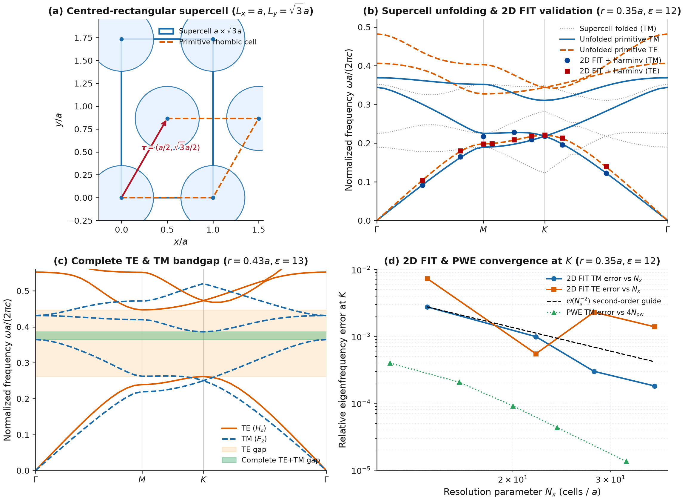

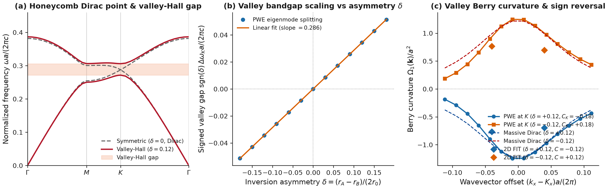

**Limits & failure modes.**
- *Even grid dimensions required for exact $`\boldsymbol{\tau}`$-unfolding on the Cartesian supercell.* Because the internal primitive translation is $`\boldsymbol{\tau} = (a/2, \sqrt{3}a/2)`$, mapping $`\mathbf{r}_1 \mapsto \mathbf{r}_1 + \boldsymbol{\tau}`$ onto exact grid nodes without spatial interpolation requires `nx` and `ny` to be even integers (`fit_supercell_bands_at_k` and `translate_supercell_field` raise `ValueError` if `nx` or `ny` is odd). Furthermore, placing all four honeycomb rod centres at exact subgrid positions relative to the cell faces is cleanest when `ny` is a multiple of 6.
- *Large inversion asymmetry ($`|\delta| \gtrsim 0.25`$) and Berry-curvature delocalization.* The quantized half-integer valley Chern number $`C_{\tau_v} = -\frac{1}{2}\tau_v\mathrm{sgn}(\delta)`$ holds in the small-mass Dirac regime ($`|m| \ll v_D |\mathbf{K} - \mathbf{M}|`$) where $`\Omega_1(\mathbf{k})`$ is tightly localized around $`K`$ and $`K'`$. For large asymmetry, Berry curvature spreads across the hexagonal Brillouin zone boundary and overlaps between valleys, reducing the single-valley integral and increasing intervalley scattering at sharp corners.
- *Symmetry protection of $`120^\circ`$ bends vs $`90^\circ`$ bends and sublattice orientation.* Valley-Hall protection relies on conservation of the valley pseudospin $`\tau_v`$ under $`C_3`$-compatible interfaces. A $`90^\circ`$ turn or short-range point defect scatters across $`|\mathbf{K} - \mathbf{K}'| = 4\pi/(3a)`$ and causes back-reflection. Even for a $`120^\circ`$ Z-bend (`domain_wall_bend_inclusions`), the diagonal segment must turn by $`-60^\circ`$ ($`C_3`$ rotation) rather than $`+60^\circ`$ ($`C_6`$ rotation): a $`+60^\circ`$ turn swaps the $`A`$ and $`B`$ sublattices across the diagonal arm, converting a small-rod interface into a large-rod interface whose guided passband lies in the opposite half of the bulk gap.

References:
- K. M. Ho, C. T. Chan and C. M. Soukoulis, "Existence of a photonic gap in periodic dielectric structures", *Phys. Rev. Lett.* **65**, 3152–3155 (1990), [doi:10.1103/PhysRevLett.65.3152](https://doi.org/10.1103/PhysRevLett.65.3152).
- M. Plihal and A. A. Maradudin, "Photonic band structure of two-dimensional systems: The triangular lattice", *Phys. Rev. B* **44**, 8565–8571 (1991), [doi:10.1103/PhysRevB.44.8565](https://doi.org/10.1103/PhysRevB.44.8565).
- T. Ma and G. Shvets, "All-Si valley-Hall photonic topological insulator", *New J. Phys.* **18**, 025012 (2016), [doi:10.1088/1367-2630/18/2/025012](https://doi.org/10.1088/1367-2630/18/2/025012).
- F. Gao, H. Xue, Z. Yang, K. Lai, Y. Yu, X. Lin, Y. Chong, G. Shvets and B. Zhang, "Topologically protected refraction of robust kink states in valley photonic crystals", *Nat. Phys.* **14**, 140–144 (2018), [doi:10.1038/nphys4304](https://doi.org/10.1038/nphys4304).
- T. Fukui, Y. Hatsugai and H. Suzuki, "Chern Numbers in Discretized Brillouin Zone: Efficient Method of Computing (Spin) Hall Conductances", *J. Phys. Soc. Jpn.* **74**, 1674–1677 (2005), [doi:10.1143/JPSJ.74.1674](https://doi.org/10.1143/JPSJ.74.1674).
- V. Popescu and A. Zunger, "Effective Band Structure of Random Alloys", *Phys. Rev. Lett.* **104**, 236403 (2010), [doi:10.1103/PhysRevLett.104.236403](https://doi.org/10.1103/PhysRevLett.104.236403).
- W. Ku, T. Berlijn and C.-C. Lee, "Unfolding First-Principles Band Structures", *Phys. Rev. Lett.* **104**, 216401 (2010), [doi:10.1103/PhysRevLett.104.216401](https://doi.org/10.1103/PhysRevLett.104.216401).
- J. D. Joannopoulos, S. G. Johnson, J. N. Winn and R. D. Meade, *Photonic Crystals: Molding the Flow of Light*, 2nd ed. (Princeton University Press, Princeton, NJ, 2008).


### Kerr ($\chi^{(3)}$) nonlinear media, delayed Raman response, and FIT-informed soliton microcombs (`wakis.nonlinear`)

Centrosymmetric optical dielectrics (such as $\text{Si}_3\text{N}_4$, $\text{SiO}_2$, $\text{AlGaAs}$, and silicon) have vanishing second-order susceptibility ($\chi^{(2)} = 0$) and exhibit a dominant third-order Kerr nonlinearity $\chi^{(3)}$ [$\text{m}^2/\text{V}^2$] responsible for self-phase modulation (SPM), cross-phase modulation (XPM), third-harmonic generation (THG), four-wave mixing (FWM), nonlinear cavity resonance shifts, and dissipative Kerr soliton (DKS) frequency microcombs. `wakis.nonlinear` (`KerrMaterial`, `NonlinearMaterial`, `solver.add_nonlinear_material`, `solve_lle`, `lle_cw_bistability`, `lle_soliton_analytic`, `chi3_to_n2`, `n2_to_chi3`, `spm_phase_shift`, `thg_conversion_efficiency`, `effective_nonlinear_volume`, `kerr_cavity_frequency_shift`; example `examples/013_kerr_nonlinear_optics.py`, tutorial `tutorials/05_guided_waves/05-11_kerr_microcomb/`, test `tests/test_073_nonlinear_kerr.py`) implements sub-cycle time-domain constitutive updates coupled to `SolverFIT3D` alongside a split-step Fourier Lugiato–Lefever Equation (LLE) solver for microcomb dynamics.

**Constitutive relation: instantaneous electronic Kerr + delayed vibrational Raman + linear ADE poles.** Following Taflove & Hagness [2005, Ch. 9] and Joseph & Taflove [1997], the macroscopic electric displacement $\mathbf{D}(\mathbf{r}, t)$ in a centrosymmetric medium with high-frequency relative permittivity $\varepsilon_\infty$, linear dispersive Drude/Lorentz/Debye poles $\mathbf{P}_{\text{L}} = \sum_p \mathbf{P}_p$, and third-order susceptibility $\chi^{(3)}$ partitioned between an instantaneous electronic fraction $(1 - f_R)$ and a delayed Raman fraction $f_R \in [0, 1]$ is

```math
\mathbf{D}(t) = \varepsilon_0 \varepsilon_\infty \mathbf{E}(t) + \mathbf{P}_{\text{L}}(t) + \varepsilon_0 \chi^{(3)}\Big[(1 - f_R)\big|\mathbf{E}(t)\big|^2 + f_R S(t)\Big]\mathbf{E}(t) .
```

The delayed scalar Raman response $S(t) = \int_0^\infty h_R(\tau)|\mathbf{E}(t-\tau)|^2\,d\tau$ with normalized impulse response $h_R(\tau) = \frac{\tau_1^2 + \tau_2^2}{\tau_1 \tau_2^2} e^{-\tau/\tau_2}\sin(\tau/\tau_1)\,\Theta(\tau)$ ($\int_0^\infty h_R(\tau)\,d\tau = 1$) satisfies the second-order Lorentz auxiliary differential equation (ADE) [Joseph & Taflove, 1997]:

```math
\frac{d^2 S}{dt^2} + 2\Gamma_R \frac{dS}{dt} + \Omega_R^2 S = \Omega_R^2 \big|\mathbf{E}(t)\big|^2, \qquad
\Omega_R = \sqrt{\frac{1}{\tau_1^2} + \frac{1}{\tau_2^2}}, \qquad
\Gamma_R = \frac{1}{\tau_2} .
```

**Time-level centering and per-edge cubic Newton / fixed-point / explicit ADE updates.** On the staggered FIT grid, $\mathbf{E}^n$, the linear auxiliary polarizations $\mathbf{p}_p^n = \mathbf{P}_p^n/\varepsilon_0$, and the Raman state $S^n$ are collocated at integer times $t^n = n\Delta t$, while $\mathbf{H}^{n+1/2}$ lives at half-integer times $t^{n+1/2} = (n + \tfrac{1}{2})\Delta t$. Within each time step $n \to n+1$:

1. *Pre-step capture (`_capture_nonlinear_E`):* Before the standard explicit step overwrites `solver.E`, each registered nonlinear group records $E_{\text{old}} = E^n$ on its edge indices.
2. *Standard leapfrog step:* Faraday's law advances $\mathbf{H}^{n-1/2} \to \mathbf{H}^{n+1/2}$ and Ampère's law computes the trial electric field $E^*$ using the static inverse permittivity $\varepsilon_s^{-1}$ stored in `solver.ieps`.
3. *Raman ADE update centered at $t^n$:* Using second-order central differences, $S^{n+1}$ is updated explicitly from $|\mathbf{E}^n|^2$ before solving for $\mathbf{E}^{n+1}$:
   ```math
   S^{n+1} = \frac{\big(2 - \Omega_R^2\Delta t^2\big)S^n - \big(1 - \Gamma_R\Delta t\big)S^{n-1} + \Omega_R^2\Delta t^2\big|\mathbf{E}^n\big|^2}{1 + \Gamma_R\Delta t} .
   ```
4. *Linear ADE accumulation and cubic constitutive inversion at $t^{n+1}$ (`_update_nonlinear`):* For an edge with subcell fill fraction $w \in (0, 1]$ over background $\varepsilon_{\text{bg}}$, let $\varepsilon_e = (1 - w)\varepsilon_{\text{bg}} + w\varepsilon_\infty$ and $s = \sigma\Delta t/(2\varepsilon_0) + \sum_D \beta_D$. Subtracting the updated linear pole increments defines the known normalized displacement numerator
   ```math
   y_e = \varepsilon_{s,e}\big(E_e^* - E_e^n\big) + \big(\varepsilon_e - w s\big)E_e^n - w\sum_L\big(p_{L,e}^{n+1} - p_{L,e}^n\big) - w\sum_D (\kappa_D - 1)p_{D,e}^n ,
   ```
   which equals $\big[\beta_e + \alpha_e |\mathbf{E}_e^{n+1}|^2\big]E_e^{n+1}$ with
   ```math
   \beta_e = \varepsilon_e + w s + w f_R \chi^{(3)} S_e^{n+1}, \qquad
   \alpha_e = w(1 - f_R)\chi^{(3)} .
   ```
   Because $\mathbf{E}^{n+1}$ is parallel to $\mathbf{y}$, taking the magnitude $x = |\mathbf{E}^{n+1}| \ge 0$ and $Y = |\mathbf{y}| \ge 0$ reduces the vector constitutive inversion to the scalar depressed cubic
   ```math
   f(x) \equiv \alpha_e x^3 + \beta_e x - Y = 0 .
   ```
   Three solver strategies are provided via `KerrMaterial(..., method=...)`:
   - `method='newton'` (default): Vectorized Newton–Raphson iteration starting from the linear trial predictor $x^{(0)} = Y/\beta_e$,
     ```math
     x^{(k+1)} = x^{(k)} - \frac{\alpha_e \big(x^{(k)}\big)^3 + \beta_e x^{(k)} - Y}{3\alpha_e \big(x^{(k)}\big)^2 + \beta_e}, \qquad
     E_e^{n+1} = \frac{y_e}{\beta_e + \alpha_e x^2} ,
     ```
     which converges quadratically to machine precision ($\le 10^{-13}$) in 3–5 iterations and is monotonically well-posed ($f'(x) = 3\alpha_e x^2 + \beta_e > 0$) for all focusing Kerr media ($\alpha_e \ge 0, \beta_e > 0$).
   - `method='fixed_point'`: Picard iteration $x^{(k+1)} = Y / \big(\beta_e + \alpha_e (x^{(k)})^2\big)$ [Taflove & Hagness, Ch. 9].
   - `method='explicit_ade'`: Single-pass evaluation replacing $|\mathbf{E}^{n+1}|^2$ by the linear trial predictor $x^{(0)} = Y/\beta_e$, avoiding iteration at the cost of an $O(\Delta t\,\chi^{(3)}|\mathbf{E}|^2)$ time-lag error.

When $\chi^{(3)} = 0$ and $f_R = 0$, $\alpha_e = 0$ and $E_e^{n+1} = y_e / \beta_e$ reproduces the linear `SolverFIT3D` update **bit-for-bit** (`max |diff| == 0.0`, verified in `test_zero_chi3_bit_for_bit_linear`).

**Relation between $\chi^{(3)}$ and $n_2$ under the $\exp(+i\omega t)$ real-field convention (the $3/4$ factor).** In Wakis's time-domain solver, the electric field is real: for a monochromatic wave $E(z, t) = \operatorname{Re}[\tilde{E}_0 e^{i(\omega_0 t - k z)}] = |\tilde{E}_0|\cos\theta$, cubing the real field gives

```math
E^3(z, t) = |\tilde{E}_0|^3\cos^3\theta = |\tilde{E}_0|^3\left(\frac{3}{4}\cos\theta + \frac{1}{4}\cos 3\theta\right) = \operatorname{Re}\!\left[\frac{3}{4}|\tilde{E}_0|^2\tilde{E}_0\,e^{i\theta} + \frac{1}{4}\tilde{E}_0^3\,e^{i 3\theta}\right] .
```

The fundamental Fourier component at $\omega_0$ therefore experiences the effective relative permittivity $\varepsilon_{\text{eff}}(\omega_0) = \varepsilon_r + \frac{3}{4}\chi^{(3)}|\tilde{E}_0|^2$. Equating $\varepsilon_{\text{eff}} = (n_0 + \Delta n_{\text{NL}})^2 \simeq n_0^2 + 2 n_0 \Delta n_{\text{NL}}$ with $\Delta n_{\text{NL}} = n_2 I$ and the cycle-averaged optical intensity $I = \tfrac{1}{2}c\varepsilon_0 n_0|\tilde{E}_0|^2$ [W/m$^2$] gives (`chi3_to_n2`, `n2_to_chi3`, `spm_phase_shift`) [Boyd, 2020]:

```math
\Delta n_{\text{NL}} = \frac{3\chi^{(3)}}{8 n_0}|\tilde{E}_0|^2 = n_2 I, \qquad
n_2 = \frac{3\chi^{(3)}}{4 c \varepsilon_0 n_0^2}\quad [\text{m}^2/\text{W}], \qquad
\Delta\Phi_{\text{NL}} = n_2 k_0 I L .
```

Simultaneously, the $\tfrac{1}{4}\tilde{E}_0^3 e^{i 3\theta}$ polarization source drives **third-harmonic generation (THG)** at $3\omega_0$. In the undepleted-pump approximation across a slab of thickness $L$ with wavevector mismatch $\Delta k = k(3\omega_0) - 3 k(\omega_0) = (3\omega_0/c)[n(3\omega_0) - n(\omega_0)]$, the THG power conversion efficiency exhibits Maker fringes (`thg_conversion_efficiency`) [Boyd, 2020]:

```math
\eta_{\text{THG}}(L) = \frac{I_{3\omega}(L)}{I_\omega(0)} = \frac{9\omega_0^2\big(\chi^{(3)}\big)^2 I_\omega^2 L^2}{16\varepsilon_0^2 c^4 n_\omega^3 n_{3\omega}}\,\operatorname{sinc}^2\!\left(\frac{\Delta k L}{2}\right), \qquad \operatorname{sinc}(u) \equiv \frac{\sin u}{u} .
```

**Kerr cavity perturbation theory and effective nonlinear mode volume.** For a resonant dielectric cavity mode $\mathbf{E}(\mathbf{r}, t) = \operatorname{Re}[\tilde{\mathbf{E}}(\mathbf{r})e^{i\omega_0 t}]$ storing total electromagnetic energy $U = \tfrac{1}{2}\varepsilon_0\int \varepsilon_r(\mathbf{r})|\tilde{\mathbf{E}}(\mathbf{r})|^2\,dV$ [J], first-order perturbation theory (`effective_nonlinear_volume`, `kerr_cavity_frequency_shift`) gives the Kerr resonance frequency shift:

```math
\frac{\Delta\omega_{\text{NL}}}{\omega_0} = \frac{\Delta f_{\text{NL}}}{f_0} = -\frac{3\chi^{(3)}\int_{\text{NL}} |\tilde{\mathbf{E}}(\mathbf{r})|^4\,dV}{8\int \varepsilon_r(\mathbf{r})|\tilde{\mathbf{E}}(\mathbf{r})|^2\,dV} = -\frac{c n_2 U}{n_0^2 V_{\text{eff,NL}}}, \qquad
V_{\text{eff,NL}} \equiv \frac{\left(\int \varepsilon_r(\mathbf{r})|\tilde{\mathbf{E}}(\mathbf{r})|^2\,dV\right)^2}{n_0^2 \int_{\text{NL}} \varepsilon_r(\mathbf{r})|\tilde{\mathbf{E}}(\mathbf{r})|^4\,dV} .
```

**FIT-informed Lugiato–Lefever Equation (LLE) for soliton microcombs (`solve_lle`).** Because comb formation in high-$Q$ microresonators unfolds over $10^5$–$10^6$ round trips, full-wave FIT supplies the resonator's cold-cavity dispersion $D_{\text{int}}(\mu) = \omega_\mu - \omega_0 - D_1\mu \simeq \tfrac{1}{2}D_2\mu^2 + \tfrac{1}{6}D_3\mu^3$, linewidths $(\kappa_0, \kappa_{\text{ex}}, \kappa = \kappa_0 + \kappa_{\text{ex}})$, and effective nonlinear mode volume $V_{\text{eff,NL}}$ to the dimensionless mean-field Lugiato–Lefever Equation [Herr et al., 2014; Chembo & Menyuk, 2013; Kippenberg et al., 2018]:

```math
\frac{\partial \Psi(\phi, \tau)}{\partial \tau} = -\big(1 + i\zeta_0\big)\Psi + i\frac{d_2}{2}\frac{\partial^2 \Psi}{\partial \phi^2} + \frac{d_3}{6}\frac{\partial^3 \Psi}{\partial \phi^3} + i|\Psi|^2\Psi + f ,
```

where $\tau = \kappa t / 2$, $\zeta_0 = 2(\omega_0 - \omega_p)/\kappa$ is the normalized pump detuning, and $d_2 = 2 D_2 / \kappa > 0$ is the normalized anomalous dispersion. `solve_lle` integrates this equation via a symmetric Strang split-step Fourier method (exact dispersion step in azimuthal mode number $\mu$ + RK4 nonlinear/pump step in angle $\phi$). On the red-detuned soliton step $\zeta_{\min} < \zeta_0 \le \zeta_{\max} = \frac{\pi^2}{8}f^2$, the single dissipative Kerr soliton profile and its $\operatorname{sech}^2$ comb spectrum (`lle_soliton_analytic`) are

```math
\Psi(\phi) \simeq \Psi_{\text{bg}} + \sqrt{2\zeta_0}\,e^{i\phi_0}\operatorname{sech}\!\left(\sqrt{\frac{2\zeta_0}{d_2}}\,\phi\right), \qquad
|\Psi_\mu|^2 = \frac{d_2}{4}\operatorname{sech}^2\!\left(\frac{\pi\mu}{2}\sqrt{\frac{d_2}{2\zeta_0}}\right), \qquad
\Delta\mu_{\text{FWHM}} = \frac{4\operatorname{arccosh}(\sqrt{2})}{\pi}\sqrt{\frac{2\zeta_0}{d_2}} \propto \sqrt{\frac{\zeta_0}{D_2}} .
```

**Validation** (`tests/test_073_nonlinear_kerr.py`, `tests/test_tut_05_11_kerr_microcomb.py`, `examples/013_kerr_nonlinear_optics.py`):
- *(a) 1D self-phase modulation (SPM) & real-field $3/4$ factor:* Across four optical intensities in a $L = 6\ \mu\text{m}$ Kerr slab ($\varepsilon_r = 2.25$, $\chi^{(3)} = 2\times 10^{-18}\ \text{m}^2/\text{V}^2$), the 1D FIT nonlinear phase shift $\Delta\Phi_{\text{NL}}$ agrees with $\Delta\Phi_{\text{NL}} = n_2 k_0 I L$ to **$0.10\%$** max relative error (`1.02e-3`) for both `method='newton'` and `method='fixed_point'`. Mutating the $3/4$ factor to $1$ shifts the slope by $+33\%$ and fails the test.
- *(b) 1D third-harmonic generation (THG) & Maker-fringe $\operatorname{sinc}^2(\Delta k L/2)$:* In a phase-matched slab ($\Delta k = 0$), the $3\omega_0$ conversion efficiency scales as $I_\omega^2 L^2$ within $4.2\%$ of the undepleted-pump formula. With a Lorentz pole introducing index dispersion $\Delta n = n(3\omega_0) - n(\omega_0) \ne 0$, the THG spatial profile oscillates with coherence length $L_c = \pi / |\Delta k|$ (`4.90%` peak error) and vanishes at $L = 2 L_c$.
- *(c) Kerr cavity resonance shift in 1D Fabry–Pérot and 2D microring cavities:* In a 1D PEC cavity ($L = 1.5\ \mu\text{m}$) partially or fully filled with a Kerr dielectric, the `harminv`-extracted frequency shift matches $\Delta f_{\text{NL}} = -f_0 c n_2 U / (n_0^2 V_{\text{eff,NL}})$ to **$1.28\%$** across 3 field amplitudes; in the 2D TM microring ($R = 2.0\ \mu\text{m}, w = 0.60\ \mu\text{m}$), the 2D FIT Kerr shift agrees with $V_{\text{eff,NL}}$ perturbation theory to **$2.01\%$**.
- *(d) Bit-for-bit linear limit at $\chi^{(3)} = 0$:* Setting $\chi^{(3)} = 0$ on `KerrMaterial` (with or without Lorentz poles) reproduces the linear `SolverFIT3D` electric and magnetic field arrays to `max |diff| == 0.0`.
- *(e) Delayed Raman ADE & nonlinear energy positivity:* Under an impulsive step $|\mathbf{E}|^2(t) = E_0^2\Theta(t)$, the discrete Raman state $S^n$ matches the exact analytical step response of the damped oscillator to $2.4\times 10^{-3}$, and the instantaneous Kerr electromagnetic energy $W_{\text{Kerr}} = \int \big(\tfrac{1}{2}\varepsilon_0\varepsilon_\infty E^2 + \tfrac{3}{4}\varepsilon_0\chi^{(3)}E^4 + \tfrac{1}{2}\mu_0 H^2\big)dV$ remains bounded and positive in a closed PEC cavity.
- *(f) FIT-informed LLE microcomb:* 2D FIT + `harminv` extracts the microring WGM resonances ($m = 14\text{--}20$, $f_0 = 214.34\text{ THz}$, $\text{FSR} = 10.32\text{ THz}$) to $0.08\%$–$0.29\%$ at $\Delta x = 20\text{ nm}$ ($0.0009\%$–$0.005\%$ after Richardson extrapolation) and anomalous dispersion $D_2/(2\pi) = +27.89\text{ GHz}$ ($22.44\%$ error at $\Delta x = 30\text{ nm}$, $14.32\%$ at $25\text{ nm}$, $9.59\%$ at $20\text{ nm}$, and $1.19\%$ after Richardson extrapolation to $+30.49\text{ GHz}$ vs $+30.85\text{ GHz}$ Bessel). Deriving $d_2 = 2 D_2/\kappa = 0.1391$ and $f = \sqrt{P_{\text{in}}/P_{\text{th}}} = 2.350$ directly from the FIT bus-coupled $Q_L = 534.2$ ($\kappa/(2\pi) = 401.06\text{ GHz}$) and $V_{\text{eff,NL}} = 1.290\ \mu\text{m}^3$ ($P_{\text{in}} = 3.521\text{ W}$), `solve_lle` produces the MI $\to$ chaotic breather $\to$ single-DKS sequence, matching the analytical $\operatorname{sech}$ pulse width to $6.74\%$, the $\operatorname{sech}^2$ spectral FWHM to $2.08\%$, and the $\Delta\mu_{\text{FWHM}} \propto D_2^{-1/2}$ exponent to $0.45\%$.

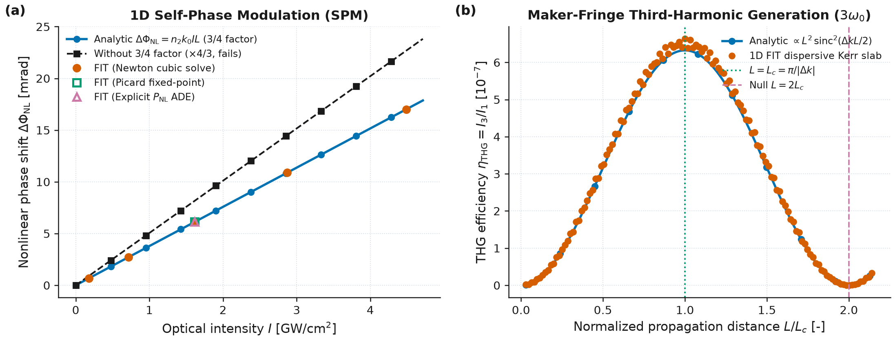

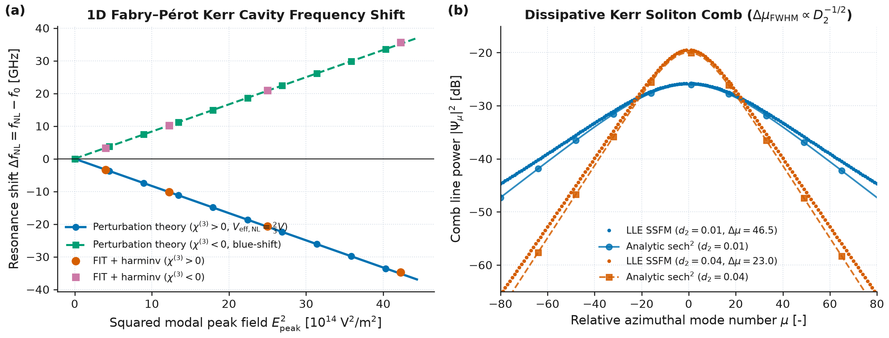

**Limits & Failure Modes.**
- *Differential permittivity positivity and defocusing blowup ($\varepsilon_e + 3\alpha |\mathbf{E}|^2 \le 0$).* For a focusing Kerr medium ($\chi^{(3)} > 0$), the instantaneous differential permittivity $\frac{dD}{dE} = \varepsilon_0(\varepsilon_e + 3\alpha |\mathbf{E}|^2)$ increases with field strength, which lowers the local wave speed $v = (\mu_0\,dD/dE)^{-1/2} < c/\sqrt{\varepsilon_e}$ and keeps the vacuum Courant step $\Delta t$ stable while guaranteeing a unique root of $f(x) = \alpha x^3 + \beta x - Y = 0$. For a strong defocusing nonlinearity ($\chi^{(3)} < 0$) or when $|\chi^{(3)}||\mathbf{E}|^2 \gtrsim \varepsilon_e / 3$, $\frac{dD}{dE}$ can approach zero or turn negative, violating hyperbolicity and the Courant limit and causing immediate numerical blowup.
- *Explicit trial-field lag (`method='explicit_ade'`) vs implicit Newton (`method='newton'`).* The single-pass `'explicit_ade'` option evaluates $|\mathbf{E}|^2$ from the linear trial predictor $E^*$ rather than solving the implicit cubic at $t^{n+1}$. When the nonlinear index shift exceeds $\Delta n_{\text{NL}} / n_0 \gtrsim 0.05$, this time lag introduces artificial phase error and high-field instability; use `method='newton'` (the default) for strong fields.
- *Unresolved higher harmonics ($3\omega_0, 5\omega_0, \dots$) and optical carrier shock wave formation.* Because full-wave FIT evolves the real electric field without a slowly varying envelope approximation, cubing $E(t)$ continuously generates odd harmonics ($3\omega_0, 5\omega_0, \dots$) and self-steepening carrier shocks [Taflove & Hagness, Ch. 9]. If the spatial grid resolves only the fundamental wavelength $\lambda_0/n_0$ at $20\text{ cells}/\lambda$ ($\approx 6.7\text{ cells}/\lambda$ at $3\omega_0$), the third harmonic experiences strong numerical grid dispersion; simulations targeting quantitative THG must resolve the shortest harmonic wavelength ($\ge 20\text{ cells}/\lambda_{3\omega}$).
- *Cross-polarization coupling on staggered Yee/FIT edges.* With `coupling='edge'` (default), each electric edge solves its scalar cubic using its own component magnitude $|E_c|^2$, which is exact for linearly polarized 1D/2D TM or TE waves and avoids spatial interpolation across staggered cell locations. For elliptically polarized 3D fields where cross-phase modulation ($|\mathbf{E}|^2 = E_x^2 + E_y^2 + E_z^2$) is required, `coupling='isotropic'` reconstructs $|\mathbf{E}|^2$ at cell centers from the previous step's orthogonal components, introducing an $O(\Delta x^2, \Delta t)$ staggering approximation.
- *Mean-field LLE validity limits.* The Lugiato–Lefever Equation assumes high cavity finesse ($\mathcal{F} = D_1/\kappa \gg 1$), small per-round-trip nonlinear phase shift, and a single transverse mode family. It breaks down when avoided mode crossings with other transverse/polarization families distort $D_{\text{int}}(\mu)$, when normal dispersion ($D_2 < 0$) prevents bright soliton formation, or when the laser detuning exceeds the maximum soliton existence limit $\zeta_{\max} = (\pi^2/8)f^2$.
- *Supported solver backends.* `wakis.nonlinear` runs on the real-field CPU FIT stepper (standard, CPML, MKL, and MPI). Passing a nonlinear material to `use_gpu=True`, `fused=True`, `scheme='tete'`, `AdjointSimulation`, or complex-dtype fields raises `NotImplementedError`.

References:
- A. Taflove and S. C. Hagness, *Computational Electrodynamics: The Finite-Difference Time-Domain Method*, 3rd ed., Artech House, Norwood, MA, Ch. 9 (2005).
- R. M. Joseph and A. Taflove, "FDTD Maxwell's equations models for nonlinear electrodynamics and optics", *IEEE Trans. Antennas Propag.* **45**(3), 364–374 (1997), [doi:10.1109/8.558652](https://doi.org/10.1109/8.558652).
- R. W. Boyd, *Nonlinear Optics*, 4th ed., Academic Press, San Diego, Chs. 2, 4 (2020).
- T. Herr, V. Brasch, J. D. Jost, C. Y. Wang, N. M. Kondratiev, M. L. Gorodetsky and T. J. Kippenberg, "Temporal solitons in optical microresonators", *Nat. Photonics* **8**(2), 145–152 (2014), [doi:10.1038/nphoton.2013.343](https://doi.org/10.1038/nphoton.2013.343).
- Y. K. Chembo and C. R. Menyuk, "Spatiotemporal Lugiato-Lefever formalism for Kerr-comb generation in whispering-gallery-mode resonators", *Phys. Rev. A* **87**(5), 053852 (2013), [doi:10.1103/PhysRevA.87.053852](https://doi.org/10.1103/PhysRevA.87.053852).
- T. J. Kippenberg, A. L. Gaeta, M. Lipson and M. L. Gorodetsky, "Dissipative Kerr solitons in optical microresonators", *Science* **361**(6402), eaan8083 (2018), [doi:10.1126/science.aan8083](https://doi.org/10.1126/science.aan8083).


### Noise and time scaling in gain media

Real lasers start oscillating from quantum spontaneous emission rather than an external coherent seed pulse, and their atomic upper-state lifetimes ($\tau_{21} \sim \text{ps–ns}$) exceed optical FDTD/FIT timesteps ($\Delta t \sim 0.05\text{–}0.1\text{ fs}$) by four to seven orders of magnitude. `FourLevelGain` (`wakis.gain`, `tests/test_074_gain_noise_and_scaling.py`, `examples/014_laser_noise_and_time_scaling.py`) addresses both problems through (1) a Fluctuation–Dissipation-Theorem (FDT) / quantum-Langevin stochastic polarization force (`spontaneous_emission=True`, `seed=...`) and (2) an explicit rate-equation lifetime acceleration transformation (`time_scale = s`, alias `lifetime_scale = s`).

**1. Langevin noise in the polarization equations (FDT / quantum-Langevin derivation).** Following the stochastic Maxwell–Bloch FDTD formalism of Andreasen, Cao, Taflove, Kumar, and Cao (*Phys. Rev. A* **77**, 023810, 2008), Andreasen and Cao (*J. Lightwave Technol.* **27**, 4530–4535, 2009; *Phys. Rev. A* **82**, 063835, 2010), and Siegman (*Lasers*, 1986, Chs. 2, 7, 13), spontaneous emission into the $1 \leftrightarrow 2$ transition is incorporated by adding a stochastic Langevin force $\mathbf{F}_a(\mathbf{r}, t)$ to the auxiliary polarization oscillator equation:

```math
\frac{\partial^2 \mathbf{P}_a}{\partial t^2} + \gamma_a \frac{\partial \mathbf{P}_a}{\partial t} + \omega_a^2 \mathbf{P}_a = \kappa_a \bigl(N_1(\mathbf{r}, t) - N_2(\mathbf{r}, t)\bigr)\mathbf{E}(\mathbf{r}, t) + \mathbf{F}_a(\mathbf{r}, t) .
```

In the Markovian thermal/quantum-Langevin limit ($\gamma_a \ll \omega_a$), the fluctuation–dissipation theorem relates the two-time correlation of $\mathbf{F}_a$ to the dissipative damping rate $\gamma_a$, the dipole coupling constant $\kappa_a = \frac{6\pi\varepsilon_0 c^3}{\omega_a^2 \tau_{21}}$, and the upper-level population density $N_2(\mathbf{r}, t)$ responsible for downward spontaneous emission:

```math
\bigl\langle F_{a,\mu}(\mathbf{r}, t)\,F_{a,\nu}(\mathbf{r}', t') \bigr\rangle = D_{F,a}(\mathbf{r}, t)\,\delta_{\mu\nu}\,\delta(\mathbf{r} - \mathbf{r}')\,\delta(t - t'), \qquad
D_{F,a}(\mathbf{r}, t) = 2\gamma_a \kappa_a \hbar\omega_a\,\bigl[\max(N_2(\mathbf{r}, t), 0)\bigr]^{2 p_{\text{noise}}},
```

where the physical FDT / quantum-Langevin exponent is $p_{\text{noise}} = \tfrac{1}{2}$ (`noise_exponent=0.5`, so the Langevin force amplitude scales as $\propto \sqrt{N_2}$ and the radiated spontaneous power scales linearly with $N_2$).

*Time-level centring and discrete cell-volume scaling.* On the FIT staggered grid, $\mathbf{P}_a^n = \varepsilon_0 \mathbf{p}_a^n$ lives at integer time levels $t^n = n\Delta t$ on primary electric-field edges $e$ with dual cell volume $\Delta V_e$. Integrating the white-noise Langevin impulse over $(t^n, t^{n+1})$ and spatial dual volume $\Delta V_{\text{eff},e}$ gives a discrete Gaussian kick per timestep with variance $\langle (F_{a,e}^n)^2 \rangle = D_{F,a,e}^{n+1/2} / (\Delta V_{\text{eff},e}\,\Delta t)$. Evaluating the population factor at the Crank–Nicolson half-step midpoint $N_{2,+}^{n+1/2} = \max(\tfrac{1}{2}(N_2^n + N_2^{n+1}), 0)$ (`wakis/gain.py:_update_gain_E`, preserving second-order midpoint accuracy during rapid population transients) yields:

```math
\mathbf{p}_a^{n+1} = b_1\,\mathbf{p}_a^n + b_2\,\mathbf{p}_a^{n-1} + a_E\,(N_1^n - N_2^n)\,\mathbf{E}^n + \frac{\Delta t^2}{\varepsilon_0 (1 + \gamma_a \Delta t / 2)}\,\alpha_{\text{noise}}\sqrt{\frac{2\gamma_a \kappa_a \hbar\omega_a\,(N_{2,+}^{n+1/2})^{2 p_{\text{noise}}}}{\Delta V_{\text{eff}}\,\Delta t}}\,\boldsymbol{\xi}_e^n ,
```

where $\boldsymbol{\xi}_e^n \sim \mathcal{N}(\mathbf{0}, \mathbf{I})$ are independent standard normal variates drawn from a dedicated per-group `np.random.Generator(np.random.PCG64(seed))` and $\alpha_{\text{noise}} \ge 0$ is `noise_amplitude` ($0$ when `spontaneous_emission=False`, $1$ when `spontaneous_emission=True`). Auto-detected transverse-uniform plane-wave noise (`transverse_uniform_noise=None`) is restricted strictly to quasi-1D periodic slabs (`bc_low[0] == "periodic"`, `bc_low[1] == "periodic"`, `Nx <= 2`, and `Ny <= 2`), where transverse edges in the same $z$-slice share the plane-wave mode of cross-sectional area $A_\perp = L_x L_y$ and $\Delta V_{\text{eff}} = A_\perp \Delta z$. On 3D periodic grids with `Nx > 2` or `Ny > 2` (such as photonic-crystal, PCSEL, or BIC unit cells), each grid cell draws independent Langevin kicks scaled by its local edge volume $\Delta V_e$.

**2. 1D radiative fraction and spontaneous-emission power.** In three dimensions, a single inverted atom in level $2$ radiates spontaneous power $\hbar\omega_a / \tau_{21}$ into all $4\pi$ steradians. In a 1D-periodic planar waveguide or slab of transverse period area $A_\perp = L_x L_y$ and background refractive index $n_{\text{bg}} = \sqrt{\varepsilon_\infty}$, a uniform current sheet $J_x(\omega)$ of thickness $\Delta z$ radiates plane waves into $\pm z$ with cycle-averaged Poynting flux $P_{\text{rad}} = \frac{A_\perp \Delta z^2}{4 c \varepsilon_0 n_{\text{bg}}} |J_x(\omega)|^2$. Integrating the Lorentzian spectral density of $J_x(\omega) = i\omega P_a(\omega)$ driven by $D_{F,a}$ over all frequencies $\omega \in (0, \infty)$ via the residue theorem $\int_{-\infty}^{\infty} \frac{\omega^2 d\omega}{(\omega_a^2 - \omega^2)^2 + \gamma_a^2 \omega^2} = \frac{\pi}{2\gamma_a}$ gives the exact 1D FDT spontaneous-emission power (`FourLevelGain.spontaneous_emission_power`, `FourLevelGain.radiative_fraction_1d`):

```math
P_{\text{sp,1D}} = f_{\text{rad,1D}}\,V_{\text{gain}} N_2\,\frac{\hbar\omega_a}{\tau_{21}}, \qquad
f_{\text{rad,1D}} = \frac{\kappa_a \tau_{21}}{2\varepsilon_0 c n_{\text{bg}} A_\perp} = \frac{3\pi c^2}{n_{\text{bg}} \omega_a^2 A_\perp} = \frac{3\lambda_0^2}{4\pi n_{\text{bg}} A_\perp} .
```

Here $f_{\text{rad,1D}}$ is the exact fraction of the 3D free-space spontaneous emission rate per polarization captured by the $\pm z$ 1D plane-wave continuum of cross-section $A_\perp$. On the discrete Yee/FIT grid with timestep $\Delta t$, the discrete Lorentzian integral $\int \frac{\tilde{\omega}^2 d\omega}{(\omega_a^2 - \tilde{\omega}^2)^2 + \gamma_a^2 \tilde{\omega}_c^2}$ introduces the second-order finite-timestep factor $1 / [1 - (\omega_a \Delta t / 2)^2]$ (included when `dt` is passed to `spontaneous_emission_power`).

**3. Amplified spontaneous emission (ASE) and spectral gain narrowing.** In a 1D gain slab of length $L$ below threshold with population densities $(N_1, N_2)$, each slice $dz'$ at position $z' \in [0, L]$ emits spontaneous power spectral density proportional to the emission lineshape $g_{\text{sp}}(\omega) = \sigma_{21}(\omega)\,N_2$, which is subsequently amplified by $\exp[g(\omega)(L - z')]$ where $g(\omega) = \sigma_{21}(\omega)(N_2 - N_1)$ is the net power gain coefficient. Integrating over $z' \in [0, L]$ yields the analytical single-pass ASE power spectral density (`ase_spectrum_1d`, `FourLevelGain.ase_spectrum`, [Siegman, 1986, §13.6]):

```math
S_{\text{ASE}}(\omega) \propto \int_0^L g_{\text{sp}}(\omega)\,e^{g(\omega)(L - z')}\,dz' = \frac{e^{g(\omega)L} - 1}{g(\omega)}\,g_{\text{sp}}(\omega) = \frac{e^{g(\omega)L} - 1}{N_2 - N_1}\,N_2 .
```

For $g_0 L \ll 1$, $S_{\text{ASE}}(\omega) \propto g_{\text{sp}}(\omega) L$ retains the full homogeneous Lorentzian FWHM $\Delta\omega_0 = \gamma_a$. As $g_0 L$ increases above unity, preferential exponential amplification at line centre $\omega_a$ narrows the half-maximum of $\exp[g(\omega)L] - 1$ (`FourLevelGain.ase_linewidth`):

```math
\Delta\omega_{\text{ASE}}(g_0 L) = \gamma_a \sqrt{\frac{g_0 L}{\ln\!\left(\frac{e^{g_0 L} + 1}{2}\right)} - 1} \;\underset{g_0 L \gg 1}{\sim}\; \frac{\gamma_a \sqrt{\ln 2}}{\sqrt{g_0 L - \ln 2}} \simeq \gamma_a \sqrt{\frac{\ln 2}{g_0 L}} .
```

**4. Threshold rounding ($\beta_{\text{sp}}$-factor) and multi-mode homogeneous mode competition.** Including the fraction $\beta_{\text{sp}}$ of spontaneous emission coupled into the lasing cavity mode modifies the dimensionless steady-state rate-equation balance between modal gain and cavity loss [Coldren, Corzine & Mašanović, 2012, Ch. 5]:

```math
\left(1 - \frac{r}{1 + s}\right)s = \beta_{\text{sp}}\,\frac{r}{1 + s}
\quad\Longrightarrow\quad
s(r, \beta_{\text{sp}}) = \frac{(r - 1) + \sqrt{(r - 1)^2 + 4\beta_{\text{sp}}\,r}}{2},
```

implemented in `fabry_perot_laser_output(..., beta_sp=...)`. For $\beta_{\text{sp}} = 0$, $s(r, 0) = \max(r - 1, 0)$ has a sharp kink at $r = 1$; for $\beta_{\text{sp}} > 0$, the threshold transition is smoothly rounded with $s(1, \beta_{\text{sp}}) = \sqrt{\beta_{\text{sp}}}$ at threshold and $s(r, \beta_{\text{sp}}) \simeq \beta_{\text{sp}} r / (1 - r)$ below threshold. In a 1D-periodic DBR Fabry–Pérot cavity of active length $L_{\text{cav}}$ bounded by symmetric quarter-wave DBR mirrors with phase penetration depth $L_{\text{pen}} = \lambda_0 / (4(n_H - n_L))$ and effective mode length $L_{\text{eff}} = L_{\text{cav}} + 2 L_{\text{pen}}$ ($\Gamma_z = L_{\text{cav}}/L_{\text{eff}}$), integrating the normalized Lorentzian spontaneous-emission spectrum $\frac{\gamma_a/(2\pi)}{(\omega - \omega_a)^2 + (\gamma_a/2)^2}$ over one longitudinal free spectral range $\Delta\omega_{\text{FSR}} = \pi c / L_{\text{eff}}$ centered on the lasing mode gives the spectral overlap factor $\Gamma_\omega = \frac{2}{\pi}\arctan(\Delta\omega_{\text{FSR}} / \gamma_a)$. The a priori theoretical spontaneous-emission coupling factor at physical FDT noise amplitude (`noise_amplitude=1.0`) is the product of the 1D plane-wave radiative fraction, longitudinal mode confinement, and Lorentzian-FSR spectral overlap:

```math
\beta_{\text{sp,theory}} = f_{\text{rad,1D}}(A_\perp)\,\Gamma_z\,\frac{2}{\pi}\arctan\!\left(\frac{\Delta\omega_{\text{FSR}}}{\gamma_a}\right), \qquad \Delta\omega_{\text{FSR}} = \frac{\pi c}{L_{\text{eff}}} .
```

In a long multi-mode Fabry–Pérot cavity ($L_{\text{cav}} \gg \lambda_0 / 2$) whose longitudinal mode spacing $\Delta f_{\text{FSR}} = c / (2 n_{\text{bg}} L_{\text{cav}})$ is smaller than the homogeneous gain bandwidth $\gamma_a / (2\pi)$, broadband spontaneous emission initially excites multiple longitudinal modes simultaneously; as the intracavity intensity saturates the homogeneous inversion (`spatial_averaging=True`), the central mode closest to $\omega_a$ clamps the gain at $g_{\text{th}}$, leaving all detuned side modes with net round-trip loss $g(\omega_m) - g_{\text{th}} < 0$ so that a single longitudinal mode wins in steady state.

**5. Lifetime acceleration (`time_scale = s`) and scaling analysis.** To bridge the $\sim\text{ns}$ population build-up timescale and the $\sim 0.05\text{ fs}$ FDTD/FIT timestep, `FourLevelGain(..., time_scale=s)` applies the rate-equation time-scaling transformation ($s > 0$):

```math
\tau_{ij} \longrightarrow \frac{\tau_{ij}}{s}, \qquad
W_p \longrightarrow s\,W_p, \qquad
W_{\text{stim}} = \frac{\mathbf{E}\cdot\partial_t \mathbf{P}_a}{\hbar\omega_a} \longrightarrow s\,W_{\text{stim}}, \qquad
\text{with } \kappa_a = \frac{6\pi\varepsilon_0 c^3}{\omega_a^2 \tau_{21,\text{phys}}} \text{ held fixed.}
```

Multiplying the entire right-hand side of the population rate equations by $s$ while keeping the optical susceptibility parameters $(\omega_a, \gamma_a, \kappa_a)$ at their physical unscaled values yields an exact separation between **invariant** steady-state observables and **scaled** transient observables (`FourLevelGain.relaxation_oscillation_parameters`, `FourLevelGain.turn_on_delay`, `FourLevelGain.time_scaling_limits`):

| Observable | Dependence on `time_scale` $s$ | Rate-equation expression / scaling |
| :--- | :--- | :--- |
| Dipole coupling $\kappa_a$ and cross-section $\sigma_{21}$ | **Invariant** ($s^0$) | $\sigma_{21} = \kappa_a / (\varepsilon_0 c n_{\text{bg}} \gamma_a)$ uses physical $\tau_{21}$ |
| Threshold pump rate $W_{p,\text{th}}$ (unscaled user input) | **Invariant** ($s^0$) | $(s W_p)(\tau_{21}/s) = W_p \tau_{21}$ cancels $s$ identically |
| Steady-state populations $\mathbf{N}_{\text{ss}}$ and inversion $\Delta N_{\text{ss}}$ | **Invariant** ($s^0$) | $\mathbf{M}(s)\mathbf{N}_{\text{ss}} = s\,\mathbf{M}(1)\mathbf{N}_{\text{ss}} = \mathbf{0}$ |
| Saturation intensity $I_{\text{sat}}$ | **Invariant** ($s^0$) | $(s W_{\text{stim}})(\tau_{\text{sat}}/s) = I / I_{\text{sat}}$ cancels $s$ identically |
| Steady-state laser output intensity $I_{\text{out}}$ | **Invariant** ($s^0$) | $I_{\text{out}} = \tfrac{1}{2}\ln(1/R)\,s(r)\,I_{\text{sat}}$ |
| Lasing spectrum peak frequency $f_{\text{lase}}$ | **Invariant** ($s^0$) | Determined by $\omega_a$, $\gamma_a$, and cold-cavity resonance $f_{\text{cav}}$ |
| Effective saturation recovery time $\tau_{\text{sat,eff}}(s)$ | **Scales as $s^{-1}$** | $\tau_{\text{sat}}(s) = \tau_{\text{sat}}(1) / s$ |
| Turn-on delay time $t_{\text{th}}(s)$ from ground state | **Scales as $s^{-1}$** | Exact root of $[\exp(\mathbf{M}(1)\,u\,\tau_{21})\mathbf{N}(0)]_{2-1} = \Delta N_{\text{th}}$ gives $t_{\text{th}}(s) = u\,\tau_{21}/s \propto s^{-1}$ |
| Undamped relaxation-oscillation frequency $\omega_{\text{RO},0}(s)$ | **Scales as $\sqrt{s}$** ($s \ll s_{\max,\text{cav}}$) | $\omega_{\text{RO},0}(s) = \sqrt{\frac{s\,(r - 1)}{\tau_{p,\text{disp}} \tau_{\text{sat}}(1)}} = \sqrt{s}\,\omega_{\text{RO},0}(1)$ |
| Relaxation-oscillation damping rate $\Gamma_{\text{RO}}(s)$ | **Scales as $s^1$** | $\Gamma_{\text{RO}}(s) = \frac{s\,r}{2\tau_{\text{sat}}(1)} = s\,\Gamma_{\text{RO}}(1)$ |
| Transient relaxation sideband / Schawlow–Townes width | **Scales with $s$** | Damping envelope broadens as $\Gamma_{\text{RO}}(s) \propto s$; scaled spontaneous rate $\propto s$ |

**Validation** (`tests/test_074_gain_noise_and_scaling.py`, `examples/014_laser_noise_and_time_scaling.py`):
1. *Default deterministic bit-identity, seeded reproducibility, and 3D periodic cell independence (`test_default_noise_off_and_seeded_reproducibility`):* With default `spontaneous_emission=False, time_scale=1.0`, an inverted cavity with no external source remains at $|\mathbf{E}| = |\mathbf{H}| = 0$ identically, and driven pulse propagation is bit-for-bit identical (`assert_array_equal`) to an in-process re-implementation of the deterministic rate-equation step (a regression guard for the noise-off path, not a comparison with the historical pre-F11b code) and to `spontaneous_emission=True, noise_amplitude=0.0` in the same process (avoiding platform-specific OpenBLAS vs macOS Accelerate ULP differences). With `spontaneous_emission=True, seed=42`, two independent runs and a run after `solver.reset_gain_state()` reproduce identical field trajectories ($0.0$ difference), while `seed=99` produces an independent realization. On a 3D periodic grid with `Nx = Ny = 4 > 2`, auto-detection disables transverse synchronization so each cell draws independent Langevin kicks (`corr < 0.15`).
2. *1D spontaneous-emission power vs FDT theory (`test_spontaneous_decay_power_and_noise_scaling`):* For an optically thin inverted layer ($L = 50\text{ nm} = 2\Delta z \ll \lambda_0 = 1.2\ \mu\text{m}$, $\Delta z = 25\text{ nm}$, $A_\perp = 4\ \mu\text{m}^2$, $f_{\text{rad,1D}} = 0.085944$) averaged over an $N_{\text{seeds}} = 8$ ensemble ($0.9\text{ ps} \approx 270/\gamma_a$ averaging window per seed, single-seed standard deviation $\sigma_1 = 7.12\%$, ensemble standard error $\sigma_{\text{SEM}} = \sigma_1/\sqrt{8} = 2.52\%$), the ensemble-averaged 3D FIT Poynting flux $P_{\text{rad,FIT}} = 1855.2 \pm 46.7\text{ fW}$ matches the analytical 1D FDT rate $P_{\text{sp,1D}} = 1898.9\text{ fW}$ to $2.31\%$ ($0.92\,\sigma_{\text{SEM}}$, well within the $3\sigma_{\text{SEM}} \approx 8\%$ statistical tolerance; single seed 42 gives $1868.1\text{ fW}$, $1.62\%$). Scaling $N_2 \to 4 N_2$ or `noise_amplitude` $\alpha \in \{0, 0.5, 1.0, 1.5, 2.0\}$ with a fixed seed scales the radiated power by $4.00000\times$ and $\alpha^2$ (internal linearity consistency checks).
3. *1D gain-slab ASE spectrum & gain narrowing (`test_ase_spectrum_and_noise_exponent_mutation`):* In an $L_{\text{slab}} = 2.4\ \mu\text{m}$ gain slab, the analytical ASE FWHM (`FourLevelGain.ase_linewidth`) narrows from the homogeneous width $\gamma_a/(2\pi) = 55.70\text{ THz}$ to $30.23\text{ THz}$ ($30.14\text{ THz}$ for an ideal Lorentzian) at $g_0 L = 2.80$, while the 3D FIT ASE spectral RMS width narrows from $31.37\text{ THz}$ at $g_0 L = 0.15$ (analytic $30.70\text{ THz}$, $2.20\%$ error) to $23.27\text{ THz}$ at $g_0 L = 2.80$ (analytic $22.56\text{ THz}$, $3.15\%$ error), and the integrated ASE power ratio between $g_0 L = 2.80$ and $g_0 L = 0.15$ ($N_{2,\text{hi}}/N_{2,\text{lo}} = 18.73$) matches `ase_spectrum_1d` within $6\%$. Mutating `noise_exponent` from $p = 0.50$ to $p = 0.55$ shifts the high-to-low ASE power ratio by $(18.73)^{2(0.55 - 0.50)} = 18.73^{0.1} = 1.340\times$ ($+34\%$) and fails the benchmark check.
4. *Fabry–Pérot lasing from noise, $\beta_{\text{sp}}$ sub-threshold/threshold validation, and multi-mode competition (`test_fabry_perot_lasing_from_noise_beta_curve_and_mode_competition`):* Starting from rest with zero external current source and physical FDT noise (`noise_amplitude=1.0`, $A_\perp = 3.6\times 3.6\ \mu\text{m}^2$, $\Delta z = 25\text{ nm}$) in a symmetric 3-layer $(H L H)$ quarter-wave DBR cavity (`n_pairs = 1, extra_high = True`, $R = (15/17)^2 = 0.77855$), the laser self-starts from Langevin noise. Because above-threshold points ($r \ge 1.5$, $I_{\text{out}}$ up to $7.26\text{ MW/m}^2$) follow the stimulated slope $s(r) \simeq r - 1$, the full-range $L_2$ norm across $r \in [0.5, 3.0]$ is insensitive to $\beta_{\text{sp}}$ (`3.120%` for $\beta_{\text{sp,theory}} = 0.01515$, $3.118\%$ for $\beta_{\text{sp,eff}} = 0.01228$, $3.120\%$ out-of-sample, and $6.28\%$ even for $\beta_{\text{sp}} = 0$, despite a $23.3\%$ difference between $\beta_{\text{sp,theory}}$ and $\beta_{\text{sp,eff}}$). Accordingly, $\beta_{\text{sp}}$ is evaluated and claimed **only from the sub-threshold and threshold points ($r \le 1.0$, $r \in \{0.5, 0.85, 1.0\}$)**, where sharp-threshold theory ($\beta_{\text{sp}} = 0$) predicts $I_{\text{out}} = 0$ ($100\%$ error): the zero-free-parameter prediction $\beta_{\text{sp,theory}} = f_{\text{rad,1D}}(A_\perp)\,\Gamma_z\,(2/\pi)\arctan(\Delta\omega_{\text{FSR}}/\gamma_a) = 0.01515$ matches the 3D FIT threshold output $I_{\text{out}}(1.0) = 0.4008\text{ MW/m}^2$ vs $0.4450\text{ MW/m}^2$ to $9.95\%$, $I_{\text{out}}(0.85) = 0.2351\text{ MW/m}^2$ vs $0.2206\text{ MW/m}^2$ to $6.55\%$, and the $r \le 1.0$ $L_2$ norm to $10.80\%$. In a multi-mode cavity of length $L_{\text{cav}} = 4.8\ \mu\text{m} = 8(\lambda_0 / 2)$, side modes at $222\text{ THz}$ and $277\text{ THz}$ are excited during early build-up ($0.05\text{–}0.45\text{ ps}$) and suppressed by $\text{SMSR} = 44.0\text{ dB}$ in steady state ($1.5\text{–}2.4\text{ ps}$), where the central $249.92\text{ THz}$ mode carries $99.99\%$ of the spectral power.
5. *Lifetime acceleration invariants, relaxation-oscillation scaling ($s \le 100$), and $s = 1000$ breakdown (`test_lifetime_acceleration_invariants_and_scalings`):* For a slow upper-state lifetime $\tau_{21} = 15\text{ ps}$ at $r = 3.0$, the exact matrix-exponential `turn_on_delay` $t_{\text{th}}(s) = [6.0918, 0.6092, 0.06092, 0.006092]\text{ ps}$ matches the Crank–Nicolson `step_rate_equations` trajectory ($\Delta t_{\text{rate}} = 0.2\text{ fs}$) with relative errors $3.4\times 10^{-12}$ ($s = 1$), $3.6\times 10^{-10}$ ($s = 10$), $3.8\times 10^{-7}$ ($s = 100$), and $3.9\times 10^{-5}$ ($s = 1000$), scaling as $O((s\Delta t_{\text{rate}})^2)$ (while the $10^{-12}$ checks on `threshold_pump_rate`, `steady_state_inversion`, and `saturation_intensity` verify algebraic scaling consistency). In 3D FIT, independent cold-start runs from rest across $s \in \{1, 5, 20\}$ (evolving for $> 9\tau_{21}(1)$ at $\tau_{21} = 150\text{ fs}$) converge to invariant steady-state output $I_{\text{out}}(s) = [4.488, 4.471, 4.425]\text{ MW/m}^2$ ($1.4\%$ spread, matching analytic $4.520\text{ MW/m}^2$ within $2.1\%$), and warm-start runs at $\tau_{21} = 15\text{ ps}$ give $I_{\text{out}}(s) = [5.876, 5.893, 5.975, 5.989]\text{ MW/m}^2$ (analytic $6.027\text{ MW/m}^2$). For small-perturbation relaxation oscillations on the passive 3-layer $(H L H)$ DBR cavity, a cold-cavity ringdown (`ResonanceMonitor` + `harminv`, gain off) measures $Q_{\text{cold}} = 34.732$, $\kappa_{\text{cav}} = 4.5162\times 10^{13}\text{ s}^{-1}$, and $\tau_{p,\text{cold}} = 22.1424\text{ fs}$. Including active-region Lorentzian slow-light group-delay enhancement $\tau_{p,\text{disp}} = \tau_{p,\text{cold}}(1 + \Gamma_z\kappa_{\text{cav}}/\gamma_a) = 28.809\text{ fs}$ (with $\Gamma_z = L_{\text{cav}}/(L_{\text{cav}} + 2 L_{\text{pen}}) = 2/3$ and $\Gamma_z\kappa_{\text{cav}}/\gamma_a = 0.3011$), the damped 2-ODE dispersive theory (`damped=True`) predicts quarter-periods $t_{1/4,\text{disp}}(s) = 1/(4 f_{\text{RO,disp}}(s)) = [730.94, 233.43, 82.47]\text{ fs}$ for $s \in \{1, 10, 100\}$ (vs bare cold-cavity $t_{1/4,\text{bare}}(1) = 640.65\text{ fs}$), while the undamped dispersive theory (`damped=False`) predicts $t_{1/4,\text{disp},0}(s) = [730.15, 230.89, 73.01]\text{ fs}$ scaling strictly as $1/\sqrt{s}$ ($t_{1/4,\text{disp},0}(1)/t_{1/4,\text{disp},0}(100) = 10.000$). Against the damped 2-ODE quarter-period $t_{1/4,\text{disp}}(s)$, the 3D FIT first zero-crossing times $t_{\text{zc,FIT}}(s) = [726.38, 245.35, 72.60]\text{ fs}$ differ by $-0.62\%$ at $s = 1$ ($726.38$ vs $730.94\text{ fs}$), $+5.11\%$ at $s = 10$ ($245.35$ vs $233.43\text{ fs}$), and $-11.96\%$ at $s = 100$ ($72.60$ vs $82.47\text{ fs}$). In the damped 2-ODE model, $\Gamma_{\text{RO}}(s) = s r / (2\tau_{\text{sat}}) \propto s$ reaches $0.465\,\omega_{\text{RO},0}(100)$ at $s = 100$, lengthening the damped period so that $t_{1/4,\text{disp}}(1)/t_{1/4,\text{disp}}(100) = 8.863$ (and $t_{1/4,\text{disp}}(1)/t_{1/4,\text{disp}}(10) = 3.131$). The FIT ratio $t_{\text{zc,FIT}}(1)/t_{\text{zc,FIT}}(100) = 10.005$ therefore lies close to the undamped $\sqrt{s}$ value, but no two-ODE model we tested reproduces the FIT zero crossings at $s = 10$ and $s = 100$: the damped quarter-period is off by $+5.11\%$ and $-11.96\%$, and adding the first-crossing phase advance $[\pi/2 - \arctan(\Gamma_{\text{RO}}/\omega_{\text{RO}})]/\omega_{\text{RO}}$ over-corrects (FIT is $+2.4\%$, $+16.0\%$ and $+27.2\%$ above it at $s = 1, 10, 100$). The near-$\sqrt{s}$ ratio is therefore an observation, not a confirmation; its explanation is open. At $s = 1000 > s_{\max,\text{cav}} = 677$, $(s/\tau_{\text{sat}})/\kappa_{\text{cav}} = 1.48 > 1$ violates the Class-B hierarchy so the 2-ODE model is overdamped ($f_{\text{RO,disp}}(1000) = 0$) and $t_{\text{zc,FIT}}(100)/t_{\text{zc,FIT}}(1000) = 4.595$ ($15.80\text{ fs}$) departs from $\sqrt{10} = 3.162$ by $+45.3\%$.

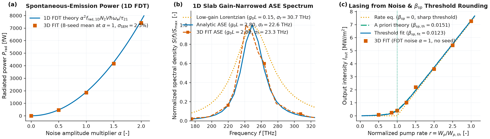

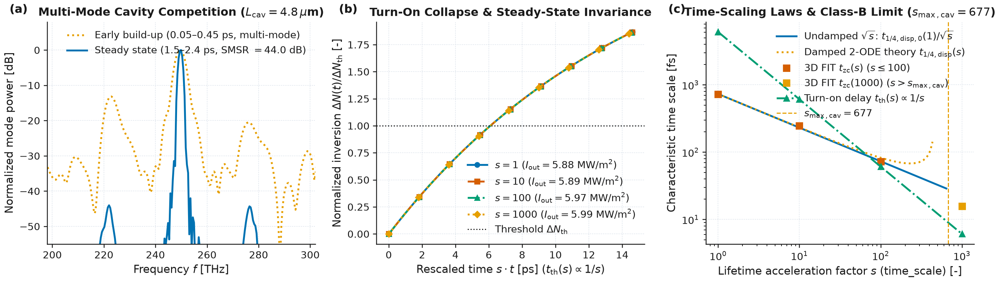

**Limits & failure modes.**
- *Cavity photon decay rate vs polarization dephasing rate for `time_scale = s` (`time_scaling_limits`).* Lifetime acceleration compresses the population relaxation rates $s / \tau_{ij}$ and the damped relaxation-oscillation decay rate $\Gamma_{\text{RO}}(s) = s r / (2\tau_{\text{sat}})$ by a factor of $s$, while leaving the cold-cavity photon decay rate $\kappa_{\text{cav}} = 1 / \tau_p$ and the polarization dephasing rate $\gamma_a$ unchanged. Two distinct physical hierarchy limits apply:
  1. **Class-B cavity limit (tighter bound in high-$Q$ cavities):** Underdamped relaxation oscillations with $\omega_{\text{RO}}(s) = \sqrt{\omega_{\text{RO},0}^2(s) - \Gamma_{\text{RO}}^2(s)} \propto \sqrt{s}$ require that the accelerated population recovery rate remain much slower than the cavity photon decay rate,
     ```math
     \frac{s}{\tau_{\text{sat}}} \ll \kappa_{\text{cav}} = \frac{1}{\tau_p} \qquad \left(s \ll s_{\max,\text{cav}} \equiv \frac{\tau_{\text{sat}}}{\tau_p}\right) .
     ```
     When $s / \tau_{\text{sat}} \gtrsim \kappa_{\text{cav}}$ (as demonstrated by the $s = 1000 > s_{\max,\text{cav}} = 677$ counter-case above, where $(s/\tau_{\text{sat}})/\kappa_{\text{cav}} = 1.48$), $\Gamma_{\text{RO}}(s)$ approaches $\omega_{\text{RO},0}(s)$, breaking the $\sqrt{s}$ relaxation-oscillation scaling and transitioning the dynamics toward Class-A adiabatic following (while the final steady-state intensity $I_{\text{out}}$ remains invariant).
  2. **Polarization adiabaticity limit:** The rate-equation description of stimulated emission requires that the accelerated population rates remain much slower than the homogeneous dipole dephasing rate,
     ```math
     \frac{s}{\tau_{21}},\, \frac{s}{\tau_{\text{sat}}} \ll \gamma_a \qquad \left(s \ll s_{\max,\text{deph}} \equiv \gamma_a \tau_{21}\right) .
     ```
     In typical optical cavities where $\kappa_{\text{cav}} \ll \gamma_a$, the cavity bound $s_{\max,\text{cav}} = \tau_{\text{sat}} / \tau_p$ is strictly tighter than $s_{\max,\text{deph}} = \gamma_a \tau_{21}$; both bounds are reported by `FourLevelGain.time_scaling_limits(tau_p)`.
- *Crank–Nicolson positivity limit at large `time_scale`.* Scaling $\tau_{\min} = \min(\tau_{10}, \tau_{32}, \tau_{21}, W_p^{-1})$ by $1/s$ increases the stiffness of the rate matrix $s\mathbf{M}$. To prevent oscillatory overshoot or negative transient populations in the Crank–Nicolson step (or instability in the explicit Heun step when `pauli_exclusion=True`), $s$ must satisfy $(s / \tau_{\min})\Delta t < 2$. If $\tau_{10}$ and $\tau_{32}$ are already chosen on the femtosecond scale ($\sim 10\text{–}20\text{ fs}$), choose $s$ so that $\tau_{10}/s, \tau_{32}/s \gtrsim \Delta t$.
- *Normally ordered excited-state noise vs Wigner-symmetrized vacuum fluctuations.* Because the Langevin variance $D_{F,a} = 2\gamma_a\kappa_a\hbar\omega_a N_2$ depends only on the upper-level population $N_2$ (rather than $N_2 + N_1$), it generates **normally ordered** field correlations in which an unpumped ground-state medium ($N_2 = 0$, $N_1 > 0$) injects strictly zero noise (`P_rad = 0`) and cannot spuriously heat a passive absorber (unlike a Wigner-symmetrized $\tfrac{1}{2}\hbar\omega$ zero-point bath, which requires subtracting vacuum energy; see Andreasen & Cao, 2009). Multi-photon entanglement and sub-Poissonian intensity squeezing are not modelled by this classical stochastic force.

References:
- J. Andreasen, H. Cao, A. Taflove, P. Kumar, and C.-q. Cao, "Finite-difference time-domain simulation of thermal noise in open cavities", *Phys. Rev. A* **77**(2), 023810 (2008), [doi:10.1103/PhysRevA.77.023810](https://doi.org/10.1103/PhysRevA.77.023810).
- J. Andreasen and H. Cao, "Finite-difference time-domain formulation of stochastic noise in macroscopic atomic systems", *J. Lightwave Technol.* **27**(20), 4530–4535 (2009), [doi:10.1109/JLT.2009.2024627](https://doi.org/10.1109/JLT.2009.2024627).
- J. Andreasen and H. Cao, "Numerical study of amplified spontaneous emission and lasing in random media", *Phys. Rev. A* **82**(6), 063835 (2010), [doi:10.1103/PhysRevA.82.063835](https://doi.org/10.1103/PhysRevA.82.063835).
- A. E. Siegman, *Lasers*, University Science Books, Mill Valley, CA, Chs. 2, 7, 11, 13 (1986).
- L. A. Coldren, S. W. Corzine, and M. L. Mašanović, *Diode Lasers and Photonic Integrated Circuits*, 2nd ed., Wiley, Chs. 2, 5 (2012), [doi:10.1002/9781118148167](https://doi.org/10.1002/9781118148167).


### 💠 Three-Dimensional Coupled-Wave Theory for PCSELs (`wakis.pcsel_cwt`)

`wakis.pcsel_cwt` implements the three-dimensional coupled-wave theory (3D-CWT) of Noda and collaborators [Sakai *et al.*, 2010; Liang *et al.*, 2011; Liang *et al.*, 2012] for square-lattice transverse-electric (TE) photonic-crystal surface-emitting lasers (PCSELs), together with the double-lattice Hermitian/non-Hermitian feedback cancellation formalism [Yoshida *et al.*, 2019; Inoue *et al.*, 2022; Yoshida *et al.*, 2023].

**1D vertical slab waveguide and Fourier permittivity expansion.** A PCSEL epitaxial stack (`PCSELLayerStack`) consists of lower/upper claddings ($`n_{\text{clad}}`$), an active waveguide core ($`n_{\text{act}}`$), and a photonic-crystal (PhC) layer ($`z \in [z_{\text{PhC,min}}, z_{\text{PhC,max}}]`$) of host index $`n_{\text{host}}`$ perforated by a 2D square lattice of period $`a`$ and hole index $`n_{\text{hole}}`$. Inside the PhC layer, the relative permittivity is expanded in 2D reciprocal-lattice harmonics $`\mathbf{G}_{m,n} = (m G_0, n G_0)`$ with $`G_0 = \beta_0 = 2\pi / a`$ (`fourier_coefficients_phc`):

```math
\varepsilon(x, y) = \varepsilon_0 + \sum_{(m,n)\neq(0,0)} \xi_{m,n}\,e^{-i(m G_0 x + n G_0 y)}, \qquad
\xi_{m,n} = \frac{1}{a^2}\iint_{[-a/2,a/2]^2} \varepsilon(x,y)\,e^{+i(m G_0 x + n G_0 y)}\,\mathrm{d}x\,\mathrm{d}y .
```

For circular holes of radii $`r_1, r_2`$ centered at $`\mathbf{r}_{1,2} = (\mp d_x/2, \mp d_y/2)`$, the Fourier coefficients evaluate analytically in terms of first-order Bessel functions $`J_1`$:

```math
\xi_{m,n} = (\varepsilon_{\text{hole}} - \varepsilon_{\text{host}})\sum_{j=1}^2 \frac{r_j}{a}\frac{J_1\!\left(2\pi\sqrt{m^2+n^2}\,r_j/a\right)}{\sqrt{m^2+n^2}}\,e^{+i G_0(m x_j + n y_j)} .
```

At the second-order Bragg condition $`\beta_0 = 2\pi / a`$, the fundamental vertically guided $`\text{TE}_0`$ profile $`\Theta_0(z)`$ and effective index $`n_{\text{eff}} = \beta_0 / k_0`$ satisfy (`solve_vertical_slab_mode`):

```math
\left[\frac{\mathrm{d}^2}{\mathrm{d}z^2} + k_0^2 \varepsilon_{\text{slab}}(z)\right]\Theta_0(z) = \beta_0^2 \Theta_0(z), \qquad
\int_{-\infty}^{\infty} |\Theta_0(z)|^2\,\mathrm{d}z = 1, \qquad
\Gamma_{\text{PhC}} = \int_{z_{\text{PhC,min}}}^{z_{\text{PhC,max}}} |\Theta_0(z)|^2\,\mathrm{d}z .
```

**Vertical Green's functions and optical theorem.** First-order diffraction of the four basic waves $`\mathbf{v} = (R_x, S_x, R_y, S_y)^T`$ (propagating along $`\pm x`$ and $`\pm y`$ with TE polarization) by $`\xi_{\pm 1, 0}`$ and $`\xi_{0, \pm 1}`$ drives the $`(0,0)`$ surface-radiating wave $`\Phi_{\text{rad}}(z)`$ at $`\mathbf{K}_{0,0} = \mathbf{0}`$, while diffraction by $`\xi_{\pm 1, \pm 1}`$ drives evanescent waves $`\Phi_{1,1}(z)`$ at $`|\mathbf{K}_{\pm 1,\pm 1}|^2 = 2\beta_0^2`$ (`solve_vertical_greens_functions`):

```math
\left[\frac{\mathrm{d}^2}{\mathrm{d}z^2} + k_0^2\varepsilon_{\text{slab}}(z)\right]\Phi_{\text{rad}}(z) = -k_0^2\mathbf{1}_{\text{PhC}}(z)\Theta_0(z), \qquad
\Phi_{\text{rad}}'(z_{\max,\min}) = \mp i k_0 n_{\text{clad}}\Phi_{\text{rad}}(z_{\max,\min}) .
```

With the overlap integral $`\mathcal{I}_{\text{rad}} = \int_{\text{PhC}} \Theta_0(z)\Phi_{\text{rad}}(z)\,\mathrm{d}z`$ and normalized response $`\chi_{\text{rad}} = \mathcal{I}_{\text{rad}} / \Gamma_{\text{PhC}}`$, integration by parts yields the exact optical theorem:

```math
-\operatorname{Im}(\mathcal{I}_{\text{rad}}) = \frac{n_{\text{clad}}}{k_0}\left(|\Phi_{\text{rad}}(z_{\max})|^2 + |\Phi_{\text{rad}}(z_{\min})|^2\right) > 0 .
```

**Infinite-crystal $`4\times 4`$ CWT eigenproblem and $`C_{4v}`$ band-edge modes.** For the basic wave vector $`\mathbf{v} = (R_x, S_x, R_y, S_y)^T`$ with in-plane wavevectors $`\beta_0(m_\alpha, n_\alpha) \in \{\beta_0(\pm 1,0), \beta_0(0,\pm 1)\}`$ and TE unit vectors $`\hat{\mathbf{e}}_0 = \hat{\mathbf{e}}_1 = \hat{\mathbf{y}}`$ and $`\hat{\mathbf{e}}_2 = \hat{\mathbf{e}}_3 = \hat{\mathbf{x}}`$, the $`4\times 4`$ coupling matrix $`\mathbf{C} = \mathbf{C}_{\text{rad}} + \mathbf{C}_{1\text{D}} + \mathbf{C}_{2\text{D}}`$ (`compute_cwt_coupling_coefficients`) follows Liang *et al.* [2011]:

```math
(\mathbf{C}_{1\text{D}})_{\alpha\beta} = -\frac{k_0^2}{2\beta_0}\Gamma_{\text{PhC}}(\hat{\mathbf{e}}_\alpha\cdot\hat{\mathbf{e}}_\beta)\xi_{m_\alpha - m_\beta, n_\alpha - n_\beta}\;(\alpha\neq\beta), \qquad
(\mathbf{C}_{\text{rad}})_{\alpha\beta} = -\frac{k_0^2}{2\beta_0}\mathcal{I}_{\text{rad}}(\hat{\mathbf{e}}_\alpha\cdot\hat{\mathbf{e}}_\beta)\xi_{m_\alpha, n_\alpha}\xi_{-m_\beta, -n_\beta},
```

```math
(\mathbf{C}_{2\text{D}}^{(T)})_{\alpha\beta} = -\frac{k_0^2}{2\beta_0}\sum_{m^2+n^2 > 1} \mathcal{I}_{m,n}(\hat{\mathbf{e}}_\alpha\cdot\hat{\mathbf{t}}_{m,n})(\hat{\mathbf{t}}_{m,n}\cdot\hat{\mathbf{e}}_\beta)\xi_{m_\alpha - m, n_\alpha - n}\xi_{m - m_\beta, n - n_\beta}, \qquad
\hat{\mathbf{t}}_{m,n} = \frac{n\hat{\mathbf{x}} - m\hat{\mathbf{y}}}{\sqrt{m^2+n^2}} .
```

Here $`\mathcal{I}_{m,n} = \int_{\text{PhC}} \Theta_0(z)\Phi_{m,n}(z)\,\mathrm{d}z > 0`$ is the vertical Green's function overlap of the $`(m,n)`$ evanescent TE diffraction wave at $`|\mathbf{K}_{m,n}|^2 = (m^2+n^2)\beta_0^2`$, and two-step scattering through the $`(\pm 1, \pm 1)`$ orders ($`R_x \to (\pm 1,\pm 1) \to R_y, S_y`$) mediates the leading 2D orthogonal coupling via the first-order harmonics $`\xi_{0,\pm 1}\xi_{\pm 1,0}`$. When `include_longitudinal=True`, `compute_cwt_coupling_coefficients` also adds the higher-order longitudinal (in-plane depolarization, $`\hat{\mathbf{l}}_{m,n} = (m\hat{\mathbf{x}} + n\hat{\mathbf{y}})/\sqrt{m^2+n^2}`$) contribution $`\mathbf{C}_{2\text{D}}^{(L)}`$ associated with the inverse-permittivity harmonics $`\zeta_{m,n}`$ of $`1/\varepsilon(x,y)`$. For an infinite crystal with in-plane Bloch wavevector $`\mathbf{k}_\parallel = (k_x, k_y)`$ relative to $`\Gamma`$, the $`4\times 4`$ eigenvalue problem (`solve_infinite_cwt`, `compute_cwt_band_structure`) is

```math
\big(\operatorname{diag}(+k_x, -k_x, +k_y, -k_y) + \mathbf{C}\big)\mathbf{v}_\nu = \tilde{\delta}_\nu\mathbf{v}_\nu, \qquad
\tilde{\delta}_\nu = \delta_\nu + i\frac{\alpha_{v,\nu}}{2}, \qquad
f_\nu = f_{\text{B}}\!\left(1 + \frac{\delta_\nu}{\beta_0}\right), \qquad
Q_\nu = \frac{\beta_0}{\alpha_{v,\nu}} .
```

For a $`C_{4v}`$-symmetric unit cell at $`\Gamma`$ ($`\mathbf{k}_\parallel = \mathbf{0}`$), Modes A ($`A_2`$, $`\mathbf{v}_A \propto (1,-1,-1,1)^T`$) and B ($`B_2`$, $`\mathbf{v}_B \propto (1,-1,1,-1)^T`$) are symmetry-protected bound states in the continuum ($`\alpha_{v,A} = \alpha_{v,B} = 0`$, $`Q = \infty`$), whereas Modes C and D ($`E`$ doublet, $`\mathbf{v}_C \propto (1,1,0,0)^T`$, $`\mathbf{v}_D \propto (0,0,1,1)^T`$) are degenerate and surface-radiating.

**Finite-size 2D CWT and double-lattice feedback cancellation.** On a finite square cavity $`[-L/2, L/2]^2`$ with open boundaries $`R_x(-L/2, y) = S_x(+L/2, y) = R_y(x, -L/2) = S_y(x, +L/2) = 0`$, the spatial derivatives $`\operatorname{diag}(+i\partial_x, -i\partial_x, +i\partial_y, -i\partial_y)`$ are discretized on a 2D Gauss–Lobatto–Legendre (GLL) grid with Summation-By-Parts (SBP) matrices $`W D + D^T W = \mathbf{e}_N\mathbf{e}_N^T - \mathbf{e}_0\mathbf{e}_0^T`$ and Simultaneous Approximation Term (SAT) upwind boundary penalties (`solve_finite_cwt`). Every eigenmode satisfies the exact discrete Poynting power balance

```math
\alpha_{\text{th}} = 2\operatorname{Im}(\tilde{\delta}) = \alpha_v + \alpha_\parallel
```

to machine precision ($`\sim 10^{-12}`$). In a strongly over-coupled single-lattice PCSEL ($`|C_{12}| L \gg 1`$), the perimeter leakage scales as $`\alpha_\parallel \propto L^{-3}`$ while finite-envelope $`\mathbf{k}_\parallel\cdot\mathbf{p}`$ mixing with the bright upper band produces vertical radiation $`\alpha_v \propto L^{-2}`$, so the threshold gain margin $`\Delta\alpha_{\text{th}}(L) = \Delta\alpha_v(L) + \Delta\alpha_\parallel(L)`$ crosses over from mixed $`L^{-3}/L^{-2}`$ behavior at intermediate $`L`$ to an asymptotic $`\Delta\alpha_{\text{th}} \propto L^{-2}`$ collapse at millimeter apertures. In a double-lattice PCSEL (`double_lattice_coupling_scan`) with a second hole shifted by $`d_x = d_y \approx a/4`$, the $`(2,0)`$ Bragg phase shifts by $`\pi`$ ($`R \to 0`$) while the radius ratio $`r_2/r_1`$ tunes the imaginary Hermitian coupling $`I`$ to balance the radiation-mediated non-Hermitian coupling $`\mu`$ at the unidirectional coupling / exceptional-point root $`C_{12} = R + i(\mu + I) = 0`$ ($`\sqrt{C_{12}C_{21}} = 0`$), expanding the mode across millimeter-scale cavities and restoring a wide single-mode threshold margin $`\Delta\alpha_{\text{th}} / \alpha_{\text{th}}`$ [Yoshida *et al.*, 2019; Inoue *et al.*, 2022; Yoshida *et al.*, 2023].

**Assumptions and limits.** Standard 3D-CWT assumes weak-to-moderate index contrast or fill factor ($`f = \pi r^2/a^2 \lesssim 15\%`$) so that a single mode-independent vertical slab profile $`\Theta_0(z)`$ and lowest-order Fourier harmonics ($`|m|, |n| \le 2`$) suffice. At large hole fill factors ($`r/a \gtrsim 0.24`$, $`f \gtrsim 18\%`$), the antisymmetric modes C/D have field antinodes inside the low-index hole where the effective PhC permittivity $`\varepsilon_0 - |\xi_{2,0}|`$ approaches or drops below $`\varepsilon_{\text{clad}}`$, expelling $`\Theta_{C,D}(z)`$ into the cladding (`dressed_vertical_profile=True` captures the leading-order shift, while full 3D FIT resolves the exact 3D vector field).

References:
- K. Sakai, E. Miyai and S. Noda, "Coupled-wave theory for square-lattice photonic crystal lasers with TE polarization", *IEEE J. Quantum Electron.* **46**(5), 788–795 (2010), [doi:10.1109/JQE.2009.2037597](https://doi.org/10.1109/JQE.2009.2037597).
- Y. Liang, C. Peng, K. Sakai, S. Iwahashi and S. Noda, "Three-dimensional coupled-wave model for square-lattice photonic crystal lasers with transverse electric polarization: A general approach", *Phys. Rev. B* **84**(19), 195119 (2011), [doi:10.1103/PhysRevB.84.195119](https://doi.org/10.1103/PhysRevB.84.195119).
- Y. Liang, C. Peng, K. Sakai, S. Iwahashi and S. Noda, "Three-dimensional coupled-wave analysis for square-lattice photonic crystal surface emitting lasers with transverse-electric polarization: finite-size effects", *Opt. Express* **20**(14), 15945–15961 (2012), [doi:10.1364/OE.20.015945](https://doi.org/10.1364/OE.20.015945).
- M. Yoshida, M. De Zoysa, K. Ishizaki, Y. Tanaka, M. Kawasaki, R. Hatsuda, B. Song, J. Gelleta and S. Noda, "Double-lattice photonic-crystal resonators enabling high-brightness semiconductor lasers with symmetric narrow-divergence beams", *Nat. Mater.* **18**, 121–128 (2019), [doi:10.1038/s41563-018-0242-y](https://doi.org/10.1038/s41563-018-0242-y).
- T. Inoue, M. Yoshida, J. Gelleta, K. Izumi, K. Yoshida, K. Ishizaki, M. De Zoysa and S. Noda, "General recipe to realize photonic-crystal surface-emitting lasers with 100-W-to-1-kW single-mode operation", *Nat. Commun.* **13**, 3262 (2022), [doi:10.1038/s41467-022-30910-7](https://doi.org/10.1038/s41467-022-30910-7).
- M. Yoshida, S. Katsuno, T. Inoue, J. Gelleta, K. Izumi, M. De Zoysa, K. Ishizaki and S. Noda, "High-brightness scalable continuous-wave single-mode photonic-crystal laser", *Nature* **618**, 727–732 (2023), [doi:10.1038/s41586-023-06059-8](https://doi.org/10.1038/s41586-023-06059-8).


```{admonition} Modularity

#### 🧪 Open-Source Compatibility

The wake and impedance analysis is performed within the `WakeSolver` class in `Wakesolver.py`. Even if this module is tailored for Wakis, it is completely modular and can be used with other EM solvers besides Wakis' `SolverFIT3D` output:
- It has been tested with **WarpX** EM fields. WarpX is a powerful open-source particle-in-cell solver for full 3D EM fields
- It has been benchmarked with **CST** Wakefield solver, using both EM field ouput (time-domain field monitors) and calculated wake potential and impedance. > See the full wake analysis benchmark in [IPAC'23 proceedings, E. de la Fuente](https://doi.org/10.18429/JACoW-IPAC2023-WEPL170).
- **Interoperability**: Wakis can read field maps in HDF5, CSV, or NumPy format
- **Subvolume extraction** and interpolation are supported for field-based post-processing
```
