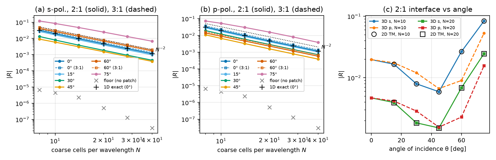
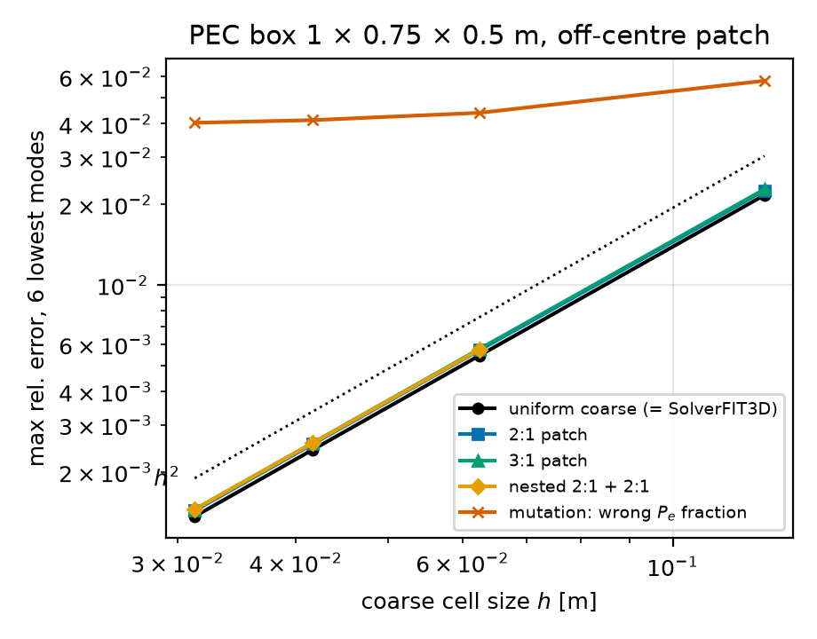
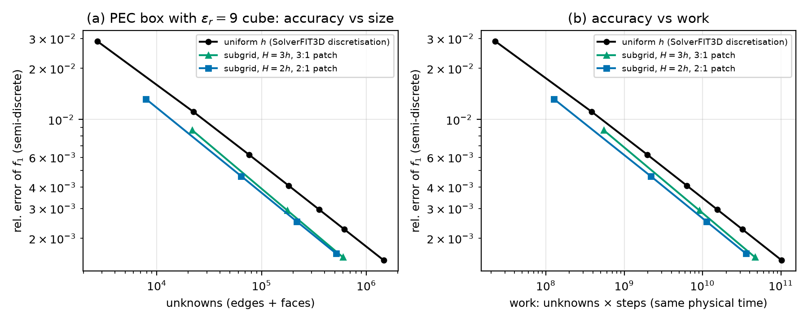
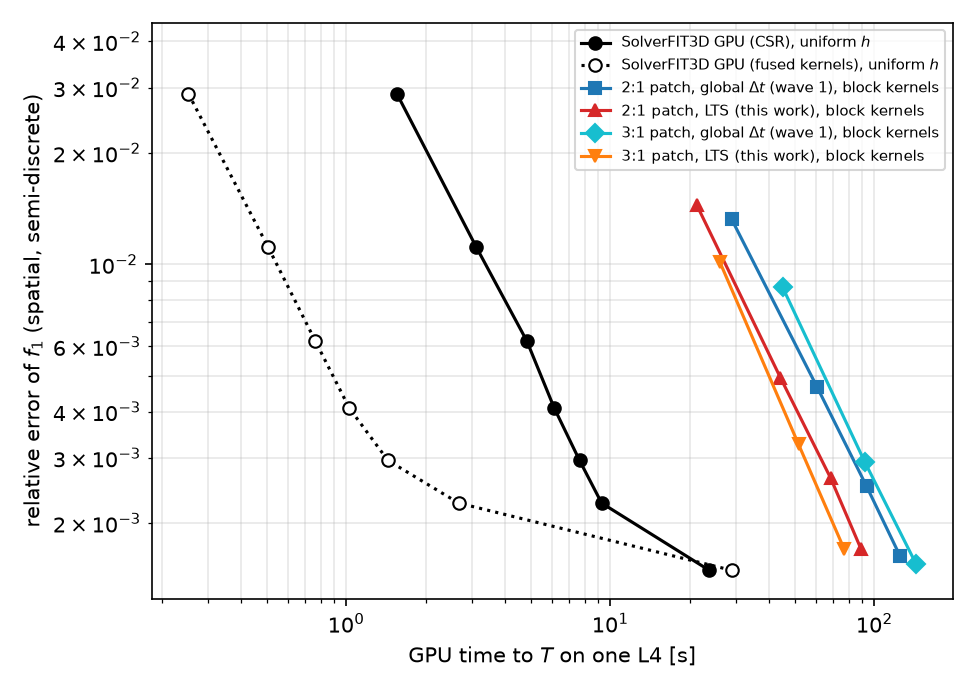
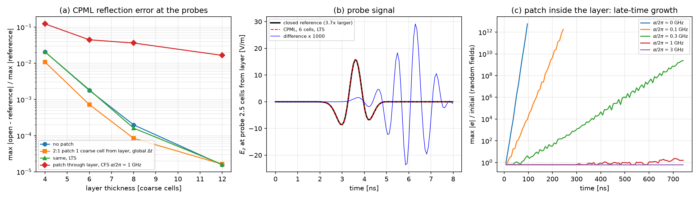
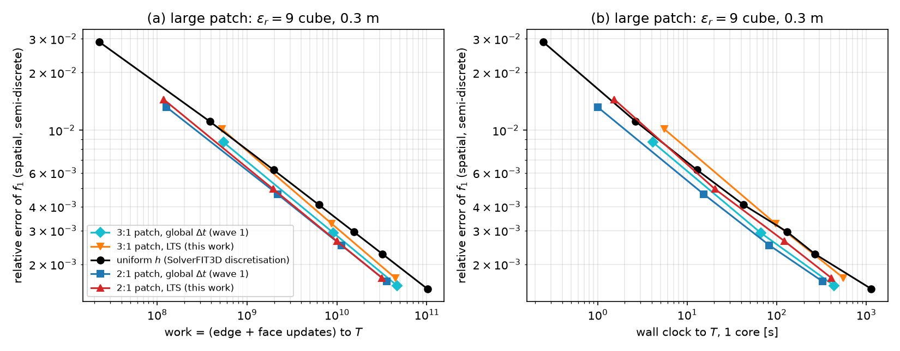

### 🧊 3D Cartesian subgridding with hanging edges: `wakis.subgrid3d` (milestone 1)

`wakis.subgrid3d` refines boxes of a `GridFIT3D` tensor grid (non-uniform allowed) by an integer ratio $r\in\{2,3\}$, recursively. It is the 3D version of the 2D scheme of `wakis.subgrid` ("Local Cartesian refinement" above): the fine-to-coarse coupling is the exact transpose of the coarse-to-fine one, so the scheme conserves a discrete energy, is stable under a computed global CFL limit and has an exact adjoint. Milestone 1 is a CPU (NumPy/SciPy) prototype with vacuum or per-cell isotropic $\varepsilon$, $\mu$, PEC outer walls (PMC and Bloch-periodic walls also work), PEC/PMC cells, soft currents, point probes, running DFTs and an energy monitor.

#### 1. Mesh: an octree of dense Cartesian blocks

* **Blocks.** Block 0 is the coarse tensor grid. Each patch is a box of whole cells of its parent block. Every parent cell in the box is split into $r$ equal parts per axis, so the child is again a (non-uniform) tensor grid, and its node lines contain the parent node lines. Parent cells inside a child box are *inactive*: they contribute nothing to any mass or Hodge entry.
* **Sides.** Each side of a block is a PEC wall, a PMC wall, a periodic (Bloch) seam, or an *interface*. A child side on its parent's boundary inherits the parent's side type. A child that spans a periodic axis of its parent is periodic along it with the same phase.
* **Balance.** An interface side of a child must lie at least one parent cell away from every interface side of its parent, and siblings must be at least one parent cell apart (both are checked). Hanging edges then reference only free edges, with no chains.
* **Unknowns.** Every leaf cell owns its 12 edges and 6 faces. On an interface, the coarse face and its $r^2$ fine sub-faces are *different* faces, and the coarse edges and their collinear fine edges are different edges, as in 2D. Each block has its own dense $(i,j,k)$ layout. The global vectors concatenate the blocks.

#### 2. The Nédélec trace and the prolongation $\mathbf P_e$

On a coarse face $[x_0,x_1]\times[y_0,y_1]$ at $z=z_0$, the tangential field of the lowest-order hexahedral Nédélec (Whitney) element [Nédélec, 1980] built from the four coarse edge voltages $e_{x,0}$ ($y=y_0$), $e_{x,1}$ ($y=y_1$), $e_{y,0}$, $e_{y,1}$ is

```math
E_x(x,y) = \frac{1}{h_x}\Big[(1-t_y)\,e_{x,0} + t_y\,e_{x,1}\Big],\qquad
E_y(x,y) = \frac{1}{h_y}\Big[(1-t_x)\,e_{y,0} + t_x\,e_{y,1}\Big],
```

with $t_x=(x-x_0)/h_x$ and $t_y=(y-y_0)/h_y$: constant along each edge direction and linear across it. The fine edges in this face are *hanging*. Their voltages are the line integrals of this trace along the fine edge, of length $h_x/r$:

```math
e_f = \frac{1}{r}\Big[(1-t)\,e_{c,0} + t\,e_{c,1}\Big],\qquad t = \frac{j}{r},\; j = 0,\dots,r .
```

* **Collinear edges** ($t=0$ or $1$) lie on a coarse edge and take $e_c/r$. The $r$ collinear pieces add up to the coarse voltage.
* **Face-interior edges** ($0<t<1$) are parallel to two coarse edges of the face and interpolate between them. The second term, $t\,e_{c,1}/r$, is the *transverse term*, since it reaches across the face. Section 7 drops it as one of the mutations.
* **Edges normal to the face** (fine edges that start on the interface and point into the patch) belong to fine cells and are free unknowns.

All weights are non-negative and real, except a factor of the Bloch phase where the reach crosses a periodic seam. With all edges oriented along $+x,+y,+z$:

```math
\mathbf e_\text{all} = \mathbf P_e\,\mathbf e,\qquad \mathbf P_e = \begin{bmatrix}\mathbf I \\ \mathbf T\end{bmatrix}\ (\text{free rows / hanging rows; dead rows} = 0),
```

where $\mathbf T$ holds the trace rows above and dead edges are PEC edges and edges of inactive cells only.

**Gradients are preserved.** Take a nodal potential $\phi$ that is continuous across the interface, with hanging nodes on the bilinear ($Q_1$) trace of the coarse face. Its fine edge differences equal the trace rows applied to its coarse edge differences: along a fine edge at height $t$, $\Delta\phi = \frac1r[(1-t)\Delta\phi_0 + t\Delta\phi_1]$ for a bilinear $\phi$. The discrete de Rham sequence nodes $\to$ edges $\to$ faces therefore holds on the composite mesh, and the null space of the curl consists exactly of these gradients. No spurious non-zero-frequency modes appear. The cavity test sees them as soon as the trace is altered (Section 7).

#### 3. Curl, Gauss's law and the face fluxes

Let $\mathbf C$ be the block-diagonal face–edge incidence of the blocks. Every leaf face circulates its own four edges: $e_b(p)+e_c(p+u_b)-e_b(p+u_c)-e_c(p)$ for a face of normal $a$, with $(b,c)$ the cyclic successors of $a$. This is the incidence of `wakis.boundaries._assemble_curl` in a compact layout without ghost samples. With $\mathbf K = \mathbf C\mathbf P_e$, Faraday's law reads $\mathbf b^{n+1/2}=\mathbf b^{n-1/2}-\Delta t\,\mathbf K\mathbf e^n$. Two consequences follow:

* **$\nabla\cdot\mathbf b=0$ in every leaf cell, coarse or fine.** Each cell's faces are built from that cell's own edges, so $\mathbf S\mathbf C=0$ per block for the cell–face incidence $\mathbf S$, for *any* edge values, including the trace values on hanging edges. If $\mathbf b$ is divergence-free at the start, it stays so to round-off.
* **Flux continuity across the interface.** The sum of the $r^2$ fine sub-face fluxes of a coarse face is the circulation of the fine edges on the coarse face's boundary, because the face-interior edges cancel pairwise. That circulation is $\sum$ (collinear pieces) $=$ the coarse circulation, so $b_\text{coarse}=\sum b_\text{fine}$ exactly at all times. The collinear fraction $1/r$ is what makes this hold. A wrong fraction breaks it. The transverse term cancels in the sum, so dropping it does *not* break the flux balance. The test checks both statements.

#### 4. Masses, Hodge and the update

Each active leaf cell $c$ (size $h_x\times h_y\times h_z$, $\varepsilon_c$, $\mu_c$) contributes:

* to each of its 4 edges of direction $x$: $m_e \mathrel{+}= \varepsilon_c\,\tfrac14 h_yh_z/h_x$ (the cell's share of $\varepsilon\tilde A/L$), and similarly for $y$ and $z$;
* to each of its 2 faces of normal $x$: $W_f \mathrel{+}= \tfrac12 h_x/(\mu_c h_yh_z)$, the series sum of the half cells on either side. $\mathbf h$-voltage $=\mathbf W\mathbf b$, and the face Hodge $W_f$ is exact for $\mu$ interfaces aligned with the grid.

On a uniform block this is the FIT Hodge of `SolverFIT3D`. Without a patch, the non-zero spectrum of $\mathbf K^T\mathbf W\mathbf K$ against $\mathbf D$ equals that of `SolverFIT3D`'s update on a graded grid with $\varepsilon_r=2$, $\mu_r=1.5$ to $8\times10^{-15}$ (test `test_without_patch_equals_solverfit3d`). Hanging edges carry the masses of their own (fine) half cells. Interface faces carry only the half cell on their own side. The free-edge mass is the row-sum lumping

```math
\mathbf D = |\mathbf P_e|^T\big(\mathbf m\circ|\mathbf P_e|\mathbf 1\big)
\quad\Longleftrightarrow\quad D_{jj}=\sum_k |P_{kj}|\,m_k\,\textstyle\sum_l |P_{kl}|,
```

which is exact for fields that are uniform over a coarse cell. Ampère's law uses the transpose of the coarse-to-fine map:

```math
\mathbf D\,(\mathbf e^{n+1}-\mathbf e^n) = \Delta t\Big(\mathbf K^H\mathbf W\,\mathbf b^{n+1/2} - \mathbf P_e^H\,\mathbf i^{\,n+1/2}\Big),
```

with $\mathbf i$ [A] an impressed current through the dual face of every edge (a current on a hanging edge is restricted to its parents by $\mathbf P_e^H$). In finite-element language this is the conforming lowest-order Nédélec/Raviart–Thomas pair on the composite hexahedral mesh with hanging-edge constraints, trapezoidal (vertex) lumping of both masses [Cohen & Monk, 1998], and the hanging variables eliminated through $\mathbf P_e$, as in [Venkatarayalu et al., 2007] (FETD, there with consistent masses on the interface layer) and the 2D `wakis.subgrid`.

**PEC and PMC cells.** A PEC cell ($\varepsilon\to\infty$) freezes its 12 edges at zero. A PMC cell ($\mu\to\infty$) adds nothing to the face Hodge: $H=0$ inside, and the faces on its surface see only the half cell outside, the natural boundary, which is the dual of the PEC edge freeze. A first version zeroed the six face fluxes of PMC cells instead. That *violates* $\nabla\cdot\mathbf b=0$ in the neighbouring cells, since the normal $B$ on a PMC surface need not vanish, and the divergence test caught it. A PEC fine cell may not touch an interface unless the coarse parents are PEC too (checked), otherwise the trace would contradict the wall.

#### 5. Energy, stability and the global time step

For the lossless, source-free leapfrog, let

```math
\mathcal E^{n+1/2} = \tfrac12\,\mathbf b^{n+1/2}\cdot\mathbf W\mathbf b^{n+1/2} + \tfrac12\,\mathbf e^{n}\cdot\mathbf D\,\mathbf e^{n+1}.
```

Subtracting two consecutive levels and inserting both updates gives $\mathcal E^{n+3/2}-\mathcal E^{n+1/2} = -\tfrac{\Delta t}2(\mathbf b^{n+3/2}+\mathbf b^{n+1/2})\cdot\mathbf W\mathbf K\mathbf e^{n+1}+\tfrac{\Delta t}{2}\mathbf e^{n+1}\cdot\mathbf K^T\mathbf W(\mathbf b^{n+3/2}+\mathbf b^{n+1/2})=0$. The step only needs $\mathbf W$ and $\mathbf D$ to be symmetric positive definite and Ampère's law to use exactly $\mathbf K^T$. In the scaled variables $\mathbf x=\mathbf W^{1/2}\mathbf b$, $\mathbf y=\mathbf D^{1/2}\mathbf e$, $\mathbf A=\mathbf W^{1/2}\mathbf K\mathbf D^{-1/2}$ one has $\mathcal E=\tfrac12|\mathbf x|^2+\tfrac12|\mathbf y|^2+\tfrac{\Delta t}2\mathbf y\cdot\mathbf A^T\mathbf x$, which is positive definite iff

```math
\Delta t < \Delta t_\max = \frac{2}{\sqrt{\lambda_\max}},\qquad \lambda_\max = \lambda_\max\big(\mathbf D^{-1}\mathbf K^H\mathbf W\mathbf K\big).
```

$\lambda_\max$ is computed at setup (Lanczos on $\mathbf D^{-1/2}\mathbf K^H\mathbf W\mathbf K\mathbf D^{-1/2}$, tolerance $10^{-12}$).

**Bound (derived).** $\mathbf C^T\mathbf W\mathbf C$ and $\mathbf m$ are block-diagonal over the blocks. Each block is a standalone FIT grid whose surface edges are free, i.e. natural (PMC-like) boundaries with half masses. By Cauchy–Schwarz on each hanging row with non-negative weights, $|(\mathbf P_e\mathbf e)_k|^2\le(\sum_l|P_{kl}|)\sum_j|P_{kj}||e_j|^2$, so $(\mathbf P_e\mathbf e)^H\mathrm{diag}(\mathbf m)\,\mathbf P_e\mathbf e\le\mathbf e^H\mathbf D\mathbf e$. The Rayleigh quotients then give

```math
\lambda_\max \;\le\; \max_{\text{blocks } b}\lambda_\max^{(b)} \;\le\; \max_b\; c_b^2\Big(\frac{4}{h_{x,b}^2}+\frac{4}{h_{y,b}^2}+\frac{4}{h_{z,b}^2}\Big)_{\min h},
```

where the second inequality is the Yee bound of a block with natural boundaries: mirror the block across its natural sides to obtain a periodic grid with the same Rayleigh quotient. The composite therefore runs at least at the Yee step of its finest cells,

```math
\Delta t_\max \;\ge\; \frac{1}{c_\max\sqrt{h_{x,f}^{-2}+h_{y,f}^{-2}+h_{z,f}^{-2}}},
```

and the interface does not reduce the global step. On the test mesh (graded coarse grid, a 2:1 patch with a nested 3:1 patch, $\varepsilon_r=4$ and $\mu_r=2$ boxes, PEC and PMC cells) the measured values are $\lambda_\max=3.49\times10^{21}\,\mathrm{s^{-2}}$ and $\max_b\lambda_\max^{(b)}=3.79\times10^{21}\,\mathrm{s^{-2}}$. With a global $\Delta t$, every block takes the finest step. Local time stepping is a later milestone.

#### 6. Exact transpose and adjoint

All updates are linear with fixed sparse matrices. One step maps $(\mathbf b^{n-1/2},\mathbf e^n,\mathbf i^{n+1/2})\mapsto(\mathbf b^{n+1/2},\mathbf e^{n+1})$. Its transpose (`linear_step_T`) is, with $\mathbf g=\mathbf D^{-1}\bar{\mathbf e}^{n+1}$:

```math
\bar{\mathbf b}^{n-1/2}=\bar{\mathbf b}^{n+1/2}+\Delta t\,\mathbf W(\mathbf K^H)^T\mathbf g,\quad
\bar{\mathbf e}^{n}=\bar{\mathbf e}^{n+1}-\Delta t\,\mathbf K^T\bar{\mathbf b}^{n-1/2},\quad
\bar{\mathbf i}=-\Delta t\,\overline{\mathbf P_e}\,\mathbf g .
```

The source adjoint $\bar{\mathbf i}$ is defined on *all* edges, hanging ones included. A design parameter on a fine edge next to an interface therefore receives its gradient through $\mathbf P_e$.

#### 7. Plane-wave reflection of an interface

The leapfrog steady state at $\omega$ solves $(\mathbf K^H\mathbf W\mathbf K-\tilde\omega^2\mathbf D)\mathbf e = -i\tilde\omega\mathbf P_e^H\mathbf i$ exactly, with $\tilde\omega = 2\sin(\omega\Delta t/2)/\Delta t$. `bloch_reflection_3d` builds a column along $x$ that is Bloch-periodic in $y$ and $z$ with a period of two coarse cells. A patch fills $x>x_i$ and spans the period, both ends carry complex-stretched absorbers, and the coarse samples are fitted to $Ae^{-ik_xx}+Be^{ik_xx}$ with the exact discrete $k_x$ of the coarse Yee grid. The fit therefore contains no coarse dispersion.

**Normal incidence: closed form (derived).** Fields that are uniform over the interface make every trace row trivial ($e_f=e_c/r$). The column then reduces exactly to a 1D FIT chain $H\to h=H/r$ with the trapezoidal interface mass $(H+h)/2$. For $u_j=Ae^{-ikHj}+Be^{ikHj}$ on the coarse side and $u_j=Te^{-i\kappa hj}$ on the fine side, the interface row gives $R=-(\alpha-\gamma)/(\beta-\gamma)$, with $\alpha,\beta=\mp i\sin(kH)/H+k_t^2H/2$ and $\gamma=-i\sin(\kappa h)/h+k_t^2H/2$ (using $1-\cos kH = k_t^2H^2/2$). Hence

```math
R_\perp=\frac{\cos(kH/2)-\cos(\kappa h/2)}{\cos(kH/2)+\cos(\kappa h/2)},\qquad
|R_\perp| = \frac{(k_tH)^2}{16}\Big(1-\frac1{r^2}\Big)+O\big((k_tH)^4\big),
```

i.e. $|R_\perp|N^2\to\frac{\pi^2}{4}(1-r^{-2})$ for $N=2\pi/(k_tH)$ coarse cells per wavelength. This is the mismatch between the discrete wave impedances $\propto\cos(kh/2)$ of the two Yee grids. At normal incidence, the coupling adds nothing beyond it. The 3D scheme reproduces this formula to within the measurement floor (Section 9).

**Oblique incidence.** The trace is exact for fields that are linear across a coarse face, so its interpolation error is $O(H^2)$ on a single cell layer, and the reflection is $C(\theta,r,\text{pol})\,(k_tH)^2$ to leading order. For s-polarisation ($E\parallel z$, plane of incidence $xy$, $k_z=0$) the fields are $z$-invariant. The 3D trace on the $z$-edges is then the 2D linear hanging-node interpolation, and the masses match those of 2D TM, so the 3D scheme reduces *exactly* to `SubgridFIT2D` TM. p-polarisation has no 2D counterpart: its in-plane $E$ sits on edges, whereas the 2D TE scheme interpolates $H_z$ on nodes. The dispersion-mismatch formula with oblique $k_x$ underestimates s and overestimates p; the difference is the interpolation term.

#### 8. Implementation and data layout

* `CartesianBlock` (`wakis/subgrid3d/block.py`): the dense block. It provides the index maps with Bloch wrap, `curl()`, `divergence()`, per-cell edge/face metric weights and the geometry. `SubgridMesh3D` (`mesh.py`): the patches, side classification, balance checks and the trace rows (`hanging_rows`). `SubgridFIT3D` (`solver.py`): materials, $\mathbf P_e$, $\mathbf K$, $\mathbf W$, $\mathbf D$, the Lanczos CFL, `one_step`/`run`, `linear_step`/`linear_step_T`, sources, probes with DFT, energy, divergence and the interface flux balance. `interface.py`: the Bloch column and the 1D closed form.
* `SubgridMesh3D(grid)` accepts a `GridFIT3D` and drops its domain-edge ghost cells. The per-block operators are FIT's own: they reproduce `SolverFIT3D` exactly without a patch (Section 4). They are rebuilt compactly rather than taken from `SolverFIT3D`, for two reasons. Wakis's ghost layout ($3(N_x+1)(N_y+1)(N_z+1)$ samples, with PEC enforced by zero inverse masses) would put dead samples on every block surface. And hanging edges need masses from the fine side only, which `SolverFIT3D`'s dual lengths do not provide inside a domain.
* This milestone steps the assembled global CSR matrices $\mathbf K$ and $\mathbf K^H$: block-diagonal curls times $\mathbf P_e$, i.e. identity plus thin surface couplings. Splitting them into per-block dense kernels plus surface operators is the GPU milestone. The measured cost is 3–8 ns per unknown-step on one core (§9b).

#### 9. Verification (`tests/test_097_subgrid3d.py`)

The fast tests run on CPU in under 30 s. The slow ones ($N=32$ cavities, $N=20/40$ reflections) are marked `slow`. Every row has a mutation that was run and seen to fail.

| check | measured | tolerance (origin) | mutation → result |
|---|---|---|---|
| no patch = `SolverFIT3D` spectrum (graded, $\varepsilon_r=2,\mu_r=1.5$) | $8\times10^{-15}$ | $10^{-12}$ (dense eig round-off) | – (reuse check) |
| energy, $10^4$ steps, 2 nested patches (2:1, 3:1), graded, ε/μ/PEC/PMC, $0.99\,\Delta t_\max$ | $4.4\times10^{-16}$ | $50\,\epsilon\sqrt{n}=1.1\times10^{-12}$ (round-off random walk) | $\mathbf P_e^T\to$ injection at $0.5\,\Delta t_\max$: drift $>0.1$ (measured 0.6 in 2000 steps); $1.02\,\Delta t_\max$: overflow |
| $\lambda_\max\le\max_b\lambda^{(b)}\le$ finest Yee | $3.49\le3.79\le$ Yee $\times10^{21}$ | $10^{-10}$ relative | – |
| $\nabla\cdot\mathbf b$, interface flux balance (driven, 300 steps), relative to $\max|b|$ | $1.9\times10^{-15}$, $1.2\times10^{-15}$ | $10^{-13}$ | wrong $P_e$ fraction (×1.25): flux mismatch 0.14; missing transverse term: $1.5\times10^{-15}$, balance intact as derived in §3 |
| cavity, 6 lowest modes, order (2:1 / 3:1), $N=8\to16$ | 1.98 / 1.98 | $[1.8,2.2]$ | fraction: order 0.40, error ×8; missing transverse: 53–58 % error (spurious modes) |
| normal incidence vs closed form, s and p, 2:1 and 3:1 | $|\Delta R|\le2.5\times10^{-7}$ | fit floor (no patch) $5.7\times10^{-6}$ | missing transverse: $R>10\times$ |
| s-pol. 3D = 2D TM (30°, 60°, $N=10$) | $1.6\times10^{-12}$ rel. | $10^{-9}$ | – |
| reflection order, $N=10\to20$, 0/30/60°, s/p, 2:1/3:1 | 1.96–2.11 | $[1.8,2.25]$ | fraction / missing transverse at 60°: order $<1$, $R>10\times$ |
| dot product of the step transpose (fields; source part alone) | $1.4\times10^{-16}$; $1.9\times10^{-16}$ | $10^{-14}$ | source transpose without the hanging rows of $\mathbf P_e$: relative error 1.0 |
| adjoint gradient vs central difference (source on a hanging edge, 60 steps) | $2.4\times10^{-14}$ | $10^{-8}$ ($J$ quadratic, so the central difference is exact up to cancellation round-off) | covered by the dot-product mutation |
| time-domain probe + DFT, lowest mode vs eigenvalue through $\tilde\omega$ | $2.6\times10^{-7}$ | $10^{-5}$ (Hann + parabolic peak, bin $=1.7\times10^{-3}f$) | – |

#### 9b. Study results (`studies/subgrid3d/`, Cloud Batch jobs `sg3d-study-a-2`, `-b-2`, `-c-2`)



**Reflection.**
- At normal incidence, the 3D column matches the closed form of §7 to $3.2\times10^{-7}$ (absolute) for $N=8$–$40$, s and p, 2:1 and 3:1.
- For s-polarisation, the 3D scheme equals 2D TM to $1.5\times10^{-10}$ (relative) at every $N$ and angle.
- The observed order between $N=28$ and $40$ is 1.99–2.02 for $\theta=0$–$60°$, and 1.86 (s) / 2.09 (p) at 75°.
- 2:1, $N=10$: s-polarisation 2.0 / 0.8 / 2.7 / 8.4 % at 0 / 30 / 60 / 75°; p-polarisation 2.0 / 1.2 / 0.9 / 5.3 %. At $N=40$: s 0.12 / 0.045 / 0.17 / 0.68 %.
- 3:1 is about 18 % above 2:1.
- Mutations at 60° (2:1, s): the wrong fraction stays at 18–22 %, and the missing transverse term grows from 61 % to 95 % as $N$ goes from 8 to 40. Injection ($\mathbf P_e^T$ replaced) is not monotone in $N$, falling from 9.7 % to 1.7 %.
- The measurement floor (no patch) is $<10^{-5}$ at $\theta\le30°$ and grows toward grazing incidence (at most $6\times10^{-4}$, at 75° and $N=8$).



**Cavity.** The maximum error over the 6 lowest modes converges at order 1.99 for the uniform coarse grid and for the 2:1 and 3:1 patches, and at 1.98 for the nested 2:1+2:1 patch, at $N=8$–$32$. The patched errors are 4–6 % above the coarse grid's at every $N$: the interface's own $O(h^2)$ term, in an empty cavity where refinement brings no benefit. With the wrong fraction, the observed order drops to 0.27 overall and to 0.08 for the last pair.



**Cost at equal accuracy** (loaded cavity, part C). The uniform arms converge at the observed order $p=1.46$; the finest and the previous triple of arms give the same $p$ to $3\times10^{-3}$. This is the field singularity at the edges and corners of the dielectric cube. The reference is therefore the 3-point power-law extrapolation, $f^*=190.716$ MHz; the $h^2/h^4$ Richardson value 190.648 MHz would understate the errors. Against the uniform `SolverFIT3D` discretisation at equal error of $f_1$ (log-log interpolation along the uniform curve):

| arm | coarse $H$ [m] | unknowns | error | fewer unknowns | less work |
|---|---|---|---|---|---|
| 3:1 | 0.1 | 21 771 | $8.7\times10^{-3}$ | 1.74× | 1.42× |
| 3:1 | 0.05 | 176 496 | $2.9\times10^{-3}$ | 2.06× | 1.74× |
| 3:1 | 0.0333 | 598 455 | $1.5\times10^{-3}$ | 2.25× | 1.95× |
| 2:1 | 0.1 | 7 881 | $1.3\times10^{-2}$ | 1.93× | 1.82× |
| 2:1 | 0.05 | 63 966 | $4.6\times10^{-3}$ | 2.17× | 2.03× |
| 2:1 | 0.025 | 515 868 | $1.6\times10^{-3}$ | 2.35× | 2.22× |

Work is unknowns × steps to the same physical time, at $0.95\,\Delta t_\max$ for every arm. The work gain is smaller than the unknown gain because the global step is set by the fine cells. 2:1 beats 3:1 here: its step is larger, and the cube ($n=3$) needs no more than about 2× refinement at this accuracy.

Per step, `SubgridFIT3D.one_step` costs the same as `SolverFIT3D.one_step` on the same uniform grid (n2-standard-8, one thread, serial). At $h=0.02$ m (60 000 cells), the two take 2.85 ms and 2.84 ms; at $h=0.05$ m, 0.149 ms and 0.151 ms. The work ratios above are therefore also wall-clock ratios. Absolute speed is about 8 ns per unknown-step on that VM and 3.4 ns on an Apple-silicon laptop core.


#### 9c. Local time stepping per refinement level (wave 2, `wakis/subgrid3d/lts.py`)

**Second-order form.** Eliminating $\mathbf b$ from the leapfrog of §4 gives, source-free,
$\mathbf e^{n+1}-2\mathbf e^n+\mathbf e^{n-1}=-\Delta t^2\mathbf A\mathbf e^n$ with $\mathbf A=\mathbf D^{-1}\mathbf S$, $\mathbf S=\mathbf K^H\mathbf W\mathbf K$ (Hermitian, $\succeq0$).

**Levels.** Level $l$ ($0$ = root) owns the set $F_l$ of free edges of the blocks of depth $\ge l$, plus the coarse parents of the hanging edges of those blocks (their row of $\mathbf S$ contains the fine faces through $\mathbf P_e^T$, see "Partition" below). The sets are nested, $F_L\subset\dots\subset F_1\subset F_0$, and the one-face buffer $C_l$ of $F_l$ (edges that share a face with it) is forced into $F_{l-1}$. Level $l$ takes $p_l$ substeps of level $l-1$ (default: its patch ratio), $\tau_0=\Delta t$, $\tau_l=\tau_{l-1}/p_l$.

**Recursion.** With $\mathbf P_l$ the 0/1 projector on $F_l$ and $r_l$ the damped leapfrog–Chebyshev polynomial of degree $p_l-1$ of the unstructured LTS ("Local time stepping (LTS) for the unstructured leapfrog" in the physics guide; $r(0)=1$, damping $\nu_l$),

```math
\mathbf B_L=\mathbf A,\qquad \mathbf B_{l-1}=\mathbf B_l\,r_l(\mathbf X_l),\qquad \mathbf X_l=\tau_{l-1}^2\,\mathbf P_l\mathbf B_l ,
```

so $\mathbf B_0=\mathbf A\mathbf R_0$, $\mathbf R_0=r_L(\mathbf X_L)\cdots r_1(\mathbf X_1)$ (applied right to left). For $L=1$ this is the two-level Diaz–Grote LTS [Diaz & Grote, 2009] with the damped polynomial of [Carle, Hochbruck & Sturm, 2020]. For $L>1$, level $l$'s substeps use the LTS operator of the finer levels, as in multi-level LTS [Diaz & Grote, 2015], but the *coarse* force also uses $\mathbf B_l$ rather than $\mathbf A$. This is what makes the induction below close. The first-order form is the ordinary leapfrog with $\mathbf e^n$ replaced by $\mathbf z=\mathbf R_0\mathbf e^n$ in Faraday's law:

```math
\mathbf b^{n+1/2}=\mathbf b^{n-1/2}-\Delta t\,\mathbf K\mathbf R_0\mathbf e^n,\qquad
\mathbf D(\mathbf e^{n+1}-\mathbf e^n)=\Delta t\,(\mathbf K^H\mathbf W\mathbf b^{n+1/2}-\mathbf P_e^H\mathbf i^{n+1/2}).
```

**Hermitian stiffness (proof by induction).** Let $\mathbf S_l=\mathbf D\mathbf B_l$. $\mathbf S_L=\mathbf S$ is Hermitian. If $\mathbf S_l$ is, then $\mathbf S_{l-1}=\sum_jc_j\tau_{l-1}^{2j}\,\mathbf S_l(\mathbf P_l\mathbf D^{-1}\mathbf S_l)^j$, and each term is a palindrome of Hermitian $\mathbf S_l$ and real diagonal $\mathbf P_l\mathbf D^{-1}$, hence Hermitian. So the scheme is a leapfrog with the Hermitian stiffness $\mathbf S_0=\mathbf S\mathbf R_0$. Multiplying by $(\mathbf e^{n+1}-\mathbf e^{n-1})^H\mathbf D$ telescopes into the conserved

```math
E^{n+1/2}=\tfrac12\Big[\mathbf w^H\big(\mathbf D-\tfrac{\Delta t^2}{4}\mathbf S_0\big)\mathbf w+\bar{\mathbf y}^H\mathbf S_0\bar{\mathbf y}\Big],\qquad \mathbf w=\tfrac{\mathbf e^{n+1}-\mathbf e^n}{\Delta t},\ \bar{\mathbf y}=\tfrac{\mathbf e^{n+1}+\mathbf e^n}{2}
```

(`SubgridLTSFIT3D.modified_energy`). The telescoping identity holds for *any* $\Delta t$ without losses, sources and CPML, because it only uses $\mathbf S_0^H=\mathbf S_0$ and $\mathbf D^H=\mathbf D$. Even when (i) $\mathbf S_0\succeq0$ and (ii) $\rho=\tfrac{\Delta t}2\sqrt{\lambda_\max(\mathbf D^{-1}\mathbf S_0)}<1$ hold, $E^{n+1/2}$ is only a *semi-norm* on the state: $\bar{\mathbf y}^H\mathbf S_0\bar{\mathbf y}$ vanishes on $\ker\mathbf S_0$ (including all discrete gradients $\ker\mathbf K$), and $\mathbf b^{n+1/2}$ enters only through $\mathbf w=\mathbf D^{-1}\mathbf K^H\mathbf W\mathbf b^{n+1/2}$, so $E^{n+1/2}$ is zero on $\ker(\mathbf K^H\mathbf W)$ as well. When (i) or (ii) is violated so that the scheme is unstable, $E^{n+1/2}$ becomes *indefinite* yet stays algebraically conserved (until floating-point overflow); **energy drift does not monitor stability**. Note also that $\mathbf D\mathbf R_0$ itself is *not* Hermitian ($\mathbf P_l\mathbf S\neq\mathbf S\mathbf P_l$), so there is no first-order energy of the form $\tfrac12\mathbf b\cdot\mathbf W\mathbf b+\tfrac12\mathbf e^n\cdot\mathbf G\mathbf e^{n+1}$; the conserved quantity is the second-order one above.

**Positivity, level by level.** In $\mathbf D$-scaled form, $\hat{\mathbf S}_{l-1}=\hat{\mathbf S}_l^{1/2}\,r_l(\mathbf Y_l)\,\hat{\mathbf S}_l^{1/2}$ with $\mathbf Y_l=\tau_{l-1}^2\hat{\mathbf S}_l^{1/2}\mathbf P_l\hat{\mathbf S}_l^{1/2}$, whose nonzero spectrum is that of $\tau_{l-1}^2\mathbf P_l\hat{\mathbf S}_l\mathbf P_l$. Hence $\mathbf S_0\succeq0$ if, for every level, $\tau_{l-1}^2\mu_l\le x_+(p_l,\nu_l)$, where $\mu_l=\lambda_\max$ of the $F_l$ rows and columns of $\mathbf D^{-1/2}\mathbf S_l\mathbf D^{-1/2}$ (Lanczos, `lts.level_margins`) and $x_+$ is the first sign change of $r_l$:

```math
x_+=\frac{2\delta}{\beta}\ \ (p\ \text{even: }T_p(\delta-\beta x)=T_p(-\delta)=T_p(\delta)),\qquad x_+=\infty\ \ (p\ \text{odd}).
```

For odd $p$ the same point $x=2\delta/\beta$ is where $x\,r(x)$ reaches 4, so it limits (ii) instead. Without (i), $\rho<1$ alone is *not* sufficient. Measured: at $2\times$ the global limit (single 2:1 patch, $N=8$), $\rho=0.997$ but $\lambda_\min(\mathbf D^{-1}\mathbf S_0)=-0.099\,\lambda_\max$, and the run diverges. Because Lanczos Ritz values are lower bounds on $\lambda_\max$, `lts.is_stable` requires $\rho<1-g$ and every level margin $\le 1-g$ with $g=10\,\text{tol}$; `lts.lts_dt_max` verifies that the lower bracket (`dt_max` global) is stable before bisecting $\Delta t$ on (i) and (ii) together, and `SubgridLTSFIT3D` verifies the chosen $\Delta t$ (whether bisected or explicit) with `is_stable(..., tol=1e-10)` and raises `ValueError` if unstable.

**Nested levels need increasing damping (derived).** The top of level $l+1$'s spectrum, seen at level $l$'s step, is $\tau_{l-1}^2\lambda=p_l^2\,\max x\,r_{l+1}(x)=p_l^2\,\big(2+2/T_{p_{l+1}}(\delta_{l+1})\big)$. For $p_l=2$, $x_+(2,\delta_l)=16\delta_l^2/(2\delta_l^2-1)=4\big(2+2/T_2(\delta_l)\big)$, so the level-$l$ margin is $\big(2+2/T_{p_{l+1}}(\delta_{l+1})\big)/\big(2+2/T_2(\delta_l)\big)$. This is *exactly* 1 for $p_{l+1}=2$ and $\nu_{l+1}=\nu_l$, whatever $\Delta t$: equal damping is marginal (measured: margin $1.0000$–$1.003$ from $3\times$ to $4\times$ the global step, with $\lambda_\min<0$ beyond round-off). Since $T_p(1+\nu/p^2)\approx1+\nu$, the condition is $\nu_{l+1}>\nu_l$. The default is $\nu_l=l\,\nu$, $\nu=0.05$.

**Stability limit vs global limit (derived relation, measured).** When the global top mode $\lambda_\max = 4/(\Delta t_\max^\mathrm{global})^2$ lies in the finest level $F_L$, its polynomial argument at level $L$ is $x=\tau_{L-1}^2\lambda_\max=4\big((\Delta t/\Delta t_\max^\mathrm{global})/\prod_{m<L}p_m\big)^2$. Letting $x_{\mathrm{adm},L}$ be the upper end of the admissible interval at level $L$ gives the global-limit relation

```math
\frac{\Delta t_\max^\mathrm{LTS}}{\Delta t_\max^\mathrm{global}}\;=\;\Big(\prod_{m<L}p_m\Big)\,\frac{\sqrt{x_{\mathrm{adm},L}}}{2}.
```

Here $x_{\mathrm{adm},L}=2\delta_L/\beta_L$ for $p_L=2$ (positivity limit $x_+$) and for single-level $p_1=3$ (where $x\,r_1(x)$ reaches $4$); for odd $p_L$ nested under $p_{L-1}=2$, $p_{L-1}^2 x\,r_L(x)$ reaches $4p_{L-1}^2=16>x_+(p_{L-1},\nu_{L-1})$ before $2\delta_L/\beta_L$, so $x_{\mathrm{adm},L}$ is cut where $p_{L-1}^2 x\,r_L(x)=x_+(p_{L-1},\nu_{L-1})$. With $\nu_l=l\times0.05$, this relation predicts $\Delta t_\max^\mathrm{LTS}/\Delta t_\max^\mathrm{global}=1.9759$, $2.9570$, $3.9070$ and $5.8253$ for 2:1, 3:1, nested 2:1+2:1 and nested 2:1+3:1. Measured on the $1\times0.75\times0.5$ m cavity at $N=16$ (`test_lts_limit_equals_coarse_grid_limit`): $\Delta t_\max^\mathrm{LTS}/\Delta t_\max^\mathrm{global}=1.9756$, $2.9536$, $3.9057$ and $5.8200$ (all within $2\times10^{-3}$ of the prediction), while the measured ratios to the unpatched coarse grid's limit $\Delta t_\max^\mathrm{LTS}/\Delta t_\max^\mathrm{coarse}$ are $0.9926$, $0.9807$, $0.9800$ and $0.9657$ (for 3:1 and 2:1+3:1 these lie slightly below $\min_l\sqrt{2\delta_l/\beta_l}/(2p_l)=0.9857$ and $0.9723$ because on a finite $N=16$ cavity $P\,\Delta t_\max^\mathrm{global}<\Delta t_\max^\mathrm{coarse}$). On the graded test mesh with a 2:1 patch and a nested 3:1 patch ($P=6$), $\Delta t_\max^\mathrm{LTS}/\Delta t_\max^\mathrm{global}=5.82$.

**Partition.** The coarse free edges that carry hanging edges belong to the fine level: their effective stiffness includes the fine faces of the trace. Leaving them at level 0 (`interface_parents=False`) lowers the limit to 0.919 × the coarse limit ($N=16$, 2:1), below the floor (test mutation).

**Consistency and order.** $r_l(0)=1$ gives $\mathbf R_0=\mathbf I+O(\Delta t^2)$, so $\mathbf B_0=\mathbf A+O(\Delta t^2)$ and the scheme stays second order; the eigenfrequencies converge at order 2 (tests).

**Transpose.** $\mathbf R_0^T=r_1(\mathbf X_1^T)\cdots r_L(\mathbf X_L^T)$ with $\mathbf X_l^T=\tau_{l-1}^2\mathbf R_l^T\mathbf A^T\mathbf P_l$, evaluated with the same three-term recurrence (`SubgridLTS.apply_T`, full-length vectors). The step's transpose is that of §6 with $\bar{\mathbf e}^n\mathrel{+}=\mathbf R_0^T(-\Delta t\,\mathbf K^T\bar{\mathbf b})$ (`step_vec_T`). Note two caveats: `apply_T` runs the full-length recursion (`RT_full`), so there is no LTS speed-up in the adjoint; and $\mathbf R_0$ depends on $\varepsilon$ and $\mu$ through $\mathbf A=\mathbf D^{-1}\mathbf K^H\mathbf W\mathbf K$, so a material gradient reusing §6 (differentiating only the outer $\mathbf D^{-1}$ and $\mathbf W$) is wrong under LTS (`material_gradient` raises `NotImplementedError`).

**Cost.** $\mathbf R_0\mathbf e$ touches only $F_l$, their faces $\Phi_l$ and buffers. The off-$F_l$ part of the recurrence is the closed form $D_k(\delta)\mathbf y$, as in 2D. Level-$l$ rows are applied $(p_l-1)\prod_{m<l}p_m$ times per coarse step, so level-$l$ edges are updated $\prod_{m\le l}p_m$ times in total, the multi-level count. Compared with the global step, LTS saves exactly the coarse region's extra steps. The work ratio is

```math
\frac{\text{global}}{\text{LTS}}\approx\frac{P\,(N_0+N_1)}{N_0+P\,N_1},\qquad P=\prod_lp_l,
```

with $N_0$ the coarse and $N_1$ the fine unknowns. This tends to $P$ only when the patch is a small part of the unknowns. Where the patch holds most of them, as in the wave-1 cost problem (§9b, 74 % of the unknowns in the 2:1 patch), the gain is at most ~1.1.

#### 9d. CPML on the outer walls (`wakis/subgrid3d/pml.py`)

Each nonzero of the face–edge incidence $\mathbf C$ has one derivative axis $d=3-a-b$ (face normal $a$, edge direction $b$), so $\mathbf K=\sum_d\mathbf K^{(d)}$ with $\mathbf K^{(d)}=\mathbf C^{(d)}\mathbf P_e$. Hanging edges keep their parents' direction, so the split also holds across interfaces. Complex stretching $\partial_d\to s_d^{-1}\partial_d$, $s_d=1+\sigma_d/(\alpha+i\omega)$ (rates in s$^{-1}$, $\kappa=1$), in recursive-convolution form [Roden & Gedney, 2000]:

```math
\boldsymbol\psi_d\leftarrow b_d\boldsymbol\psi_d+a_d\mathbf K^{(d)}\mathbf z,\quad
\mathbf b\leftarrow\mathbf b-\Delta t\big(\mathbf K\mathbf z+\textstyle\sum_d\boldsymbol\psi_d\big),\quad
\boldsymbol\phi_d\leftarrow b_d\boldsymbol\phi_d+a_d\mathbf K^{(d)H}\mathbf W\mathbf b,\quad
\mathbf e\leftarrow\mathbf e+\Delta t\,\mathbf D^{-1}\big(\mathbf K^H\mathbf W\mathbf b+\textstyle\sum_d\boldsymbol\phi_d-\mathbf P_e^H\mathbf i\big),
```

with $b_d=e^{-(\sigma_d+\alpha)\Delta t}$ and $a_d=\sigma_d(b_d-1)/(\sigma_d+\alpha)$, evaluated at the face centre (for $\boldsymbol\psi$) or the edge midpoint (for $\boldsymbol\phi$) along $d$. The grading is $\sigma=\sigma_\max u^m$ with $\sigma_\max=-(m+1)\ln R_0\,c/(2d)$; the default is $m=3$, $R_0=10^{-6}$. The step is linear, and `step_vec_T` is its exact transpose (dot-product test). With LTS, the layer is stepped at the coarse $\Delta t$, and $F_1$, its buffer and $\Phi_1$ must lie outside the layer (checked). The loss is not part of the LTS energy proof.

**Patches inside the layer: an instability (measured).** A 2:1 patch that reaches into an $x$-layer makes the CPML with $\alpha=0$ grow exponentially, from random initial fields, at a rate of about $3.5\times10^8\,\mathrm{s^{-1}}$ (≈1 % of $\sigma_\max$). The growth persists at Courant 0.2, so it is a property of the semi-discrete system, not a CFL effect. Switching off either the $\boldsymbol\psi$ or the $\boldsymbol\phi$ terms in the fine block does not remove it. The same layer is stable without the patch, and so is the same patch next to a layer along another axis. A CFS shift larger than the growth rate suppresses it (§9e). By default, `SubgridCPML` refuses patches inside the layer (`allow_patches=True` overrides).

#### 9e. Block kernels and GPU (`wakis/subgrid3d/gpu.py`)

`BlockOps` evaluates $\mathbf K\mathbf e=\mathbf C\mathbf P_e\mathbf e$ in two stages: first the trace, $\mathbf e_\text{all}[\text{free}]=\mathbf e$ and $\mathbf e_\text{all}[\text{hanging}]=\mathbf P_h\mathbf e$ (at most 2 nonzeros per row); then, per block, the FIT curl as four shifted views of the dense edge arrays. $\mathbf K^H\mathbf y$ is the transposed slicing followed by the $\mathbf P_h^T$ scatter. The state keeps $\mathbf b$ on all faces with $\mathbf W_\text{all}$, which is zero on faces of inactive cells and on PMC faces. The same code runs on NumPy and CuPy (`backend='cupy'`). The LTS level operators ($\mathbf K_{\Phi_l F_l}$, $\mathbf K_{\Phi_lC_l}$, $\mathbf K^H_{F_l\Phi_l}$) and the CPML rows are CSR on the device. Bloch-periodic blocks and complex fields use the CSR path.

**Empirical round-off tolerance.** The CSR and block paths compute the same exact map $\mathbf G$ with different addition orders. In the wave-1 global-$\Delta t$ leapfrog, the first-order energy norm bounds the scaled propagator powers by $\kappa_E=\sqrt{(1+\rho)/(1-\rho)}$. Under LTS there is no first-order energy in $(\mathbf W^{1/2}\mathbf b,\mathbf D^{1/2}\mathbf e)$ (§9c): a rigorous 2-norm bound would require the condition factor $\Gamma^2$ of $\hat{\mathbf S}_0=\hat{\mathbf K}^H\hat{\mathbf K}\hat{\mathbf R}_0$ and the $P-1$ additional level products per coarse step inside $\mathbf R_0$. On `cavity_mesh(8)` at $0.95\,\Delta t_\max^\mathrm{LTS}$ ($\rho=0.9879$), the measured scaled propagator norm is $\max_k\|\mathbf G_s^k\|_2=13.57$, above $\kappa_E=12.82$ (`test_lts_propagator_norm_exceeds_kappa_e`). We therefore use

```math
\frac{\|\mathbf e^\mathrm{block}_N-\mathbf e^\mathrm{CSR}_N\|_2}{\|\mathbf e^\mathrm{CSR}_N\|_2}\;\le\;N\,u\,(m_K+m_{K^H})\,\kappa_E
```

($u=2^{-53}$, $m_K$ and $m_{K^H}$ the maximum row nonzeros) as an **empirical tolerance** on the relative 2-norm difference (and similarly between GPU and CPU).

**GPU timing (wave 2, Batch `sg3d-lts-cost-d`, `g2-standard-8` with one L4).** Baseline: `SolverFIT3D` on the same uniform grid with `use_gpu=True` (both default CSR and `fused=True` kernels), compared against `SubgridLTSFIT3D` with `backend='cupy'` (`kernels='block'` and `kernels='csr'`) on the large-patch loaded-cavity arms of §9g (`summary_lts.json` keys `gpu` and `gpu_vs_cpu`, 200 timed steps after warm-up). On the 2:1 LTS arm at $H=0.05$ m ($n_\text{free}=29\,294$, $\rho=0.988$, $m_K=6$, $m_{K^H}=17$), after `n_steps = 200` steps the recorded relative $L_\infty$ difference between the CuPy `block` state and the CPU state in `summary_lts.json` is `rel_err` $=1.73\times10^{-14}$, below the empirical tolerance `bound` $=6.68\times10^{-12}$.

| arm | coarse $H$ [m] | fine $h$ [m] | `SolverFIT3D` CSR [ms/step] | `SolverFIT3D` fused [ms/step] | subgrid `block` [ms/step] | subgrid `csr` [ms/step] | `SolverFIT3D` CSR / fused to $T$ [s] | subgrid `block` / `csr` to $T$ [s] |
|---|---|---|---|---|---|---|---|---|
| uniform | 0.1 | 0.1 | 0.179 | 0.0291 | 0.829 | 0.259 | 1.56 / 0.253 | 6.93 / 2.17 |
| uniform | 0.05 | 0.05 | 0.179 | 0.0291 | 0.839 | 0.260 | 3.11 / 0.507 | 14.4 / 4.47 |
| uniform | 0.0333 | 0.0333 | 0.185 | 0.0293 | 0.828 | 0.257 | 4.83 / 0.764 | 21.5 / 6.68 |
| uniform | 0.025 | 0.025 | 0.177 | 0.0296 | 0.840 | 0.258 | 6.14 / 1.03 | 29.1 / 8.96 |
| uniform | 0.02 | 0.02 | 0.176 | 0.0331 | 0.825 | 0.258 | 7.65 / 1.44 | 35.8 / 11.2 |
| uniform | 0.0167 | 0.0167 | 0.178 | 0.0511 | 0.832 | 0.260 | 9.28 / 2.67 | 43.3 / 13.5 |
| uniform | 0.0125 | 0.0125 | 0.341 | 0.416 | 0.834 | 0.564 | 23.7 / 29.0 | 58.0 / 39.2 |
| global 2:1 | 0.1 | 0.05 | – | – | 1.79 | 0.259 | – | 28.8 / 4.17 |
| lts 2:1 | 0.1 | 0.05 | – | – | 2.55 | 1.01 | – | 21.2 / 8.36 |
| global 2:1 | 0.05 | 0.025 | – | – | 1.79 | 0.259 | – | 60.8 / 8.83 |
| lts 2:1 | 0.05 | 0.025 | – | – | 2.56 | 1.02 | – | 44.1 / 17.6 |
| global 2:1 | 0.0333 | 0.0167 | – | – | 1.81 | 0.260 | – | 93.4 / 13.4 |
| lts 2:1 | 0.0333 | 0.0167 | – | – | 2.61 | 1.03 | – | 68.4 / 26.9 |
| global 2:1 | 0.025 | 0.0125 | – | – | 1.81 | 0.260 | – | 125 / 18.0 |
| lts 2:1 | 0.025 | 0.0125 | – | – | 2.54 | 1.03 | – | 89.0 / 36.0 |
| global 3:1 | 0.1 | 0.0333 | – | – | 1.79 | 0.262 | – | 45.0 / 6.59 |
| lts 3:1 | 0.1 | 0.0333 | – | – | 3.06 | 1.40 | – | 26.0 / 11.9 |
| global 3:1 | 0.05 | 0.0167 | – | – | 1.78 | 0.302 | – | 92.1 / 15.6 |
| lts 3:1 | 0.05 | 0.0167 | – | – | 2.95 | 1.40 | – | 51.6 / 24.4 |
| global 3:1 | 0.0333 | 0.0111 | – | – | 1.85 | 0.258 | – | 144 / 20.1 |
| lts 3:1 | 0.0333 | 0.0111 | – | – | 2.92 | 1.39 | – | 76.9 / 36.6 |

At these grid sizes ($\le 1.46\times10^6$ unknowns), both subgrid GPU paths are launch-latency bound on the L4 and slower per step than `SolverFIT3D(..., use_gpu=True)` on the same uniform grid: `subgrid_block` issues separate CuPy slice kernels per block and axis ($\approx 0.83$ ms/step per block, plus the LTS recursion), and `subgrid_csr` takes $0.257$–$0.564$ ms/step on uniform grids and $1.01$–$1.40$ ms/step with LTS.




**CPML results** (`studies/subgrid3d/run_study_lts.py` part F, Batch job `sg3d-lts-study-f`). Setup: box of $20^3$ coarse cells ($H=4$ cm), layers of 4–12 cells, a derivative-of-Gaussian current pulse (1 GHz). Probe signals are compared with a closed reference 3.7× larger, time-gated before its walls echo. The error measure is max |open − reference| / max |reference| at a probe 2.5 cells from the layer:

| layer [cells] | 4 | 6 | 8 | 12 |
|---|---|---|---|---|
| no patch | $2.1\times10^{-2}$ | $1.8\times10^{-3}$ | $2.0\times10^{-4}$ | $1.6\times10^{-5}$ |
| 2:1 patch one coarse cell from the layer, global $\Delta t$ | $1.1\times10^{-2}$ | $7.3\times10^{-4}$ | $8.4\times10^{-5}$ | $1.6\times10^{-5}$ |
| same, LTS | $2.1\times10^{-2}$ | $1.9\times10^{-3}$ | $1.6\times10^{-4}$ | $1.6\times10^{-5}$ |
| patch through the layer, CFS $\alpha/2\pi=1$ GHz | $1.2\times10^{-1}$ | $4.5\times10^{-2}$ | $3.6\times10^{-2}$ | $1.7\times10^{-2}$ |

A patch next to the layer costs nothing in absorption, with global steps or LTS. The patch-through-layer row shows that the CFS shift needed for stability (below) also ruins the absorption of a 1 GHz pulse.

Late-time growth with a patch inside the layer (random initial fields, 20 000 steps): $\alpha/2\pi=0$ and 0.1 GHz overflow within 100–250 ns; 0.3 GHz grows by $10^9$ in 740 ns; 1 GHz stays within a factor 1.6 but is not monotone; 3 GHz is flat. A CFS shift therefore removes the instability only at a cost in low-frequency absorption. Patches inside the layer stay refused by default.

Without patches in the layer, the plain CPML ($\alpha=0$) still shows the known slow late-time drift of non-CFS layers. The field energy of random initial fields, whose static part never leaves, creeps up by 8 % between 6 000 and 18 000 steps. $\alpha/2\pi=10$ MHz removes the drift (test). For long runs, use a small CFS shift.



#### 9f. Wave-2 verification (`tests/test_104_subgrid3d_lts.py`)

The whole file runs in 106 s on one n2-standard-8 (Batch `sg3d-lts-t3`; 13 tests, the GPU test is skipped there and passes on an L4, `sg3d-lts-gpu1`). The measured values below come from `studies/subgrid3d/verify_numbers_lts.py` (Batch `sg3d-lts-nums`). Every row has a mutation that was run and seen to fail.

| check | measured | tolerance (origin) | mutation → result |
|---|---|---|---|
| fast $\mathbf R_0$ ($F_l$ + buffer) = full-length recursion; = sparse matrix (2:1 + nested 3:1) | $2.3\times10^{-16}$; $1.7\times10^{-15}$ | $10^{-13}$ (round-off) | buffer closed form ×1.1: $7.3\times10^{-4}$; `d.T` ×1.01 in both forms on $N=8$ cavity: $1.20\times10^{-2}$ vs $1.45\times10^{-2}$ ($0.83\times$, `< 5×` `xfail(strict=True)`) |
| $\mathbf S_0$ Hermitian; criterion (i)+(ii) vs dense spectrum at 0.99 / 1.02 × the bisected limit; setup stability enforcement | agree on both sides | exact decision ($g=10\,\text{tol}$) | `dt = 1.0001 * dt_lts` on $N=8$ cavity raises `ValueError`; unstable `dt_lo` in `lts_dt_max` raises `ValueError` |
| $\Delta t_\max^\mathrm{LTS}/\Delta t_\max^\mathrm{global}$ vs $(\prod_{m<L}p_m)\sqrt{x_{\mathrm{adm},L}}/2$, 2:1 / 3:1 / 2:1+2:1 / 2:1+3:1 ($N=16$) | 1.9756 / 2.9536 / 3.9057 / 5.8200 vs 1.9759 / 2.9570 / 3.9070 / 5.8253 | $2\times10^{-3}$ relative | omitting parent cut on 2:1+3:1 predicts 5.8336 ($2.3\times10^{-3}>2\times10^{-3}$); $\Delta t_\max^\mathrm{LTS}/\Delta t_\max^\mathrm{coarse}=0.9926 / 0.9807 / 0.9800 / 0.9657$ (3:1 and 2:1+3:1 `<` coarse floor 0.9857 / 0.9723, `xfail(strict=True)`); parents outside $F_1$ (2:1): 0.919 < floor |
| modified energy, 4000 coarse steps at 0.99 × the LTS limit, 2:1 + nested 3:1, graded, ε/μ/PEC/PMC ($\Delta t=5.82\times$ global) | $6.0\times10^{-15}$ | $50\epsilon\sqrt n=7.0\times10^{-13}$ | 1.03 × the limit and `interface_parents=False` rejected at setup (`ValueError`); non-Hermitian `inject` restriction with LTS drifts by $4.2\times10^{-2}>10^{-2}$ |
| dot product of `step_vec_T` (closed $L=2$ LTS; open $L=1$ LTS + CPML, CSR and block) | $4.6, 2.7, 4.6\times10^{-18}$ | $10^{-15}$ | $\mathbf R_0$ for $\mathbf R_0^T$: $8.1\times10^{-6}$ (closed $L=2$), $1.2\times10^{-7}$ (open $L=1$); CPML $a$ ×1.1 in the transpose: $8.1\times10^{-8}$ |
| cavity, 6 lowest modes, time-discrete LTS frequencies, $N=8\to16$, 2:1 | errors $1.45\times10^{-2}\to3.74\times10^{-3}$, order 1.96 | $[1.8,2.2]$ | $r(0)=1.05$: order −0.16, error $2.4\times10^{-2}$ |
| time-domain probe + DFT = LTS eigenvalue through $\sin(\omega\Delta t/2)=\tfrac{\Delta t}2\sqrt\lambda$ | $1.8\times10^{-8}$ | $10^{-5}$ (Hann, as wave 1) | `SubgridLTS(..., mutate="consistency")` in `run()` only: $8.4\times10^{-3}>10^{-4}$ |
| CPML residual energy after the pulse (6 cells, patch one cell away), global / LTS | $5.8\times10^{-9}$ / $8.8\times10^{-9}$ | $10^{-6}$ | $\sigma=0$: $3.3\times10^{-3}$ / $4.9\times10^{-3}$ |
| CPML late time, random fields, $\alpha/2\pi=10$ MHz | energy falls, then flat to $10^{-3}$ | $10^{-3}$ | $\alpha=0$: +8 %; patch in layer, $\alpha=0$: $>10^3$ |
| scaled LTS propagator norm $\max_k\|\mathbf G_s^k\|_2$ vs $\kappa_E$ on $N=8$ cavity at $0.95\,\Delta t_\max^\mathrm{LTS}$ | $13.57 > \kappa_E = 12.82$ | $>\kappa_E$ (no first-order LTS energy) | asserting $\le\kappa_E$ fails |
| block kernels = CSR (2-norm): $\mathbf K$, $\mathbf K^H$; state after 500 LTS steps | $0.42\epsilon$, $0.42\epsilon$; $6.6\times10^{-14}$ | empirical tolerance $Nu(m_K+m_{K^H})\kappa_E=3.0\times10^{-11}$ | hanging rows dropped: $>10^{-3}$ |
| `gpu_equals_cpu` (`kernels='block'`, `backend='numpy'` on CPU and `backend='cupy'` on L4), 500 LTS steps | $6.6\times10^{-14}$ (CPU); passes on L4 | same empirical tolerance | same mutation as above |

#### 9g. Cost at equal accuracy (wave 2, Batch `sg3d-lts-cost-d`, `sg3d-lts-cost-e`)



Three arms are compared on the $1.0\times0.8\times0.6$ m PEC cavity with an $\varepsilon_r=9$ dielectric cube (`studies/subgrid3d/run_study_lts.py` parts D and E; `summary_lts.json` keys `cost_D` and `cost_E`): (i) the uniform `SolverFIT3D` grid at cell size $h$, (ii) the wave-1 global-$\Delta t$ subgrid (`SubgridFIT3D`, coarse $H=rh$ with an $r$:1 patch), and (iii) the LTS subgrid (`SubgridLTSFIT3D` on the same composite mesh), each run at $0.95$ of its own $\Delta t_\max$. In every LTS row of `results_D.json` and `results_E.json`, $\Delta t / \Delta t_\max^\mathrm{LTS} = 0.95$ ($\Delta t / (0.95\,\Delta t_\max^\mathrm{LTS}) = 1.0$) against the bisected `lts.dt_max`. In the table below, `work_gain_*` and `wall_gain_*` have the **uniform fine grid (`SolverFIT3D` discretisation)** as baseline (log-log interpolation along the uniform curve at equal `err_td` or `err_semi`), whereas $\Delta t / \Delta t_{\text{global},\max}$ (`dt_lts_over_global`) has the **global-$\Delta t$ subgrid** stability limit `dt_global_max` on the same composite mesh as baseline (where the global-$\Delta t$ subgrid runs at $0.95\,\Delta t_{\text{global},\max}$):

**Part D — large patch** ($\varepsilon_r=9$ cube of side $0.3$ m, patch = cube + $0.1$ m; 300 periods; reference $f^*=190.717$ MHz, observed order $1.46$):

| arm | coarse $H$ [m] | fine $h$ [m] | unknowns | work | $\Delta t/\Delta t_{\text{global},\max}$ | `err_td` | `work_gain_td` (vs uniform) | `wall_gain_td` (vs uniform) | `err_semi` | `work_gain_semi` (vs uniform) | `wall_gain_semi` (vs uniform) |
|---|---|---|---|---|---|---|---|---|---|---|---|
| global 3:1 | 0.1 | 0.0333 | 21 771 | $5.47\times10^{8}$ | 0.95 | $8.43\times10^{-3}$ | 1.36× | 1.22× | $8.66\times10^{-3}$ | 1.42× | 1.26× |
| lts 3:1 | 0.1 | 0.0333 | 21 771 | $5.26\times10^{8}$ | 2.81 | $8.09\times10^{-3}$ | 1.59× | 1.01× | $1.01\times10^{-2}$ | 0.95× | 0.61× |
| global 3:1 | 0.05 | 0.0167 | 176 496 | $9.12\times10^{9}$ | 0.95 | $2.86\times10^{-3}$ | 1.71× | 1.99× | $2.92\times10^{-3}$ | 1.74× | 2.04× |
| lts 3:1 | 0.05 | 0.0167 | 176 496 | $8.72\times10^{9}$ | 2.81 | $2.77\times10^{-3}$ | 1.96× | 1.49× | $3.26\times10^{-3}$ | 1.35× | 0.96× |
| global 3:1 | 0.0333 | 0.0111 | 598 455 | $4.66\times10^{10}$ | 0.95 | $1.52\times10^{-3}$ | 1.93× | 2.23× | $1.55\times10^{-3}$ | 1.95× | 2.27× |
| lts 3:1 | 0.0333 | 0.0111 | 598 455 | $4.45\times10^{10}$ | 2.81 | $1.48\times10^{-3}$ | 2.18× | 1.93× | $1.70\times10^{-3}$ | 1.59× | 1.30× |
| global 2:1 | 0.1 | 0.05 | 7 881 | $1.27\times10^{8}$ | 0.95 | $1.27\times10^{-2}$ | 1.78× | 1.70× | $1.32\times10^{-2}$ | 1.82× | 1.73× |
| lts 2:1 | 0.1 | 0.05 | 7 881 | $1.18\times10^{8}$ | 1.84 | $1.24\times10^{-2}$ | 2.04× | 1.17× | $1.45\times10^{-2}$ | 1.49× | 0.90× |
| global 2:1 | 0.05 | 0.025 | 63 966 | $2.18\times10^{9}$ | 0.95 | $4.52\times10^{-3}$ | 2.00× | 1.91× | $4.65\times10^{-3}$ | 2.02× | 1.93× |
| lts 2:1 | 0.05 | 0.025 | 63 966 | $1.95\times10^{9}$ | 1.88 | $4.44\times10^{-3}$ | 2.35× | 1.51× | $4.94\times10^{-3}$ | 1.91× | 1.22× |
| global 2:1 | 0.0333 | 0.0167 | 217 035 | $1.12\times10^{10}$ | 0.95 | $2.46\times10^{-3}$ | 2.12× | 2.41× | $2.51\times10^{-3}$ | 2.14× | 2.44× |
| lts 2:1 | 0.0333 | 0.0167 | 217 035 | $9.97\times10^{9}$ | 1.88 | $2.42\times10^{-3}$ | 2.49× | 1.70× | $2.64\times10^{-3}$ | 2.10× | 1.44× |
| global 2:1 | 0.025 | 0.0125 | 515 868 | $3.57\times10^{10}$ | 0.95 | $1.60\times10^{-3}$ | 2.21× | 2.55× | $1.63\times10^{-3}$ | 2.22× | 2.57× |
| lts 2:1 | 0.025 | 0.0125 | 515 868 | $3.16\times10^{10}$ | 1.88 | $1.58\times10^{-3}$ | 2.58× | 2.13× | $1.70\times10^{-3}$ | 2.23× | 1.77× |

**Part E — small patch** ($\varepsilon_r=9$ cube of side $0.1$ m, patch = cube + $0.05$ m, $0.8\%$ of the box volume; 200 periods; reference $f^*=237.549$ MHz, observed order $1.11$):

Part E reference: the three-point power-law fit to the mean probe frequency of the uniform arms has no solution in `plot_figures_lts.py`, so `analyse_cost` falls back to the first probe of each uniform arm (`fn = v[0]`) for both $f^*$ and the arm errors. Part E is being rerun and its updated table in §9g is pending (to be filled from the rerun); from the existing part E data, the reference-free comparison on the same 3:1 mesh ($H=0.025$ m) at equal `err_semi` gives 1.80× less work and about 1.29× less wall time for LTS than for the global-$\Delta t$ subgrid.

| arm | coarse $H$ [m] | fine $h$ [m] | unknowns | work | $\Delta t/\Delta t_{\text{global},\max}$ | `err_td` | `work_gain_td` (vs uniform) | `wall_gain_td` (vs uniform) | `err_semi` | `work_gain_semi` (vs uniform) | `wall_gain_semi` (vs uniform) |
|---|---|---|---|---|---|---|---|---|---|---|---|
| global 3:1 | 0.05 | 0.0167 | 32 056 | $8.57\times10^{8}$ | 0.95 | $2.25\times10^{-3}$ | 0.87× | 0.85× | $2.34\times10^{-3}$ | 1.30× | 1.28× |
| lts 3:1 | 0.05 | 0.0167 | 32 056 | $4.86\times10^{8}$ | 2.77 | $1.63\times10^{-3}$ | 4.56× | 3.25× | $2.41\times10^{-3}$ | 2.09× | 1.48× |
| global 3:1 | 0.025 | 0.00833 | 260 176 | $1.43\times10^{10}$ | 0.95 | $7.74\times10^{-4}$ | 1.92× | 2.38× | $7.96\times10^{-4}$ | 2.38× | 3.07× |
| lts 3:1 | 0.025 | 0.00833 | 260 176 | $7.94\times10^{9}$ | 2.81 | $6.20\times10^{-4}$ | 8.41× | 8.64× | $8.11\times10^{-4}$ | 3.99× | 3.66× |
| global 2:1 | 0.05 | 0.025 | 24 988 | $4.27\times10^{8}$ | 0.95 | $2.58\times10^{-3}$ | 1.09× | 1.09× | $2.81\times10^{-3}$ | 1.49× | 1.50× |
| lts 2:1 | 0.05 | 0.025 | 24 988 | $2.61\times10^{8}$ | 1.77 | $2.08\times10^{-3}$ | 3.68× | 2.67× | $2.87\times10^{-3}$ | 2.29× | 1.66× |
| global 2:1 | 0.025 | 0.0125 | 202 744 | $7.34\times10^{9}$ | 0.95 | $9.48\times10^{-4}$ | 1.77× | 2.17× | $9.98\times10^{-4}$ | 2.04× | 2.57× |
| lts 2:1 | 0.025 | 0.0125 | 202 744 | $4.22\times10^{9}$ | 1.86 | $8.17\times10^{-4}$ | 5.24× | 5.42× | $1.01\times10^{-3}$ | 3.42× | 3.29× |
| global 2:1 | 0.0125 | 0.00625 | 1 634 032 | $1.20\times10^{11}$ | 0.95 | $4.28\times10^{-4}$ | 2.26× | 2.41× | $4.40\times10^{-4}$ | 2.44×* | 2.61× |
| lts 2:1 | 0.0125 | 0.00625 | 1 634 032 | $6.83\times10^{10}$ | 1.88 | $3.95\times10^{-4}$ | 5.35×* | 4.93× | $4.43\times10^{-4}$ | 4.18×* | 3.85× |

(*`in_range = false`: error lies slightly below the finest uniform point $h=0.00833$ m, where `err_td` $=4.26\times10^{-4}$ and `err_semi` $=4.48\times10^{-4}$, so the uniform baseline is log-log extrapolated along the last segment.)

#### 10. Limits & Failure Modes

* **Interface reflection.** It is second order but not zero. At normal incidence it equals the impedance mismatch of the two Yee grids, $\approx(k_tH)^2(1-r^{-2})/16$, i.e. 2.0 % at $N=10$ and 0.47 % at $N=20$ (2:1). Oblique s-polarisation is larger (2.7 % at 60° and 8.4 % at 75°, $N=10$), and p-polarisation is smaller at 60° (0.9 %); the order drops slightly toward grazing incidence (1.86 at 75°, s). Keep $\gtrsim10$ coarse cells per local wavelength, and keep strong near fields a few fine cells away from level jumps.
* **Global time step.** With a global $\Delta t$, every block takes the step of the finest cells (bound in §5). Multi-level LTS (§9c) is implemented for $r=2,3$ nested levels: when the global top mode lies in $F_L$, $\Delta t_\max^\mathrm{LTS}/\Delta t_\max^\mathrm{global}=(\prod_{m<L}p_m)\sqrt{x_{\mathrm{adm},L}}/2$ (§9c), and the work gain is bounded by $P(N_0+N_1)/(N_0+PN_1)$ (§9c).
* **Ratios and balance.** Only $r=2,3$ are implemented and tested. Children must stay one parent cell from the parent's interfaces and from siblings, and unbalanced meshes are rejected rather than repaired. Adjacent sibling boxes must be merged into one box.
* **Materials.** Isotropic $\varepsilon$, $\mu$ are sampled at cell centres, with a diagonal Hodge. This is exact only for interfaces aligned with the grid of the block that owns the cell; oblique or curved interfaces are staircased, first order in $h$. Conformal or tensor averaging inside patches is not implemented. Material interfaces may cross patch interfaces (tested). PEC may cross an interface only if it is aligned with coarse cells there (checked).
* **Boundaries.** PEC, PMC (natural) and Bloch-periodic outer walls are supported, and CPML on the outer walls is implemented (§9d). Patches inside the CPML layer are refused by default (`allow_patches=True` overrides), and the CFS shift needed for stability costs low-frequency absorption (§9d). No lossy media, no dispersive ADE, no TF/SF, no lumped ports.
* **Sources and probes.** Soft edge currents and nearest-edge point probes only (no interpolation). A probe on a hanging edge reads the trace value.
* **Adjoint and energy caveats.** Anything non-symmetric breaks conservation (the `inject` mutation drifts even at half the CFL limit). Under LTS, the conserved $E^{n+1/2}$ is only a semi-norm (zero on $\ker\mathbf S_0$ and $\ker(\mathbf K^H\mathbf W)$) and remains conserved even when the scheme is unstable (becoming indefinite), so energy drift does not monitor stability (§9c). In the adjoint (`step_vec_T`), `SubgridLTS.apply_T` evaluates the full-length recursion (`RT_full`) with no LTS speed-up, and $\mathbf R_0$ depends on $\varepsilon$ and $\mu$, so a material gradient reusing §6 is wrong with LTS (`material_gradient` raises `NotImplementedError`).
* **Performance.** Global CSR on one core takes 3–8 ns per unknown-step depending on the machine, the same per step as `SolverFIT3D` on the same uniform grid; per-block dense kernels (`BlockOps`) and CuPy GPU kernels (`backend='cupy'`) are implemented (§9e). On one L4 GPU (§9e), the subgrid CuPy kernels are slower than `SolverFIT3D(..., use_gpu=True)` on the same uniform grid: per step, `subgrid_block` takes $0.825$–$0.840$ ms on uniform grids ($1.78$–$3.06$ ms with a patch) and `subgrid_csr` takes $0.257$–$0.564$ ms ($0.258$–$1.40$ ms with a patch), against $0.176$–$0.341$ ms for `SolverFIT3D` CSR and $0.0291$–$0.416$ ms for `SolverFIT3D` fused kernels. There is no MPI. The leading extra cost of a patch is its surface, about $6r^2$ hanging edges per coarse face.
* **Accuracy relative to the coarse grid.** In the empty cavity with a patch, the error is about 4 % *larger* than on the coarse grid alone ($2.25\times10^{-2}$ vs $2.17\times10^{-2}$ at $N=8$). The interface's $O(h^2)$ contribution is of the same order as the coarse-grid error. Refinement pays only where the field needs it, as in the loaded cavity of §9b and §9g: for the large patch (part D), LTS reaches 2.58× work and 2.13× wall-clock gain vs the uniform grid, with no wall-clock gain over the wave-1 global-$\Delta t$ subgrid (2.55× wall); for the small patch (part E, whose rerun and §9g table are pending), the reference-free comparison on the same 3:1 mesh at equal `err_semi` gives 1.80× work and about 1.29× wall-clock gain vs the global-$\Delta t$ subgrid.

#### 11. Next milestones

Patches inside the CPML layer (needs a stable formulation; §9d); CPML on the coarse frame with an adjoint; conformal/tensor material averaging inside patches; dispersive ADE media; lumped ports and mode sources across patches; MPI ownership of whole blocks.

References:
- J.-C. Nédélec, "Mixed finite elements in $\mathbb R^3$", *Numer. Math.* **35**(3), 315–341 (1980), doi:10.1007/BF01396415.
- G. Cohen and P. Monk, "Gauss point mass lumping schemes for Maxwell's equations", *Numer. Methods Partial Differ. Equ.* **14**(1), 63–88 (1998), doi:10.1002/(SICI)1098-2426(199801)14:1<63::AID-NUM4>3.0.CO;2-J.
- P. Monk and E. Süli, "A convergence analysis of Yee's scheme on nonuniform grids", *SIAM J. Numer. Anal.* **31**(2), 393–412 (1994), doi:10.1137/0731021.
- P. Thoma and T. Weiland, "A consistent subgridding scheme for the finite difference time domain method", *Int. J. Numer. Model.* **9**(5), 359–374 (1996), doi:10.1002/(SICI)1099-1204(199609)9:5<359::AID-JNM245>3.0.CO;2-A.
- W. Podebrad, M. Clemens and T. Weiland, "New flexible subgridding scheme for the finite integration technique", *IEEE Trans. Magn.* **39**(3), 1662–1665 (2003), doi:10.1109/TMAG.2003.810521.
- N. V. Venkatarayalu, R. Lee, Y.-B. Gan and L.-W. Li, "A stable FDTD subgridding method based on finite element formulation with hanging variable", *IEEE Trans. Antennas Propag.* **55**(3), 907–915 (2007), doi:10.1109/TAP.2007.891809.
- R. A. Chilton and R. Lee, "Conservative and provably stable FDTD subgridding", *IEEE Trans. Antennas Propag.* **55**(9), 2537–2549 (2007), doi:10.1109/TAP.2007.904092.
- F. Collino, T. Fouquet and P. Joly, "Conservative space-time mesh refinement methods for the FDTD solution of Maxwell's equations", *J. Comput. Phys.* **211**(1), 9–35 (2006), doi:10.1016/j.jcp.2005.03.035.
- M. Clemens and T. Weiland, "Discrete electromagnetism with the finite integration technique", *Prog. Electromagn. Res.* **32**, 65–87 (2001), doi:10.2528/PIER00080103.
