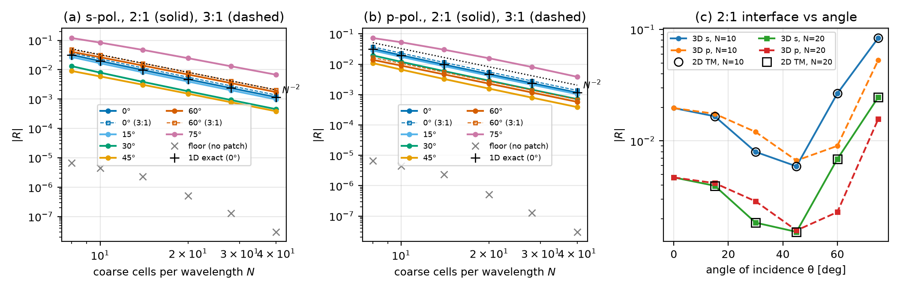
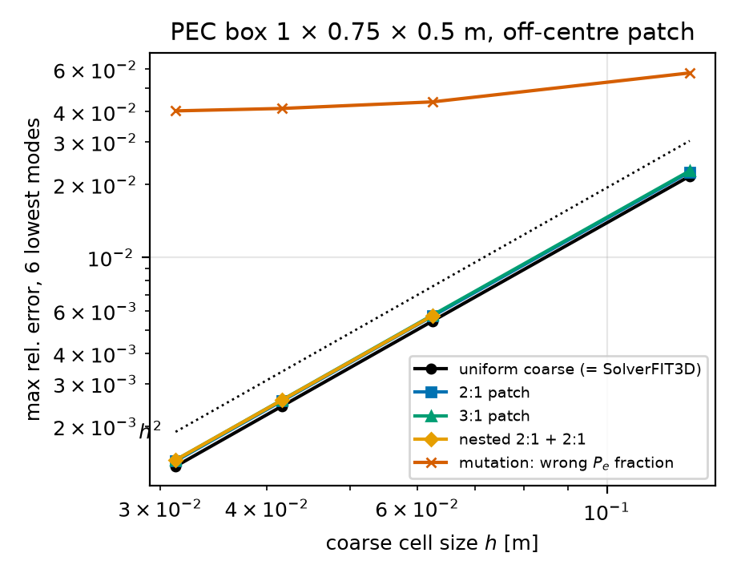
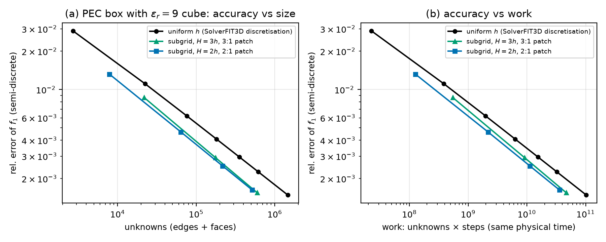

### 🧊 3D Cartesian subgridding with hanging edges: `wakis.subgrid3d` (milestone 1)

`wakis.subgrid3d` refines boxes of a `GridFIT3D` tensor grid (non-uniform allowed) by an integer ratio $r\in\{2,3\}$, recursively. It is the 3D version of the 2D scheme of `wakis.subgrid` ("Local Cartesian refinement" above): the fine-to-coarse coupling is the exact transpose of the coarse-to-fine one, so the scheme conserves a discrete energy, is stable under a computed global CFL limit and has an exact adjoint. Milestone 1 is a CPU (NumPy/SciPy) prototype with vacuum or per-cell isotropic $\varepsilon$, $\mu$, PEC outer walls (PMC and Bloch-periodic walls also work), PEC/PMC cells, soft currents, point probes, running DFTs and an energy monitor.

#### 1. Mesh: an octree of dense Cartesian blocks

* **Blocks.** Block 0 is the coarse tensor grid. Each patch is a box of whole cells of its parent block. Every parent cell in the box is split into $r$ equal parts per axis, so the child is again a (non-uniform) tensor grid, and its node lines contain the parent node lines. Parent cells inside a child box are *inactive*: they contribute nothing to any mass or Hodge entry.
* **Sides.** Each side of a block is a PEC wall, a PMC wall, a periodic (Bloch) seam, or an *interface*. A child side on its parent's boundary inherits the parent's side type. A child that spans a periodic axis of its parent is periodic along it with the same phase.
* **Balance.** An interface side of a child must lie at least one parent cell away from every interface side of its parent, and siblings must be at least one parent cell apart (both are checked). Hanging edges then reference only free edges, with no chains.
* **Unknowns.** Every leaf cell owns its 12 edges and 6 faces. On an interface, the coarse face and its $r^2$ fine sub-faces are *different* faces, and the coarse edges and their collinear fine edges are different edges, as in 2D. Each block has its own dense $(i,j,k)$ layout. The global vectors concatenate the blocks.

#### 2. The Nédélec trace and the prolongation $\mathbf P_e$

On a coarse face $[x_0,x_1]\times[y_0,y_1]$ at $z=z_0$, the tangential field of the lowest-order hexahedral Nédélec (Whitney) element [Nédélec, 1980] built from the four coarse edge voltages $e_{x,0}$ ($y=y_0$), $e_{x,1}$ ($y=y_1$), $e_{y,0}$, $e_{y,1}$ is

```math
E_x(x,y) = \frac{1}{h_x}\Big[(1-t_y)\,e_{x,0} + t_y\,e_{x,1}\Big],\qquad
E_y(x,y) = \frac{1}{h_y}\Big[(1-t_x)\,e_{y,0} + t_x\,e_{y,1}\Big],
```

with $t_x=(x-x_0)/h_x$ and $t_y=(y-y_0)/h_y$: constant along each edge direction and linear across it. The fine edges in this face are *hanging*. Their voltages are the line integrals of this trace along the fine edge, of length $h_x/r$:

```math
e_f = \frac{1}{r}\Big[(1-t)\,e_{c,0} + t\,e_{c,1}\Big],\qquad t = \frac{j}{r},\; j = 0,\dots,r .
```

* **Collinear edges** ($t=0$ or $1$) lie on a coarse edge and take $e_c/r$. The $r$ collinear pieces add up to the coarse voltage.
* **Face-interior edges** ($0<t<1$) are parallel to two coarse edges of the face and interpolate between them. The second term, $t\,e_{c,1}/r$, is the *transverse term*, since it reaches across the face. Section 7 drops it as one of the mutations.
* **Edges normal to the face** (fine edges that start on the interface and point into the patch) belong to fine cells and are free unknowns.

All weights are non-negative and real, except a factor of the Bloch phase where the reach crosses a periodic seam. With all edges oriented along $+x,+y,+z$:

```math
\mathbf e_\text{all} = \mathbf P_e\,\mathbf e,\qquad \mathbf P_e = \begin{bmatrix}\mathbf I \\ \mathbf T\end{bmatrix}\ (\text{free rows / hanging rows; dead rows} = 0),
```

where $\mathbf T$ holds the trace rows above and dead edges are PEC edges and edges of inactive cells only.

**Gradients are preserved.** Take a nodal potential $\phi$ that is continuous across the interface, with hanging nodes on the bilinear ($Q_1$) trace of the coarse face. Its fine edge differences equal the trace rows applied to its coarse edge differences: along a fine edge at height $t$, $\Delta\phi = \frac1r[(1-t)\Delta\phi_0 + t\Delta\phi_1]$ for a bilinear $\phi$. The discrete de Rham sequence nodes $\to$ edges $\to$ faces therefore holds on the composite mesh, and the null space of the curl consists exactly of these gradients. No spurious non-zero-frequency modes appear. The cavity test sees them as soon as the trace is altered (Section 7).

#### 3. Curl, Gauss's law and the face fluxes

Let $\mathbf C$ be the block-diagonal face–edge incidence of the blocks. Every leaf face circulates its own four edges: $e_b(p)+e_c(p+u_b)-e_b(p+u_c)-e_c(p)$ for a face of normal $a$, with $(b,c)$ the cyclic successors of $a$. This is the incidence of `wakis.boundaries._assemble_curl` in a compact layout without ghost samples. With $\mathbf K = \mathbf C\mathbf P_e$, Faraday's law reads $\mathbf b^{n+1/2}=\mathbf b^{n-1/2}-\Delta t\,\mathbf K\mathbf e^n$. Two consequences follow:

* **$\nabla\cdot\mathbf b=0$ in every leaf cell, coarse or fine.** Each cell's faces are built from that cell's own edges, so $\mathbf S\mathbf C=0$ per block for the cell–face incidence $\mathbf S$, for *any* edge values, including the trace values on hanging edges. If $\mathbf b$ is divergence-free at the start, it stays so to round-off.
* **Flux continuity across the interface.** The sum of the $r^2$ fine sub-face fluxes of a coarse face is the circulation of the fine edges on the coarse face's boundary, because the face-interior edges cancel pairwise. That circulation is $\sum$ (collinear pieces) $=$ the coarse circulation, so $b_\text{coarse}=\sum b_\text{fine}$ exactly at all times. The collinear fraction $1/r$ is what makes this hold. A wrong fraction breaks it. The transverse term cancels in the sum, so dropping it does *not* break the flux balance. The test checks both statements.

#### 4. Masses, Hodge and the update

Each active leaf cell $c$ (size $h_x\times h_y\times h_z$, $\varepsilon_c$, $\mu_c$) contributes:

* to each of its 4 edges of direction $x$: $m_e \mathrel{+}= \varepsilon_c\,\tfrac14 h_yh_z/h_x$ (the cell's share of $\varepsilon\tilde A/L$), and similarly for $y$ and $z$;
* to each of its 2 faces of normal $x$: $W_f \mathrel{+}= \tfrac12 h_x/(\mu_c h_yh_z)$, the series sum of the half cells on either side. $\mathbf h$-voltage $=\mathbf W\mathbf b$, and the face Hodge $W_f$ is exact for $\mu$ interfaces aligned with the grid.

On a uniform block this is the FIT Hodge of `SolverFIT3D`. Without a patch, the non-zero spectrum of $\mathbf K^T\mathbf W\mathbf K$ against $\mathbf D$ equals that of `SolverFIT3D`'s update on a graded grid with $\varepsilon_r=2$, $\mu_r=1.5$ to $8\times10^{-15}$ (test `test_without_patch_equals_solverfit3d`). Hanging edges carry the masses of their own (fine) half cells. Interface faces carry only the half cell on their own side. The free-edge mass is the row-sum lumping

```math
\mathbf D = |\mathbf P_e|^T\big(\mathbf m\circ|\mathbf P_e|\mathbf 1\big)
\quad\Longleftrightarrow\quad D_{jj}=\sum_k |P_{kj}|\,m_k\,\textstyle\sum_l |P_{kl}|,
```

which is exact for fields that are uniform over a coarse cell. Ampère's law uses the transpose of the coarse-to-fine map:

```math
\mathbf D\,(\mathbf e^{n+1}-\mathbf e^n) = \Delta t\Big(\mathbf K^H\mathbf W\,\mathbf b^{n+1/2} - \mathbf P_e^H\,\mathbf i^{\,n+1/2}\Big),
```

with $\mathbf i$ [A] an impressed current through the dual face of every edge (a current on a hanging edge is restricted to its parents by $\mathbf P_e^H$). In finite-element language this is the conforming lowest-order Nédélec/Raviart–Thomas pair on the composite hexahedral mesh with hanging-edge constraints, trapezoidal (vertex) lumping of both masses [Cohen & Monk, 1998], and the hanging variables eliminated through $\mathbf P_e$, as in [Venkatarayalu et al., 2007] (FETD, there with consistent masses on the interface layer) and the 2D `wakis.subgrid`.

**PEC and PMC cells.** A PEC cell ($\varepsilon\to\infty$) freezes its 12 edges at zero. A PMC cell ($\mu\to\infty$) adds nothing to the face Hodge: $H=0$ inside, and the faces on its surface see only the half cell outside, the natural boundary, which is the dual of the PEC edge freeze. A first version zeroed the six face fluxes of PMC cells instead. That *violates* $\nabla\cdot\mathbf b=0$ in the neighbouring cells, since the normal $B$ on a PMC surface need not vanish, and the divergence test caught it. A PEC fine cell may not touch an interface unless the coarse parents are PEC too (checked), otherwise the trace would contradict the wall.

#### 5. Energy, stability and the global time step

For the lossless, source-free leapfrog, let

```math
\mathcal E^{n+1/2} = \tfrac12\,\mathbf b^{n+1/2}\cdot\mathbf W\mathbf b^{n+1/2} + \tfrac12\,\mathbf e^{n}\cdot\mathbf D\,\mathbf e^{n+1}.
```

Subtracting two consecutive levels and inserting both updates gives $\mathcal E^{n+3/2}-\mathcal E^{n+1/2} = -\tfrac{\Delta t}2(\mathbf b^{n+3/2}+\mathbf b^{n+1/2})\cdot\mathbf W\mathbf K\mathbf e^{n+1}+\tfrac{\Delta t}{2}\mathbf e^{n+1}\cdot\mathbf K^T\mathbf W(\mathbf b^{n+3/2}+\mathbf b^{n+1/2})=0$. The step only needs $\mathbf W$ and $\mathbf D$ to be symmetric positive definite and Ampère's law to use exactly $\mathbf K^T$. In the scaled variables $\mathbf x=\mathbf W^{1/2}\mathbf b$, $\mathbf y=\mathbf D^{1/2}\mathbf e$, $\mathbf A=\mathbf W^{1/2}\mathbf K\mathbf D^{-1/2}$ one has $\mathcal E=\tfrac12|\mathbf x|^2+\tfrac12|\mathbf y|^2+\tfrac{\Delta t}2\mathbf y\cdot\mathbf A^T\mathbf x$, which is positive definite iff

```math
\Delta t < \Delta t_\max = \frac{2}{\sqrt{\lambda_\max}},\qquad \lambda_\max = \lambda_\max\big(\mathbf D^{-1}\mathbf K^H\mathbf W\mathbf K\big).
```

$\lambda_\max$ is computed at setup (Lanczos on $\mathbf D^{-1/2}\mathbf K^H\mathbf W\mathbf K\mathbf D^{-1/2}$, tolerance $10^{-12}$).

**Bound (derived).** $\mathbf C^T\mathbf W\mathbf C$ and $\mathbf m$ are block-diagonal over the blocks. Each block is a standalone FIT grid whose surface edges are free, i.e. natural (PMC-like) boundaries with half masses. By Cauchy–Schwarz on each hanging row with non-negative weights, $|(\mathbf P_e\mathbf e)_k|^2\le(\sum_l|P_{kl}|)\sum_j|P_{kj}||e_j|^2$, so $(\mathbf P_e\mathbf e)^H\mathrm{diag}(\mathbf m)\,\mathbf P_e\mathbf e\le\mathbf e^H\mathbf D\mathbf e$. The Rayleigh quotients then give

```math
\lambda_\max \;\le\; \max_{\text{blocks } b}\lambda_\max^{(b)} \;\le\; \max_b\; c_b^2\Big(\frac{4}{h_{x,b}^2}+\frac{4}{h_{y,b}^2}+\frac{4}{h_{z,b}^2}\Big)_{\min h},
```

where the second inequality is the Yee bound of a block with natural boundaries: mirror the block across its natural sides to obtain a periodic grid with the same Rayleigh quotient. The composite therefore runs at least at the Yee step of its finest cells,

```math
\Delta t_\max \;\ge\; \frac{1}{c_\max\sqrt{h_{x,f}^{-2}+h_{y,f}^{-2}+h_{z,f}^{-2}}},
```

and the interface does not reduce the global step. On the test mesh (graded coarse grid, a 2:1 patch with a nested 3:1 patch, $\varepsilon_r=4$ and $\mu_r=2$ boxes, PEC and PMC cells) the measured values are $\lambda_\max=3.49\times10^{21}\,\mathrm{s^{-2}}$ and $\max_b\lambda_\max^{(b)}=3.79\times10^{21}\,\mathrm{s^{-2}}$. With a global $\Delta t$, every block takes the finest step. Local time stepping is a later milestone.

#### 6. Exact transpose and adjoint

All updates are linear with fixed sparse matrices. One step maps $(\mathbf b^{n-1/2},\mathbf e^n,\mathbf i^{n+1/2})\mapsto(\mathbf b^{n+1/2},\mathbf e^{n+1})$. Its transpose (`linear_step_T`) is, with $\mathbf g=\mathbf D^{-1}\bar{\mathbf e}^{n+1}$:

```math
\bar{\mathbf b}^{n-1/2}=\bar{\mathbf b}^{n+1/2}+\Delta t\,\mathbf W(\mathbf K^H)^T\mathbf g,\quad
\bar{\mathbf e}^{n}=\bar{\mathbf e}^{n+1}-\Delta t\,\mathbf K^T\bar{\mathbf b}^{n-1/2},\quad
\bar{\mathbf i}=-\Delta t\,\overline{\mathbf P_e}\,\mathbf g .
```

The source adjoint $\bar{\mathbf i}$ is defined on *all* edges, hanging ones included. A design parameter on a fine edge next to an interface therefore receives its gradient through $\mathbf P_e$.

#### 7. Plane-wave reflection of an interface

The leapfrog steady state at $\omega$ solves $(\mathbf K^H\mathbf W\mathbf K-\tilde\omega^2\mathbf D)\mathbf e = -i\tilde\omega\mathbf P_e^H\mathbf i$ exactly, with $\tilde\omega = 2\sin(\omega\Delta t/2)/\Delta t$. `bloch_reflection_3d` builds a column along $x$ that is Bloch-periodic in $y$ and $z$ with a period of two coarse cells. A patch fills $x>x_i$ and spans the period, both ends carry complex-stretched absorbers, and the coarse samples are fitted to $Ae^{-ik_xx}+Be^{ik_xx}$ with the exact discrete $k_x$ of the coarse Yee grid. The fit therefore contains no coarse dispersion.

**Normal incidence: closed form (derived).** Fields that are uniform over the interface make every trace row trivial ($e_f=e_c/r$). The column then reduces exactly to a 1D FIT chain $H\to h=H/r$ with the trapezoidal interface mass $(H+h)/2$. For $u_j=Ae^{-ikHj}+Be^{ikHj}$ on the coarse side and $u_j=Te^{-i\kappa hj}$ on the fine side, the interface row gives $R=-(\alpha-\gamma)/(\beta-\gamma)$, with $\alpha,\beta=\mp i\sin(kH)/H+k_t^2H/2$ and $\gamma=-i\sin(\kappa h)/h+k_t^2H/2$ (using $1-\cos kH = k_t^2H^2/2$). Hence

```math
R_\perp=\frac{\cos(kH/2)-\cos(\kappa h/2)}{\cos(kH/2)+\cos(\kappa h/2)},\qquad
|R_\perp| = \frac{(k_tH)^2}{16}\Big(1-\frac1{r^2}\Big)+O\big((k_tH)^4\big),
```

i.e. $|R_\perp|N^2\to\frac{\pi^2}{4}(1-r^{-2})$ for $N=2\pi/(k_tH)$ coarse cells per wavelength. This is the mismatch between the discrete wave impedances $\propto\cos(kh/2)$ of the two Yee grids. At normal incidence, the coupling adds nothing beyond it. The 3D scheme reproduces this formula to within the measurement floor (Section 9).

**Oblique incidence.** The trace is exact for fields that are linear across a coarse face, so its interpolation error is $O(H^2)$ on a single cell layer, and the reflection is $C(\theta,r,\text{pol})\,(k_tH)^2$ to leading order. For s-polarisation ($E\parallel z$, plane of incidence $xy$, $k_z=0$) the fields are $z$-invariant. The 3D trace on the $z$-edges is then the 2D linear hanging-node interpolation, and the masses match those of 2D TM, so the 3D scheme reduces *exactly* to `SubgridFIT2D` TM. p-polarisation has no 2D counterpart: its in-plane $E$ sits on edges, whereas the 2D TE scheme interpolates $H_z$ on nodes. The dispersion-mismatch formula with oblique $k_x$ underestimates s and overestimates p; the difference is the interpolation term.

#### 8. Implementation and data layout

* `CartesianBlock` (`wakis/subgrid3d/block.py`): the dense block. It provides the index maps with Bloch wrap, `curl()`, `divergence()`, per-cell edge/face metric weights and the geometry. `SubgridMesh3D` (`mesh.py`): the patches, side classification, balance checks and the trace rows (`hanging_rows`). `SubgridFIT3D` (`solver.py`): materials, $\mathbf P_e$, $\mathbf K$, $\mathbf W$, $\mathbf D$, the Lanczos CFL, `one_step`/`run`, `linear_step`/`linear_step_T`, sources, probes with DFT, energy, divergence and the interface flux balance. `interface.py`: the Bloch column and the 1D closed form.
* `SubgridMesh3D(grid)` accepts a `GridFIT3D` and drops its domain-edge ghost cells. The per-block operators are FIT's own: they reproduce `SolverFIT3D` exactly without a patch (Section 4). They are rebuilt compactly rather than taken from `SolverFIT3D`, for two reasons. Wakis's ghost layout ($3(N_x+1)(N_y+1)(N_z+1)$ samples, with PEC enforced by zero inverse masses) would put dead samples on every block surface. And hanging edges need masses from the fine side only, which `SolverFIT3D`'s dual lengths do not provide inside a domain.
* This milestone steps the assembled global CSR matrices $\mathbf K$ and $\mathbf K^H$: block-diagonal curls times $\mathbf P_e$, i.e. identity plus thin surface couplings. Splitting them into per-block dense kernels plus surface operators is the GPU milestone. The measured cost is 3–8 ns per unknown-step on one core (§9b).

#### 9. Verification (`tests/test_097_subgrid3d.py`)

The fast tests run on CPU in under 30 s. The slow ones ($N=32$ cavities, $N=20/40$ reflections) are marked `slow`. Every row has a mutation that was run and seen to fail.

| check | measured | tolerance (origin) | mutation → result |
|---|---|---|---|
| no patch = `SolverFIT3D` spectrum (graded, $\varepsilon_r=2,\mu_r=1.5$) | $8\times10^{-15}$ | $10^{-12}$ (dense eig round-off) | – (reuse check) |
| energy, $10^4$ steps, 2 nested patches (2:1, 3:1), graded, ε/μ/PEC/PMC, $0.99\,\Delta t_\max$ | $4.4\times10^{-16}$ | $50\,\epsilon\sqrt{n}=1.1\times10^{-12}$ (round-off random walk) | $\mathbf P_e^T\to$ injection at $0.5\,\Delta t_\max$: drift $>0.1$ (measured 0.6 in 2000 steps); $1.02\,\Delta t_\max$: overflow |
| $\lambda_\max\le\max_b\lambda^{(b)}\le$ finest Yee | $3.49\le3.79\le$ Yee $\times10^{21}$ | $10^{-10}$ relative | – |
| $\nabla\cdot\mathbf b$, interface flux balance (driven, 300 steps), relative to $\max|b|$ | $1.9\times10^{-15}$, $1.2\times10^{-15}$ | $10^{-13}$ | wrong $P_e$ fraction (×1.25): flux mismatch 0.14; missing transverse term: $1.5\times10^{-15}$, balance intact as derived in §3 |
| cavity, 6 lowest modes, order (2:1 / 3:1), $N=8\to16$ | 1.98 / 1.98 | $[1.8,2.2]$ | fraction: order 0.40, error ×8; missing transverse: 53–58 % error (spurious modes) |
| normal incidence vs closed form, s and p, 2:1 and 3:1 | $|\Delta R|\le2.5\times10^{-7}$ | fit floor (no patch) $5.7\times10^{-6}$ | missing transverse: $R>10\times$ |
| s-pol. 3D = 2D TM (30°, 60°, $N=10$) | $1.6\times10^{-12}$ rel. | $10^{-9}$ | – |
| reflection order, $N=10\to20$, 0/30/60°, s/p, 2:1/3:1 | 1.96–2.11 | $[1.8,2.25]$ | fraction / missing transverse at 60°: order $<1$, $R>10\times$ |
| dot product of the step transpose (fields; source part alone) | $1.4\times10^{-16}$; $1.9\times10^{-16}$ | $10^{-14}$ | source transpose without the hanging rows of $\mathbf P_e$: relative error 1.0 |
| adjoint gradient vs central difference (source on a hanging edge, 60 steps) | $2.4\times10^{-14}$ | $10^{-8}$ ($J$ quadratic, so the central difference is exact up to cancellation round-off) | covered by the dot-product mutation |
| time-domain probe + DFT, lowest mode vs eigenvalue through $\tilde\omega$ | $2.6\times10^{-7}$ | $10^{-5}$ (Hann + parabolic peak, bin $=1.7\times10^{-3}f$) | – |

#### 9b. Study results (`studies/subgrid3d/`, Cloud Batch jobs `sg3d-study-a-2`, `-b-2`, `-c-2`)



**Reflection.**
- At normal incidence, the 3D column matches the closed form of §7 to $3.2\times10^{-7}$ (absolute) for $N=8$–$40$, s and p, 2:1 and 3:1.
- For s-polarisation, the 3D scheme equals 2D TM to $1.5\times10^{-10}$ (relative) at every $N$ and angle.
- The observed order between $N=28$ and $40$ is 1.99–2.02 for $\theta=0$–$60°$, and 1.86 (s) / 2.09 (p) at 75°.
- 2:1, $N=10$: s-polarisation 2.0 / 0.8 / 2.7 / 8.4 % at 0 / 30 / 60 / 75°; p-polarisation 2.0 / 1.2 / 0.9 / 5.3 %. At $N=40$: s 0.12 / 0.045 / 0.17 / 0.68 %.
- 3:1 is about 18 % above 2:1.
- Mutations at 60° (2:1, s): the wrong fraction stays at 18–22 %, and the missing transverse term grows from 61 % to 95 % as $N$ goes from 8 to 40. Injection ($\mathbf P_e^T$ replaced) is not monotone in $N$, falling from 9.7 % to 1.7 %.
- The measurement floor (no patch) is $<10^{-5}$ at $\theta\le30°$ and grows toward grazing incidence (at most $6\times10^{-4}$, at 75° and $N=8$).



**Cavity.** The maximum error over the 6 lowest modes converges at order 1.99 for the uniform coarse grid and for the 2:1 and 3:1 patches, and at 1.98 for the nested 2:1+2:1 patch, at $N=8$–$32$. The patched errors are 4–6 % above the coarse grid's at every $N$: the interface's own $O(h^2)$ term, in an empty cavity where refinement brings no benefit. With the wrong fraction, the observed order drops to 0.27 overall and to 0.08 for the last pair.



**Cost at equal accuracy** (loaded cavity, part C). The uniform arms converge at the observed order $p=1.46$; the finest and the previous triple of arms give the same $p$ to $3\times10^{-3}$. This is the field singularity at the edges and corners of the dielectric cube. The reference is therefore the 3-point power-law extrapolation, $f^*=190.716$ MHz; the $h^2/h^4$ Richardson value 190.648 MHz would understate the errors. Against the uniform `SolverFIT3D` discretisation at equal error of $f_1$ (log-log interpolation along the uniform curve):

| arm | coarse $H$ [m] | unknowns | error | fewer unknowns | less work |
|---|---|---|---|---|---|
| 3:1 | 0.1 | 21 771 | $8.7\times10^{-3}$ | 1.74× | 1.42× |
| 3:1 | 0.05 | 176 496 | $2.9\times10^{-3}$ | 2.06× | 1.74× |
| 3:1 | 0.0333 | 598 455 | $1.5\times10^{-3}$ | 2.25× | 1.95× |
| 2:1 | 0.1 | 7 881 | $1.3\times10^{-2}$ | 1.93× | 1.82× |
| 2:1 | 0.05 | 63 966 | $4.6\times10^{-3}$ | 2.17× | 2.03× |
| 2:1 | 0.025 | 515 868 | $1.6\times10^{-3}$ | 2.35× | 2.22× |

Work is unknowns × steps to the same physical time, at $0.95\,\Delta t_\max$ for every arm. The work gain is smaller than the unknown gain because the global step is set by the fine cells. 2:1 beats 3:1 here: its step is larger, and the cube ($n=3$) needs no more than about 2× refinement at this accuracy.

Per step, `SubgridFIT3D.one_step` costs the same as `SolverFIT3D.one_step` on the same uniform grid (n2-standard-8, one thread, serial). At $h=0.02$ m (60 000 cells), the two take 2.85 ms and 2.84 ms; at $h=0.05$ m, 0.149 ms and 0.151 ms. The work ratios above are therefore also wall-clock ratios. Absolute speed is about 8 ns per unknown-step on that VM and 3.4 ns on an Apple-silicon laptop core.


#### 10. Limits & Failure Modes

* **Interface reflection.** It is second order but not zero. At normal incidence it equals the impedance mismatch of the two Yee grids, $\approx(k_tH)^2(1-r^{-2})/16$, i.e. 2.0 % at $N=10$ and 0.47 % at $N=20$ (2:1). Oblique s-polarisation is larger (2.7 % at 60° and 8.4 % at 75°, $N=10$), and p-polarisation is smaller at 60° (0.9 %); the order drops slightly toward grazing incidence (1.86 at 75°, s). Keep $\gtrsim10$ coarse cells per local wavelength, and keep strong near fields a few fine cells away from level jumps.
* **Global time step.** Every block takes the step of the finest cells (bound in §5). Subgridding then saves unknowns but not steps. Two-level LTS per patch level is the next milestone.
* **Ratios and balance.** Only $r=2,3$ are implemented and tested. Children must stay one parent cell from the parent's interfaces and from siblings, and unbalanced meshes are rejected rather than repaired. Adjacent sibling boxes must be merged into one box.
* **Materials.** Isotropic $\varepsilon$, $\mu$ are sampled at cell centres, with a diagonal Hodge. This is exact only for interfaces aligned with the grid of the block that owns the cell; oblique or curved interfaces are staircased, first order in $h$. Conformal or tensor averaging inside patches is not implemented. Material interfaces may cross patch interfaces (tested). PEC may cross an interface only if it is aligned with coarse cells there (checked).
* **Boundaries.** PEC, PMC (natural) and Bloch-periodic outer walls are supported. There is no CPML: patches must stay away from any absorber, and the Bloch column uses complex stretching in the frequency domain only. No lossy media, no dispersive ADE, no TF/SF, no lumped ports.
* **Sources and probes.** Soft edge currents and nearest-edge point probes only (no interpolation). A probe on a hanging edge reads the trace value.
* **Not covered by the energy proof.** Anything non-symmetric. The `inject` mutation shows that a restriction other than $\mathbf P_e^T$ drifts even at half the CFL limit.
* **Performance.** Global CSR on one core, 3–8 ns per unknown-step depending on the machine, the same per step as `SolverFIT3D` on the same uniform grid. There are no per-block kernels, no GPU and no MPI. The leading extra cost of a patch is its surface, about $6r^2$ hanging edges per coarse face.
* **Accuracy relative to the coarse grid.** In the empty cavity with a patch, the error is about 4 % *larger* than on the coarse grid alone ($2.25\times10^{-2}$ vs $2.17\times10^{-2}$ at $N=8$). The interface's $O(h^2)$ contribution is of the same order as the coarse-grid error. Refinement pays only where the field needs it, as in the loaded cavity of §9b, where it saves 1.4–2.2× work at equal accuracy. That gain is modest because the global step is set by the fine cells.

#### 11. Next milestones

Per-block dense kernels with surface coupling operators, then GPU (CuPy) kernels; two-level LTS per patch level (Diaz–Grote leapfrog–Chebyshev, as in 2D); CPML on the coarse frame with an adjoint; conformal/tensor material averaging inside patches; dispersive ADE media; lumped ports and mode sources across patches; MPI ownership of whole blocks.

References:
- J.-C. Nédélec, "Mixed finite elements in $\mathbb R^3$", *Numer. Math.* **35**(3), 315–341 (1980), doi:10.1007/BF01396415.
- G. Cohen and P. Monk, "Gauss point mass lumping schemes for Maxwell's equations", *Numer. Methods Partial Differ. Equ.* **14**(1), 63–88 (1998), doi:10.1002/(SICI)1098-2426(199801)14:1<63::AID-NUM4>3.0.CO;2-J.
- P. Monk and E. Süli, "A convergence analysis of Yee's scheme on nonuniform grids", *SIAM J. Numer. Anal.* **31**(2), 393–412 (1994), doi:10.1137/0731021.
- P. Thoma and T. Weiland, "A consistent subgridding scheme for the finite difference time domain method", *Int. J. Numer. Model.* **9**(5), 359–374 (1996), doi:10.1002/(SICI)1099-1204(199609)9:5<359::AID-JNM245>3.0.CO;2-A.
- W. Podebrad, M. Clemens and T. Weiland, "New flexible subgridding scheme for the finite integration technique", *IEEE Trans. Magn.* **39**(3), 1662–1665 (2003), doi:10.1109/TMAG.2003.810521.
- N. V. Venkatarayalu, R. Lee, Y.-B. Gan and L.-W. Li, "A stable FDTD subgridding method based on finite element formulation with hanging variable", *IEEE Trans. Antennas Propag.* **55**(3), 907–915 (2007), doi:10.1109/TAP.2007.891809.
- R. A. Chilton and R. Lee, "Conservative and provably stable FDTD subgridding", *IEEE Trans. Antennas Propag.* **55**(9), 2537–2549 (2007), doi:10.1109/TAP.2007.904092.
- F. Collino, T. Fouquet and P. Joly, "Conservative space-time mesh refinement methods for the FDTD solution of Maxwell's equations", *J. Comput. Phys.* **211**(1), 9–35 (2006), doi:10.1016/j.jcp.2005.03.035.
- M. Clemens and T. Weiland, "Discrete electromagnetism with the finite integration technique", *Prog. Electromagn. Res.* **32**, 65–87 (2001), doi:10.2528/PIER00080103.
