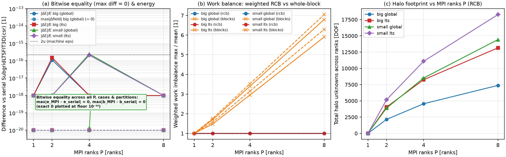
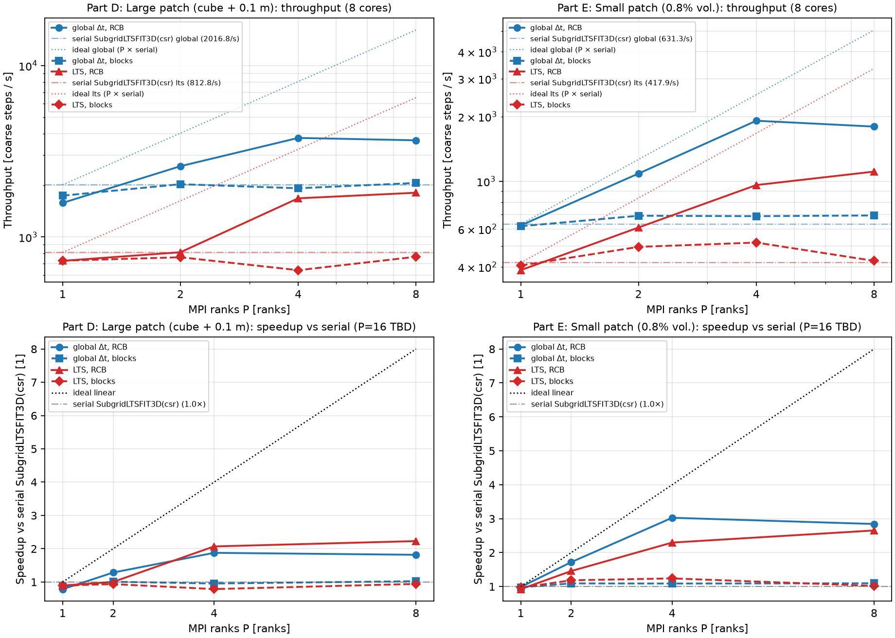

#### Distributed-memory (MPI) time stepping for 3D subgridding (`wakis/subgrid3d/mpi.py`)

`wakis.subgrid3d.mpi` distributes the time-stepping loop of a configured `SubgridFIT3D` or `SubgridLTSFIT3D` (`kernels="csr"`, `backend="numpy"`) across $P$ MPI ranks without modifying the serial solver classes. The serial composite mesh and operators ($\mathbf K = \mathbf C\mathbf P_e$, $\mathbf K^H$, $\mathbf W$, $\mathbf D$, the CPML convolutional operators, and the multi-level LTS hierarchy) are built once on the root rank (`mode="scatter"`) or on every rank (`mode="replicated"`), cut into per-rank owned CSR row blocks with point-to-point halo spaces, and stepped in lockstep. `SubgridLocalCluster` executes the exact same per-rank arithmetic and halo copies in a single Python process for deterministic verification.

```python
from wakis.subgrid3d import SubgridLTSFIT3D, SubgridMesh3D
from wakis.subgrid3d.mpi import DistributedSubgridFIT3D, SubgridLocalCluster

s = SubgridLTSFIT3D(mesh, lts=True, pml=dict(thickness=th))
d = DistributedSubgridFIT3D(s if comm.rank == 0 else None, comm, mode="scatter")
d.run(n_steps)
st = d.gather_state()          # {'b', 'e', 'psi', 'phi'} on rank 0
v0 = d.probe_signal(0)         # time series of probe 0 on rank 0
X0 = d.dft_data(0)             # running DFT of probe 0 on rank 0
E = d.energy()                 # Allreduce of per-rank partial energies
lam = d.apply_T(adjoint_vec)   # exact transpose of the source-free step

lc = SubgridLocalCluster(s, n_parts=4, method="rcb")   # in-process cluster
```

##### 1. Partition and ownership

Let $\mathcal C_{\mathrm{act}}$ be the set of active leaf cells across all octree blocks $b = 0, \dots, N_{\mathrm{blk}}-1$ (`solver.active_cells`, where coarse cells covered by a child patch are inactive and carry zero mass/Hodge). `partition_cells(solver, n_parts, method, weights="work")` assigns each active leaf cell $c \in \mathcal C_{\mathrm{act}}$ to a part $p(c) \in \{0, \dots, P-1\}$:

* **Work weights.** A leaf cell $c$ in a block at refinement depth $l = \mathrm{level}(b)$ carries work weight
  ```math
  w(c) = \begin{cases}
  1, & \text{global }\Delta t, \\
  \prod_{m=1}^{l} p_m, & \text{local time stepping (LTS)},
  \end{cases}
  ```
  where $p_m$ is the integer substep ratio at level $m$ (`solver.lts.ratios`).
* **`method="rcb"` (default) and `"rib"`.** Weighted recursive coordinate bisection [Berger & Bokhari, 1987] (or recursive inertial bisection [Simon, 1991]) splits the active leaf cell centroids $\mathbf x_c$ at each recursion level into left and right subsets of $P_L = \lfloor P'/2 \rfloor$ and $P_R = P' - P_L$ parts so that the cumulative work weight matches the target fraction $P_L / P'$ to within a single leaf cell.
* **`method="blocks"`.** Whole octree blocks are assigned greedily in descending order of total block work weight $W_b = \sum_{c \in b} w(c)$ to the currently lightest rank (the whole-block ownership model of `subgrid3d.md` §11). When a single fine patch holds more than $1/P$ of the total work, whole-block assignment cannot split that block across ranks and therefore suffers an intrinsic work imbalance $\max_r W_r / \bar W > 1$.

**Unique ownership of free edges, active faces, and CPML states (`_entity_owners`).** Every unknown in the state vector is assigned a single deterministic owner rank in $\{0, \dots, P-1\}$:

1. **Free edges** $e \in \text{`solver.free_edges`}$ ($N_{\mathrm{free}} = \text{`solver.n_free`}$): owned by the lowest part among the active leaf cells of $e$'s own block that contain $e$,
   ```math
   \mathrm{owner}_e(e) = \min\big\{\, p(c) \;\big|\; c \in \mathcal C_{\mathrm{act}}(b(e)),\; e \subset \partial c \,\big\}.
   ```
   Every free edge belongs to at least one active leaf cell of its block (edges touching only inactive cells or PEC walls are eliminated at setup), so $0 \le \mathrm{owner}_e(e) < P$ is well-defined and unique.
2. **Active faces** $f \in \text{`solver.faces`}$ ($N_{\mathrm{faces}} = \text{`solver.n_faces`}$): owned by the lowest part among the $\le 2$ active leaf cells of $f$'s block that share $f$,
   ```math
   \mathrm{owner}_f(f) = \min\big\{\, p(c) \;\big|\; c \in \mathcal C_{\mathrm{act}}(b(f)),\; f \subset \partial c \,\big\}.
   ```
3. **CPML auxiliary fields** (`SubgridCPML`): for each axis $d \in \{0, 1, 2\}$, the magnetic auxiliary $\boldsymbol\psi_d$ lives on the subset of active faces $\text{`cpml.pf`}[d]$ and the electric auxiliary $\boldsymbol\phi_d$ lives on the subset of free edges $\text{`cpml.pe`}[d]$. Each entry inherits the owner of its face or free edge:
   ```math
   O_{\psi_d}(r) = \{\, k \mid \mathrm{owner}_f(\text{` pf`}[d][k]) = r \,\}, \qquad
   O_{\phi_d}(r) = \{\, k \mid \mathrm{owner}_e(\text{`pe`}[d][k]) = r \,\}.
   ```
4. **Probes:** each point probe $i$ (`solver.probes[i]`) has a sparse interpolation row $\mathbf r_i^T$ over free edges and is owned by $\mathrm{owner}_{\mathrm{probe}}(i) = \min_{j \in \operatorname{cols}(\mathbf r_i)} \mathrm{owner}_e(j)$.

The owned index sets $O_e(r) = \{j \mid \mathrm{owner}_e(j) = r\}$ and $O_f(r) = \{f \mid \mathrm{owner}_f(f) = r\}$ form disjoint partitions of $\{0, \dots, N_{\mathrm{free}}-1\}$ and $\{0, \dots, N_{\mathrm{faces}}-1\}$.

##### 2. Interface trace couplings in $\mathbf K = \mathbf C\mathbf P_e$ and the halo exchange schedule

In `wakis.subgrid3d`, hanging fine edges on coarse/fine patch interfaces are eliminated algebraically through the Nédélec trace prolongation $\mathbf P_e = \begin{bmatrix}\mathbf I \\ \mathbf T\end{bmatrix}$ [Nédélec, 1980]. The composite curl matrix $\mathbf K = \mathbf C\mathbf P_e$ and its conjugate transpose $\mathbf K^H = \mathbf P_e^H\mathbf C^T$ therefore already contain all coarse-to-fine trace interpolations and fine-to-coarse trace restrictions as standard CSR matrix entries:

* For a fine face $f$ adjacent to a coarse/fine interface, row $\mathbf K[f, :]$ has non-zero columns on the free fine edges of $f$ and, for each hanging edge of $f$, on the coarse parent edges that interpolate it through $\mathbf T$ (including any Bloch phase factors across periodic seams).
* Dually, for a coarse parent edge $j$ on an interface, row $\mathbf K^H[j, :]$ has non-zero columns on the coarse faces touching $j$ and on all fine sub-faces whose hanging edges depend on $j$.

Because these couplings are explicit entries of $\mathbf K$ and $\mathbf K^H$, no separate trace-prolongation or trace-restriction communication step is needed. Rank $r$ simply extracts its owned rows of $\mathbf K$, $\mathbf K^H$, and the CPML slice matrices $\mathbf K_{f,d}$, $\mathbf K_{e,d}$, and forms its halo from the off-rank column indices referenced by those owned rows:

```math
\begin{aligned}
H_e(r) &= \Big(\operatorname{cols}(\mathbf K[O_f(r),:]) \cup \operatorname{cols}(\mathbf K_{f,d}[O_{\psi_d}(r),:]) \cup \operatorname{cols}((\mathbf K^H)^T[O_f(r),:]) \cup \operatorname{cols}(\mathbf K_{e,d}^T[O_f(r),:]) \cup \operatorname{cols}_{\mathrm{probe}}(r)\Big) \setminus O_e(r), \\
H_b(r) &= \Big(\operatorname{cols}(\mathbf K^H[O_e(r),:]) \cup \operatorname{cols}(\mathbf K_{e,d}[O_{\phi_d}(r),:]) \cup \operatorname{cols}(\mathbf K^T[O_e(r),:]) \cup \operatorname{cols}(\mathbf K_{f,d}^T[O_e(r),:])\Big) \setminus O_f(r).
\end{aligned}
```

Including the transpose column sets $\operatorname{cols}((\mathbf K^H)^T[O_f(r),:])$ and $\operatorname{cols}(\mathbf K^T[O_e(r),:])$ guarantees that the exact distributed adjoint `apply_T` reuses the same halo spaces `sp_e` and `sp_b`. Each rank stores its local vectors in contiguous `[owned | halo]` order.

###### Figure-ready description of the halo and exchange schedule

```
  Rank p (coarse block)             Interface              Rank q (fine patch)
 +----------------------+                                +----------------------+
 |   coarse parent edge  | ---- T_{k,j} in K[f_fine,j] -> | fine face f_fine     |
 |  e_c in O_e(p)       |      (sent in e / fc_l halo)   | b_f in O_f(q)        |
 |                      |                                |                      |
 |  coarse parent edge  | <--- T_{k,j}^* in KH[j,f_fine] | (W b)_{f_fine}       |
 |  e_c in O_e(p)       |      (sent in b / phi_l halo)  | f_fine in O_f(q)     |
 +----------------------+                                +----------------------+

 Global-dt step (2 exchanges / coarse step):
   [Faraday: K @ e_ext + CPML psi] --> Exchange(b) --> [Ampere: KH @ (W b_ext) + CPML phi - s] --> Exchange(e) --> [Probes & DFT]

 Multi-level LTS step (2 + 2 * sum_{l=1..L} (p_l - 1) * prod_{m<l} p_m exchanges / coarse step):
   1. Recursive Chebyshev filter z = R_0(e):
        At level m = lv + 1, for substep k = 1 .. p_m - 1:
          - recurse z_sub = R_m(d_k) on owned F_m
          - pack [z_sub | y_C] into buf["fc_m"]  --> Exchange(fc_m)
          - w_Phi = W_m * (K_{F,m} z_sub + kappa_{m,k} K_{C,m} y_C) on owned Phi_m  --> Exchange(phi_m)
          - d_{k+1} = 2 delta_m d_k - 2 beta_m tau_m^2 D_m^{-1} (KH_{F,m} w_Phi) + 2 T_{m,k} y_F - d_{k-1}
        Apply tail recursion u_F = R_m(y_F + corr_m) and inject locally into parent F_{m-1}[iF_loc].
   2. Exchange(z on e-space) --> [Faraday: K @ z_ext + CPML psi]
   3. Exchange(b)            --> [Ampere: KH @ (W b_ext) + CPML phi - s] --> [Probes & DFT]
```

**Local nesting under multi-level LTS (`wakis/subgrid3d/lts.py`).** At LTS level $m \in \{1, \dots, L\}$, the fine edge set $F_m$ and its one-face buffer $C_m$ are subsets of $F_{m-1}$ (with $F_0 = \{0, \dots, N_{\mathrm{free}}-1\}$), and $F_m \cap C_m = \emptyset$. Because ownership is a function of the global free-edge index, an edge $j \in F_m \cup C_m$ has the same owner rank in level $m$ as in level $m-1$:

```math
O_{F_m}(r) = F_m \cap O_e(r) \subset O_{F_{m-1}}(r), \qquad
O_{C_m}(r) = C_m \cap O_e(r) \subset O_{F_{m-1}}(r).
```

Consequently, restricting `v_parent` from $F_{m-1}$ to $(F_m, C_m)$ (`yF = v_parent[iF_loc]`, `yC = v_parent[iC_loc]`) and injecting the updated $F_m$ entries back into $F_{m-1}$ (`v_parent[iF_loc] = uF`) are purely local index slices on rank $r$ and require **zero communication**. Communication inside `_corr(m, ...)` occurs only during the $p_m - 1$ Chebyshev iterations $k = 1, \dots, p_m - 1$:

1. ** Halo on $F_m \cup C_m$ (`fc{m}`):** refreshes off-rank entries of $(z, y_C)$ needed by rank $r$'s owned rows of $\mathbf K_{F,m}$ and $\mathbf K_{C,m}$ on $O_{\Phi_m}(r)$.
2. **Halo on $\Phi_m$ (`phi{m}`):** refreshes off-rank entries of $\mathbf w_{\Phi_m} = \mathbf W_m(\mathbf K_{F,m}\mathbf z + \kappa_{m,k}\mathbf K_{C,m}\mathbf y_C)$ needed by rank $r$'s owned rows of $\mathbf K^H_{F,m}$ on $O_{F_m}(r)$.

**Exchange count per coarse step (`exchange_counts_per_step`).**
* For a **global time step** (`lts=False`), each step executes **2** halo exchanges: `("b", "b")` after Faraday and `("e", "e")` after Ampère.
* For **multi-level LTS** (`lts=True`), `_R(m - 1, ...)` invokes `_corr(m, ...)` once and `_R(m, ...)` a total of $(p_m - 1) + 1 = p_m$ times. By induction on $l = 1, \dots, L$, `_corr(l, ...)` is called $\prod_{m < l} p_m$ times per coarse step, and each call executes $p_l - 1$ Chebyshev iterations with 2 exchanges (`fc{l}` and `phi{l}`) per iteration, followed by 1 exchange `("e", "z")` before Faraday and 1 exchange `("b", "b")` before Ampère:
  ```math
  N_{\mathrm{exch}} = 2 + 2 \sum_{l=1}^{L} (p_l - 1)\prod_{m=1}^{l-1} p_m.
  ```
  For a single 2:1 patch ($L = 1$, $p_1 = 2$), $N_{\mathrm{exch}} = 2 + 2(2 - 1) = 4$. For nested 2:1 + 3:1 patches ($L = 2$, $p_1 = 2, p_2 = 3$), $N_{\mathrm{exch}} = 2 + 2\big[(2 - 1)\cdot 1 + (3 - 1)\cdot 2\big] = 12$ (`NUMBERS test_m2_local_cluster_bitwise_and_mutations: exchanges_global=2 exchanges_lts_2_3=12 exchanges_lts_2=4`). When a point probe interpolates across multiple ranks under LTS, one additional probe-only halo exchange `("p", "p")` on the $\le 1$ probe edges is performed before recording probes.

##### 3. Bitwise equality with the serial solver

In IEEE-754 floating-point arithmetic, a distributed step is bit-for-bit identical (`np.array_equal`) to the serial step if and only if every owned state entry is updated by the exact same algebraic expression tree and summation order over identical binary64/complex128 operands. `wakis.subgrid3d.mpi` replicates the exact operation order of `SubgridFIT3D.one_step` (`wakis/subgrid3d/solver.py`) and `SubgridLTSFIT3D.one_step` (`wakis/subgrid3d/stepper.py`):

1. **CSR row entry order (`_ref_csr`, `_local`).** SciPy's CSR matrix-vector product `A @ x` accumulates each row $i$ from left to right in the stored order `A.indices[A.indptr[i]:A.indptr[i+1]]`. `_local(A, rows, lookup, n_loc)` slices `A[rows]` without sorting or reordering `indices`, mapping global column indices to local `[owned | halo]` indices via `lookup`. Every owned row of `K`, `KH`, `Kf[d]`, `Ke[d]`, `K_F`, `K_C`, and `KH_F` therefore performs additions in the exact serial order.
2. **LTS recursion (`_R` and `_corr`, `wakis/subgrid3d/lts.py` ll. 206–237).** On owned $F_m$ and $\Phi_m$, `_SubgridRank` evaluates:
   * `g = K_C @ buf_fc` once at $k = 1$;
   * `w_phi = W_own * (K_F @ buf_fc + kappa[k] * g)` on owned $\Phi_m$;
   * `Xd = tau2 * Dinv_own * (KH_F @ buf_phi)` (left-to-right binary multiplication `(tau2 * Dinv_own) * (KH_F @ buf_phi)`);
   * `d_new = 2 * delta * dk - 2 * beta * Xd + 2 * T[k] * yF - d_old`;
   * `corr = out * dk - yF` (or `0` when $p_m = 1$) and `uF = yF + corr`.
3. **Faraday and CPML magnetic update (`stepper.py` ll. 176–184).** With $\mathbf z = \mathbf R_0\mathbf e^n$ (or $\mathbf z = \mathbf e^n$ for global $\Delta t$):
   * `Kz = K @ z_ext` on owned faces;
   * for $d = 0, 1, 2$: `psi[d] = bh * psi[d] + ah * (Kf[d] @ z_ext)` and `Kz[loc_pf] += psi[d]`;
   * `b[:nb] -= dt * Kz`.
4. **Ampère, CPML electric update, and soft current sources (`stepper.py` ll. 185–199, `solver.py` ll. 308–314).**
   * `y_ext = W_ext * b_ext` and `rhs = KH @ y_ext` on owned free edges;
   * for $d = 0, 1, 2$: `phi[d] = be * phi[d] + ae * (Ke[d] @ y_ext)` and `rhs[loc_pe] += phi[d]`;
   * `_source_own(t + 0.5 * dt)` loops over `solver.sources` in registration order and accumulates `s[loc_row] += amp * f(t + 0.5 * dt) * w`, followed by `rhs -= s`;
   * `e[:ne] += dt * Dinv_own * rhs`, matching `(dt * self.Dinv) * rhs` in both `SubgridFIT3D.one_step` and `SubgridLTSFIT3D.one_step`.
5. **Probes and running DFTs (`solver.py` ll. 316–322, `stepper.py` ll. 201–208).** When `run(n_steps)` is called at $n = 0$, initial probe values at $t = 0$ are recorded before step 1. At each step, the single owner rank $\mathrm{owner}_{\mathrm{probe}}(i)$ evaluates the probe sum in the exact serial order (`(row.data * e_src[loc_cols]).sum() / L` for `SubgridLTSFIT3D`, `(row_loc @ e_src).item() / L` for `SubgridFIT3D`) and updates `dft += v * exp(-1j * 2 * pi * freqs * t) * dt`.

Because no cross-rank reduction occurs inside the time step, the distributed fields `e`, `b`, CPML auxiliaries `psi`, `phi`, probe time series, and DFTs match the serial run with `max|Δ| = 0.0` (`np.array_equal`) for any $P$ and any partition method.

**Global energy (`energy()`) and Higham's summation bound.** The discrete electromagnetic energy
```math
\mathcal E = \frac{1}{2}\operatorname{Re}(\mathbf b^H(\mathbf W\circ\mathbf b)) + \frac{1}{2}\operatorname{Re}(\mathbf e^H(\mathbf D\circ\mathbf e))
```
is a sum of $n = N_{\mathrm{faces}} + N_{\mathrm{free}}$ non-negative terms. `DistributedSubgridFIT3D.energy()` computes each rank's partial sum over its owned faces and free edges and reduces the $P$ partial sums with `MPI.Comm.allreduce`. By Higham [Higham, 2002, §3.1, eq. (3.5)], any two summation orders of $n$ non-negative binary64 numbers with unit roundoff $u = 2^{-53}$ satisfy
```math
|\mathcal E_{\mathrm{MPI}} - \mathcal E_{\mathrm{serial}}| \le 2\gamma_{n+2}\,\mathcal E_{\mathrm{serial}}, \qquad \gamma_k = \frac{k u}{1 - k u}.
```

**Exact transpose (`apply_T`) and dot-product bound.** Every stage of the source-free step $\mathbf x^{n+1} = \mathbf F\mathbf x^n$ on the packed state $\mathbf x = (\mathbf b, \mathbf e, \boldsymbol\psi_{0..2}, \boldsymbol\phi_{0..2})$ is inverted in reverse order in `_SubgridRank._build_program_T()`, using the sorted CSR transpose rows (`_ref_csr(A.T)`) and the reverse Chebyshev recursion `_lts_T_prog`. For any state vector $\mathbf x$ and adjoint vector $\mathbf y$ of length $N = \text{`n_state`}$, the algebraic bilinear identity $\langle \mathbf F\mathbf x, \mathbf y\rangle = \langle \mathbf x, \mathbf F^T\mathbf y\rangle$ holds up to the floating-point inner-product and row-accumulation bound [Higham, 2002, §3.1 & §3.5]:
```math
\big|\langle \mathbf F\mathbf x, \mathbf y\rangle - \langle \mathbf x, \mathbf F^T\mathbf y\rangle\big| \le (2\gamma_m + 2\gamma_N)\,|\mathbf y|^T|\mathbf F|\,|\mathbf x|,
```
where $m$ is the per-row operation depth of $\mathbf F$.

##### 4. Communication volume and strong-scaling cost model

Let $W_{\mathrm{tot}} = \sum_{c \in \mathcal C_{\mathrm{act}}} w(c)$ be the total weighted cell work per coarse step, and let $I(P) = \max_r W_r / (W_{\mathrm{tot}} / P) \ge 1$ be the work imbalance across $P$ ranks. The wall-clock time per coarse step on a single shared-memory node of $P$ MPI ranks is
```math
T_{\mathrm{step}}(P) \approx I(P)\,\frac{T_1}{P}\,\beta_{\mathrm{mem}}(P) + N_{\mathrm{exch}}\,\alpha_{\mathrm{MPI}} + \frac{B_{\mathrm{halo,max}}(P)}{B_{\mathrm{net}}},
```
where:
* $T_1$ is the serial single-core step time (`SubgridLTSFIT3D(kernels="csr")`), and $\beta_{\mathrm{mem}}(P) \ge 1$ is the memory-bandwidth contention factor when $P$ ranks stream CSR matrices from shared DRAM on one node;
* $N_{\mathrm{exch}}$ is the number of collective halo exchange phases per coarse step ($2$ for global $\Delta t$; $2 + 2\sum_{l=1}^L (p_l - 1)\prod_{m<l} p_m$ under LTS), each incurring effective synchronization/Python dispatch latency $\alpha_{\mathrm{MPI}}$;
* $B_{\mathrm{halo,max}}(P)$ is the maximum bytes transferred by any rank per coarse step. Under global $\Delta t$, rank $r$ receives $|H_e(r)| + |H_b(r)|$ field words per step. Under LTS, level-$l$ halos $H_{FC,l}(r)$ and $H_{\Phi,l}(r)$ on the refined patch are exchanged $(p_l - 1)\prod_{m<l} p_m$ times per coarse step.

**What bounds strong scaling for a small patch holding most of the work.** When a geometrically small patch of $N_{\mathrm{patch}}$ fine cells holds a large fraction of the total work (especially under LTS where each level-$l$ cell has weight $\prod_{m\le l} p_m$), two effects bound strong scaling:
1. **With `method="blocks"` (whole-block assignment):** the fine patch is a single octree block and cannot be subdivided across ranks. One rank receives the entire patch work $W_{\mathrm{patch}}$, clamping the imbalance at $I(P) \ge P\,W_{\mathrm{patch}} / W_{\mathrm{tot}}$ and preventing any speedup once $W_{\mathrm{patch}} / W_{\mathrm{tot}}$ dominates (e.g. $I(4) = 3.4933$ on case (b) and $3.3191$ on case (d); see §5).
2. **With `method="rcb"` (weighted cell bisection):** RCB cuts directly through the fine patch so that $I(P) \approx 1$ (`1.0000`–`1.0007` at $P = 3, 4$), balancing the arithmetic across all $P$ ranks. However, cutting a small patch of $N_{\mathrm{patch}}$ cells into $P$ pieces creates an internal cut surface of $\propto N_{\mathrm{patch}}^{2/3} P^{1/3}$ fine faces inside the patch, and under LTS those fine-level halos are exchanged $2(p_l - 1)\prod_{m<l} p_m$ times per coarse step. As $N_{\mathrm{patch}} / P$ shrinks, the per-substep surface-to-volume ratio $(N_{\mathrm{patch}}/P)^{-1/3}$ and the $N_{\mathrm{exch}}$-fold latency amplification eventually dominate the fine-level substep time.

##### 5. Verification (`tests/test_122_subgrid3d_mpi.py`, `tests/test_122_subgrid3d_mpi_run.py`)

Five test configurations are exercised with fixed-seed random initial $\mathbf e$, $\mathbf b$ (and CPML $\boldsymbol\psi, \boldsymbol\phi$), a soft current source, and two point probes with running DFTs:
* **(a)** closed graded mesh (`closed_mesh()`) with nested 2:1 and 3:1 patches, $\varepsilon_r = 4$ and $\mu_r = 2$ dielectric/magnetic boxes, and PEC and PMC obstacle boxes (`closed_materials()`), global $\Delta t$;
* **(b)** the same nested 2:1 + 3:1 graded mesh with 2-level LTS ($p_1 = 2, p_2 = 3$);
* **(c)** open box (`_open_box(lts=False)`) with 6-cell CPML on all six faces and a 2:1 patch one coarse cell from the CPML layer, global $\Delta t$;
* **(d)** the same CPML open box with LTS (`_open_box(lts=True)`, $L = 1, p_1 = 2$);
* **(e)** Bloch-periodic complex column (`bc=[("pec", "pec"), "periodic", "periodic"]`, non-trivial complex Bloch phase on $y$ and $z$, 13 coarse cells along $x$ and a 2:1 patch), global $\Delta t$.

Every number in the table below comes directly from the `NUMBERS` lines printed by `tests/test_122_subgrid3d_mpi.py` and `tests/test_122_subgrid3d_mpi_run.py`.

| check | measured | tolerance (origin) | mutation → result |
|---|---|---|---|
| **M1** partition ownership & weighted work imbalance (`test_m1_partition_ownership`, $P \in \{2,3,4\}$, cases (a)–(e)) | disjoint union $= 100\%$ of active cells, free edges, active faces; $P=4$ RCB imbalance: $1.0000$ (a), $1.0007$ (b, $P=3$ and $P=4$; RIB $1.0007$), $1.0002$ (d); $P=4$ `blocks` imbalance: $2.6024$ (a), $2.6199$ (b, $P=3$), $3.4933$ (b, $P=4$), $3.3191$ (d) | exact ownership; RCB/RIB imbalance $< 1.05$ | — |
| **M2** `SubgridLocalCluster` 120 steps vs serial (`test_m2_local_cluster_bitwise_and_mutations`, $P \in \{2,3,4\} \times \{\text{rcb}, \text{blocks}\} \times$ cases (a)–(e)) | `max_field_diff=0.0`, `max_probe_diff=0.0`, `max_dft_diff=0.0`; exchanges/step: $2$ (global $\Delta t$), $12$ ($2{:}1+3{:}1$ LTS), $4$ ($2{:}1$ LTS) | `np.array_equal` (bitwise, §3) | `_mutation="drop_halo"` ($P=3$): $\max|\Delta\mathbf e|/\max|\mathbf e_{\mathrm{ref}}| = 1.72\times10^{-2}$ (a), $1.82\times10^{-2}$ (b), $5.10\times10^{-4}$ (c), $2.23\times10^{-3}$ (d), $2.83\times10^{-2}$ (e) ($> 10^{-6}$); `_mutation="skip_lts_exchange"`: $4.25\times10^{69}$ (b), $5.49\times10^{49}$ (d) |
| **M3** `energy()` Allreduce vs serial (`test_m3_energy_allreduce_higham`, cases (a)–(e), $P \in \{2,3,4\}$) | $|\Delta\mathcal E|/\mathcal E = 2.12\times10^{-16}$ (a), $1.74\times10^{-16}$ (b), $3.02\times10^{-16}$ (c), $1.99\times10^{-16}$ (e); max ratio to bound $= 0.001$ | $\le 2\gamma_{n+2}\mathcal E$ [Higham, 2002, eq. 3.5]: $3.24\times10^{-12}$ (a), $1.97\times10^{-11}$ (c), $3.28\times10^{-13}$ (e) | — |
| **M4** real MPI `DistributedSubgridFIT3D` (`test_122_subgrid3d_mpi_run.py` under `mpirun -n 2` and `-n 4`, `replicated` and `scatter`, cases (a)–(e), 120 steps) | $P=2$ & $P=4$: `max_field_diff=0.0`, `max_probe_diff=0.0`, `max_dft_diff=0.0`; $|\Delta\mathcal E|/\mathcal E \le 3.02\times10^{-16}$ ($P=2$), $4.52\times10^{-16}$ ($P=4$) | bitwise (`np.array_equal`) for fields/probes/DFTs; $\le 2\gamma_{n+2}\mathcal E$ for energy | $P=2$ `drop_halo`: $4.61\times10^{-3}$ (a), $2.30\times10^{-3}$ (b), $1.59\times10^{-4}$ (c), $6.00\times10^{-3}$ (d), `skip_lts_exchange`: $6.88\times10^{13}$ (b); $P=4$ `drop_halo`: $2.21\times10^{-2}$ (a), $1.26\times10^{-2}$ (b), $2.35\times10^{-4}$ (c), $1.69\times10^{-4}$ (d), `skip_lts_exchange`: $4.25\times10^{69}$ (b) |
| **M5** unsupported feature refusals (`test_m5_unsupported_feature_refusals`) | `refused_cupy=1`, `refused_block=1`, `refused_dispersive=1`, `refused_n_state=1` | raises `NotImplementedError` | — |
| **Transpose** distributed `apply` vs `apply_T` (`test_distributed_transpose_dot_product`, $P=3$, cases (a)–(e)) | $|\langle \mathbf F\mathbf x,\mathbf y\rangle - \langle \mathbf x,\mathbf F^T\mathbf y\rangle| / (|\mathbf y|^T|\mathbf F||\mathbf x|) = 1.57\times10^{-18}$ (a), $3.09\times10^{-18}$ (b), $2.64\times10^{-18}$ (c), $1.69\times10^{-18}$ (d), $2.08\times10^{-18}$ (e); max bound ratio $= 0.000$ | $\le (2\gamma_m + 2\gamma_N)|\mathbf y|^T|\mathbf F||\mathbf x|$ [Higham, 2002] | rank-1 `KHT` scaled by $1.1$ on case (b): relative residual $6.41\times10^{-5} > 10^{-6}$ |

##### 6. Strong-scaling study (`studies/subgrid3d/mpi/scaling.py`, `plot_scaling.py`)

`studies/subgrid3d/mpi/scaling.py` measures strong scaling at $P \in \{1, 2, 4, 8, 16\}$ on one VM against the serial `SubgridLTSFIT3D(kernels="csr")` baseline on the two loaded-cavity benchmarks imported from `studies/subgrid3d/run_study_lts.py`:
* **Part D (`case="big"`, large patch):** $1.0\times0.8\times0.6\text{ m}$ PEC cavity with an $\varepsilon_r = 9$ dielectric cube $[0.3, 0.6]\times[0.2, 0.5]\times[0.2, 0.5]\text{ m}$ and a 2:1 subgrid patch $[0.2, 0.7]\times[0.1, 0.6]\times[0.1, 0.6]\text{ m}$.
* **Part E (`case="small"`, small patch):** the same cavity with a small $\varepsilon_r = 9$ cube of side $0.1\text{ m}$ and a 2:1 patch $[0.4, 0.6]\times[0.3, 0.5]\times[0.2, 0.4]\text{ m}$ ($0.8\%$ of the cavity volume).





| problem | step | partition | $P=1$ [steps/s] | $P=2$ [steps/s] | $P=4$ [steps/s] | $P=8$ [steps/s] | $P=16$ [steps/s] | $P=8$ speedup vs serial | $P=4$ work imbalance |
|---|---|---|---|---|---|---|---|---|---|
| Part D (`big`) | global $\Delta t$ | `rcb` | `TBD(scaling.json:big_global_rcb_p1_steps_per_s)` | `TBD(scaling.json:big_global_rcb_p2_steps_per_s)` | `TBD(scaling.json:big_global_rcb_p4_steps_per_s)` | `TBD(scaling.json:big_global_rcb_p8_steps_per_s)` | `TBD(scaling.json:big_global_rcb_p16_steps_per_s)` | `TBD(scaling.json:big_global_rcb_p8_speedup)` | `TBD(scaling.json:big_global_rcb_p4_imbalance)` |
| Part D (`big`) | global $\Delta t$ | `blocks` | `TBD(scaling.json:big_global_blocks_p1_steps_per_s)` | `TBD(scaling.json:big_global_blocks_p2_steps_per_s)` | `TBD(scaling.json:big_global_blocks_p4_steps_per_s)` | `TBD(scaling.json:big_global_blocks_p8_steps_per_s)` | `TBD(scaling.json:big_global_blocks_p16_steps_per_s)` | `TBD(scaling.json:big_global_blocks_p8_speedup)` | `TBD(scaling.json:big_global_blocks_p4_imbalance)` |
| Part D (`big`) | LTS | `rcb` | `TBD(scaling.json:big_lts_rcb_p1_steps_per_s)` | `TBD(scaling.json:big_lts_rcb_p2_steps_per_s)` | `TBD(scaling.json:big_lts_rcb_p4_steps_per_s)` | `TBD(scaling.json:big_lts_rcb_p8_steps_per_s)` | `TBD(scaling.json:big_lts_rcb_p16_steps_per_s)` | `TBD(scaling.json:big_lts_rcb_p8_speedup)` | `TBD(scaling.json:big_lts_rcb_p4_imbalance)` |
| Part D (`big`) | LTS | `blocks` | `TBD(scaling.json:big_lts_blocks_p1_steps_per_s)` | `TBD(scaling.json:big_lts_blocks_p2_steps_per_s)` | `TBD(scaling.json:big_lts_blocks_p4_steps_per_s)` | `TBD(scaling.json:big_lts_blocks_p8_steps_per_s)` | `TBD(scaling.json:big_lts_blocks_p16_steps_per_s)` | `TBD(scaling.json:big_lts_blocks_p8_speedup)` | `TBD(scaling.json:big_lts_blocks_p4_imbalance)` |
| Part E (`small`) | global $\Delta t$ | `rcb` | `TBD(scaling.json:small_global_rcb_p1_steps_per_s)` | `TBD(scaling.json:small_global_rcb_p2_steps_per_s)` | `TBD(scaling.json:small_global_rcb_p4_steps_per_s)` | `TBD(scaling.json:small_global_rcb_p8_steps_per_s)` | `TBD(scaling.json:small_global_rcb_p16_steps_per_s)` | `TBD(scaling.json:small_global_rcb_p8_speedup)` | `TBD(scaling.json:small_global_rcb_p4_imbalance)` |
| Part E (`small`) | global $\Delta t$ | `blocks` | `TBD(scaling.json:small_global_blocks_p1_steps_per_s)` | `TBD(scaling.json:small_global_blocks_p2_steps_per_s)` | `TBD(scaling.json:small_global_blocks_p4_steps_per_s)` | `TBD(scaling.json:small_global_blocks_p8_steps_per_s)` | `TBD(scaling.json:small_global_blocks_p16_steps_per_s)` | `TBD(scaling.json:small_global_blocks_p8_speedup)` | `TBD(scaling.json:small_global_blocks_p4_imbalance)` |
| Part E (`small`) | LTS | `rcb` | `TBD(scaling.json:small_lts_rcb_p1_steps_per_s)` | `TBD(scaling.json:small_lts_rcb_p2_steps_per_s)` | `TBD(scaling.json:small_lts_rcb_p4_steps_per_s)` | `TBD(scaling.json:small_lts_rcb_p8_steps_per_s)` | `TBD(scaling.json:small_lts_rcb_p16_steps_per_s)` | `TBD(scaling.json:small_lts_rcb_p8_speedup)` | `TBD(scaling.json:small_lts_rcb_p4_imbalance)` |
| Part E (`small`) | LTS | `blocks` | `TBD(scaling.json:small_lts_blocks_p1_steps_per_s)` | `TBD(scaling.json:small_lts_blocks_p2_steps_per_s)` | `TBD(scaling.json:small_lts_blocks_p4_steps_per_s)` | `TBD(scaling.json:small_lts_blocks_p8_steps_per_s)` | `TBD(scaling.json:small_lts_blocks_p16_steps_per_s)` | `TBD(scaling.json:small_lts_blocks_p8_speedup)` | `TBD(scaling.json:small_lts_blocks_p4_imbalance)` |

##### 7. Limits & Failure Modes

* **No GPU + MPI (`backend="cupy"` refused).** `wakis.subgrid3d.mpi` supports CPU NumPy/SciPy CSR stepping (`backend="numpy"`, `kernels="csr"`) only. Passing `backend="cupy"` raises `NotImplementedError`.
* **No per-block dense kernels (`kernels="block"` refused).** The bitwise-identical distributed stepper slices the assembled global CSR matrices $\mathbf K$ and $\mathbf K^H$. Passing `kernels="block"` raises `NotImplementedError`.
* **No dispersive media or unknown state vectors (`NotImplementedError`).** Solvers with a non-empty `dispersive_groups` attribute or with `solver.n_state != len(b) + len(e) + CPML auxiliaries` raise `NotImplementedError`.
* **Serial setup, Lanczos CFL, and LTS bisection.** Mesh construction, CSR operator assembly, Lanczos eigenvalue estimation (`lambda_max`), and LTS stability bisection (`lts_dt_max`) are not distributed: they run on rank 0 in `mode="scatter"` (which then scatters the per-rank pieces via `comm.scatter`, requiring picklable source waveforms) or on every rank in `mode="replicated"`. Peak setup memory on the root node is that of the full serial solver.
* **LTS exchange count amplification.** While global-$\Delta t$ stepping performs only $2$ halo exchanges per step, multi-level LTS performs $2 + 2\sum_{l=1}^L (p_l - 1)\prod_{m<l} p_m$ halo exchanges per coarse step ($4$ for a 2:1 patch; $12$ for nested 2:1 + 3:1 patches). On small fine patches at high rank counts, MPI message latency and Python program dispatch overhead per substep limit strong scaling.
* **Severe load imbalance with `method="blocks"`.** Whole-block greedy assignment cannot subdivide an individual octree block across multiple ranks. Whenever a refined patch contains more than $1/P$ of the total cell work (or when the number of blocks is smaller than $P$, as in a two-block mesh at $P = 4$), `method="blocks"` leaves ranks idle or under-loaded (weighted imbalance $3.4933$ on case (b) and $3.3191$ on case (d) at $P = 4$), whereas weighted cell bisection (`method="rcb"` or `"rib"`) achieves imbalance $\le 1.0007$.
* **Shared memory-bandwidth saturation on a single node.** Sparse matrix-vector products are memory-bandwidth bound; when multiple MPI ranks run on a single shared-memory VM, DRAM bandwidth saturates before the physical core count is reached.

**References.**
- M. J. Berger and S. H. Bokhari, "A partitioning strategy for nonuniform problems on multiprocessors", *IEEE Trans. Comput.* **C-36**(5), 570–580 (1987), [doi:10.1109/TC.1987.1676942](https://doi.org/10.1109/TC.1987.1676942).
- H. D. Simon, "Partitioning of unstructured problems for parallel processing", *Comput. Syst. Eng.* **2**(2–3), 135–148 (1991), [doi:10.1016/0956-0521(91)90014-V](https://doi.org/10.1016/0956-0521(91)90014-V).
- N. J. Higham, *Accuracy and Stability of Numerical Algorithms*, 2nd ed., SIAM (2002), [doi:10.1137/1.9780898718027](https://doi.org/10.1137/1.9780898718027).
- J. Diaz and M. J. Grote, "Energy conserving explicit local time stepping for second-order wave equations", *SIAM J. Sci. Comput.* **31**(3), 1985–2014 (2009), [doi:10.1137/070709414](https://doi.org/10.1137/070709414).
- J.-C. Nédélec, "Mixed finite elements in $\mathbb R^3$", *Numer. Math.* **35**(3), 315–341 (1980), [doi:10.1007/BF01396415](https://doi.org/10.1007/BF01396415).
