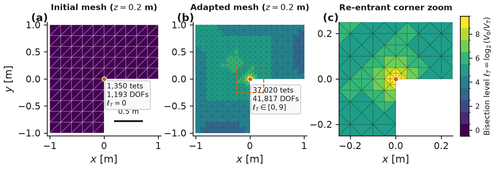
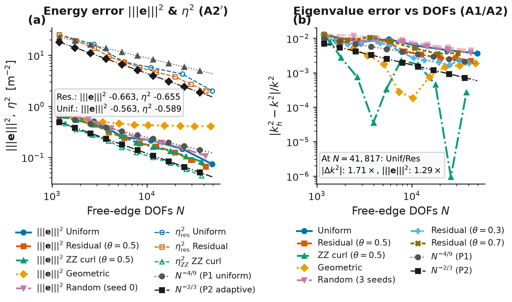
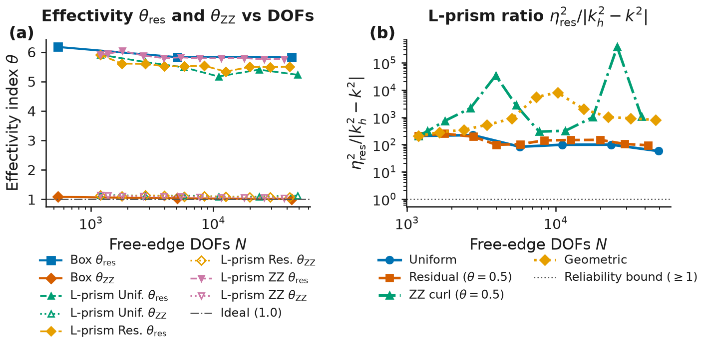

# Adaptive mesh refinement for 3D tetrahedral FIT eigenmodes

Code: `wakis/unstructured/adapt.py` (Kuhn/L-prism meshes, Rivara longest-edge bisection, boundary projection,
Whitney field reconstruction, residual and Zienkiewicz–Zhu error indicators, Dörfler marking, adaptive eigenmode loop,
Voronoi export), `wakis/unstructured/analytic.py` (`l_shape_dirichlet_eigenvalue`, `l_shape_dirichlet_field`),
`wakis/unstructured/solver3d.py::UnstructuredFIT3D`.
Tests: `tests/test_115_unstructured_adapt.py`.
Mutation audit: `studies/unstructured-adapt/run_mutations.py`.
Study: `studies/unstructured-adapt/` (`run_adapt_study.py`, `merge_results.py`, `plot_adapt_study.py`).

## 1. Problem statement and conventions

We seek isolated interior electromagnetic cavity eigenpairs $(\lambda, \mathbf{u})$ of the source-free curl–curl
eigenproblem on a bounded polyhedral or curved domain $\Omega \subset \mathbb{R}^3$ with boundary
$\partial\Omega = \Gamma_{\mathrm{PEC}} \cup \Gamma_{\mathrm{PMC}}$:

$$\nabla \times \left(\mu_r^{-1} \nabla \times \mathbf{u}\right) = \lambda\,\varepsilon_r\,\mathbf{u} \quad \text{in }\Omega, \qquad
\mathbf{n} \times \mathbf{u} = \mathbf{0} \quad \text{on }\Gamma_{\mathrm{PEC}}, \qquad
\mathbf{n} \times \left(\mu_r^{-1} \nabla \times \mathbf{u}\right) = \mathbf{0} \quad \text{on }\Gamma_{\mathrm{PMC}},$$

where $\lambda = k^2 = (2\pi f / c_0)^2$ $[\mathrm{m}^{-2}]$ is the squared vacuum wavenumber, $f$ $[\mathrm{Hz}]$ is
the resonance frequency, and $\varepsilon_r, \mu_r > 0$ are piecewise-constant relative permittivity and permeability
per tetrahedron.

In `UnstructuredFIT3D(mesh, materials, bc, hodge="whitney")`, the discrete electric field is expanded in lowest-order
Whitney 1-forms (first-kind Nédélec edge elements [Nédélec, 1980; Bossavit, 1988; Monk, 2003]),

$$\mathbf{u}_h(\mathbf{x}) = \sum_{e \in \mathcal{E}} e_e\,\mathbf{W}_e(\mathbf{x}),$$

where $e_e = \int_e \mathbf{u}_h \cdot \mathrm{d}\boldsymbol{\ell}$ $[\mathrm{V}]$ is the edge voltage oriented from
the lower to the higher global node index (`SimplexMesh.edges` in `wakis/unstructured/mesh.py`). Because
$\nabla \times \mathbf{W}_e$ lies in the space of Whitney 2-forms and `hodge="whitney"` assembles the exact
consistent Whitney 1-form mass matrix $\mathbf{M}_1$ (containing $\varepsilon_0 \varepsilon_r$) and 2-form reluctivity
mass matrix $\mathbf{M}_2$ (containing $(\mu_0 \mu_r)^{-1}$), the discrete generalized eigenproblem solved by
`UnstructuredFIT3D.eigenmodes(n_modes, f_target)` on the free edges (`fixed` edges on $\Gamma_{\mathrm{PEC}}$ set to zero),

$$\mathbf{K}\,\mathbf{e} = \omega_h^2\,\mathbf{M}_1\,\mathbf{e}, \qquad \mathbf{K} = \mathbf{C}^T \mathbf{M}_2 \mathbf{C}, \qquad
\lambda_h = k_h^2 = \left(\frac{\omega_h}{c_0}\right)^2,$$

is algebraically identical to the lowest-order Nédélec Galerkin eigenproblem. Throughout `wakis.unstructured.adapt`,
discrete eigenfunctions are normalised so that $(\varepsilon_r \mathbf{u}_h, \mathbf{u}_h)_{L^2(\Omega)} = 1$:

$$\mathbf{u}_h \leftarrow \frac{\mathbf{e}}{\sqrt{\mathbf{e}_{\mathrm{free}}^T \mathbf{M}_1 \mathbf{e}_{\mathrm{free}} / \varepsilon_0}},$$

and errors are measured in the scaled $H(\mathrm{curl}; \Omega)$ energy norm

$$|||\mathbf{v}|||^2 = \left(\mu_r^{-1} \nabla \times \mathbf{v}, \nabla \times \mathbf{v}\right)_{L^2(\Omega)}
+ \lambda \left(\varepsilon_r \mathbf{v}, \mathbf{v}\right)_{L^2(\Omega)} \qquad [\mathrm{m}^{-2}].$$

Public API and history keys carry explicit physical units in their names: `f_hz` $[\mathrm{Hz}]$,
`k2_per_m2` $[\mathrm{m}^{-2}]$, `h_m` $[\mathrm{m}]$, and `eta2_per_m2` $[\mathrm{m}^{-2}]$.

## 2. Why adapt: re-entrant edge singularities and convergence rates

On a domain with a re-entrant dihedral edge of interior opening angle $\omega \in (\pi, 2\pi)$, the electromagnetic
field develops an algebraic singularity in cylindrical coordinates $(r, \theta, z)$ centred on the edge. On the PEC
L-prism benchmark (`l_prism_mesh(n_per_unit, n_z, height_m=0.6)`),

$$\Omega = \left((-1, 1)^2 \setminus [0, 1] \times [-1, 0]\right) \times (0, d), \qquad d = 0.6\,\mathrm{m}, \qquad \omega = \frac{3\pi}{2},$$

the fundamental cavity mode is $\mathrm{TM}_{z0}$: $\mathbf{u}(x, y, z) = \psi(x, y)\,\hat{\mathbf{z}}$ with
$k^2 = \lambda_{D,1}(L)$, where $\psi$ is the first Dirichlet eigenfunction of the 2D L-shaped cross-section $L$. Near
the re-entrant edge $(r \to 0)$,

$$\psi(r, \theta) \sim r^{\alpha} \sin(\alpha \theta), \qquad \alpha = \frac{\pi}{\omega} = \frac{2}{3}, \qquad
\mathbf{H} = \mu_r^{-1} \nabla \times \mathbf{u} \sim r^{\alpha - 1} = r^{-1/3}.$$

Because $\nabla(\nabla \times \mathbf{u}) \sim r^{\alpha - 2} = r^{-4/3}$, we have
$\nabla \times \mathbf{u} \in H^{\alpha - \epsilon}(\Omega) = H^{2/3 - \epsilon}(\Omega)$ for all $\epsilon > 0$.

* **Prediction P1 (uniform refinement)**: On a sequence of quasi-uniform tetrahedral meshes of spacing $h$ and
  degree-of-freedom count $N \propto h^{-3}$, interpolation in the lowest-order Nédélec space is limited by the corner
  regularity to $|||\mathbf{u} - \mathbf{u}_h||| \lesssim h^\alpha = h^{2/3}$. By the Galerkin eigenvalue identity
  (Section 4.2), the eigenvalue error scales asymptotically as

  $$|k_h^2 - k^2| \lesssim |||\mathbf{u} - \mathbf{u}_h|||^2 \propto h^{4/3} \propto N^{-4/9} \approx N^{-0.444},$$

  with pre-asymptotic log–log slopes between $-4/9$ and the smooth rate $-2/3$.

* **Prediction P2 (Dörfler adaptive refinement and 3D equidistribution count)**: Let a tetrahedron $T$ at distance $r$
  from the re-entrant edge have local diameter $h(r)$ and volume $|T| \sim h(r)^3$. Since the local energy-error
  density of the first-order approximation scales as $|D(\nabla \times \mathbf{u})|^2 + k^2 |D\mathbf{u}|^2 \sim r^{2\alpha - 4}$,
  the squared local energy error on $T$ is

  $$e_T^2 \sim h(r)^2 \int_T r^{2\alpha - 4}\,\mathrm{d}\mathbf{x} \sim h(r)^5\,r^{2\alpha - 4}.$$

  Equidistributing $e_T^2 \approx \delta$ across all tetrahedra requires the mesh grading profile

  $$h(r) \sim \delta^{1/5}\,r^{(4 - 2\alpha)/5}.$$

  Integrating the element density $h(r)^{-3}$ over the cylindrical neighbourhood $r\,\mathrm{d}r\,\mathrm{d}z$ of the
  re-entrant edge gives the total number of tetrahedra:

  $$N \sim \int_0^d \mathrm{d}z \int_0^1 h(r)^{-3}\,r\,\mathrm{d}r \sim \delta^{-3/5} \int_0^1 r^{1 - 3(4 - 2\alpha)/5}\,\mathrm{d}r
  = \delta^{-3/5} \int_0^1 r^{(6\alpha - 7)/5}\,\mathrm{d}r.$$

  This radial integral is finite at $r = 0$ if and only if $(6\alpha - 7)/5 > -1$, which simplifies to

  $$\alpha > \frac{1}{3}.$$

  For the L-prism re-entrant edge, $\alpha = 2/3 > 1/3$ ($h(r) \sim \delta^{1/5} r^{8/15}$ and
  $r^{(6\alpha - 7)/5} = r^{-3/5}$, which is integrable against $\mathrm{d}r$). Therefore $N \sim \delta^{-3/5}$ is
  finite, and summing the equidistributed errors gives

  $$|||\mathbf{u} - \mathbf{u}_h|||^2 \sim \sum_T e_T^2 \sim N\,\delta \sim N \cdot N^{-5/3} = N^{-2/3},$$

  so isotropic adaptive refinement around this edge singularity recovers the optimal 3D smooth convergence rate
  $|k_h^2 - k^2| \propto N^{-2/3}$ [Boffi & Gastaldi, 2019].

* **Reference eigenvalue and eigenfunction by the Method of Particular Solutions (MPS)**:
  `l_shape_dirichlet_eigenvalue` in `wakis/unstructured/analytic.py` computes $\lambda_{D,1}(L)$ and the expansion
  coefficient vector $\mathbf{c} = \mathbf{R}^{-1}\mathbf{v}_{\min}$ (sign-normalised so $c_0 > 0$) via the
  subspace-angle formulation of Betcke & Trefethen [Fox, Henrici & Moler, 1967; Betcke & Trefethen, 2005] using the
  Fourier–Bessel basis $J_{2j/3}(\sqrt{\lambda}\,r)\sin(2j\theta/3)$ ($j = 1, \dots, n_{\mathrm{terms}}$) in polar
  coordinates around the re-entrant corner, and `l_shape_dirichlet_field` reconstructs the reference mode
  $\mathbf{u}(x, y, z) = \psi(x, y)\,\hat{\mathbf{z}}$ and $\nabla\psi(x, y)$ (giving
  $\nabla \times \mathbf{u} = \nabla\psi \times \hat{\mathbf{z}}$). Collocating $n_{\mathrm{boundary}} = 240$ non-corner
  boundary points and $n_{\mathrm{interior}} = 200$ interior points (seed 0), QR-factorizing
  $[\mathbf{A}_B; \mathbf{A}_I] = \mathbf{Q}\mathbf{R}$, minimizing the smallest singular value $\sigma_{\min}(\lambda)$
  of the boundary rows $\mathbf{Q}_B$, and mapping the corresponding right singular vector through $\mathbf{R}^{-1}$
  yields (`test_e5_mps_reference`): $\lambda_{24} = 9.6397238519\,\mathrm{m}^{-2}$ ($\sigma_{\min} = 1.915 \times 10^{-6}$,
  $c_0 = 0.245462$) at $n_{\mathrm{terms}} = 24$ and $\lambda_{32} = 9.6397239608\,\mathrm{m}^{-2}$
  ($\sigma_{\min} = 1.452 \times 10^{-7}$, $c_0 = 0.245462$) at $n_{\mathrm{terms}} = 32$, agreeing to a relative
  eigenvalue difference of $1.129 \times 10^{-8}$, relative interior field difference $2.860 \times 10^{-8}$, relative
  gradient difference $2.149 \times 10^{-7}$, and outer-boundary residual $1.006 \times 10^{-7}$.

## 3. Rivara longest-edge bisection (LEB) and boundary projection

### 3.1 Kuhn meshes and stateless longest-edge bisection

`kuhn_mesh(n_xyz, h_m, origin_m=(0,0,0), keep=None, tag=None)` subdivides each retained Cartesian cube into 6 Kuhn
(Freudenthal) tetrahedra along the body diagonal $\mathbf{v}_{000} \to \mathbf{v}_{111}$, one per axis permutation
$(p_0, p_1, p_2) \in S_3$ [Freudenthal, 1942].

`bisect(mesh, marked, face_patch=None, project=None, max_rounds=1000)` implements stateless 3D Rivara longest-edge
bisection (LEB) with iterative conformity closure [Rivara, 1984; Rivara & Levin, 1992]. Unlike newest-vertex bisection
[Maubach, 1995; Arnold, Mukherjee & Pouly, 2000; Stevenson, 2008], which requires persistent per-tetrahedron marked-edge
state that any bistellar flip or node-relocation pass destroys, LEB selects the bisection edge from the current mesh
geometry alone.

To break ties deterministically on symmetric meshes (such as Kuhn grids, where many edges share identical lengths),
every edge $e = (i_{\min}, i_{\max})$ with $i_{\min} < i_{\max}$ is assigned the strict global key

$$\mathrm{key}(e) = \left(\mathrm{round}\!\left(\frac{L_e^2}{L_{\mathrm{ref}}^2},\, 10\right),\; i_{\min},\; i_{\max}\right),
\qquad L_{\mathrm{ref}}^2 = \max_{e' \in \mathcal{E}_0} L_{e'}^2,$$

where $L_{\mathrm{ref}}^2$ is fixed at the entry of `bisect` from the input mesh $\mathcal{E}_0$. Because
$\mathrm{key}(e)$ is a function of the global edge alone—never of the local edge index $0, \dots, 5$ inside a
tetrahedron—no two distinct edges share the same key.

In each vectorized round:
1. Active tetrahedra (the user's `marked` set in round 1; all tetrahedra containing at least one edge already split in
   earlier rounds of the same `bisect` call in rounds $\ge 2$) each select their own local edge with the maximum global
   key (`_pick_bisect_edge`).
2. Midpoint nodes are deduplicated globally per undirected edge via the 64-bit integer code
   $i_{\min} \cdot S + i_{\max}$.
3. Each active tetrahedron $(a, b, c, d)$ whose selected edge is $(a, b)$ (arranged via an even permutation of its
   vertices so positive orientation is preserved) is split at midpoint $m$ into two positively oriented children
   $(a, m, c, d)$ and $(m, b, c, d)$ (`_split_cells`), both inheriting the parent's `cell_tags` and `parent` index.

### 3.2 Conformity and termination proofs

* **Conformity**: Suppose two tetrahedra $T_+$ and $T_-$ share an interior face $F$. During the closure loop, $F$ is
  cut only when $T_+$ or $T_-$ bisects one of the three edges of $F$. Whenever a tetrahedron $T \supset F$ bisects an
  edge $e \subset F$, $e$ is the globally highest-ranked edge of $T$, and because $\mathcal{E}(F) \subset \mathcal{E}(T)$,
  $e$ is necessarily the unique highest-ranked edge of $F$ under the strict global order $\mathrm{key}(\cdot)$. When
  the closure loop terminates, no tetrahedron in the mesh contains an unsplit edge that was split by another
  tetrahedron. Therefore both $T_+$ and $T_-$ (and recursively their child tetrahedra bordering sub-faces of $F$) have
  bisected $F$ first along the exact same maximum-key edge of $F$, and recursively bisected every sub-triangle of $F$
  along the exact same edge. The resulting tetrahedral partition is strictly face-to-face conforming.

* **Termination**: Consider any closure round $r \ge 2$ in which a tetrahedron $T$ is flagged because one of its edges
  $e_{\mathrm{split}} \in \mathcal{E}(T)$ was already bisected in an earlier round. $T$ bisects its own maximum-key
  edge $e_{\max}(T)$, which satisfies $\mathrm{key}(e_{\max}(T)) \ge \mathrm{key}(e_{\mathrm{split}})$ (and in
  particular $L_{e_{\max}(T)} \ge L_{e_{\mathrm{split}}}$ up to the $10^{-10} L_{\mathrm{ref}}^2$ rounding quantum).
  Every new edge created when bisecting an edge $ab$ at midpoint $m = \tfrac{1}{2}(a + b)$ is either:
  - one of the two halves $am, mb$, of squared length $\tfrac{1}{4}|ab|^2 < |ab|^2$, or
  - a face median $mc$ connecting $m$ to an opposite vertex $c$ of a face $abc$ whose longest edge is $ab$
    ($|ab| \ge \max(|ac|, |bc|)$). By Apollonius's theorem,

    $$|mc|^2 = \frac{|ac|^2 + |bc|^2}{2} - \frac{|ab|^2}{4} \le |ab|^2 - \frac{|ab|^2}{4} = \frac{3}{4}|ab|^2 < |ab|^2.$$

  Because every newly created edge is strictly shorter than the edge whose bisection produced it (by a factor at most
  $\sqrt{3}/2$), only finitely many distinct edge lengths can be generated above any minimum threshold before the
  triggering split edge $e_{\mathrm{split}}$ itself becomes the maximum-key edge of the descendant tetrahedra and is
  bisected. Hence every propagation chain is finite and the closure loop terminates in finitely many rounds
  [Rivara, 1984; Rivara & Levin, 1992]. `bisect` enforces `max_rounds=1000` and raises `RuntimeError` rather than ever
  returning a nonconforming mesh.

### 3.3 Frozen geometry during closure, boundary projection, and back-off

Node coordinates remain **frozen at exact chord midpoints** throughout all closure rounds. Moving boundary nodes onto
curved surfaces between closure rounds would change edge lengths mid-closure and invalidate the conformity proof above.
Only after the closure loop finishes are newly created nodes projected (`_apply_projector`):
* `label_constraint_faces(mesh, classify=None)` labels boundary and material-interface faces with non-negative patch
  integers (`-1` on unconstrained interior faces). When a constraint face $(a, b, c)$ is split at $m \in ab$, both child
  triangles $(a, m, c)$ and $(m, b, c)$ inherit the parent's patch label (`info["face_patch"]`), and `mesh.surface_groups`
  are mapped through the same face parentage.
* A new midpoint node $m$ on edge $(a, b)$ is eligible for projection if and only if $(a, b)$ lies on at least one
  constraint face and all constraint faces containing $(a, b)$ carry the exact same patch label $p \ge 0$. Nodes created
  on crease curves shared by two different patches stay on the chord.
* Eligible nodes are mapped by `project(points, patches)` (e.g. `sphere_projector(center_m, radius_m, patch=0)`). If
  moving a subset of projected nodes causes any incident tetrahedron to have non-positive signed volume, those nodes are
  backed off along their displacement vector by $\alpha \in \{1/2, 1/4, 0\}$ until all tetrahedra have strictly positive
  volume, incrementing `info["n_backoff"]`.

### 3.4 Quality properties in 2D and 3D

In 2D, longest-edge bisection keeps every interior angle bounded below by at least half the minimum angle of the initial
triangulation [Rosenberg & Stenger, 1975]. On 3D Kuhn meshes, LEB with the global edge key above coincides with
Maubach's bisection of reflection meshes [Maubach, 1995]: three uniform bisection generations reproduce the exact $h/2$
Kuhn lattice (`test_r3_kuhn_similarity`), and arbitrary adaptive marking sequences produce at most 3 similarity classes
of tetrahedra (`test_r4_kuhn_classes`, verified over 12 random marking rounds). On general 3D unstructured tetrahedral
meshes, no analytical lower bound on the radius ratio under stateless LEB is known to us; element quality is therefore
monitored at every iteration (`min_radius_ratio`) and tested empirically on `ball_mesh` (`test_r5_general_quality`,
where 24 localized refinement rounds yield $q_{\mathrm{final}} / q_0 = 0.593131 \ge 0.5$ from $q_0 = 0.092597$ to
$q_{\mathrm{final}} = 0.054922$ at $6\,479$ tetrahedra).

## 4. Whitney field reconstruction and a-posteriori error estimators

### 4.1 Piecewise-linear electric field and constant curl

`whitney_fields(mesh, e)` reconstructs the cellwise affine electric field $\mathbf{u}_h|_T$ and constant magnetic flux
density $\mathbf{B}_T = \nabla \times \mathbf{u}_h|_T$ on all tetrahedra simultaneously (`wakis/unstructured/adapt.py`).
With barycentric coordinates $\lambda_0, \lambda_1, \lambda_2, \lambda_3$, gradients
$\mathbf{g}_i = \nabla \lambda_i$ (`SimplexMesh.barycentric_gradients`), and orientation sign
$s_p = +1$ if $\mathrm{cells}[T, a] < \mathrm{cells}[T, b]$ else $-1$ for local edge $p = (a, b)$, the local Whitney
basis function is $\mathbf{W}_p = s_p(\lambda_a \mathbf{g}_b - \lambda_b \mathbf{g}_a)$. Evaluating $\mathbf{W}_p$ at
the four vertices of $T$ (where $\lambda_i(\mathbf{x}_j) = \delta_{ij}$) and taking its curl ($\nabla \times \mathbf{g}_i = \mathbf{0}$)
gives

$$\mathbf{u}_h|_T(\mathbf{x}_a) \mathrel{+}= s_p\,e_p\,\mathbf{g}_b, \qquad
\mathbf{u}_h|_T(\mathbf{x}_b) \mathrel{-}= s_p\,e_p\,\mathbf{g}_a, \qquad
\mathbf{B}_T = \sum_{p=0}^5 2\,s_p\,e_p\,\left(\mathbf{g}_a \times \mathbf{g}_b\right).$$

By Stokes's theorem on each face $f \subset \partial T$ of area $A_f$ and global unit normal $\mathbf{n}_f$,
$\mathbf{B}_T \cdot \mathbf{n}_f\,A_f = (\mathbf{C}\mathbf{e})_f$ holds to machine precision (`test_s1_stokes`).

### 4.2 Galerkin eigenvalue identity and why eigenvalue effectivity is not used

Let $(\lambda, \mathbf{u})$ be an exact eigenpair with $(\varepsilon_r \mathbf{u}, \mathbf{u})_{L^2(\Omega)} = 1$ and
$(\lambda_h, \mathbf{u}_h)$ a discrete Whitney eigenpair with
$(\varepsilon_r \mathbf{u}_h, \mathbf{u}_h)_{L^2(\Omega)} = 1$, sign-aligned so that
$(\varepsilon_r \mathbf{u}, \mathbf{u}_h)_{L^2(\Omega)} > 0$. Because the Whitney space is $H(\mathrm{curl})$-conforming,
$\mathbf{u}_h$ is an admissible test function in the continuous weak formulation
$(\mu_r^{-1}\nabla\times\mathbf{u}, \nabla\times\mathbf{v}) = \lambda(\varepsilon_r\mathbf{u}, \mathbf{v})$. Expanding
the curl-error and $L^2$-error norms gives the classical Babuška–Osborn identity [Babuška & Osborn, 1991]:

$$\begin{aligned}
\left\|\mu_r^{-1/2}\nabla\times(\mathbf{u} - \mathbf{u}_h)\right\|_{L^2(\Omega)}^2
- \lambda \left\|\varepsilon_r^{1/2}(\mathbf{u} - \mathbf{u}_h)\right\|_{L^2(\Omega)}^2
&= \|\mu_r^{-1/2}\nabla\times\mathbf{u}\|^2 + \|\mu_r^{-1/2}\nabla\times\mathbf{u}_h\|^2
- 2(\mu_r^{-1}\nabla\times\mathbf{u}, \nabla\times\mathbf{u}_h) \\
&\quad - \lambda\left(\|\varepsilon_r^{1/2}\mathbf{u}\|^2 + \|\varepsilon_r^{1/2}\mathbf{u}_h\|^2
- 2(\varepsilon_r\mathbf{u}, \mathbf{u}_h)\right) \\
&= \lambda + \lambda_h - 2\lambda(\varepsilon_r\mathbf{u}, \mathbf{u}_h)
- \lambda\left(2 - 2(\varepsilon_r\mathbf{u}, \mathbf{u}_h)\right)
= \lambda_h - \lambda = k_h^2 - k^2.
\end{aligned}$$

On lowest-order Nédélec elements, both $\|\mu_r^{-1/2}\nabla\times(\mathbf{u} - \mathbf{u}_h)\|^2$ and
$k^2\|\varepsilon_r^{1/2}(\mathbf{u} - \mathbf{u}_h)\|^2$ are $\mathcal{O}(h^2)$ on smooth fields (or $\mathcal{O}(h^{2\alpha})$
near singularities), whereas for higher-order scalar elliptic elements the $L^2$ error is higher order via the
Aubin–Nitsche duality argument. Here the eigenvalue error $k_h^2 - k^2$ is the difference of two positive error norms of
the *same* asymptotic order:
1. $k_h^2 - k^2$ is not guaranteed to be positive (the discrete method is conforming, not non-conforming, yet the curl
   and mass errors compete in sign), and can change sign across refinement steps;
2. cancellation between the two terms makes $|k_h^2 - k^2|$ much smaller than the squared energy error
   $|||\mathbf{u} - \mathbf{u}_h|||^2 = \|\mu_r^{-1/2}\nabla\times(\mathbf{u}-\mathbf{u}_h)\|^2 + k^2\|\varepsilon_r^{1/2}(\mathbf{u}-\mathbf{u}_h)\|^2$,
   so the ratio $\eta^2 / |k_h^2 - k^2|$ is not bounded above (`unstructured_adapt_effectivity.png` panel b).
3. On the other hand, $|k_h^2 - k^2| \le |||\mathbf{u} - \mathbf{u}_h|||^2$ always holds because both terms in the
   difference are non-negative (`test_e4_box_reliability` when $\theta_{\mathrm{res}} \ge 1$).

Therefore, estimator effectivity must be defined and verified against the eigenfunction energy error
$|||\mathbf{u} - \mathbf{u}_h|||$, not $|k_h^2 - k^2|^{1/2}$.

### 4.3 Coefficient-weighted residual indicator

`residual_indicator(mesh, e, k2_per_m2, materials=None, bc="pec")` evaluates the per-tetrahedron squared residual
indicator $\eta_T^2$ $[\mathrm{m}^{-2}]$ [Beck, Hiptmair, Hoppe & Wohlmuth, 2000; Schöberl, 2008; Boffi, Gastaldi,
Rodríguez & Šebestová, 2017]:

$$\begin{aligned}
\eta_T^2 &= h_T^2\,\mu_T\,\|\lambda_h \varepsilon_T \mathbf{u}_h\|_{L^2(T)}^2 \\
&\quad + \sum_{F \subset \partial T \cap \Omega} \frac{1}{2}\,h_F \left(
\mu_F \left\|[\![\mathbf{n}_F \times (\mu_r^{-1}\nabla\times\mathbf{u}_h)]\!]\right\|_{L^2(F)}^2
+ \frac{\lambda_h}{\varepsilon_F} \left\|[\![\varepsilon_r \mathbf{u}_h \cdot \mathbf{n}_F]\!]\right\|_{L^2(F)}^2
\right) \\
&\quad + \sum_{F \subset \partial T \cap \Gamma_{\mathrm{PMC}}} h_F\,\mu_T
\left\|\mathbf{n}_F \times (\mu_T^{-1}\nabla\times\mathbf{u}_h)\right\|_{L^2(F)}^2,
\end{aligned}$$

where $h_T = \max_{e \subset T} L_e$ and $h_F = \max_{e \subset F} L_e$ are the longest edge lengths of tetrahedron $T$
and face $F$, and $\mu_F = \tfrac{1}{2}(\mu_{T_+} + \mu_{T_-})$, $\varepsilon_F = \tfrac{1}{2}(\varepsilon_{T_+} + \varepsilon_{T_-})$
are the arithmetic averages across an interior face $F = \partial T_+ \cap \partial T_-$.

* **Why two volume terms vanish**: Inside each tetrahedron $T$ with constant $\varepsilon_T, \mu_T$,
  $\nabla \times \mathbf{u}_h|_T = \mathbf{B}_T$ is constant, so $\nabla \times (\mu_T^{-1} \nabla \times \mathbf{u}_h)|_T = \mathbf{0}$.
  Likewise, for each local Whitney basis function $\mathbf{W}_p = s_p(\lambda_a \nabla\lambda_b - \lambda_b \nabla\lambda_a)$
  with constant gradients $\nabla\lambda_i$,

  $$\nabla \cdot (\varepsilon_T \mathbf{W}_p) = s_p\,\varepsilon_T \left(\nabla\lambda_a \cdot \nabla\lambda_b - \nabla\lambda_b \cdot \nabla\lambda_a\right) = 0,$$

  so $\nabla \cdot (\varepsilon_T \mathbf{u}_h)|_T = 0$ identically inside every tetrahedron. The weak divergence
  residual $\nabla \cdot (\varepsilon_r \mathbf{u}_h)$ is supported purely on the inter-element faces as the normal
  displacement jump $[\![\varepsilon_r \mathbf{u}_h \cdot \mathbf{n}_F]\!]$.
* **Boundary conditions**: On $\Gamma_{\mathrm{PEC}}$ (outer PEC boundary faces and faces between live and PEC-tagged
  cells), the tangential electric field $\mathbf{n} \times \mathbf{u}_h = \mathbf{0}$ is enforced strongly and test
  functions satisfy $\mathbf{n} \times \mathbf{v} = \mathbf{0}$ and $\phi = 0$, so neither tangential magnetic nor
  normal electric boundary terms appear. On $\Gamma_{\mathrm{PMC}}$, the natural boundary condition
  $\mathbf{n} \times (\mu_r^{-1}\nabla\times\mathbf{u}) = \mathbf{0}$ contributes the boundary tangential residual term.
  Lossy absorbing boundary conditions (`bc="abc"`) make the eigenproblem non-self-adjoint and raise `NotImplementedError`.
* **Derivation sketch and scaling**: For any $\mathbf{v} \in H_0(\mathrm{curl}; \Omega)$, the residual functional is
  $\mathcal{R}(\mathbf{v}) = \lambda_h(\varepsilon_r \mathbf{u}_h, \mathbf{v}) - (\mu_r^{-1}\nabla\times\mathbf{u}_h, \nabla\times\mathbf{v})$,
  which satisfies Galerkin orthogonality $\mathcal{R}(\mathbf{v}_h) = 0$ for all Nédélec functions $\mathbf{v}_h$ on the
  discrete space (up to the higher-order eigenvalue perturbation $(\lambda - \lambda_h)(\varepsilon_r \mathbf{u}, \mathbf{v})$).
  Decomposing the interpolation error via a commuting regular decomposition
  $\mathbf{v} - \Pi_h \mathbf{v} = \mathbf{z} + \nabla\phi$ with $\|\mu_r^{1/2} h^{-1} \mathbf{z}\| \lesssim \|\mu_r^{-1/2}\nabla\times\mathbf{v}\|$
  and $\|\lambda^{1/2}\varepsilon_r^{1/2} h^{-1} \phi\| \lesssim \lambda^{1/2}\|\varepsilon_r^{1/2}\mathbf{v}\|$
  [Schöberl, 2008], elementwise integration by parts of $\mathcal{R}(\mathbf{z})$ produces the volume residual and
  tangential magnetic jump terms weighted by $\mu_T, \mu_F$, while integration by parts of $\mathcal{R}(\nabla\phi) = \lambda_h(\varepsilon_r \mathbf{u}_h, \nabla\phi)$
  produces the normal electric jump terms weighted by $\lambda_h / \varepsilon_F$.
* **Exact element and face quadrature**: Because $\mathbf{u}_h|_T$ is affine on $T$ and $[\![\varepsilon_r \mathbf{u}_h \cdot \mathbf{n}_F]\!]$
  is affine on $F$ (with vertices matched by global node ID between $T_+$ and $T_-$), their $L^2$ integrals are
  computed exactly from vertex values via the $P_1$ mass matrices:

  $$\int_T \lambda_i \lambda_j\,\mathrm{d}\mathbf{x} = \frac{|T|}{20}(1 + \delta_{ij}), \qquad
  \int_F \lambda_i \lambda_j\,\mathrm{d}s = \frac{|F|}{12}(1 + \delta_{ij}),$$

  while $[\![\mathbf{n}_F \times (\mu_r^{-1}\mathbf{B})]\!]$ is constant on each face $F$.
* **Dimensional and material homogeneity**: Under spatial scaling $\mathbf{x} \mapsto s\mathbf{x}$ and
  $\lambda_h \mapsto s^{-2}\lambda_h$ at fixed edge voltages $\mathbf{e}$, the normalised field scales as
  $\mathbf{u}_h \mapsto s^{-3/2} \cdot s^{-1} = s^{-5/2}$ and every term of $\eta_T^2$ scales as $s^{-2}$
  (`test_s3_scale_invariance`). Under uniform material scaling $\varepsilon_r \mapsto a\varepsilon_r$,
  $\mu_r \mapsto b\mu_r$ with $\lambda_h \mapsto (ab)^{-1}\lambda_h$, the normalised field scales as $a^{-1/2}$ and all
  three terms of $\eta_T^2$ (as well as $|||\mathbf{u} - \mathbf{u}_h|||^2$) scale identically by $(ab)^{-1}$
  (`test_s4_material_homogeneity`).

### 4.4 Zienkiewicz–Zhu curl-recovery indicator

`zz_curl_indicator(mesh, e, materials=None)` implements a Zienkiewicz–Zhu recovery estimator on the magnetic flux
density $\mathbf{B}_h = \nabla \times \mathbf{u}_h$ [Zienkiewicz & Zhu, 1987]. For each mesh node $n$ and material tag
$m$, a volume-weighted nodal curl is recovered exclusively from live tetrahedra sharing node $n$ and tag $m$:

$$\mathbf{R}_n^{(m)} = \frac{\sum_{T \ni n,\; \mathrm{tag}(T) = m} |T|\,\mathbf{B}_T}{\sum_{T \ni n,\; \mathrm{tag}(T) = m} |T|},$$

preventing spurious smoothing across material jumps where $\mathbf{B} = \mu_0 \mu_r \mathbf{H}$ is discontinuous.
Interpolating $\mathbf{R}^{(m)}$ linearly inside each tetrahedron $T$ from its four vertex values and integrating the
discrepancy $\mathbf{R}^{(m)} - \mathbf{B}_T$ exactly with the tetrahedral $P_1$ mass matrix gives

$$\eta_{\mathrm{ZZ}, T}^2 = \int_T \mu_T^{-1} \left|\mathbf{R}^{(\mathrm{tag}(T))}(\mathbf{x}) - \mathbf{B}_T\right|^2 \mathrm{d}\mathbf{x}
\qquad [\mathrm{m}^{-2}],$$

which targets the curl semi-norm error $\|\mu_r^{-1/2} \nabla \times (\mathbf{u} - \mathbf{u}_h)\|_{L^2(\Omega)}$.

## 5. Dörfler bulk marking and adaptive eigenmode loop

* **Dörfler marking** (`dorfler_mark(eta2, theta=0.5)`): Given non-negative cell indicators $\eta_T^2$ and bulk parameter
  $\theta \in (0, 1]$, cells are sorted in descending order of $\eta_T^2$ (`kind="stable"`) and the smallest prefix
  $\mathcal{M}$ satisfying $\sum_{T \in \mathcal{M}} \eta_T^2 \ge \theta \sum_T \eta_T^2$ is returned [Dörfler, 1996].
* **Adaptive loop and mode tracking** (`adapt_eigen` returning `AdaptResult`):
  1. Before any solve above $2 \times 10^4$ tetrahedra, `estimate_memory(mesh, eigen=True)` is checked against
     `max_memory_bytes`; if exceeded, the loop stops cleanly with `stop_reason="memory"`.
  2. `UnstructuredFIT3D(mesh, materials, bc, hodge="whitney", stability=False)` is constructed and `eigenmodes` solves
     for at least 2 modes near `f_target_hz`. On iteration 0, index `mode` (ordered by ascending frequency) is selected;
     on iteration $k \ge 1$, the mode minimizing $|f_j - f_h^{(k-1)}|$ is selected, and the nearest neighbour mode
     frequency is checked to monitor the spectral gap.
  3. Both `residual_indicator` and `zz_curl_indicator` are evaluated and recorded in `history` (`eta2_per_m2`,
     `eta2_zz_per_m2`), regardless of which `estimator` (`"residual"` or `"zz"`) drives marking.
  4. Stopping criteria `n_dofs >= max_dofs`, `it + 1 >= max_iter`, or `next_dofs > max_dofs` after `bisect` set
     `stop_reason` to `"max_dofs"` or `"max_iter"`.
* **Constructor stability bypass (`stability=False`) and `one_step` guard**: By default, `UnstructuredFIT3D.__init__`
  computes an LU factorization of $\mathbf{M}_1$ and runs a Lanczos iteration (`max_eigenvalue`) to determine the
  explicit leapfrog Courant limit $\Delta t_{\max}$, which is unneeded in frequency-domain eigenmode loops. Passing
  `stability=False` inside `adapt_eigen` skips this constructor step and leaves `lambda_max`, `dt_max`, and `courant` as
  `nan` (along with `dt = nan` when `dt=None`). If `one_step` is called on a solver whose `self.dt` is not a positive
  finite number (e.g. `stability=False` and `dt=None`), `UnstructuredFIT3D.one_step` raises a `ValueError` instead of
  advancing silently with `nan` (`test_solver3d_stability_false_dt_none_raises`); when a positive finite `dt` is
  supplied with `stability=False`, `_M1` is factored lazily on the first `one_step` call.

## 6. Hodge choice (D1) and `voronoi_export`

The adaptive loop solves exclusively with `hodge="whitney"` (Decision D1):
1. With Whitney forms, $\mathbf{M}_1$ is symmetric positive definite on any non-degenerate tetrahedral mesh and the
   discrete curl–curl pencil $(\mathbf{K}, \mathbf{M}_1)$ satisfies discrete compactness on shape-regular meshes (no
   spurious non-zero modes).
2. Longest-edge bisection splits tetrahedra across edge midpoints, creating co-spherical and non-Delaunay face pairs
   with negative circumcentric dual lengths $\tilde{h}_f < 0$. The diagonal Voronoi Hodge raises a `ValueError` on any
   mesh with negative assembled dual lengths (`wakis/unstructured/solver3d.py`), because a negative entry in
   $\mathbf{M}_\nu$ makes $\mathbf{K}$ indefinite and causes exponential instability in explicit time stepping.
3. Running a 3D bistellar flip repair pass at every adaptive iteration would add an $\mathcal{O}(n)$ Python pass per
   step, destroy any marked-edge hierarchy, and can still leave topological/geometric stuck faces.

For users who want to export the final adapted mesh to the explicit Voronoi time-domain solver,
`voronoi_export(mesh, materials=None, bc="pec", **improve_kw)` counts non-Delaunay faces before repair via
`wakis.unstructured.improve.neg_faces`, runs `improve_dt(mesh, materials, bc=bc, repair=True, **improve_kw)` once on the
final mesh, counts residual negative faces, and attempts to construct `UnstructuredFIT3D(..., hodge="voronoi")`,
returning `(repaired_mesh, report)` with `negative_faces_before`, `negative_faces_after`, `dt_max_s`, `dt_rate_s`
(the element-rate stability step from `improve_dt`), and the solver's `ValueError` message if stuck faces remain.

## 7. Verification and mutation audit

### 7.1 Verification suite (`tests/test_115_unstructured_adapt.py`)

| Test ID | Test function | Physical / mathematical property verified | Measured values printed by pytest |
| --- | --- | --- | --- |
| R1 | `test_r1_conformity` | Face valence $\in \{1, 2\}$, boundary and two-tag interface area conservation to $16\,n_{\mathrm{child}}\epsilon A$, no hanging midpoints, Euler characteristic $V - E + F - C = 1$ across 12 rounds on bipyramid, `l_prism_mesh(5,3)`, two-tag `kuhn_mesh((7,5,3), 0.1)`, and `ball_mesh([1.0], 0.25)` | Bipyramid: `rand_cells=6, pt_cells=8, chi=1`; L-prism: `rand_cells=21136, pt_cells=3018, chi=1`; two-tag box: `rand_cells=9640, pt_cells=2314, chi=1`; ball: `rand_cells=119509, pt_cells=4649, chi=1` |
| R2 | `test_r2_volume_conservation` | Total and per-tag polyhedral volume conserved to $n_{\mathrm{cells}}\epsilon V$ with `project=None` | `final cells = 12654`, `\|dV\|/V = 1.322e-16` |
| R3 | `test_r3_kuhn_similarity` | 3 uniform LEB generations on `kuhn_mesh((3,2,2), 0.5)` match the exact $h/2$ grid nodes and volume $(h/2)^3 / 6$ to $10^{-15}$ | `node_diff = 0.000e+00`, `max_rel_vol_err = 4.996e-16` |
| R4 | `test_r4_kuhn_classes` | 12 random marking rounds (seed 1) on a Kuhn mesh produce $\le 3$ similarity classes matching the 3 analytical bisection classes of one Kuhn tet | `n_classes = 3`, `min_rr = 0.640754482034`, `ref = 0.640754482034`, `diff = 5.551e-16` |
| R5 | `test_r5_general_quality` | 24 localized refinement rounds on `ball_mesh([1.0], 0.25)` keep $\min q \ge \tfrac{1}{2} q_0$ | $q_0 = 0.092597$, $q_{\mathrm{final}} = 0.054922$, $q_{\mathrm{final}}/q_0 = 0.593131$ at `final_cells = 6479` |
| R6 | `test_r6_noop` | `bisect(mesh, [])` returns bitwise-identical nodes and cells | `bitwise identical nodes = 36, cells = 72` |
| R7 | `test_r7_sphere_projection` | `sphere_projector` on `ball_mesh([1.0], 0.25)` places all new boundary nodes on $\|\mathbf{x}\| = R$ to $10^{-12}R$, moves nodes strictly outward, shrinks volume deficit by $\sim 1/4$ | $\max\|\|\mathbf{x}\|-R\| = 2.220 \times 10^{-16}\,\mathrm{m}$, `n_backoff = 0`, $\mathrm{deficit}(3)/\mathrm{deficit}(0) = 0.1732$ |
| S1 | `test_s1_stokes` | Cellwise Stokes identity $\mathbf{B}_T \cdot \mathbf{n}_f A_f = (\mathbf{C}\mathbf{e})_f$ for random $\mathbf{e}$ | `max relative Stokes discrepancy = 3.356e-16` |
| S2 | `test_s2_galerkin_identity` | Galerkin identity (Section 4.2) on box $\mathrm{TM}_{110}$ at L0 and L1 with $6\times 6\times 6$ Duffy Gauss quadrature | L0: `\|lhs-rhs\| = 6.735e-11 <= bound = 1.020e-07` (`quad_bound = 4.270e-09`); L1: `\|lhs-rhs\| = 7.076e-11 <= bound = 5.970e-08` (`quad_bound = 1.660e-11`) |
| S3 | `test_s3_scale_invariance` | Cellwise scale invariance $\eta_T^2(s\Omega, s^{-2}k^2)\cdot s^2 = \eta_T^2(\Omega, k^2)$ for $s = 10^{-3}$ (residual and ZZ) | `bc=pec`: $8.146 \times 10^{-16}$; `bc=pmc`: $1.164 \times 10^{-15}$; ZZ: $1.786 \times 10^{-15}$ |
| S4 | `test_s4_material_homogeneity` | Uniform dielectric/magnetic scaling $[\varepsilon_r, \mu_r] = [2.5, 1.7]$ scales $\eta^2$ by $(2.5 \times 1.7)^{-1}$ | `bc=pec`: $3.655 \times 10^{-16}$; `bc=pmc`: $2.982 \times 10^{-16}$; ZZ: $3.849 \times 10^{-16}$ |
| S5 | `test_s5_dorfler_mark` | Minimal cardinality and descending order of `dorfler_mark` (seed 2, $n = 1013$) | `n_marked = 299/1013`, `sum_m/tot = 0.501146 >= 0.5`, `without_min/tot = 0.499774 < 0.5`, `min_marked = 7.0092 >= max_unmarked = 7.0067` |
| E2–E4 | `test_e2_e3_e4_box_effectivity_fast`, `test_e3_box_effectivity_slow` | Box $(0.7, 0.5, 0.3)\,\mathrm{m}$ $\mathrm{TM}_{110}$ effectivity bands $\theta_{\mathrm{res}} \in [1, 20]$, $\theta_{\mathrm{ZZ}} \in [0.5, 2]$, level ratio $\theta(\mathrm{L2})/\theta(\mathrm{L1}) \in [0.8, 1.25]$, reliability $\|k_h^2 - k^2\| \le \eta_{\mathrm{res}}^2$ | L0: $\theta_{\mathrm{res}} = 6.1800$, $\theta_{\mathrm{ZZ}} = 1.0827$, $\|k_h^2-k^2\| = 2.7195 \times 10^{-1} \le \eta^2 = 2.1653 \times 10^2$; L1: $\theta_{\mathrm{res}} = 5.8285$, $\theta_{\mathrm{ZZ}} = 1.0349$, $\|k_h^2-k^2\| = 8.9893 \times 10^{-2} \le \eta^2 = 4.7241 \times 10^1$; L2 ($40\,320$ cells): $\theta_{\mathrm{res}} = 5.8310$ (ratio $1.0004$), $\theta_{\mathrm{ZZ}} = 1.0126$ (ratio $0.9784$) |
| E5 | `test_e5_mps_reference` | MPS eigenvalue, coefficient vector $\mathbf{c} = \mathbf{R}^{-1}\mathbf{v}_{\min}$, interior field/gradient convergence ($n_{\mathrm{terms}} = 24$ vs $32$), and outer-boundary vanishing | $\lambda_{24} = 9.6397238519$ ($\sigma = 1.915 \times 10^{-6}$, $c_0 = 0.245462$), $\lambda_{32} = 9.6397239608$ ($\sigma = 1.452 \times 10^{-7}$, $c_0 = 0.245462$), `rel_diff = 1.129e-08`, `field_rel_diff = 2.860e-08`, `grad_rel_diff = 2.149e-07`, `bdry_rel = 1.006e-07` |
| Guard | `test_a1_a3_sign_change_guard` | `_refuse_sign_change_point` and `_pick_same_sign_point` reject iterations where `rel_err_signed` flipped sign since the previous step | `refused it=2 (-2.714e-04 after +9.478e-07), picked it=1` |
| A1 | `test_a1_adaptive_vs_uniform_and_random` | L-prism residual Dörfler ($\theta = 0.5$) beats uniform and random marking at equal DOFs (both in guarded eigenvalue error and in energy error $\|\|\|\mathbf{e}\|\|\|^2$) and preserves mode gap | `mode0 = 0.149079 GHz`, `mode1 = 0.185345 GHz`, `max_\|f-f_ref\|/gap = 0.0252`; at $41\,817$ DOFs: $\mathrm{err}_{\mathrm{adapt}} = 2.2222 \times 10^{-3} < \mathrm{err}_{\mathrm{unif}} = 3.8015 \times 10^{-3}$ (ratio $1.711$), $\mathrm{en2}_{\mathrm{adapt}} = 6.6307 \times 10^{-2} < \mathrm{en2}_{\mathrm{unif}} = 8.5593 \times 10^{-2}$ (ratio $1.291$); at $41\,601$ DOFs: $\mathrm{err}_{\mathrm{rand}} = 3.8042 \times 10^{-3} > \mathrm{err}_{\mathrm{adapt}} = 2.2281 \times 10^{-3}$ (ratio $1.707$), $\mathrm{en2}_{\mathrm{rand}} = 1.0756 \times 10^{-1} > \mathrm{en2}_{\mathrm{adapt}} = 6.6592 \times 10^{-2}$ (ratio $1.615$) |
| A2 | `test_a2_eigenvalue_convergence_slopes` | Eigenvalue-measure variant ($\log\|k_h^2 - k^2\|/k^2$ vs $\log N$): pre-registered slope check $\mathrm{slope}_{\mathrm{adapt}} \le \mathrm{slope}_{\mathrm{unif}} - 0.1$ at $N \le 4.9 \times 10^4$ DOFs | Strict `xfail`: Kuhn 4-gen window slopes $(-0.2721, -0.2846, -0.4347)$; $\mathrm{slope}_{\mathrm{adapt}}(\text{it } 5..9) = -0.3756$, $\mathrm{slope}_{\mathrm{unif}}(\text{gen } 2..5) = -0.4347$ (target $\le -0.5347$) |
| A2′ | `test_a2_prime_energy_and_indicator_slopes` | Decisive experiment on energy error $\|\|\|\mathbf{e}\|\|\|^2 = \|\nabla\times\mathbf{e}\|^2 + k^2\|\mathbf{e}\|^2$ and indicator $\eta^2$ against the MPS field: verifies strict monotone decay of both error components and tests pre-registered slopes ($P_1 = -4/9$, $P_2 = -2/3$, $\mathrm{slope}_{\mathrm{adapt}} \le \mathrm{slope}_{\mathrm{unif}} - 0.1$) | Strict `xfail`: $\|\|\|\mathbf{e}\|\|\|^2$ slopes $\mathrm{slope}_{\mathrm{adapt}}(\text{it } 5..9) = -0.6629$ ($P_2 = -0.6667$), $\mathrm{slope}_{\mathrm{unif}}(\text{gen } 2..5) = -0.5632$ ($P_1 = -0.4444$), `diff = -0.0997` (target $\le -0.6632$); $\eta^2$ slopes $\mathrm{slope}_{\mathrm{adapt}} = -0.6549$, $\mathrm{slope}_{\mathrm{unif}} = -0.5888$, `diff = -0.0661` (target $\le -0.6888$) |
| A3 | `test_a3_zz_adaptive_vs_uniform` | ZZ Dörfler ($\theta = 0.5$) refuses sign-change points in `rel_err_signed` (`it = [5, 6, 10]`) and beats uniform refinement in the sign-free energy and curl norms | `it=9` (`+9.4775e-07`) $\to$ `it=10` (`-2.7137e-04`) refused; at $37\,799$ DOFs (`it=10`): $\mathrm{en2}_{\mathrm{ZZ}} = 8.2442 \times 10^{-2} < \mathrm{en2}_{\mathrm{unif}} = 9.4281 \times 10^{-2}$ (ratio $1.144$), $\mathrm{curl2}_{\mathrm{ZZ}} = 3.9832 \times 10^{-2} < \mathrm{curl2}_{\mathrm{unif}} = 6.6001 \times 10^{-2}$ (ratio $1.657$); at last same-sign `it=9` ($25\,903$ DOFs): $\mathrm{en2}_{\mathrm{ZZ}} = 1.0570 \times 10^{-1} < \mathrm{en2}_{\mathrm{unif}} = 1.3536 \times 10^{-1}$ (ratio $1.281$) |
| A4 | `test_a4_voronoi_export` | `voronoi_export` on final adaptive mesh reports negative faces before/after and time-step rate | Cells $37\,020 \to 44\,781$, $\mathrm{neg\_before} = 13\,470$, $\mathrm{neg\_after} = 285$, $\Delta t_{\mathrm{rate}} = 1.7354 \times 10^{-11}\,\mathrm{s}$ (Voronoi guard refuses $451$ negative dual lengths) |
| dt guard | `test_solver3d_stability_false_dt_none_raises` | `UnstructuredFIT3D(mesh, stability=False, dt=None).one_step()` raises `ValueError` for both `hodge="voronoi"` and `hodge="whitney"` | `PASSED` for `voronoi` and `whitney` |

### 7.2 Mutation audit (`studies/unstructured-adapt/run_mutations.py`)

`run_mutations.py` monkeypatches helpers of `wakis.unstructured.adapt`, `wakis.unstructured.analytic`, and
`wakis.unstructured.solver3d` at call time and runs the target tests in `tests/test_115_unstructured_adapt.py`
in-process. All 13 mutations are killed:

| Mutation | Patched helper | Predicted failure mechanism | Observed failure in `run_mutations.py` |
| --- | --- | --- | --- |
| MU1 | `_find_nonconforming_cells` | Disable closure (single bisection round): predicted to fail at R1(iii)/(iv) (hanging midpoints), but killed earlier by R1(ii) face conformity | `test_r1_conformity`: KILLED by R1(ii), not (iii)/(iv) (`valence-1 face does not descend from an initial boundary face`) |
| MU2 | `_pick_bisect_edge` | Tie-break by local edge index $0..5$ instead of global node IDs: predicted to fail at R1(iii)/(iv), but killed earlier by R1(ii) face conformity | `test_r1_conformity`: KILLED by R1(ii), not (iii)/(iv) (`valence-1 face does not descend from an initial boundary face`) |
| MU3 | `_pick_bisect_edge` | Bisect shortest local edge instead of longest $\to$ breaks Freudenthal lattice and Maubach similarity bound | `test_r3_kuhn_similarity`: KILLED (`node count (234, 3) != (175, 3)`); `test_r4_kuhn_classes`: KILLED (`class count 7400 > 3`) |
| MU4 | `_split_cells` | Drop second child tetrahedron of each bisection $\to$ loses half the parent volume | `test_r2_volume_conservation`: KILLED (`total volume drift 2.750e-02 > 1.469e-14`) |
| MU5 | `_apply_projector` | Identity boundary projector (leave new boundary nodes on chord midpoints, radial sagitta $\sim L^2/(8R)$) | `test_r7_sphere_projection`: KILLED (`projected boundary nodes must move strictly outward`) |
| MU7 | `_local_edge_signs` | Flip orientation sign $s_0$ of local edge 0 in `whitney_fields` $\to$ breaks discrete curl and energy norm | `test_s1_stokes`: KILLED (`1.00206 <= 1e-12`); `test_s2_galerkin_identity`: KILLED (`591.901 <= 8.706e-08`) |
| MU8 | `_res_face_jump_weight` | Replace $\lambda_h / \varepsilon_F$ with $\lambda_h^2 / \varepsilon_F$ in normal jump $\to$ breaks dimensional scaling by $s^{-2}$ | `test_s3_scale_invariance`: KILLED (`756474.48 <= 1e-12`) |
| MU9 | `_res_face_jump_weight` | Drop face diameter $h_F$ from face jump weights $\to$ breaks dimensional scaling by $s^{-1}$ | `test_s3_scale_invariance`: KILLED (`998.782 <= 1e-12`) |
| MU10 | `_res_element_term` | Drop $\mu_T$ factor in element residual $\to$ breaks material homogeneity by factor $\mu_r = 1.7$ | `test_s4_material_homogeneity`: KILLED (`9.424e-04 <= 1e-12`) |
| MU11 | `_zz_recover_curl` | Skip nodal averaging ($\mathbf{R} = \mathbf{B}_T$, $\eta_{\mathrm{ZZ}} = 0$) | `test_e2_e3_e4_box_effectivity_fast`: KILLED (`assert 0.5 <= 0.0`) |
| MU12 | `_dorfler_order` | Sort $\eta_T^2$ ascending instead of descending in `dorfler_mark` | `test_s5_dorfler_mark`: KILLED (`2555.11 < 0.5 * 5107.96`) |
| MU13 | `_mps_solve_coeffs` | Return right singular vector $\mathbf{v}_{\min}$ without mapping through $\mathbf{R}^{-1}$ in `l_shape_dirichlet_eigenvalue` | `test_e5_mps_reference`: KILLED (`assert 0.12463634531996126 <= 1e-06`) |
| MU14 | `UnstructuredFIT3D.one_step` | Bypass positive-finite `dt` check in `one_step` when `stability=False` and `dt=None` | `test_solver3d_stability_false_dt_none_raises`: KILLED (`Failed: DID NOT RAISE ValueError`) |

Note on MU1 and MU2: in `test_r1_conformity`, check (ii) verifies that every valence-1 face in `mesh.faces` descends
from an initial boundary face before checks (iii) and (iv) run. When closure is disabled (MU1) or two tetrahedra split a
shared interior face along different diagonals (MU2), the unmatched interior half-triangles have valence 1 in the face
table with `orig_bface = -1`, so R1(ii) catches the nonconformity immediately.

## 8. Study design and results schema

The full convergence study (`studies/unstructured-adapt/run_adapt_study.py`, merged via `merge_results.py` into
`results/adapt_study.json` and plotted by `plot_adapt_study.py`) runs ten arms:
1. `box`: PEC box $(0.7, 0.5, 0.3)\,\mathrm{m}$ on `kuhn_mesh((7, 5, 3), 0.1)` across similar Kuhn levels
   (`arms.box.levels`, `arms.box.level_ratios`), recording `theta_res`, `theta_zz`, and consecutive-level ratios
   `theta_res_ratio`, `theta_zz_ratio` (Prediction P7).
2. `uniform`: L-prism `l_prism_mesh(5, 3)` uniform refinement (one bisection generation per step), recording per-step
   history (`arms.uniform.history`), least-squares log–log slope (`arms.uniform.slope_fit.slope`,
   `arms.uniform.slope_fit.slope_se`, `arms.uniform.slope_fit.index_range`), three repeated solves at the finest level
   (`arms.uniform.final_solve_repeats_s`, `arms.uniform.final_solve_mean_s`, `arms.uniform.final_solve_se_s`), and per-generation
   Voronoi export summaries (`arms.uniform.voronoi_by_generation`).
3. `residual` and `zz`: Dörfler adaptive refinement ($\theta = 0.5$) driven by `residual_indicator` and
   `zz_curl_indicator` (`arms.residual`, `arms.zz`), plus top-face triangulation data (`arms.residual.top_face`) and
   final-mesh Voronoi export (`arms.residual.voronoi_export`).
4. `random0`, `random1`, `random2`: random marking controls with seeds $0, 1, 2$ using the per-iteration `n_marked`
   counts of the `residual` arm (`arms.random0`, `arms.random1`, `arms.random2`; Prediction P4).
5. `geometric`: a-priori geometric marking of the `n_marked` cells nearest the re-entrant edge $x = y = 0$
   (`arms.geometric`; Prediction P5).
6. `theta03` and `theta07`: Dörfler residual refinement with $\theta = 0.3$ and $\theta = 0.7$ (`arms.theta03`,
   `arms.theta07`).

Cross-arm quantities in `results/adapt_study.json`:
* **Equal-DOF error ratios and sign-change guard** (`equal_dof_ratios.vs_uniform.<arm>.ratio_uniform_over_arm` and
  `equal_dof_ratios.vs_residual.<arm>.ratio_arm_over_residual`), computed by log–log interpolation within the recorded
  `uniform_dof_bracket` (never extrapolated; Prediction P3), with a guard (`_pick_same_sign_history_entry`,
  `_refuse_sign_change_point` in `test_a1_a3_sign_change_guard`) that refuses comparison points where `rel_err_signed`
  changed sign since the previous iteration. In the 5-generation verification run (`test_a1`, `test_a3` up to
  $N = 49\,006$ DOFs):
  - Residual adaptivity (`theta=0.5`, no sign changes) achieves a $1.711\times$ lower relative eigenvalue error than
    uniform refinement at $41\,817$ DOFs ($2.2222 \times 10^{-3}$ vs $3.8015 \times 10^{-3}$) and a $1.291\times$ lower
    squared energy error $|||\mathbf{e}|||^2$ ($6.6307 \times 10^{-2}$ vs $8.5593 \times 10^{-2}\,\mathrm{m}^{-2}$), while
    beating random marking at $41\,601$ DOFs by $1.707\times$ in eigenvalue error ($2.2281 \times 10^{-3}$ vs
    $3.8042 \times 10^{-3}$) and $1.615\times$ in $|||\mathbf{e}|||^2$ ($6.6592 \times 10^{-2}$ vs
    $1.0756 \times 10^{-1}\,\mathrm{m}^{-2}$).
  - On the ZZ arm (`test_a3_zz_adaptive_vs_uniform`), because $\eta_{\mathrm{ZZ}}$ refines only the curl semi-norm
    $\|\nabla \times \mathbf{e}\|^2$, $\|\nabla \times \mathbf{e}\|^2$ crosses below $k^2\|\mathbf{e}\|^2$ and
    `rel_err_signed` changes sign at iterations $[5, 6, 10]$ (from $+9.4775 \times 10^{-7}$ at `it=9` to
    $-2.7137 \times 10^{-4}$ at `it=10`); `it=10` is therefore refused as an eigenvalue-error comparison point. In the
    sign-free norms at `it=10` ($37\,799$ DOFs), ZZ adaptivity achieves $|||\mathbf{e}|||^2 = 8.2442 \times 10^{-2}\,\mathrm{m}^{-2}$
    vs $9.4281 \times 10^{-2}\,\mathrm{m}^{-2}$ for uniform refinement (ratio $1.144\times$) and
    $\|\nabla \times \mathbf{e}\|^2 = 3.9832 \times 10^{-2}\,\mathrm{m}^{-2}$ vs $6.6001 \times 10^{-2}\,\mathrm{m}^{-2}$
    (ratio $1.657\times$); at the last same-sign point `it=9` ($25\,903$ DOFs), $|||\mathbf{e}|||^2 = 1.0570 \times 10^{-1}\,\mathrm{m}^{-2}$
    vs $1.3536 \times 10^{-1}\,\mathrm{m}^{-2}$ for uniform refinement (ratio $1.281\times$).
* **Eigenvalue-cancellation diagnosis (`A2`) and decisive energy-norm experiment (`A2′`)**:
  - In the eigenvalue-measure variant (`test_a2_eigenvalue_convergence_slopes`), the error
    $k_h^2 - k^2 = \|\nabla \times \mathbf{e}\|^2 - k^2 \|\mathbf{e}\|^2$ is the difference of two positive
    $\mathcal{O}(h^2)$ / $\mathcal{O}(h^{2\alpha})$ terms with different spatial distributions ($\|\nabla \times \mathbf{e}\|^2$
    concentrated at the $r^{-1/3}$ re-entrant edge, $k^2\|\mathbf{e}\|^2$ spread across the smooth bulk). On the uniform
    arm between generation 1 ($2\,768$ DOFs) and generation 2 ($5\,738$ DOFs), $\|\nabla \times \mathbf{e}\|^2$ drops
    from $2.92824 \times 10^{-1}$ to $1.68512 \times 10^{-1}\,\mathrm{m}^{-2}$ while $k^2\|\mathbf{e}\|^2$ drops faster
    from $2.20239 \times 10^{-1}$ to $7.95520 \times 10^{-2}\,\mathrm{m}^{-2}$, causing `rel_err_signed` to *rise* from
    $+7.72137 \times 10^{-3}$ to $+9.33934 \times 10^{-3}$; consecutive 4-generation uniform eigenvalue slopes also depend
    on the 3-generation Kuhn-cycle phase (`(-0.2721, -0.2846, -0.4347)` for generations `0..3`, `1..4`, `2..5`). On the
    residual-adaptive arm, localized refinement near the singularity reduces $\|\nabla \times \mathbf{e}\|^2$ faster than
    the bulk $k^2\|\mathbf{e}\|^2$ at iterations $2 \to 3$ (`rel_err_signed`: $+7.38663 \times 10^{-3} \to +1.00005 \times 10^{-2}$)
    and $7 \to 8$ ($+2.66490 \times 10^{-3} \to +2.67689 \times 10^{-3}$), flattening the last-half eigenvalue slope to
    `-0.3756` vs `-0.4347` for uniform generations `2..5` (strict `xfail` against `<= -0.5347`).
  - The decisive experiment `A2′` (`test_a2_prime_energy_and_indicator_slopes`) integrates $\|\nabla \times \mathbf{e}\|_T^2$
    and $k^2\|\mathbf{e}\|_T^2$ directly against the MPS reference field (`l_shape_dirichlet_field`) with
    `_duffy_tet_rule(6)`. Both $\|\nabla \times \mathbf{e}\|^2$ and $k^2\|\mathbf{e}\|^2$—and hence the non-cancelling
    energy error $|||\mathbf{e}|||^2 = \|\nabla \times \mathbf{e}\|^2 + k^2\|\mathbf{e}\|^2$ and the residual indicator
    $\eta^2$—decrease **strictly monotonically** at every iteration of both the uniform arm
    ($|||\mathbf{e}|||^2: 7.27147 \times 10^{-1} \to 7.35376 \times 10^{-2}\,\mathrm{m}^{-2}$,
    $\eta^2: 2.53768 \times 10^{1} \to 2.00896\,\mathrm{m}^{-2}$) and the residual-adaptive arm
    ($|||\mathbf{e}|||^2: 7.27147 \times 10^{-1} \to 6.63072 \times 10^{-2}\,\mathrm{m}^{-2}$,
    $\eta^2: 2.53768 \times 10^{1} \to 2.00835\,\mathrm{m}^{-2}$), proving that the `A2` non-monotonicity was entirely
    Babuška–Osborn cancellation. Over the last half of the adaptive run (`it=5..9`, $8\,386 \to 41\,817$ DOFs), the
    adaptive energy-error slope is `slope_adapt_energy = -0.6629` and the indicator slope is `slope_adapt_eta2 = -0.6549`,
    recovering the pre-registered optimal 3D rate $P_2 = -2/3 = -0.6667$ to within `0.0038` and `0.0118`. Over uniform
    generations `2..5` ($5\,738 \to 49\,006$ DOFs), however, the uniform arm is still in the pre-asymptotic transition
    between smooth bulk decay ($-2/3 = -0.6667$) and corner-singular decay ($P_1 = -4/9 = -0.4444$), with
    `slope_unif_energy = -0.5632` and `slope_unif_eta2 = -0.5888`. Because the resulting 5-generation slope gap is
    `slope_adapt - slope_unif = -0.0997` on $|||\mathbf{e}|||^2$ (target `<= -0.6632`) and `-0.0661` on $\eta^2$
    (target `<= -0.6888`) vs the pre-registered `-0.1000` margin, `test_a2_prime_energy_and_indicator_slopes` is kept as
    `xfail(strict=True)` with the exact printed slopes.
* **Wall-time comparison** (`time_to_error.<arm>.adapt_cum_wall_s` vs
  `time_to_error.<arm>.uniform_finest_single_solve_s`, with Rule 8 resolution status in
  `time_to_error.<arm>.resolution_status` against $2 \times \mathrm{final\_solve\_se\_s}$): the finest uniform solve
  (generation 5, $49\,006$ DOFs, relative eigenvalue error $3.6216 \times 10^{-3}$) takes
  `uniform_finest_single_solve_s = 19.125 s` ($\pm 0.0379\,\mathrm{s}$ SE across 3 repeats, cumulative loop time
  $28.860\,\mathrm{s}$), whereas `residual` ($\theta = 0.5$) reaches $3.3586 \times 10^{-3} \le 3.6216 \times 10^{-3}$ at
  iteration 6 ($12\,577$ DOFs) in `adapt_cum_wall_s = 5.424 s` (`ratio_adapt_cum_over_uniform_single = 0.2836`,
  `RESOLVED`) and `theta03` ($\theta = 0.3$) reaches $2.6700 \times 10^{-3}$ at iteration 8 ($10\,431$ DOFs) in
  `4.563 s` (`ratio = 0.2386`, `RESOLVED`), while none of `random0`–`random2` reach $3.6216 \times 10^{-3}$ within the
  $49\,006$-DOF budget (`reached_finest_uniform_error = False`, `ratio = 1.272–1.314`).
* **Explicit time-step cost (P6)** (`p6_voronoi_export.dt_ratio_adapt_over_uniform` and
  `p6_voronoi_export.work_rate_ratio_adapt_over_uniform`), comparing the final adapted mesh against the uniform generation
  with the closest eigenvalue error (`p6_voronoi_export.uniform_closest_error`): on the final `residual` mesh ($37\,020$
  cells, $41\,817$ DOFs, `abs_rel_err = 2.2222e-3`), `voronoi_export` reduces negative faces from `13,470` to `285` with
  element-rate step $\Delta t_{\mathrm{rate}} = 1.7354 \times 10^{-11}\,\mathrm{s}$ and explicit work rate
  $N/\Delta t = 2.4096 \times 10^{15}\,\mathrm{s}^{-1}$, compared to uniform generation 5 ($43\,200$ cells, $49\,006$
  DOFs, `abs_rel_err = 3.6216e-3`, $\Delta t_{\mathrm{rate}} = 2.1769 \times 10^{-11}\,\mathrm{s}$,
  $N/\Delta t = 2.2512 \times 10^{15}\,\mathrm{s}^{-1}$), giving `dt_ratio_adapt_over_uniform = 0.7972` and
  `work_rate_ratio_adapt_over_uniform = 1.0703`.

## 9. Limits and failure modes

1. **No 3D LEB quality theorem**: While 2D LEB guarantees a lower angle bound of half the initial minimum
   [Rosenberg & Stenger, 1975] and 3D Kuhn meshes produce at most 3 similarity classes (`test_r4_kuhn_classes`), no
   general 3D lower bound on the radius ratio is known for stateless LEB on arbitrary unstructured meshes; quality is
   only measured (`min_radius_ratio` in `AdaptResult.history` and `test_r5_general_quality`).
2. **Unknown estimator constants and coefficient-contrast sensitivity**: The residual indicator carries unknown
   mesh-dependent reliability/efficiency constants ($\theta_{\mathrm{res}} \approx 5.8$–$6.2$ on the Kuhn box in `E3`)
   and uses arithmetic face averages $\mu_F, \varepsilon_F$; robustness to high-contrast dielectric or permeable
   inclusions is neither claimed nor proved.
3. **Eigenvalue error cancellation and sign flips**: By the Galerkin identity
   $k_h^2 - k^2 = \|\mu_r^{-1/2}\nabla\times(\mathbf{u}-\mathbf{u}_h)\|^2 - k^2\|\varepsilon_r^{1/2}(\mathbf{u}-\mathbf{u}_h)\|^2$,
   the eigenvalue error can change sign across refinement iterations (observed on the `zz` and `geometric` arms, where
   `sign_change_detected` is `True`), producing non-monotone $|k_h^2 - k^2|$ curves even when the energy norm
   $|||\mathbf{u} - \mathbf{u}_h|||$ decreases monotonically.
4. **Clustered or degenerate eigenmodes**: `adapt_eigen` tracks a single isolated mode by nearest frequency to the
   previous iteration. On cavities with degenerate or crossing modes, nearest-frequency tracking can swap branches, and
   invariant-subspace (cluster) error estimators are not implemented.
5. **Bisection destroys the Delaunay property and export repair can leave stuck faces**: Longest-edge bisection introduces
   thousands of non-Delaunay faces (`13,470` negative faces on the $37\,020$-cell final adaptive L-prism mesh in `A4`).
   A single pass of `voronoi_export` reduces this to `285` negative faces (`451` negative live-weighted dual lengths),
   which still triggers the Voronoi solver's positivity guard (`ValueError`), requiring `hodge="whitney"` unless all
   negative faces are eliminated.
6. **Explicit time-stepping penalty ($\Delta t \propto h_{\min}$)**: Grading $h_{\min}$ toward a re-entrant corner shrinks
   the explicit CFL time step everywhere in a global leapfrog scheme (P6: `p6_voronoi_export`), increasing the global work
   rate $N / \Delta t$ unless paired with local time stepping.
7. **Analytic-only surface projection and chordal crease edges**: Boundary projection (`project`) supports user-supplied
   analytic surface callables (`sphere_projector`). Midpoint nodes created on crease curves shared by two different
   surface patches (`face_patch` labels) are left on the straight chord to avoid tangency violations, and volume-inversion
   back-off (`n_backoff`) leaves residual chordal geometry error whenever triggered.
8. **No live CAD projector**: `wakis/unstructured/cad.py` finalizes the gmsh session before returning `SimplexMesh`, so
   closest-point projection onto OpenCASCADE BREP/STEP surfaces during adaptive refinement is not yet wired in.
9. **Isotropic refinement only**: `bisect` refines tetrahedra isotropically in all three directions along the re-entrant
   edge $z \in (0, d)$, whereas the singularity is 2D in $(x, y)$ and smooth in $z$; anisotropic prismatic or edge-aligned
   grading would achieve the same accuracy with a smaller constant factor in $N$.
10. **Superlinear direct-LU cost**: Shift-invert `eigsh` uses sparse direct LU (`SuperLU`) whose memory and flop count
    grow superlinearly ($\sim 20\,n_{\mathrm{tets}}^{1.7}$ bytes in `wakis/unstructured/estimate.py`), so the cumulative
    wall time of many adaptive solve-estimate-mark-refine iterations exceeds a single solve on a coarse uniform mesh until
    asymptotic accuracy gains dominate.
11. **No driven or time-domain quantity of interest**: Only isolated cavity eigenvalues are targeted; goal-oriented
    dual-weighted residual (DWR) estimators for driven frequency-domain port $S$-parameters or time-domain DFT monitors
    are left for future work.
12. **Outside the fixed-mesh exact-adjoint chain**: Discrete mesh bisection changes the combinatorial topology and unknown
    count, so `bisect` is non-differentiable and sits outside the fixed-topology discrete adjoint gradient chain
    (`wakis/unstructured/adjoint.py`).

## 10. References

- D. N. Arnold, A. Mukherjee and L. Pouly, "Locally adapted tetrahedral meshes using bisection", *SIAM J. Sci. Comput.* **22**(2), 431–448 (2000), [doi:10.1137/S1064827597323373](https://doi.org/10.1137/S1064827597323373).
- I. Babuška and J. Osborn, "Eigenvalue problems", in *Handbook of Numerical Analysis*, Vol. II, pp. 641–787, North-Holland (1991).
- R. Beck, R. Hiptmair, R. H. W. Hoppe and B. Wohlmuth, "Residual based a posteriori error estimators for eddy current computation", *ESAIM: M2AN* **34**(1), 159–182 (2000), [doi:10.1051/m2an:2000136](https://doi.org/10.1051/m2an:2000136).
- T. Betcke and L. N. Trefethen, "Reviving the method of particular solutions", *SIAM Rev.* **47**(3), 469–491 (2005), [doi:10.1137/S0036144503437336](https://doi.org/10.1137/S0036144503437336).
- D. Boffi, L. Gastaldi, R. Rodríguez and I. Šebestová, "Residual-based a posteriori error estimation for the Maxwell's eigenvalue problem", *IMA J. Numer. Anal.* **37**(4), 1710–1732 (2017).
- D. Boffi and L. Gastaldi, "Adaptive finite element method for the Maxwell eigenvalue problem", *SIAM J. Numer. Anal.* **57**(1), 478–494 (2019).
- A. Bossavit, "Whitney forms: a class of finite elements for three-dimensional computations in electromagnetism", *IEE Proc. A* **135**(8), 493–500 (1988).
- W. Dörfler, "A convergent adaptive algorithm for Poisson's equation", *SIAM J. Numer. Anal.* **33**(3), 1106–1124 (1996), [doi:10.1137/0733054](https://doi.org/10.1137/0733054).
- L. Fox, P. Henrici and C. Moler, "Approximations and bounds for eigenvalues of elliptic operators", *SIAM J. Numer. Anal.* **4**(1), 89–102 (1967), [doi:10.1137/0704008](https://doi.org/10.1137/0704008).
- H. Freudenthal, "Simplizialzerlegungen von beschränkter Flachheit", *Ann. of Math.* **43**(3), 580–582 (1942).
- J. M. Maubach, "Local bisection refinement for N-simplicial grids generated by reflection", *SIAM J. Sci. Comput.* **16**(1), 210–227 (1995), [doi:10.1137/0916014](https://doi.org/10.1137/0916014).
- P. Monk, *Finite Element Methods for Maxwell's Equations*, Oxford University Press (2003).
- J.-C. Nédélec, "Mixed finite elements in $\mathbb{R}^3$", *Numer. Math.* **35**, 315–341 (1980), [doi:10.1007/BF01396415](https://doi.org/10.1007/BF01396415).
- M.-C. Rivara, "Algorithms for refining triangular grids suitable for adaptive and multigrid techniques", *Int. J. Numer. Methods Eng.* **20**(4), 745–756 (1984), [doi:10.1002/nme.1620200412](https://doi.org/10.1002/nme.1620200412).
- M.-C. Rivara and C. Levin, "A 3-D refinement algorithm suitable for adaptive and multi-grid techniques", *Commun. Appl. Numer. Methods* **8**(5), 281–290 (1992).
- I. G. Rosenberg and F. Stenger, "A lower bound on the angles of triangles constructed by bisecting the longest side", *Math. Comp.* **29**(130), 390–395 (1975), [doi:10.1090/S0025-5718-1975-0375068-5](https://doi.org/10.1090/S0025-5718-1975-0375068-5).
- J. Schöberl, "A posteriori error estimates for Maxwell equations", *Math. Comp.* **77**(262), 633–649 (2008), [doi:10.1090/S0025-5718-07-02030-3](https://doi.org/10.1090/S0025-5718-07-02030-3).
- R. Stevenson, "The completion of locally refined simplicial partitions created by bisection", *Math. Comp.* **77**(261), 227–241 (2008), [doi:10.1090/S0025-5718-07-01959-X](https://doi.org/10.1090/S0025-5718-07-01959-X).
- O. C. Zienkiewicz and J. Z. Zhu, "A simple error estimator and adaptive procedure for practical engineering analysis", *Int. J. Numer. Methods Eng.* **24**(2), 337–357 (1987), [doi:10.1002/nme.1620240206](https://doi.org/10.1002/nme.1620240206).
