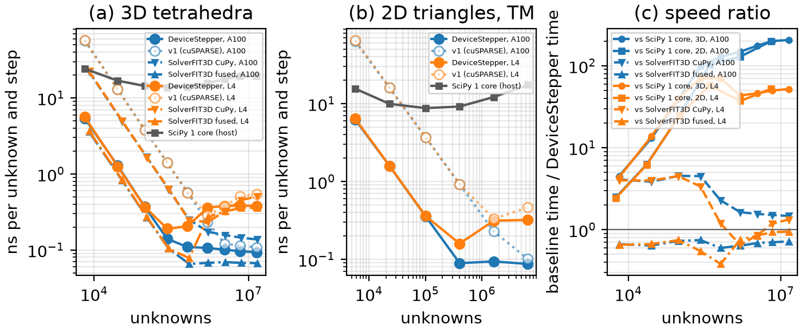
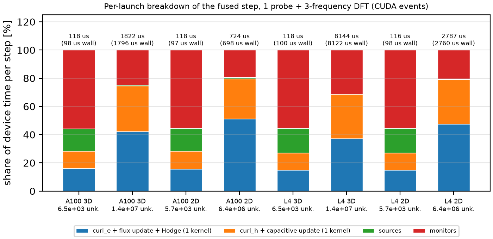

#### Unstructured FIT on the GPU: device stepping and the CPU–GPU agreement bound

`wakis.unstructured.gpu.DeviceStepper(solver)` runs the time loop of a configured `UnstructuredFIT2D` or `UnstructuredFIT3D` on a CUDA GPU with CuPy (`cupyx.scipy.sparse` / cuSPARSE). It does not change the solver classes. The stepper copies the operators and the current state, advances the state on the device, and `to_host()` returns the fields, probe samples and DFTs to the solver.

```python
s = UnstructuredFIT3D(mesh, materials, bc="abc")
s.add_point_dipole(r0, d, pulse); pr = s.add_probe(points, 2); s.add_dft(freqs)
g = DeviceStepper(s)      # xp=cupy (default); xp=numpy runs the same code on the host
g.run(n_steps)            # no host synchronisation inside a step
g.to_host()               # s.u, s.b, s.n, probe samples, DFTs
```

##### 1. The step as sparse mat-vecs

In 3D (Voronoi Hodge) the leapfrog of the solver is

```math
\mathbf b^{n+1/2} = \mathbf b^{n-1/2} - \Delta t\,(C_f\,\mathbf e_f^n + C_s\,\mathbf e_s^n),\qquad
\mathbf e_s^n = -K_{ss}^{-1}K_{sf}\,\mathbf e_f^n,\qquad
\mathbf r = C_f^{T}(M_\nu\mathbf b^{n+1/2}) - \mathbf j^{n+1/2},
```

followed by the local capacitive update $`\mathbf e_f^{n+1} = (a_1\mathbf e_f^n + \Delta t\,\mathbf r - \sum_m c_m\,\mathrm{corr}_m)/\mathrm{den}`$ with the ADE polarisations of the dispersive groups. Here $`\mathbf e_s`$ are the voltages of the massless edges (degenerate Voronoi faces), which are eliminated by the quasi-static constraint $`(C^TM_\nu\mathbf b)_s = 0`$, and $`K_{ss} = C_s^TM_\nu C_s`$, $`K_{sf} = C_s^TM_\nu C_f`$. On the host, $`K_{ss}^{-1}`$ is applied with a sparse LU solve in every step. Two massless edges couple only through a face they share, so $`K_{ss}`$ is block diagonal with tiny blocks: the largest block has 6 edges on the `ball_mesh` meshes used here. The stepper inverts each block densely once and folds the elimination into one operator,

```math
C_{\mathrm{eff}} = C_f - C_s\,(K_{ss}^{-1}K_{sf}),
```

so a step is two SpMVs ($`C_{\mathrm{eff}}`$ and $`C_f^T`$) plus elementwise kernels. $`C_{\mathrm{eff}}^TM_\nu C_{\mathrm{eff}} = K_{ff} - K_{sf}^TK_{ss}^{-1}K_{sf}`$ is the Schur complement that sets the solver's stability limit, so the folded step is the host step written differently. Blocks larger than 64 edges raise an error, because their dense inverse would fill in. `fuse_massless=False` keeps the three-SpMV form.

In 2D the step uses $`G`$ and $`G^T`$ with the same capacitive update (TM) or the series dispersive voltages (TE). The radial CFS-PML filters are elementwise recurrences on the gathered spoke, chord and layer-node sets, scattered back. The two-level LTS correction is $`p-1`$ SpMVs on the fine rows. The scattered-field plane wave is one SpMV $`W\,\mathbf g`$, where $`\mathbf g`$ is a reversed slice of the zero-padded source table (no index arithmetic on the device). Source amplitudes $`f(t)`$ are evaluated on the host and passed to the kernels as scalar arguments. Probes are SpMVs written into a device buffer, and DFTs are accumulated on the device. Nothing in `step` copies device data to the host. `tests/test_099_unstructured_gpu.py::test_device_step_does_not_synchronize` checks this with a 100 ms device spin kernel that must still be running when three steps have been enqueued.

##### 2. How far apart may CPU and GPU be?

The two implementations evaluate the same linear recurrence $`\mathbf x_{n+1} = A\mathbf x_n + B\mathbf f_n`$ in floating point: SciPy CSR SpMV against cuSPARSE, NumPy expressions against fused CUDA kernels with FMA contraction. The state $`\mathbf x`$ holds the fields and the ADE/PML auxiliaries. Each implementation computes

```math
\hat{\mathbf x}_{n+1} = A\hat{\mathbf x}_n + B\mathbf f_n + \boldsymbol\delta_n,\qquad
|\boldsymbol\delta_n| \le \gamma_m\,|A|(|\hat{\mathbf x}_n|) + O(u^2),\qquad \gamma_m = \frac{mu}{1-mu},
```

componentwise, with $`u = 2^{-53}`$. The bound holds for any summation order and with or without FMA [Higham, 2002, §3.1]: a dot product of length $`k`$ has error at most $`\gamma_k|\mathbf x|^T|\mathbf y|`$, and each elementwise operation adds one factor $`(1+\theta)`$, $`|\theta|\le u`$. Here $`|A|(\cdot)`$ is the **absolute-value twin** of the step: the same code with every coefficient and operator replaced by its absolute value and every subtraction by an addition (`DeviceStepper(..., absolute=True)`). $`m`$ (`DeviceStepper.depth`) is the largest number of operations that feed one state entry in one step: the sum of the largest row lengths of the chained SpMVs, plus a fixed count per elementwise update, per ADE pole and per source. The difference $`\mathbf d_n`$ of the two runs then obeys $`\mathbf d_{n+1} = A\mathbf d_n + (\boldsymbol\delta_n - \boldsymbol\delta'_n)`$ with $`\mathbf d_0 = 0`$, so

```math
\|\mathbf d_N\|_W \;\le\; \varepsilon_N := 2K\gamma_m\sum_{n<N}\big\||A|(|\mathbf x_n|)\big\|_W,\qquad
K = \sup_{k\le N}\|A^k\|_W .
```

$`W`$ is a diagonal energy-type weight: node or edge capacitance for $`\mathbf u`$, $`M_\nu`$ (stiffness) for the fluxes, the vacuum capacitance $`c_m`$ for the polarisations. For the PML integrals $`P=\int x\,\mathrm dt`$ the weight is that of the filtered variable times $`\sigma^2`$, because $`P`$ enters the filter output as $`\sigma P`$.

**The constant $`K`$.** For the lossless leapfrog, the stored pair $`(\mathbf u^{n+1}, \mathbf b^{n+1/2})`$ conserves the modified energy $`E_{\mathrm{mod}} = \tfrac12\mathbf u^TM\mathbf u + \tfrac12\mathbf b^{n+1/2\,T}M_\nu\mathbf b^{n-1/2}`$ [Diaz & Grote, 2009]. With $`\mathbf b^{n-1/2} = \mathbf b^{n+1/2} + \Delta t\,C\mathbf u`$, the cross term is bounded by $`\Delta t\,\|M_\nu^{1/2}CM^{-1/2}\|\,\|\mathbf b\|\,\|\mathbf u\| = 2\rho\,\|\mathbf b\|\,\|\mathbf u\|`$ with $`\rho = \tfrac{\Delta t}2\sqrt{\lambda_{\max}}`$ (`solver.courant`). Hence $`(1-\rho)E \le E_{\mathrm{mod}} \le (1+\rho)E`$ and

```math
K \le \sqrt{\frac{1+\rho}{1-\rho}}\quad(= 6.24 \text{ at } \rho = 0.95).
```

Crank–Nicolson conductivity, Silver–Müller and absorber losses only decrease $`E_{\mathrm{mod}}`$, so the same $`K`$ holds. With LTS, $`\rho`$ is the LTS stability ratio (`lts_info["rho"]`). For the dispersive ADEs we use the same $`K`$ and assume that the augmented (passive) energy does not grow; this is not proved for the weights chosen. For the PML (and as a cross-check for LTS) no discrete energy estimate is available: `agreement_bound` then takes the larger of the formula and `empirical_amplification`, the largest growth $`\|A^k\mathbf x_0\|_W/\|\mathbf x_0\|_W`$ over 4 random states and $`k\le N`$. This is a lower estimate of the supremum, not a proof.

**Probes and DFTs.** $`|\Delta P_n| \le \varepsilon_n\,|P|W_u^{-1/2} + 2\gamma_k|P||\mathbf u_n|`$ componentwise, where $`k`$ is the probe row length. For a DFT, $`\|\Delta F\|_{W_u} \le \Delta t\sum_n[\varepsilon_n + (8u+\gamma_3)\|\mathbf u_n\|] + 2\gamma_N\Delta t\sum_n\|\mathbf u_n\|`$. The term $`8u`$ covers the phase $`e^{-i\omega t}`$, which both sides compute from the same rounded argument: CUDA double `sin`/`cos` are within 2 ulp (CUDA C++ Programming Guide, "Mathematical Functions"), and the host libm within 1 ulp. The last term covers the running sums of the two sides, which see slightly different inputs.

**Massless elimination.** The block inverse and the host LU solve differ by at most $`\kappa(K_b)\,\gamma`$ relative, where $`\kappa_{\max}`$ is the largest block condition number. The twin therefore uses $`|C_f| + (1+\kappa_{\max})|C_s||K_{ss}^{-1}||K_{sf}|`$ in place of $`|C_{\mathrm{eff}}|`$, with the chain's row lengths added to $`m`$.

The bound is a worst case: errors are aligned in every step and grow linearly in $`N`$. Independent rounding errors grow like $`\sqrt N`$, so the measured differences are expected to lie orders of magnitude below $`\varepsilon_N`$. They do (section 3), and that gap is where a real bug would show. The mutations show that the bound still resolves $`O(10^{-3})`$ coefficient errors with five or more orders of margin.

##### 3. Validation (`tests/test_099_unstructured_gpu.py`)

Fourteen feature combinations run for 300 steps on the host SciPy solver and on the stepper, from the same initial state, on small meshes (disk h = 0.12 m, ball h = 0.22–0.25 m): 2D TM PEC; TM Silver–Müller + conductivity + Drude/Lorentz; TM PMC + Debye/Lorentz + absorber; TE Silver–Müller + Debye/Lorentz with an in-plane dipole and a magnetic line current; TE Drude + absorber; TM/TE radial PML with a Drude scatterer; TM/TE two-level LTS; TM/TE scattered-field plane wave; 3D PEC; 3D Silver–Müller with massless edges, Debye/Lorentz and conductivity, with dipole and distributed current sources; 3D PMC + Drude/Lorentz. Each case records three probe points and a 3-frequency DFT of all node/edge dofs. Every case passes all three checks against the bound (state, every probe sample, every DFT) on an NVIDIA L4 (Batch job `ugpu-test-l4-4`: 56 passed) and an A100-SXM4-40GB (`ugpu-test-a100-4`: 56 passed), both with exit code 0. On the host the same checks run with `xp=numpy`, the device code path without CUDA, in every test run.

| case (A100, fused kernels) | $`\|\mathbf d_N\|_W/\max\|\mathbf x\|_W`$ | $`\varepsilon_N/\max\|\mathbf x\|_W`$ | $`\|\mathbf d_N\|/\varepsilon_N`$ | $`K`$ | $`m`$ |
|---|---|---|---|---|---|
| 2D TM PEC | 1.9e-15 | 2.5e-11 | 7.8e-5 | 6.24 | 25 |
| 2D TE Debye/Lorentz, ABC | 2.0e-16 | 5.4e-12 | 3.6e-5 | 6.24 | 43 |
| 2D TM PML (Drude scatterer) | 6.3e-17 | 2.1e-9 | 3.0e-8 | 1385 (est.) | 68 |
| 2D TM LTS (p = 2) | 5.9e-15 | 3.2e-10 | 1.8e-5 | 7.64 (est.) | 51 |
| 2D TE plane wave | 3.7e-16 | 1.0e-11 | 3.7e-5 | 6.24 | 35 |
| 3D PEC | 1.4e-15 | 7.3e-12 | 1.9e-4 | 6.24 | 39 |
| 3D ABC, massless, Debye/Lorentz | 6.5e-16 | 8.0e-10 | 8.1e-7 | 6.24 | 73 |
| 3D PMC Drude/Lorentz | 1.9e-15 | 2.8e-11 | 7.0e-5 | 6.24 | 51 |

The measured differences lie $`10^{-4}`$ to $`10^{-8}`$ below the worst-case bound, as expected for uncorrelated rounding. In the 3D massless case the bound is loose because of the factor $`(1+\kappa_{\max})`$ of an ill-conditioned $`K_{ss}`$ block. In the lossless cases the random-state growth (`empirical_amplification`, fields only) stays below $`\sqrt{(1+\rho)/(1-\rho)}`$, as derived (`test_theory_amplification_bounds_empirical`).

**Mutations** (`test_mutated_device_step_exceeds_bound`, both backends, both GPUs). Each perturbs the device step only. Each one was run and fails the bound by the factor shown:

| mutation | case | $`\|\mathbf d_N\|/\varepsilon_N`$ |
|---|---|---|
| massless-edge correction dropped ($`C_{\mathrm{eff}}\to C_f`$) | 3D ABC, massless | 5.2e8 |
| Lorentz $`\zeta \times 1.01`$ | 2D TM dispersive | 5.5e6 |
| Lorentz $`\zeta \times 1.01`$ | 3D PMC Drude/Lorentz | 9.9e7 |
| LTS buffer coupling removed ($`\kappa_k = 0`$) | 2D TM LTS | 5.1e8 |
| PML spoke filter numerator $`s_t \to 1`$ | 2D TM PML | 4.4e5 |
| TE series ADE denominator $`\times 1.001`$ | 2D TE dispersive | 1.3e5 |
| $`a_1 \times (1+10^{-3})`$ in the fused SpMV + capacitive kernel | 3D PEC / 2D TM PEC | 6.4e9 / 5.0e9 |

**No host synchronisation** (`test_device_step_does_not_synchronize`, 5 cases, including the ADE, PML, LTS, plane-wave and massless paths). After the warm-up, three enqueued steps return while the 100 ms spin kernel is still running. The detector itself is mutated: a `float(u[0])` read inside the step is caught.

##### 4. Throughput

`studies/unstructured-gpu/bench.py` runs one subprocess per size; the results are in `studies/unstructured-gpu/out/bench_{a100,l4}_{3d,2d}.json`. The Batch jobs are `ugpu-bench-a100-2` (A100-SXM4-40GB, a2-highgpu-1g) and `ugpu-bench-l4-2` (L4, g2-standard-8), both exit 0. The `*_cusparse.json` files hold the first version (v1, cuSPARSE SpMV plus separate elementwise kernels; `ugpu-bench-*-1`).

The meshes are the 3D `ball_mesh([0.5, 1.0], h)` with $`\varepsilon_r = 3`$ inside and a PEC boundary (massless edges eliminated), $`h = 0.25 \dots 0.022`$ m, 2.1e3–4.5e6 tetrahedra, and the 2D `disk_mesh` TM PEC problem with 2.9e3–3.2e6 triangles. There is one point source. The unknown count is the length of the state vector (free edges + faces in 3D, free nodes + edges in 2D).

The two step kernels, after the CUDA-graph-free fusion described in §1, are:

* `uns_spmv_flux`: $`\mathbf b \mathrel{+}= -\Delta t\,C_{\mathrm{eff}}\mathbf e`$ and $`\mathbf h = M_\nu\mathbf b`$ in one pass.
* `uns_spmv_cap`: $`\mathbf e = (a_1\mathbf e + \Delta t\,C_f^T\mathbf h)/\mathrm{den}`$.

Both are 4-lane sub-warp CSR kernels. Sources and the probe/DFT monitors each take one more small kernel.

**Baselines** (equal number of unknowns, same GPU):

* (i) the host solver `UnstructuredFIT3D/2D.one_step` (SciPy CSR, one thread, `OMP/MKL/OPENBLAS_NUM_THREADS=1`) on the host of the same VM;
* (ii) `SolverFIT3D(use_gpu=True, fused=False)` and (iii) `SolverFIT3D(use_gpu=True, fused=True)` (`wakis.gpu_fused.FusedStep`) on a PEC cube with $`6N^3`$ ≈ the same unknowns and no sources.

All timings use unsynchronised step loops of at least 1 s after 20 warm-up steps; the host timings run for at least 3 s.

| largest size, no monitors | A100: ns / unknown-step | L4: ns / unknown-step |
|---|---|---|
| DeviceStepper, 3D, 4.54e6 tets (1.43e7 unknowns) | **0.093** (1.34 ms/step) | **0.380** (5.44 ms/step) |
| v1 (cuSPARSE + elementwise), same mesh | 0.108 | 0.543 |
| (i) SciPy 1 core | 19.0 → DeviceStepper **206×** faster | 19.7 → **52×** |
| (ii) SolverFIT3D CuPy, N = 134 | 0.137 → DeviceStepper **1.47×** faster | 0.504 → **1.33×** faster |
| (iii) SolverFIT3D fused | 0.067 → DeviceStepper **1.39× slower** | 0.359 → **1.06× slower** |
| DeviceStepper, 2D TM, 3.22e6 triangles | 0.087 (199× vs SciPy) | 0.321 (52× vs SciPy) |

**Small sizes.** The fused step costs about 36 µs per step on both GPUs, independent of size up to about 2e5 unknowns. This is host launch latency for 3–4 kernels. The v1 path took about 370 µs per step at the smallest size, so the fusion makes small problems 10× faster: 5.4 instead of 57 ns per unknown-step at 6.5e3 unknowns. It also beats the `SolverFIT3D` CuPy path by 3.4–4.5× below 3e5 unknowns. The Cartesian fused step is faster at every size: 1.3–1.7× on the A100, and 1.05–2.6× on the L4, where the gap is largest at 6.5e5 unknowns. It fuses the whole step into one kernel per half step and has no index gather. On the L4 between 1.6e6 and 3.5e6 unknowns, where the unstructured problem has just outgrown the L2 cache, even the Cartesian CuPy path is up to 1.5× faster.

**Large sizes: memory bound.** On the A100, the 1.06 GB device footprint of the 4.5e6-tet problem (operators + state) is read once per step in 1.34 ms, i.e. 0.79 TB/s, about half of the 1.555 TB/s peak. On the L4 the same footprint at 5.44 ms is 0.19 TB/s, 65 % of its 300 GB/s. The rest of the traffic is the gathered $`\mathbf x[\text{indices}]`$ of the unstructured SpMV, which the Cartesian stencil does not have. The L4 sizes of 2–6e5 unknowns run faster per unknown (0.19 ns) because the whole problem fits in its 48 MB L2 cache. These bandwidth figures are estimates from the measured footprint, not profiler counters.

**Memory.** The device pool after the warm-up is 233 B per tetrahedron and 128 B per triangle on both GPUs. That is 4.3× below the roadmap's guess of 1 kB/tet, so a 24 GB L4 holds about 1e8 tetrahedra; the host mesh generation (2.4 kB/tet) is the real limit. `estimate_memory(..., device=True)` now uses 0.24 kB/tet and 0.13 kB/tri. A DFT adds 16 bytes per frequency and dof. The host peak RSS grew by 2.4 kB per tetrahedron between 2.2e6 and 4.5e6 tets, above the old 2.1 kB calibration, so `TD_PER_TET` is now 2.4 kB.

**Monitors.** One probe plus a 3-frequency DFT of all dofs costs +34 % on the A100 and +49 % on the L4 at 4.5e6 tets, because the DFT reads and writes 48 bytes per dof and step.

**Too-good check.** At every size, the relative energy-norm difference GPU vs CPU after 50 equal steps is 2.6e-16–1.0e-15 (`agree_rel`), i.e. both runs computed the same physics. The speed-ups against SciPy are bandwidth ratios: GPU HBM/GDDR against one host core streaming CSR.





##### 5. The 3D spherical CFS-PML on the device

With `pml=` the host step is already four fixed sparse stages on the extended state
$`\mathbf x = [\mathbf u, \mathbf b, \mathbf z]`$ (`pml3d.PML3D`; $`\mathbf z`$: PML dual fluxes and filter memories),
$`\mathbf x' = S_4(S_3S_2S_1\mathbf x + B\mathbf j)`$. `DeviceStepper` copies the four CSR matrices and runs them with
the 4-lane CSR kernel into two ping-pong buffers; `u`, `b`, `z` are views of one device vector, so probes, DFTs and
`get_state` work unchanged. Each source is folded once into $`B\mathbf w_k`$; the stretched massless elimination and
the capacitive update are inside $`S_1`$ and $`S_3`$. `to_host()` hands the whole extended state back (`PML3D.x`), so
the host solver can continue.

**Bound.** The derivation of §2 carries over with two additions. (i) The local error of the chained SpMVs: the rounding
of stage $`k`$ propagates through the absolute values of the later stages, $`|\delta| \le
\gamma_{\sum_k m_k}|S_4||S_3||S_2||S_1||\mathbf x| + \dots`$ (Higham 2002, Lemma 3.3 and §3.5), so the depth is
$`m = 12 + \sum_k \max\text{row-nnz}(S_k) + 2`$ (164 on the test ball), and the absolute twin uses $`|S_k|`$ and
$`|B||\mathbf w|`$. (ii) The norm includes the filter states: $`\mathbf d`$ with $`1/C`$, edge-filter voltages with $`C`$,
face-filter currents with $`1/M_\nu`$, and each integral $`P`$ with the weight of its filtered variable times
$`\sigma_n^2`$ ($`P_x`$) or $`\sigma_d^2`$ ($`P_y`$), as in 2D. $`K`$ is `empirical_amplification` over random states in
that norm (11.7 with κ = 2, α > 0; 40.7 with α = 0, where $`P`$ is a pure integrator): a lower
estimate, not a theorem.

**Validation** (`tests/test_102_unstructured_pml3d_gpu.py`, ball 1 m, h = 0.25 m, 4 layers, two dipoles, two probes,
2-frequency DFT, 300 steps; NVIDIA L4, Batch `pmlgpu-test-v2`, 19 passed with test_101). State difference incl.
$`\mathbf z`$: $`\|d\|_W/\|x\|_W`$ = 8.6e-16 (CFS, K = 11.7) and 9.4e-16 (α = 0, K = 40.7), $`d/\varepsilon_N`$ = 1.5e-5
and 4.4e-6; every probe sample ≤ 6.7e-6 of its bound, every DFT ≤ 3.6e-6; the numpy path gives the same to two
digits. Mutations: face-filter stage × (1 + 1e-3) gives $`d/\varepsilon_N`$ = 9.3e8; the source added to $`\mathbf u`$
without $`B`$ gives 4.7e8. No host synchronisation in a step (spin-kernel test). The `test_099` suite still passes on the
L4 (Batch `pmlgpu-v1`, together with an earlier weighting of the filter states).

**Throughput** (`studies/unstructured-pml3d-gpu/bench_pml3d_gpu.py`, L4 on g2-standard-8, host SciPy 1 thread on the same
VM; balls 8–20 h, 10 layers of dr = h):

| ball | tets (shell) | ball + 10 vacuum layers, Silver–Müller: L4 µs/step | + 10-layer CFS-PML: L4 µs/step | PML / vacuum (L4) | PML / vacuum (host) | L4 vs host (PML) |
|---|---|---|---|---|---|---|
| 8 h | 7.8e4 | 53 | 720 | 13.6 | 6.2 | 30× |
| 12 h | 2.0e5 | 131 | 1872 | 14.3 | 6.4 | 32× |
| 16 h | 4.1e5 | 485 | 3494 | 7.2 | 5.8 | 35× |
| 20 h | 7.3e5 | 877 | 5783 | 6.6 | 5.0 | 35× |

The PML step costs 5–14× the vacuum step on the same cells, because the extended state is 3.6–5.1× longer (four
memories per stage × two cascaded filters per PML edge and face, all layers of the shell) and the stage matrices are
generic CSR (1.45 kB of device memory per tetrahedron at 7.3e5 tets, against 0.24 kB without the PML). At small sizes
the plain step is launch-bound (53 µs), so the ratio is largest there. Fusing each cascade into one elementwise kernel
(the filters are diagonal per dof) would remove most of the PML traffic; not done.

##### Limits & Failure Modes

* **The bound is first order and worst case.** It neglects $`O(u^2)`$ terms and assumes $`K`$ bounds the propagation. For the PML and LTS, $`K`$ is a random-state estimate (a lower estimate of $`\sup\|A^k\|_W`$), not a theorem. For dispersive ADEs, $`K`$ assumes the augmented passive energy does not grow, which is checked numerically only for lossless fields.
* **PML auxiliaries integrate.** With $`\alpha = 0`$ (the default) the CFS filter states $`P = \int x\,\mathrm dt`$ are marginally stable. A perturbation of $`P`$ persists and drives the fields, so the estimated $`K`$ is $`10^3`$ on the 300-step test cases instead of 6.24, and it grows with $`N`$. This is the discrete counterpart of the known late-time linear growth of PML auxiliaries [Bécache & Joly, 2002]. CPU and GPU runs with a PML can drift apart linearly in time at the round-off level; a positive $`\alpha`$ removes it.
* **Not on the device:** `hodge="whitney"` (needs a sparse solve per step), plane waves combined with dispersive media (`dispersive_planewave` patches the host step), and K_ss blocks larger than 64 massless edges. `to_host()` returns fields, probes and DFTs but not the ADE or 2D PML auxiliary states (the 3D PML extended state is returned), so to continue a run after `to_host()`, keep stepping the same `DeviceStepper`. Only float64 is supported.
* **Launch latency at small sizes.** The plain 3D / 2D-TM step is 2 fused kernels plus one per source and per monitor, about 36 µs per step on an L4 or A100 below about 2e5 unknowns, where the GPU waits on the host. With ADE groups, the PML, LTS, the plane wave or 2D TE, the step falls back to one kernel per array operation (still on the device, with the CSR kernels for every SpMV), several times more launches. The step is not captured in a CUDA graph, because the source amplitudes are host scalars that change every step.
* **Gather-bound SpMV.** At large sizes the step reaches about 50 % (A100) to 65 % (L4) of peak bandwidth on the operator footprint. Reordering the dofs (RCM / space-filling curve) for gather locality has not been tried; the Cartesian fused step stays 1.05–1.4× faster at the largest size and up to 2.6× faster at mid sizes, at equal unknowns.
* **Device memory.** $`C_{\mathrm{eff}}`$ and $`C_f^T`$ are stored as separate CSR matrices (the transpose is explicit for cuSPARSE speed), and the massless fold adds the fill of $`C_sK_{ss}^{-1}K_{sf}`$. A DFT stores $`n_f\times n_{\mathrm{dof}}`$ complex values.
* **Non-bitwise reproducibility.** GPU results differ from the host in the last bits and may differ between GPU models (FMA, cuSPARSE algorithm). Only the bound is guaranteed; bitwise reproducibility is not.

**References.** N. J. Higham, *Accuracy and Stability of Numerical Algorithms*, 2nd ed., SIAM (2002), doi:10.1137/1.9780898718027. J. Diaz and M. J. Grote, Energy conserving explicit local time stepping for second-order wave equations, *SIAM J. Sci. Comput.* 31, 1985–2014 (2009), doi:10.1137/070709414. E. Bécache and P. Joly, On the analysis of Bérenger's perfectly matched layers for Maxwell's equations, *ESAIM: M2AN* 36, 87–119 (2002), doi:10.1051/m2an:2002004. NVIDIA, *CUDA C++ Programming Guide*, appendix "Mathematical Functions" (ulp error bounds).
