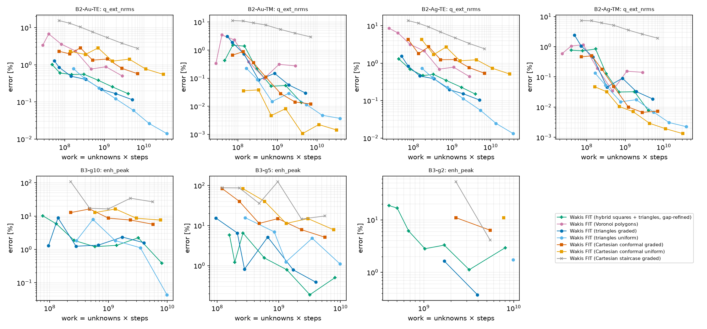
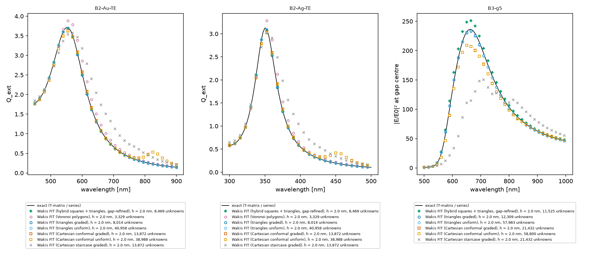

# Polygonal FIT on the metallic benchmarks: B2 (Au/Ag nanocylinder LSPR) and B3 (Au dimer gap)

**Question.** Do the polygonal-FIT meshes keep their advantage when the scatterer is a dispersive metal?
- The hybrid mesh: squares in the bulk and inside the metal, conforming triangles at the surface, and gaps refined to a fixed number of triangles across.
- The Voronoi-primal mesh.

The comparison is at equal cost against the shared baselines of `wakis.benchmarks`. B3, the Au dimer with a 2–10 nm gap, is the showcase for the hybrid's local gap refinement.

**Cases** (`wakis.benchmarks.cases`; exact references: series for B2, multi-cylinder T-matrix for B3; Rakić Lorentz–Drude Au/Ag in solver and reference):
- B2-Au-TE/TM: a = 20 nm, host n = 2, λ = 450–900 nm (LSPR at 553 nm in TE);
- B2-Ag-TE/TM: vacuum, λ = 300–500 nm (LSPR at 351 nm);
- B3-g2/g5/g10: two a = 20 nm Au cylinders with gaps of 2/5/10 nm, host n = 2, TE with E along the dimer axis. The metric is the peak of |E/E0|² at the gap centre.

**Arms** (`wakis/benchmarks/arms/polygon2d.py`; store names `hybrid-quadtri`, `voronoi-poly`). The ladder is h = a/5 … a/40 (4 to 0.5 nm), with h_out = max(h, min(4h, λ_host/20)) as in the triangle baseline.
- **hybrid-quadtri:** `hybrid_circles_mesh` with squares inside the metal and in the bulk.
  - The triangle band and `gap_cells = 4` give at least 4 triangles across the gap (h ≥ gap/4) on every rung.
  - Square domain |x|,|y| < 90/110 nm (the case's absorber radius), split-field PML of 10 h_out squares.
  - The metal ADEs need a smaller dt than the leapfrog CFL at the coarsest h. The arm lowers cfl in 15 % steps until `DispersiveMaterial.is_stable`, and records the value.
- **voronoi-poly:** `voronoi_disk_mesh` (single centred cylinder, B2 only), with a first-order ABC at r_absorber + 10 h_out.
- **Baselines** (from the shared store `gs://cloud-code-511302-autoresearch/bench-results/`, all uncontended Batch runs): tri-graded, tri-uniform, cart-conformal-all-{graded,uniform}, cart-staircase-graded.

**Compute.** 77 tasks, one per n2-standard-2 spot machine (job `polyfit-bench-20261019-0647`, commit 104a8b8). Records are in `data/` and in the store.


**(a)** Error vs work (unknowns × steps): Q_ext NRMS for B2, gap enhancement peak error for B3. Markers are "Wakis FIT (mesh)" runs.


**(b)** Spectra at h = 2 nm against the exact reference (lines).

## Results (from `data/summary.md`; log-log interpolation; "last crossing" rule for non-monotone ladders)

### B2: single nanocylinder
| case | target | hybrid-quadtri | tri-graded | cart-conformal-all-graded | voronoi-poly |
|---|---|---|---|---|---|
| Au-TE | 1 % | 5.6k / 4.8e7 | 4.8k / 6.5e7 | 46k / 2.0e9 | 7.7k / 3.8e8 |
| Au-TE | 0.1 % | not reached (0.17 % at 0.5 nm) | not reached (0.11 %) | not reached | not reached |
| Au-TM | 0.1 % | **15.6k / 4.7e8** | 27.4k / 1.2e9 | 20.9k / 5.4e8 | not reached |
| Ag-TE | 1 % | 5.3k / 5.5e7 | 4.8k / 6.5e7 | 42k / 1.8e9 | 7.3k / 3.5e8 |
| Ag-TM | 0.1 % | **13.1k / 3.7e8** | 10.9k / 2.5e8 | 16.4k / 3.4e8 | not reached |

(unknowns / work)

- **TE (the plasmon).** The hybrid is on par with graded triangles at 1 %: 1.15× more unknowns but 1.3× less work, because its time step is the square one. It converges about as slowly at finer h (0.17 % vs 0.11 % at 0.5 nm). Both are first order or a bit better in this metric, so the hybrid does not gain on a scatterer that is mostly interface.
  - Inner triangles instead of inner squares lower the hybrid error at 1 nm from 0.38 % to 0.30 % (one local check); the inner squares cost little.
  - The graded conformal Cartesian grid needs 8× more unknowns and 32–42× more work at 1 %, and none of the arms reaches 0.1 % in TE except tri-uniform.
- **TM.** The hybrid is the cheapest arm to 0.1 % on Au (1.75× fewer unknowns and 2.5× less work than tri-graded, 1.15× less work than conformal Cartesian), and similar on Ag.
- **Voronoi** is not competitive here. Its ABC sits only 1.4 wavelengths (host) from the cylinder and reflects 10–21 % (de-embedded, but the fit degrades). It needs a PML on polygonal cells, which does not exist yet.

### B3: Au dimer gap (showcase)
- **g5 and g10.** The hybrid and graded triangles reach 5 % on the gap enhancement peak at similar cost:
  - g5: 12.6k vs 20.2k unknowns, 3.0e8 vs 6.7e8 work;
  - g10: 8.8k vs 9.1k unknowns, 1.4e8 vs 1.7e8 work.
  - The pointwise gap value is noisy from one mesh to the next for every arm (tri-graded g5: 15, 6.5, 0.8, 5.2, 0.8 % along its ladder; hybrid: 5.8, 1.2, 6.5, 1.6, 0.8, 0.2, 0.5 %). So these single-crossing numbers carry ±2× uncertainty.
  - Conformal Cartesian does not reach 5 % on the ladder.
- **g2 (2 nm gap, the hard case).** The hybrid refines only the gap (h_min ≈ 0.4 nm) while the rest of the mesh stays at h. It reaches 5 % at h ≈ 1.6 nm with 13k unknowns and 7.6e8 work (2.8 % at h = 1.43 nm, 18k unknowns).
  - The triangle baseline has no gap refinement, so its g2 ladder starts at h = 1 nm (1.6 % with 35k unknowns, 1.7e9 work).
  - Against that first converged rung, the hybrid needs ≥ 2.6× fewer unknowns and ≥ 2.2× less work for 5 %. This is an upper bound on the baseline cost: whether tri-graded would reach 5 % at a coarser h was not run.
  - Below 3 % the hybrid stalls: 1.1 % at 0.71 nm, then 2.9 % at 0.5 nm. The gap cells stay at h ≥ gap/4 = 0.5 nm on every rung, so the gap resolution does not refine with h. `gap_cells` should grow with the ladder (open question).
- **Time step.** On g2 every hybrid rung runs about 57k steps, set by the 0.4 nm gap triangles. Local time stepping (a separate branch) would remove most of that cost, since only a few hundred cells are that small.

## Limits & caveats
- Square domain and split PML for the hybrid vs radial CFS-PML disks for triangles: the absorbers and domain areas differ.
- Gap refinement is fixed in cells across the gap (`gap_cells = 4`). A convergence study of the gap needs `gap_cells` to scale with the ladder.
- The gap field is reconstructed from the edge fluxes of the triangle containing the gap point (Raviart–Thomas, as the triangle baseline). A least-squares linear reconstruction over two rings of cells (`gap_lsq=True`) was not better on a smooth synthetic field, and is off.
- Voronoi: no PML; single centred cylinder only.

## Reproduce
```bash
python poly_bench.py list                                    # 77 tasks
python poly_bench.py run --shard I --nshards 77 --outdir out   # Cloud Batch
python publish_records.py out <batch job> <commit>           # shared store (arm names hybrid-quadtri, voronoi-poly)
python plot_bench.py --base <local copy of the store>        # figures + data/summary.md
```
