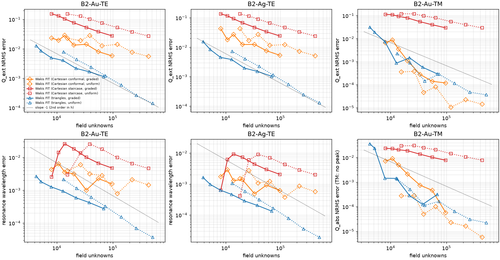
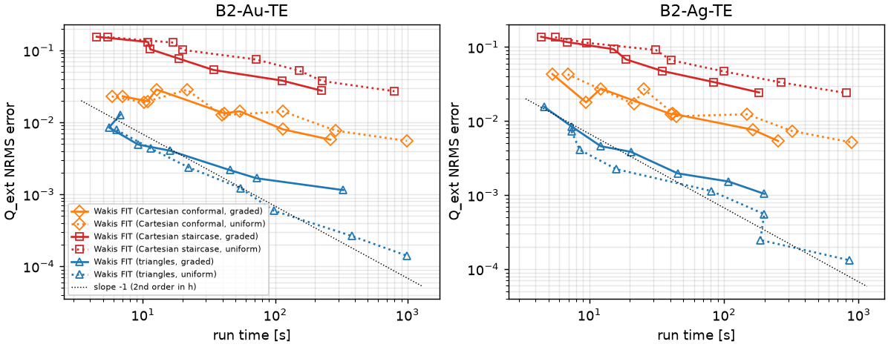
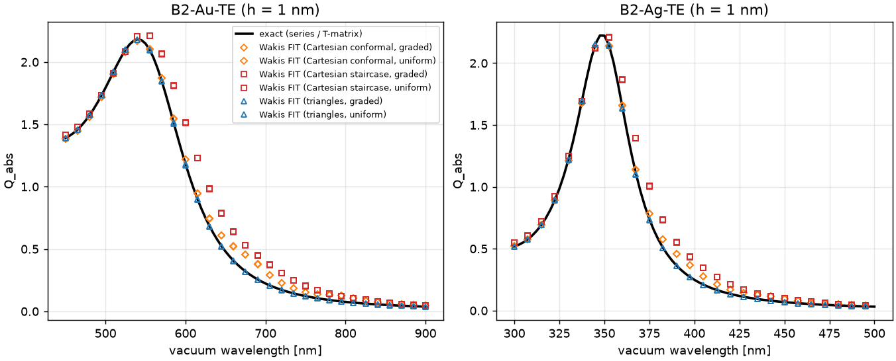
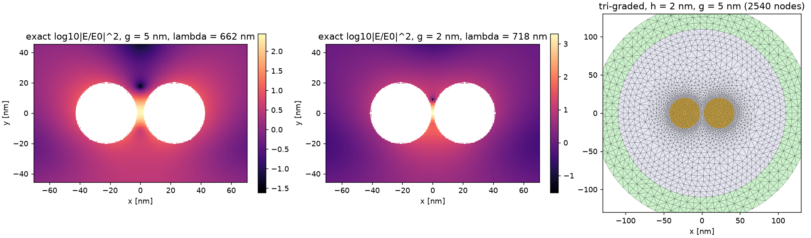
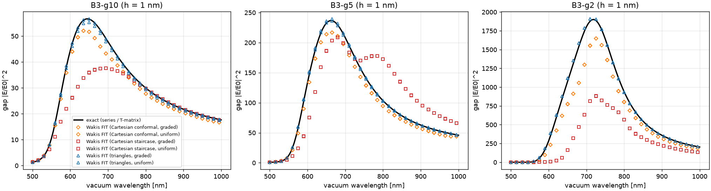
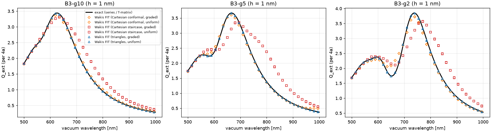
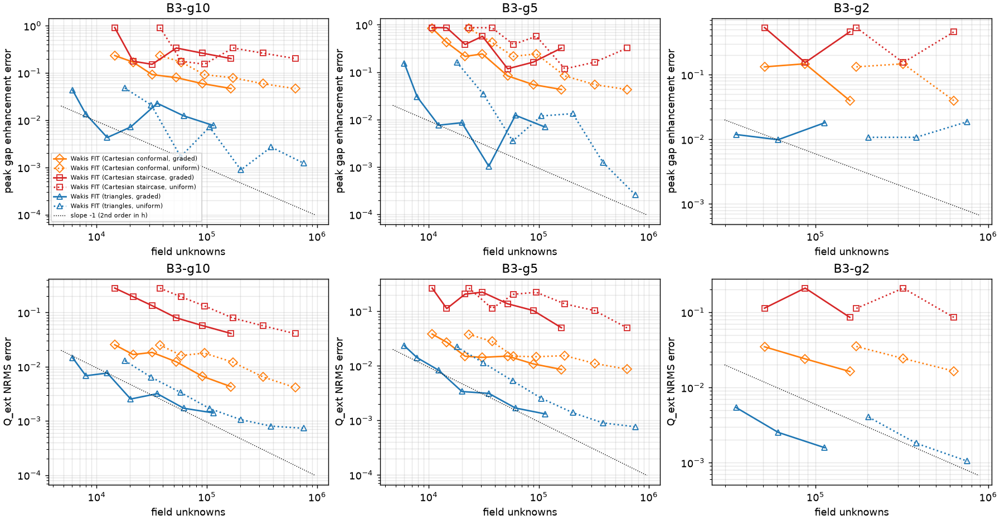
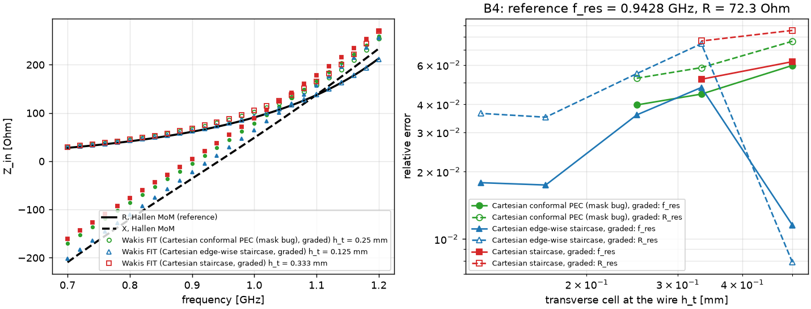

# Benchmark suite: baseline arms

**Question.** On cases that stress meshing (metal particles with a surface plasmon resonance, a nanometre gap, a wire antenna), how many unknowns, how much work (unknowns × steps) and how much uncontended wall time does each existing mesh/scheme need to reach a given accuracy?

The cases, references and metrics are defined in [`wakis/benchmarks`](../../wakis/benchmarks/README.md).
- **Simulations** (markers in the figures) are labelled "Wakis FIT (mesh)".
- **References** (lines) are labelled "exact": the series, the T-matrix or the Hallén MoM.

**Compute.**
- Every simulation ran as one Cloud Batch task on its own spot machine: n2-standard-2 for B2/B3, n2-highmem-2 for B4.
- The code was shipped as a tarball through the project bucket.
- Every record is in `data/<phase>/` and in the shared store `gs://cloud-code-511302-autoresearch/bench-results/<case>/<arm>/` (`wakis.benchmarks.results.fetch(case)`).
- Run times scatter by 2–5× between spot machines at equal size, so the *work* column is the implementation-independent comparison.

## Arms

| arm | mesh | absorber / source |
|---|---|---|
| cart-staircase-uniform / -graded | rectilinear, legacy STL cell masks | TF/SF box, CPML |
| cart-conformal-all-uniform / -graded | rectilinear, diagonal subpixel averaging; dispersive cut cells via the passive sub-capacitor network | TF/SF box, CPML |
| tri-uniform / -graded | `cluster_mesh`: interface rings, greedy Poisson-disk fill, Voronoi Hodge | scattered-field plane wave (dispersive source), radial CFS-PML |

The resolution label is h, the cell or edge size on the particles: a/5 … a/40, i.e. 4 → 0.5 nm.
- **Graded meshes** keep h on the particles plus a 2h band, then grow by 1.2 per cell up to min(4h, λ_host/20).
- **Uniform meshes** use h everywhere.

## B1: dielectric Mie cylinder at 3000 fs: graded arms with an uncapped outer mesh (40 runs)

The original graded arms capped the outer element size at λ_min/20 (31 nm for B1). The outer region then stops refining while h does, and both families plateau. For example, tri-graded with the 40-ring PML stalls at 1.2 % (data/B1tri).

These runs use h_out = r·h with no cap (`ppw_out=None`). Jobs: bench-b1tri2-20261019-1528 (triangles, 40-ring PML) and bench-b1cart-20261019-1529 (conformal Cartesian, CPML); data in `data/B1u`. Q_sca RMS error vs h:

| arm | h = 31 | 22 | 16 | 11 | 7.9 nm | unknowns to 2 % / 1 % (TE) | unknowns to 2 % / 1 % (TM) |
|---|---|---|---|---|---|---|---|
| tri-graded-r2 (TE / TM) | 9.1 / 7.1 % | 5.3 / 3.5 % | 2.7 / 2.3 % | 1.24 / 1.27 % | 0.57 / 0.61 % | 304k / 506k | 276k / 521k |
| cart-conformal-all-graded-r2 | 9.4 / 8.4 % | 5.2 / 4.4 % | 2.5 / 2.6 % | 1.22 / 1.40 % | 0.58 / 0.66 % | 246k / 452k | 263k / 511k |
| tri-graded-r4 | 13.6 / 14.8 % | 9.4 / 8.8 % | 4.8 / 3.9 % | 2.3 / 2.1 % | 1.22 / 1.24 % | 265k / — | 254k / — |
| cart-conformal-all-graded-r4 | 14.9 / 15.4 % | 8.6 / 8.8 % | 4.3 / 4.4 % | 2.1 / 2.4 % | 1.03 / 1.21 % | 253k / — | 294k / — |

**Findings:**
- **The plateau is gone.** Uncapped, both families converge at second order (r = 2: 1.24 → 0.57 %).
- **The two families are equivalent here.** At equal outer ratio they agree within 10 % in unknowns to 1 % (TE 452k Cartesian vs 506k triangles; TM 511k vs 521k). On this smooth dielectric the mesh type matters less than the outer-mesh policy.
- **r = 4 converges at the same order but costs about 2× the error** at equal h.
- **Still far from the high-order agent's curved DG** (0.014–0.07 %) at these costs.

## B2: Au and Ag nanocylinders (168 runs)


**(a)** Q_ext at h = 1 nm, against the exact series with the same Rakić ε(ω).
- Staircase: red-shifted shoulder from corner modes plus the jagged perimeter.
- Conformal: small excess on the red side, from mixed metal/host cells.
- Triangles: on the line.


**(b)** Q_ext NRMS error and LSPR-wavelength error vs field unknowns (TM: Q_abs, since there is no peak).
- Triangles converge at second order.
- Conformal Cartesian TE converges non-monotonically.
- Staircase converges at first order.


**(c)** The same error against uncontended run time.


**(d)** Q_abs at h = 1 nm.

### Cost to target (TE, from `data/summary_B2.md`)

| case, target | tri-graded | tri-uniform | cart-conformal-graded | cart-conformal-uniform | staircase |
|---|---|---|---|---|---|
| Au, Q_ext NRMS 1 % | 4.8k unknowns, 6.5e7 work, 5 s | ≤ 13k (met at the coarsest run) | 46k, 2.0e9, 86 s | 170k, 7.4e9, 193 s | not reached (2.7 % at 0.5 nm) |
| Au, LSPR λ 0.2 % | 5.0k | 14k | 67k | 244k | not reached |
| Au, FWHM 2 % | ≤ 4.3k | ≤ 13k | 56k | 235k | not reached |
| Ag, Q_ext NRMS 1 % | 4.8k | ≤ 13k | 42k | 154k | not reached |
| Ag, FWHM 2 % | ≤ 3.9k | ≤ 13k | 76k | 318k | not reached |

**Main result.** At 1 % on the metal TE spectra, graded triangles need about 10× fewer unknowns and 30× less work than the best Cartesian arm (graded conformal). The Cartesian slab counts 3 unknowns per cell, as in the earlier Mie studies.

**Why:**
- **Triangles.** The triangle mesh follows the circle. The series (edge-normal) Hodge then keeps D_n continuous across the metal surface, so the surface-charge (LSPR) physics is represented without geometric error at first order.
- **Cartesian conformal.** Kottke averaging of a metal (ε ≈ −4 … −30) and its host produces cells whose parallel-averaged ε(ω) crosses zero, or whose series average has a pole, somewhere in the band. These cells add weak spurious resonances, and the TE error is not monotone in h (B2-Au-TE: 2.3, 2.0, 2.9, 1.3, 1.4, 0.8, 0.6 %).
- **Cartesian staircase.** It is first order, with extra corner modes.
- **TM (E along the axis).** TM is easy for every conformal arm (≤ 0.05 % NRMS at h = 4 nm, uniform). In the graded arms the coarse outer region (4h) dominates the error once the metal's strong scattered field reaches the extraction circles, so graded is *worse* than uniform at equal h. This is an outer-mesh effect, not a metal effect.

## B3: Au dimer gap (102 runs)


**(a)** Exact T-matrix log10 |E/E0|² at the gap-mode peak for g = 5 nm and g = 2 nm, and the graded triangle mesh (h = 2 nm, polar PML rings in green).


**(b)** Gap enhancement (mean |E/E0|² over the gap stencil) at h = 1 nm against the T-matrix.
- Staircase splits and shifts the gap mode: at g = 5 nm it shows a second, red-shifted peak.
- Conformal Cartesian under-shoots the peak by 5–10 %.
- Triangles sit on the line.


**(c)** Q_ext (per 4a) at h = 1 nm.


**(d)** Peak gap-enhancement error and Q_ext NRMS vs unknowns.

### Cost to target (from `data/summary_B3.md`)

| case, target | tri-graded | tri-uniform | cart-conformal-graded | staircase |
|---|---|---|---|---|
| g = 10 nm, gap enhancement 5 % | met at coarsest run (≤ 6.1k) | ≤ 18k | 141k, 659 s | not reached |
| g = 10 nm, Q_ext NRMS 1 % | 7.0k | 22k | 64k | not reached |
| g = 5 nm, gap enhancement 5 % | 7.2k, 1.2e8 work, 11 s | 28k | 111k, 8.0e9, 481 s | not reached |
| g = 5 nm, Q_ext NRMS 1 % | 10.5k | 35k | 109k | not reached |
| g = 2 nm, gap enhancement 5 % | met at coarsest (h = 1 nm) run (≤ 35k) | ≤ 204k | 143k | not reached |
| g = 2 nm, Q_ext NRMS 1 % | met at coarsest run (≤ 35k) | ≤ 204k | not reached (1.7 % at 0.5 nm) | not reached |

**Main result.** For the 5 % gap-enhancement target, graded triangles need 10–20× fewer unknowns and about 65× less work than graded conformal Cartesian (g = 5 nm: 7.2k vs 111k unknowns, 1.2e8 vs 8.0e9 work). Staircase never reaches 5 % on these ladders: its errors are 12–120 % and non-monotone.

**Triangle floor at 1–2 %.** The triangle gap-enhancement error levels off at about 1–2 % (non-monotone), while Q_ext keeps converging. That is about twice the PML reflection the triangle arms report (3.5–5e-3 in field), and |E|² responds to it at first order. A better triangle absorber is needed for the 2 % target, and B3 uses only the raw outgoing coefficients (no de-embedding).
### B3 with the m2 gap metric (current numbers; `data/summary_B3m2.md`, figures `b3_*_m2.png`)

What changed relative to the tables above:
- **Gap field:** second-order reconstruction, a 12-edge least-squares patch on triangles and bilinear interpolation of the staggered components on Cartesian grids. The old pointwise Raviart–Thomas value is kept as the `enh_rt_peak` diagnostic.
- **Triangle PML:** 40 rings, from the triangle agent's B3-PML2 study.

The 102 records are published with the tag suffix `_m2`; the old records are marked `superseded_by_metric_change`.

Cost to target, as unknowns / work:

| gap | enh_peak target | tri-graded | tri-uniform | cart-conformal-graded | staircase |
|---|---|---|---|---|---|
| 10 nm | 5 % | 14k / 2.4e8 | 48k | 141k / 1.2e10 | not reached |
| 10 nm | 2 % | 17k / 2.9e8 | 70k | not reached | not reached |
| 10 nm | 1 % | 18k / 3.5e8 | 88k | not reached | not reached |
| 5 nm | 5 % | 22k / 4.8e8 | 95k | 111k / 8.0e9 | not reached |
| 5 nm | 2 % | 31k / 9.0e8 | 145k | not reached | not reached |
| 5 nm | 1 % | 41k / 1.5e9 | 203k | not reached | not reached |
| 2 nm | 5 % | 59k / 2.9e9 | 305k | 143k / 1.2e10 | not reached |
| 2 nm | 2 % | 78k / 4.7e9 | 426k | not reached | not reached |
| 2 nm | 1 % | 107k / 7.8e9 | 617k | not reached | not reached |

**Findings:**
- **The m2 metric removes the triangle plateau.** Graded triangles now converge to 1 % on all three gaps, where the previous metric left them stuck at about 1–2 %.
- **Graded conformal Cartesian reaches only 5 %** on every gap, and is not reached at 2 % on the ladder (finest h = 0.5 nm).
- **The triangle numbers at 5 % are higher than in the first table.** The patch fit is wider than the gap at coarse h, and the 40-ring PML adds unknowns.
- **At 5 %, graded triangles still need 2.4–10× fewer unknowns and 4–49× less work** than graded conformal Cartesian.

**Metric definition.** The metric is the mean over the gap stencil, not the pointwise centre value.
- The first B3 ladder used the centre value, plus a mesher that let the two outer interface rings collide in the gap (a 2.8° sliver at h = 2.86 nm).
- That combination gave 1–9 % non-monotone errors.
- The stencil (centre plus 8 points at g/4) and the priority-ring mesher remove the cell-position noise. On triangles, `e_gap` now uses a second-order least-squares linear patch fit over the 12 nearest host edges (`e_gap_rt` retains the pointwise Raviart–Thomas diagnostic, `enh_rt_peak`). The centre value is still reported (`enh_centre`).

**DFT window.** The window floor is ≤ 8e-6 on every B2/B3 metric (`data/window_floor.md`: 1× vs 3× window, finest arms). The plasmon modes (Q ≈ 3–9) ring down within a few fs, unlike the high-Q TE mode that limits B1, whose window is now 3000 fs.

## B4: centre-fed dipole (Cartesian 3D)


**(a)** Z_in(f): Hallén MoM reference (lines) vs the finest run of each Cartesian arm (markers).
**(b)** Relative errors of f_res and R_res vs the transverse cell h_t.
- The axial cell is h_z = min(g, 4 h_t): 1 mm for h_t ≥ a/2 and 0.5 mm for a/3 and a/4.
- Rungs h_t ≥ a/1.5 ran on n2-highmem-2 CPUs (50–120 min); the finer rungs ran on L4 GPUs (6–23 min).

| arm | h_t | h_z | f_res err | R_res err | directivity err |
|---|---|---|---|---|---|
| edge-wise staircase | a (0.5 mm) | 1 mm | 1.16 % | 0.8 % | 0.10 % |
| edge-wise staircase | a/1.5 | 1 mm | 4.8 % | 7.5 % | 0.25 % |
| edge-wise staircase | a/2 | 1 mm | 3.6 % | 5.5 % | 0.17 % |
| edge-wise staircase | a/3 | 0.5 mm | 1.74 % | 3.5 % | 0.00 % |
| edge-wise staircase | a/4 | 0.5 mm | 1.79 % | 3.6 % | 0.03 % |
| edge-wise staircase | a/3 | 0.25 mm | 1.69 % | 3.5 % | 0.04 % |
| edge-wise staircase | a/3 | 0.125 mm | 1.67 % | 3.5 % | 0.03 % |
| edge-wise, 2× domain / λ/40 outer mesh | a/2 | 1 mm | 3.59 % / 3.62 % | 5.5 % / 5.6 % | 6 % / 0.3 % |
| legacy STL staircase | a, a/1.5 | 1 mm | 6.2 %, 5.2 % | 8.6 %, 7.7 % | 0.4 % |
| conformal PEC (STL; **mask bug**) | a, a/1.5, a/2 | 1 mm | 6.0 %, 4.5 %, 4.0 % | 7.7 %, 5.8 %, 5.2 % | 0.3 % |

**Reading the ladder:**
- **The h_z dependence is first order down to 0.5 mm.** Halving the axial (gap) cell from 1 mm to 0.5 mm halves the error (3.6 % → 1.7 %). Below 0.5 mm the edge-wise staircase stops changing:
  - h_z = 0.5, 0.25, 0.125 mm give 1.74 %, 1.69 %, 1.67 %;
  - h_t = a/3 and a/4 give 1.74 % and 1.79 %.
- **Converged result.** The edge-wise Cartesian FIT dipole converges to f_res 1.7 % below, and R_res 3.5 % below, the reduced-kernel Hallén reference. The broadside directivity agrees to 3e-4.
- **The h_t = a point (1.16 %) is a lucky cancellation**, not convergence. The coarse cross-shaped PEC wire is effectively thicker, which pulls the error the other way. The cost-to-target rule ("stays below target") does not count it.
- **The error is not from the domain.** Doubling the domain or the outer resolution changes f_res by less than 0.03 %. One exception: the near-to-far box of the 2× domain run gives a 6 % directivity error, which is unexplained (the box is still outside the CPML); Z_in is unaffected.
- **The legacy STL staircase and the conformal-PEC arm are both thickened.** They carry the same thickened wire (physics guide; `problems_solutions.md`). The conformal-PEC records are flagged in the store until `fix/conformal-pec-legacy-mask` lands.

**Open: the 1.7 % / 3.5 % converged offset.** Two candidates:
1. **The reference.** Thin-wire theory differs from the solved geometry:
   - the reduced kernel puts the current on the axis;
   - the wire has no end caps;
   - the gap is modelled as a uniform axial field, whereas FIT solves flat-ended 0.5 mm cylinders with a real 1 mm gap between flat faces.
2. **FIT.** A non-vanishing staircase/feed-model error that does not shrink with h_t or h_z.

The MoM's own N-spread is 0.09 % / 0.06 %, so the offset is not MoM discretization. Two cheap hypotheses were tested with the MoM, and neither closes the offset:
- **Equivalent radius of the staircase wire.** At h_t = a/3 the PEC node set (29 nodes) is a staircased disk, not a square. Its outermost node lies at r = a, and the area-equivalent radius is 0.506 mm. Matching f_res would need a_eq ≈ 2a, and a thicker wire *raises* R_in (+1.5 % at a_eq = 1 mm) while FIT's R is lower.
- **Flat end caps.** Adding a or 2a to the length explains −0.33 … −0.65 % of the f_res offset and none of the R_in offset.
- **Feed width.** It matches: the FIT port spans exactly the 1 mm gap between the face planes, as in the MoM's uniform gap field.

The R_in offset (−3.5 %) is therefore not geometric thickening.

**Independent third reference: NEC-2 (`nec2c`, run as an external tool on Batch; `nec/nec_b4.py`, `nec/nec_b4.json`).** Same wire, centre-segment voltage source:

| reference | f_res [GHz] | R_res [Ω] |
|---|---|---|
| Hallén MoM (this suite, finite 1 mm gap, N = 200) | 0.94281 | 72.35 |
| NEC-2, extended kernel, 301 segments | 0.94247 (−0.04 %) | 72.35 (0.00 %) |
| NEC-2, thin kernel, 201 segments | 0.94093 (−0.20 %) | 72.35 (0.00 %) |
| Cartesian FIT, edge-wise staircase, converged (h_t = a/3, h_z ≤ 0.5 mm) | 0.927 (−1.7 %) | 69.8 (−3.5 %) |

The two MoM codes agree to 0.04 % (extended kernel), so the offset lies on the FIT side. Flat end caps (absent in both MoM models) account for at most −0.65 % of f_res. The next suspects are the lumped-port feed model (gap-cell capacitance and inductance) and the staircased end and gap faces.

**Feed-model and end-cap tests** (h_t = a/3, h_z = 0.5 mm, L4 GPU; job bench-b4feed-20261019-1438). Each FIT run is compared with the Hallén MoM using the same gap; values are FIT − MoM:

| gap g | port | ends | f_res | R_res |
|---|---|---|---|---|
| 1 mm | axis edge | flat | −1.74 % | −3.5 % |
| 2 mm | axis edge | flat | −2.12 % | −4.5 % |
| 4 mm | axis edge | flat | −3.17 % | −6.7 % |
| 1 mm | sheet (inscribed square) | flat | −1.40 % | −2.3 % |
| 2 mm | sheet | flat | −1.44 % | −2.3 % |
| 4 mm | sheet | flat | −1.85 % | −2.4 % |
| 1 mm | axis edge | round (hemispherical) | −1.53 % | −3.5 % |
| 1 mm | sheet | round | −1.19 % | −2.3 % |

**Findings:**
- **The single-edge (axis) port adds a feed error that grows with the gap length.** The current is forced through one line of edges across the gap, which acts like a series probe inductance. With the sheet port the offset becomes almost independent of the gap (−1.4 … −1.85 %, R −2.3 … −2.4 %). At g = 1 mm the sheet port recovers 0.34 % of f_res and 1.2 % of R_in.
- **Flat end caps account for 0.2 % of f_res and none of R_in.**
- **About 1.2 % (f_res) and 2.3 % (R_in) remain unexplained** with the sheet port and round ends. Next suspects: the edge-wise staircase of the wire surface itself, or the gap faces of the inscribed-square sheet. Tests to resolve this: conformal PEC once `fix/conformal-pec-legacy-mask` lands, and a port sheet covering the whole gap disk. It is logged in `open_questions.md`. Two independent checks would settle it: an exact-kernel (or body-of-revolution) reference, and the conformal-PEC arm after the mask fix.
Until then, the B4 targets are scored against the Hallén reference, and the offset is reported as part of the baseline.

**Cost.**
- Converged rung (h_t = a/3, h_z = 0.5 mm): 2.4 M cells and about 55k steps. It took 15 min on an L4 GPU; on one CPU core it would be about 7 h, so the CPU rungs beyond a/2 timed out at 330 min.
- h_t = a: 0.85 M cells, 19k steps, 49 min on n2-highmem-2.

## Limits & caveats

- **B2 is 2D.** Spheres (−2ε_b resonance, 3D staircase) are harder for the Cartesian arms and are not covered.
- **Ladder too fine for some targets.** Some targets are met at the coarsest run (marked "≤"), so the ladder does not bracket them. The TM ladder in particular should be extended to coarser h.
- **Triangle absorber.** The triangle arms use a 10-ring CFS-PML of h_out cells; its reflection (3–8e-3, reported per record) sets an error floor of about 1e-3 in the B3 gap metrics.
- **Spot-machine timing.** Run times come from single spot runs; the work column is the comparison to trust.

## Reproduce

```bash
python bench_study.py list --phase B2                       # 168 tasks
python bench_study.py run --phase B2 --shard I --nshards N --outdir out [--publish]
python bench_study.py plot --phase B2                       # figures + data/summary_B2.md
```

Tests: `tests/test_bench_multicylinder.py`, `test_bench_cases.py`, `test_bench_dispersive_planewave.py`, `test_bench_thin_wire.py`.
