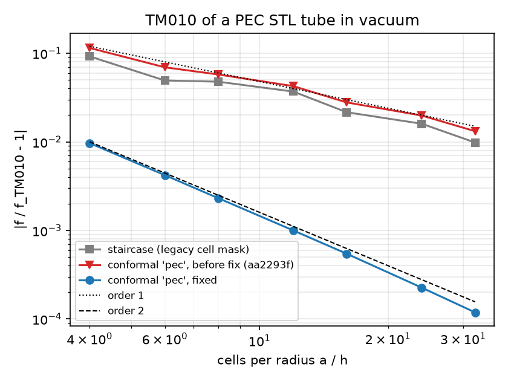
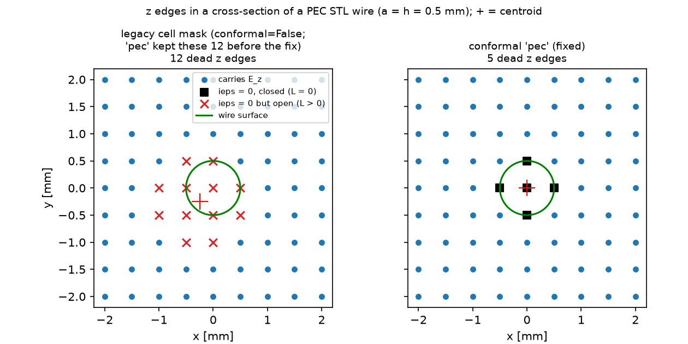

# Conformal PEC with PEC-only STL solids: the legacy-mask bug and its fix

**Bug (found 2026-10-19 by the B4 dipole benchmark).** With `conformal='pec'` (or `'all'`, `'tensor'`, or `sheets` alone), PEC STL solids in a non-PEC background, and no dielectric solid, the solver kept the legacy staircase cell mask in `ieps`. The conformal open lengths and areas were set, but edges with a positive open length stayed dead, so the conformal PEC was **worse than the staircase and first order**.

**Root cause.**
1. `SolverFIT3D._apply_stl_materials` zeroes `ieps` on the lower-corner edges of every cell with any of its 8 nodes inside a PEC solid. The `legacy` marking compares the node average with `stl_tol * min(dx)`, a length, so in practice one node is enough. This thickens the solid by up to a cell towards −x, −y, −z. It is upstream behaviour (issue #92, see `notes/upstream/23-issue-stl-mask-bias.md`).
2. `conformal.apply_conformal_materials` rewrote `ieps`/`sigma` from the conformal geometry only when `geo.fractions` was non-empty (a dielectric solid was present) or the background was PEC. Otherwise it only multiplied the existing `ieps` by the closed-edge factor.

**Fix** (`wakis/conformal.py`). The conformal materials (`_material_tensors`) are now always written. PEC solids are not in `geo.fractions`, so edges outside dielectric solids get the background material, and the closed-edge factor (L_open = 0) zeroes the edges inside the PEC. The dielectric-present and PEC-background paths run the same code as before (bit-identical). Non-conformal grids are not touched. An empty `TensorOperator` is no longer built in mode `'tensor'` without dielectrics.

## Results

|  |  |
|---|---|

**Left:** TM010 of the hollow (radius a = 10 mm) of a PEC STL tube in vacuum, two cells high between PEC walls, axis off the grid by (0.37, −0.23) mm, leapfrog dispersion removed. Errors |f/f₀ − 1|:

| a/h | staircase | conformal, before fix (aa2293f) | conformal, fixed |
|---|---|---|---|
| 4 | 9.2e-2 | 1.15e-1 | 9.7e-3 |
| 8 | 4.8e-2 | 5.8e-2 | 2.3e-3 |
| 16 | 2.2e-2 | 2.8e-2 | 5.5e-4 |
| 32 | 9.8e-3 | 1.3e-2 | 1.2e-4 |
| fitted order (4–32) | 1.08 | 1.04 | 2.12 |

Before the fix, the conformal error (+) has the sign of a thicker wall (smaller hollow, higher frequency) and is larger than the staircase error. After the fix, it converges at second order and is 40–80× smaller than the staircase at 16–32 cells per radius.

**Right:** z edges in a cross-section of a PEC STL cylinder of radius one cell (a = h = 0.5 mm), as in the reproducer `notes/bugs/repro_conformal_pec_legacy_mask.py`. The legacy mask zeroes 12 edges, with a centroid at (−h/2, −h/2). Before the fix, `'pec'` kept the same 12, and 7 of them are open (L > 0), e.g. (−1.0, −0.5) mm, 1.1 mm from the axis. After the fix, only the 5 edges at nodes inside or on the surface are closed, centred on the axis.

**B4 dipole** (Hallén reference, coarsest rungs, `cart-conformal-pec-graded`): see the table in the task report / `claims_register.md` (rerun on Cloud Batch with the fix).

**Time step.** The revived open edges include short ones, so the conformal stable step of PEC-only geometries drops slightly. The ratio to the Yee limit goes from 0.96 to 0.86 (rotated box) and from 0.97 to 0.88 (sphere). This stays inside the 0.85–1.0 range quoted in the physics guide.

## Limits & failure modes

- The non-conformal (`conformal=False`) path still uses the thickened, −x/−y/−z biased legacy mask (documented in `test_048::test_nonconformal_mask_unchanged`). Changing it changes all staircase results and upstream regression data; it belongs to upstream issue #92.
- `imu` keeps the cell mask. PEC with μ_r ≠ 1 is not meaningful, but a magnetic STL solid would keep its legacy mask.
- With a PEC background, all solids are holes and the fix changes nothing. The same holds when any dielectric solid is present.

## Reproduce

```bash
python tube_study.py run --label conformal-fixed
python tube_study.py run --label staircase --staircase
PYTHONPATH=<checkout of aa2293f> python tube_study.py run --label conformal-legacy-mask
python tube_study.py mask && python tube_study.py plot
```

Each run takes a few seconds on a laptop (≤ 2.3k cells). Test: `tests/test_048_conformal_pec_mask.py`. Against aa2293f, 7 of its 10 tests fail. With the closed-edge factor removed (mutation), 6 fail.
