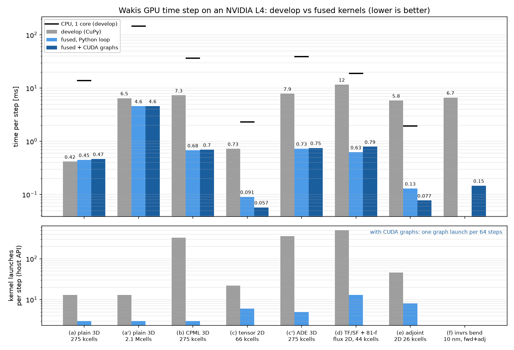
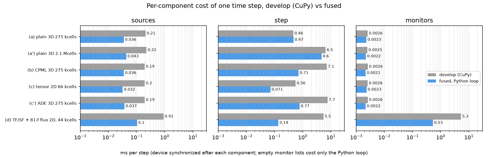

# GPU time stepping without per-step Python and launch overhead

**Question.** On an NVIDIA L4 the invrs-gym ceviche waveguide bend (98 kcells, 2D 10 nm grid, CPML,
mode source, DFT readouts, exact adjoint) ran at 6.7 ms per time step with 11 % GPU utilization, about
2× the CPU, and the 2D TF/SF tutorial (44 kcells, two 81-frequency flux boxes) at 12–19 ms per step,
slower than one CPU core. Where does the time go, and how much of it is avoidable?

**Answer.** Nearly all of it was host overhead: one CuPy kernel (and ~10–20 µs of Python dispatch) per
array expression — 326 launches per CPML step, ~500 per TF/SF step with monitors. The fused kernels
of `wakis/gpu_fused.py` (`SolverFIT3D(..., use_gpu=True, fused=True)`) do the same arithmetic in 2 kernels
per step (+1 per source, 2 per monitor batch, 4 per transposed step), and CUDA graphs replay 64 steps per
launch. **The full bend forward + adjoint iteration drops from 753 s to 15.3–16.6 s (45–49×) with the
same loss and gradients to 3·10⁻¹¹; GPU utilization goes from 11 % to 93 %.**

Machine: `cem-gpuperf`, GCP g2-standard-8 (8 vCPU), one NVIDIA L4 (24 GB, ~300 GB/s), CUDA 12.9 driver
580, CuPy 14.2, Python 3.12, float64; one run at a time on an otherwise idle VM (uncontended).
CPU column: same VM, one core (`OMP_NUM_THREADS=1`, SciPy). Baseline = Wakis `develop` 663536f (CuPy path).

## Results

| case | cells | develop GPU [ms/step] | fused [ms/step] | fused + graphs [ms/step] | speed-up | CPU 1 core [ms/step] | launches/step develop → fused |
|---|---|---|---|---|---|---|---|
| (a) plain 3D, PEC box, dipole | 275 k | 0.42 | 0.45 | 0.47 | 0.93× | 13.8 | 13 → 3 |
| (a') plain 3D, PEC box | 2.15 M | 6.47 | 4.59 | 4.61 | 1.41× | 147 | 13 → 3 |
| (b) 3D CPML (8 cells, 6 faces) | 275 k | 7.33 | 0.68 | 0.70 | 10.8× | 36.5 | 326 → 3 |
| (c) 2D rod, conformal `tensor` | 66 k | 0.73 | 0.091 | 0.057 | 12.7× | 2.3 | 22 → 6 |
| (c') 3D CPML + Lorentz/Drude/Debye block (ADE) | 275 k | 7.86 | 0.73 | 0.75 | 10.8× | 38.8 | 357 → 5 |
| (d) 2D TF/SF + 2 flux boxes (81 f) + DFT plane | 44 k | 11.66 | 0.63 | 0.79 | 18.5× | 18.9 | 499 → 13 |
| (e) `AdjointSimulation` 2D CPML, forward | 26 k | 5.97 | 0.161 | 0.101 | 59× | 1.91 | – |
| (e) `AdjointSimulation` 2D CPML, adjoint (`vjp`) | 26 k | 5.73 | 0.099 | 0.053 | 108× | 1.97 | 46 → 8 (fwd+adj) |
| (f) invrs bend, value_and_grad (Nt = 56 587, fwd + adj) | 98 k | 6.65 (753 s) | – | 0.135–0.147 (15.3–16.6 s) | 45–49× | – | – |

"fused" times the emsolve-like Python loop of `bench.py` (sources, `one_step`, monitors); "fused +
graphs" times `solver.emsolve` (and `AdjointSimulation`), which replay CUDA graphs when every per-step
operation is fused. The graph rows include step 0, the amplitude tables and the capture (500 steps per
case): for (d) this one-off cost (~80 ms of TF/SF injection tables) makes the graph run slower than the
per-step loop over only 500 steps. Speed-up = develop / best fused. Bend: two runs of the fused
iteration (15.3 s, 16.6 s on the same VM) bracket the run-to-run spread.





### Per-component cost (develop)

Device synchronized after each component (`bench.py`, `breakdown_ms`), so each bar is the wall time of
that component when serialized:

- **CPML step**: 7.1 ms of the 7.3 ms step at 275 kcells; 1.36 ms of GPU kernel time (nsys) — the
  rest is Python dispatch of 326 kernels (12 cuSPARSE products + 1200 csrmv partition/scalar kernels per
  100 steps, 8100 `multiply`, 7300 `take`, 2500 `scatter_update`, …). Plain step: 0.46 ms (13 launches,
  GPU-bound already).
- **Sources**: 0.19–0.22 ms per `CurrentSource` update (fancy-index add, temporaries, a host float per
  step); TF/SF: 0.91 ms (25 operations on the auxiliary line).
- **Monitors**: TF/SF case 5.3 ms (per term: gather, exp, outer product, add, for 2 × 12 flux terms
  and a plane).
- **Adjoint**: 46 launches per forward+adjoint step pair at 26 kcells (the transposed CPML step, monitor
  adjoint sources with cuBLAS/cuSPARSE, gradient accumulation).

After fusion, (a), (a'), (b), (c') and (d) are GPU-bound (nsys kernel time 99–100 % of the wall
time; NVML utilization sampled every 20 ms reads 43–98 % and is not reliable for these short runs): the step kernels stream ~210 MB per CPML step at 275 kcells, i.e. the L4's ~300 GB/s. The
small 2D cases (c), (e), (f) are still launch-bound without graphs and become GPU-bound with them
(bend: 93 %).

**Where fused is not faster.** (a) a plain 275 kcell box: the fused row-per-thread curl kernels take
190 + 256 µs per step vs 2 × 152 µs for cuSPARSE `csrmv_v3` + 2 small elementwise kernels — the CuPy
path was already GPU-bound there (85 % of its wall time is kernel time) and cuSPARSE's product is
better at this size; at 2.15 Mcells the fused step wins by 1.4× because it does not write and re-read
the curl vector. Neither ELL storage (coalesced, tried: +0 % plain, +6 % CPML, kept for CPML rows only),
block size 128/512, nor FMA contraction changed the plain timing: these kernels are bandwidth-bound.

## Correctness (tests/test_045_gpu_fused.py, `pytest --gpu`)

| check | result |
|---|---|
| fused vs CuPy path, 300 steps, fields + DFT + flux (PEC, lossy, periodic, CPML, lossy CPML, mixed, Bloch complex) | ≤ 1e-11 relative (round-off of the summation order) |
| sources, running DFT/flux, TF/SF line: one update on the same random state | bitwise equal to the CuPy expressions |
| CUDA-graph replay vs fused per-step loop (currents, TF/SF, adjoint forward + vjp) | bitwise equal |
| energy-decay stop with graphs | stops at the same step |
| tensor averaging, ADE (Lorentz + Drude + Debye + σ), mode source/monitor | fields/DFT/polarizations ≤ 1e-11 |
| dot-product test of the fused transposed step (7 boundary cases, tensor, dispersive), incl. ψ-only supports | < 1e-12 relative |
| mutation: one transposed entry ×1.001, transposed ψ coefficient ×1.001, loss factor ×(1+1e-6) | dot test fails (> 1e-10) |
| mutation: CPML ψ coefficient ×(1+1e-6), dropped magnetic current, σ ×(1+1e-6) in the forward | comparison with the CuPy path fails |
| `AdjointSimulation` gradient fused vs CuPy (250 steps) / vs central FD | ≤ 1e-10 / ≤ 1e-5 of max |
| adjoint2d (2000 steps) gradient, graphs vs develop | 6.4e-16 relative |
| invrs bend gradient (56 587 steps fwd + adj), fused + graphs vs develop | max 3.0e-11, l2 1.5e-12 relative; loss identical |

Tolerances: the fused kernels change only the order of floating-point additions (a curl row summed in
CSR order, the CPML terms of a component added in one expression), ~1e-16 per step; errors grow at
most linearly over a few hundred steps, so 1e-11 leaves a margin of ~10³ while a 10⁻⁶ change of any
coefficient is detected.

Full suites on `cem-gpuperf` (commit 7346761): GPU `xvfb-run -a pytest --gpu -m "not slow"` 353 passed,
16 skipped, 0 failed (59 min); CPU `pytest -m "not slow" -n 6` 322 passed, 47 skipped (the GPU-only
tests), 0 failed. `wakis.estimate(fused=True)` (CPU-only code, added after) passes `test_036_estimate.py`
and `test_045::test_estimate_fused_step` locally.

## CPU path (report only; unchanged)

`cpu_cpml_probe.py` (one core, 275 kcells): the CPU CPML step takes 36.3 ms against 13.8 ms for the plain
step on the same grid. Its 12 derivative products take only 9.1 ms; ~24 ms go to NumPy fancy indexing
and temporaries of the ψ updates and corrections (cProfile tottime of `_one_step_cpml` itself: 24 ms per
step; 12 `numpy.zeros` per step from the DIA products, 3 ms). Two products with the merged curl rows
(11.7 ms) plus the face-restricted derivative rows for ψ (3.4 ms) would bring the CPU CPML step to
~16–18 ms (~2×) — the same restructuring as the GPU kernels, not implemented here (the CPU path was to
stay unchanged).

## Memory

Fused CPML solvers keep the merged ELL rows (4 entries per row per half step), ψ slot maps and the
contiguous ψ buffers in addition to the solver's own 12 derivative operators: +0.105 GB at 275 kcells
(0.172 → 0.278 GB CuPy pool, ~380 B per cell). The transposed rows for the adjoint are built only when an
`AdjointStepper` is created. Without CPML the fused step reads the solver's CSR operators directly (no
extra memory).

## Files

- `cases.py` — the cases (a)–(e); `bend_iteration.py` — case (f) through the invrs-wakis driver (a
  `PixelDesign` shim for develop's `network_of`; `--fused 1` subclasses `SolverFIT3D` with
  `fused=True`, the driver is otherwise unchanged); `compare_bend.py`.
- `bench.py` — ms/step, NVML utilization, per-component breakdown, nsys capture range;
  `run_all.sh <tag> <fused>` runs all cases (+ CPU with `CPU=1`, graphs with `GRAPH=1`).
- `results/*.json` — raw results (base = develop, fused, graph); `prof/*_cuda_{api,gpu_kern}_sum.csv` —
  nsys summaries over 100 steps (adjoint2d: forward + vjp, 2 × 2000 steps). With graphs, nsys counts
  the kernels recorded during capture as launches; the host launches one graph per 64 steps.
- `cpu_cpml_probe.py`, `results/cpu_cpml_probe_{32,64}.txt` — CPU CPML profile.
- `plot_results.py` → `gpu_perf_step_time.png`, `gpu_perf_breakdown.png`.

Reproduce (GPU VM, CUDA + CuPy):

```bash
cd studies/gpu-perf
PYTHONPATH=<develop checkout> CPU=1 bash run_all.sh base none     # develop baseline
bash run_all.sh fused 1 && GRAPH=1 bash run_all.sh graph 1
python bend_iteration.py --fused 0 --out results/base_bend.json   # with invrs-wakis installed
python bend_iteration.py --fused 1 --out results/graph_bend.json
python compare_bend.py results/base_bend.json results/graph_bend.json
python plot_results.py
```

## Limits & failure modes

See `docs/performance.md` (section *Fused GPU time stepping*). In short: GPU + float64/complex128 +
no MPI; `Near2FarMonitor`, `SliceRecorder`, lumped elements, Mur ABC, the dispersive tensor network,
plotting/saving/callbacks keep the per-step loop (still with the fused step); legacy in-step TF/SF
injection falls back to the CuPy step; complex-field ADE keeps the CuPy wrapper. Plain 3D grids
around 0.3 Mcells are ~7 % slower than cuSPARSE.

## Next steps

1. Matrix-free stencil kernels for non-conformal Cartesian grids (no column/value loads: ~2× on the
   bandwidth-bound 3D steps, (a') 4.6 → ~2.3 ms); keep CSR for conformal rows.
2. Block-DFT: buffer K samples and accumulate with one GEMM per K steps (monitor traffic / K; case (d)
   0.53 → ~0.1 ms of monitors), at the cost of bitwise equality with the running DFT.
3. Make `fused=True` the default for GPU solvers after the merged validation (GPU suite, invrs runs
   on Batch with an unpinned Wakis); fuse `Near2FarMonitor` and lumped elements so graphs cover them.
4. Recalibrate `wakis.estimate` for fused GPU runs (no CPML launch floor; see `estimate(..., fused=True)`).
