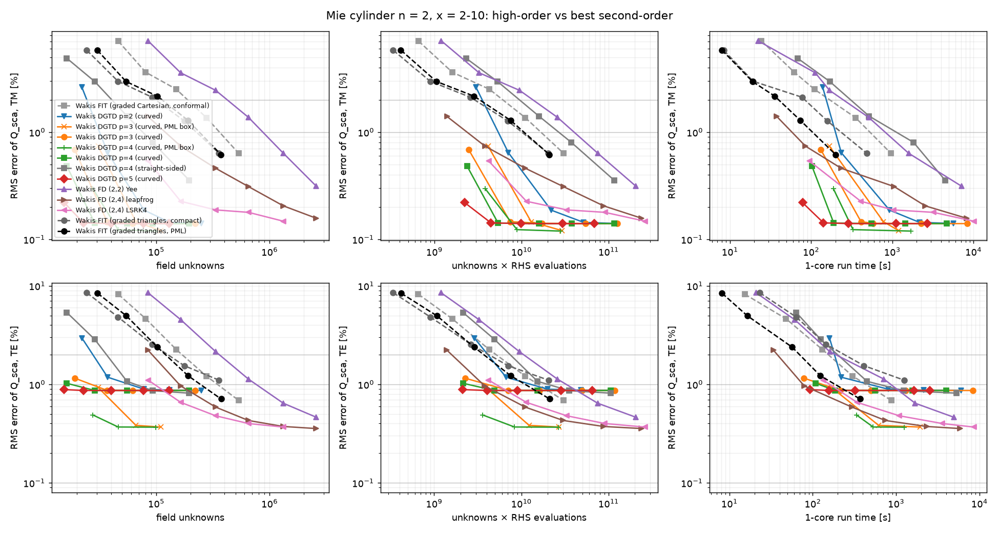
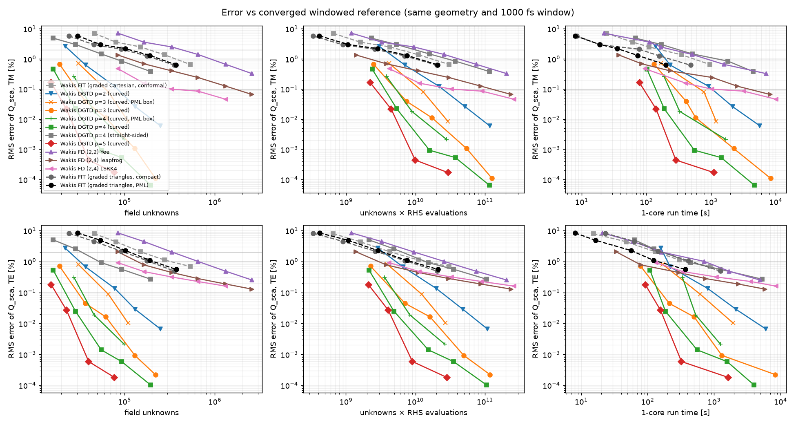
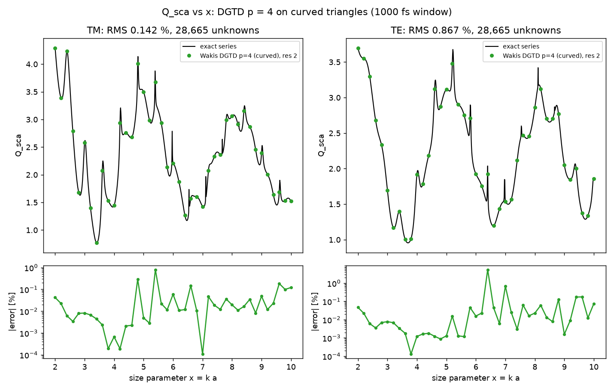
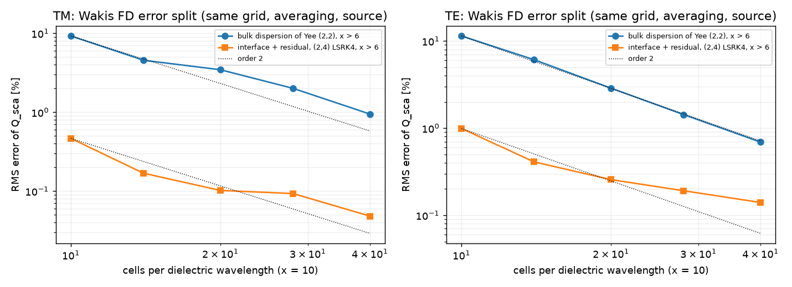
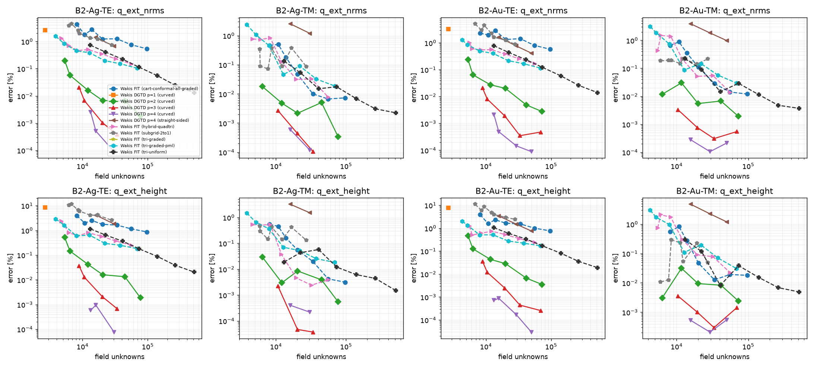
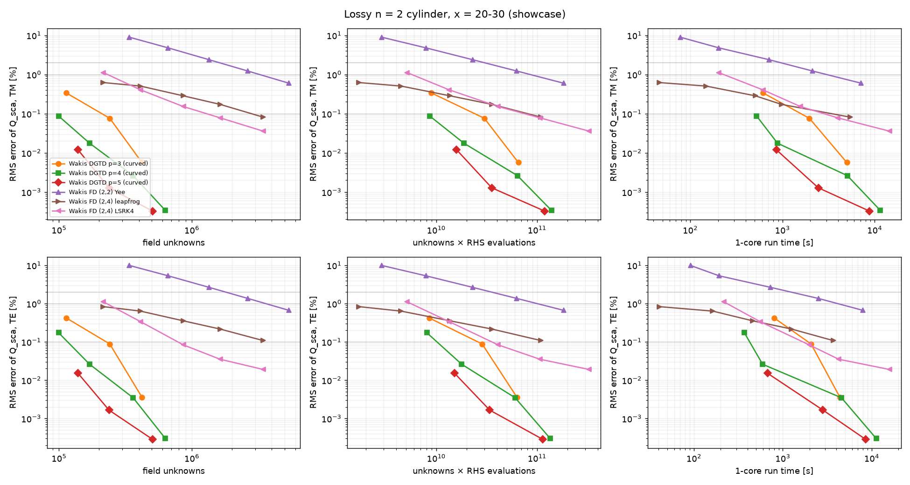
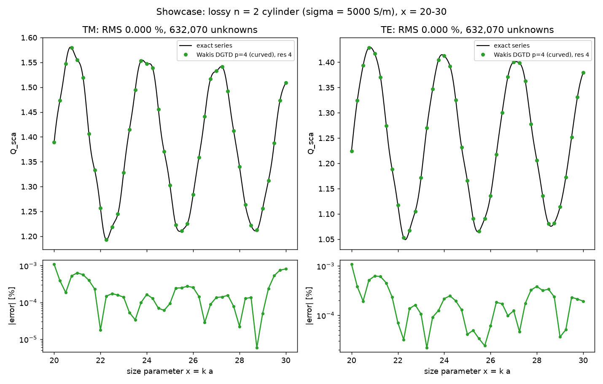
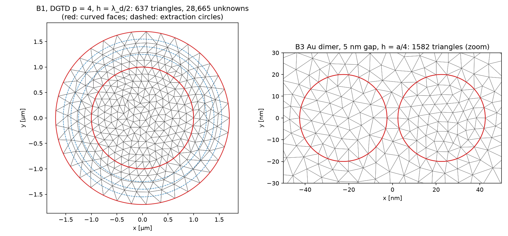

# High-order time-domain schemes vs second-order FIT: Mie cylinder, metals and an electrically large cylinder

**Question.** In the cylinder studies, conformal Cartesian FIT and triangle FIT both converge at second order, and for x > 6 their error comes from bulk numerical dispersion: resonances shift. How many unknowns, how much work and how much time does a high-order scheme need to reach 1 %, 0.1 % (and 0.01 %) error, against the best second-order baselines?

**Answer (short).**
- **Nodal DGTD on curved triangles (p = 4–5) is a different accuracy class.** On the shared Mie benchmark it reaches 0.1 % with about 17k unknowns, against an extrapolated ~2M for graded triangle FIT. That is about 120× fewer unknowns and ~550× fewer unknown-steps, and it runs 29× (TM) and 55× (TE) faster on one core.
  - Against the best competitor *measured* at 0.1 %, the Cartesian (2,4) scheme with RK4, DG is 11× faster.
  - At the loose 1–2 % targets the picture is different. DG still needs 15× fewer unknowns, but its wall time is about equal to graded triangle FIT. The **(2,4) leapfrog** scheme is the fastest at 1 %, about 2× faster than the triangle baseline.
- **Curved geometry is essential.** Straight-sided DG at p = 4 is no better than FIT (it reaches 3–5 % at λ_d/1.5–2). The same holds on metals: on the Au nanocylinder (B2) curved DG reaches 0.02 % Q_ext NRMS with 9k unknowns, while straight-sided DG at p = 4 stalls at 4 %.
- **Error split.** For x > 6, 95–99 % of the Yee/FIT error is bulk dispersion. The interface error measured with the (2,4) scheme is only 0.09 % (TM) and 0.2 % (TE) at 28 cells per λ_d. So the high-order *stencil* alone gains about 10× before the second-order sub-pixel interface caps it, and TE (diagonal tensor) caps first.

## Methods (details and derivations: physics guide, "High-order time-domain schemes")

| scheme | module | order | interfaces | time | absorber |
|---|---|---|---|---|---|
| nodal DGTD, p = 1–5 | `wakis.highorder.DGTD2D` | p + 1 (space) | curved isoparametric elements (Szabó–Babuška blend) | LSRK(5,4) | CFS stretched-coordinate PML (ADE) or Silver–Müller ABC |
| (2,4) staggered FD | `wakis.highorder.FDTD24(order=4)` | 4 (space) | sub-pixel averaging (2nd order) | leapfrog or LSRK(5,4) | CPML |
| Yee (2,2) | `FDTD24(order=2)` | 2 | same averaging | leapfrog | CPML |

- **Validation of the FD module against FIT.** Yee in `FDTD24` reproduces the conformal Cartesian FIT baseline: 3.58 % vs 3.50 % RMS at res 14, and 2.45 % vs 2.40 % at res 20 (TM). The bulk/interface split therefore uses the same grid, the same averaging, the same source and the same extraction for (2,2) and (2,4).
- **Literature (verified metadata, see the guide for the list).**
  - Hesthaven & Warburton, J. Comput. Phys. 181 (2002), and the 2008 book (DGTD, upwind flux);
  - Warburton, J. Eng. Math. 56 (2006) (nodes);
  - Carpenter & Kennedy, NASA TM-109112 (1994) (LSRK);
  - Yefet & Petropoulos, J. Comput. Phys. 168 (2001), and Hwang & Cangellaris, Electromagnetics 23 (2003) ((2,4) schemes);
  - Zhao & Wei, J. Comput. Phys. 200 (2004) (high-order FD with interface matching);
  - Busch, König & Niegemann, Laser Photonics Rev. 5 (2011) (DGTD in nanophotonics);
  - Rapetti & Bossavit, SIAM J. Numer. Anal. 47 (2009) (high-degree Whitney forms).
- **Why not option (iii), high-order mimetic FIT.** High-degree Whitney forms exist (Rapetti & Bossavit 2009), but we found no verified *explicit, diagonal-Hodge* high-order edge-element scheme on triangles. Mass lumping is established for nodal (scalar) triangles (Cohen–Joly–Roberts–Tordjman 2001) and lowest-order edge elements (Elmkies–Joly 1997). Without lumping, every step needs a sparse solve. Decision D9 in `decisions.md`.

## B1: shared Mie benchmark (n = 2, a = 1 µm, x = 2–10, 1000 fs window)


**(a)** RMS error of Q_sca vs the exact series, plotted against unknowns, unknowns × RHS evaluations, and uncontended 1-core time. Markers are Wakis runs; dashed lines are the baselines from `../mie-cylinder-graded` (graded triangle FIT with PML or compact, graded conformal Cartesian). The DG curves flatten at 0.14 % (TM) and 0.87 % (TE), and that floor comes from the run window, not from the mesh (next paragraph).

**The run-window floor (new finding).**
- **Cause.** With the shared 1000 fs DFT window, the error against the exact series cannot go below a geometry-dependent floor. One high-Q TE resonance near x = 6.4 has not rung down by 1000 fs.
- **Evidence.** Converged DG (three resolutions agree to < 1e-5) plateaus at 0.140 % (TM) and 0.866 % (TE) in the compact geometry. In the other geometries the plateaus are 0.19–0.37 %. With a 3000 fs window the same DG runs reach 0.012 % (TM) and 0.036 % (TE) against the exact series (`data_long/`).
- **Consequence.** The baselines' "1 % TE" numbers are partly this floor. The benchmark suite has since moved B1 to 3000 fs.
- **Our protocol.** For targets ≤ 0.1 % we measure every arm against a *converged windowed reference*: the finest DG p = 5 run with the same extraction circles, the same boundary and the same 1000 fs window (`dg5-compact`, `dg5-std`, `dg5-cc`, `dg5`). This removes the floor without rerunning the baselines. The geometry match for `tri-graded-pml` (radial PML) against `dg5-std` (ABC disk) is approximate, so its sub-0.5 % values carry about ±0.1 % uncertainty.


**(g)** The same comparison against the converged windowed reference. DG keeps converging to about 1e-6.

### Cost to reach a target

Values interpolate log-log between runs. `*` means extrapolated with the arm's last measured slope. `≤` means the coarsest run already beats the target. Time is the uncontended n2-standard-2 core time-stepping time.

| target (reference) | pol | arm | unknowns | unknowns × steps | time [s] |
|---|---|---|---|---|---|
| 1 % (exact series) | TM | tri-graded-pml (best 2nd-order) | 240k | 1.07e10 | 104 |
| | TM | cart-graded-compact | 362k | 1.67e10 | 531 |
| | TM | fd24 leapfrog | 120k | 2.4e9 | **58** |
| | TM | **DG p = 5 curved** | **≤ 15k** | **≤ 4.5e8** | ≤ 79 |
| 1 % (exact series) | TE | tri-graded-pml | 245k | 1.11e10 | 185 |
| | TE | fd24 leapfrog | 159k | 3.6e9 | **76** |
| | TE | **DG p = 4 curved** | **18k** | **4.9e8** | 117 |
| 0.1 % (windowed) | TM | tri-graded-pml | 2.1M* | 2.9e11* | 2600* |
| | TM | cart-graded-compact | 2.9M* | 4.1e11* | 12600* |
| | TM | fd24 (2,4) LSRK4 (measured) | 331k | 6.5e9 | 1020 |
| | TM | **DG p = 5 curved** | **17k** | **5.3e8** | **91** |
| 0.1 % (windowed) | TE | tri-graded-pml | 2.1M* | 2.9e11* | 6000* |
| | TE | fd24 (2,4) LSRK4 | 3.3M* (interface-capped) | 2.1e11* | 63000* |
| | TE | **DG p = 5 curved** | **17k** | **5.2e8** | **109** |
| 0.01 % (windowed) | TM/TE | DG p = 5 curved | 25–26k | 1.0e9 | 163–189 |

- DG takes 5 RHS evaluations per step, and the work column counts steps. In unknowns × RHS evaluations, the 0.1 % advantage over tri-graded-pml is ~110× instead of ~550×.
- Per unknown-step, DG costs 150–300 ns on an n2 core, against 17–30 ns for the numpy (2,2)/(2,4) leapfrog and ~19 ns for triangle FIT. That is about 10× more per unknown, offset by 15–120× fewer unknowns.
- All tables, per-run data and the full target table are in `data/summary.md` (exact series) and `data/summary_windowed.md` (windowed).


**(b)** Q_sca vs x: Wakis DGTD p = 4 (curved) at 2 elements per λ_d (28,665 unknowns), against the exact series. The remaining error is the 1000 fs window floor at the x = 6.4 TE resonance.

### Bulk vs interface error (Cartesian, same grid)


**(f)** Signed per-frequency errors against the windowed reference. e(fd24 LSRK4) estimates the interface error plus a small 4th-order bulk residual. e(Yee) − e(fd24 LSRK4) is Yee's bulk dispersion. For x > 6:

| pol | res | Yee bulk | interface (2,4) |
|---|---|---|---|
| TM | 14 | 4.55 % | 0.17 % |
| TM | 28 | 2.00 % | 0.09 % |
| TE | 14 | 6.10 % | 0.41 % |
| TE | 28 | 1.43 % | 0.19 % |

- **Bulk dominates second order.** The bulk error is 95–99 % of the Yee error at x > 6. A high-order *stencil* therefore gains 10–25× in error at equal h, until the interface takes over. In TE that happens at about 0.2–0.5 %, where the diagonal sub-pixel tensor converges at about first order.
- **Time error matters for (2,4).** With leapfrog at CFL 0.95 it dominates: res 14 TM gives 0.74 % with leapfrog, 0.26 % at CFL 0.3 and 0.23 % with LSRK4. Yoshida's symplectic 4th-order composition is unstable with the CPML, because its negative sub-step amplifies inside the absorber.
- **DG interface.** On DG the analogous split is curved vs straight-sided at equal p and h. Straight-sided p = 4 gives 2.9–5.4 % at λ_d/1.5–2, against 0.48–1.0 % (vs series) or 0.02–0.5 % (windowed) for curved.

## B2 / B3: metals (benchmark suite, `../highorder-bench`)

Arms `dgtd-p1…p4` (curved) and `dgtd-p4-straight`, box with CFS-PML, Rakić Drude–Lorentz Au/Ag through ADEs driven by the total field. The records are published in the shared store (`gs://…/bench-results/<case>/dgtd-*`).



- **B2-Au-TE (LSPR, Q ≈ 3.5), Q_ext NRMS.**
  - DG p = 2 at h = a/1.5: 0.24 % with 5.3k unknowns.
  - DG p = 3: 0.02 % with 8.9k unknowns.
  - DG p = 4: < 0.005 %.
  - Best second-order baselines: tri-uniform 0.12 % at 74k unknowns (67 s), tri-graded 0.11 % at 69k (192 s), conformal Cartesian 0.58 % at 97k.
  - At 0.1 %, DG needs about 7k unknowns, ~10× fewer than triangles, and about 20× fewer unknown-steps. Wall time is comparable (50–110 s), because the DG time step is set by p² and by the 13-gon element size.
- **Order on metals.** No order loss is visible down to the error floor of about 1e-5. The interface is smooth (a circle), represented exactly to O(h^{p+1}), and the ADE is integrated by RK4 with no time-discrete permittivity mismatch.
  - The straight-sided control stalls at 3.9 % (h = 10 nm). For metals the interface geometry is the *whole* error, because a 20 nm particle has no bulk dispersion at λ/a ≈ 25.
  - Corners (sharp metal edges) would bring field singularities and reduce DG to the singularity's order. They are not tested here.
- **B3 (Au dimer, gaps 2/5/10 nm).**
  - The gap enhancement (9-point stencil metric of commit 6771d3c) converges below the 5 % target already at h = a/2 with p = 2–4. Straight-sided p = 4 gives 5–13 %.
  - The time step is set by the gap elements. For g = 2 nm, DG p = 4 takes 2.7× more steps than for g = 10 nm (global RK, no local time stepping). See `../highorder-bench/data/B3/summary.md` and the store for the numbers.

## Showcase: electrically large lossy cylinder (x = 20–30)

**Why this case.** Dispersion error grows with the electrical size: the phase error accumulates over the path length, so second-order schemes need ever more cells per wavelength. A lossless n = 2 cylinder at x = 20–30 has whispering-gallery modes with enormous Q, and no finite window converges for them (see the floor above). We therefore give the cylinder σ = 5000 S/m. That is Im n ≈ 0.02 and Q < ~50 for every resonance, so a 200 fs window converges and the error measures the scheme. The exact series uses the same complex ε(ω). The domain is a disk (DG) or square (FD) of half-width 1.45 µm, which is 14 λ_0 across at x = 30.


**(c)** RMS error of Q_sca vs cost, x = 20–30.


**(d)** Q_sca of Wakis DGTD p = 4 (170k unknowns) against the exact series; the error is 0.018 % (TM) and 0.026 % (TE).

| target | pol | arm | unknowns | time [s] |
|---|---|---|---|---|
| 1 % | TM | Yee (2,2) | 3.2M* | 2950* |
| | TM | (2,4) leapfrog | 215k | **46** |
| | TM | DG p = 4 | ≤ 99k (0.09 % already) | ≤ 525 |
| 0.1 % | TM | Yee (2,2) | 33M* | 1.3e5* |
| | TM | (2,4) LSRK4 | 1.29M | 2820 |
| | TM | (2,4) leapfrog | 3.3M* (TE measured: 3.4M, 0.108 %, 3700 s) | 2000–4000 |
| | TM | **DG p = 4** | **99k** | **525** |
| 0.1 % | TE | (2,4) LSRK4 | 784k | 1680 |
| | TE | **DG p = 4** | **116k** | **424** |
| 0.01 % | TM/TE | DG p = 5 | 139–238k | 860–2800 |

- The DG times come from final-code timing reruns (`ho-ltime`).
- At 0.1 % on the large cylinder, DG is 4–5× faster than the best (2,4) arm, and 250× faster than Yee (extrapolated).
- At 1 %, the (2,4) leapfrog is the clear winner: 46 s, against at least ~370 s for our coarsest DG run, which already overshoots to 0.1–0.2 %.

## Exact-adjoint and GPU assessment

| scheme | linear, transposable step? | adjoint in practice | GPU |
|---|---|---|---|
| DGTD + LSRK4 | yes: X' = A X + f(t). `operator_matrix()` assembles A exactly by coloured probing; a step's adjoint is the same LSRK with Aᵀ; dot test < 1e-12 (`test_operator_matrix_and_adjoint_dot_product`, mutation A↔Aᵀ fails) | 5 stage vectors per step to checkpoint or recompute (vs 1 for leapfrog); PML and ADE auxiliaries included in X | dense element GEMMs ([Dr;Ds] (Np × 3K), lift) plus gathers; arithmetic intensity grows with p, better suited to GPU than FIT's sparse memory-bound updates |
| (2,4) leapfrog | yes (difference operators and diagonal scalings, like Yee; CN loss is a linear symmetric-in-time map) | same structure as the existing FIT adjoint | same as Yee: 2× wider stencil, same bytes per cell |
| (2,4) LSRK4 | yes (as DG) | 5 stages | as Yee |

## Limits & caveats

- **Window floor.** The B1 results against the exact series are limited by the 1000 fs window; see the protocol above. The windowed reference for `tri-graded-pml` (radial PML) comes from a DG run with a de-embedded ABC disk at the same radii, an approximate geometry match (±0.1 %).
- **Extrapolation.** The baselines' 0.1 % values are extrapolated: the second-order arms do not reach 0.1 % in the measured ladders. Treat the ratios as ±30 %.
- **Late-time growth in fine PML-box DG runs.** `dg4` box at res 4 and `dg3` box at res 6 grew without bound late in the 1000 fs window and are excluded. The coarser box runs, all compact (ABC) runs and all B2/B3 runs (80–100 fs windows) are stable. Diagnosis: `stab` job (CFL 0.5/0.65 vs no-PML variants), see `problems_solutions.md`.
- **Mesh limits.** Elements with two curved faces are rejected, so h ≥ a/1.5 on a circle: the B2 runs at h = a failed by design. Circles only (no CAD). A gap narrower than h is forced to one element across.
- **Timing.** One core of n2-standard-2 spot machines; the same configuration varies by ±30 % between machines. The numpy implementations of DG and of the (2,4)/Yee schemes are not optimized, so a compiled or GPU kernel would change the time ratios (not the unknown or work ratios).
- **Single geometry.** Smooth convex scatterers only. Sharp corners (singular fields) would reduce the DG convergence rate, and the Cartesian interface treatment would lose more.

## Reproduce

```bash
python ho_study.py list                                   # B1 tasks (112)
python ho_study.py run --shard I --nshards 112 --outdir out      # Cloud Batch, one task per machine
python ho_study.py run --tasklist wref --shard I --nshards 10    # windowed references
python ho_study.py run --tasklist long --t-run 3000 ...          # window check
python ho_study.py run --tasklist large --t-run 200 ...          # showcase (52)
python ho_study.py plot                                   # figures + data/*.md
python plot_mesh.py                                       # figure e
```

Tests: `tests/test_055_highorder.py` (12 tests, each with the failure it catches):
- the reference element is exact;
- LSRK4 is 4th order (mutated coefficient → order < 2.5);
- DG converges at > p (square cavity);
- the central flux conserves energy while upwind dissipates;
- curved elements restore order > 3.5 on a circular cavity, with straight-sided > 100× worse;
- the probed operator equals the matrix-free one and passes the adjoint dot test (mutation fails);
- the PML is > 6× better than the ABC (σ = 0 mutation fails);
- the Drude cavity frequency is √(ω_p² + c²k²) (mutation: no current);
- the (2,4) scheme is 4th order and Yee 2nd order.


**(e)** The curved DG meshes: B1 at h = λ_d/2 (637 triangles, 28,665 unknowns at p = 4), and the B3 dimer with a 5 nm gap.
