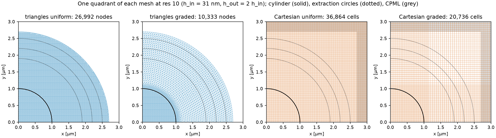
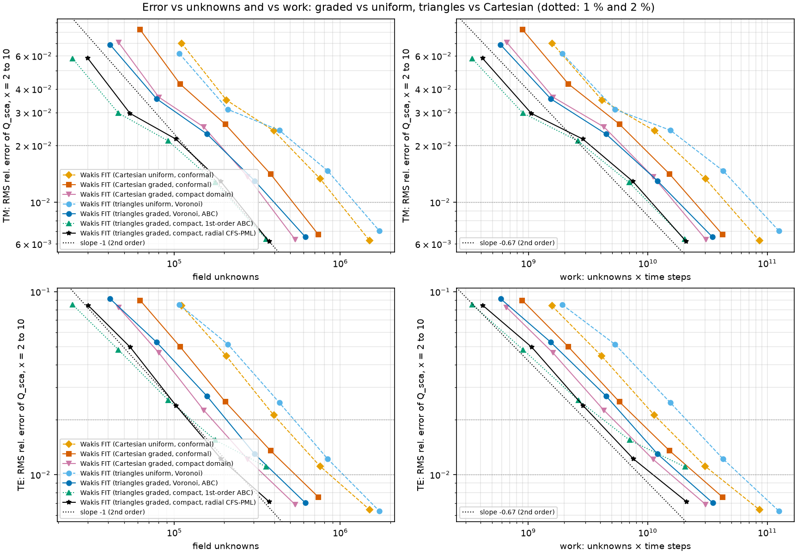
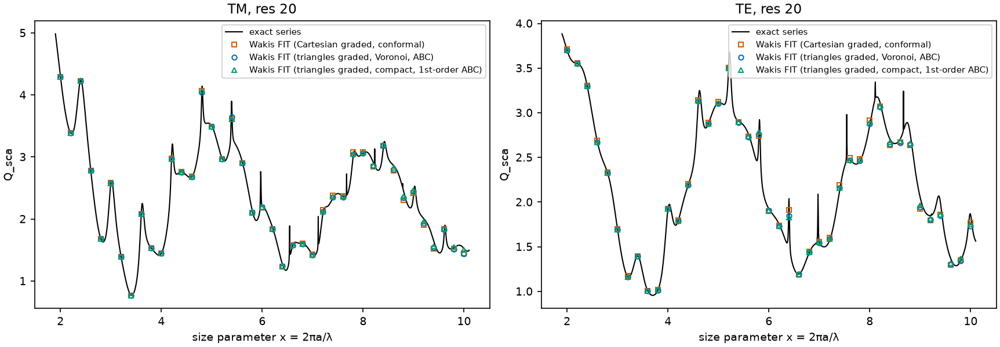

# Mie cylinder on graded meshes: triangles vs Cartesian at equal accuracy

**Question.** In the uniform-mesh study (`../mie-cylinder-mesh`), triangles and conformal Cartesian cells were equally accurate at equal h, and triangles cost 1.45× more work. That study used one h everywhere, which wastes the main strength of triangles: local size control. Do graded triangles reach the same accuracy with fewer unknowns, and so finish faster?

**Problem.** A dielectric cylinder with n = 2 and a = 1 µm, size parameter x = 2–10 (41 points), TM and TE. The extraction (`wakis.cylinder_harmonics`, with S-matrix de-embedding), the error metric (RMS relative error of Q_sca over the band) and the 1000 fs run window are all identical to the uniform study.

## Arms

h_in = λ_min,diel/res with res = 10, 14, 20, 28, 40. Graded meshes keep h_in inside the cylinder and in a band 2 h_in wide around it. Beyond that band the size grows geometrically (×1.2 per cell) to h_out = n·h_in, which gives equal cells per *local* wavelength.

| arm | mesh | domain / extraction circles / boundary |
|---|---|---|
| cart-uniform | uniform rectilinear grid, conformal 'all' (from the first study) | TF/SF half width 1.25 µm; circles 1.9/2.2/2.5 µm; CPML from 2.7 µm |
| cart-graded | rectilinear grid graded along x and y, conformal 'all'; the fine strips must cross the whole domain | same |
| cart-graded-compact | same grading | TF/SF half width 1.15 µm; circles 1.72/1.86/2.0 µm; CPML from 2.12 µm (the TF box limits how close the circles can be) |
| tri-uniform | `disk_mesh`, Voronoi Hodge (from the first study) | circles 1.9/2.2/2.5 µm; 1st-order ABC at 2.7 µm |
| tri-graded | `graded_disk_mesh` (new): hexagonal core plus staggered rings with a radial size field, Voronoi Hodge | same |
| tri-graded-compact | same | circles 1.25/1.4/1.55 µm; ABC at 1.7 µm (no TF box is needed) |

**Compute.** Every graded run and a set of uniform timing runs (res 20 and 28) ran on Cloud Batch, one run per n2-standard-2 machine (Xeon 2.8 GHz), so the timings are free of memory-bandwidth contention. The code was shipped as a tarball through the project bucket because `sweep.sh` needs a pushed commit. The accuracy numbers for the uniform arms come from the first study; their run times there were contended, so their times below are computed as work × the uncontended ns per unknown-step measured here.

## Results


**(a)** One quadrant of each mesh at res 10: 26,992 uniform vs 10,333 graded triangle nodes, and 36,864 uniform vs 20,736 graded Cartesian cells. The Cartesian grading cannot coarsen the strips that cross the cylinder.


**(b)** RMS error vs field unknowns and vs work (unknowns × steps). Markers are "Wakis FIT (mesh)" runs; the dotted guides show second order.


**(c)** Unknowns needed to reach 2 % (light) and 1 % (dark) RMS error, from log-log interpolation.


**(d)** Q_sca vs x at res 20 for the graded arms, against the exact series.

### Elements needed for a target accuracy

Values are log-log interpolations between runs. "Cells" means triangles or Cartesian cells. Unknowns are nodes + edges for triangles and 3 per cell for Cartesian. Times are for one uncontended core.

| pol | arm | unknowns 2 % | unknowns 1 % | cells 1 % | work 1 % | time 1 % [s] |
|---|---|---|---|---|---|---|
| TM | cart-uniform | 485k | 982k | 327k | 4.49e10 | 1327 |
| TM | cart-graded | 266k | 518k | 173k | 2.44e10 | 674 |
| TM | cart-graded-compact | 189k | 362k | 121k | 1.67e10 | 531 |
| TM | tri-uniform | 554k | 1222k | 610k | 7.48e10 | 1296 |
| TM | **tri-graded** | 185k | **399k** | 199k | **1.80e10** | **318** |
| TM | **tri-graded-compact** | 99k | **226k** | 113k | **1.01e10** | **234** |
| TE | cart-uniform | 420k | 864k | 288k | 3.70e10 | 1057 |
| TE | cart-graded | 255k | 536k | 179k | 2.58e10 | 728 |
| TE | cart-graded-compact | 169k | 347k | 116k | 1.56e10 | 433 |
| TE | tri-uniform | 526k | 1043k | 521k | 5.90e10 | 1191 |
| TE | **tri-graded** | 206k | **410k** | 205k | **1.89e10** | **661** |
| TE | tri-graded-compact | 126k | not reached (1.10 % at res 40) | — | — | — |

The full per-run table (dt, steps, maximum error, reflections) and the timing runs are in [`data/summary.md`](data/summary.md).

### Speed-up of graded triangles at equal accuracy (1 % RMS)

| | vs cart-uniform | vs cart-graded (fair rectilinear competitor) |
|---|---|---|
| TM, unknowns | 2.5× fewer | 1.30× fewer |
| TM, work | 2.5× | 1.36× |
| TM, uncontended time | 4.2× | 2.1× |
| TE, unknowns | 2.1× fewer | 1.31× fewer |
| TE, work | 2.0× | 1.37× |
| TE, uncontended time | 1.6× | 1.10× |

**Compact domains** (TM): tri-graded-compact needs 1.6× fewer unknowns and 1.65× less work than cart-graded-compact, and runs 2.3× faster. In TE the compact triangle domain stalls at 1.1 %. At 2 % it needs 1.3× fewer unknowns than cart-graded-compact and 1.2× less work, but takes 1.6× more time.

### Interpretation

- **Grading is the bigger lever, and triangles exploit it better.**
  - Grading cuts unknowns at 1 % by 2.5–3× for triangles, against 1.6–1.9× for Cartesian. The rectilinear grid has to keep h_in along every row and column that crosses the cylinder: at res 20, 78 % of its cells are fine along at least one axis.
  - Against the fair rectilinear competitor, graded triangles still need about 1.3× fewer unknowns and about 1.36× less work.
- **Unknowns, not elements.** At equal accuracy the graded triangle mesh has *more* cells than the graded Cartesian grid (199k vs 173k at 1 % TM). Each triangle carries about 2 unknowns (0.5 node + 1.5 edges) against 3 per Cartesian cell. "Fewer elements" is therefore true against the uniform grids, not against the graded one.
- **Time step.** The ring-based graded mesh has no slivers at the interface, so its dt equals the Cartesian dt (17.6 vs 17.5 as at res 40). The uniform `disk_mesh` needed a 21 % smaller dt. With global leapfrog the step count is set by h_in in both families, so grading reduces unknowns but not steps.
- **Local time stepping (not implemented).**
  - For triangles, about half of the graded nodes sit in the h_out region and could take 2 dt, saving roughly 20–25 % of the work.
  - For the rectilinear grid only 22 % of the cells are coarse in both directions (the CFL needs both), so it would save only about 10 %.
  - LTS therefore widens the gap further in favour of triangles.
- **Wall time vs work.**
  - Uncontended, a triangle update costs 16–21 ns per unknown-step, against 27–32 ns for the 3D Cartesian code running on a one-cell slab.
  - In TE, however, the scattered-field source evaluates the analytic pulse on every dual-edge segment inside the cylinder at every step. That overhead is a larger fraction on graded meshes: 33 ns per unknown-step for tri-graded TE vs 20 ns for tri-uniform TE, which is why the TE time advantage is only 1.1×.
  - Tabulating s(t − τ) once per step on a 1D delay grid would remove most of this overhead.
  - The work column is the implementation-independent comparison.

### Outer boundary and absorber

- **ABC reflection.** The 1st-order ABC reflects 6 % at R = 2.7 µm and 17 % at R = 1.7 µm (maximum over the band, at x = 2), measured as |incoming|/|outgoing| on the extraction circles.
  - With de-embedding, the R = 2.7 µm domain converges cleanly.
  - At R = 1.7 µm TM still converges (0.64 % at res 40), but TE stalls at 1.1 %. Multiple re-reflections (of order Γ²) and the evanescent near field close to the circles are the likely causes; this is not yet diagnosed.
- **New matched absorbing layer** (`UnstructuredFIT2D(absorber=dict(r0, r1, s_max, order))`). It applies equal electric and magnetic loss rates, σ_e/ε = σ_m/μ, with quadratic grading. In front of an ABC at 1.75 µm, a layer 0.8 µm thick:
  - lowers the reflection from 1.4–2.3 % to 0.01–0.3 % at x = 6–10;
  - lowers it only from 7.0 % to 4.6 % at x = 2 (λ = 3.1 µm, about 4× the layer thickness);
  - doubles the node count (7.2k → 15k at h = 40 nm).
- Because of that cost and the poor low-frequency performance, the absorber is **not** used in the arms above: de-embedding the ABC is cheaper. Its isotropic matched loss is not reflectionless for cylindrical waves at low kr. A radial complex-coordinate-stretched PML would be the right next step.

## Limits & caveats

- **Domains differ** between the triangle and Cartesian arms: a disk with an ABC vs a square with CPML. The "compact" arms each use their own minimal geometry; the Cartesian one is limited by the TF/SF box.
- **Single case:** one contrast (n = 2), one band (x = 2–10), one smooth convex scatterer. Thin features, corners or several scatterers would change the grading economics; Cartesian loses more there.
- **Mesh construction:** the graded triangle mesh differs from the uniform `disk_mesh` (rings vs lattice outside the cylinder). Part of its gain is the larger dt from avoiding slivers.
- **Interpolated targets:** the target values are log-log interpolations between neighbouring resolutions. The error curves are not perfectly smooth (TM plateaus at res 14–20), so treat the ratios as ±15 %.
- **Shared machines:** Batch timings come from single runs on n2-standard-2. The neighbours on the physical host are unknown. The repeated res-20/28 timing runs agree within ±10 %.

## Reproduce

```bash
python graded_study.py list                      # 48 tasks
python graded_study.py run --shard I --nshards 48 --outdir out   # one task per shard (Cloud Batch)
python graded_study.py plot                      # figures + data/summary.md
```

Tests: `tests/test_045_graded_mesh_absorber.py`.
- The graded mesh has positive Voronoi masses, more than 2× fewer nodes, and Mie Q_sca within 1 % (mutation: an ungraded 4× size jump is more than 3× worse).
- The absorber reflects at least 3× less than the bare ABC (mutation: an electric-only layer reflects more than 2× as much).
