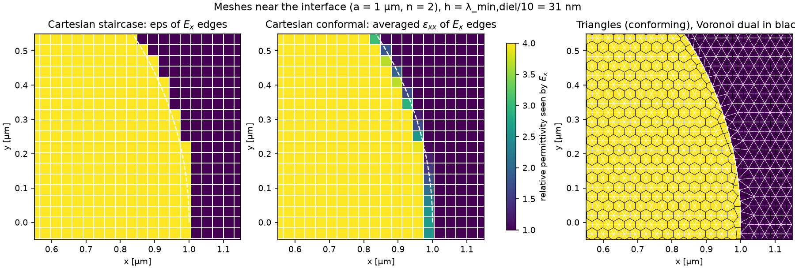
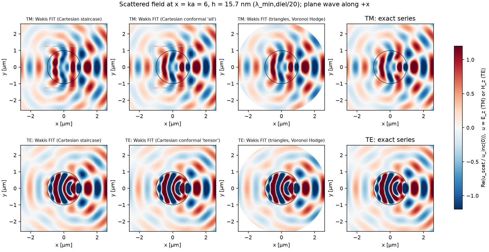
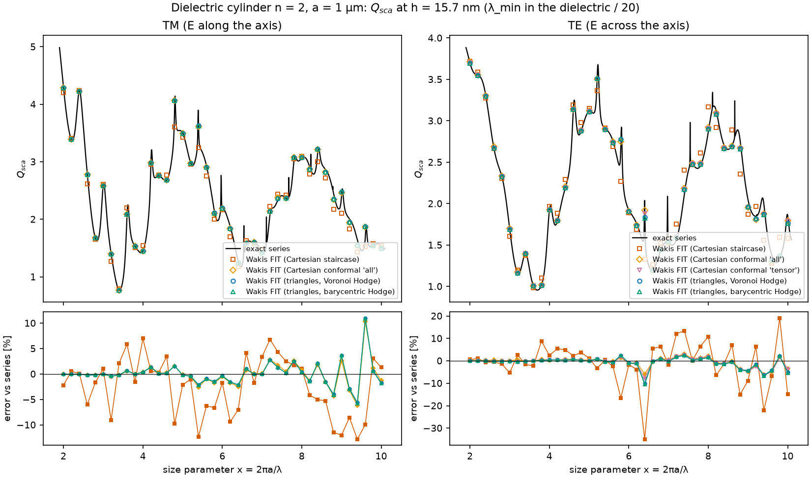
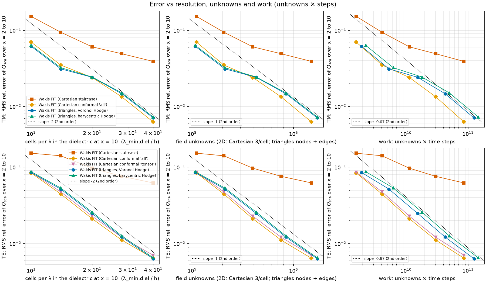

# Mie cylinder: triangular FIT vs the Cartesian FIT grid

> **Interim results.** One run is still pending (tri-barycentric TE at res 40), along with the res-20 flux-box cross-checks. Open markers in figure (d) show the pending runs. The numbers below will be updated when those runs finish.

**Problem.** A plane wave hits an infinite dielectric cylinder at normal incidence: n = 2, a = 1 µm, x = ka from 2 to 10 (41 points), TM (E_z) and TE (H_z). We compare Q_sca from Wakis FIT on five mesh arms with the exact series (`wakis.analytic.cylinder_efficiencies`, Bohren & Huffman ch. 8).

| arm | solver | interface treatment | excitation / boundary |
|---|---|---|---|
| staircase | `SolverFIT3D`, 1-cell periodic-z slab (dz = 10 h) | staircase cell masks | `TFSFSource` box (half width 1.25 µm), 10-cell CPML from r = 2.7 µm |
| conformal | same | `conformal='all'` (diagonal subpixel eps) | same |
| tensor | same (TE only; for TM it is identical to 'all') | `conformal='tensor'` | same |
| tri-voronoi | `UnstructuredFIT2D` (truly 2D) | conforming Delaunay mesh (`disk_mesh`, area-preserving ring) | scattered-field plane wave (`add_plane_wave`), 1st-order ABC on r = 2.7 µm |
| tri-barycentric | same, barycentric node masses | same | same |

All arms share the target edge length h = λ_min,diel / res (λ_min,diel = 0.314 µm at x = 10, res = 10, 14, 20, 28, 40), CFL 0.95 of each scheme's own limit, the same Gaussian pulse, at most 1000 fs per run (stopped early once the energy falls below 1e-7 of its peak) and the same post-processing.

**Extraction (identical for all arms; `wakis.cylinder_harmonics`).** The scattered E_z or H_z is DFT'd on three circles (r = 1.9, 2.2, 2.5 µm; 256 points each). It is interpolated linearly on the triangles and bilinearly on the Cartesian samples. The samples are projected on e^{inθ} and fitted at each order as outgoing H⁽¹⁾ plus incoming H⁽²⁾ waves. Then c_n = (1 − O_n/I_n)/2 follows from the cylinder's S-matrix (O = outgoing, I = incoming including boundary reflections), which de-embeds the reflections of the outer boundary. Finally Q_sca = (2/x) Σ|c_n|².

## Figures

| | |
|---|---|
|  | **(a)** The meshes near the interface at res 10: the staircase permittivity of the E_x edges, the conformal averaged ε_xx, and the conforming triangles with their Voronoi dual. |
|  | **(b)** Re(u_scat/u_inc(0)) at x = 6, res 20, for each mesh and for the exact series. Inside the Cartesian TF box, the analytic incident wave is subtracted. |
|  | **(c)** Q_sca vs x at res 20. The exact series is drawn as lines and the Wakis FIT runs as markers; the lower panels show the error vs the series. |
|  | **(d)** RMS relative error of Q_sca over x = 2 to 10 vs cells per λ, vs unknowns and vs work (unknowns × steps). The dotted lines are second-order guides. |

## Numbers (interim)

The full table is in [`data/summary.md`](data/summary.md). Unknowns are 3 per cell for the Cartesian arms (E_z, H_x, H_y per z layer) and nodes + edges for the triangles. Both counts include the whole domain: the Cartesian square includes the CPML, while the triangle domain is a disk of radius 2.7 µm.

RMS error of Q_sca over x = 2 to 10, with unknowns and steps in brackets:

| res | staircase TM | conformal TM | tri-Voronoi TM | staircase TE | conformal TE | tensor TE | tri-Voronoi TE |
|---|---|---|---|---|---|---|---|
| 10 | 15.2 % | 7.0 % | 6.2 % | 15.2 % | 8.4 % | 8.6 % | 8.5 % |
| 20 | 6.1 % | 2.4 % | 2.4 % | 9.7 % | 2.1 % | 2.3 % | 2.5 % |
| 28 | 4.9 % | 1.33 % | 1.47 % | 7.6 % | 1.11 % | 1.21 % | 1.22 % |
| 40 | 3.9 % (1.50 M, 57k) | 0.62 % (1.50 M, 57k) | 0.71 % (1.72 M, 73k) | 6.2 % | 0.64 % | 0.70 % | 0.63 % |

The barycentric Hodge stays within 5 % of the Voronoi error everywhere: the mesh is nearly equilateral, so the two duals almost coincide.

**Equal cost.**

- At equal h, conformal Cartesian and triangles are equally accurate: both are second order.
- At equal error, triangles cost more:
  - about 14 % more unknowns at the same h, because the hexagonal lattice has 3 edges per node;
  - a time step 21 % smaller (Voronoi) or 33 % smaller (barycentric).
  - Net work (unknowns × steps) is about 1.45× that of conformal Cartesian (124.5e9 vs 85.9e9 at res 40, for the same error).
- The staircase is far behind. Its TE error falls only from 15 % to 6 % between res 10 and 40, below second order. Its relative mirror-symmetry error |c_n − c_−n| reaches 2–7 %.
- Wall time is **not** an equal-cost measure here. The Cartesian arm is the 3D `SolverFIT3D` on a one-cell periodic-z slab, which updates all six components. The triangles are a truly 2D code with three fields. In addition, 32 runs shared the VM. Wall times are listed in `data/summary.md` for information only.

**Where the error comes from.** For x ≤ 5 the conformal and triangle errors are 0.1–0.6 %, while the staircase error is 2–8 %. Over the full band, every second-order arm is limited by resonance shifts at x > 6, i.e. bulk numerical dispersion, and not by the interface. Within this band, then, the "geometry" advantage of conforming triangles is already captured by subpixel averaging.

**Boundary reflections.**

- Triangles, 1st-order Silver–Müller ABC on r = 2.7 µm: the fitted |γ|/|α| is 5–6 % at x = 2, about 3 % at x = 6 and 2.3–3.3 % at x = 10.
- Without de-embedding, the triangle error saturates near 2.5–2.9 % (column "RMS err no de-embed"). With de-embedding it keeps converging.
- Cartesian CPML (10 cells): 0.1–2.6 % at x = 2 and ≤ 0.04 % at x = 6.

**Cross-check.** At res 10, the Cartesian flux-box Q_sca (separate runs with 4 z cells) agrees with the harmonic Q_sca of the same runs to 1.2–1.4 % RMS. Part of this gap comes from the extraction itself: the H_n(kr) basis uses the continuum k, not the grid's k. The res-20 cross-check is pending.

## Limits & caveats

- Triangle incidence is an analytic plane wave inside the scatterer (scattered-field formulation). The Cartesian incidence is the discrete, dispersion-matched TF/SF wave. These are different second-order error sources.
- The domains differ (disk + ABC vs square + CPML). De-embedding removes the first-order effect of boundary reflections on c_n, but not multiple re-reflections at the level of the reflection squared.
- DFT window: at most 1000 fs. The residual energy is 3e-4 to 9e-4 of the peak, and Q changes by about 0.3 % between 400 and 1000 fs at res 8. This sets a floor near the sharp resonances.
- x = 2 to 10 only, and a single index contrast (n = 2). Higher contrast, sharper corners, or interfaces near grazing incidence could change the ranking.

## Reproduce

```bash
# on a many-core VM (OMP_NUM_THREADS=1, one process per run); ~2.5 h on 32 vCPU
python mie_mesh_study.py run --procs 32 --t-run 1000
python mie_mesh_study.py plot        # figures/*.png + data/summary.md
# local smoke test only under memguard:
~/computational-electromagnetics/bin/memguard -m 2000 -- python mie_mesh_study.py run --res 6 --procs 4 --flux-res --t-run 150
```

Unit tests of the plane-wave source: `tests/test_044_unstructured_planewave.py`. They compare against the series at x = 0.1, 0.3 and 1.5 and against the Rayleigh limit, and include three mutations that must fail.
