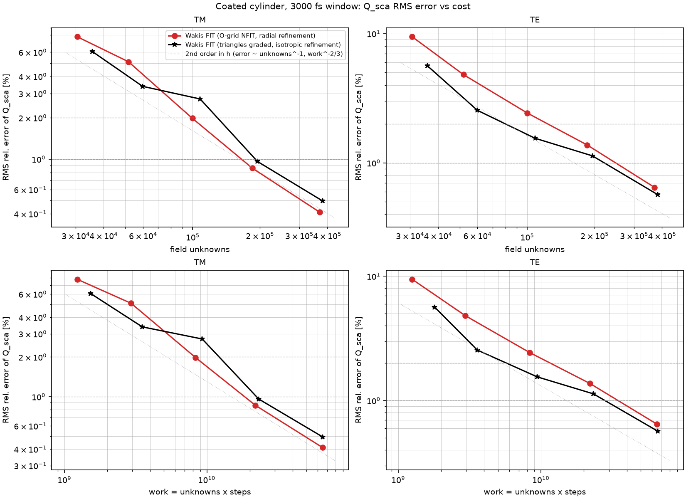
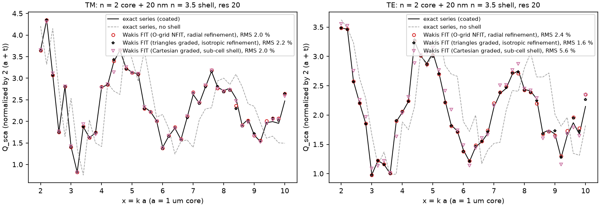
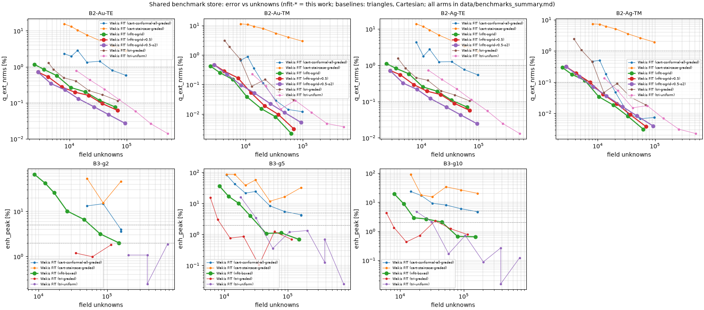

# Curvilinear (O-grid) time-domain FIT: Mie cylinder, coated cylinder, plasmonic benchmarks

**Question.** Does a body-fitted structured mesh (O-grid around the cylinder, nonorthogonal FIT where the cells are skewed) reach a target accuracy with fewer unknowns, less work and less time than the best existing Wakis meshes: graded Cartesian conformal and graded triangles? And how general is it?

**Method** (`wakis.curvilinear`, physics guide section "Curvilinear FIT").
- 2D leapfrog FIT, TM and TE. The topological incidence $\mathbf G$ is unchanged; all metric information sits in the edge Hodge $\mathbf W = \mathbf R^T\mathrm{diag}(w/p)\mathbf R$, assembled in the flux→voltage direction from per-cell field components. It is symmetric positive semi-definite by construction, so the leapfrog conserves a discrete energy, and it is never inverted. The node mass is diagonal.
- General quadrilaterals (the "butterfly" core, circle-to-square transition blocks) use a corner reconstruction (banded NFIT matrix, Schuhmann & Weiland 2000). Polar annular sectors use exact arcs (diagonal: FIT in cylindrical coordinates). Rectangles reduce to standard FIT.
- Radial complex-coordinate PML with the curvature factor $s_\varphi=\tilde r/r$ (Teixeira & Chew 1997); Cartesian PML on the multi-block outer block.
- Scattered-field plane wave (total-field ADE for dispersive scatterers), Drude/Lorentz/Debye media in TM and TE.
- Multi-block meshes: O-grid + transition + Cartesian block (`ogrid_cartesian_mesh`), and adjacent boxed O-grids for cylinder rows such as dimers (`boxed_cylinders_mesh`).

**Compute.** Every run was one Cloud Batch task on its own n2-standard-2 spot machine (uncontended single-core timings). The code was shipped as a tarball. Jobs: `nfit-all-20261018-2352` (B1 at 1000 fs, shell, B2, B3 v1), `nfit-t3000-*` (B1 and shell at 3000 fs, with the baselines rerun in the same job), `nfit-mbr-*`, `nfit-b2o2-*`, `nfit-b3v2-*`. Accuracy runs from the first job `nfit-mie-20261018-2338` (before the 3–4× TE speed-up of the tabulated source) were replaced by the reruns. The Cartesian and triangle shell arms of that job are kept: their code did not change.

## B1: dielectric cylinder n = 2, a = 1 µm, x = 2–10 (shared Mie case)


**(a)** Meshes at res 10. Single-block O-grid: a butterfly core inside r = 0.9a (orange, nonorthogonal corner Hodge), polar rings with h_in in and near the cylinder that grow ×1.2 per cell to h_out = 2 h_in, extraction rings at 1.15/1.3/1.45 µm (green), and 10 PML rings from 1.55 µm (red). Multi-block: the same up to 1.55 µm, then a transition block and a Cartesian frame with a Cartesian PML. Coated cylinder: only the radial spacing is refined in the 20 nm shell.


**(b)** RMS error of Q_sca against unknowns and work, with a 3000 fs DFT window (B1 floor removed; see the window note below). The baselines were rerun in the same Batch job with the same window. Markers are "Wakis FIT (mesh)" runs; dotted lines are second-order guides.

### Cost to reach 2 % and 1 % RMS error (3000 fs window; log-log interpolation)

| pol | arm | unknowns 2 % | unknowns 1 % | work 1 % | 1-core time 1 % [s] |
|---|---|---|---|---|---|
| TM | **O-grid NFIT** | **85.5k** | **158k** | **1.72e10** | **319** |
| TM | triangles graded + radial PML | 114k | 244k | 3.28e10 | 561 |
| TM | Cartesian graded conformal (compact) | 191k | 366k | 5.09e10 | 1406 |
| TE | **O-grid NFIT** | **95.6k** | **176k** | **2.04e10** | **297** |
| TE | triangles graded + radial PML | 121k | 215k | 2.72e10 | 470 |
| TE | Cartesian graded conformal (compact) | 166k | 307k | 3.88e10 | 1138 |

At 1 % against graded triangles with a radial PML (the best baseline), the O-grid needs:
- TM: 1.55× fewer unknowns, 1.9× less work and 1.8× less time;
- TE: 1.22× fewer unknowns, 1.33× less work and 1.6× less time.

Against graded Cartesian conformal (compact) the O-grid needs 2.3× fewer unknowns, 3.0× less work and 4.4× less time (TM), and 1.7×, 1.9× and 3.8× (TE).

The 1000 fs runs (`data/summary.md`, `figures/b_error_vs_cost.png`) give the same ratios: TM 157k vs 240k unknowns, TE 203k vs 245k. Their timings come from the same Batch configuration, but from separate jobs.

**Where the gain comes from.**
- Unknowns per cell are equal to Cartesian (3 per quad). Triangles carry about 2 per cell but need about 1.5× more cells at equal edge length.
- Radial grading is natural on an O-grid, and the interface sits exactly on a ring (no staircase, no sub-cell averaging).
- The time step equals the Cartesian one: $c\Delta t/h_\text{in} = 0.65$–$0.71$ against 0.67, because the dielectric core is slower than the vacuum cells that set the limit.
- The error constant is similar to that of the other second-order meshes at equal h. The win is in unknowns per area, not in accuracy per cell.

**Variants (1000 fs).**
- Corner Hodge on every cell, with straight chords instead of exact arcs (`ogrid-corner`): 153k/193k unknowns at 1 % (TM/TE), the same as the exact polar Hodge. The nonorthogonal Hodge loses nothing here.
- Baseline-sized domain (`ogrid-std`, rings out to 2.7 µm): 232k/316k unknowns. Azimuthal cells grow as r, so large O-grids are wasteful; use a compact domain or a Cartesian outer block.
- Multi-block (`multiblock`): 161k/215k unknowns. Its 2-layer circle-to-square transition reflects up to 50 % at x > 6 (coarse 45° corner cells), which the S-matrix de-embedding removes.
- The resolved transition (`multiblock-resolved`, a larger square and layers about one Cartesian cell thick on the diagonal) cuts that reflection, but its thin mid-side layers halve Δt. It needs 244k/311k unknowns at 1 % (TM/TE) and 2.1–2.3× the work of the 2-layer version. Joining an O-grid to a Cartesian grid therefore costs accuracy-neutral but work-relevant transition cells; an elliptic-smoothed transition would be the next step.

**Window note.** The 1000 fs window of the shared harness puts a floor of about 0.14 % (TM) and 0.87 % (TE) on Q_sca, from a high-Q TE resonance near x ≈ 6.4 (measured by the high-order agent). The 1 % TE targets at 1000 fs are therefore window-limited. The headline table uses 3000 fs for every arm. Errors at res 40 move from 0.63 % to 0.44 % (O-grid TE) and from 0.71 % to 0.54 % (triangles TE).

## Showcase: coated cylinder (n = 2 core, 20 nm n = 3.5 shell)


**(c)** Coated cylinder against the exact two-layer series (`wakis.analytic.coated_cylinder`, new; it reduces to the homogeneous series to 1e-15). The shell changes Q_sca by 31–35 % RMS.


**(d)** Q_sca(x) at res 20.

Both body-fitted arms use the same size field: 10 nm cells in the shell, graded in optical size away from it. The triangles refine isotropically; the O-grid refines only radially.

| pol | arm | unknowns 2 % | unknowns 1 % | work 1 % | time 1 % [s] |
|---|---|---|---|---|---|
| TM | O-grid | 99k | 165k | 1.84e10 | 319 |
| TM | triangles | 129k | 191k | 2.23e10 | 267 |
| TE | O-grid | 124k | 248k | 3.48e10 | 679 |
| TE | triangles | **80k** | **221k** | 2.81e10 | 643 |
| TM/TE | Cartesian graded conformal (sub-cell shell) | 149k / not reached | not reached (1.1 % / 3.4 % at res 40) | | |

**Result: not the expected clear win.**
- Against Cartesian sub-cell averaging the body-fitted meshes win clearly: Cartesian stalls at 1.1 % TM and 3.4 % TE.
- Against triangles the O-grid is ahead in TM (1.15× fewer unknowns) and behind in TE (1.1–1.5× more).
- The anisotropic O-grid cells save only the azimuthal refinement of a thin ring (about 2πa/10 nm × 2 rings ≈ 1300 nodes). That is small next to the 10⁵ unknowns of the whole cross section.
- The thin layer is not the cost driver at these sizes. It would become one for many or long thin layers (multilayer coatings, 3D shells, beam-pipe coatings), where the azimuthal count scales with the layer area.
- A larger win was found instead on the plasmonic B2 case below, where the radial resolution of the surface plasmon dominates.

## B2: plasmonic nanocylinders (shared benchmark store)


**(e)** Q_ext NRMS (B2) and gap-enhancement error (B3) against unknowns, from the shared store (`wakis.benchmarks.results`). nfit-* is this work.

Arms: `nfit-ogrid` (radial spacing h at the surface, outer cells up to 4h), `nfit-ogrid-r0.5` (h/2 radially), and `nfit-ogrid-r0.5-o2` (h/2 radially, outer cells up to 2h; chosen after seeing the first two, i.e. tuned on B2).

B2-Au-TE (LSPR at 553 nm in an n = 2 host), Q_ext NRMS:

| target | O-grid r0.5-o2 | O-grid (default) | tri-uniform | tri-graded | Cartesian conformal graded |
|---|---|---|---|---|---|
| 1 %, unknowns | < 2.8k (all runs below 1 %) | 2.9k | — (0.78 % at 13k) | 4.8k | 46k |
| 0.1 %, unknowns / work / time | **19.6k / 1.05e9 / 31 s** | 42k / 4.6e9 / 261 s | 88k / 2.6e9 / 72 s | not reached (0.11 %) | not reached (0.55 %) |

- B2-Ag-TE at 0.1 %: O-grid r0.5-o2 17.9k / 9.1e8 / 35 s against tri-uniform 83k / 2.3e9 / 44 s.
- TM (E tangential, easy): O-grid 6.3–8k unknowns at 0.1 % against 15–21k for triangles, at about equal work.
- At equal accuracy the O-grid needs 4.5× fewer unknowns, 2.5× less work and 1.3–2.3× less time than uniform triangles (TE, 0.1 %). The time gain is smaller than the unknowns gain because the metal core (ε∞ = 1) makes the butterfly core cells limit Δt: $c\Delta t/h \approx 0.38$ against about 0.6 for triangles.
- Caveat: the r0.5-o2 settings were chosen after a first look at B2; the default arm (not tuned) needs 42k unknowns at 0.1 %, still 2× fewer than tri-uniform but with 1.8× more work.

## B3: Au dimers (2/5/10 nm gaps)

`nfit-boxed`: an O-grid in a box around each cylinder; the two boxes share the side through the gap; a graded Cartesian block and a Cartesian PML surround them. Metric: the peak of the mean |E/E0|² over the 9-point gap stencil (benchmark commit 6771d3c, rerun in job `nfit-b3v2`).

| gap | target | nfit-boxed (unknowns / time) | tri-graded | tri-uniform | Cartesian conformal graded |
|---|---|---|---|---|---|
| 10 nm | 5 % | 13.7k / 19 s | below 5 % on every run (≥ 6k) | below 5 % on every run | 141k / 659 s |
| 10 nm | 2 % | 46k / 127 s | 7.3k / 12 s | 32k / 28 s | not reached |
| 5 nm | 5 % | 23k / 54 s | 7.2k / 12 s | 28k / 17 s | 111k / 481 s |
| 5 nm | 2 % | 35k / 90 s | 9.0k / 16 s | 36k / 22 s | not reached |
| 2 nm | 5 % | 56k / 252 s | below 5 % on every run (≥ 35k) | below 5 % on every run (≥ 204k) | 143k / 643 s |
| 2 nm | 2 % | 148k / 1820 s | below 2 % on every run (≥ 35k) | below 2 % on every run (≥ 204k) | not reached |

- The O-grid beats the Cartesian grid by 2.5–10× in unknowns.
- It is comparable to uniform triangles.
- The triangle errors are not monotone in h (e.g. tri-graded g10: 0.43 % at 12k and 2.3 % at 35k), so the triangle crossings are uncertain to about 2×.
- It is **3–8× worse than graded triangles** (and the quad/tri hybrid).

**Why the O-grid loses on B3.** The gap needs fine *azimuthal* resolution only near θ = 0 of each cylinder. A structured O-grid refines the whole ring (and the Cartesian lines through it), and its transition block must squeeze m layers into g/2 at the gap, which cuts Δt. Graded triangles put small elements only in the gap. This is the structural limit of block-structured meshes: local refinement is global along grid lines.

## Generality (honest scope)

- **Natural:** round and smoothly star-shaped bodies, concentric layers and coatings, coaxial and beam-pipe cross sections, any problem with a radial structure (also the PML).
- **Possible with hand-made blocks:** rows of equal cylinders (implemented), O-grids embedded in a Cartesian region (implemented), ellipses and rounded rectangles (elliptic O-grids, not implemented).
- **Poor fit:** sharp corners, re-entrant shapes, local features such as gaps, and arbitrary CAD. These need an unstructured mesh or an automatic multi-block mesher (none here).
- A vacuum (or ε∞ = 1 metal) core limits Δt to about 0.4 h/c. The angular count is fixed by the smallest radius, so large O-grids over-resolve azimuthally far out.

## Reproduce

```bash
python nfit_study.py run --only ogrid:TE:20 --t-run 3000        # one B1 task (Batch)
python shell_study.py run --only ogrid:TE:20 --t-run 3000       # showcase
python bench_ogrid.py run --phase B2 --only "B2-Au-TE:ogrid-r0.5-o2:2e-09"
python plot_nfit.py                                             # figures + data/summary.md
python bench_compare.py compare --root <local copy of the store> # B2/B3 tables + figure
```

The triangle baselines (`tri`, `tri-graded-pml`, `cart-graded-compact`) ran from the `feature/tri-fixes` tree (commit 75f603d) in the same Batch jobs. Tests: `tests/test_046_curvilinear_nfit.py` (energy and asymmetric-Hodge mutation, rod-in-cavity order, multi-block square cavity, radial PML and curvature mutation, dispersive TE plane wave and source-off mutation, coated series).

Data: `data/*.json` (1000 fs), `data/t3000/` (3000 fs), `data/B2*`, `data/B3/` (benchmark records, also in the store), `data/baselines/` (copied 1000 fs baseline records), `data/summary.md`, `data/benchmarks_summary.md`.
