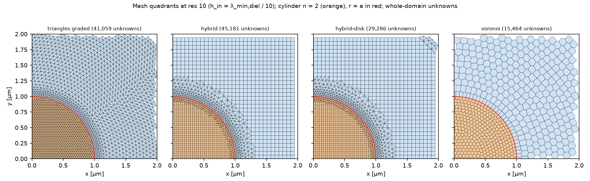
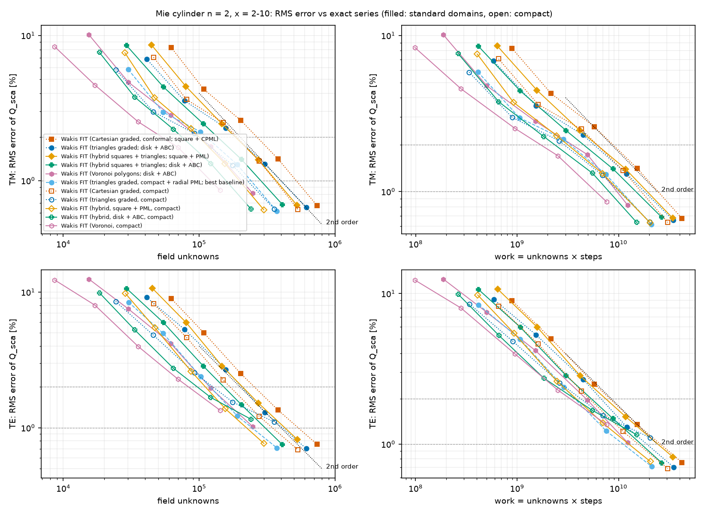
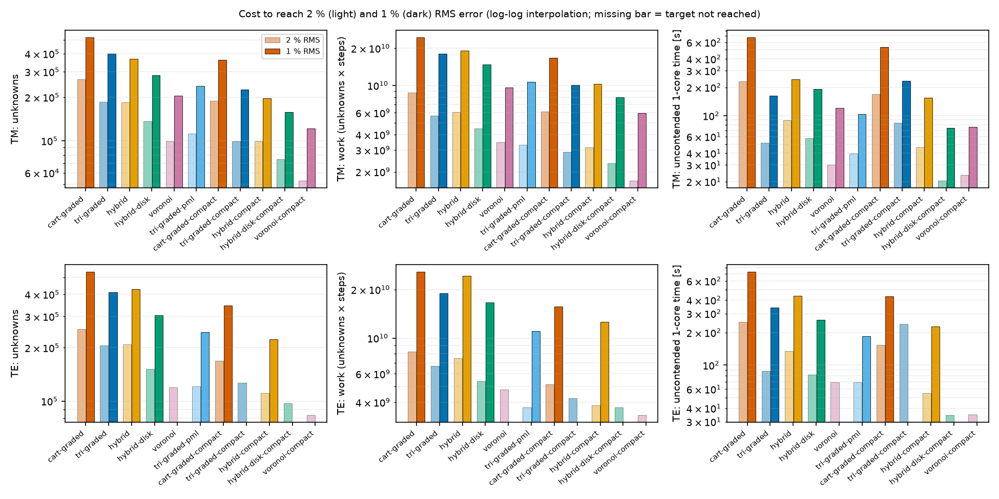
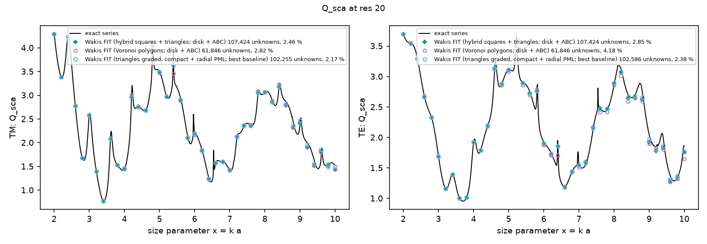

# Polygonal FIT for the Mie cylinder: hybrid square/triangle and Voronoi meshes

**Question.** Graded triangles beat graded Cartesian grids at equal accuracy (`../mie-cylinder-graded`). Can two polygonal meshes do better still on the same problem?
- **(a) Hybrid mesh.** Axis-aligned squares fill the bulk and the inside of the scatterer, and a conforming triangle patch fills only the band around the interface.
- **(b) Voronoi-primal mesh.** Mostly hexagonal cells, with the Delaunay triangulation as the dual grid.

The headline question: **does the hybrid reach 1 % error with less work than both graded Cartesian and graded triangles?**

**Problem (shared benchmark B1).** A dielectric cylinder with n = 2 and a = 1 µm, size parameter x = 2–10 (41 points), TM and TE. The extraction (`wakis.cylinder_harmonics`, S-matrix de-embedding), the 1000 fs window and the error metric (RMS relative error of Q_sca against the exact series) are identical to the baseline studies. Solver: `wakis.unstructured.PolygonFIT2D` with the diagonal (orthogonal-dual) Hodge. Method and derivation: physics guide, "Polygonal FIT".

## Arms

h_in = λ_min,diel / res with res = 10, 14, 20, 28, 40. Sizes grow geometrically (×1.2 per h) to h_out = n·h_in, as in the graded study.

| arm | mesh | domain / circles / boundary |
|---|---|---|
| hybrid | `hybrid_circles_mesh`: h_out squares in the bulk, h_in squares inside the cylinder, Delaunay triangles only in a band around r = a (shared edges, orthogonal everywhere) | square \|x\|,\|y\| < 2.7 µm, circles 1.9/2.2/2.5 µm, split-field PML of 10 h_out squares (as cart-graded with its CPML) |
| hybrid-compact | same | square 1.7 µm, circles 1.25/1.4/1.55 µm, PML 10 squares |
| hybrid-disk | same plus a thin h_out triangle annulus at the circular boundary | disk r < 2.7 µm, 1st-order ABC (as tri-graded) |
| hybrid-disk-compact | same | disk r < 1.7 µm, ABC (as tri-graded-compact) |
| voronoi | `voronoi_disk_mesh`: Voronoi cells of staggered generator rings (spacing √3 h(r), so the Voronoi edges are ~h), mirrored ring pair at r = a; 10 Lloyd sweeps, collapse 0.1 | disk 2.7 µm, ABC |
| voronoi-compact | same | disk 1.7 µm, ABC |

**Baselines** (`../mie-cylinder-graded/data`, the same Batch machine type): cart-graded (conformal, square + CPML), cart-graded-compact, tri-graded (disk + ABC), tri-graded-compact, and **tri-graded-pml**, the best existing baseline (compact disk with a radial CFS-PML, from `feature/tri-fixes`). All runs use the tabulated separable-delay plane-wave source.

**Compute.** 60 accuracy runs on Cloud Batch, one per n2-standard-2 spot machine (job `polyfit-b1v2-20261019-0649`), and three same-machine A/B timing runs (`timing_ab.py`, job `polyfit-timing-20261019-0705`). Locally: smoke tests only.

## Results


**(a)** One quadrant of each mesh at res 10, with the unknowns of the whole domain. The hybrid keeps triangles only where the interface needs them.


**(b)** RMS error vs field unknowns (nodes + edges) and vs work (unknowns × steps). Filled markers: standard domains; open markers: compact domains. Markers are "Wakis FIT (mesh)" runs.


**(c)** Unknowns, work and uncontended time to 2 % and 1 % RMS error (log-log interpolation between runs).


**(d)** Q_sca vs x at res 20 against the exact series.


**(e)** Numerical dispersion of the three periodic lattices at equal unknowns per area (Bloch analysis, `dispersion.py`).

### Cost to 1 % RMS error

Ratios are baseline / new arm: > 1 means the new arm needs less. Each block compares arms on the same domain and boundary.

| pol | comparison (same domain) | unknowns | work | ratio unknowns | ratio work |
|---|---|---|---|---|---|
| TM | tri-graded → **hybrid-disk** (disk 2.7 µm, ABC) | 399k → 284k | 1.80e10 → 1.48e10 | **1.40×** | **1.22×** |
| TM | tri-graded → **voronoi** | 399k → 205k | 1.80e10 → 9.62e9 | **1.95×** | **1.87×** |
| TM | cart-graded → **hybrid** (square 2.7 µm + PML) | 518k → 369k | 2.44e10 → 1.91e10 | **1.40×** | **1.28×** |
| TM | tri-graded-pml (best baseline, compact + radial PML) → hybrid-compact (compact square + PML) | 240k → 197k | 1.07e10 → 1.03e10 | 1.22× | 1.04× |
| TM | tri-graded-pml → hybrid-disk-compact (compact disk, ABC) | 240k → 157k | 1.07e10 → 8.04e9 | 1.53× | 1.33× |
| TM | tri-graded-pml → voronoi-compact (compact disk, ABC) | 240k → 121k | 1.07e10 → 5.96e9 | **1.98×** | **1.80×** |
| TE | tri-graded → **hybrid-disk** | 410k → 306k | 1.89e10 → 1.67e10 | **1.34×** | **1.13×** |
| TE | cart-graded → **hybrid** | 536k → 427k | 2.58e10 → 2.43e10 | 1.25× | 1.06× |
| TE | tri-graded-pml → hybrid-compact | 245k → 223k | 1.11e10 → 1.26e10 | 1.10× | **0.88×** (more work) |
| TE | voronoi | 1.02 % at res 40 (not reached); at 2 %: 120k vs 206k for tri-graded (1.72×), work 1.40× less | | | |
| TE | compact ABC arms (hybrid-disk-compact, voronoi-compact) | stall at 1.15 % / 1.35 % (ABC-limited, as tri-graded-compact) | | | |

**Per-step cost on one machine** (`data/timing_ab_machine*.json`, three n2-standard-2 machines; ns per unknown-step, res 28 meshes):

| | TM | TE |
|---|---|---|
| UnstructuredFIT2D, graded triangles | 7.4 / 12.6 / 13.0 | 12.2 / 17.4 / 17.8 |
| PolygonFIT2D, same triangle mesh | 7.5 / 10.8 / 10.7 | 10.0 / 15.1 / 14.6 |
| PolygonFIT2D, hybrid-disk | 6.2 / 9.8 / 9.5 | 8.2 / 12.8 / 12.8 |
| PolygonFIT2D, hybrid (square + split PML) | 10.2 / 14.5 / 14.3 | 12.3 / 18.4 / 17.2 |
| PolygonFIT2D, Voronoi | 6.0 / 7.2 / 7.2 | 8.0 / 10.3 / 10.5 |
| bare square update: NumPy stencil vs sparse incidence | 3.3–4.5 vs 4.9–6.3 (1.4–1.5×) | |

The hosts differ by up to 1.7× between machines, so only same-machine ratios mean anything.
- **hybrid-disk:** 0.73–0.84× the per-unknown cost of the triangle solver. Combined with its work ratio, it reaches 1 % about **1.6× faster than tri-graded on the same domain, in TM and in TE** (estimate: work ratio / same-machine cost ratio, 1.22/0.78 and 1.13/0.71).
- **Voronoi:** 0.56–0.81× the per-unknown cost, about **2.3–3.4× faster than tri-graded in TM** (1.87× less work / 0.55–0.81).
- **Split-field PML:** adds 1.4–1.6× per unknown on the square hybrid (its nodes carry two parts and two sparse products).

The time columns of `data/summary.md` are single Batch runs on different hosts. They scatter by ±40 %, so the table above uses work and same-machine costs instead.

### Answer to the headline question
- **Against graded Cartesian** (same square domain with a PML): **yes**. The hybrid needs 1.40×/1.25× fewer unknowns and 1.28×/1.06× less work at 1 % (TM/TE).
- **Against graded triangles on the same domain** (disk + ABC): **yes**. hybrid-disk needs 1.40×/1.34× fewer unknowns and 1.22×/1.13× less work, and its time per unknown is 0.79× (same machine).
- **Against the best triangle baseline**, which has a radial PML on a compact disk: **not clearly**.
  - With a PML the hybrid must use a square domain (the split PML acts on axis-aligned edges), and the corners and the square PML cost unknowns. Work is equal in TM (1.04×) and 1.14× higher in TE.
  - On the same compact disk with an ABC, the hybrid needs 1.33× less work in TM but stalls at 1.15 % in TE, because the ABC limits it.
  - A radial PML on the triangle annulus of hybrid-disk would combine both advantages; it has not been tried.
- **Voronoi primal** is the most efficient per unknown in TM: 1.95× fewer unknowns and 1.87× less work than graded triangles, and 1.8–2.0× better than the best baseline in its compact form. This matches the Bloch analysis (e), in which the honeycomb has half the dispersion error of squares or triangles at equal unknowns. In TE it is ahead at 2 % but converges more slowly and misses 1 % by 0.02 %. The likely cause is the O(collapse) non-orthogonality of the collapsed edges near the interface (see Limits).

### Why the hybrid gains, and why not more
- **Unknowns per area.** A square cell of edge h carries 3 unknowns per h² against 4.62 for equilateral triangles of the same edge, and in uniform meshes squares and triangles are about equally accurate at equal h (`../mie-cylinder-mesh`). The bulk squares therefore save up to 1.54× in unknowns. The measured 1.34–1.40× comes from the triangle band around the interface.
- **Time step.** The hybrid dt is the Cartesian one (23.3 as at res 28, set by the inner h_in squares), 8 % below graded triangles (25.3 as); this is included in the work.
- **Grading.** The squares cannot grade, which is not needed: the inner squares have h_in and the outer squares h_out, and the triangle patch carries the whole grading. The graded Cartesian grid, in contrast, must keep h_in along every row and column that crosses the cylinder.

## B2/B3 (plasmonic) results

The polygonal arms on the shared metallic cases are in `../benchmark-polygon` (B3, the Au dimer gap, is the showcase). Records are published to the shared store as `hybrid-quadtri` and `voronoi-poly`.

## Limits & caveats
- **Single smooth scatterer.** One contrast, one band. The hybrid needs circles (any number, including narrow gaps); the Voronoi generator needs concentric circles.
- **Domains differ between families.**
  - The square-PML hybrid is compared with cart-graded (same square and absorber type).
  - hybrid-disk and voronoi are compared with tri-graded (same disk and ABC).
  - The compact comparisons with tri-graded-pml mix absorbers (ABC vs radial PML), so TE compact ABC arms stall above 1 % for reasons unrelated to the mesh.
- **Voronoi edge collapse.** 6–17 % of the edges carry an orthogonality defect after collapse (up to 0.3 of L_e), used with the diagonal Hodge anyway (`ortho_tol=inf`). Without collapse the shortest Voronoi edges cut the time step by 4–6×; with collapse 0.2 the TM error doubled (5.8 % vs 2.8 % at res 20). Collapse 0.1 with 10 Lloyd sweeps was the best of the 4 settings tried (res 20 local smoke runs).
- **Interpolated targets** (log-log between runs), ±15 % as in the baseline studies. The TE Voronoi 1 % target is missed by 0.02 %.
- **First cloud run (job `polyfit-b1-20261019-0631`, direct source).** Five Voronoi runs gave NaN, caused by a 0/0 in the mean-value interpolation for circle points within round-off of a mesh edge (it depends on the floating-point details of the host). The bug is fixed (`PolyMesh._mean_value_weights`); every run of v2 is finite. The accuracy of v1 and v2 agrees to < 1e-4.

## Reproduce

```bash
python polyfit_study.py list                                   # 60 tasks
python polyfit_study.py run --shard I --nshards 60 --outdir out   # Cloud Batch, one task per machine
python timing_ab.py run --outdir out                           # same-machine A/B timing
python dispersion.py                                           # Bloch analysis (seconds)
python plot_polyfit.py                                         # figures + data/summary.md
```

Tests: `tests/test_polygon_fit.py` (13 tests with mutations).
