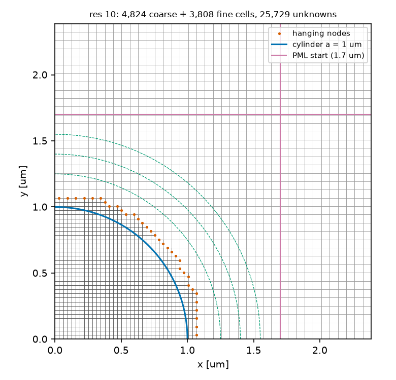
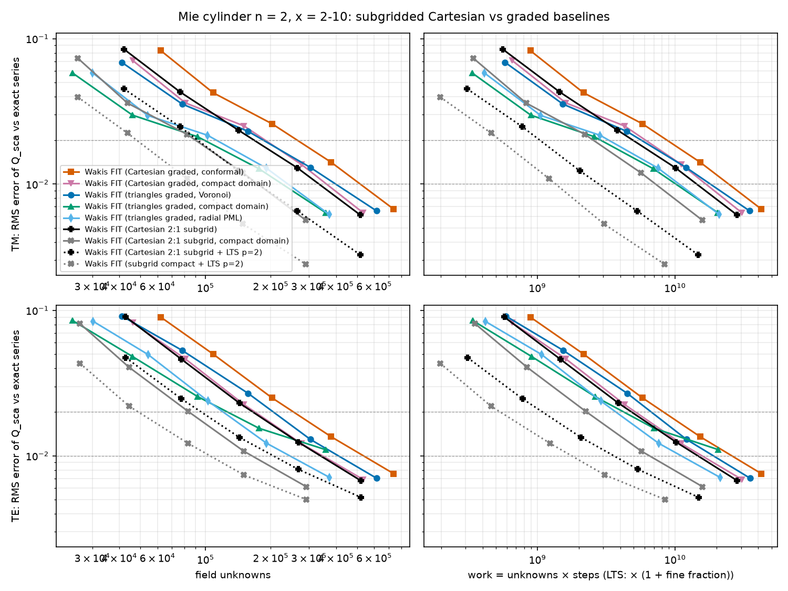
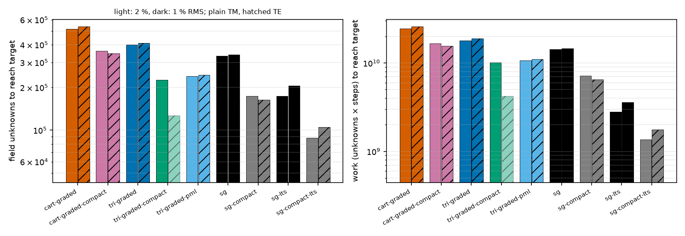
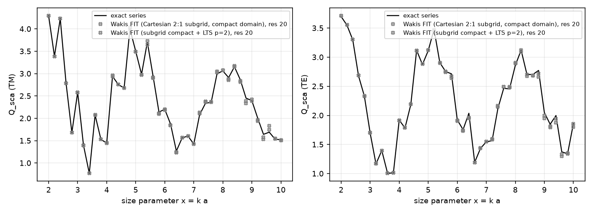
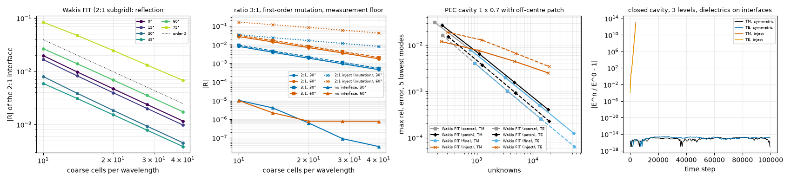

# Local Cartesian refinement (subgridding) for the Mie cylinder

**Question.** A graded rectilinear grid must keep the fine spacing along every row and column that crosses the scatterer. At res 20, 78 % of its cells are fine along at least one axis. Graded triangles avoid this, but they cost about 2 unknowns per triangle, 4.6/h² per area, against 3/h² for squares. Can a Cartesian grid with nested 2:1 patches, a provably stable interface and an exact adjoint get both advantages?

**Method.** `wakis.subgrid`: `QuadMesh` builds the patch mesh, `SubgridFIT2D` steps it, and the physics guide section "Local Cartesian refinement" gives the derivation.
- Hanging nodes take the linear interpolant of their coarse side, through the prolongation $\mathbf P$. The fine-to-coarse restriction is the exact transpose $\mathbf P^T$, and the mass is row-sum lumped. This is the conforming bilinear finite-element scheme with trapezoidal lumping, i.e. Yee/FIT on every uniform block.
- The operator is symmetric positive semi-definite in the mass inner product. The discrete energy is conserved, the scheme is stable iff $\Delta t < 2/\sqrt{\lambda_\max}$ (computed at setup), and the transposed step is exact.
- Materials are averaged sub-pixel: arithmetic node masses; in TE, a series-across / parallel-along rule for the edge Hodge.
- Plane wave in scattered-field form (no TF/SF box), split-field PML on the coarse frame, Drude/Lorentz ADE.
- Optional two-level local time stepping (`lts=2`, the stabilized leapfrog–Chebyshev scheme of `wakis.unstructured.lts`).

**Problem (benchmark B1).** Dielectric cylinder n = 2, a = 1 µm, x = 2–10 (41 points), TM and TE. The pulse, the 1000 fs window, the extraction (`wakis.cylinder_harmonics`, 3 circles, S-matrix de-embedding) and the error metric (RMS of Q_sca/Q_exact − 1) are identical to `../mie-cylinder-graded`.

## Arms

h_in = λ_min,diel / res with res = 10, 14, 20, 28, 40.
- **Coarse grid.** Uniform with H = 2 h_in = n h_in, i.e. equal cells per *local* wavelength, the same h_out as the graded arms.
- **Patch.** One 2:1 level on every coarse cell that comes closer than a + 2 h_in to the axis. This is the fine band of the graded arms, staircased in coarse cells.
- **PML.** 10 coarse cells of split-field PML.

| arm | domain | time step |
|---|---|---|
| sg | circles 1.9/2.2/2.5 µm, PML from 2.7 µm (as `cart-graded`, `tri-graded`) | global |
| sg-compact | circles 1.25/1.4/1.55 µm, PML from 1.7 µm (as `tri-graded-compact`; no TF/SF box limits it) | global |
| sg-lts, sg-compact-lts | same | two-level LTS, p = 2 |

**Baselines.**
- The graded Cartesian (`SolverFIT3D`, conformal 'all', one-cell slab) and graded triangle arms of `../mie-cylinder-graded`, taken as rerun on branch `feature/tri-fixes` (commit 75f603d, radial-PML triangle arm `tri-graded-pml`). Their JSON files are copied into `data/baselines/`.
- All runs, baselines and subgrid alike, used one uncontended n2-standard-2 Cloud Batch machine each.

## Results


**(a)** The compact res-10 mesh (one quadrant): hanging nodes (orange) on the 2:1 interface, the cylinder, the extraction circles and the PML start.


**(b)** RMS error of Q_sca vs field unknowns (left) and vs work (right). For LTS, work counts the extra fine-set product: unknowns × steps × (1 + fine fraction).


**(c)** Unknowns and work to reach 2 % (light) and 1 % (dark) RMS error (log-log interpolation).


**(d)** Q_sca vs x at res 20 for the compact subgrid arms, against the exact series.


**(e)** Verification (`verification.py`):
- reflection of a straight 2:1 interface vs coarse cells per wavelength and angle: order 2 at every angle;
- 3:1 interface, the first-order "inject" mutation, and the measurement floor;
- cavity eigenfrequencies with a patch: order 2, between coarse and fine; the mutation is first order;
- energy over 10⁵ steps: drift 2×10⁻¹⁵; the non-transposed (injection) restriction explodes.

### Cost to reach a target accuracy (B1)

The values are log-log interpolations between runs. "Unknowns" counts free nodes plus edges: 3 per Cartesian cell, about 2 per triangle. Times are for one uncontended n2-standard-2 core. Every number is in [`data/summary.md`](data/summary.md).

| pol | arm | unknowns 2 % | unknowns 1 % | work 1 % | time 1 % [s] |
|---|---|---|---|---|---|
| TM | cart-graded | 266k | 518k | 2.44e10 | 674 |
| TM | cart-graded-compact | 189k | 362k | 1.67e10 | 531 |
| TM | tri-graded | 185k | 399k | 1.80e10 | 163 |
| TM | tri-graded-compact | 99k | 226k | 1.01e10 | 234 |
| TM | tri-graded-pml | 113k | 240k | 1.07e10 | 104 |
| TM | **sg** | 168k | 334k | 1.43e10 | 224 |
| TM | **sg-compact** | **90k** | **175k** | **7.2e9** | 136 |
| TM | sg-lts | 92k | 174k | 2.8e9 | 31 |
| TM | sg-compact-lts | 48k | 88k | 1.4e9 | 16 |
| TE | cart-graded | 255k | 536k | 2.58e10 | 728 |
| TE | cart-graded-compact | 169k | 347k | 1.56e10 | 433 |
| TE | tri-graded | 206k | 410k | 1.89e10 | 342 |
| TE | tri-graded-compact | 126k | not reached | — | — |
| TE | tri-graded-pml | 121k | 245k | 1.11e10 | 185 |
| TE | **sg** | 166k | 339k | 1.46e10 | 197 |
| TE | **sg-compact** | **84k** | **164k** | **6.5e9** | **96** |
| TE | sg-lts | 96k | 206k | 3.6e9 | 48 |
| TE | sg-compact-lts | 49k | 105k | 1.8e9 | 22 |

**Equal time step (global Δt), 1 % RMS.**

| comparison | TM unknowns | TM work | TE unknowns | TE work |
|---|---|---|---|---|
| sg vs cart-graded (same domain) | 1.55× fewer | 1.7× less | 1.6× fewer | 1.8× less |
| sg-compact vs cart-graded-compact | 2.1× fewer | 2.3× less | 2.1× fewer | 2.4× less |
| sg-compact vs tri-graded-pml (the best triangle arm) | 1.38× fewer | 1.49× less | 1.49× fewer | 1.71× less |
| sg vs tri-graded (same circles and r_out) | 1.19× fewer | 1.26× less | 1.21× fewer | 1.29× less |

**Wall time.** Subgrid steps cost a median of 14.9 ns per unknown-step (10–25 over 40 spot machines). The triangle steps cost 18.2 ns and the Cartesian (3D slab) steps 29.2 ns. At 1 %:
- against tri-graded-pml, sg-compact is 1.3× slower in TM and 1.9× faster in TE;
- sg-compact is 3.9× (TM) and 4.5× (TE) faster than cart-graded-compact.

The single-run spot timings scatter by about ±40 %, so treat the time ratios as indicative and the work ratios as the measurement.

**DFT-window check (3000 fs).** A high-Q TE resonance near x ≈ 6.4 is not fully rung down within the shared 1000 fs window. That sets an error floor of about 0.87 % in TE and 0.14 % in TM; this was found by the high-order agent. The compact subgrid arms were therefore rerun with a 3000 fs window (`data/t3000/`):
- TM is unchanged. The unknowns to 1 % are 176k vs 175k, and with LTS 88k vs 88k.
- TE improves near and below 1 %. Res 40 goes from 0.61 % to 0.45 %, and with LTS from 0.50 % to 0.32 %. The unknowns to reach 1 % drop from 164k to 146k, and with LTS from 105k to 93k.
- The baselines above were all run at 1000 fs and share the same floor. The TE ratios at 1 % are therefore comparisons at equal window. With converged windows the TE 1 % numbers of all arms would fall by roughly 10–15 %.

**With local time stepping (p = 2).** The steps halve, and the error at equal mesh also halves (see the caveat below). At 1 %, sg-compact-lts needs 88k unknowns (TM) and 1.4×10⁹ unknown-steps, and runs in 16 s. That is 8× less work than tri-graded-pml at global Δt and 33× less wall time than cart-graded-compact. The fair LTS-to-LTS comparison uses the triangle LTS study (branch `feature/unstructured-lts`, res ≤ 20 only). At TM res 20 compact:
- tri-graded-compact with LTS: 92k unknowns, 14 454 steps, 1.14 %, 32 s;
- sg-compact-lts: 82k unknowns, 13 838 steps, 1.09 %, 14 s.

The two schemes are about equal in unknowns, and the subgrid is faster per step.


## Interpretation

- **The rectilinear penalty is gone.** At equal global Δt the patch mesh needs about 2× fewer unknowns than the graded rectilinear grid in the same domain shape. Its fine cells cover only the cylinder and a 2 h band, not the cross-shaped strips.
- **Squares beat triangles per area.** At equal accuracy the subgrid also needs 1.2–1.5× fewer unknowns than graded triangles. A square of side h carries 3 unknowns, 3/h², against about 4.6/h² for equilateral triangles of edge h. With sub-pixel averaging, the conformal Cartesian cell is about as accurate as the body-fitted triangle at equal h for this smooth n = 2 cylinder. Its TE averaging is first order at the curved interface, but at these resolutions that error stays below the dispersion error. For the plasmonic case, see `../subgrid-benchmarks`.
- **The interface does not limit accuracy.** The 2:1 jump sits only 2 h_in outside the cylinder, and yet the subgrid follows the same error-vs-h curve as the graded meshes. Its error per unknown is the lowest of all arms without LTS. The reflection of the interface is O((kH)²): 0.2–0.7 % at 20 coarse cells per wavelength.
- **Time steps are not reduced by subgridding alone.** With a global Δt the step is set by the fine vacuum band; the dielectric and the coarse grid would allow 2× larger steps. LTS (p = 2) recovers that factor with a fine set F of only 4–11 % of the nodes (ρ = 0.975, checked at setup).
- **The size of the LTS gain is partly physics, not scheme.** With p = 2 the dielectric runs at twice its previous Courant number (0.95 instead of 0.475 of its local limit), where the leapfrog's temporal dispersion cancels more of the spatial dispersion. Along the axes the phase error falls by (1 − S₁²)/(1 − S₀²) ≈ 0.62, and more on the diagonals. Global-Δt runs at Courant 0.5/0.7/0.95 (res 20, compact, TM) give 2.36/2.31/2.20 %, consistent with this picture. Triangles with LTS show the same halving.


## Limits & caveats

- **One smooth convex scatterer.** The patch is a staircase of coarse cells around a circle. Features that need deeper refinement are the subject of the B3 nanogap case.
- **Domain shapes differ.** The subgrid and Cartesian arms use a square with a PML; the triangle arms use a disk.
- **Interpolated targets.** Values come from log-log interpolation between neighbouring resolutions, so treat ratios as ±15 %.
- **Time per update is implementation-specific.** The subgrid runs on SciPy sparse (one CSR product each for K and Kᵀ). The per-step DFT on 3 × 256 circle points (41 frequencies) is the same in every arm and is a large share of each step at these sizes. Work (unknowns × steps) is the implementation-independent comparison.
- **The LTS accuracy gain is not specific to subgridding.** With p = 2, the dielectric runs at twice the Courant number, where the leapfrog's temporal dispersion cancels more of the spatial dispersion. Global-Δt runs at Courant 0.5/0.7/0.95 (res 20, compact, TM) give 2.36/2.31/2.20 %. The triangle LTS study (`feature/unstructured-lts`) sees the same effect. Compare LTS arms with LTS arms.
- **Spurious interface reflection.** 0.2–0.7 % at 20 coarse cells per wavelength (0–60°), order 2, larger at grazing incidence.
- **The PML, ADE and source are not in the transposed step.** Only the lossless core has an exact adjoint so far (dot-product test).

## Reproduce

```bash
python subgrid_study.py list                                     # 40 tasks
python subgrid_study.py run --shard I --nshards 40 --outdir out  # Cloud Batch, one task per n2-standard-2
python subgrid_study.py plot                                     # figures + data/summary.md
python verification.py                                           # figure (e), < 10 s
```

`data/run1/` holds the first sweep. It is numerically identical except for a slower incident-field evaluation that was replaced by delay tabulation; the times in the tables come from the second sweep, `data/sg*.json`.

Tests: `tests/test_052_subgrid2d.py` covers eigenvalue order, energy over 10⁵ steps, interface reflection order, the dot-product adjoint, LTS energy, Mie res 10 and a Lorentz ADE cylinder. Each test has a mutation that makes it fail.
