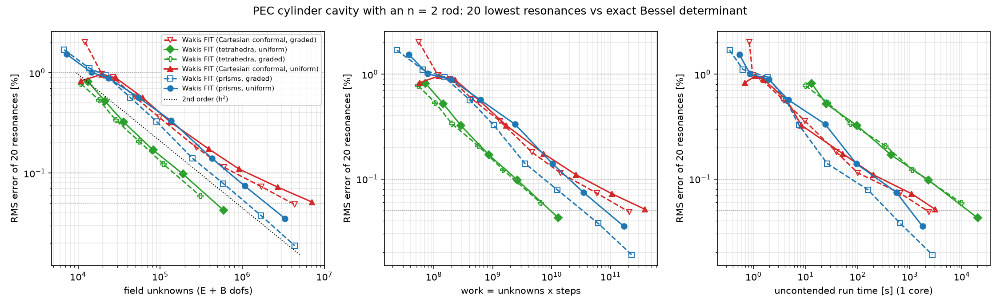
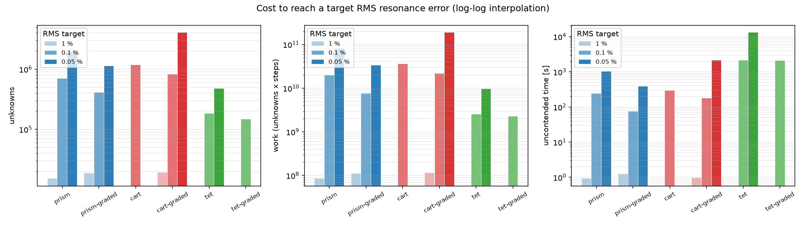

# 3D dielectric-rod cavity: prism FIT vs Cartesian conformal FIT vs tetrahedral FIT

**Question.** On the 3D analogue of the shared $n = 2$ cylinder benchmark (`../mie-cylinder-mesh`, `../mie-cylinder-graded`), do triangular prisms (2D triangles $\times$ $z$ layers) reach a target eigenfrequency accuracy with fewer unknowns, less work, and less wall time than Cartesian conformal FIT (uniform and graded) and tetrahedral FIT?

**Problem.** A closed PEC cylindrical cavity of radius $a = 2\ \mu\text{m}$ and height $H = 2\ \mu\text{m}$ containing a coaxial dielectric rod of radius $b = 1\ \mu\text{m}$ and $\varepsilon = 4$ ($n = 2$) spanning the full height.
- **Reference:** the 20 lowest resonances from the exact hybrid-mode Bessel determinant `wakis.unstructured.analytic.rod_cavity_hybrid` ($\text{TM}_0$ modes for $p = 0$ and hybrid $\text{HE}/\text{EH}$ modes for $p \ge 1$; the uncoupled formula $k^2 = k_t^2 + (p\pi/H)^2$ would be $> 2\text{ \%}$ off).
- **Metric:** RMS relative error across the 20 resonances (with multiplicity).
- **Extraction:** 3 broadband dipoles at fixed off-symmetry positions, 6 probes $\times$ 3 $E$ components, $1.33\ \text{ps}$ ($400\,b/c$) ring-down, harmonic inversion (`wakis.resonances.harminv`, FDM) of all 18 probe signals after the pulse, fits clustered across signals ($10^{-4}$), and Hungarian assignment to the exact mode list. The raw leapfrog frequencies are scored (including time dispersion, as a user gets); the dispersion-corrected spatial error is also recorded in `data/summary.md`.
- **Extraction check:** against the prism shift-invert eigensolver (`python prism_study.py eig --res R`), time-domain extraction agrees mode by mode within the leapfrog dispersion shift ($2\text{--}3 \times 10^{-4}$) at $\text{res} = 8, 11, 16$ (checked on the earlier `merge_tol = 0.15` build: RMS $0.62 / 0.39 / 0.18\text{ \%}$ eigensolver vs $0.57 / 0.36 / 0.18\text{ \%}$ time domain, which includes the positive leapfrog shift).

## Arms

$\text{res}$ is the number of cells per minimum wavelength inside the rod ($h = \lambda_{\min,\text{rod}} / \text{res}$).

| arm | solver ("Wakis FIT (<mesh>)") | mesh / Hodge / boundary |
|---|---|---|
| `prism` | `PrismFIT3D` (Wakis FIT (prisms, uniform)) | `disk_mesh` + ODT smoothing, uniform $dz = h$, Voronoi Hodge with merged near-cocircular edges (`merge_tol = 0.05`) |
| `prism-graded` | `PrismFIT3D` (Wakis FIT (prisms, graded)) | `graded_disk_mesh` ($h$ in the rod and a $2h$ band, $\times 1.2$ radial growth to $2h$), ODT smoothing, $dz = h$, `merge_tol = 0.05` |
| `cart` | `SolverFIT3D` (Wakis FIT (Cartesian conformal, uniform)) | uniform $h$, conformal `'all'` (PEC wall: background PEC around a vacuum cylinder STL) |
| `cart-graded` | `SolverFIT3D` (Wakis FIT (Cartesian conformal, graded)) | rectilinear grid graded in $x$ and $y$ ($h$ over $|x|, |y| < b + 2h$, $\times 1.2$ growth to $2h$), $dz = h$, conformal `'all'` |
| `tet` | `UnstructuredFIT3D` (Wakis FIT (tetrahedra, uniform)) | gmsh tetrahedra (size $h$), `hodge='whitney'`; the Voronoi Hodge is unstable on gmsh meshes (622 negative dual lengths out of 50,701 at $\text{res} = 8$) |
| `tet-graded` | `UnstructuredFIT3D` (Wakis FIT (tetrahedra, graded)) | gmsh size field $h$ in the rod, $2h$ outside, `hodge='whitney'` |

**Compute.** Runs executed on Cloud Batch, one task per `n2-standard-2` or `n2-highmem-2` spot VM (single core). Because `n2` VMs land on either Cascade Lake or Ice Lake hosts, wall times carry $\sim \pm 2\times$ machine variance (the same prism task took $223\ \text{s}$ and $555\ \text{s}$ on two VMs). `work` ($\text{unknowns} \times \text{steps}$) is the implementation- and machine-independent cost.

## Results


**(a)** RMS relative frequency error over the 20 lowest cavity resonances vs field unknowns ($E + B$ DOFs), work ($\text{unknowns} \times \text{steps}$), and single-core wall time. Curves are labelled `Wakis FIT (<mesh>)`.


**(b)** Field unknowns, work, and single-core time needed to reach $1\text{ \%}$, $0.1\text{ \%}$, and $0.05\text{ \%}$ RMS error (log-log interpolation).


**(c)** Prism cross-sections and $z$ layering: (left) one quadrant of the `prism-graded` cavity mesh at $\text{res} = 8$ showing the 10 merged near-cocircular edges (`merge_tol = 0.05`) in white; (middle, right) the graded cross-section and non-uniform $z$ layers used in the companion silicon microring study (`../prism-ring`).

### Cost to reach a target accuracy

Values are log-log interpolations between bracketing runs from [`data/summary.md`](data/summary.md) (`—` means not bracketed by the tested resolutions). Every arm reaches $1\text{ \%}$ RMS error below $\sim 20\text{k}$ unknowns in about one second, so $1\text{ \%}$ is not discriminating.

| arm | target | unknowns | cells | work (unknowns x steps) | time [s] |
|---|---|---|---|---|---|
| `prism` | 0.1 % | 697,772 | 150,281 | 1.98e+10 | 243 |
| **`prism-graded`** | **0.1 %** | **412,098** | **88,731** | **7.46e+09** | **75** |
| `cart` | 0.1 % | 1,169,471 | 194,912 | 3.56e+10 | 292 |
| `cart-graded` | 0.1 % | 821,155 | 136,859 | 2.18e+10 | 177 |
| `tet` | 0.1 % | 183,517 | 55,273 | 2.51e+09 | 2138 |
| `tet-graded` | 0.1 % | 146,849 | 44,774 | 2.26e+09 | 2078 |
| `prism` | 0.05 % | 1,957,745 | 425,413 | 8.1e+10 | 1030 |
| **`prism-graded`** | **0.05 %** | **1,131,841** | **246,008** | **3.36e+10** | **382** |
| `cart` | 0.05 % | — (0.051 % at res 45) | — | — | — |
| `cart-graded` | 0.05 % | 4,075,619 | 679,270 | 1.89e+11 | 2140 |
| `tet` | 0.05 % | 474,974 | 144,801 | 9.56e+09 | 13187 |
| `tet-graded` | 0.05 % | — (0.059 % at res 16) | — | — | — |

The full per-run table ($\Delta t$, steps, $\text{ns}/(\text{unknown}\cdot\text{step})$, spatial and maximum error) is in [`data/summary.md`](data/summary.md).

### Speed-up of `prism-graded` at equal accuracy

| target | metric | `prism-graded` | vs `cart-graded` | vs `cart` (uniform) | vs `tet` (Whitney) |
|---|---|---|---|---|---|
| 0.1 % RMS | unknowns | 412k | **2.0× fewer** (821k) | **2.8× fewer** (1.17M) | 2.2× more (184k) |
| 0.1 % RMS | work | 7.5e9 | **2.9× less** (2.2e10) | **4.8× less** (3.6e10) | 3.0× more (2.5e9) |
| 0.1 % RMS | wall time | 75 s | **2.4× faster** (177 s) | **3.9× faster** (292 s) | **28× faster** (2138 s) |
| 0.05 % RMS | unknowns | 1.13M | **3.6× fewer** (4.1M) | not reached at res 45 | 2.4× more (475k) |
| 0.05 % RMS | work | 3.4e10 | **5.6× less** (1.9e11) | not reached at res 45 | 3.5× more (9.6e9) |
| 0.05 % RMS | wall time | 382 s | **5.6× faster** (2140 s) | not reached at res 45 | **35× faster** (13187 s) |

### Interpretation

- **Convergence order.** Uniform prisms (`prism`) converge cleanly at second order ($0.57\text{ \%}$ at $\text{res} = 8 \to 0.035\text{ \%}$ at $\text{res} = 32$), and `prism-graded` reaches $0.019\text{ \%}$ at $\text{res} = 45$. Cartesian conformal (`cart`, `cart-graded`) matches prisms up to $\text{res} = 11$ ($0.33\text{ \%}$), then slows to roughly first order at fine resolution ($0.11\text{ \%}$ at $\text{res} = 22 \to 0.051\text{ \%}$ at $\text{res} = 45$) because a few TE-like modes whose electric field crosses the curved rod interface converge at first order under diagonal conformal averaging.
- **Unstructured $(x, y)$ grading.** Because the triangle cross-section grades radially without propagating fine strips into the outer vacuum region, `prism-graded` cuts unknowns by $1.7\times$ and work by $2.4\text{--}2.7\times$ relative to uniform `prism` (the ring-based `graded_disk_mesh` also avoids interface slivers and takes a larger $\Delta t$ than `disk_mesh`). Rectilinear grading (`cart-graded`) must carry fine $x$ and $y$ strips across the cylinder and gains less, while inheriting the same high-resolution conformal slope.
- **Tetrahedra vs prisms.** Tetrahedra with the consistent Whitney Hodge need the fewest unknowns ($183\text{k}$ uniform, $147\text{k}$ graded at $0.1\text{ \%}$), but each leapfrog step solves a sparse $N_e \times N_e$ electric mass matrix ($180\text{--}1540\ \text{ns}$ per unknown-step, growing with mesh size vs $7\text{--}16\ \text{ns}$ for explicit prisms and Cartesian FIT), making them $\sim 28\times$ slower than `prism-graded` at $0.1\text{ \%}$.

## Limits & caveats

- **Single extrusion-friendly geometry.** A vertical rod spanning the full cavity height is well suited to an extruded prism mesh, although this benchmark uses uniform $dz = h$ and does not exploit $z$ grading (see `../prism-ring` for thin-layer $z$ grading). Geometries with 3D curved interfaces tilted against $z$ would require staircase/conformal $z$ treatment or tetrahedra.
- **Closed cavity.** The outer boundary is PEC, so no absorbing layer is exercised here (see `../prism-ring` and `../prism-dipole`).
- **Single-core Cloud Batch timing noise.** Spot VMs (`n2-standard-2` / `n2-highmem-2`) land on either Cascade Lake or Ice Lake hosts; identical prism runs took $223\ \text{s}$ and $555\ \text{s}$ across two VMs ($\sim \pm 2\times$). Use `work` ($\text{unknowns} \times \text{steps}$) for hardware-independent comparisons.
- **Extraction floor.** Harmonic inversion and cross-probe clustering across 20 modes have a practical floor of $\sim 10^{-5}$.
- **Merge history.** An earlier run with `merge_tol = 0.15` and an upward floor on vertical-quad reluctances left a resolution-independent error ($-7.5 \times 10^{-4}$ on the $\text{TM}_{010}$-like mode on graded meshes). Keeping the vertical quads of merged edges with path-sum virtual voltages ($\mathbf{C}\mathbf{G} = 0$), removing the upward reluctance floor, and tightening `merge_tol` to $0.05$ eliminated that floor. Earlier outputs are archived in `data_premergefix/` and `data_merge015/` (not used).

## Reproduce

```bash
python prism_study.py list
python prism_study.py run --task I
python prism_study.py eig --res R
python plot_study.py
python plot_meshes.py
python batch/submit.py RUN_ID prism-cavity prism_study.py n2-highmem-2 "0 1 ..."
```
