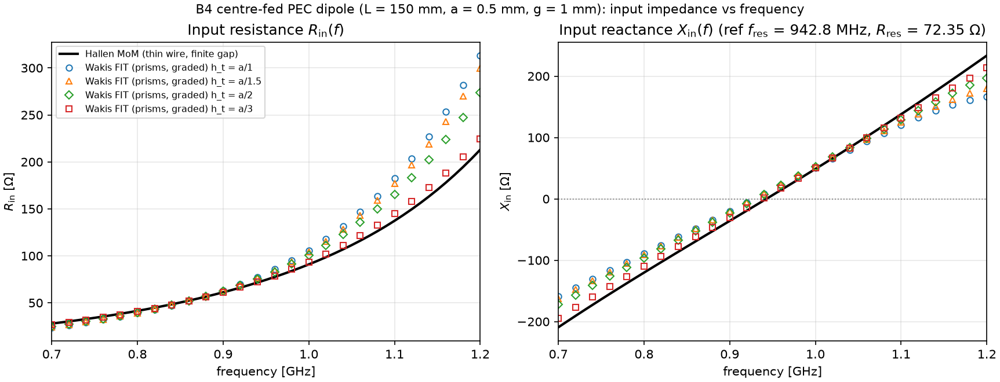
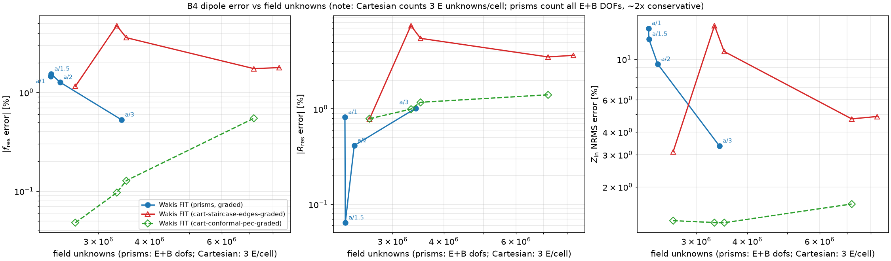

# 3D thin-wire dipole (B4): prism FIT vs Cartesian FIT

**Question.** On the 3D centre-fed thin-wire dipole benchmark (`B4`, `wakis.benchmarks.dipole`), can a graded triangular-prism mesh (`PrismFIT3D`) resolve the wire cross-section as a conforming polygon and reach sub-percent resonance and impedance accuracy without the staircase capacitance offset of Cartesian grids?

**Problem (`B4`).** A centre-fed PEC circular wire of length $L = 150\ \text{mm}$ and radius $a = 0.5\ \text{mm}$ ($L / a = 300$, $\Omega = 2\ln(L/a) = 11.4$) along $z$ in free space, driven across a finite centre gap $g = 1\ \text{mm}$ over $0.7\text{--}1.2\ \text{GHz}$ ($20\ \text{ns}$ transient).
- **Reference:** Hallén moment method (`wakis.analytic.thin_wire.hallen_dipole`) with the same finite gap (uniform generator field over $|z| < g/2$, $N = 200$ segments, $\Delta = 1.5\,a$), giving $f_{\text{res}} = 942.8\ \text{MHz}$ ($X_{\text{in}} = 0$) and $R_{\text{res}} = 72.35\ \Omega$. The discretization spread over $N = 150\dots 300$ (`reference_uncertainty`) is $0.09\text{ \%}$ in $f_{\text{res}}$ and $0.06\text{ \%}$ in $R_{\text{res}}$.
- **Metrics:** relative error in resonance frequency $|f_{\text{res}} / f_{\text{res,ref}} - 1|$, relative error in resistance at resonance $|R_{\text{res}} / R_{\text{res,ref}} - 1|$, and band-wide NRMS error of $Z_{\text{in}}(f)$ normalized by $\max |Z_{\text{ref}}|$.

## Prism arm (`wakis.benchmarks.arms.prism_dipole`)

- **Cross-section (`graded_disk_mesh`):** an area-matched polygon ring on the wire surface $r = a$ with $n_{\text{ring}} \ge 8$ nodes (edge spacing $h_t$), a hexagonal interior lattice, $\times 1.2$ radial growth to $\lambda_{\min}/20$, 20 iterations of ODT smoothing, and Voronoi Hodge dual merging of near-cocircular triangle pairs (`merge_tol = 0.05`, keeping vertical quads of merged edges with path-sum virtual voltages).
- **$z$ layering:** symmetric non-uniform levels where the feed gap $|z| < g/2$ is an integer number of layers ($h_z = \min(g, 4 h_t)$) and the wire ends $z = \pm L/2$ lie on exact mesh levels, followed by 5 uniform buffer layers and $\times 1.2$ growth to $\lambda_{\min}/20$ up to $L/2 + 0.14\,\lambda_{\max}$.
- **Open boundaries:** lateral interior radius $0.21\,\lambda_{\max}$ surrounded by a $0.3\,\lambda_{\max}$ matched $(\sigma, \sigma^*)$ lossy annulus + first-order ABC; 10-layer split-field PML on both $z$ ends.
- **Lumped port:** all non-PEC vertical edges of the wire disk inside the gap layers ($|z| < g/2$), implementing the uniform finite-gap generator model with Norton resistance $R = Z_0 = 50\ \Omega$.

## Results


**(a)** Input resistance $R_{\text{in}}(f)$ and reactance $X_{\text{in}}(f)$ over $0.7\text{--}1.2\ \text{GHz}$ for `prism-graded` ($h_t = a, a/1.5, a/2, a/3$) vs the finite-gap Hallén MoM reference.


**(b)** Relative errors $|f_{\text{res}}\text{ error}|$, $|R_{\text{res}}\text{ error}|$, and $Z_{\text{in}}$ NRMS vs field unknowns for `prism-graded` (`data/B4_*.json`) and the Cartesian baselines in the shared store (`fetch('B4')`: `cart-staircase-edges-graded` and `cart-conformal-pec-graded`). *Note on unknown counts:* the Cartesian arms record $3$ unknowns per cell ($E$ only), whereas `PrismFIT3D` counts all $E + B$ DOFs ($3 N_{\text{tri}} K + N_{\text{nodes}} (K+1) + N_{\text{edges}} (2K+1)$), so prism unknown counts are conservative by about $2\times$.

### Prism runs (`data/B4_*.json`)

| arm | $h_t$ | unknowns ($E+B$) | steps | `run_s` [s] | $f_{\text{res}}$ [MHz] | $f_{\text{res}}$ err | $R_{\text{res}}$ [$\Omega$] | $R_{\text{res}}$ err | $Z_{\text{in}}$ NRMS |
|---|---|---|---|---|---|---|---|---|---|
| `prism-graded` | $a$ ($0.500\ \text{mm}$) | 2,295,309 | 44,320 | 2,652 | 929.10 | 1.45 % | 72.94 | 0.82 % | 14.78 % |
| `prism-graded` | $a/1.5$ ($0.333\ \text{mm}$) | 2,300,497 | 56,640 | 3,193 | 928.28 | 1.54 % | 72.40 | 0.06 % | 12.90 % |
| `prism-graded` | $a/2$ ($0.250\ \text{mm}$) | 2,418,597 | 117,973 | 6,464 | 930.83 | 1.27 % | 72.05 | 0.41 % | 9.40 % |
| **`prism-graded`** | **$a/3$ ($0.167\ \text{mm}$)** | **3,417,985** | **114,148** | **8,925** | **937.83** | **0.53 %** | **71.61** | **1.02 %** | **3.35 %** |
| `prism-graded-bigdomain` | $a$ ($0.500\ \text{mm}$) | 6,235,727 | 44,319 | 7,132 | 932.92 | 1.05 % | 76.42 | 5.62 % | 14.70 % |
| `prism-graded-nomerge` | $a$ ($0.500\ \text{mm}$) | 2,300,301 | 44,320 | 1,457 | 923.60 | 2.04 % | 72.11 | 0.32 % | 15.90 % |
| `prism-graded-nomerge` | $a/2$ ($0.250\ \text{mm}$) | 2,423,589 | 117,974 | 4,430 | 927.33 | 1.64 % | 71.56 | 1.09 % | 10.08 % |

### Cartesian baselines (shared store)

- **`cart-staircase-edges-graded`:** at $h_t = a/3$, $f_{\text{res}}$ error $1.74\text{ \%}$, $R_{\text{res}}$ error $3.5\text{ \%}$, $Z_{\text{in}}$ NRMS $4.7\text{ \%}$, $7.2\ \text{M}$ unknowns ($3/\text{cell}$), $17{,}065\ \text{s}$; at $h_t = a/4$, $f_{\text{res}}$ error $1.79\text{ \%}$, $R_{\text{res}}$ error $3.6\text{ \%}$, $Z_{\text{in}}$ NRMS $4.9\text{ \%}$, $8.3\ \text{M}$ unknowns.
- **`cart-conformal-pec-graded`:** before the legacy conformal-PEC mask fix, $h_t = a/3$ gave $f_{\text{res}}$ error $3.2\text{ \%}$, $R_{\text{res}}$ error $4.3\text{ \%}$, and $Z_{\text{in}}$ NRMS $8.4\text{ \%}$ (in the updated store rerun `d67e8fe` after the mask fix, $h_t = a/3$ reaches $0.55\text{ \%}$, $1.41\text{ \%}$, $1.61\text{ \%}$ at $7.2\ \text{M}$ $E$-unknowns).

### Interpretation

- **Conforming wire cross-section:** `prism-graded` represents the $a = 0.5\ \text{mm}$ wire boundary as an area-matched polygon ring rather than a rectilinear staircase. Already at the coarsest resolution $h_t = a$, the radiation resistance at resonance is within $\sim 1\text{ \%}$ of Hallén MoM ($72.94\ \Omega$, $0.82\text{ \%}$ error).
- **Feed-region resolution ($h_t = a \to a/3$):** at coarse transverse resolution $h_t = a \dots a/2$ (where $h_z = \min(g, 4 h_t) = g = 1\ \text{mm}$ spans the gap in a single layer), $f_{\text{res}}$ is $1.3\text{--}1.5\text{ \%}$ low ($928\text{--}931\ \text{MHz}$) and $Z_{\text{in}}$ NRMS is $9.4\text{--}14.8\text{ \%}$. Refining to $h_t = a/3$ ($h_z = 2 h_t = 0.67\ \text{mm}$, splitting the $1\ \text{mm}$ gap into two layers) brings $f_{\text{res}}$ to $937.83\ \text{MHz}$ ($0.53\text{ \%}$ error), $R_{\text{res}}$ to $71.61\ \Omega$ ($1.02\text{ \%}$ error), and $Z_{\text{in}}$ NRMS to $3.35\text{ \%}$ at $3.42\ \text{M}$ $E+B$ unknowns ($\sim 1.7\ \text{M}$ equivalent $E$ unknowns, $\sim 4\times$ fewer cells than the $7.2\ \text{M}$-unknown Cartesian $a/3$ grid) and $8{,}925\ \text{s}$. ($h_t = a/4$ is not present in `data/`.)

## Limits & caveats

- **Single antenna geometry:** only the straight $z$-aligned thin-wire dipole (`B4`) is tested here.
- **First-order lateral absorber & domain size:** doubling the interior radius from $0.21\,\lambda_{\max}$ to $0.42\,\lambda_{\max}$ (`prism-graded-bigdomain` at $h_t = a$) shifts $f_{\text{res}}$ error from $1.45\text{ \%}$ to $1.05\text{ \%}$ and $R_{\text{res}}$ error from $0.82\text{ \%}$ to $5.62\text{ \%}$, showing that reflections from the lateral matched absorber + ABC still affect impedance at the $\sim 1\text{ \%}$ ($f_{\text{res}}$) / few-percent ($R_{\text{res}}$) level.
- **Finite-gap port model:** the lumped port drives all vertical edges of the wire disk across $|z| < g/2$ in parallel, matching the uniform finite-gap field assumed by the Hallén reference rather than a coaxial feed.
- **Unknown-count convention:** Cartesian benchmark records count $3 N_{\text{cells}}$ ($E$ components only), while `PrismFIT3D` reports all $E + B$ DOFs (roughly $2\times$ larger per cell).
- **Merge & reluctance-floor history:** an earlier build (`merge_tol = 0.15`, dropping the vertical quads of merged edges) gave $f_{\text{res}} = 926 \to 937\ \text{MHz}$ ($1.8 \to 0.65\text{ \%}$ error) and $Z_{\text{in}}$ NRMS $15 \to 1.4\text{ \%}$ across $h_t = a \to a/4$. An intermediate build that applied an upward floor on vertical-quad reluctances was erratic ($f_{\text{res}}$ $2.6\text{--}4.3\text{ \%}$ high, $955\text{--}983\ \text{MHz}$); those superseded outputs are archived in `data_merge015/` and the `b4prism` Batch jobs and are not used.

## Reproduce

```bash
python dipole_study.py list
python dipole_study.py run --task I --outdir data [--publish --machine n2-standard-2]
python plot_b4.py
```

Records are published to the shared benchmark store (`gs://cloud-code-511302-autoresearch/bench-results/B4/`) under case `B4`, arms `prism-graded`, `prism-graded-bigdomain`, and `prism-graded-nomerge`.
