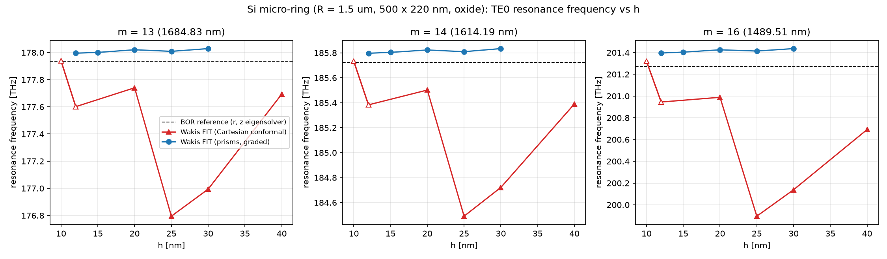

# Silicon microring resonator: prism FIT vs Cartesian conformal FIT

**Question.** On a planar photonic device with a thin high-index core ($220\ \text{nm}$ silicon strip in oxide) and curved vertical sidewalls, do graded triangular prisms with independent $z$ layering reach practical wavelength accuracy ($\sim 1\text{--}2\ \text{nm}$) with fewer unknowns, less work, and less wall time than uniform Cartesian conformal FIT?

**Device.** A silicon strip ring ($\varepsilon = 12.1$) of centre radius $R = 1.5\ \mu\text{m}$, width $w = 500\ \text{nm}$, and thickness $t = 220\ \text{nm}$ embedded in a homogeneous oxide cladding ($\varepsilon = 2.1$).
- **Symmetry & domain:** quarter domain ($x \ge 0, y \ge 0$) with a PMC plane at $z = 0$ (even TE-like modes) and two symmetry runs per arm on the planes $x = 0, y = 0$ ($\text{PMC}/\text{PMC}$ for even azimuthal orders $m$, $\text{PMC}/\text{PEC}$ for odd $m$). The outer computational boundary lies at radius $R + w/2 + 1.25\ \mu\text{m}$ and $z_{\max} = 1.0\ \mu\text{m}$.
- **Open boundaries ($0.45\ \mu\text{m}$ absorber):** `prism` uses a matched lossy annulus plus first-order lateral ABC and a split-field $z$ PML on top; `cart` uses CPML of the same $0.45\ \mu\text{m}$ thickness whose interior ends at the same radius and height.
- **Extraction:** narrow-band dipole excitation around $193\ \text{THz}$ ($\lambda_0 = 1.55\ \mu\text{m}$), $1.0\ \text{ps}$ ring-down, harmonic inversion (`wakis.resonances.harminv`) of four in-strip probes per symmetry run, and clustering of high-$Q$ modes ($Q > 500$).

**Reference.** An independent body-of-revolution (BOR) $(r, z)$ finite-difference eigensolver (`bor_reference.py`) for fields $\propto e^{i m \phi}$ on a cylindrical Yee grid. Because the $500 \times 220\ \text{nm}$ strip cross-section is aligned with the $(r, z)$ grid lines, material interfaces lie on grid nodes with exact second-order tangential averaging and no staircasing.
- **Validation:** on a closed coaxial PEC cavity against exact Bessel roots, the BOR eigensolver converges at second order with relative errors $2.8 \times 10^{-4}$, $7.5 \times 10^{-5}$, and $1.8 \times 10^{-5}$ at grid steps $d = 0.02, 0.01, 0.005$.
- **Ring resonances:** solved at $d = 10, 5, 2.5\ \text{nm}$ and Richardson-extrapolated ($5$ and $2.5\ \text{nm}$) for the fundamental $\text{TE}_0$ family ($\text{FSR} \approx 7.8\ \text{THz}$). Azimuthal order $m = 15$ is excluded from the error metric: its $\text{TE}_0$ mode anticrosses a higher-order mode of the same $m$ (BOR eigenvalues at $193.37$ and $193.93\ \text{THz}$), and the $1\ \text{ps}$ 3D runs resolve a single mode in between.

| m | BOR 10 nm [THz] | 5 nm | 2.5 nm | Richardson [THz] | lambda [nm] |
|---|---|---|---|---|---|
| 13 | 177.9439 | 177.9375 | 177.9366 | 177.9362 | 1684.83 |
| 14 | 185.7341 | 185.7253 | 185.7237 | 185.7232 | 1614.19 |
| 16 | 201.2864 | 201.2732 | 201.2704 | 201.2694 | 1489.51 |

## Arms

| arm | solver | mesh / Hodge / absorber |
|---|---|---|
| `prism` | `PrismFIT3D` (`Wakis FIT (prisms, graded)`) | graded $(x, y)$ triangles ($h$ in the strip and a $2h$ band, growing $\times 1.2$ to $3h$ in cladding), exact $z$ levels at $z = 0$ and $z = t/2 = 110\ \text{nm}$ ($\Delta z_{\text{core}} = h$, graded $\times 1.25$ up to $100\ \text{nm}$ in cladding), Voronoi Hodge (`merge_tol = 0.05`), lateral lossy annulus + ABC and top split-field $z$ PML |
| `cart` | `SolverFIT3D` (`Wakis FIT (Cartesian conformal)`) | uniform cubic grid of step $h$, conformal `'all'`, $0.45\ \mu\text{m}$ CPML on the outer faces |

**Compute.** All `prism` runs and `cart` runs at $h = 40, 30, 25, 20\ \text{nm}$ executed on single-core `n2` Cloud Batch VMs; `cart` at $h = 12$ and $10\ \text{nm}$ (`*_gpu.json`) ran on an NVIDIA L4 GPU (`cupy`), so their wall times are not directly comparable to the single-core CPU runs. Every row in the cost table sums both symmetry runs (`even` + `odd`).

## Results


**(a)** Extracted $\text{TE}_0$ resonance frequencies ($m = 13, 14, 16$) vs in-plane grid step $h$, compared against the BOR $(r, z)$ Richardson reference (dashed). Open triangles mark the GPU Cartesian runs ($h = 12, 10\ \text{nm}$).


**(b)** Maximum resonance wavelength error $\max |\Delta\lambda|$ across $m \in \{13, 14, 16\}$ (at $\lambda_0 = 1550\ \text{nm}$) vs total field unknowns (both symmetry runs), total work ($\text{unknowns} \times \text{steps}$), and run time. Horizontal dotted lines mark $1\ \text{nm}$ and $0.1\ \text{nm}$.

### Per-run summary ([`data/summary.md`](data/summary.md))

| arm | h [nm] | unknowns | work | run [s] | max abs d-lambda [nm] | RMS rel. error |
|---|---|---|---|---|---|---|
| cart | 40 | 1,802,112 | 4.68e+10 | 916 | 4.447 | 2.11e-03 |
| cart | 30 | 4,284,420 | 1.48e+11 | 3289 | 8.710 | 5.44e-03 |
| cart | 25 | 7,203,372 | 2.99e+11 | 8023 | 10.580 | 6.63e-03 |
| cart | 20 | 13,954,212 | 7.25e+11 | 18098 | 2.163 | 1.24e-03 |
| cart | 12 | 64,261,020 | 5.56e+12 | 7478* | 2.916 | 1.78e-03 |
| cart | 10 | 109,808,412 | 1.14e+13 | 16561* | 0.390 | 1.48e-04 |
| prism | 30 | 900,000 | 3.3e+10 | 865 | 1.286 | 6.63e-04 |
| prism | 25 | 1,440,888 | 6.39e+10 | 1645 | 1.113 | 5.47e-04 |
| prism | 20 | 2,463,148 | 1.38e+11 | 3265 | 1.201 | 6.09e-04 |
| prism | 15 | 4,905,824 | 3.42e+11 | 8373 | 1.036 | 5.06e-04 |
| prism | 12 | 8,616,514 | 7.92e+11 | 23383 | 0.973 | 4.70e-04 |

*\*`cart` at $h = 12$ and $10\ \text{nm}$ ran on an L4 GPU; all other runs are single-core `n2` CPU.*

### Headlines

- **Prisms reach $\sim 1\ \text{nm}$ immediately:** `prism` achieves $\max |\Delta\lambda| = 1.29\ \text{nm}$ already at the coarsest grid $h = 30\ \text{nm}$ ($0.90\ \text{M}$ unknowns across both symmetry runs, $3.3 \times 10^{10}$ work, $865\ \text{s}$ on one `n2` core) and remains at $1.04\text{--}1.20\ \text{nm}$ down to $h = 15\ \text{nm}$.
- **Cartesian conformal is non-monotone on the $220\ \text{nm}$ core:** `cart` gives $\max |\Delta\lambda| = 4.4, 8.7, 10.6, 2.2, 2.9\ \text{nm}$ at $h = 40, 30, 25, 20, 12\ \text{nm}$, before finally dropping to $0.39\ \text{nm}$ at $h = 10\ \text{nm}$ ($110\ \text{M}$ unknowns, $1.14 \times 10^{13}$ work on GPU).
- **Cost to reach $\sim 2\ \text{nm}$ accuracy:** comparing `cart` at $h = 20\ \text{nm}$ ($2.16\ \text{nm}$ error; $14.0\ \text{M}$ unknowns, $7.25 \times 10^{11}$ work, $18{,}098\ \text{s}$) against `prism` at $h = 30\ \text{nm}$ ($1.29\ \text{nm}$ error; $0.90\ \text{M}$ unknowns, $3.3 \times 10^{10}$ work, $865\ \text{s}$), graded prisms use **$15\times$ fewer unknowns**, **$22\times$ less work**, and **$21\times$ less single-core wall time**.
- **Below $1\ \text{nm}$:** only the $h = 10\ \text{nm}$ Cartesian run reaches sub-nanometre accuracy ($0.39\ \text{nm}$); `prism` plateaus at a $\sim 1.0\ \text{nm}$ ($+0.04\text{--}0.07\text{ \%}$) residual offset.

### Why prisms win here

1. **Exact horizontal core interfaces and decoupled $z$ layering.** In an extruded prism mesh, the top of the half-core ($z = t/2 = 110\ \text{nm}$) is an exact horizontal mesh level for every $h$, $\Delta z$ in the core is chosen independently so $110\ \text{nm}$ is an integer number of layers, and the oxide cladding grades vertically up to $\Delta z = 100\ \text{nm}$. In uniform Cartesian FIT, the same step $h$ applies in $x, y, z$, and the conformal $z$-averaging across $z = 110\ \text{nm}$ varies non-monotonically with cell alignment: the core interface sits at $110/h = 2.75, 3.67, 4.4, 5.5, 9.17, 11.0$ cells for $h = 40, 30, 25, 20, 12, 10\ \text{nm}$ (matching the improved accuracy near half-integer/integer alignments $h = 20$ and $10\ \text{nm}$).
2. **Conforming curved sidewalls and unstructured radial grading.** The concentric $R \pm w/2$ sidewalls are represented by body-fitted triangle edges rather than subcell diagonal volume fractions, while triangle size grades radially from $h$ in the strip to $3h$ in the cladding without propagating fine grid lines across the domain.

## Limits & caveats

- **Unidentified prism residual offset ($\sim 1\ \text{nm}$).** Across $h = 30 \to 15\ \text{nm}$, `prism` frequencies sit $+0.04\text{--}0.07\text{ \%}$ ($\sim 1.0\text{--}1.3\ \text{nm}$) above the BOR reference. The cause of this floor is not identified: replacing the open absorbers with a closed PEC box gives identical frequencies, setting `merge_tol = 0` gives identical frequencies, and halving $h$ from $30$ to $15\ \text{nm}$ barely shifts it.
- **$m = 15$ excluded.** The $\text{TE}_0$ mode at $m = 15$ anticrosses a higher-order mode of the same azimuthal order ($193.37$ and $193.93\ \text{THz}$ in BOR), and the $1\ \text{ps}$ 3D time-domain window resolves a single peak between them.
- **Hardware comparison.** The $h = 12$ and $10\ \text{nm}$ Cartesian runs executed on an L4 GPU, so their wall times cannot be compared directly to the single-core `n2` CPU runs; compare `unknowns` and `work` instead.
- **Quarter domain and single device.** Both arms exploit the quarter-ring symmetry planes and $z = 0$ midplane of an isolated microring; bus-waveguide coupling or asymmetric perturbations would require a half or full domain.
- **Merge tolerance history.** An earlier run with `merge_tol = 0.15` produced a $+0.4\text{--}0.7\text{ \%}$ positive frequency bias because `merge_tol = 0.15` merged systematic bands of nearly cocircular quad-like triangle pairs inside the structured strip mesh. Tightening `merge_tol` to $0.05$ restricts merging to genuine Delaunay slivers and removed that bias (superseded runs are archived in `data_merge015/` and `data_premergefix/` and are not used).

## Reproduce

```bash
python bor_reference.py validate
python bor_reference.py ring --d 10 5 2.5
python ring_study.py list
python ring_study.py run --task I --outdir data [--gpu]
python plot_ring.py
python ../prism-cavity/batch/submit.py RUN_ID prism-ring ring_study.py n2-highmem-2 "0 1 ..."
```
