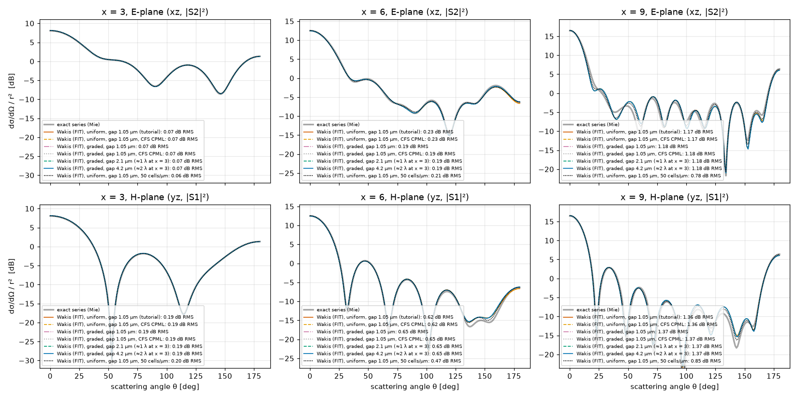
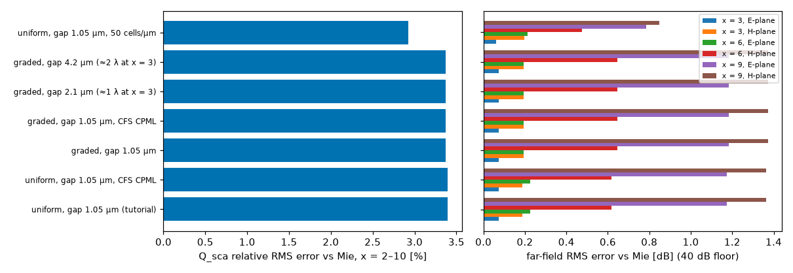

# Tutorial 3.5 set-up check: sphere-to-CPML distance and CFS shift

Does placing the 10-cell CPML 1.05 µm from the sphere surface in Tutorial 3.5 ($r = 1$ µm, $n = 2$, $x = 2\text{–}10$) distort $Q_\mathrm{sca}$ or the far-field pattern by absorbing evanescent near fields?

## Problem and hypothesis

In Tutorial 3.5 at 40 cells/µm (`conformal='all'`), the scattered-field flux and near-to-far box sits at half-width 1.45 µm and the CPML starts at 2.05 µm (1.05 µm from the sphere surface). At the longest wavelength in the band ($x = 2$, $\lambda = 3.14$ µm), a 1.05 µm gap is only $0.33\,\lambda$ (though still $\ge \lambda / 2\pi = 0.50$ µm, the reactive near-field scale $k^{-1}$). At $x = 9$ E-plane ($100\text{–}150°$) and $x = 6$ H-plane ($\sim 150°$), the simulated far field deviates by ~1 dB from the exact Mie series.

We test two hypotheses:
1. **Near-field absorption / CPML reflection**: the CPML is too close to the sphere or needs a complex-frequency-shifted (CFS) $\alpha_\mathrm{max}$ to attenuate evanescent waves and grazing-incidence fields.
2. **Bulk discretization error**: the deviation comes from the 40 cells/µm grid resolution inside and around the sphere ($12.6$ cells per internal wavelength at $x = 10$).

## Runs and reproduction

All runs use `tutorials/03_diffraction_and_scattering/03-05_mie_sphere/mie_sphere.py` in `--arm` mode (`conformal='all'`, 300 fs window, identical TF/SF box at 1.25 µm and near-to-far flux box at 1.45 µm). The script supports CPML and domain-grading options:
- `--gap-um`: sphere-surface-to-CPML distance [µm] on a symmetric graded grid (uniform 40 cells/µm out to 2 cells past the flux box, then stretched to the CPML);
- `--coarse-per-um`: coarse grid resolution in the outer vacuum gap (default `16.0` cells/µm);
- `--grade-ratio`: maximum adjacent cell-size ratio in the grading zone (default `1.15`);
- `--pml-gap`: scale factor for the sphere-to-CPML gap on a uniform grid (default `1.0`);
- `--alpha-max`: CFS CPML parameter $\alpha_\mathrm{max}$ [S/m] (`1000` gives $\alpha/\varepsilon_0 \approx 0.2\,\omega_\mathrm{min}$);
- `--kappa-max`: CPML coordinate-stretching parameter $\kappa_\mathrm{max}$;
- `--n-pml`: number of CPML cells (default `10`).

Example commands (`pmlgap.sh` on a GPU node, from `tutorials/03_diffraction_and_scattering/03-05_mie_sphere/`):

```bash
python mie_sphere.py --arm --gpu --resolution 40 --out uniform_gap1x.json
python mie_sphere.py --arm --gpu --resolution 40 --alpha-max 1000 --out uniform_gap1x_cfs.json
python mie_sphere.py --arm --gpu --resolution 40 --gap-um 1.05 --out graded_gap1.05um.json
python mie_sphere.py --arm --gpu --resolution 40 --gap-um 1.05 --alpha-max 1000 --out graded_gap1.05um_cfs.json
python mie_sphere.py --arm --gpu --resolution 40 --gap-um 2.1 --out graded_gap2.1um.json
python mie_sphere.py --arm --gpu --resolution 40 --gap-um 4.2 --out graded_gap4.2um.json
python mie_sphere.py --arm --gpu --resolution 50 --out uniform_gap1x_res50.json
```

Regenerate the summary table and figures from the committed JSON files (`data/*.json`):

```bash
python studies/sphere-pml-gap/plot_pml_gap.py
```

## Results

Full metrics are in [`data/summary.md`](data/summary.md). Far-field RMS errors [dB] are evaluated over $\theta = 0\text{–}180°$ with a 40 dB floor below the Mie peak so deep pattern nulls do not dominate.

| run | cells | Q_sca RMS err x=2–10 | far field RMS dB x=3 E/H, 6 E/H, 9 E/H |
|---|---|---|---|
| uniform, gap 1.05 µm (tutorial, 40 cells/µm) | 6.3 M | 3.40 % | 0.07/0.19, 0.23/0.62, 1.17/1.36 |
| same, CFS CPML (alpha_max = 1000 S/m) | 6.3 M | 3.40 % | identical |
| graded, gap 1.05 µm | 4.3 M | 3.37 % | 0.07/0.19, 0.19/0.65, 1.18/1.37 |
| graded, gap 2.1 µm (≈1 λ at x=3) | 7.6 M | 3.37 % | same |
| graded, gap 4.2 µm (≈2 λ at x=3) | 18.6 M | 3.37 % | same |
| uniform, gap 1.05 µm, 50 cells/µm | 11.7 M | 2.92 % | 0.06/0.20, 0.21/0.47, 0.78/0.85 |

Pairwise differences across `x = 2–10` and the six far-field cuts:
- **Graded 1.05 µm vs 4.2 µm gap**: $\max|\Delta Q_\mathrm{sca}| = 3.7\times 10^{-4}$ (absolute), max far-field difference $0.010$ dB.
- **Graded 2.1 µm vs 4.2 µm gap**: $\max|\Delta Q_\mathrm{sca}| = 3.2\times 10^{-4}$ (absolute), max far-field difference $0.007$ dB.
- **CFS $\alpha_\mathrm{max} = 1000$ S/m vs $\alpha_\mathrm{max} = 0$**: no change at the printed digits on either the uniform or the graded 1.05 µm grid.
- **Uniform vs graded grid at 1.05 µm gap**: $\max|\Delta Q_\mathrm{sca}| = 1.0\times 10^{-2}$, max far-field difference $0.43$ dB, because the grid spacing outside the flux box differs (25 nm uniform vs graded up to 62.5 nm).
- **Resolution 40 vs 50 cells/µm (uniform 1.05 µm gap)**: $Q_\mathrm{sca}$ RMS error drops from $3.40\,\%$ to $2.92\,\%$; the largest far-field RMS errors drop from $1.17 \to 0.78$ dB ($x = 9$ E-plane), $1.36 \to 0.85$ dB ($x = 9$ H-plane), and $0.62 \to 0.47$ dB ($x = 6$ H-plane).

## Figures





## Conclusion

The CPML at 1.05 µm from the sphere does **not** affect $Q_\mathrm{sca}$ or the far field in this problem: the hypothesis that the PML absorbs the near field is rejected. Moving the CPML out to 4.2 µm ($\approx 2\lambda$ at $x = 3$) changes $Q_\mathrm{sca}$ by at most $3.7\times 10^{-4}$ and the far field by at most $0.010$ dB, and adding a CFS shift has no effect at the printed digits. The remaining deviations from Mie ($x = 9$ E-plane at $100\text{–}150°$, $x = 6$ H-plane near $150°$) shrink when the grid is refined from 40 to 50 cells/µm, confirming that they are discretization error.

Physical reason: a 1.05 µm gap exceeds the reactive near-field scale $\lambda / 2\pi = r / x$ across the entire band ($\lambda / 2\pi = 0.50$ µm at $x = 2$, and smaller at larger $x$), and the standard 10-cell CPML absorbs the outward-propagating scattered wave well. When a larger buffer is needed, grading the vacuum gap outside the flux box (`--gap-um`, $\le 1.15\times$ step growth down to 16 cells/µm) keeps the cell count low (4.3 M vs 6.3 M at 1.05 µm, and 7.6 M at 2.1 µm).

## Limits

- **Single resolution for the gap sweep**: the 1.05, 2.1, and 4.2 µm graded-gap comparisons were run only at 40 cells/µm inside the flux box.
- **300 fs simulation window**: high-$Q$ multipole resonances at the top of the band are still ringing weakly at 300 fs.
- **Lossless $n = 2$ dielectric only**: strongly resonant, lossy, or plasmonic scatterers (e.g., Drude metals near a localized surface plasmon resonance, or subwavelength $x \ll 1$ particles where $\lambda / 2\pi \gg r$) have stronger evanescent near fields and require larger gaps or CFS stretching.
