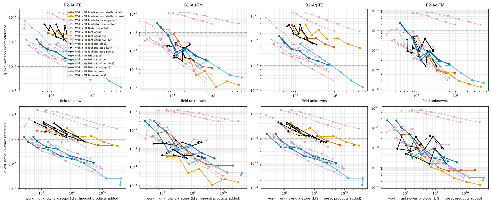
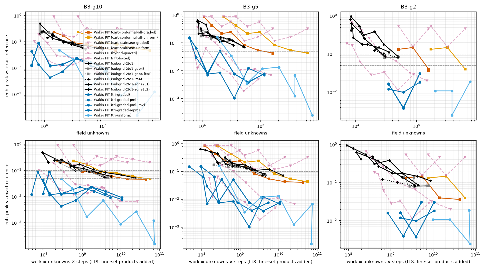
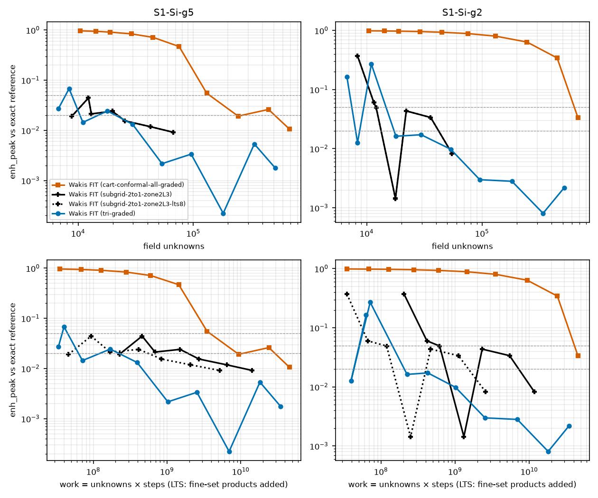
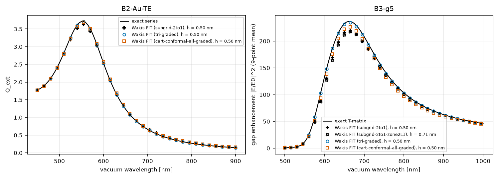

# Subgridded Cartesian FIT on the plasmonic and nanogap benchmarks

**Question.** `wakis.subgrid` is 1.4–2.1× cheaper than the best graded baselines on the smooth dielectric Mie cylinder (`../mie-cylinder-subgrid`). Does local Cartesian refinement also pay off when the field concentrates on curved metal surfaces (B2, B3) or in a nanogap (S1)?

**Arm** `wakis.benchmarks.arms.subgrid2d.Subgrid2DArm`:
- **Mesh.** A coarse grid H = h·2^L (at most λ_host/20, or λ_host/40 for the `ppw40` arm), refined 2:1 down to h on and inside the metal, plus a band of 2 cells per level.
- **Gap refinement.**
  - `gap_zone = 2`, `gap_levels = L`: every cell whose local gap width (the sum of the distances to the two nearest surfaces) is below 2 g gets L more levels. That covers the gap and the facing surfaces.
  - `gap_cells = 4`: refine until 4 cells span the local gap.
- **Materials.** Rakić Au/Ag Drude–Lorentz poles through the ADE. In TE each sub-pixel column of a cut edge carries its own metal-segment field in series with the host, which is exact for a flat surface aligned with the grid. In TM the poles sit on the nodes, weighted by area fraction.
- **Excitation and boundary.** Scattered-field plane wave in the host, split-field PML on the coarse frame.
- **LTS.** Optional two-level LTS (`lts=p`).

Every record went to the shared store (`gs://cloud-code-511302-autoresearch/bench-results/<case>/<arm>/`) under the arm names `subgrid-2to1[-ppw40|-lts4|-gap4|-gap4-lts8|-zone2L1|-zone2L2|-zone2L3|...]`. Each record carries its commit and Batch job id. All runs used one n2-standard-2 spot machine per task (uncontended).

## Results

The full tables, with every arm in the store, are in [`data/summary_B2_B3.md`](data/summary_B2_B3.md), as unknowns, work and time to target, interpolated in order of unknowns. A negative value means the coarsest run is already below the target. The arms run at the same h and are compared at equal unknowns and work.


**B2.** Q_ext NRMS vs unknowns (top) and work (bottom), for Au and Ag, TE and TM.


**B3.** Peak gap enhancement (9-point mean) error vs cost, for gaps of 10, 5 and 2 nm.


**S1.** Si nanogap dimer, peak gap enhancement vs cost.


**Spectra.** Wakis FIT (markers) at h = 0.5 nm vs the exact series / T-matrix (lines).

### B2: plasmonic nanocylinder, Q_ext NRMS

| case | target | subgrid-2to1 | cart-conformal-all-graded | tri-graded | hybrid-quadtri |
|---|---|---|---|---|---|
| Au TE | 1 % | 25k unknowns, 1.6e9 work | 46k, 2.0e9 | 4.8k, 6.5e7 | 5.6k, 4.8e7 |
| Ag TE | 1 % | 21k, 1.2e9 | 42k, 1.8e9 | 4.8k, 6.5e7 | 5.3k, 5.5e7 |
| Au TM | 0.1 % | not reached; 0.03 % with ppw40 at 18k (floor 0.14–0.2 % at ppw20) | 21k | 27k | 16k |
| Ag TM | 0.1 % | 11k (ppw40) | 16k | 11k | 13k |

- **TE (LSPR, E normal to the curved metal surface).** The subgrid needs 1.8–2× fewer unknowns than graded conformal Cartesian at 1 %. Graded triangles and the quad–triangle hybrid still need 4–5× fewer than the subgrid.
  - The subgrid TE error is first order in h: 5.1, 2.9, 1.6 and 0.9 % at h = 4, 2, 1 and 0.5 nm (Au).
  - That is the diagonal (axis-aligned) Hodge at a curved metal surface. The series-per-column ADE is exact only for grid-aligned surfaces.
  - Local refinement reduces the cost of this error but does not change its order. Body-fitted triangles have no such error.
- **TM.** With the default coarse grid (20 cells per host wavelength, H = 8 nm) the error plateaus at 0.1–0.2 %. Neither a thicker PML nor a smaller jump ratio changes it, but 40 cells per wavelength lowers it to 0.02–0.04 % (`ppw40`). So it is the coarse-grid phase error between the scatterer and the extraction circles, not the interface or the absorber.
- **LTS with Rakić Au/Ag.** At the coarse step of p = 4, 12 of 28 runs fail the ADE stability check (Lorentz poles up to 2×10¹⁶ rad/s) or diverge. LTS is not usable for these metals until the ADE of the fine set is sub-stepped.

### B3: Au nanodimer gap (9-point enhancement metric, commit 6771d3c)

| case | target | subgrid (best variant) | cart-conformal-all-graded | tri-graded | hybrid-quadtri |
|---|---|---|---|---|---|
| g10 | 10 % | 21k (2:1) | 30k | ≤ 6k | 6.9k |
| g5 | 10 % | 28k (zone2L1) | 48k | 6.4k | ≤ 7k |
| g2 | 10 % | 27k (zone2L1) | 104k | ≤ 35k | 10k |
| all | 5 % | not reached (best 5.1–8.6 %) | 111–143k | 7–35k | 9–13k |

- The subgrid needs 1.5–3.8× fewer unknowns than graded Cartesian at 10 %, but 3–4× more than triangles or the hybrid, and it does not reach 5 % on the ladder.
- Refining the gap zone by 1–2 extra levels (zone2L1/L2, gap4) does not lower the error at equal surface h. The error comes from the first-order TE metal-surface averaging on the whole facing surfaces, not from resolving the gap.
- The stale-store caveat: the triangle and Cartesian B3 records are being regenerated (bench-redo-20261019-0741), so their B3 numbers here are from the store at the time of writing. The arms `subgrid-2to1-gap4`, `-gap4-lts8` and `-lts4` in the store still carry the old centre-point metric. `subgrid-2to1`, `-zone2L1` and `-zone2L2` were republished with the 9-point metric.

### S1 (extra case): Si nanogap dimer, where local refinement should pay off

- **Geometry.** Two Si cylinders (n = 3.5, a = 100 nm) with a 5 nm or 2 nm gap, in vacuum. TE, E along the axis, λ = 0.8–2 µm.
- **Metric and reference.** Peak gap enhancement (about 54, 9-point mean) against the exact T-matrix.
- **Arms.** All arms ran here at the same h ladder (`showcase.py`, 68 Batch tasks). The subgrid puts h on the surfaces and h/8 in the gap zone.

| case | target | subgrid-2to1-zone2L3 | + LTS p = 8 | cart-conformal-all-graded | tri-graded |
|---|---|---|---|---|---|
| g5 | 5 % | ≤ 8.8k unknowns, ≤ 2.3e8 work, ≤ 15 s | ≤ 4.6e7 work, ≤ 2 s | 138k, 3.8e9, 101 s | 8.8k, 4.5e7, 2 s |
| g5 | 2 % | 22k, 1.9e9, 65 s | 5.6e8, 10 s | 509k, 2.9e10, 861 s | 21k, 2.2e8, 7 s |
| g2 | 5 % | 12k, 6.0e8, 20 s | 1.1e8, 6 s | 631k, 4.1e10, 1202 s | 15k, 1.4e8, 7 s |
| g2 | 2 % | 42k, 7.2e9, 130 s | 1.5e9, 22 s | not reached (3.4 % at 677k) | 17k, 2.1e8, 10 s |

- **Against the graded rectilinear grid** (the method subgridding replaces), the subgrid needs 16–52× fewer unknowns. With LTS it is 50–200× faster. A rectilinear grid must carry the gap size along full rows and columns: at h = 1 nm that is 680k unknowns.
- **Against graded triangles,** it reaches about the same unknowns at 5 % (g5: equal; g2: 1.2× fewer) and 2.4× more at 2 % for g2.
  - Triangles conform to the curved surfaces and converge faster.
  - The subgrid's error is again first order where E crosses the curved Si surface; at n = 3.5 the contrast is larger than in B1.
- **LTS works here** because Si is non-dispersive. p = 8 cuts the subgrid's steps 8× (ρ < 1 checked at setup) with an unchanged error (0.915 % vs 0.915 % at h = 2.5 nm, g5).
- **Non-monotone errors.** The convergence ladders are noisy: the gap field depends on where cells fall relative to the gap. Treat the interpolated targets as ±30 %.

### Verdict

- **Local Cartesian refinement removes the rectilinear penalty.** It gives 2× on B1, 1.8–2× on B2 TE, 1.5–3.8× on B3 and 16–52× on S1 against graded Cartesian.
- **It is competitive with graded triangles in dielectrics.** It is ahead on B1 and on par at 5 % on S1.
- **For metal surfaces in TE, body-fitted triangles (or the quad–triangle hybrid) are 4–5× cheaper.** The limiting error is the diagonal sub-pixel Hodge at curved surfaces, not the mesh size. The natural next step is to use this interface operator for nested quadtree refinement inside the Cartesian part of the hybrid, keeping body-fitted cells only at curved metal.


**Data folders.**
- `data/B2`, `data/B2p`: B2.
- `data/B3n`: B3 with the 9-point metric.
- `data/B3`, `data/B3z`: B3 with the superseded centre-point metric; not used above.
- `data/S1`: S1 with the 9-point metric.
- `data/S1_centre`: the first S1 sweep with the centre-point metric. The conclusions are the same: subgrid 4.3 % at 22k unknowns vs Cartesian 3.4 % at 677k for g2.

## Reproduce

```bash
python sg_bench.py run --phase B2|B2p|B3|B3z --shard I --nshards N --outdir out   # Cloud Batch
python showcase.py run --shard I --nshards 68 --outdir out                        # S1 (all arms)
python publish_sg.py --phase B2 --commit <sha> --job <batch job>                 # to the store
BENCH_ROOT=<local mirror of the store> python plot_bench.py                       # figures + data/summary_B2_B3.md
```
