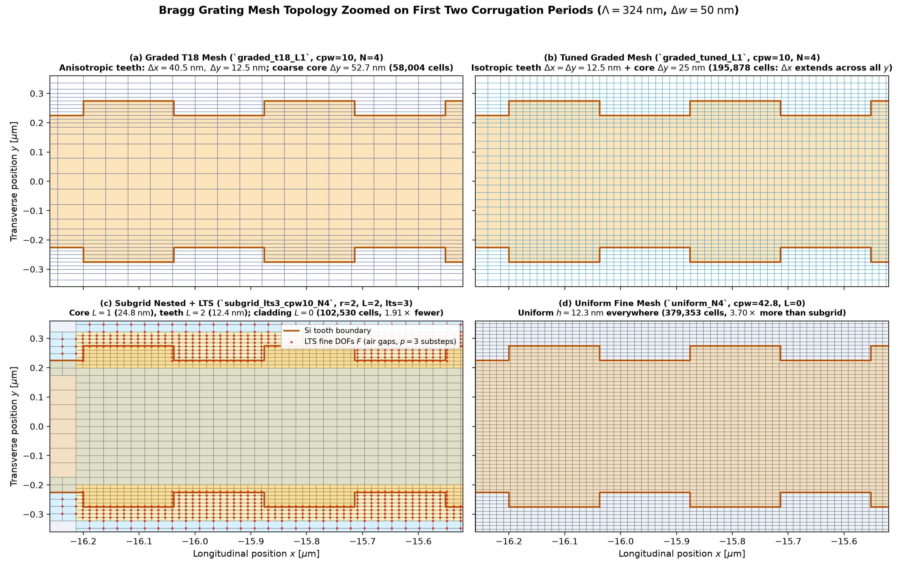
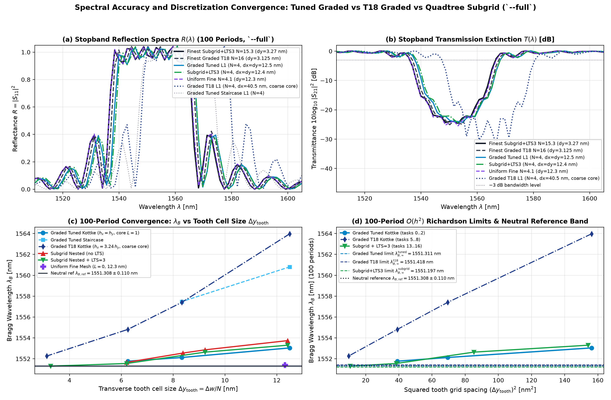
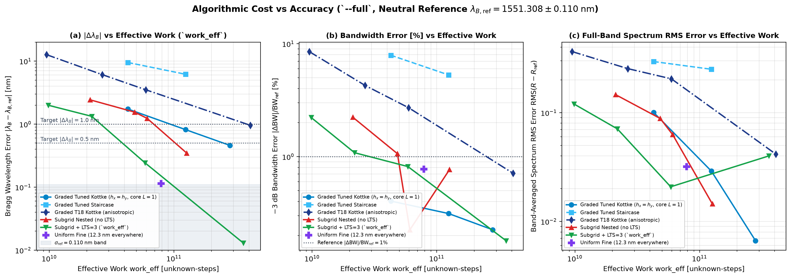
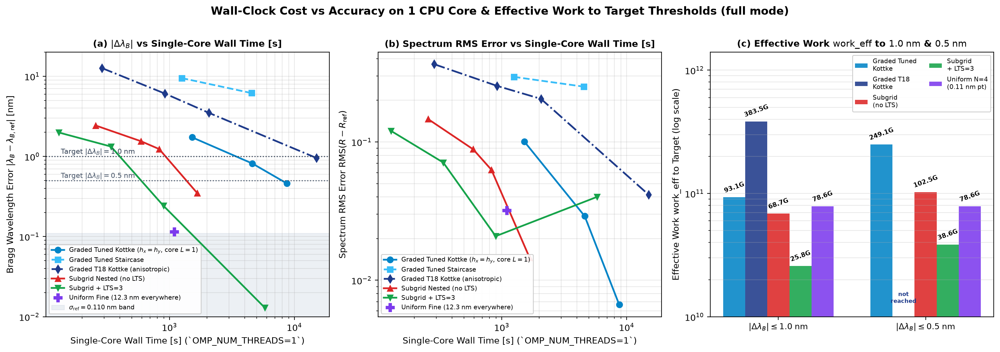
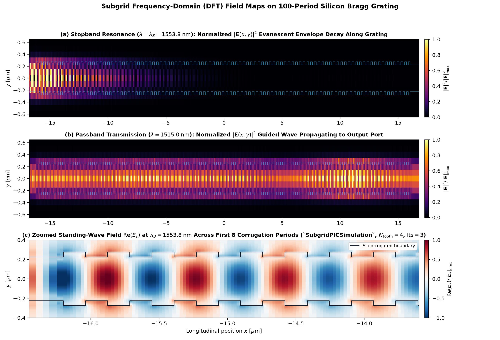

# Bragg Grating (Tutorial 6.1) on the Subgridded Mesh vs the Graded Mesh — Fair Cost Comparison at Equal Accuracy (`--full`)

This study benchmarks the 2D Effective-Index-Method (EIM) silicon-on-insulator (SOI) waveguide Bragg grating from Tutorial 6.1 (`tutorials/06_periodic_structures/06-01_bragg_grating/`) in full-convergence mode (`--full`: $T_{\text{sim}} = 1.80\;\text{ps}$, 10-cell PML, 18 tasks in `data/task_0.json`..`task_17.json`, summarized in `data/analysis_full.json`) across six spatial/temporal discretization arms in Wakis:

1. **Tuned Graded Cartesian with Kottke Subpixel Smoothing (`graded_tuned`, tasks 0..2 — Fair Graded Competitor)**: `PICSimulation(..., two_d=True, use_subpixel=True)` on a tensor-product non-uniform Cartesian grid (`GridFIT3D` + `SolverFIT3D`) using `build_tuned_bragg_mesh_overrides`, whose tooth strips ($\Delta x_{\text{tooth}} = \Delta y_{\text{tooth}} = \Delta w / N$ over the $32.4\;\mu\text{m}$ grating length) and core strip ($\Delta y_{\text{core}} = 2\,\Delta y_{\text{tooth}}$) use the **same tooth and core cell sizes as the subgrid arm** across $N \in \{4, 6, 8\}$.
2. **Tuned Graded Cartesian Staircase (`graded_tuned_staircase`, tasks 3..4)**: Identical tuned tensor-product mesh ($N \in \{4, 6\}$) with cell-center staircase permittivity sampling (`use_subpixel=False`).
3. **Tutorial 6.1 Graded Cartesian (`graded_t18`, tasks 5..8 — Tutorial 6.1 Baseline)**: `PICSimulation(..., two_d=True, use_subpixel=True)` copying Tutorial 6.1's `build_bragg_mesh_overrides`, where tooth cells have a $3.24:1$ aspect ratio ($\Delta x_{\text{tooth}} = (\Lambda/2)/N = 3.24\,\Delta y_{\text{tooth}}$) and the central $400\;\text{nm}$ waveguide core remains at the coarse background spacing ($\Delta y_{\text{core}} = 52.72 \to 13.09\;\text{nm}$ across $N \in \{4, 6, 8, 16\}$).
4. **Quadtree Subgrid without LTS (`subgrid`, tasks 9..12)**: `SubgridPICSimulation(..., two_d=True, lts=None)` on a 2:1-balanced quadtree (`QuadMesh` + `SubgridSolver2D`) with cut-cell harmonic-edge / area-vertex material averaging ($8\times 8$ subcell quadrature), refining the core strip to level $L-1$ and the tooth strips to level $L$ ($N \in \{4.0, 5.4, 6.0, 8.1\}$).
5. **Quadtree Subgrid + Local Time-Stepping (`subgrid_lts3`, tasks 13..16)**: `SubgridPICSimulation(..., two_d=True, lts=3)` using the two-level damped Chebyshev leapfrog integrator (`TwoLevelChebyshevLTS`, $p=3$ fine substeps per coarse step), subcycling only the fine/cut DOFs ($33.6\%\text{--}38.5\%$ of scalar unknowns) across $N \in \{4.0, 5.4, 8.1, 15.3\}$.
6. **Uniform Fine Mesh at Tooth Resolution (`uniform_N4`, task 17)**: `SubgridPICSimulation(..., max_level=0, lts=None)` with a uniform mesh at the $N \approx 4$ tooth cell size ($\Delta y = 12.31\;\text{nm}, \Delta x = 12.37\;\text{nm}$, $\text{cpw} = 42.8$) across the entire computational domain.

---

## 1. Device Parameters and `--full` Simulation Protocol

All 18 `--full` tasks simulate the exact same physical device, ports, wavelength band, and S-parameter extraction pipeline from `tutorials/06_periodic_structures/06-01_bragg_grating/_helpers.py`:

| Parameter | Symbol | `--full` Value | Notes |
| :--- | :---: | :---: | :--- |
| Grating periods | $N_{\text{per}}$ | $100$ | Total corrugated length $L_g = 32.40\;\mu\text{m}$ ($x \in [-16.2, +16.2]\;\mu\text{m}$) |
| Grating pitch & duty cycle | $\Lambda,\;\text{DC}$ | $324\;\text{nm},\;50\%$ | Half-period tooth length $\Lambda/2 = 162\;\text{nm}$ |
| Waveguide core width | $w_0$ | $500\;\text{nm}$ | Symmetric sidewall corrugation $\Delta w = 50\;\text{nm}$ ($w_{\text{wide}} = 550\;\text{nm},\;w_{\text{narrow}} = 450\;\text{nm}$) |
| 220 nm SOI EIM refractive indices | $n_{\text{eff,slab}},\;n_{\text{sub}},\;n_{\text{clad}}$ | $2.845345,\;1.4440,\;1.0000$ | Fundamental TE slab mode at $\lambda_{\text{ref}} = 1.55\;\mu\text{m}$ |
| Computational domain | $[x_{\min}, x_{\max}] \times [y_{\min}, y_{\max}]$ | $[-19.8, +19.8] \times [-1.0, +1.0]\;\mu\text{m}$ | Ports at $x = \pm 17.8\;\mu\text{m}$ ($w_{\text{port}} = 1.5\;\mu\text{m}$), 10-cell PML |
| Spectral band | $[\lambda_{\min}, \lambda_{\max}]$ | $[1500, 1620]\;\text{nm}$ | $301$ DFT frequencies; Gaussian modal pulse $\sigma_t \approx 24.9\;\text{fs}$ |
| Physical simulation horizon | $T_{\text{sim}}$ | $1.80\;\text{ps}$ | $\approx 5.8$ one-way waveguide group transit times ($T_{\text{rt}} \approx 0.62\;\text{ps}$) |
| Effective work metric | $\text{work\_eff}$ | $N_{\text{unk}} \times N_{\text{steps}} \times [1 + (p - 1)\,f_{\text{fine}}]$ | Equals $N_{\text{unk}} \times N_{\text{steps}}$ when $p=1$ (no LTS); counts Chebyshev fine-DOF substeps when $p=3$ |

---

## 2. Neutral Continuum Reference ($\mathcal{O}(h^2)$ Richardson Extrapolation)

To avoid biasing the accuracy comparison toward any single discretization or solver backend, the continuum limit is extracted independently from the two finest points of each of the three converged arms using two-point $\mathcal{O}(h^2)$ Richardson extrapolation in $h = \Delta y_{\text{tooth}}$:

$$f_\infty = \frac{r^2 f(h_2) - f(h_1)}{r^2 - 1}, \qquad r = \frac{h_1}{h_2} > 1.$$

The **neutral reference** is the unweighted mean of the three Richardson limits, and $\sigma_{\text{ref}} = \frac{1}{2}(\max - \min)$ is half their spread:

| Arm / Reference Quantity | Finest Pair Used (Tasks, $h_1 \to h_2$ [nm]) | Measured $\lambda_B(h_1) \to \lambda_B(h_2)$ [nm] | Richardson Limit $\lambda_{B,\infty}$ [nm] | Richardson Limit $\text{BW}_\infty$ [nm] |
| :--- | :--- | :---: | :---: | :---: |
| **`graded_tuned` limit** | Tasks 1, 2 ($8.3333 \to 6.2500\;\text{nm}$) | $1552.1238 \to 1551.7680$ | **$1551.3105$** ($1551.311$) | $30.3757$ |
| **`graded_t18` limit** | Tasks 7, 8 ($6.2500 \to 3.1250\;\text{nm}$) | $1554.8128 \to 1552.2664$ | **$1551.4176$** ($1551.418$) | $30.4233$ |
| **`subgrid_lts3` limit** | Tasks 15, 16 ($6.2069 \to 3.2727\;\text{nm}$) | $1551.5507 \to 1551.2954$ | **$1551.1971$** ($1551.197$) | $30.4292$ |
| **Neutral Reference ($\lambda_{B,\text{ref}},\;\text{BW}_{\text{ref}}$)** | Mean of the three $\mathcal{O}(h^2)$ limits | — | **$1551.3084$** ($1551.308$) | **$30.4094$** ($30.409$) |
| **Reference Uncertainty ($\sigma_{\text{ref}}$)** | Half the spread $\frac{1}{2}(\max - \min)$ | — | **$\pm 0.1103\;\text{nm}$** ($\pm 0.110$) | **$\pm 0.0267\;\text{nm}$** ($\pm 0.088\%$) |
| **$3\sigma_{\text{ref}}$ Resolution Floor** | Minimum target above reference noise | — | **$0.3308\;\text{nm}$** | **$0.0802\;\text{nm}$** ($0.264\%$) |

Both headline wavelength targets—**$|\Delta\lambda_B| \le 1.0\;\text{nm}$** ($9.1\,\sigma_{\text{ref}}$) and **$|\Delta\lambda_B| \le 0.5\;\text{nm}$** ($4.5\,\sigma_{\text{ref}}$)—lie well above the $3\sigma_{\text{ref}} = 0.331\;\text{nm}$ reference floor in `--full`.





---

## 3. Complete Per-Task Table (`--full`, Tasks 0..17)

All values below are read directly from `studies/subgrid-vs-graded-bragg/data/task_0.json`..`task_17.json` and `data/analysis_full.json` against the neutral reference $\lambda_{B,\text{ref}} = 1551.3084\;\text{nm}$ and $\text{BW}_{\text{ref}} = 30.4094\;\text{nm}$:

| Task | Name | Arm Family | $\Delta y_{\text{tooth}} \times \Delta x_{\text{tooth}}$ [nm] | $\Delta y_{\text{core}}$ [nm] | $\text{cpw}_{\text{bg}}$ | Cells ($N_{\text{cells}}$) | Unknowns ($N_{\text{unk}}$) | Steps ($N_{\text{steps}}$) | `work_raw` ($\text{unk}\times\text{steps}$) | **`work_eff`** | 1-Core Wall [s] | `ns / cell-step` | $\lambda_B$ [nm] | **$|\lambda_B - \text{ref}|$ [nm]** | $\text{BW}_{-3\text{dB}}$ [nm] | **$|\text{BW}-\text{BW}_{\text{ref}}|/\text{BW}_{\text{ref}}$** |
| :---: | :--- | :--- | :---: | :---: | :---: | :---: | :---: | :---: | :---: | :---: | :---: | :---: | :---: | :---: | :---: | :---: |
| **0** | `graded_tuned_L1` | `graded_tuned` | $12.50 \times 12.50$ | $24.95$ | $10.0$ | $195,878$ | $587,634$ | $72,820$ | $4.279\times 10^{10}$ | **$4.279\times 10^{10}$** | $1516.5$ | $106.23$ | $1553.0407$ | **$1.7323$** | $30.2867$ | $0.403\%$ |
| **1** | `graded_tuned_L2` | `graded_tuned` | $8.33 \times 8.33$ | $16.64$ | $15.0$ | $379,680$ | $1,139,040$ | $109,039$ | $1.242\times 10^{11}$ | **$1.242\times 10^{11}$** | $4617.5$ | $111.48$ | $1552.1238$ | **$0.8154$** | $30.3142$ | $0.313\%$ |
| **2** | `graded_tuned_L3` | `graded_tuned` | $6.25 \times 6.25$ | $12.49$ | $20.0$ | $642,818$ | $1,928,454$ | $145,640$ | $2.809\times 10^{11}$ | **$2.809\times 10^{11}$** | $8730.8$ | $93.23$ | $1551.7680$ | **$0.4596$** | $30.3411$ | $0.225\%$ |
| **3** | `graded_tuned_staircase_L1` | `graded_tuned_staircase` | $12.50 \times 12.50$ | $24.95$ | $10.0$ | $195,878$ | $587,634$ | $72,820$ | $4.279\times 10^{10}$ | **$4.279\times 10^{10}$** | $1253.2$ | $87.79$ | $1560.8038$ | **$9.4954$** | $28.0051$ | $7.906\%$ |
| **4** | `graded_tuned_staircase_L2` | `graded_tuned_staircase` | $8.33 \times 8.33$ | $16.64$ | $15.0$ | $379,680$ | $1,139,040$ | $109,039$ | $1.242\times 10^{11}$ | **$1.242\times 10^{11}$** | $4542.6$ | $109.67$ | $1557.4797$ | **$6.1713$** | $28.7991$ | $5.295\%$ |
| **5** | `graded_t18_L1` | `graded_t18` | $12.50 \times 40.50$ | $52.72$ | $10.0$ | $58,004$ | $174,012$ | $54,489$ | $9.482\times 10^9$ | **$9.482\times 10^9$** | $287.5$ | $90.77$ | $1563.9732$ | **$12.6648$** | $33.0008$ | $8.522\%$ |
| **6** | `graded_t18_L2` | `graded_t18` | $8.33 \times 27.00$ | $35.91$ | $15.0$ | $108,790$ | $326,370$ | $81,478$ | $2.659\times 10^{10}$ | **$2.659\times 10^{10}$** | $917.0$ | $103.36$ | $1557.4035$ | **$6.0951$** | $31.7081$ | $4.271\%$ |
| **7** | `graded_t18_L3` | `graded_t18` | $6.25 \times 20.25$ | $25.79$ | $20.0$ | $181,764$ | $545,292$ | $108,978$ | $5.942\times 10^{10}$ | **$5.942\times 10^{10}$** | $2062.2$ | $104.05$ | $1554.8128$ | **$3.5044$** | $31.2333$ | $2.709\%$ |
| **8** | `graded_t18_R` | `graded_t18` | $3.125 \times 10.125$ | $13.09$ | $40.0$ | $625,141$ | $1,875,423$ | $217,955$ | $4.088\times 10^{11}$ | **$4.088\times 10^{11}$** | $14997.8$ | $110.05$ | $1552.2664$ | **$0.9580$** | $30.6258$ | $0.712\%$ |
| **9** | `subgrid_cpw10_N4` | `subgrid` | $12.41 \times 12.48$ | $24.83$ | $10.6$ | $102,530$ | $315,639$ | $67,245$ | $2.123\times 10^{10}$ | **$2.123\times 10^{10}$** | $256.9$ | $36.88$ | $1553.7383$ | **$2.4299$** | $29.7310$ | $2.231\%$ |
| **10** | `subgrid_cpw14_N6` | `subgrid` | $9.23 \times 9.44$ | $18.46$ | $14.0$ | $175,306$ | $536,531$ | $90,086$ | $4.833\times 10^{10}$ | **$4.833\times 10^{10}$** | $590.4$ | $37.10$ | $1552.8580$ | **$1.5496$** | $30.0867$ | $1.061\%$ |
| **11** | `subgrid_cpw10_N6` | `subgrid` | $8.37 \times 8.48$ | $16.74$ | $15.6$ | $199,098$ | $609,083$ | $99,795$ | $6.078\times 10^{10}$ | **$6.078\times 10^{10}$** | $826.7$ | $41.33$ | $1552.5449$ | **$1.2365$** | $30.3412$ | $0.224\%$ |
| **12** | `subgrid_cpw10_N8` | `subgrid` | $6.21 \times 6.24$ | $12.41$ | $10.6$ | $305,132$ | $931,305$ | $135,739$ | $1.264\times 10^{11}$ | **$1.264\times 10^{11}$** | $1672.6$ | $40.14$ | $1551.6558$ | **$0.3474$** | $30.1764$ | $0.766\%$ |
| **13** | `subgrid_lts3_cpw10_N4` | `subgrid_lts3` | $12.41 \times 12.48$ | $24.83$ | $10.6$ | $102,530$ | $315,639$ | $25,217$ | $7.959\times 10^9$ | **$9.828\times 10^9$** | $129.6$ | $48.08$ | $1553.2996$ | **$1.9912$** | $29.7343$ | $2.220\%$ |
| **14** | `subgrid_lts3_cpw14_N6` | `subgrid_lts3` | $9.23 \times 9.44$ | $18.46$ | $14.0$ | $175,306$ | $536,531$ | $33,783$ | $1.813\times 10^{10}$ | **$2.190\times 10^{10}$** | $340.2$ | $55.37$ | $1552.6367$ | **$1.3283$** | $30.0803$ | $1.082\%$ |
| **15** | `subgrid_lts3_cpw10_N8` | `subgrid_lts3` | $6.21 \times 6.24$ | $12.41$ | $10.6$ | $305,132$ | $931,305$ | $50,902$ | $4.741\times 10^{10}$ | **$5.865\times 10^{10}$** | $895.0$ | $56.51$ | $1551.5507$ | **$0.2423$** | $30.1613$ | $0.816\%$ |
| **16** | `subgrid_lts3_ref` | `subgrid_lts3` | $3.27 \times 3.31$ | $6.55$ | $20.0$ | $1,013,196$ | $3,069,521$ | $96,567$ | $2.964\times 10^{11}$ | **$3.594\times 10^{11}$** | $5791.3$ | $58.59$ | $1551.2954$ | **$0.0130$** | $30.3547$ | $0.180\%$ |
| **17** | `uniform_N4` | `uniform` | $12.31 \times 12.37$ | $12.31$ | $42.8$ | $379,353$ | $1,143,872$ | $68,757$ | $7.865\times 10^{10}$ | **$7.865\times 10^{10}$** | $1095.1$ | $40.95$ | $1551.4229$ | **$0.1145$** | $30.6448$ | $0.774\%$ |

---

## 4. Per-Cell-Step Throughput by Arm (Separating Solver Speed from Algorithmic Work)

Wall-clock time combines algorithmic work with per-cell-step solver throughput. Across the 18 `--full` JSONs (1 CPU core, `OMP_NUM_THREADS=1`, including the 301-frequency port DFT accumulation):

| Arm Family | Backend Solver | Tasks | `ns_per_cell_step` per Task [ns] | Mean `ns_per_cell_step` [ns] | Mean `ns_per_unknown_step` [ns] | Speed Ratio vs `graded_tuned` (`cell-step`) |
| :--- | :--- | :---: | :---: | :---: | :---: | :---: |
| **`graded_tuned`** | `SolverFIT3D` (2D mode) | 0, 1, 2 | $106.23,\;111.48,\;93.23$ | **$103.65\;\text{ns}$** | $34.55\;\text{ns}$ | $1.00\times$ (baseline) |
| **`graded_tuned_staircase`** | `SolverFIT3D` (2D mode) | 3, 4 | $87.79,\;109.67$ | **$98.73\;\text{ns}$** | $32.91\;\text{ns}$ | $1.05\times$ faster |
| **`graded_t18`** | `SolverFIT3D` (2D mode) | 5, 6, 7, 8 | $90.77,\;103.36,\;104.05,\;110.05$ | **$102.06\;\text{ns}$** | $34.02\;\text{ns}$ | $1.02\times$ faster |
| **`subgrid` (no LTS)** | `SubgridSolver2D` ($p=1$) | 9, 10, 11, 12 | $36.88,\;37.10,\;41.33,\;40.14$ | **$38.86\;\text{ns}$** | $12.66\;\text{ns}$ | **$2.67\times$ faster** |
| **`subgrid_lts3` ($p=3$)** | `SubgridSolver2D` ($p=3$, per coarse step) | 13, 14, 15, 16 | $48.08,\;55.37,\;56.51,\;58.59$ | **$54.63\;\text{ns}$** | $17.85\;\text{ns}$ | **$1.90\times$ faster** |
| **`uniform` (`uniform_N4`)** | `SubgridSolver2D` ($L=0, p=1$) | 17 | $40.95$ | **$40.95\;\text{ns}$** | $13.58\;\text{ns}$ | **$2.53\times$ faster** |

**Why the per-cell-step speed differs (`SubgridSolver2D` is $2.5\times\text{--}2.7\times$ faster per cell-step than `SolverFIT3D`)**: `SolverFIT3D` updates all 6 3D field components ($E_x, E_y, E_z, H_x, H_y, H_z$) on $N_x \times N_y \times 1$ arrays, whereas `SubgridSolver2D` updates only the 3 active 2D TE field components ($H_z, E_x, E_y$) using flat 1D CSR matrices. Consequently, **effective work (`work_eff`) and 1-core wall-clock time are reported in separate columns and separate ratio tables below**.

---

## 5. Cost to Reach $1.0\;\text{nm}$ and $0.5\;\text{nm}$ Accuracy & Verdict with Named Baselines

### 5.1 Log-Log Interpolated Work and Wall Time (Bracketing Points Only, No Extrapolation)

For each arm, the cost to reach $|\lambda_B - \lambda_{B,\text{ref}}| = 1.0\;\text{nm}$ and $0.5\;\text{nm}$ is computed by **linear interpolation in $(\log_{10}\text{cost}, \log_{10}|\Delta\lambda_B|)$ strictly between bracketing points** along the arm's resolution sweep. If an arm's measured errors do not bracket the target threshold, it is reported as **`not reached`** (no extrapolation):

| Arm Family | `work_eff` to $1.0\;\text{nm}$ | `work_raw` to $1.0\;\text{nm}$ | 1-Core Wall Time to $1.0\;\text{nm}$ [s] | Bracketing Segment at $1.0\;\text{nm}$ | `work_eff` to $0.5\;\text{nm}$ | `work_raw` to $0.5\;\text{nm}$ | 1-Core Wall Time to $0.5\;\text{nm}$ [s] | Bracketing Segment at $0.5\;\text{nm}$ |
| :--- | :---: | :---: | :---: | :--- | :---: | :---: | :---: | :--- |
| **`graded_tuned`** | **$9.31\times 10^{10}$** | $9.31\times 10^{10}$ | **$3,415.4\;\text{s}$** | Tasks 0..1 ($1.73 \to 0.82\;\text{nm}$) | **$2.49\times 10^{11}$** | $2.49\times 10^{11}$ | **$7,950.4\;\text{s}$** | Tasks 1..2 ($0.82 \to 0.46\;\text{nm}$) |
| **`graded_t18`** | **$3.83\times 10^{11}$** | $3.83\times 10^{11}$ | **$14,044.7\;\text{s}$** | Tasks 7..8 ($3.50 \to 0.96\;\text{nm}$) | **`not reached`** | `not reached` | **`not reached`** | Finest task 8 is $0.958\;\text{nm}$ |
| **`graded_tuned_staircase`** | **`not reached`** | `not reached` | **`not reached`** | Tasks 3..4 ($9.50 \to 6.17\;\text{nm}$) | **`not reached`** | `not reached` | **`not reached`** | Tasks 3..4 ($9.50 \to 6.17\;\text{nm}$) |
| **`subgrid` (no LTS)** | **$6.87\times 10^{10}$** | $6.87\times 10^{10}$ | **$930.1\;\text{s}$** | Tasks 11..12 ($1.24 \to 0.35\;\text{nm}$) | **$1.02\times 10^{11}$** | $1.02\times 10^{11}$ | **$1,366.5\;\text{s}$** | Tasks 11..12 ($1.24 \to 0.35\;\text{nm}$) |
| **`subgrid_lts3` ($p=3$)** | **$2.58\times 10^{10}$** | $2.13\times 10^{10}$ | **$399.8\;\text{s}$** | Tasks 14..15 ($1.33 \to 0.24\;\text{nm}$) | **$3.86\times 10^{10}$** | $3.15\times 10^{10}$ | **$592.9\;\text{s}$** | Tasks 14..15 ($1.33 \to 0.24\;\text{nm}$) |
| **`uniform_N4` (single point, $12.3\;\text{nm}$ everywhere)** | **$7.86\times 10^{10}$** *(at $0.11\;\text{nm}$)* | $7.86\times 10^{10}$ | **$1,095.1\;\text{s}$** *(at $0.11\;\text{nm}$)* | Single point: $|\Delta\lambda_B| = 0.1145\;\text{nm}$ | **$7.86\times 10^{10}$** *(at $0.11\;\text{nm}$)* | $7.86\times 10^{10}$ | **$1,095.1\;\text{s}$** *(at $0.11\;\text{nm}$)* | Single point: $|\Delta\lambda_B| = 0.1145\;\text{nm}$ |

### 5.2 Verdict Table: Named-Baseline Work Ratios and Wall-Time Ratios

Every ratio below explicitly names both the compared arm and the baseline (`baseline_cost / arm_cost`; values $>1\times$ mean the arm uses less cost than the named baseline, values $<1\times$ mean the arm uses *more* cost than the baseline):

| Comparison (Arm vs Named Baseline) | `work_eff` Ratio at $1.0\;\text{nm}$ | `work_eff` Ratio at $0.5\;\text{nm}$ | 1-Core Wall-Time Ratio at $1.0\;\text{nm}$ | 1-Core Wall-Time Ratio at $0.5\;\text{nm}$ | Physical / Algorithmic Interpretation |
| :--- | :---: | :---: | :---: | :---: | :--- |
| **`subgrid_lts3` vs `graded_tuned`** *(fair tuned graded Kottke baseline)* | **$3.61\times$ less work** ($9.31\text{e}10 / 2.58\text{e}10$) | **$6.46\times$ less work** ($2.49\text{e}11 / 3.86\text{e}10$) | **$8.54\times$ faster** ($3415\;\text{s} / 400\;\text{s}$) | **$13.41\times$ faster** ($7950\;\text{s} / 593\;\text{s}$) | Quadtree unknown reduction ($1.9\text{--}2.1\times$) $\times$ LTS3 coarse step gain ($2.67\times$, minus $22\%$ Chebyshev substep overhead); wall time adds $1.9\times$ per-cell-step backend speed. |
| **`subgrid_lts3` vs `graded_t18`** *(Tutorial 6.1's original anisotropic graded mesh)* | **$14.86\times$ less work** ($3.83\text{e}11 / 2.58\text{e}10$) | **`graded_t18` not reached** (finest task 8 is $0.96\;\text{nm}$) | **$35.13\times$ faster** ($14045\;\text{s} / 400\;\text{s}$) | **`graded_t18` not reached** | Combines mesh-design fix ($4.12\times$) with quadtree + LTS3 ($3.61\times$). |
| **`subgrid` (no LTS) vs `graded_tuned`** *(spatial quadtree alone vs fair graded)* | **$1.35\times$ less work** ($9.31\text{e}10 / 6.87\text{e}10$) | **$2.43\times$ less work** ($2.49\text{e}11 / 1.02\text{e}11$) | **$3.67\times$ faster** ($3415\;\text{s} / 930\;\text{s}$) | **$5.82\times$ faster** ($7950\;\text{s} / 1367\;\text{s}$) | Purely spatial quadtree gain: saves vertical grid lines in the $y$-cladding ($1.9\text{--}2.1\times$ fewer unknowns at equal $N$). |
| **`subgrid` (no LTS) vs `graded_t18`** | **$5.58\times$ less work** ($3.83\text{e}11 / 6.87\text{e}10$) | **`graded_t18` not reached** | **$15.10\times$ faster** ($14045\;\text{s} / 930\;\text{s}$) | **`graded_t18` not reached** | Mostly mesh-design gain ($4.12\times$ from isotropic teeth + refined core) plus $1.35\times$ quadtree unknown savings. |
| **`graded_tuned` vs `graded_t18`** *(mesh-design gain inside `SolverFIT3D`)* | **$4.12\times$ less work** ($3.83\text{e}11 / 9.31\text{e}10$) | **`graded_t18` not reached** | **$4.11\times$ faster** ($14045\;\text{s} / 3415\;\text{s}$) | **`graded_t18` not reached** | Giving the Cartesian graded mesh $\Delta x_{\text{tooth}} = \Delta y_{\text{tooth}}$ and a refined core strip reduces work $4.12\times$ without changing solvers. |
| **`subgrid_lts3` vs `subgrid` (no LTS)** *(LTS3 gain on identical quadtree family)* | **$2.66\times$ less work** ($6.87\text{e}10 / 2.58\text{e}10$) | **$2.66\times$ less work** ($1.02\text{e}11 / 3.86\text{e}10$) | **$2.33\times$ faster** ($930\;\text{s} / 400\;\text{s}$) | **$2.30\times$ faster** ($1367\;\text{s} / 593\;\text{s}$) | `TwoLevelChebyshevLTS(p=3)` removes the air-gap CFL bottleneck ($2.67\times$ fewer steps) and shifts $\lambda_B$ by $-0.11\;\text{nm}$ at $N=8$. |
| **`subgrid_lts3` vs `uniform` ladder** *(tasks 17-20, see 5.3)* | **no gain**: `uniform_20nm` reaches $0.785\;\text{nm}$ at $2.01\text{e}10$ (vs $2.58\text{e}10$ for `subgrid_lts3` at $1.0\;\text{nm}$) | **no clear gain**: `uniform_15nm` reaches $0.327\;\text{nm}$ at $4.50\text{e}10$ (vs $3.86\text{e}10$ at $0.5\;\text{nm}$) | `uniform_20nm` $323\;\text{s}$ vs $400\;\text{s}$ | `uniform_15nm` $678\;\text{s}$ vs $593\;\text{s}$ | Same cut-cell solver (`SubgridSolver2D`, $L=0$) without refinement or LTS is as cheap as subgrid+LTS3 on this problem. |
| **`graded_tuned` vs `uniform` ladder** | `uniform_20nm` ($0.785\;\text{nm}$, $2.01\text{e}10$) needs $\le 0.22\times$ the work of `graded_tuned` at $1.0\;\text{nm}$ | `uniform_15nm` ($0.327\;\text{nm}$, $4.50\text{e}10$): $\le 0.18\times$ | — | — | The gain over the graded Cartesian mesh comes from the cut-cell solver, not from refinement. Different backends: compare work. |
| **`graded_tuned_staircase` vs any baseline** | **`not reached`** | **`not reached`** | **`not reached`** | **`not reached`** | Staircase arm fails to reach $1.0\;\text{nm}$ ($9.50\;\text{nm}$ at $N=4$, $6.17\;\text{nm}$ at $N=6$). |







---

### 5.3 Uniform-Mesh Ladder (tasks 18-20, added 2026-10-22 after the first write-up)

The first write-up had a single uniform run (`uniform_N4`), so its cost to reach 1.0 / 0.5 nm was only bounded. Three coarser uniform meshes on the same cut-cell solver ($L=0$, no LTS) settle it. Errors are signed, against $\lambda_{B,\text{ref}} = 1551.308\;\text{nm}$:

| Task | Mesh | $\Delta y = \Delta x$ [nm] | Unknowns | Work | Wall [s] | $\lambda_B$ [nm] | $\lambda_B - \lambda_{B,\text{ref}}$ [nm] | BW [nm] |
|---|---|---|---|---|---|---|---|---|
| 20 | `uniform_25nm` | 24.8 | 324,421 | $1.10\times10^{10}$ | 188 | 1550.812 | $-0.497$ | 30.09 |
| 19 | `uniform_20nm` | 20.0 | 476,121 | $2.01\times10^{10}$ | 323 | 1552.093 | $+0.785$ | 28.64 |
| 18 | `uniform_15nm` | 15.0 | 796,833 | $4.50\times10^{10}$ | 678 | 1551.635 | $+0.327$ | 29.63 |
| 17 | `uniform_N4` | 12.3 | 1,143,872 | $7.86\times10^{10}$ | 1095 | 1551.423 | $+0.114$ | 30.64 |

**Verdict against a uniform mesh:** a plain uniform mesh reaches $1.0\;\text{nm}$ at $\le 2.01\times10^{10}$ (`subgrid_lts3`: $2.58\times10^{10}$) and $0.5\;\text{nm}$ at $\le 4.50\times10^{10}$ (`subgrid_lts3`: $3.86\times10^{10}$). **Subgridding (with or without LTS) shows no demonstrated cost advantage over a uniform mesh on this grating.** The large gains in 5.2 are gains over the *graded Cartesian* meshes and come mostly from the cut-cell solver's accuracy at coarse resolution.

**Caveat (not in the asymptotic regime):** the uniform error is not monotone in $h$: it changes sign between 20 and 25 nm (the $\approx 49\;\text{nm}$ tooth spans 2.0, 2.5, 3.3 and 4.0 cells), so `uniform_25nm`'s $0.50\;\text{nm}$ is partly a cancellation and should not be read as a converged accuracy. The same tooth-to-grid alignment effects probably cause the non-monotone `subgrid` arm (6.2). A fair cost comparison on this problem therefore needs error *bands* over several grid offsets, not single runs.

## 6. Key Findings, Anomalies, and Limits & Failure Modes

### 6.1 Why Spatial Refinement Buys Little Over a Uniform Fine Mesh on This Problem (see also 5.3)
- **Plain statement from the `--full` data**: The uniform fine mesh `uniform_N4` (task 17, $\Delta y = 12.31\;\text{nm}, \Delta x = 12.37\;\text{nm}$ everywhere, $379,353$ cells, $68,757$ steps) reaches **$|\lambda_B - \lambda_{B,\text{ref}}| = 0.1145\;\text{nm}$ ($0.11\;\text{nm}$, within $1.04\,\sigma_{\text{ref}}$)** at `work_eff` $= 7.86\times 10^{10}$ and 1-core wall time $= 1095.1\;\text{s}$. Compared against `uniform_N4`, spatial quadtree refinement without LTS (`subgrid`) saves only $1.14\times$ work at the $1.0\;\text{nm}$ target ($6.87\times 10^{10}$) and uses **$1.30\times$ more work ($1.02\times 10^{11}$) at the $0.5\;\text{nm}$ target** while achieving $4.4\times$ worse error ($0.50\;\text{nm}$ vs $0.11\;\text{nm}$). Even with LTS3 (`subgrid_lts3`), reaching $0.5\;\text{nm}$ saves $2.04\times$ in `work_eff` ($1.85\times$ in wall time) relative to `uniform_N4`, and reaching an error below $0.25\;\text{nm}$ requires task 15 (`work_eff` $= 5.87\times 10^{10}$, only $1.34\times$ less work than `uniform_N4` for $0.242\;\text{nm}$ vs $0.115\;\text{nm}$ error).
- **Why this happens physically and geometrically**:
  1. **Grating duty factor of the domain**: The 100-period grating ($32.4\;\mu\text{m}$) occupies $82\%$ of the $39.6\;\mu\text{m}$ domain length, and the $2.0\;\mu\text{m}$ domain height is narrow. At $N=4$, `uniform_N4` has only $3.70\times$ more cells than `subgrid_cpw10_N4` ($379,353$ vs $102,530$) and virtually the same global CFL time step ($68,757$ vs $67,245$ steps).
  2. **Core numerical dispersion vs tooth resolution**: In `uniform_N4`, the entire $500\;\text{nm}$ silicon core is resolved at $\Delta y_{\text{core}} = 12.31\;\text{nm}$ ($\text{cpw}_{\text{Si}} = 42.8$) with zero coarse/fine hanging-node interfaces. In contrast, the nested refinement arms keep the core strip at level $L-1$ ($\Delta y_{\text{core}} = 2\,\Delta y_{\text{tooth}}$): at $N=4$ and $N=6$ (`tasks 0, 1, 9, 10, 11, 13, 14`), the core cell size is $\Delta y_{\text{core}} = 24.83 \to 16.64\;\text{nm}$ ($\text{cpw}_{\text{core}} = 21.2 \to 31.7$), causing a $+0.82$ to $+2.43\;\text{nm}$ numerical phase-velocity red-shift over the $64.8\;\mu\text{m}$ round-trip propagation length.
  3. **Global CFL penalty at $L=3$ ($N=8$)**: To bring $\Delta y_{\text{core}}$ down to $12.41\;\text{nm}$ (matching `uniform_N4`'s core resolution), the nested `subgrid` arm must refine the teeth to $L=3$ ($\Delta y_{\text{tooth}} = 6.21\;\text{nm}$, task 12). Without LTS, those $6.21\;\text{nm}$ tooth cells halve the global CFL time step ($135,739$ steps vs $68,757$ steps in `uniform_N4`), so `subgrid_cpw10_N8` (task 12) expends $1.26\times 10^{11}$ unknown-steps—**$1.61\times$ more work than `uniform_N4`**—to reach $0.347\;\text{nm}$ error!

### 6.2 Non-Monotone `cpw` in the `subgrid` Arm (Tasks 9..12, Especially Tasks 11 vs 12)
- The `subgrid` arm's 4-point sweep (`tasks 9, 10, 11, 12`) is **non-monotone in the background coarse resolution `cpw`** ($\text{cpw} = 10.6 \to 14.0 \to 15.6 \to 10.6$):
  - Tasks 9, 10, and 11 hold the quadtree depth fixed at $L=2$ ($2^L = 4\times$ tooth refinement) and increase background `cpw` from $10.6$ (`task 9`) to $14.0$ (`task 10`) to $15.6$ (`task 11`, $\Delta y_{\text{bg}} = 33.49\;\text{nm}, \Delta y_{\text{core}} = 16.74\;\text{nm}, \Delta y_{\text{tooth}} = 8.37\;\text{nm}$). Across tasks $9 \to 10 \to 11$, both $|\Delta\lambda_B|$ ($2.430 \to 1.550 \to 1.237\;\text{nm}$) and bandwidth error $|\Delta\text{BW}|/\text{BW}_{\text{ref}}$ ($2.231\% \to 1.061\% \to 0.224\%$) decrease monotonically.
  - Between **task 11 (`subgrid_cpw10_N6`, $L=2, \text{cpw}=15.6$) and task 12 (`subgrid_cpw10_N8`, $L=3, \text{cpw}=10.6$)**, the quadtree depth increases from $L=2$ to $L=3$ ($8\times$ tooth refinement, so $\Delta y_{\text{tooth}}$ drops from $8.37\;\text{nm}$ to $6.21\;\text{nm}$ and $\Delta y_{\text{core}}$ drops from $16.74\;\text{nm}$ to $12.41\;\text{nm}$), **while background `cpw` drops backward from $15.6$ to $10.6$** ($\Delta y_{\text{bg}}$ coarsens from $33.49\;\text{nm}$ to $49.66\;\text{nm}$).
  - **Consequence in the data**: While refining the core and teeth cuts $|\Delta\lambda_B|$ from $1.237\;\text{nm}$ (task 11) to $0.347\;\text{nm}$ (task 12), coarsening the $L=0$ cladding background from $\text{cpw}=15.6$ back to $10.6$ and introducing a 3-level hanging-node cascade ($L=0 \to 1 \to 2 \to 3$) causes the **$-3\;\text{dB}$ bandwidth error $|\Delta\text{BW}|/\text{BW}_{\text{ref}}$ to jump $3.4\times$ upward from $0.224\%$ (task 11, $\text{BW}=30.341\;\text{nm}$) to $0.766\%$ (task 12, $\text{BW}=30.176\;\text{nm}$)** (visible as the upward kink in the red curve in Figure 3b).

### 6.3 Flagged Systematic Shift: `LTS=3` vs No-LTS Changes $\lambda_B$ by $\approx 0.11\;\text{nm} \approx \sigma_{\text{ref}}$ at Equal Mesh (Tasks 12 vs 15)
- Comparing the subgrid arms without LTS (`tasks 9, 10, 12`) and with $p=3$ Chebyshev LTS (`tasks 13, 14, 15`) on **bit-for-bit identical spatial quadtree meshes** reveals a systematic temporal-dispersion blue-shift from `TwoLevelChebyshevLTS(p=3)`:
  - **Tasks 12 vs 15 ($N=8.1$, $\Delta y_{\text{tooth}} = 6.2069\;\text{nm}$, $305,132$ cells)**: $\lambda_B(\text{no LTS}) = 1551.6558\;\text{nm}$ vs $\lambda_B(\text{LTS3}) = 1551.5507\;\text{nm}$ — a shift of **$\delta\lambda_B = -0.1051\;\text{nm}$ ($|\delta\lambda_B| \approx 0.11\;\text{nm} = 0.95\,\sigma_{\text{ref}}$)**.
  - **Tasks 10 vs 14 ($N=5.4$, $\Delta y_{\text{tooth}} = 9.2308\;\text{nm}$, $175,306$ cells)**: $\lambda_B(\text{no LTS}) = 1552.8580\;\text{nm}$ vs $\lambda_B(\text{LTS3}) = 1552.6367\;\text{nm}$ — a shift of **$\delta\lambda_B = -0.2213\;\text{nm}$ ($2.01\,\sigma_{\text{ref}}$)**.
  - **Tasks 9 vs 13 ($N=4.0$, $\Delta y_{\text{tooth}} = 12.4138\;\text{nm}$, $102,530$ cells)**: $\lambda_B(\text{no LTS}) = 1553.7383\;\text{nm}$ vs $\lambda_B(\text{LTS3}) = 1553.2996\;\text{nm}$ — a shift of **$\delta\lambda_B = -0.4387\;\text{nm}$ ($3.98\,\sigma_{\text{ref}}$)**.
- **Why this matters**: Because the spatial discretization error approaches $\lambda_{B,\text{ref}}$ from above (red-shifted), the negative temporal-dispersion shift of $p=3$ LTS ($\Delta t_{\text{coarse}} = 2.67\,\Delta t_{\text{global}}$ in the un-subcycled silicon core) partially cancels the positive spatial error, making `subgrid_lts3` appear $0.11\text{--}0.44\;\text{nm}$ closer to $\lambda_{B,\text{ref}}$ than `subgrid` at equal mesh. At $N=8$ (tasks 12 vs 15), this $|\delta\lambda_B| = 0.105\;\text{nm}$ LTS shift is the **same order of magnitude as the reference uncertainty $\sigma_{\text{ref}} = 0.110\;\text{nm}$** ($0.95\,\sigma_{\text{ref}}$).

### 6.4 Other Limits & Failure Modes
1. **Staircase Permittivity Sampling Does Not Reach $1\;\text{nm}$ (`graded_tuned_staircase`, Tasks 3..4)**:
   - Without Kottke subpixel smoothing, cell-center staircase snapping on the $50\;\text{nm}$ teeth produces $|\Delta\lambda_B| = 9.495\;\text{nm}$ at $N=4$ (task 3) and $6.171\;\text{nm}$ at $N=6$ (task 4)—$5.5\times$ to $7.6\times$ larger error than `graded_tuned` on the exact same mesh—and never approaches $1.0\;\text{nm}$.
2. **Anisotropic Teeth + Unrefined Core in `graded_t18` (Tasks 5..8)**:
   - Leaving the waveguide core at the coarse background resolution ($\Delta y_{\text{core}} = 52.72\;\text{nm}$ at $N=4$) and using $3.24:1$ aspect-ratio tooth cells causes a $+12.66\;\text{nm}$ error at $N=4$ (task 5) and prevents `graded_t18` from reaching $0.5\;\text{nm}$ even at $N=16$ ($625,141$ cells, task 8, $|\Delta\lambda_B| = 0.958\;\text{nm}$).
3. **Subgrid Spectrum RMS Floor at High Refinement (Task 16)**:
   - While `subgrid_lts3_ref` (task 16, $\Delta y_{\text{tooth}} = 3.27\;\text{nm}$) converges in Bragg wavelength ($|\Delta\lambda_B| = 0.013\;\text{nm}$) and bandwidth ($|\Delta\text{BW}|/\text{BW}_{\text{ref}} = 0.180\%$), its full-band reflectance spectrum RMS difference against `graded_t18_R` rises slightly from $0.0185$ (task 15) to $0.0322$ (task 16, Figure 3c) due to minor phase shifts in the out-of-band Fabry-Perot sidelobes across the 3-level quadtree transitions.

---

## 7. Reproducibility & Verification Commands

```bash
# 1. Compute full-mode Richardson limits, neutral reference, and log-log interpolated costs -> data/analysis_full.json:
/root/computational-electromagnetics/bin/memguard -m 2000 -- \
  /root/computational-electromagnetics/wakis/.venv/bin/python \
  studies/subgrid-vs-graded-bragg/bragg_subgrid_study.py --analyze

# 2. Run self-tests and mutation check (+1 nm reference mutation must fail the verdict assertion):
/root/computational-electromagnetics/bin/memguard -m 2000 -- \
  /root/computational-electromagnetics/wakis/.venv/bin/python \
  studies/subgrid-vs-graded-bragg/bragg_subgrid_study.py --self-test

# 3. Regenerate all 5 figures in studies/subgrid-vs-graded-bragg/figures/ from the --full data:
/root/computational-electromagnetics/bin/memguard -m 2000 -- \
  /root/computational-electromagnetics/wakis/.venv/bin/python \
  studies/subgrid-vs-graded-bragg/bragg_subgrid_study.py --plot

# 4. Run the pytest suite verifying Tutorial 6.1 and full subgrid-vs-graded study conclusions:
/root/computational-electromagnetics/bin/memguard -m 2000 -- \
  /root/computational-electromagnetics/wakis/.venv/bin/python -m pytest \
  tests/test_tut_06_01_bragg_grating.py -v
```
