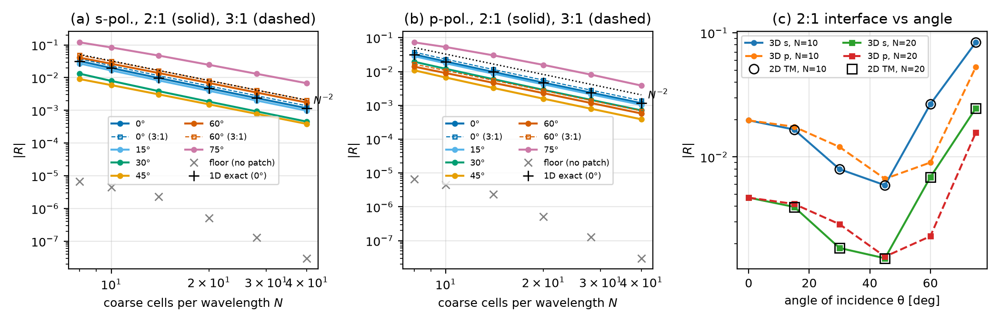
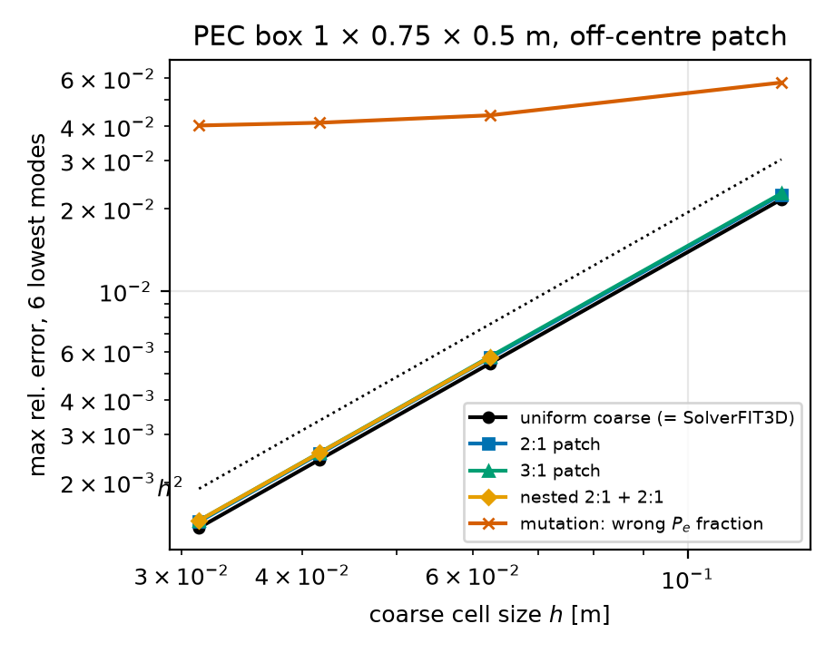
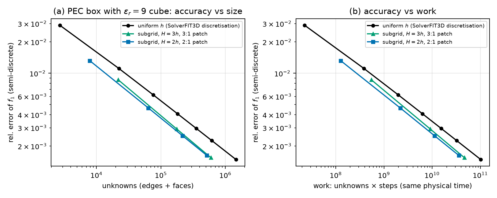

# 3D Cartesian subgridding (`wakis.subgrid3d`, milestone 1)

**Question.** Does the hanging-edge scheme have the properties the derivation claims in 3D, at ratios 2 and 3?
- The interface reflection should be second order, with the derived closed form at normal incidence.
- Cavity frequencies should converge at second order.
- How much does refining only where the field needs it save against a uniformly refined `SolverFIT3D` grid at equal accuracy?

The derivation is in `docs/physicsguide_sections/subgrid3d.md`, and the tests in `tests/test_097_subgrid3d.py`.

**Reproduce.**
- `python studies/subgrid3d/run_study.py`, on Cloud Batch on one n2-highmem-8, all independent runs packed onto the 8 cores. It writes `results.json`.
- `python studies/subgrid3d/plot_figures.py` writes the figures in `docs/img/subgrid3d_*.png` and `summary.json`.

## Parts

**A. Interface reflection** (`bloch_reflection_3d`). Exact time-discrete steady state of a planar interface in a Bloch column (period two coarse cells in $y$ and $z$, complex-stretched ends, fit with the exact discrete coarse $k_x$).
- Sweep: $N = 8$–$40$ coarse cells per wavelength, $\theta = 0$–$75°$, s and p polarisation, 2:1 and 3:1.
- Floor: the same column without a patch.
- References: the 1D closed form at normal incidence, and the 2D TM result of `wakis.subgrid.interface.bloch_reflection` (same column, equal-amplitude source).
- Mutations at 60°: `fraction`, `missing_transverse`, `inject`.

**B. Cavity** (PEC box 1 × 0.75 × 0.5 m, 6 lowest analytic TE+TM modes; eigenvalues of the semi-discrete operator).
- Arms: uniform coarse grid (identical to `SolverFIT3D`'s operator), an off-centre 2:1 or 3:1 patch $[0.25,0.625]\times[0.25,0.5]\times[0.125,0.375]$, the 2:1 patch with a nested 2:1 box one coarse cell inside it, and the `fraction` mutation.
- Grids: $N = 8$–$32$ cells along $x$.

**C. Cost at equal accuracy.** PEC box 1.0 × 0.8 × 0.6 m with a dielectric cube $\varepsilon_r = 9$ on $[0.3,0.6]\times[0.2,0.5]\times[0.2,0.5]$ m. The quantity is the lowest resonance $f_1 \approx 189$ MHz, isolated (the next mode is 21 % higher).
- Measurement: time domain, from two current pulses in the cube over 300 periods. Two probes, Hann-window DFT peak (zero-padded FFT plus a parabolic fit), mapped back to the semi-discrete frequency $\tilde\omega = 2\sin(\omega\Delta t/2)/\Delta t$. On the $h = 0.05$ uniform grid this agrees with the eigenvalue to $3\times10^{-7}$.
- Reference $f^*$: Richardson extrapolation ($h^2$, $h^4$) of the three finest uniform arms.
- Baseline (named): the uniform grid with spacing $h$ everywhere. This is the `SolverFIT3D` discretisation: `test_without_patch_equals_solverfit3d` shows the operator is identical, with per-cell arithmetic $\varepsilon$ edge averaging. It runs at $0.95\,\Delta t_\max$, $h = 0.1$ … $0.0125$ m.
- Subgrid arms: coarse $H = rh$ with an $r$:1 patch over the cube plus 0.1 m, also at $0.95\,\Delta t_\max$ (Lanczos).
- Work: unknowns (edges + faces) × steps to the same physical time.
- Wall clock: `SolverFIT3D.one_step` (CPU, SciPy CSR, one thread, PEC box, $h = 0.1$ … $0.02$) and `SubgridFIT3D.one_step` on the same uniform grids, measured serially on the same VM after the parallel phase.

## Results

The numbers are in `summary.json`; the discussion is in §9b of `docs/physicsguide_sections/subgrid3d.md`.

**Reflection.**
- At normal incidence, the 3D column matches the closed form of §7 to $3.2\times10^{-7}$ (absolute) for $N=8$–$40$, s and p, 2:1 and 3:1.
- For s-polarisation, the 3D scheme equals 2D TM to $1.5\times10^{-10}$ (relative) at every $N$ and angle.
- The observed order between $N=28$ and $40$ is 1.99–2.02 for $\theta=0$–$60°$, and 1.86 (s) / 2.09 (p) at 75°.
- 2:1, $N=10$: s-polarisation 2.0 / 0.8 / 2.7 / 8.4 % at 0 / 30 / 60 / 75°; p-polarisation 2.0 / 1.2 / 0.9 / 5.3 %. At $N=40$: s 0.12 / 0.045 / 0.17 / 0.68 %.
- 3:1 is about 18 % above 2:1.
- Mutations at 60° (2:1, s): the wrong fraction stays at 18–22 %, and the missing transverse term grows from 61 % to 95 % as $N$ goes from 8 to 40. Injection ($\mathbf P_e^T$ replaced) is not monotone in $N$, falling from 9.7 % to 1.7 %.
- The measurement floor (no patch) is $<10^{-5}$ at $\theta\le30°$ and grows toward grazing incidence (at most $6\times10^{-4}$, at 75° and $N=8$).

**Cavity.** The maximum error over the 6 lowest modes converges at order 1.99 for the uniform coarse grid and for the 2:1 and 3:1 patches, and at 1.98 for the nested 2:1+2:1 patch, at $N=8$–$32$. The patched errors are 4–6 % above the coarse grid's at every $N$: the interface's own $O(h^2)$ term, in an empty cavity where refinement brings no benefit. With the wrong fraction, the observed order drops to 0.27 overall and to 0.08 for the last pair.

**Cost at equal accuracy** (loaded cavity, part C). The uniform arms converge at the observed order $p=1.46$; the finest and the previous triple of arms give the same $p$ to $3\times10^{-3}$. This is the field singularity at the edges and corners of the dielectric cube. The reference is therefore the 3-point power-law extrapolation, $f^*=190.716$ MHz; the $h^2/h^4$ Richardson value 190.648 MHz would understate the errors. Against the uniform `SolverFIT3D` discretisation at equal error of $f_1$ (log-log interpolation along the uniform curve):

| arm | coarse $H$ [m] | unknowns | error | fewer unknowns | less work |
|---|---|---|---|---|---|
| 3:1 | 0.1 | 21 771 | $8.7\times10^{-3}$ | 1.74× | 1.42× |
| 3:1 | 0.05 | 176 496 | $2.9\times10^{-3}$ | 2.06× | 1.74× |
| 3:1 | 0.0333 | 598 455 | $1.5\times10^{-3}$ | 2.25× | 1.95× |
| 2:1 | 0.1 | 7 881 | $1.3\times10^{-2}$ | 1.93× | 1.82× |
| 2:1 | 0.05 | 63 966 | $4.6\times10^{-3}$ | 2.17× | 2.03× |
| 2:1 | 0.025 | 515 868 | $1.6\times10^{-3}$ | 2.35× | 2.22× |

Work is unknowns × steps to the same physical time, at $0.95\,\Delta t_\max$ for every arm. The work gain is smaller than the unknown gain because the global step is set by the fine cells. 2:1 beats 3:1 here: its step is larger, and the cube ($n=3$) needs no more than about 2× refinement at this accuracy.

Per step, `SubgridFIT3D.one_step` costs the same as `SolverFIT3D.one_step` on the same uniform grid (n2-standard-8, one thread, serial). At $h=0.02$ m (60 000 cells), the two take 2.85 ms and 2.84 ms; at $h=0.05$ m, 0.149 ms and 0.151 ms. The work ratios above are therefore also wall-clock ratios. Absolute speed is about 8 ns per unknown-step on that VM and 3.4 ns on an Apple-silicon laptop core.

