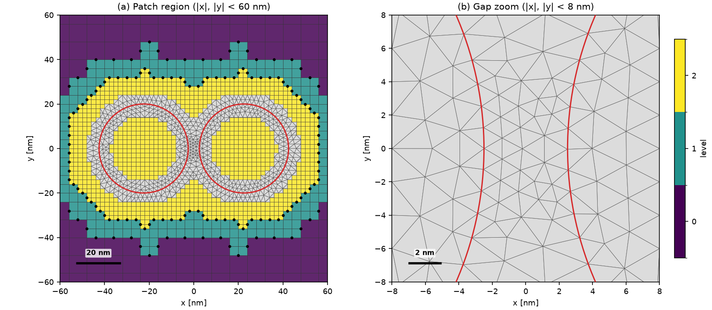
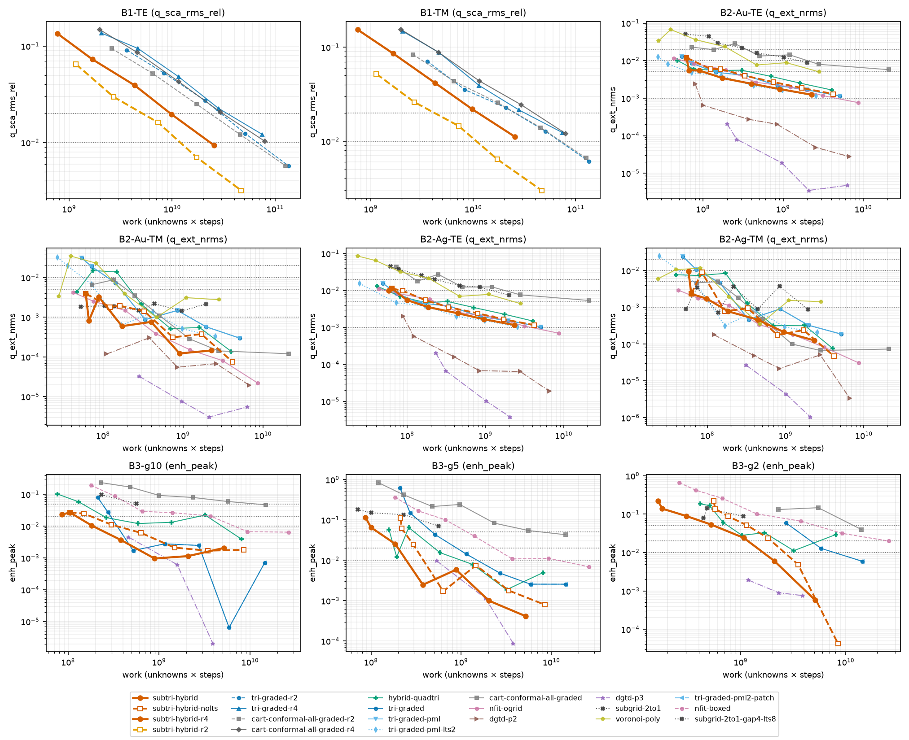
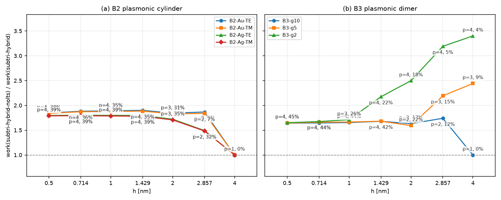

# Subgridded Quadtree Squares with a Conforming Triangle Band (`subtri-hybrid`)

**Question.** Can one mesh combine the cheap bulk of nested Cartesian patches (quadtree squares, 2:1, $P/P^{\mathsf T}$ hanging nodes) with body-fitted triangles only where they pay (a $\pm 2h$ band at curved metal/dielectric interfaces and in nanogaps), plus two-level LTS, and beat every existing mesh arm at equal work?

**Arm** `wakis.benchmarks.arms.subtri2d.SubTriArm` / mesher `wakis.unstructured.subtri.subtri_circles_mesh`:
- **Mesh.** Quadtree squares from $H = 4h$ (capped at $\lambda_{\text{host}}/20$ for B2/B3, uncapped `ppw_out=None` with $H = 2h$ (`-r2`) or $4h$ (`-r4`) for B1) down to $h$; finest squares inside the scatterers; Delaunay triangle band $\pm 2h$ around each interface plus the gap (sizes down to $g/4$).
- **Excitation, boundary, and materials.** Split-field PML (10 coarse cells) on squares; scattered-field plane wave; Rakić Au/Ag ADE.
- **LTS.** `lts='auto'` ($p \in \{2,3,4\}$ by unknown-weighted work, ADE stable at the coarse $\Delta t$).
- **B3 gap metric.** Second-order 12-edge least-squares patch at the 9 gap points (same metric as `tri-graded-pml2-patch`).
- **Work.** $\text{steps} \times (\text{unknowns} + (p-1)(\text{fine nodes} + \text{their edges}))$, stored as `cost['work']`.
- **Stability.** SPD operator, exact energy (see physics guide "Quadtree squares with a conforming triangle band").


**Mesh (`figures/mesh_dimer_gap.png`).** B3-g5 at $h = 2\text{ nm}$: levels coloured, hanging nodes black, triangles grey.

## Runs

Cloud Batch, one run per `n2-standard-2` SPOT machine:
- `subtri-b1-20261019-210352` (20 of 20 records collected, including the two `-r4` runs at $h = 7.854\text{ nm}$)
- `subtri-b1nolts-20261019-212048`
- `subtri-b2-20261019-210427`
- `subtri-b3-20261019-210458` and `subtri-b3fix-20261019-212010` (12 B3 tasks rerun after a bug in the RT *diagnostic* for gap points that fall in squares; superseded records kept in `data/superseded_rt_error/`)

Code commit `699c0fd` (B3FIX, B1NOLTS) / `f9386e6` (B1, B2, B3).

## Results

Full per-arm tables are in [`data/compare.md`](data/compare.md) (`unknowns / work / time` interpolated log-log to each target; `≤` = upper bound at coarsest rung, `—` = target not reached).


**Error vs work (`figures/error_vs_work.png`).** Convergence against work across B1, B2, and B3.


**LTS gain (`figures/lts_gain.png`).** Comparison of `subtri-hybrid` (LTS) against `subtri-hybrid-nolts`.

### Headline comparison: ours / best baseline at equal work (and at equal wall time)

| case | target | ours (`subtri-hybrid` / `-r2`) | `subtri-hybrid-nolts` (or `-r4`) | best baseline (work) | ours / best (work) | best baseline (time): ours / best |
|---|---|---|---|---|---|---|
| B1-TE | `q_sca_rms_rel ≤ 2 %` | 121k / 5.2e9 / 79 s | 147k / 9.6e9 / 114 s (`-r4`) | cart-conformal-all-graded-r2 (2.3e10) | 0.22 | cart-conformal-all-graded-r2 (506 s): 0.16 |
| B1-TE | `q_sca_rms_rel ≤ 1 %` | 213k / 1.2e10 / 209 s | 263k / 2.3e10 / 366 s (`-r4`) | cart-conformal-all-graded-r2 (5.9e10) | 0.20 | cart-conformal-all-graded-r2 (1384 s): 0.15 |
| B1-TM | `q_sca_rms_rel ≤ 2 %` | 107k / 4.2e9 / 52 s | 162k / 1.1e10 / 138 s (`-r4`) | tri-graded-r2 (2.5e10) | 0.16 | tri-graded-r2 (495 s): 0.11 |
| B1-TM | `q_sca_rms_rel ≤ 1 %` | 197k / 1.1e10 / 148 s | — (`-r4`) | tri-graded-r2 (7.0e10) | 0.15 | tri-graded-r2 (1307 s): 0.11 |
| B2-Au-TE | `q_ext_nrms ≤ 2 %` | ≤7.3k / ≤6.2e7 / ≤2.9 s | ≤7.3k / ≤6.2e7 / ≤3.1 s | tri-graded-pml-lts2 (≤2.7e7) | 2.28 | tri-graded-pml-lts2 (3 s): 1.14 |
| B2-Au-TE | `q_ext_nrms ≤ 1 %` | 7.7k / 6.3e7 / 3.2 s | 7.7k / 7.4e7 / 3.5 s | tri-graded-pml-lts2 (3.2e7) | 1.99 | hybrid-quadtri (3 s): 1.08 |
| B2-Au-TE | `q_ext_nrms ≤ 0.5 %` | 10.7k / 1.0e8 / 3.8 s | 11.4k / 2.3e8 / 11 s | tri-graded-pml-lts2 (6.7e7) | 1.51 | tri-graded-pml-lts2 (5 s): 0.80 |
| B2-Au-TE | `q_ext_nrms ≤ 0.1 %` | — | — | dgtd-p2 (9.3e7) | — | — |
| B2-Au-TE | `q_ext_lam_peak ≤ 0.5 %` | ≤7.3k / ≤6.2e7 / ≤2.9 s | ≤7.3k / ≤6.2e7 / ≤3.1 s | tri-graded-pml-lts2 (≤2.7e7) | 2.28 | tri-graded-pml-lts2 (3 s): 1.14 |
| B2-Au-TE | `q_ext_lam_peak ≤ 0.2 %` | 8.2k / 6.5e7 / 3.4 s | 8.3k / 9.5e7 / 4.1 s | tri-graded-pml-lts2 (3.3e7) | 1.94 | tri-graded-pml-lts2 (4 s): 0.90 |
| B2-Au-TM | `q_ext_nrms ≤ 2 %` | ≤7.1k / ≤6.1e7 / ≤2.0 s | ≤7.1k / ≤6.1e7 / ≤2.1 s | tri-graded-pml-lts2 (3.6e7) | 1.70 | hybrid-quadtri (2 s): 1.03 |
| B2-Au-TM | `q_ext_nrms ≤ 1 %` | ≤7.1k / ≤6.1e7 / ≤2.0 s | ≤7.1k / ≤6.1e7 / ≤2.1 s | nfit-ogrid (≤4.2e7) | 1.43 | subgrid-2to1 (3 s): 0.79 |
| B2-Au-TM | `q_ext_nrms ≤ 0.5 %` | ≤7.1k / ≤6.1e7 / ≤2.0 s | ≤7.1k / ≤6.1e7 / ≤2.1 s | nfit-ogrid (≤4.2e7) | 1.43 | subgrid-2to1 (3 s): 0.79 |
| B2-Au-TM | `q_ext_nrms ≤ 0.1 %` | 9.8k / 1.4e8 / 2.8 s | 14.6k / 3.9e8 / 10.0 s | dgtd-p2 (≤1.1e8) | 1.27 | nfit-ogrid (9 s): 0.32 |
| B2-Au-TM | `q_ext_lam_peak ≤ 0.5 %` | ≤7.1k / ≤6.1e7 / ≤2.0 s | ≤7.1k / ≤6.1e7 / ≤2.1 s | tri-graded-pml-lts2 (≤2.7e7) | 2.25 | hybrid-quadtri (2 s): 1.03 |
| B2-Au-TM | `q_ext_lam_peak ≤ 0.2 %` | ≤7.1k / ≤6.1e7 / ≤2.0 s | ≤7.1k / ≤6.1e7 / ≤2.1 s | tri-graded-pml-lts2 (≤2.7e7) | 2.25 | hybrid-quadtri (2 s): 1.03 |
| B2-Ag-TE | `q_ext_nrms ≤ 2 %` | ≤7.0k / ≤5.8e7 / ≤2.7 s | ≤7.0k / ≤6.4e7 / ≤3.0 s | tri-graded-pml-lts2 (≤2.4e7) | 2.37 | tri-graded-pml-lts2 (2 s): 1.10 |
| B2-Ag-TE | `q_ext_nrms ≤ 1 %` | 7.6k / 6.9e7 / 2.9 s | 7.6k / 8.4e7 / 4.4 s | tri-graded-pml-lts2 (3.6e7) | 1.89 | tri-graded-pml-lts2 (3 s): 0.92 |
| B2-Ag-TE | `q_ext_nrms ≤ 0.5 %` | 10.0k / 1.1e8 / 3.7 s | 10.0k / 2.0e8 / 9.7 s | tri-graded-pml-lts2 (6.8e7) | 1.67 | tri-graded-pml-lts2 (5 s): 0.79 |
| B2-Ag-TE | `q_ext_nrms ≤ 0.1 %` | — | — | dgtd-p2 (1.1e8) | — | — |
| B2-Ag-TE | `q_ext_lam_peak ≤ 0.5 %` | ≤7.0k / ≤5.8e7 / ≤2.7 s | ≤7.0k / ≤6.4e7 / ≤3.0 s | tri-graded-pml-lts2 (≤2.4e7) | 2.37 | tri-graded-pml-lts2 (2 s): 1.10 |
| B2-Ag-TE | `q_ext_lam_peak ≤ 0.2 %` | ≤7.0k / ≤5.8e7 / ≤2.7 s | ≤7.0k / ≤6.4e7 / ≤3.0 s | tri-graded-pml-lts2 (≤2.4e7) | 2.37 | tri-graded-pml-lts2 (2 s): 1.10 |
| B2-Ag-TM | `q_ext_nrms ≤ 2 %` | ≤6.9k / ≤5.7e7 / ≤1.8 s | ≤6.9k / ≤6.2e7 / ≤2.1 s | voronoi-poly (≤2.3e7) | 2.46 | hybrid-quadtri (2 s): 0.97 |
| B2-Ag-TM | `q_ext_nrms ≤ 1 %` | ≤6.9k / ≤5.7e7 / ≤1.8 s | ≤6.9k / ≤6.2e7 / ≤2.1 s | hybrid-quadtri (≤4.0e7) | 1.43 | hybrid-quadtri (2 s): 0.97 |
| B2-Ag-TM | `q_ext_nrms ≤ 0.5 %` | 7.0k / 5.9e7 / 1.9 s | 7.0k / 1.0e8 / 3.5 s | nfit-ogrid (≤4.2e7) | 1.40 | subgrid-2to1 (2 s): 0.78 |
| B2-Ag-TM | `q_ext_nrms ≤ 0.1 %` | 11.6k / 1.5e8 / 2.6 s | 8.6k / 1.6e8 / 4.8 s | tri-graded-pml-lts2 (1.2e8) | 1.31 | tri-graded-pml-lts2 (8 s): 0.34 |
| B2-Ag-TM | `q_ext_lam_peak ≤ 0.5 %` | ≤6.9k / ≤5.7e7 / ≤1.8 s | ≤6.9k / ≤6.2e7 / ≤2.1 s | voronoi-poly (≤2.3e7) | 2.46 | hybrid-quadtri (2 s): 0.97 |
| B2-Ag-TM | `q_ext_lam_peak ≤ 0.2 %` | ≤6.9k / ≤5.7e7 / ≤1.8 s | ≤6.9k / ≤6.2e7 / ≤2.1 s | voronoi-poly (≤2.3e7) | 2.46 | hybrid-quadtri (2 s): 0.97 |
| B3-g10 | `enh_peak ≤ 5 %` | ≤9.2k / ≤8.6e7 / ≤5.6 s | ≤9.2k / ≤1.0e8 / ≤6.2 s | hybrid-quadtri (1.4e8) | 0.60 | tri-graded (13 s): 0.43 |
| B3-g10 | `enh_peak ≤ 2 %` | 10.3k / 1.2e8 / 7.2 s | 10.6k / 1.8e8 / 12 s | tri-graded-pml2-patch (2.9e8) | 0.42 | tri-graded-pml2-patch (19 s): 0.38 |
| B3-g10 | `enh_peak ≤ 1 %` | 13.6k / 1.9e8 / 9.8 s | 14.5k / 3.4e8 / 21 s | tri-graded-pml2-patch (3.4e8) | 0.54 | tri-graded-pml2-patch (21 s): 0.47 |
| B3-g10 | `q_ext_nrms ≤ 2 %` | ≤9.2k / ≤8.6e7 / ≤5.6 s | ≤9.2k / ≤1.0e8 / ≤6.2 s | hybrid-quadtri (≤7.6e7) | 1.12 | hybrid-quadtri (6 s): 1.00 |
| B3-g10 | `q_ext_nrms ≤ 1 %` | 9.9k / 1.1e8 / 6.4 s | 10.1k / 1.6e8 / 11 s | hybrid-quadtri (1.5e8) | 0.72 | hybrid-quadtri (16 s): 0.41 |
| B3-g5 | `enh_peak ≤ 5 %` | 10.4k / 1.2e8 / 5.6 s | 10.3k / 2.3e8 / 15 s | hybrid-quadtri (3.0e8) | 0.39 | tri-graded-pml2-patch (22 s): 0.25 |
| B3-g5 | `enh_peak ≤ 2 %` | 13.6k / 2.0e8 / 12 s | 13.4k / 3.1e8 / 19 s | hybrid-quadtri (5.0e8) | 0.39 | tri-graded-pml2-patch (42 s): 0.28 |
| B3-g5 | `enh_peak ≤ 1 %` | 15.5k / 2.5e8 / 17 s | 15.0k / 3.8e8 / 23 s | dgtd-p3 (≤5.3e8) | 0.46 | tri-graded-pml2-patch (71 s): 0.23 |
| B3-g5 | `q_ext_nrms ≤ 2 %` | ≤9.4k / ≤8.7e7 / ≤4.8 s | ≤9.4k / ≤2.1e8 / ≤13 s | hybrid-quadtri (≤1.6e8) | 0.55 | hybrid-quadtri (12 s): 0.40 |
| B3-g5 | `q_ext_nrms ≤ 1 %` | ≤9.4k / ≤8.7e7 / ≤4.8 s | ≤9.4k / ≤2.1e8 / ≤13 s | hybrid-quadtri (≤1.6e8) | 0.55 | hybrid-quadtri (12 s): 0.40 |
| B3-g2 | `enh_peak ≤ 5 %` | 20.8k / 5.6e8 / 20 s | 20.5k / 1.2e9 / 63 s | hybrid-quadtri (7.6e8) | 0.74 | hybrid-quadtri (52 s): 0.37 |
| B3-g2 | `enh_peak ≤ 2 %` | 34.4k / 1.2e9 / 41 s | 33.9k / 2.0e9 / 101 s | dgtd-p3 (≤1.2e9) | 0.99 | tri-graded (198 s): 0.21 |
| B3-g2 | `enh_peak ≤ 1 %` | 44.2k / 1.6e9 / 47 s | 42.3k / 2.6e9 / 136 s | dgtd-p3 (≤1.2e9) | 1.39 | tri-graded (354 s): 0.13 |
| B3-g2 | `q_ext_nrms ≤ 2 %` | 10.1k / 1.9e8 / 18 s | 10.1k / 5.8e8 / 38 s | hybrid-quadtri (5.0e8) | 0.37 | nfit-boxed (37 s): 0.48 |
| B3-g2 | `q_ext_nrms ≤ 1 %` | 14.9k / 3.6e8 / 18 s | 14.7k / 8.4e8 / 51 s | hybrid-quadtri (6.9e8) | 0.52 | hybrid-quadtri (48 s): 0.37 |

### Verdict

- **B1 (dielectric Mie, 3000 fs, uncapped outer mesh): clear win.** 5–7× less work and 7–9× less time than the best baselines (`cart-conformal-all-graded-r2` for TE, `tri-graded-r2` for TM) at 2 % and 1 %. Attribution: at equal $h$ the no-LTS arm (`subtri-hybrid-r2-nolts`, 532k unknowns at 7.854 nm vs 789k for `tri-graded-r2`) has about the same error as `tri-graded-r2` (0.61–0.64 % vs 0.61 %), i.e. the squares save ~1/3 of the unknowns; the LTS arm halves the error at equal $h$ (B1-TM 11.22 nm: 0.64 % with LTS vs 1.32 % without; 7.854 nm: 0.30 % vs 0.61 %) and doubles $\Delta t$. The error halving is NOT a resolution effect: the coarse squares then step close to their own CFL limit, where the leapfrog time error partly cancels the square-grid spatial dispersion; without LTS they step at the $\Delta t$ of the smallest triangle. Hypothesis, to be confirmed by a dispersion study.
- **B2 (single Au/Ag cylinder): no win.** At equal work the arm is 1.3–2.5× more expensive than the best baselines (`tri-graded-pml-lts2` in TE; `nfit-ogrid` / `hybrid-quadtri` / `tri-graded-pml-lts2` / `dgtd-p2` in TM); at equal wall time it is 0.3–1.1× (B2 runs take 2–10 s, so timing scatter is large). In TE it plateaus near 0.12 % (not reaching 0.1 %); DGTD p2/p3 reaches 1e-4–1e-5 at similar work and is the clear B2 winner. Why: B2 is mostly metal interior + band, the regime where squares save little; the triangle-only LTS arm has the same LTS benefit. Caveat: `tri-graded-pml-lts2` records store $\text{work} = \text{unknowns} \times \text{steps}$ without its fine-substep overhead ($\le \sim 1.2\times$ understatement per the unstructured-lts study).
- **B3 (Au dimer nanogaps, patch metric): win except g2 at tight targets vs DGTD.** `enh_peak`: 0.25–0.60× the work of the best FIT/FDTD baselines (`hybrid-quadtri`, `tri-graded-pml2-patch`, `tri-graded`) and 0.13–0.47× their wall time; `q_ext_nrms` 0.37–0.72× (g10 2 %: 1.12×). Against `dgtd-p3` (curved, high order): g5 1 % 0.46× (ours wins), g2 2 % 0.99×, g2 1 % 1.39× in work (DGTD wins on work, but its fine p3 rungs diverged — rows with error > 1 are dropped — and in time ours is 0.13–0.21×).
- **LTS attribution (B2/B3):** comparing `subtri-hybrid-nolts` vs `subtri-hybrid` in `data/compare.md`, two-level LTS cuts work and wall time across resolved targets (e.g. B2-Au-TE `q_ext_nrms ≤ 0.5 %`: 2.3e8 / 11 s vs 1.0e8 / 3.8 s; B2-Au-TM `q_ext_nrms ≤ 0.1 %`: 3.9e8 / 10.0 s vs 1.4e8 / 2.8 s; B2-Ag-TE `q_ext_nrms ≤ 0.5 %`: 2.0e8 / 9.7 s vs 1.1e8 / 3.7 s; B3-g10 `enh_peak ≤ 1 %`: 3.4e8 / 21 s vs 1.9e8 / 9.8 s; B3-g5 `enh_peak ≤ 1 %`: 3.8e8 / 23 s vs 2.5e8 / 17 s; B3-g2 `enh_peak ≤ 1 %`: 2.6e9 / 136 s vs 1.6e9 / 47 s; B3-g2 `q_ext_nrms ≤ 1 %`: 8.4e8 / 51 s vs 3.6e8 / 18 s).

## Caveats

- **DGTD/FIT work units differ:** DG unknowns are dearer per update, so read the wall-time column alongside the work column.
- **B2 timings are noisy:** B2 runs take 2–10 s, so wall-time ratios have large scatter.
- **B1 `-r4` finest rung:** B1 now has all 20 records in `data/B1` including the two `subtri-hybrid-r4` runs at $h = 7.854\text{ nm}$ from job `subtri-b1-20261019-210352` (B1-TM `-r4` reaches $1.12\%$ at $7.854\text{ nm}$, above the $1\%$ target).
- **Coarsest-rung upper bounds (`≤`):** entries prefixed with `≤` indicate that the coarsest rung already meets the target.
- **Two-level LTS only:** `lts='auto'` uses a single fine/coarse split ($p \in \{2,3,4\}$), not multi-tier subcycling across quadtree levels.
- **B3 gap metric mismatch across store baselines:** `hybrid-quadtri` and `tri-graded` B3 records use the single-cell RT centre metric (`gap_metric` absent/`'rt'`), whereas `subtri-hybrid` and `tri-graded-pml2-patch` use the 9-point second-order 12-edge least-squares patch metric.

## Reproduce

```bash
python subtri_bench.py list|run --phase B1|B2|B3|B3FIX|B1NOLTS
./batch.sh <phase>
./collect.sh <job>
python compare.py [--offline]
python plot_subtri.py [--offline]
```
