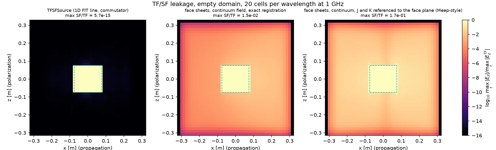
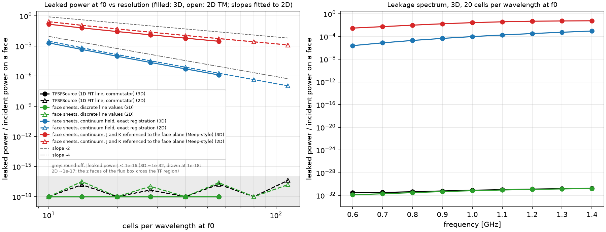
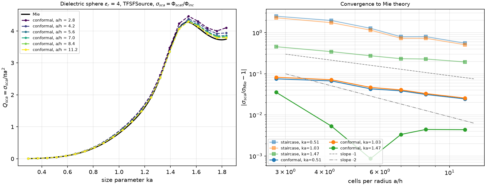

# TF/SF plane-wave source study

Reproducible study for `wakis.TFSFSource` (physics guide: "Total-field/scattered-field plane-wave source").

```bash
python tfsf_study.py run --procs 10   # cases/*.json -> results.json (resumable; ~1.7 h on cem-gpu, n=128 spheres dominate)
python tfsf_study.py plot             # the three figures below
python tfsf_study.py run --quick      # small local smoke test (results_quick.json)
```

## A. Discrete-exact TF/SF vs continuum Huygens sheets

The same TF/SF box (0.5 λ0 cube, f0 = 1 GHz, +x incidence, E along z, empty CPML domain) is driven in four ways:

| variant | J on the face E plane carries | K on the dual plane outside carries | values from | expected leakage |
|---|---|---|---|---|
| `tfsf` (`TFSFSource`) | commutator corrections (equivalent) | | 1D FIT line | round-off |
| `sheets_discrete` | H_inc of the dual sample outside | E_inc of the face node | 1D FIT line | round-off (same operator, written as sheets) |
| `sheets_continuum` | H_inc of the dual sample outside | E_inc of the face node | continuum A s(t − k·(r−r0)/c) | grid-dispersion mismatch, amplitude O((kh)²) |
| `sheets_face` (Meep-style) | H_inc of the face plane | E_inc of the face plane | continuum | + half-cell offset, amplitude O(kh) |

`sheets_face` is the construction of the user's Meep notebook (`Total_Field_Scattered_Field_Meep_Tutorial.ipynb`), which follows Oskooi & Johnson (2013): equivalent currents J = n̂×H_inc and K = −n̂×E_inc on the box faces, with continuum phases, deposited with ordinary source objects. The study implements it with a small helper (`HuygensBox`) that adds per-sample time-delayed sheet currents to `solver.J` and `solver.M`. It is not a public API.

Leakage is measured as the power through a closed box three cells outside the TF/SF surface, divided by the incident power on one box face.

Results (`results.json`, cem-gpu, 12-process CPU run; leaked power at f0 / incident power on a face, and peak max|E_SF| / max|E_TF| over the run):

| cells/λ0 | `tfsf` 3D (peak) | `sheets_discrete` 3D (peak) | `sheets_continuum` 3D power (peak) | `sheets_face` 3D power (peak) | `sheets_continuum` 2D power | `sheets_face` 2D power |
|---|---|---|---|---|---|---|
| 10 | 5.9e-32 (5.8e-15) | 5.5e-32 (5.8e-15) | 2.1e-3 (6.5e-2) | 1.5e-1 (0.25) | 3.0e-3 | 2.7e-1 |
| 20 | 7.9e-32 (5.7e-15) | 6.7e-32 (5.8e-15) | 9.6e-5 (1.5e-2) | 2.8e-2 (0.17) | 1.4e-4 | 5.0e-2 |
| 40 | 6.1e-32 (1.1e-14) | 4.0e-32 (1.1e-14) | 5.3e-6 (3.7e-3) | 6.0e-3 (0.15) | 7.7e-6 | 1.1e-2 |
| 56 | 3.7e-32 (9.7e-15) | 3.7e-32 (9.7e-15) | 1.3e-6 (1.9e-3) | 3.0e-3 (0.14) | 1.9e-6 | 5.5e-3 |
| 113 (2D) | | | | | 1.1e-7 | 1.3e-3 |

- `TFSFSource` and the discrete sheets leak at round-off at every resolution (2D: peak 4e-16 to 2.5e-15; 2D flux values of ±1e-17 are round-off of O(1) cross terms on the z faces of the flux box, which cross the TF region).
- Continuum sheets with exact registration: power slope −4.2 (2D, 10 to 113 cells/λ), peak amplitude slope −2.0. This is the dispersion mismatch, as expected.
- Meep-style face-referenced sheets: power slope −2.2 (2D), the half-cell offset. At 20 cells/λ they leak 5 % of the face power, 300× more than the exact-registration sheets.
- **Open item:** in 3D the face-referenced variant's *peak* field ratio levels off at ~0.14, while its leaked power still falls as (kh)². This has not been investigated. A guess is a localized, non-radiating near field at the face rims, where the face-referenced J and K of adjacent faces do not cancel. It concerns only the baseline, not `TFSFSource`.




**Why the continuum sheets leak.** Exact cancellation needs an incident field that solves the *discrete* equations (Oskooi & Johnson 2013, §4.2.2). Two errors enter when the continuum wave is used:

1. **Dispersion mismatch.** The grid propagates the wave with the numerical wavenumber k̃, where (2/h) sin(k̃h/2) = (2/(cΔt)) sin(ωΔt/2), so k̃ − k ≈ k (kh)²(1 − S²)/24 for Courant number S. The sheets on the exit face and along the side faces impose the continuum phase k·x. The phase error grows along the box as (k̃−k)L ~ kL(kh)²/24. The residual field radiates out of the box with relative amplitude O((kh)²), so the leaked power falls as (kh)⁴: slope −4.
2. **Half-cell offset.** On the staggered grid the electric sheet sits on the face E plane but must carry H_inc of the dual plane half a cell outside, and the magnetic sheet sits on that dual plane but carries E_inc of the face node. That is the discrete operator, derived in the physics guide. Referencing both to the face plane, as a source defined on a line does, shifts H_inc by h/2. That is a phase error kh/2 on the entry and exit faces, so the leaked amplitude is O(kh) and the power falls as (kh)²: slope −2.

`sheets_discrete` gives the same round-off leakage as `TFSFSource`. This confirms that the commutator corrections are exactly the discrete Huygens (equivalent-current) sheets: the only difference between Meep-style sheets and the exact discrete TF/SF is which incident field the sheets carry, and where.

## B. Scattering cross-section of a dielectric sphere vs Mie theory

Sphere ε_r = 4, radius a = 3.5 cm, in a 0.4 m CPML domain with a 12 cm TF box, ka = 0.29–1.83. σ_sca = Φ_scat / Φ_inc, with Φ_scat from a closed `FluxMonitor` three cells outside the box and Φ_inc from `TFSFSource.incident_flux_density`. Mie efficiencies come from `wakis.analytic.mie` when available, otherwise from the Bohren & Huffman series in the script. Staircase (legacy STL marking) and conformal spheres at h = 12.5–3.1 mm (a/h = 2.8–11.2).

Results (`results.json`), σ_sca/σ_Mie − 1:

| a/h | staircase ka=0.51 | staircase ka=1.03 | staircase ka=1.47 | conformal ka=0.51 | conformal ka=1.03 | conformal ka=1.47 | max net TF-box flux / face power (conformal) |
|---|---|---|---|---|---|---|---|
| 2.8 | +2.51 | +2.30 | +0.46 | +0.075 | +0.082 | +0.036 | 1.2e-7 |
| 4.4 | +1.98 | +1.75 | +0.35 | +0.067 | +0.072 | +0.005 | 7e-10 |
| 5.6 | +1.28 | +1.15 | +0.27 | +0.043 | +0.047 | −0.001 | 7e-10 |
| 8.4 | +0.80 | +0.73 | +0.23 | +0.031 | +0.033 | −0.004 | 7e-12 |
| 11.2 | +0.55 | +0.51 | +0.19 | +0.025 | +0.026 | −0.004 | 9e-11 |

- The conformal sphere converges at about first order, 7.5 % → 2.5 % at ka ≈ 0.5–1. Near the first resonance (ka ≈ 1.5) the error crosses zero and settles at −0.4 %.
- The legacy staircase sphere is far off: +250 % at a/h = 2.8, +55 % at a/h = 11. Its STL marking includes cells only touched by the sphere (936 dielectric edges vs 539 for the true volume at a/h = 3.5, a 1.7× volume), and σ_sca ∝ V² in the Rayleigh limit. Use `conformal=True` for scatterers.
- Energy conservation through the TF-region box (lossless sphere) holds to ≤ 1.2e-7 of the face power at every resolution: TF/SF injection, monitors and the FIT step together conserve energy.



## Limits

Axis-aligned incidence; homogeneous lossless background at the box surface; box outside the PML; no MPI. See "Limits & Failure Modes" in the physics guide.
