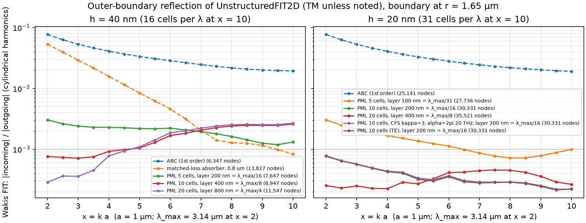

# Radial CFS-PML for unstructured 2D FIT

`UnstructuredFIT2D(..., bc="pec", pml=dict(r0, r1, order=3, R=1e-8, kappa_max=1, alpha=0))` absorbs outgoing waves in an annulus r0 < r < r1. The layer is meshed with `graded_disk_mesh(..., pml_layers=N, pml_dr=dr)`.



## Formulation

The PML is a complex coordinate stretch in r, after Teixeira & Chew (1997, 1999):

- r~ = ∫ s_r dr, with s_r = κ_r + σ_r/(α + iω);
- s_θ = r~/r = κ_θ + σ_θ/(α + iω), where σ_θ = (1/r)∫σ_r dr and κ_θ = 1 + (1/r)∫(κ_r − 1) dr, both integrated from r0.

Maxwell's equations in the stretched coordinates are those of an anisotropic medium:

ε, μ × diag(s_θ/s_r, s_r/s_θ, s_r s_θ) in the (r, θ, z) components.

**Mesh layout.** The layer consists of rings that all share the outer ring's node angles. Each cell is therefore an isosceles trapezoid split into two triangles with a common circumcentre:

- The diagonal edge has a zero dual edge, so it carries no coupling.
- Every coupling edge is either a radial spoke or an azimuthal chord.
- As a result, the anisotropic Hodge stays diagonal.

**Update.** Each node keeps its flux (D_z for TM, B_z for TE) and each edge keeps its flux b or d. The fields follow from bilinear-transform (trapezoidal) CFS ratio filters:

- nodes: u = q/(M s_r s_θ), applied as two cascaded first-order filters;
- spokes: s_θ/s_r;
- chords: s_r/s_θ.

The incidence matrices G and Gᵀ are unchanged, and the scheme stays explicit. Outside the layer the solver's own update runs as before, including conductive and dispersive ADE cells.

## Results

The test case is an off-centre line source in vacuum. The boundary sits at r0 = 1.65 µm, and the fields are fitted on circles at 1.2, 1.35 and 1.5 µm. The plotted quantity is |incoming|/|outgoing| summed over harmonics |n| ≤ 12, for x = 2–10 (λ = 3.14 to 0.63 µm).

| boundary | h | reflection over x = 2–10 |
|---|---|---|
| 1st-order ABC | 20 or 40 nm | 7.7e-2 → 1.9e-2 |
| matched-loss absorber, 0.8 µm thick | 40 nm | 5.3e-2 → 8.3e-4; poor at low frequency, and it doubles the nodes |
| **PML, 10 cells (0.2 µm = λ_max/16)** | 20 nm | **2.2e-4 to 7.8e-4** |
| PML, 20 cells (0.4 µm = λ_max/8) | 20 nm | 2.2e-4 to 4.6e-4 |
| PML, 5 cells (λ_max/31) | 20 nm | 7.2e-4 to 3.0e-3 |
| PML, 10 or 20 cells | 40 nm | 2.9e-4 to 2.7e-3 |

- At 40 nm, the reflection rises with x towards 2.5e-3 regardless of layer thickness, and it drops about 10× when h is halved. That floor is set by discretization (16 cells per λ at x = 10) and by the continuum-k harmonic fit, not by the absorber.
- The fit floor is about 2–3e-4.
- TE gives the same numbers as TM (vacuum duality).
- The CFS variant (κ = 3, α = 2π·20 THz) changes nothing for propagating waves.

## Tests (`tests/test_046_unstructured_pml.py`)

| test | what it checks |
|---|---|
| reflection bound | below 4e-3 at h = 40 nm, TM and TE |
| mutation: negative σ | must fail |
| mutation: spoke/chord anisotropy swapped | must fail (reflection > 1) |
| 4000 fs run (10× the usual window) | no late-time growth, field below 1e-3 of peak at the end |
| Drude rod (dispersive ADEs) inside the PML domain | stable and decaying, TM and TE |
| layer that is not polar-aligned | rejected |

Stability literature to keep in mind: Bécache & Joly (2002) and Appelö, Hagstrom & Kreiss (2006). The tests above are empirical; they do not prove stability.

## 3D note (not implemented)

For `UnstructuredFIT3D` the same idea needs a spherical shell meshed as layered "prism-like" cells, i.e. tetrahedra from a polar-aligned extrusion. Edges must be radial or tangential, and the dual must stay orthogonal to them. The tangential edges of a triangulated sphere are not mutually orthogonal, so the two tangential stretch factors (both s_θ = r~/r) must be equal. They are, for a spherical stretch.

Two pieces of work would be needed:

1. a mesher that extrudes the outer triangulated sphere radially, with each prism split into 3 tetrahedra whose duals are consistent;
2. the same three filters as in 2D: s_r s_θ² on faces normal to r, and s_θ/s_r or s_r/s_θ on the edges.

The splitting of prisms into tetrahedra with an orthogonal dual is the main risk. A Cartesian CPML shell around a conforming tet core is the alternative.

## Prior art

The unstructured FIT with a circumcentric or barycentric dual is the "discrete geometric approach" / cell method of Codecasa, Specogna, Trevisan, Kapidani et al. (see `notes/lit/fit_meshing_sota.md`, item 1). The dual construction is not new here.

The radial PML follows from:

- F. L. Teixeira and W. C. Chew, IEEE Microw. Guided Wave Lett. 7, 371 (1997);
- F. L. Teixeira and W. C. Chew, J. Electromagn. Waves Appl. 13, 665 (1999);
- CFS: Kuzuoglu & Mittra (1996);
- CPML/ADE: Roden & Gedney (2000).

## Reproduce

```bash
python pml_reflection.py run 6     # 11 cases, ~2 min on 6 local cores (memguard)
```
