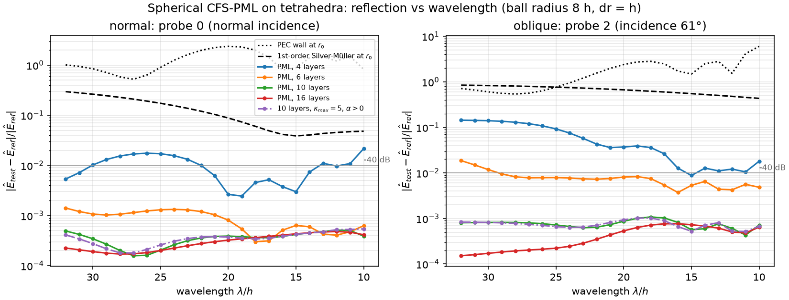
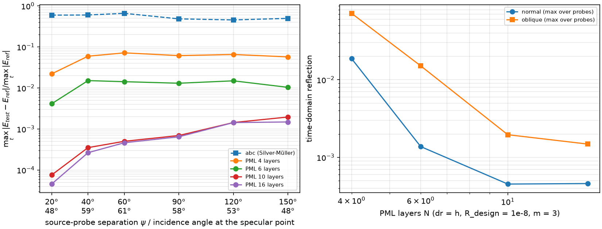
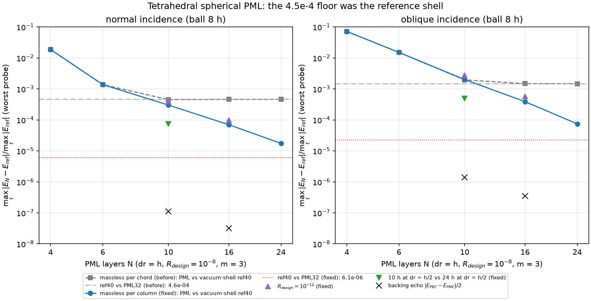
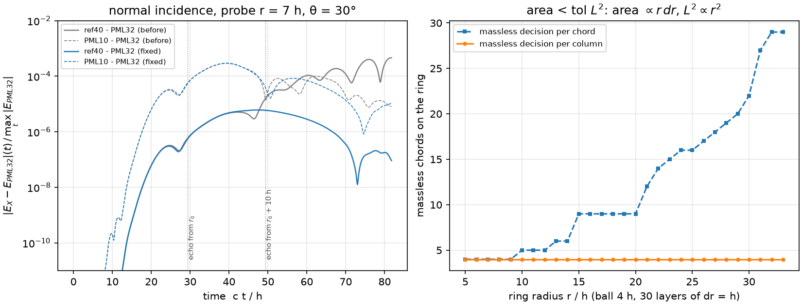
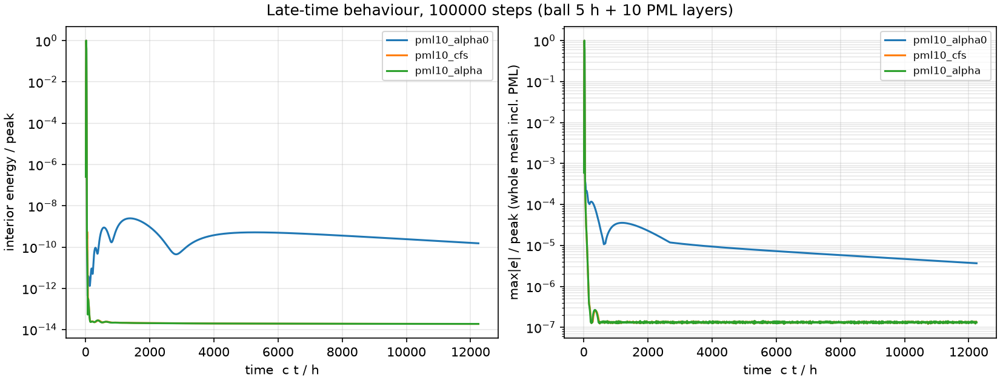

# Spherical CFS-PML for 3D tetrahedral FIT

`UnstructuredFIT3D(mesh, bc="pec", pml=dict(r0, r1, order=3, R=1e-8, kappa_max=1, alpha=0))` absorbs outgoing
waves in a shell r0 < r < r1, meshed by `wakis.unstructured.pml3d.ball_with_pml_mesh` /
`spherical_shell_mesh`. Derivation and limits: `docs/physicsguide_sections/unstructured_pml3d.md`.




## Setup

* **Mesh.** `ball_mesh` of radius 8 h (edge h), extruded radially in layers dr = h. The prisms are split into
  tetrahedra; the PML has N = 4, 6, 10 or 16 layers backed by PEC.
* **Source.** Derivative-of-Gaussian current moment, centre wavelength 16 h, so the spectrum covers λ = 10–32 h.
  The point dipole sits off the lattice nodes.
* **Reference.** The *same* ball and first layers, continued by 40 vacuum layers and a 16-layer PML. Its own
  echo arrives after the window. The reflection is the probe-field difference test − reference (all three E
  components, Whitney interpolation from *all* edge voltages). The interior discretisation and source-model error
  cancel exactly. All runs share one dt (0.0926 h/c, 0.9 × the most restrictive limit).
* **Normal case.** z-dipole near the centre; probes at r = 7 h, θ = 90°, 60°, 30°.
* **Oblique case.** Radial dipole 1 h below the PML surface; probes on the same sphere at separations
  ψ = 20°–150°. The incidence angle at the specular point is 48°–61°; a sphere of radius 8 h allows no more for
  this source depth.
* **Baselines on the identical ball.** First-order Silver–Müller (`bc="abc"`) and a bare PEC wall, both at r0.

## Results (`reflection.json`; Cloud Batch `pml3d-refl-v2`, n2-highmem-8, 18 runs in 158 s)

`max_t |E_test − E_ref| / max_t |E_ref|` (worst probe), and the worst spectral ratio over λ = 10–32 h:

| boundary | normal (time) | normal (spectral, worst λ) | oblique (time, ψ = 20°…150°) |
|---|---|---|---|
| PEC wall at r0 | 0.81–1.9 | 5.6 | 0.69–10.7 |
| 1st-order Silver–Müller at r0 | 0.14–0.22 | 0.30 | 0.46–0.66 |
| PML, 4 layers | 1.9e-2 | 2.3e-2 | 2.2e-2–7.2e-2 |
| PML, 6 layers | 1.4e-3 | 1.4e-3 | 4.1e-3–1.5e-2 |
| **PML, 10 layers** | **4.5e-4 (−67 dB)** | **5.2e-4** | **7.5e-5–2.0e-3 (≤ −54 dB)** |
| PML, 16 layers | 4.6e-4 | 5.1e-4 | 4.5e-5–1.5e-3 |
| PML, 10 layers, κ_max = 5, α = ω0/10 | 4.6e-4 | 7.0e-4 | 7.0e-5–2.0e-3 |
| PML, 10 layers, α = ω0/10 | 4.6e-4 | 5.2e-4 | 6.8e-5–1.8e-3 |

* **Against the target.** 10 layers beat the −40 dB target by 27 dB at normal incidence and by ≥ 14 dB obliquely.
  They are 300–500× better than first-order Silver–Müller on the same ball.
* **Layer count.** The reflection falls steeply from N = 4 to 10, by 40× in a factor 2.5 of N. This regime is
  dominated by the per-cell discretisation of the grading: σ_max dr / c = 9.2 at N = 4 and 3.7 at N = 10. I did
  not derive a closed-form exponent, and the N⁻² guess I started from is not supported by the data.
* **Floor.** From N = 10 to 16 the normal-incidence reflection did not change (4.5e-4).
  **Correction (2026-11-13):** this README said the floor was "a property of the layer, not of the reference".
  That was wrong. The floor was the error of the vacuum-shell reference itself: the solver's massless-edge test made
  more shell chords massless at larger radii, so the reference shell reflected inside the window. See "Floor
  diagnosis" below; after the fix the 10 / 16 / 24-layer reflections are 3.0e-4 / 7.0e-5 / 1.7e-5.
* **CFS parameters.** κ_max = 5 and α > 0 change propagating-wave absorption by less than about 30 %, as in 2D.
* **Reference vs the exact dipole Green's function.** 14–59 % (field `ref_vs_exact`). This is the error of the
  point-dipole source model and of the interior discretisation at 7 h from a point source at 16 cells per
  wavelength. A Whitney point dipole puts its charge on one tetrahedron, which gives O(h/r) multipoles in the near
  field; on a lattice node the error was 2.4×. This error is why the identical-mesh reference is needed; it
  cancels in the reflection.

## Floor diagnosis (`pml3d_floor.py`, 2026-11-13)

Four hypotheses for the 4.5e-4 floor, each with a run that can reject it (24 runs per variant, one dt, the
window of the study above; baselines: the vacuum-shell reference `ref40` and thick 24- and 32-layer PMLs whose backing
echo is outside the window). Cloud Batch `pmlfloor-v1` (first 12 cases), `pmlfloor-v2` (all cases, massless decision
per chord, files `floor_*_before.*`), `pmlfloor-v3` (per column, `floor_*_fixed.*`); n2-highmem-16/32, exit 0.

| hypothesis | test | result (normal incidence, worst probe) |
|---|---|---|
| backing echo | (E_PEC − E_PMC)/2 behind 10 / 16 layers | 1.1e-7 / 3.2e-8: rejected |
| design R not reached | R = 1e-12 | vs ref40 unchanged (4.6e-4); after the fix *worse* (4.0e-4 at 10 layers): rejected |
| grading discretisation | 10 h at dr = h/2 vs 24 h at dr = h/2 | not the floor; sets the 10-layer value after the fix (7.3e-5 vs 3.0e-4 at dr = h) |
| reference reflects | ref40 vs PML32 | **4.6e-4 = the floor**; PML16 vs PML32 = 7.9e-5: confirmed |

**Mechanism.** The solver calls an edge massless when its dual area is below `massless_tol · L²`. Along one radial
column of shell chords the dual area grows as r·dr and L² as r², so the test value falls as dr/r and more chords turn
massless further out (4 per ring at r = 5 h, 29 at r = 33 h on the 4 h test ball): the vacuum shell is a radially
inhomogeneous discrete medium and reflects. The difference ref40 − PML32 starts when the wave returns from r ≈ 16 h.
`spherical_shell_mesh` now makes one decision per column (`mesh.massless_area_factor`); dt is unchanged.

| (after the fix) | normal | oblique (worst of 6 probes) |
|---|---|---|
| PML 10 / 16 / 24 layers vs ref40 | 3.0e-4 / 7.0e-5 / 1.7e-5 | 2.0e-3 / 3.9e-4 / 7.4e-5 |
| ref40 vs PML32 (reference error) | 6.1e-6 (was 4.6e-4) | 2.2e-5 (was 1.5e-3) |
| 10 h layer at dr = h/2 vs 24 h at dr = h/2 | 7.3e-5 | 4.9e-4 |

**Not measured by this reference.** Thick PMLs on shells with other radial spacings differ from the dr = h shell by
0.6 % (dr = 0.75 h), 1.0 % (h/2) and 2.0 % (1.5 h) at normal incidence: the tetrahedra → prism transition at r0
reflects at the 1e-2 level and cancels in every identical-shell comparison. `pml3d_transition.py` measures it.




## Late-time behaviour (`stability.json`, Cloud Batch `pml3d-stab-v1`)

Three runs of 1e5 steps each (ball radius 5 h + 10 layers, 40 k tetrahedra; ~25 min each on n2-standard-4;
Cloud Batch `pml3d-stab-v2`, exit 0; the first attempt `pml3d-stab-v1` failed in code shipping, exit 4, and never ran):

| layer | max\|e\| / peak at 2 %, 25 %, 100 % of the run | growth (max last 10 % / max 40–50 %) | interior energy at end / peak |
|---|---|---|---|
| α = 0, κ = 1 | 1.2e-4, 1.1e-5, 3.7e-6 (slowly decaying quasi-static field held in the layer) | 0.51 | 1.5e-10 |
| α = ω0/10 | 1.3e-7 flat | 0.98 | 1.9e-14 |
| κ_max = 5, α = ω0/10 | 1.3e-7 flat | 0.99 | 1.9e-14 |

None of the runs grows. With α = 0 the layer keeps a quasi-static field (the 1/(iω) pole) that decays only slowly.
Some of that field leaks back: the interior energy climbs from 1e-12 to 2e-9 of the peak around ct ≈ 1400 h
before it decays. CFS α > 0 lets it relax within a few hundred steps; what remains is a flat 1.3e-7 residual on edges near the
source, which is not curl-free. It is not a PML effect: the field is bounded and lives in the interior. Its
nature (a weakly radiating local mode of the tetrahedral mesh?) is open.



## Tests (`tests/test_098_unstructured_pml3d.py`, ball radius 4 h, Cloud Batch `pml3d-test-v3`)

See the module docstring; the measured values are listed in the physics guide section.

## Reproduce

```bash
python pml3d_reflection.py run 8        # 18 runs, ~3 min on 8 cores (Cloud Batch)
python pml3d_reflection.py stability    # 3 x 1e5 steps
python pml3d_reflection.py plot
FLOOR_TAG=_before python pml3d_floor.py run 30   # per-chord massless decision (as before the fix)
FLOOR_TAG=_fixed python pml3d_floor.py run 30    # per-column decision (default)
python pml3d_floor.py plot
python pml3d_transition.py run 7 && python pml3d_transition.py plot
```
