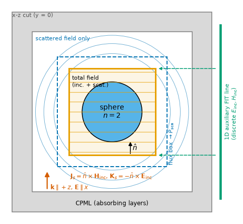

# Wakis tutorials

Worked examples that teach the Finite Integration Technique (FIT) with Wakis
and validate it against theory. Each tutorial is a runnable script and a
Colab notebook generated from the same source, with figures committed in its
`figures/` folder.

<table>
<tr>
<td width="42%"><a href="01_mie_cylinder/mie_cylinder.ipynb"></a></td>
<td>

### [01 &mdash; 2D Mie scattering by a dielectric cylinder](01_mie_cylinder/mie_cylinder.ipynb)
[](https://colab.research.google.com/github/eshipton/Wakis/blob/main/tutorials/01_mie_cylinder/mie_cylinder.ipynb)

Plane-wave scattering by an infinite cylinder (n = 2, a = 1 µm, x = 2&ndash;10),
TM and TE, with a total-field/scattered-field source: equivalence principle,
a 2D problem in a 3D solver (periodic slab), PyVista geometry and edge-level
mesh views (staircase vs conformal), memory preflight, near fields and a
movie, Q<sub>sca</sub> against the exact series, and a resolution study.
Runs in about a minute per polarization on a laptop CPU.

</td>
</tr>
<tr>
<td width="42%"><a href="01b_mie_sphere/mie_sphere.ipynb"></a></td>
<td>

### [01b &mdash; Mie scattering of a lossless dielectric sphere (3D)](01b_mie_sphere/mie_sphere.ipynb)
[](https://colab.research.google.com/github/eshipton/Wakis/blob/main/tutorials/01b_mie_sphere/mie_sphere.ipynb)

The same set-up in 3D (n = 2, r = 1 µm): Mie series, near and far fields
(`Near2FarMonitor` vs S<sub>1</sub>, S<sub>2</sub>), GPU run. *Validation
runs pending; see the notebook status.*

</td>
</tr>
<tr>
<td width="42%"><i>coming next</i></td>
<td>

### 02 &mdash; Plasmonic spheres (Ag, Au), 10 nm to 1 µm
Dispersive (Drude-Lorentz) metals with the same TF/SF set-up, absorption
from the inner flux box, comparison with complex-index Mie theory.

</td>
</tr>
</table>

## Running a tutorial

```bash
# local, from the repository root (virtual environment with `uv pip install -e .`)
python tutorials/01_mie_cylinder/mie_cylinder.py --quick    # 2D, CPU, ~2 min
python tutorials/01_mie_cylinder/mie_cylinder.py --full     # 2D, converged
python tutorials/01b_mie_sphere/mie_sphere.py --full --gpu  # 3D, GPU
```

On Colab, open the notebook with the badge: its first cell installs the fork
from GitHub (`pip install git+https://github.com/eshipton/Wakis.git@main`)
and `xvfb` for off-screen PyVista rendering.

## Conventions shared by all tutorials

* **One source, two formats.** `NN_name/name.py` is a
  [Jupytext](https://jupytext.readthedocs.io) *percent* script (`# %%` code
  cells, `# %% [markdown]` text cells). It runs as a headless script and is
  the only file to edit. The notebook is generated from it:

  ```bash
  python tutorials/build.py                 # regenerate all notebooks (no outputs)
  python tutorials/build.py --check         # CI: fail if a notebook is stale
  python tutorials/build.py 01 --execute --args "--full --gpu"   # run, keep outputs
  ```

  Executed notebooks keep only static outputs (PNG images, text), so they
  render on GitHub and stay below ~5 MB.
* **Run modes.** `--quick` (CPU, &le; 1&ndash;2 Mcells, minutes),
  `--full` (converged; GPU for 3D), `--gpu`/`--cpu` to force the backend.
  In a notebook the options come from the environment variable
  `WAKIS_TUTORIAL_ARGS`.
* **Studies.** Each script has an `--arm --out FILE` mode that performs one
  run and writes a JSON summary; `tutorials/study.py` expands an option grid
  into arms, runs them in parallel (one process per core, or several on a
  GPU) and merges them into the `data/convergence.json` read by the
  notebook.
* **Preflight first.** Every tutorial calls `wakis.estimate.estimate` and
  `preflight` before allocating a 3D grid.
* **Validation.** Every tutorial compares with an analytic or independent
  reference (`wakis.analytic`) and states its error and resolution.
* **Visualization.** `wakis.visualize` provides the shared helpers:
  `setup_rendering` (off-screen PyVista, static notebook backend),
  `plot_scene` (solids and labelled boxes), `plot_material_slice`
  (permittivity per edge: staircase vs conformal), `field_slice` /
  `plot_field_slice`, `plot_isosurfaces`, `SliceRecorder` + `save_animation`
  (GIF movies).
* **Units.** SI throughout (metres, seconds, Hz); plots label µm and fs.
