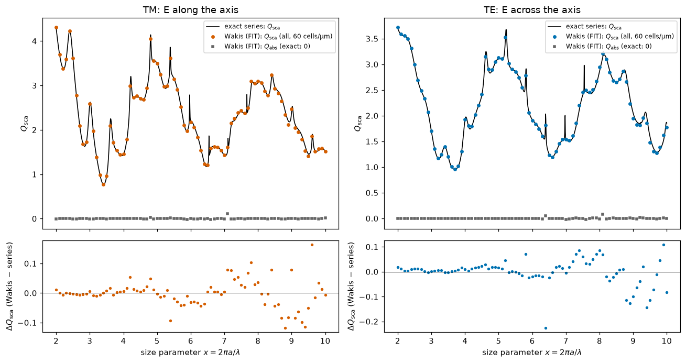

# Wakis User Manual — Electromagnetic & Wakefield Simulation with the Finite Integration Technique

**Repository:** [`github.com/eshipton/Wakis`](https://github.com/eshipton/Wakis) (fork of CERN's [`ImpedanCEI/wakis`](https://github.com/ImpedanCEI/wakis))  
**Upstream Documentation:** [`wakis.readthedocs.io`](https://wakis.readthedocs.io/)

> **Status Marker Legend**  
> Throughout this manual, every section, subsection, and feature-matrix row carries a status marker indicating whether the capability comes from upstream CERN Wakis or from this fork:
> - *(no marker)* — **Upstream CERN Wakis** (`ImpedanCEI/wakis`, merged from `upstream/main`).
> - 🆕 **New in this fork** — Implemented, merged into `develop`/`main` in this fork, and covered by automated tests in `tests/` and benchmark studies in `studies/`.
> - 🧪 **In progress** — Implemented on an active branch or pilot study and currently under evaluation (e.g., `feature/subpixel-projection` or the external `invrs-wakis` bridge).
> - 🗺️ **Planned** — Scheduled on the project roadmap (`README.md` checklists, `docs/unstructured_roadmap.md`, and the broader computational electromagnetics roadmap).

---

## Table of Contents

- [1. Title and Overview](#1-title-and-overview)
   - [1.1 What Wakis Is](#11-what-wakis-is)
   - [1.2 What This Fork Adds](#12-what-this-fork-adds--new-in-this-fork)
   - [1.3 Complete Feature Matrix](#13-complete-feature-matrix)
- [2. Installation and Environment Setup](#2-installation-and-environment-setup)
   - [2.1 Core Installation (`pip` and `uv`)](#21-core-installation-pip-and-uv)
   - [2.2 Optional Dependencies: GPU (CuPy), MPI (`mpi4py`), JAX, PyVista](#22-optional-dependencies-gpu-cupy-mpi-mpi4py-jax-pyvista)
   - [2.3 CPU Multithreading and BLAS/OpenMP Tuning](#23-cpu-multithreading-and-blasopenmp-tuning)
   - [2.4 Running on Google Colab and Headless Servers](#24-running-on-google-colab-and-headless-servers--new-in-this-fork)
- [3. Quick Start: Three Minimal Runnable Examples](#3-quick-start-three-minimal-runnable-examples)
   - [3.1 (a) 3D PEC Rectangular Cavity Resonance](#31-a-3d-pec-rectangular-cavity-resonance--new-in-this-fork)
   - [3.2 (b) 2D Mie Scattering by a Dielectric Cylinder with a TF/SF Plane Wave](#32-b-2d-mie-scattering-by-a-dielectric-cylinder-with-a-tfsf-plane-wave--new-in-this-fork)
   - [3.3 (c) Wakefield and Beam-Coupling Impedance of a Cavity](#33-c-wakefield-and-beam-coupling-impedance-of-a-cavity)
- [4. The Finite Integration Technique (FIT): Theory and Method Comparison](#4-the-finite-integration-technique-fit-theory-and-method-comparison)
   - [4.1 Integral Maxwell Equations on Dual Cell Complexes](#41-integral-maxwell-equations-on-dual-cell-complexes)
   - [4.2 Maxwell Grid Equations (Weiland 1977) and Topological Identities](#42-maxwell-grid-equations-weiland-1977-and-topological-identities)
   - [4.3 Material (Hodge) Matrices: Where All Spatial Approximation Lives](#43-material-hodge-matrices-where-all-spatial-approximation-lives)
   - [4.4 Leapfrog Time Integration, CFL Stability, Discrete Energy, and Dispersion](#44-leapfrog-time-integration-cfl-stability-discrete-energy-and-dispersion)
   - [4.5 Relation to FDTD (Yee 1966) and Discrete Exterior Calculus (DEC)](#45-relation-to-fdtd-yee-1966-and-discrete-exterior-calculus-dec)
   - [4.6 Relation to Finite Element Methods (FEM: Whitney/Nédélec Edge Elements)](#46-relation-to-finite-element-methods-fem-whitneynédélec-edge-elements)
   - [4.7 Relation to Other CEM Methods: FVTD, DGTD, FDFD, BEM/MoM, RCWA, Ray Tracing, and Fourier Optics](#47-relation-to-other-cem-methods-fvtd-dgtd-fdfd-bemmom-rcwa-ray-tracing-and-fourier-optics)
   - [4.8 Master Comparison Table of Computational Electromagnetics Methods](#48-master-comparison-table-of-computational-electromagnetics-methods)
   - [4.9 Decision Guide: When to Use Which Method](#49-decision-guide-when-to-use-which-method)
   - [4.10 Limits and Failure Modes of the Finite Integration Technique](#410-limits-and-failure-modes-of-the-finite-integration-technique)
- [5. Units, Conventions, and Time Stepping](#5-units-conventions-and-time-stepping)
   - [5.1 SI Units vs. Nondimensional Units](#51-si-units-vs-nondimensional-units)
   - [5.2 Phasor Convention: $\exp(+i\omega t)$ vs. $\exp(-i\omega t)$](#52-phasor-convention-expiomega-t-vs-exp-iomega-t--new-in-this-fork)
   - [5.3 Half-Step Temporal and Half-Cell Spatial Staggering of $\mathbf{E}$ and $\mathbf{H}$](#53-half-step-temporal-and-half-cell-spatial-staggering-of-mathbfe-and-mathbfh--new-in-this-fork)
   - [5.4 CFL Time Step on Uniform, Nonuniform, Conformal, and Unstructured Grids](#54-cfl-time-step-on-uniform-nonuniform-conformal-and-unstructured-grids)
- [6. Grids, Geometry, Subpixel Smoothing, and Symmetry](#6-grids-geometry-subpixel-smoothing-and-symmetry)
   - [6.1 `GridFIT3D` and Exact Domain-Edge Boundaries (`boundary_at_domain_edge=True`)](#61-gridfit3d-and-exact-domain-edge-boundaries-boundary_at_domain_edgetrue--new-in-this-fork)
   - [6.2 Importing CAD / STL Solids and Assigning Materials](#62-importing-cad--stl-solids-and-assigning-materials)
   - [6.3 Nonuniform / Graded Cartesian Meshes and Automatic Feature Snapping](#63-nonuniform--graded-cartesian-meshes-and-automatic-feature-snapping)
   - [6.4 Conformal Cut Cells: Dey–Mittra PEC and Thin Conducting Sheets](#64-conformal-cut-cells-deymittra-pec-and-thin-conducting-sheets--new-in-this-fork)
   - [6.5 Dielectric Subpixel Smoothing: Diagonal Harmonic/Arithmetic (`conformal='all'`) and Full Symmetric Kottke Tensor (`conformal='tensor'`)](#65-dielectric-subpixel-smoothing-diagonal-harmonicarithmetic-conformalall-and-full-symmetric-kottke-tensor-conformaltensor--new-in-this-fork)
   - [6.6 Exploiting Mirror Symmetry Planes](#66-exploiting-mirror-symmetry-planes--new-in-this-fork)
   - [6.7 High-Level Device Templates (`wakis.templates`)](#67-high-level-device-templates-wakistemplates--new-in-this-fork)
- [7. Materials and Dispersion](#7-materials-and-dispersion)
   - [7.1 Isotropic and Anisotropic Permittivity $\varepsilon$, Permeability $\mu$, and Conductivity $\sigma$](#71-isotropic-and-anisotropic-permittivity-varepsilon-permeability-mu-and-conductivity-sigma)
   - [7.2 Dispersive Materials via Auxiliary Differential Equations (Drude, Lorentz, Debye, Rakić Metals)](#72-dispersive-materials-via-auxiliary-differential-equations-drude-lorentz-debye-rakić-metals--new-in-this-fork)
   - [7.3 Subpixel Averaging at Dispersive Interfaces (`wakis.tensor_dispersive`)](#73-subpixel-averaging-at-dispersive-interfaces-wakistensor_dispersive--new-in-this-fork)
   - [7.4 Cold Plasma Medium and Analytical Linear Plasma Wakefield (`wakis.plasma`)](#74-cold-plasma-medium-and-analytical-linear-plasma-wakefield-wakisplasma--new-in-this-fork)
   - [7.5 Leontovich Surface Impedance Boundary Condition (`use_sibc=True`)](#75-leontovich-surface-impedance-boundary-condition-use_sibctrue)
- [8. Sources and Excitations](#8-sources-and-excitations)
   - [8.1 Relativistic and Sub-Relativistic Particle Beams (`Beam`, Direct vs. TF/SF Injection)](#81-relativistic-and-sub-relativistic-particle-beams-beam-direct-vs-tfsf-injection)
   - [8.2 Dipoles, Line/Sheet Currents, Gaussian Pulses, and CW Harmonics (`CurrentSource`, `MagneticCurrentSource`, `GaussianSource`, `ContinuousSource`, `CustomSource`)](#82-dipoles-linesheet-currents-gaussian-pulses-and-cw-harmonics-currentsource-magneticcurrentsource-gaussiansource-continuoussource-customsource--new-in-this-fork)
   - [8.3 Total-Field / Scattered-Field (TF/SF) Plane-Wave Box (`TFSFSource`)](#83-total-field--scattered-field-tfsf-plane-wave-box-tfsfsource--new-in-this-fork)
   - [8.4 Waveguide Eigenmode Sources (`solve_modes`, `ModeSource`)](#84-waveguide-eigenmode-sources-solve_modes-modesource--new-in-this-fork)
   - [8.5 Lumped Circuit Elements (`LumpedElement`) and Driven Lumped Ports (`LumpedPort`)](#85-lumped-circuit-elements-lumpedelement-and-driven-lumped-ports-lumpedport--new-in-this-fork)
- [9. Boundary Conditions and Absorbing Layers](#9-boundary-conditions-and-absorbing-layers)
   - [9.1 PEC, PMC, and Periodic Boundaries](#91-pec-pmc-and-periodic-boundaries)
   - [9.2 Bloch-Periodic Boundaries (`'bloch'`) with Complex Fields](#92-bloch-periodic-boundaries-bloch-with-complex-fields--new-in-this-fork)
   - [9.3 Convolutional Perfectly Matched Layer (`'cpml'`) vs. Legacy `'pml'`](#93-convolutional-perfectly-matched-layer-cpml-vs-legacy-pml--new-in-this-fork)
   - [9.4 First-Order Absorbing Boundary Conditions (`'abc'` / `'mur'`)](#94-first-order-absorbing-boundary-conditions-abc--mur)
   - [9.5 Radial Complex-Frequency-Shifted PML on Unstructured Meshes](#95-radial-complex-frequency-shifted-pml-on-unstructured-meshes--new-in-this-fork)
- [10. Monitors, Post-Processing, and Physical Observables](#10-monitors-post-processing-and-physical-observables)
   - [10.1 Time-Domain Field Snapshots, `FieldMonitor`, and `SliceRecorder`](#101-time-domain-field-snapshots-fieldmonitor-and-slicerecorder--new-in-this-fork)
   - [10.2 On-the-Fly Discrete Fourier Transform Monitor (`DFTMonitor`)](#102-on-the-fly-discrete-fourier-transform-monitor-dftmonitor--new-in-this-fork)
   - [10.3 Poynting Flux and Cross Sections (`FluxMonitor`)](#103-poynting-flux-and-cross-sections-fluxmonitor--new-in-this-fork)
   - [10.4 Near-to-Far-Field Transformation and Antenna Metrics (`Near2FarMonitor`)](#104-near-to-far-field-transformation-and-antenna-metrics-near2farmonitor--new-in-this-fork)
   - [10.5 Floquet Diffraction-Order Decomposition (`DiffractionMonitor`)](#105-floquet-diffraction-order-decomposition-diffractionmonitor--new-in-this-fork)
   - [10.6 Waveguide Mode Monitors (`ModeMonitor`) and Multi-Port S-Matrices (`wakis.sparameters`)](#106-waveguide-mode-monitors-modemonitor-and-multi-port-s-matrices-wakissparameters--new-in-this-fork)
   - [10.7 High-Resolution Resonance Extraction (`harminv`, `ResonanceMonitor`)](#107-high-resolution-resonance-extraction-harminv-resonancemonitor--new-in-this-fork)
   - [10.8 Wake Potential and Beam-Coupling Impedance (`WakeSolver`)](#108-wake-potential-and-beam-coupling-impedance-wakesolver)
- [11. Unstructured, Hybrid, Curvilinear, and High-Order Solvers](#11-unstructured-hybrid-curvilinear-and-high-order-solvers--new-in-this-fork)
   - [11.1 2D Triangle FIT (`UnstructuredFIT2D`, Voronoi / Barycentric Dual)](#111-2d-triangle-fit-unstructuredfit2d-voronoi--barycentric-dual--new-in-this-fork)
   - [11.2 2D Polygonal, Hybrid Square/Triangle, and Voronoi FIT (`PolygonFIT2D`)](#112-2d-polygonal-hybrid-squaretriangle-and-voronoi-fit-polygonfit2d--new-in-this-fork)
   - [11.3 2D Cartesian Subgridding (`SubgridFIT2D`)](#113-2d-cartesian-subgridding-subgridfit2d--new-in-this-fork)
   - [11.4 Hybrid Quadtree Subgrid + Body-Fitted Triangles (`subtri`)](#114-hybrid-quadtree-subgrid--body-fitted-triangles-subtri--new-in-this-fork)
   - [11.5 2D Curvilinear O-Grid Non-Orthogonal FIT (`CurvilinearFIT2D`)](#115-2d-curvilinear-o-grid-non-orthogonal-fit-curvilinearfit2d--new-in-this-fork)
   - [11.6 3D Extruded Prism FIT (`PrismFIT3D`)](#116-3d-extruded-prism-fit-prismfit3d--new-in-this-fork)
   - [11.7 3D Tetrahedral FIT (`UnstructuredFIT3D`)](#117-3d-tetrahedral-fit-unstructuredfit3d--new-in-this-fork)
   - [11.8 Stabilized Local Time Stepping (`UnstructuredFIT2D(lts=2)`, Leapfrog–Chebyshev)](#118-stabilized-local-time-stepping-unstructuredfit2dlts2-leapfrogchebyshev--new-in-this-fork)
   - [11.9 High-Order Solvers: Curved Nodal `DGTD2D` ($p=1\text{–}5$) and Cartesian `(2,4)` `FDTD24`](#119-high-order-solvers-curved-nodal-dgtd2d-p1text5-and-cartesian-24-fdtd24--new-in-this-fork)
   - [11.10 Summary Comparison of Mesh & Solver Arms (`README.md` Headline Benchmarks)](#1110-summary-comparison-of-mesh--solver-arms-readmemd-headline-benchmarks--new-in-this-fork)
- [12. GPU Acceleration, Fused Kernels, and MPI Domain Decomposition](#12-gpu-acceleration-fused-kernels-and-mpi-domain-decomposition)
   - [12.1 GPU Acceleration (`use_gpu=True`) and Fused CUDA Kernels (`fused=True`)](#121-gpu-acceleration-use_gputrue-and-fused-cuda-kernels-fusedtrue--new-in-this-fork)
   - [12.2 MPI Domain Decomposition (`use_mpi=True`) and Multi-GPU Scaling](#122-mpi-domain-decomposition-use_mpitrue-and-multi-gpu-scaling)
- [13. Inverse Design and Discrete Adjoint Sensitivity Analysis](#13-inverse-design-and-discrete-adjoint-sensitivity-analysis--new-in-this-fork)
   - [13.1 Exact Discrete Adjoint Theory and the Dot-Product Test](#131-exact-discrete-adjoint-theory-and-the-dot-product-test--new-in-this-fork)
   - [13.2 Parameterizing a Design Region (`MaterialGrid`) and Wrapping with JAX (`jax_simulation`)](#132-parameterizing-a-design-region-materialgrid-and-wrapping-with-jax-jax_simulation--new-in-this-fork)
   - [13.3 The Adjoint Memory Ladder (`store`, `checkpoint`, `reverse`, `nyquist`, `auto`)](#133-the-adjoint-memory-ladder-store-checkpoint-reverse-nyquist-auto--new-in-this-fork)
   - [13.4 Subpixel-Smoothed Projection (SSP) for High-Beta Topology Optimization](#134-subpixel-smoothed-projection-ssp-for-high-beta-topology-optimization--in-progress)
   - [13.5 The `invrs-gym` Bridge (`invrs-wakis`) and Benchmark Results](#135-the-invrs-gym-bridge-invrs-wakis-and-benchmark-results--in-progress)
- [14. Wakefield and Accelerator Physics Specifics](#14-wakefield-and-accelerator-physics-specifics)
   - [14.1 Wake Potential, Panofsky–Wenzel Theorem, Beam-Coupling Impedance, and Loss Factors](#141-wake-potential-panofskywenzel-theorem-beam-coupling-impedance-and-loss-factors)
   - [14.2 Dispersion-Free TE/TM Wake Time Stepping (`scheme='tete'`)](#142-dispersion-free-tetm-wake-time-stepping-schemetete--new-in-this-fork)
   - [14.3 Linear Cold-Plasma Wakefield Simulation (`wakis.plasma`)](#143-linear-cold-plasma-wakefield-simulation-wakisplasma--new-in-this-fork)
   - [14.4 Companion CERN ImpedanCEI Ecosystem Tools](#144-companion-cern-impedancei-ecosystem-tools)
- [15. Validation, Analytical References, and Benchmark Suite (`B1`–`B5`)](#15-validation-analytical-references-and-benchmark-suite-b1b5--new-in-this-fork)
   - [15.1 Built-in Exact Analytical Reference Solvers (`wakis.analytic`)](#151-built-in-exact-analytical-reference-solvers-wakisanalytic--new-in-this-fork)
   - [15.2 The Shared Benchmark Suite (`B1`–`B5`), Result Store, and `cost_to_target` Metric](#152-the-shared-benchmark-suite-b1b5-result-store-and-cost_to_target-metric--new-in-this-fork)
   - [15.3 How to Add and Benchmark a New Solver Arm](#153-how-to-add-and-benchmark-a-new-solver-arm--new-in-this-fork)
   - [15.4 Index of Engineering Studies (`studies/*`)](#154-index-of-engineering-studies-studies--new-in-this-fork)
- [16. Performance Modeling and Memory Planning](#16-performance-modeling-and-memory-planning--new-in-this-fork)
   - [16.1 Using `wakis.estimate` and `preflight` Before Launching a Run](#161-using-wakisestimate-and-preflight-before-launching-a-run--new-in-this-fork)
   - [16.2 Memory Breakdown per Grid Cell (`wakis/estimate.py`)](#162-memory-breakdown-per-grid-cell-wakisestimatepy--new-in-this-fork)
   - [16.3 Why Time-Domain Electromagnetic Solvers Are Memory-Bandwidth Bound](#163-why-time-domain-electromagnetic-solvers-are-memory-bandwidth-bound)
- [17. Roadmap and Sister Libraries](#17-roadmap-and-sister-libraries)
   - [17.1 Wakis Fork Roadmap (`README.md`, `docs/unstructured_roadmap.md`)](#171-wakis-fork-roadmap-readmemd-docsunstructured_roadmapmd)
   - [17.2 Sister Libraries in the Computational Electromagnetics Ecosystem (`plan.md`)](#172-sister-libraries-in-the-computational-electromagnetics-ecosystem-planmd--planned)
- [18. FAQ and Troubleshooting](#18-faq-and-troubleshooting)
   - [18.1 Why did my simulation blow up (`NaN` or `Inf` fields)?](#181-why-did-my-simulation-blow-up-nan-or-inf-fields)
   - [18.2 Why is my CPU simulation suddenly running $5\times\text{–}10\times$ slower after the pulse passes?](#182-why-is-my-cpu-simulation-suddenly-running-5timestext10times-slower-after-the-pulse-passes)
   - [18.3 How do I avoid Out-Of-Memory (OOM) errors on GPU or during Adjoint Runs?](#183-how-do-i-avoid-out-of-memory-oom-errors-on-gpu-or-during-adjoint-runs)
   - [18.4 How do I fix staircase errors on curved PEC or high-contrast dielectric/plasmonic surfaces?](#184-how-do-i-fix-staircase-errors-on-curved-pec-or-high-contrast-dielectricplasmonic-surfaces)
   - [18.5 Why do my complex phasors or S-parameters look conjugated compared to `Meep`, `fmmax`, or `ceviche`?](#185-why-do-my-complex-phasors-or-s-parameters-look-conjugated-compared-to-meep-fmmax-or-ceviche)
- [19. References and Credits](#19-references-and-credits)
   - [19.1 Verified Scientific References](#191-verified-scientific-references)
   - [19.2 Credits and Acknowledgments](#192-credits-and-acknowledgments)

---

## 1. Title and Overview

### 1.1 What Wakis Is

**Wakis** (*Wake and Impedance Solver*) is an open-source, 3D time-domain electromagnetic solver originally developed in the Accelerator Beam Physics group at **CERN** ([`ImpedanCEI/wakis`](https://github.com/ImpedanCEI/wakis)) to compute longitudinal and transverse wake potentials and beam-coupling impedances of accelerator components from imported CAD (`.stl`) geometries.

At its core, Wakis discretizes Maxwell's equations in integral form on a staggered dual cell complex using Thomas Weiland's **Finite Integration Technique (FIT)** ([Weiland 1977](#19-references-and-credits); [Clemens & Weiland 2001](#19-references-and-credits)), advancing the electric voltages and magnetic fluxes in time with a second-order symplectic leapfrog integrator. Because it is written in pure Python on top of `numpy`, `scipy.sparse`, `cupy` (for GPU acceleration), `mpi4py` (for longitudinal domain decomposition), and `pyvista` (for 3D CAD geometry interrogation and visualization), Wakis is easy to inspect, extend, and embed in optimization or multiphysics workflows.


*Figure 1.1 — Upstream Wakis architecture for 3D time-domain electromagnetic and wakefield simulation.*

### 1.2 What This Fork Adds 🆕 **New in this fork**

This fork ([`github.com/eshipton/Wakis`](https://github.com/eshipton/Wakis)) preserves full backward compatibility with upstream Wakis's wakefield and impedance workflows while expanding Wakis into a **general-purpose computational electromagnetics (CEM) and photonic/RF inverse-design solver**, validated against exact analytical solutions (`wakis.analytic`) and external reference solvers (`meep`, `ceviche`, `fmmax`, `scikit-fem`, and `necpp`).

The fork adds **88 new files under `wakis/` (97 changed in total)** (`git diff --name-status upstream/main...HEAD -- wakis`), organized around six major themes:

1. **General CEM Sources, Ports, Boundaries, and Monitors:**
   - Exact discrete 3D Total-Field / Scattered-Field plane-wave excitation (`TFSFSource`; peak scattered-field leakage in vacuum $\approx 6\times 10^{-15}$–$10^{-14}$ of the total field in 3D, i.e. round-off; `studies/tfsf/`).
   - 2D waveguide vector eigenmode solver, modal launcher, and S-parameter decomposition (`solve_modes`, `ModeSource`, `ModeMonitor`).
   - Lumped RLC circuit elements, Norton discrete ports, and multi-port Touchstone/scikit-rf S-parameters (`LumpedElement`, `LumpedPort`, `wakis.sparameters`).
   - Bloch-periodic boundary conditions (`bc='bloch'`, `k_bloch`) and Rayleigh diffraction-order decomposition (`DiffractionMonitor`).
   - Frequency-domain field, Poynting flux, near-to-far-field Stratton–Chu radiation, and harmonic-inversion (`harminv`) resonance monitors (`DFTMonitor`, `FluxMonitor`, `Near2FarMonitor`, `ResonanceMonitor`).
2. **Subcell Geometry Accuracy and Dispersive Media:**
   - Dey–Mittra conformal PEC cut cells with a symmetric $(2,-1)$ small-face flux redistribution, zero-thickness PEC sheets with a knife-edge field correction (`conformal='pec'`), diagonal Kottke subpixel smoothing (`conformal='all'`), and full symmetric octant tensor averaging (`conformal='tensor'`).
   - Multi-pole Drude, Lorentz, and Debye dispersive materials via Auxiliary Differential Equations (`DispersiveMaterial`, `dispersive_lib` with Rakić Au, Ag, Al, Cu, $\text{SiO}_2$), plus a two-capacitor edge-network scheme (`wakis/tensor_dispersive.py`) for subpixel-averaged metal–dielectric interfaces.
   - Mirror symmetry by placing PEC/PMC boundaries exactly on a symmetry plane (`boundary_at_domain_edge=True`), cutting the cell count by $2\times$ to $8\times$.
3. **Unstructured, Hybrid, Curvilinear, Prism, and High-Order Meshes:**
   - 2D and 3D simplex FIT on Delaunay–Voronoi and barycentric dual meshes (`UnstructuredFIT2D`, `UnstructuredFIT3D`) with radial CFS-PML, automatic $h$-grading, and integer-ratio Local Time Stepping (`lts=p`).
   - 2D polygonal, hybrid quad/triangle, and centroidal Voronoi FIT (`PolygonFIT2D`), 2D nested Cartesian subgridding (`SubgridFIT2D`), subgridded quadtree squares with a conforming triangle band (`subtri`, 🆕 merged), and curvilinear O-grid Non-Orthogonal FIT (`CurvilinearFIT2D`).
   - 3D extruded triangular prism FIT (`PrismFIT3D`) for layered photonic, metasurface, and planar RF structures.
   - High-order nodal Discontinuous Galerkin Time Domain on curved isoparametric triangles (`DGTD2D`, $p=1\dots 6$) and fourth-order staggered Cartesian FDTD (`FDTD24`).
4. **Wakefield Physics Extensions:**
   - Dispersion-free longitudinal propagation for wakefields via the Dohlus–Zagorodnov TE/TM splitting (`SolverFIT3D(..., scheme='tete')`), giving a smooth-pipe spurious wake at round-off ($\le 3\times 10^{-8}$ V/pC, against 1.2–660 V/pC for Yee) and, in a closed box at $\sigma_z/\Delta z = 1$, a loss-factor error of 10 % against 48 % for Yee (19× less work to reach 1 %).
   - Self-consistent cold-plasma ADE response and linear plasma wakefield analytical benchmarks (`wakis.plasma`).
5. **Exact Discrete Adjoint and Photonic/RF Inverse Design:**
   - Discretize-then-differentiate adjoint sensitivity analysis (`AdjointSimulation`, `AdjointStepper`) matching finite differences to $10^{-11}$ across dielectrics, CPML, Bloch boundaries, lumped ports, and dispersive media.
   - Custom JAX primitive (`jax_simulation`), density filtering/projection (`MaterialGrid`, plus subpixel-smoothed projection 🧪 **In progress**), a 5-rung adjoint memory ladder (`store`, `checkpoint`, `reverse`, `nyquist`, `auto`) with `reverse` using 30–60× less memory than `store` (12.3 GB → 0.39 GB measured on a 313² × 20 000-step case), and an `invrs-gym` bridge (`invrs-wakis`).
6. **Performance Engineering and Reproducible Benchmarking:**
   - Fused CuPy CUDA elementwise kernels (`use_gpu=True, fused=True`) delivering $185\text{–}319$ Mcells/s on one NVIDIA L4 GPU for a plain PEC box of $64^3$–$192^3$ cells, i.e. $10\text{–}38\times$ one CPU core and $6\text{–}20\times$ eight MKL cores (`docs/performance.md`).
   - Pre-flight memory and runtime estimator (`wakis.estimate`, `preflight`) and the `wakis.benchmarks` suite (`B1`–`B5`) with one JSON record per run.

---

### 1.3 Complete Feature Matrix

Every row below carries one of the four status markers defined at the top of this manual.

| Feature | Module / Public API | Status | Where Documented / Tested |
| :--- | :--- | :--- | :--- |
| **3D Cartesian FIT Grid & STL Import** | `wakis.GridFIT3D` (`wakis/gridFIT3D.py`) | *(upstream)* | [Sec. 6.1](#61-gridfit3d-and-exact-domain-edge-boundaries-boundary_at_domain_edgetrue--new-in-this-fork), [Sec. 6.2](#62-importing-cad--stl-solids-and-assigning-materials); `tests/test_001_grid_and_stl.py` |
| **Domain-Edge Boundary Alignment** | `GridFIT3D(..., boundary_at_domain_edge=True)` | 🆕 **New in this fork** | [Sec. 6.1](#61-gridfit3d-and-exact-domain-edge-boundaries-boundary_at_domain_edgetrue--new-in-this-fork); `tests/test_012_grid_boundaries.py` |
| **Nonuniform / Graded Cartesian Grids** | `GridFIT3D(..., x=..., y=..., z=...)`, `wakis.templates.meshing.graded_axis` | *(upstream)* + 🆕 **New in this fork** | [Sec. 6.3](#63-nonuniform--graded-cartesian-meshes-and-automatic-feature-snapping); `wakis/benchmarks/arms/cartesian2d.py` |
| **3D FIT Leapfrog Solver (`emsolve`, `wakesolve`)** | `wakis.SolverFIT3D` (`wakis/solverFIT3D.py`) | *(upstream)* | [Sec. 4](#4-the-finite-integration-technique-fit-theory-and-method-comparison), [Sec. 5](#5-units-conventions-and-time-stepping); `tests/test_002_solverFIT3D.py` |
| **Energy-Decay Early Stopping** | `SolverFIT3D.emsolve(..., stop_when_energy_decayed=(tol, check_every))` | 🆕 **New in this fork** | [Sec. 3.2](#32-b-2d-mie-scattering-by-a-dielectric-cylinder-with-a-tfsf-plane-wave--new-in-this-fork), [Sec. 8.5](#85-lumped-circuit-elements-lumpedelement-and-driven-lumped-ports-lumpedport--new-in-this-fork); `tests/test_016_lumped_and_sparameters.py` |
| **Mirror Symmetry via Domain-Edge PEC/PMC Planes** | `GridFIT3D(..., boundary_at_domain_edge=True)` + `SolverFIT3D(bc_low=['pmc', ...])` (no dedicated symmetry API) | 🆕 **New in this fork** (domain-edge convention) | [Sec. 6.6](#66-exploiting-mirror-symmetry-planes--new-in-this-fork); `tests/test_023_symmetry.py` |
| **Conformal Dey–Mittra PEC & Thin Sheets** | `GridFIT3D(..., conformal='pec', sheets={...})` (`wakis/conformal.py`) | 🆕 **New in this fork** | [Sec. 6.4](#64-conformal-cut-cells-deymittra-pec-and-thin-conducting-sheets--new-in-this-fork); `tests/test_022_conformal.py`, `studies/conformal/` |
| **Diagonal Kottke Subpixel Smoothing** | `GridFIT3D(..., conformal='all')` (`wakis/conformal.py`) | 🆕 **New in this fork** | [Sec. 6.5](#65-dielectric-subpixel-smoothing-diagonal-harmonicarithmetic-conformalall-and-full-symmetric-kottke-tensor-conformaltensor--new-in-this-fork); `tests/test_022_conformal.py`, `tutorials/01_mie_cylinder/` |
| **Full-Tensor Kottke Subpixel Averaging** | `GridFIT3D(..., conformal='tensor')` (`wakis/tensor_averaging.py`) | 🆕 **New in this fork** | [Sec. 6.5](#65-dielectric-subpixel-smoothing-diagonal-harmonicarithmetic-conformalall-and-full-symmetric-kottke-tensor-conformaltensor--new-in-this-fork); `tests/test_027_tensor_averaging.py`, `studies/tensor-averaging/` |
| **Declarative Device Templates** | `wakis.templates` (`Simulation`, `Box`, `Cylinder`, `Sheet`, `dipole_antenna`, `patch_antenna`, `rectangular_waveguide`, `slab_waveguide`, `unit_cell`, `parameter_sweep`) | 🆕 **New in this fork** | [Sec. 6.7](#67-high-level-device-templates-wakistemplates--new-in-this-fork), `docs/templates.md`; `tests/test_024_templates.py` |
| **Anisotropic Diagonal $`\varepsilon_r, \mu_r, \sigma`$** | `SolverFIT3D.ieps`, `imu`, `sigma` (`wakis/field.py`, `wakis/materials.py`) | *(upstream)* | [Sec. 7.1](#71-isotropic-and-anisotropic-permittivity-varepsilon-permeability-mu-and-conductivity-sigma); `tests/test_002_solverFIT3D.py` |
| **Leontovich Surface Impedance (SIBC)** | `SolverFIT3D(..., use_sibc=True)` | *(upstream)* | [Sec. 7.5](#75-leontovich-surface-impedance-boundary-condition-use_sibctrue); `tests/test_005_boundaries.py` |
| **Dispersive Materials (ADE: Drude, Lorentz, Debye, Rakić)** | `DispersiveMaterial`, `Drude`, `Lorentz`, `Debye`, `dispersive_lib`, `fit_poles`, `eps_from_nk` (`wakis/dispersive.py`) | 🆕 **New in this fork** | [Sec. 7.2](#72-dispersive-materials-via-auxiliary-differential-equations-drude-lorentz-debye-rakić-metals--new-in-this-fork); `tests/test_019_dispersive.py`, `studies/dispersive/` |
| **Tensor-Dispersive Two-Capacitor Subpixel Averaging** | `GridFIT3D(..., conformal='tensor')` with `DispersiveMaterial` (`wakis/tensor_dispersive.py`) | 🆕 **New in this fork** | [Sec. 7.3](#73-subpixel-averaging-at-dispersive-interfaces-wakistensor_dispersive--new-in-this-fork); `tests/test_036_tensor_dispersive.py`, `studies/tensor-dispersive/` |
| **Cold-Plasma Material & Linear Plasma Wake** | `wakis.plasma` (`cold_plasma`, `plasma_frequency`, `linear_wake`, `wake_amplitude`) | 🆕 **New in this fork** | [Sec. 7.4](#74-cold-plasma-medium-and-analytical-linear-plasma-wakefield-wakisplasma--new-in-this-fork), [Sec. 14.3](#143-linear-cold-plasma-wakefield-simulation-wakisplasma--new-in-this-fork); `tests/test_020_linear_plasma_wake.py`, `examples/007_linear_plasma_wakefield.py` |
| **Relativistic Beam, Dipole, PlaneWave, Pulse** | `Beam`, `Dipole`, `PlaneWave`, `Pulse` (`wakis/sources.py`) | *(upstream)* | [Sec. 8.1](#81-relativistic-and-sub-relativistic-particle-beams-beam-direct-vs-tfsf-injection); `tests/test_004_sources.py` |
| **Soft Electric/Magnetic Current Sources & Waveforms** | `CurrentSource`, `MagneticCurrentSource`, `GaussianSource`, `ContinuousSource`, `CustomSource` (`wakis/sources.py`) | 🆕 **New in this fork** | [Sec. 8.2](#82-dipoles-linesheet-currents-gaussian-pulses-and-cw-harmonics-currentsource-magneticcurrentsource-gaussiansource-continuoussource-customsource--new-in-this-fork); `tests/test_014_soft_sources.py` |
| **Exact Discrete 3D TF/SF Plane-Wave Source** | `wakis.TFSFSource` (`wakis/tfsf.py`) | 🆕 **New in this fork** | [Sec. 8.3](#83-total-field--scattered-field-tfsf-plane-wave-box-tfsfsource--new-in-this-fork); `tests/test_029_tfsf.py`, `studies/tfsf/` |
| **Waveguide Eigenmode Solver, Launcher & Monitor** | `solve_modes`, `ModeSource`, `ModeMonitor` (`wakis/mode_solver.py`) | 🆕 **New in this fork** | [Sec. 8.4](#84-waveguide-eigenmode-sources-solve_modes-modesource--new-in-this-fork), [Sec. 10.6](#106-waveguide-mode-monitors-modemonitor-and-multi-port-s-matrices-wakissparameters--new-in-this-fork); `tests/test_017_mode_ports.py`, `studies/mode_ports/` |
| **Lumped RLC Elements, Ports & S-Parameters** | `LumpedElement`, `LumpedPort` (`wakis/lumped.py`), `s_matrix`, `write_touchstone`, `read_touchstone`, `to_skrf_network` (`wakis/sparameters.py`) | 🆕 **New in this fork** | [Sec. 8.5](#85-lumped-circuit-elements-lumpedelement-and-driven-lumped-ports-lumpedport--new-in-this-fork), [Sec. 10.6](#106-waveguide-mode-monitors-modemonitor-and-multi-port-s-matrices-wakissparameters--new-in-this-fork); `tests/test_016_lumped_and_sparameters.py`, `studies/lumped_sparam/` |
| **PEC, PMC, Periodic, Mur ABC, Scalar PML, CPML** | `SolverFIT3D(..., bc_low=..., bc_high=...)` (`wakis/boundaries.py`, `wakis/solverFIT3D.py`) | *(upstream)* | [Sec. 9.1](#91-pec-pmc-and-periodic-boundaries), [Sec. 9.3](#93-convolutional-perfectly-matched-layer-cpml-vs-legacy-pml--new-in-this-fork), [Sec. 9.4](#94-first-order-absorbing-boundary-conditions-abc--mur); `tests/test_005_boundaries.py`, `tests/test_008_cpml.py` |
| **Bloch-Periodic Boundaries & Diffraction Orders** | `bc='bloch'`, `k_bloch` (`wakis/bloch.py`), `DiffractionMonitor` (`wakis/diffraction.py`) | 🆕 **New in this fork** | [Sec. 9.2](#92-bloch-periodic-boundaries-bloch-with-complex-fields--new-in-this-fork), [Sec. 10.5](#105-floquet-diffraction-order-decomposition-diffractionmonitor--new-in-this-fork); `tests/test_021_bloch.py`, `tests/test_030_diffraction.py`, `studies/diffraction/` |
| **Time-Domain `FieldMonitor` & `SliceRecorder`** | `wakis.FieldMonitor` (`wakis/field_monitors.py`), `wakis.visualize.SliceRecorder` | *(upstream)* + 🆕 **New in this fork** | [Sec. 10.1](#101-time-domain-field-snapshots-fieldmonitor-and-slicerecorder--new-in-this-fork); `examples/005_CPU_with_field_monitor.py` |
| **Frequency-Domain `DFTMonitor` & `FluxMonitor`** | `wakis.DFTMonitor`, `wakis.FluxMonitor` (`wakis/field_monitors.py`) | 🆕 **New in this fork** | [Sec. 10.2](#102-on-the-fly-discrete-fourier-transform-monitor-dftmonitor--new-in-this-fork), [Sec. 10.3](#103-poynting-flux-and-cross-sections-fluxmonitor--new-in-this-fork); `tests/test_015_dft_and_flux_monitors.py` |
| **Stratton–Chu Near-to-Far-Field Transformation** | `wakis.Near2FarMonitor` (`wakis/near2far.py`) | 🆕 **New in this fork** | [Sec. 10.4](#104-near-to-far-field-transformation-and-antenna-metrics-near2farmonitor--new-in-this-fork); `tests/test_018_near2far.py`, `studies/near2far/` |
| **Harmonic Inversion (`harminv`, `ResonanceMonitor`)** | `wakis.harminv`, `wakis.ResonanceMonitor` (`wakis/resonances.py`) | 🆕 **New in this fork** | [Sec. 10.7](#107-high-resolution-resonance-extraction-harminv-resonancemonitor--new-in-this-fork); `tests/test_025_resonances.py`, `studies/resonances/` |
| **Wake Potential & Impedance (`WakeSolver`)** | `wakis.WakeSolver` (`wakis/wakeSolver.py`) | *(upstream)* | [Sec. 10.8](#108-wake-potential-and-beam-coupling-impedance-wakesolver), [Sec. 14.1](#141-wake-potential-panofskywenzel-theorem-beam-coupling-impedance-and-loss-factors); `tests/test_003_wakeSolver.py` |
| **Dispersion-Free TE/TM Wakefield Scheme** | `SolverFIT3D(..., scheme='tete')` (`wakis/tete.py`) | 🆕 **New in this fork** | [Sec. 14.2](#142-dispersion-free-tetm-wake-time-stepping-schemetete--new-in-this-fork); `tests/test_044_tete_wake.py`, `studies/tete-wake/` |
| **2D/3D Simplex FIT & Radial CFS-PML** | `SimplexMesh`, `UnstructuredFIT2D`, `UnstructuredFIT3D` (`wakis/unstructured/`) | 🆕 **New in this fork** | [Sec. 9.5](#95-radial-complex-frequency-shifted-pml-on-unstructured-meshes--new-in-this-fork), [Sec. 11.1](#111-2d-triangle-fit-unstructuredfit2d-voronoi--barycentric-dual--new-in-this-fork), [Sec. 11.7](#117-3d-tetrahedral-fit-unstructuredfit3d--new-in-this-fork); `tests/test_028_unstructured_fit.py`, `studies/unstructured/` |
| **Local Time Stepping (LTS) on Unstructured Meshes** | `UnstructuredFIT2D(..., lts=p)` (`wakis/unstructured/lts.py`) | 🆕 **New in this fork** | [Sec. 11.8](#118-stabilized-local-time-stepping-unstructuredfit2dlts2-leapfrogchebyshev--new-in-this-fork); `tests/test_035_unstructured_lts.py`, `studies/unstructured-lts/` |
| **Polygonal, Hybrid Quad/Tri & Voronoi FIT** | `PolyMesh`, `PolygonFIT2D`, `hybrid_circles_mesh`, `voronoi_disk_mesh` (`wakis/unstructured/polymesh*.py`) | 🆕 **New in this fork** | [Sec. 11.2](#112-2d-polygonal-hybrid-squaretriangle-and-voronoi-fit-polygonfit2d--new-in-this-fork); `tests/test_037_polygon_fit.py`, `studies/polygon-fit/` |
| **2D Nested Cartesian Subgridding** | `QuadMesh`, `refine_near`, `Geometry`, `Circle`, `Rect`, `SubgridFIT2D` (`wakis/subgrid/`) | 🆕 **New in this fork** | [Sec. 11.3](#113-2d-cartesian-subgridding-subgridfit2d--new-in-this-fork); `tests/test_038_subgridding.py`, `studies/subgridding/` |
| **Subgridded Quadtree + Triangle Band (`subtri`)** | `subtri_circles_mesh`, `SubTriFIT2D` (`wakis/unstructured/subtri.py`), benchmark arm `SubTriArm` (`wakis/benchmarks/arms/subtri2d.py`) | 🆕 **New in this fork** | [Sec. 11.4](#114-hybrid-quadtree-subgrid--body-fitted-triangles-subtri--new-in-this-fork); `studies/subtri-hybrid/` on branch `merge/subtri` |
| **Curvilinear O-Grid Non-Orthogonal FIT (NFIT)** | `CurvilinearFIT2D`, `ogrid_mesh`, `ogrid_cartesian_mesh`, `radial_nodes` (`wakis/curvilinear/`) | 🆕 **New in this fork** | [Sec. 11.5](#115-2d-curvilinear-o-grid-non-orthogonal-fit-curvilinearfit2d--new-in-this-fork); `tests/test_039_curvilinear_nfit.py`, `studies/curvilinear-nfit/` |
| **Extruded 3D Triangular Prism FIT** | `PrismMesh`, `PrismFIT3D` (`wakis/unstructured/prism.py`) | 🆕 **New in this fork** | [Sec. 11.6](#116-3d-extruded-prism-fit-prismfit3d--new-in-this-fork); `tests/test_046_prism_fit.py`, `studies/prism-cavity/`, `studies/prism-ring/`, `studies/prism-dipole/` |
| **High-Order Nodal DGTD & Fourth-Order FDTD** | `DGTD2D`, `circles_mesh` (`wakis/highorder/dgtd2d.py`), `FDTD24` (`wakis/highorder/fdtd24.py`) | 🆕 **New in this fork** | [Sec. 11.9](#119-high-order-solvers-curved-nodal-dgtd2d-p1text5-and-cartesian-24-fdtd24--new-in-this-fork); `tests/test_040_highorder.py`, `studies/high-order/` |
| **GPU Acceleration (CuPy) & MPI z-Slab Decomposition** | `SolverFIT3D(..., use_gpu=True, use_mpi=True)` | *(upstream)* | [Sec. 12.1](#121-gpu-acceleration-use_gputrue-and-fused-cuda-kernels-fusedtrue--new-in-this-fork), [Sec. 12.2](#122-mpi-domain-decomposition-use_mpitrue-and-multi-gpu-scaling); `tests/test_006_gpu.py`, `tests/test_007_mpi.py` |
| **Fused CUDA/CuPy Elementwise Step Kernels** | `SolverFIT3D(..., use_gpu=True, fused=True)` (`wakis/gpu_fused.py`) | 🆕 **New in this fork** | [Sec. 12.1](#121-gpu-acceleration-use_gputrue-and-fused-cuda-kernels-fusedtrue--new-in-this-fork); `tests/test_041_gpu_fused.py`, `studies/gpu-fused/` |
| **Exact Discrete Adjoint & JAX Custom VJP** | `AdjointStepper`, `AdjointSimulation`, `MaterialGrid`, `jax_simulation` (`wakis/inverse/`) | 🆕 **New in this fork** | [Sec. 13.1](#131-exact-discrete-adjoint-theory-and-the-dot-product-test--new-in-this-fork), [Sec. 13.2](#132-parameterizing-a-design-region-materialgrid-and-wrapping-with-jax-jax_simulation--new-in-this-fork); `tests/test_031_adjoint_core.py`, `tests/test_032_adjoint_coverage.py`, `tests/test_033_adjoint_gpu_mpi.py` |
| **Adjoint Memory Ladder (`store`/`checkpoint`/`reverse`/`nyquist`/`auto`)** | `AdjointSimulation(..., memory='auto', memory_budget_gb=...)` (`wakis/inverse/memory.py`) | 🆕 **New in this fork** | [Sec. 13.3](#133-the-adjoint-memory-ladder-store-checkpoint-reverse-nyquist-auto--new-in-this-fork); `tests/test_045_adjoint_memory.py`, `studies/adjoint-memory/` |
| **Subpixel-Smoothed Projection (SSP)** | `smoothed_projection`, `MaterialGrid(projection_beta=...)` (`feature/subpixel-projection`) | 🧪 **In progress** | [Sec. 13.4](#134-subpixel-smoothed-projection-ssp-for-high-beta-topology-optimization--in-progress); `studies/ssp/` on branch `feature/subpixel-projection` |
| **`invrs-gym` Photonic Optimization Bridge** | `invrs-wakis` (`github.com/eshipton/invrs-wakis`) | 🧪 **In progress** | [Sec. 13.5](#135-the-invrs-gym-bridge-invrs-wakis-and-benchmark-results--in-progress); `studies/invrs-round2/` |
| **Exact Analytical Reference Solutions** | `wakis.analytic` (`mie_efficiencies`, `mie_s1_s2`, `cylinder_efficiencies`, `coated_cylinder_efficiencies`, `CylinderCluster`, `hallen_dipole`) | 🆕 **New in this fork** | [Sec. 15.1](#151-built-in-exact-analytical-reference-solvers-wakisanalytic--new-in-this-fork); `tests/test_013_analytic.py`, `tests/test_043_mie_cylinder_theory.py` |
| **Cross-Method Benchmark Suite (`B1`–`B5`)** | `wakis.benchmarks` (`CASES`, `get_case`, `Arm`, `run`, `cost_to_target`, `load_records`) | 🆕 **New in this fork** | [Sec. 15.2](#152-the-shared-benchmark-suite-b1b5-result-store-and-cost_to_target-metric--new-in-this-fork), [Sec. 15.3](#153-how-to-add-and-benchmark-a-new-solver-arm--new-in-this-fork); `tests/test_042_benchmarks.py`, `studies/benchmarks/` |
| **Pre-Run Memory & Runtime Estimator** | `wakis.estimate.estimate`, `wakis.estimate.preflight` (`wakis/estimate.py`) | 🆕 **New in this fork** | [Sec. 16.1](#161-using-wakisestimate-and-preflight-before-launching-a-run--new-in-this-fork); `tests/test_026_estimate.py` |
| **3D Octree Subgridding, 3D O-Grid NFIT, Unstructured Adjoints** | Roadmap items (`docs/unstructured_roadmap.md`) | 🗺️ **Planned** | [Sec. 17.1](#171-wakis-fork-roadmap-readmemd-docsunstructured_roadmapmd) |

---

## 2. Installation and Environment Setup

### 2.1 Core Installation (`pip` and `uv`)

Wakis requires **Python $\ge 3.9$** (Python 3.11 or 3.12 recommended). Its core dependencies (`numpy`, `scipy`, `matplotlib`, `pyvista`, `h5py`, and `tqdm`) are installed automatically.

#### Installing this fork in editable mode (recommended for development and studies)

Using [`uv`](https://docs.astral.sh/uv/) (fastest):

```bash
git clone https://github.com/eshipton/Wakis.git
cd Wakis
uv venv .venv
source .venv/bin/activate
uv pip install -e .
```

Or using standard `pip`:

```bash
git clone https://github.com/eshipton/Wakis.git
cd Wakis
python3 -m venv .venv
source .venv/bin/activate
pip install -e .
```

#### Installing directly from GitHub without cloning

```bash
pip install "wakis @ git+https://github.com/eshipton/Wakis.git@main"
```

*(Note: Running `pip install wakis` from PyPI installs upstream CERN Wakis v0.6.x, which does not include the fork modules marked with 🆕 **New in this fork**.)*

---

### 2.2 Optional Dependencies: GPU (CuPy), MPI (`mpi4py`), JAX, PyVista

Wakis keeps heavy or platform-specific packages optional so that the core solver installs cleanly on any laptop or CI runner.

| Capability | Package(s) | Installation Command | Used By |
| :--- | :--- | :--- | :--- |
| **NVIDIA GPU Acceleration** | `cupy` | `pip install cupy-cuda12x` *(or `conda install -c conda-forge cupy`)* | `SolverFIT3D(..., use_gpu=True, fused=True)`, `PrismFIT3D(..., use_gpu=True)`, `AdjointSimulation` |
| **MPI Domain Decomposition** | `mpi4py`, OpenMPI / MPICH | `conda install -c conda-forge mpi4py openmpi` *(or system `apt install libopenmpi-dev && pip install mpi4py`)* | `SolverFIT3D(..., use_mpi=True)` |
| **Differentiable Inverse Design** | `jax`, `jaxlib`, `optax` | `pip install jax jaxlib` *(CPU)* or `pip install "jax[cuda12]"` *(GPU)* | `wakis.inverse.jax_simulation`, `wakis.inverse.smoothed_projection`, topology optimization |
| **Interactive Notebook 3D Rendering** | `trame`, `ipywidgets`, `ipympl` | `pip install "wakis[notebook]"` | Interactive PyVista widgets inside JupyterLab |
| **RF Network Post-Processing** | `scikit-rf` | `pip install scikit-rf` | `wakis.sparameters.to_skrf_network` |
| **Wakefield Post-Processing** | `iddefix`, `neffint`, `bihc` | `pip install iddefix neffint bihc` | `WakeSolver.get_ExtrapolatedImpedance`, beam-induced heating |

To verify whether CuPy sees a working CUDA device:

```python
import cupy as cp

print("CUDA devices:", cp.cuda.runtime.getDeviceCount())
print("Device 0:", cp.cuda.runtime.getDeviceProperties(0)["name"].decode())
```

---

### 2.3 CPU Multithreading and BLAS/OpenMP Tuning

On CPU, Wakis's default time-stepping loop calls `scipy.sparse` CSR matrix-vector products and vectorised NumPy ufuncs.
- By default, SciPy's sparse matvec is single-threaded unless OpenMP/MKL threading is enabled, whereas NumPy array operations use the underlying BLAS (`OpenBLAS` or `MKL`) thread pool.
- When running **MPI** (`mpirun -n N python script.py`) or parallel benchmark sweeps (`memguard` / `multiprocessing`), always pin each process to **1 thread** to avoid oversubscribing CPU cores:

```python
import os

os.environ["OMP_NUM_THREADS"] = "1"
os.environ["OPENBLAS_NUM_THREADS"] = "1"
os.environ["MKL_NUM_THREADS"] = "1"
```

- When using the Intel Math Kernel Library (`mkl`) alongside [`sparse_dot_mkl`](https://github.com/flatironinstitute/sparse_dot) for multithreaded single-process CPU runs, install `conda install -c conda-forge mkl sparse_dot_mkl` and set `os.environ["MKL_NUM_THREADS"] = "4"` **before** importing `numpy` or `wakis`.

---

### 2.4 Running on Google Colab and Headless Servers 🆕 **New in this fork**

The tutorials in [`tutorials/README.md`](tutorials/README.md) are paired `.py` (Jupytext percent-format) and `.ipynb` files designed to run unaltered on **Google Colab** (free CPU or T4/L4 GPU runtime) and on headless Linux servers.

1. **Colab one-cell setup:** At the top of a Colab notebook, install `xvfb` (for off-screen PyVista 3D rendering) and this fork:

```python
import subprocess, sys

if "google.colab" in sys.modules:
    subprocess.run("apt-get -qq install -y xvfb > /dev/null", shell=True, check=False)
    subprocess.run(
        [sys.executable, "-m", "pip", "install", "-q",
         "wakis @ git+https://github.com/eshipton/Wakis.git@main"],
        check=True,
    )
```

2. **Headless rendering helper (`wakis.visualize.setup_rendering`):** Calling `wakis.visualize.setup_rendering()` automatically starts `pv.start_xvfb()` on headless Linux when `DISPLAY` is unset and configures static PNG rendering so notebooks remain lightweight and portable.
3. **Local memory guard:** When running scripts locally on a shared workstation or laptop, wrap Python invocations with `memguard` (if present in your workspace) or call `wakis.estimate.preflight` ([Section 16.1](#161-using-wakisestimate-and-preflight-before-launching-a-run--new-in-this-fork)) to prevent accidental out-of-memory thrashing.

---

## 3. Quick Start: Three Minimal Runnable Examples

The three self-contained scripts below reside in [`docs/manual_examples/`](docs/manual_examples/) and each run in **a few seconds to about a minute** on one laptop core under a 2 GB memory cap (quickstart (b) is the slowest, about 50 s). Together they demonstrate the three primary ways to use Wakis:
- **(a) Eigenmode / resonance analysis** in a closed 3D cavity (`GridFIT3D` + `SolverFIT3D` + `CurrentSource` + `ResonanceMonitor` / `harminv`).
- **(b) Open-region wave scattering** in the frequency domain from a single broadband time-domain run (`GridFIT3D(conformal='all')` + `TFSFSource` + `FluxMonitor` + `wakis.analytic`).
- **(c) Relativistic particle-beam wakefields and impedance** in an accelerator structure (`GridFIT3D` + `WakeSolver` + `SolverFIT3D.wakesolve`).

---

### 3.1 (a) 3D PEC Rectangular Cavity Resonance 🆕 **New in this fork**

A rectangular metallic cavity of dimensions $L_x \times L_y \times L_z = 10\text{ cm} \times 12\text{ cm} \times 8\text{ cm}$ has exact analytical $\text{TM}_{mnp}$ resonant frequencies (with $E_z \ne 0$ for $m, n \ge 1, p \ge 0$):

$$f_{mnp} = \frac{c}{2}\sqrt{\left(\frac{m}{L_x}\right)^2 + \left(\frac{n}{L_y}\right)^2 + \left(\frac{p}{L_z}\right)^2}.$$

On a $20 \times 24 \times 16$ grid (cell size $\Delta x = \Delta y = \Delta z = 5\text{ mm}$), we inject a broadband $J_z$ Gaussian current pulse at an off-symmetry point, record the free ring-down after the pulse ends (`t_start=pulse.end_time`), and extract the resonant frequencies to sub-percent accuracy using the Filter Diagonalization Method (`harminv`) in a few seconds:

```python
# File: docs/manual_examples/quickstart_01_cavity.py
import numpy as np
from scipy.constants import c as c0

from wakis import GridFIT3D, ResonanceMonitor, SolverFIT3D
from wakis.sources import CurrentSource, GaussianSource

# 1. Define a 10 cm x 12 cm x 8 cm rectangular cavity on a 20 x 24 x 16 FIT grid.
#    By default (boundary_at_domain_edge=True), PEC walls sit exactly at [0, Lx/Ly/Lz].
Lx, Ly, Lz = 0.10, 0.12, 0.08
Nx, Ny, Nz = 20, 24, 16
grid = GridFIT3D(0.0, Lx, 0.0, Ly, 0.0, Lz, Nx, Ny, Nz, verbose=0)

solver = SolverFIT3D(
    grid,
    bc_low=["pec", "pec", "pec"],
    bc_high=["pec", "pec", "pec"],
    verbose=0,
)

# 2. Excite TM_mnp modes (Ez != 0 for p = 0, 1, ...) with an off-symmetry Ez dipole
pulse = GaussianSource(frequency=2.5e9, fwidth=1.5e9)
src = CurrentSource(
    pulse,
    center=(0.37 * Lx, 0.41 * Ly, 0.48 * Lz),
    component="z",
    amplitude=1.0,
)

# 3. Record Ez after the source ends (t_start = pulse.end_time) and run harminv
mon = ResonanceMonitor(
    component="Ez",
    center=(0.63 * Lx, 0.67 * Ly, 0.52 * Lz),
    t_start=pulse.end_time,
)

solver.emsolve(1500, source=[src], monitors=[mon])

# 4. Compare extracted modes against analytical TM_mnp frequencies
res = mon.harminv(1.5e9, 3.5e9)
f_tm110 = 0.5 * c0 * np.sqrt((1.0 / Lx) ** 2 + (1.0 / Ly) ** 2)
f_tm111 = 0.5 * c0 * np.sqrt((1.0 / Lx) ** 2 + (1.0 / Ly) ** 2 + (1.0 / Lz) ** 2)
f_tm120 = 0.5 * c0 * np.sqrt((1.0 / Lx) ** 2 + (2.0 / Ly) ** 2)
f_tm210 = 0.5 * c0 * np.sqrt((2.0 / Lx) ** 2 + (1.0 / Ly) ** 2)

print(f"Grid: {Nx}x{Ny}x{Nz} cells, dt = {solver.dt * 1e12:.3f} ps")
print(
    "Analytical TM_110, TM_111, TM_120, TM_210 [GHz]: "
    f"{f_tm110 * 1e-9:.4f}, {f_tm111 * 1e-9:.4f}, "
    f"{f_tm120 * 1e-9:.4f}, {f_tm210 * 1e-9:.4f}"
)
for f, amp, err in zip(res.frequency, np.abs(res.amplitude), res.error):
    print(f"  Extracted f = {f * 1e-9:.4f} GHz, |A| = {amp:.3e}, err = {err * 1e-6:.2e} MHz")
```

**Output:**
```text
Grid: 20x24x16 cells, dt = 4.815 ps
Analytical TM_110, TM_111, TM_120, TM_210 [GHz]: 1.9512, 2.7052, 2.9135, 3.2478
  Extracted f = 1.9497 GHz, |A| = 1.496e+04, err = 4.57e-08 MHz
  Extracted f = 2.7026 GHz, |A| = 2.237e+02, err = 2.59e-03 MHz
  Extracted f = 2.9075 GHz, |A| = 1.205e+04, err = 4.13e-04 MHz
  Extracted f = 3.2373 GHz, |A| = 1.973e+04, err = 1.81e-03 MHz
```
Notice how `harminv` resolves all four cavity modes to within $0.08\%\text{–}0.32\%$ from a $7.2\text{ ns}$ time record—far finer than the Fourier resolution $1/T \approx 140\text{ MHz}$. The small downward shift ($-0.08\%$ on $\text{TM}_{110}$) is consistent with the expected second-order numerical dispersion of the 5 mm Yee/FIT grid (Yee modes in a PEC box always lie below the exact frequencies) ([Section 4.4](#44-leapfrog-time-integration-cfl-stability-discrete-energy-and-dispersion)).

---

### 3.2 (b) 2D Mie Scattering by a Dielectric Cylinder with a TF/SF Plane Wave 🆕 **New in this fork**

Derived from [`tutorials/01_mie_cylinder/mie_cylinder.py`](tutorials/01_mie_cylinder/mie_cylinder.py), this example models an infinitely long lossless dielectric cylinder of radius $a = 1\,\mu\text{m}$ and refractive index $n = 2.0$ ($\varepsilon_r = 4.0$) illuminated by a broadband TM ($E_z$) plane wave. In a 3D solver, a 2D $z$-invariant problem is represented as a thin slab ($N_z = 4$ cells) with `periodic` boundaries along $z$ and `cpml` absorbing boundaries in $x$ and $y$.

`TFSFSource` injects the incident plane wave inside the total-field box; outside the box the incident wave cancels to machine precision, leaving only the scattered field. A `FluxMonitor` box in the scattered-field region integrates the outward scattered power per unit length, giving the scattering efficiency $Q_{\text{sca}}(x)$ across size parameters $x = 2\pi a/\lambda \in [2, 6]$ in a single time-domain run:

```python
# File: docs/manual_examples/quickstart_02_mie_tfsf.py
from pathlib import Path
import tempfile

import numpy as np
import pyvista as pv
from scipy.constants import c as c0

import wakis
from wakis.analytic import cylinder_efficiencies
from wakis.sources import GaussianSource

# 1. Cylinder parameters: radius a = 1 um, refractive index n = 2.0 (eps_r = 4.0)
a_cyl = 1.0e-6
n_cyl = 2.0
res_per_um = 34.0  # 34 cells/um: a coarse demo (~18 cells per wavelength inside the n = 2 cylinder at x = 6)
dx = 1.0e-6 / res_per_um
nz = 4
n_pml = 10

# Box half-widths (in cells from the origin)
i_tf = int(round(1.25e-6 / dx))
i_flux = i_tf + 4
i_pml = i_flux + 12
n_half = i_pml + n_pml
half = n_half * dx
hz = (nz / 2) * dx

with tempfile.TemporaryDirectory() as tmpdir:
    stl_path = str(Path(tmpdir) / "cylinder.stl")
    pv.Cylinder(
        radius=a_cyl, height=10e-6, direction=(0, 0, 1), resolution=360, capping=True
    ).triangulate().save(stl_path)

    # 2. Build 2D periodic slab with conformal subpixel averaging
    grid = wakis.GridFIT3D(
        -half, half, -half, half, -hz, hz,
        2 * n_half, 2 * n_half, nz,
        stl_solids={"cylinder": stl_path},
        stl_materials={"cylinder": [n_cyl**2, 1.0]},
        conformal="all",
        verbose=0,
    )
    solver = wakis.SolverFIT3D(
        grid,
        bc_low=["cpml", "cpml", "periodic"],
        bc_high=["cpml", "cpml", "periodic"],
        n_pml=n_pml,
        use_stl=True,
        verbose=0,
    )

    # 3. Broadband TF/SF plane wave (TM: E along z) and scattered-field FluxMonitor
    x_sim = np.linspace(2.0, 6.0, 21)
    freqs = x_sim * c0 / (2.0 * np.pi * a_cyl)
    f_center = 0.5 * (freqs[0] + freqs[-1])
    f_width = 0.25 * (freqs[-1] - freqs[0])

    pulse = GaussianSource(frequency=f_center, fwidth=f_width)
    src = wakis.TFSFSource(
        pulse,
        center=(0.0, 0.0, 0.0),
        size=(2.0 * i_tf * dx, 2.0 * i_tf * dx, None),
        direction="+x",
        polarization="z",
        amplitude=1.0,
    )
    lz = 2.0 * dx
    scat = wakis.FluxMonitor(freqs, size=(2.0 * i_flux * dx, 2.0 * i_flux * dx, lz))

    n_max = int(450e-15 / solver.dt)
    solver.emsolve(
        n_max,
        source=[src],
        monitors=[scat],
        stop_when_energy_decayed=(1e-6, 50),
    )

    # 4. Normalize scattered power per unit length by incident intensity and shadow width 2a
    phi_inc = src.incident_flux_density(freqs)
    q_sca_sim = scat.get_flux() / (lz * phi_inc) / (2.0 * a_cyl)
    q_sca_ref = cylinder_efficiencies(n_cyl, x_sim, "TM")[1]
    rel_rms = np.sqrt(np.mean((q_sca_sim - q_sca_ref) ** 2)) / np.sqrt(np.mean(q_sca_ref**2))

    print(f"Grid: {grid.Nx}x{grid.Ny}x{grid.Nz}, steps = {solver.Nt}/{n_max}")
    print(f"TM Q_sca relative RMS error across x in [2, 6]: {100.0 * rel_rms:.2f} %")
    for idx in (0, len(x_sim) // 2, -1):
        print(
            f"  x = {x_sim[idx]:.1f}: Q_sca(sim) = {q_sca_sim[idx]:.4f}, "
            f"Q_sca(Mie) = {q_sca_ref[idx]:.4f}"
        )
```

**Output:**
```text
Grid: 139x139x4, steps = 15964/15964
TM Q_sca relative RMS error across x in [2, 6]: 2.58 %
  x = 2.0: Q_sca(sim) = 4.2853, Q_sca(Mie) = 4.2932
  x = 4.0: Q_sca(sim) = 1.4697, Q_sca(Mie) = 1.4451
  x = 6.0: Q_sca(sim) = 2.1410, Q_sca(Mie) = 2.2026
```

**This is a coarse demo, not a converged result.** It runs in about 50 s on one laptop core and reaches 2.6 % RMS error against the exact series over $x = 2$–$6$, with the largest error at the highest size parameter ($-2.8\%$ at $x = 6$, where there are only about 18 cells per wavelength inside the cylinder). The error falls at roughly second order with resolution: 6.2 % at 20 cells/µm, 3.6 % at 28 and 2.6 % at 34 (same script, `res_per_um` changed; a 3× longer run window and a larger box left the 20 cells/µm error unchanged, so it is discretization error, not truncation or PML reflection). For converged numbers see `studies/mie-cylinder-mesh/`: conformal Cartesian reaches 0.62 % (TM) RMS over $x = 2$–$10$ at 40 cells per shortest wavelength in the dielectric (about 127 cells/µm), against 3.9 % for staircasing.


*Figure 3.1 — Scattering efficiency $Q_{\text{sca}}(x)$ of the $n=2$ dielectric cylinder from tutorial 01 (finer mesh than this quickstart) against the exact Bessel/Hankel series (`tutorials/01_mie_cylinder`).*

---

### 3.3 (c) Wakefield and Beam-Coupling Impedance of a Cavity

Derived from [`examples/001_CPU_wakefield_simulation.py`](examples/001_CPU_wakefield_simulation.py), this example imports two `.stl` CAD solids—an inner vacuum pillbox cavity with beam pipes (`001_vacuum_cavity.stl`) surrounded by a lossy metallic shell (`001_lossymetal_shell.stl`, $\varepsilon_r = 30, \sigma = 30\text{ S/m}$)—and injects an ultrarelativistic ($\beta = v/c = 1.0$) Gaussian particle bunch ($\sigma_z = 10\text{ cm}, q = 1\text{ nC}$) along the $z$-axis.

`solver.wakesolve` steps the fields as the bunch traverses the structure, integrates the longitudinal and transverse wake potentials $W_\parallel(s), \mathbf{W}_\perp(s)$ up to a wake length of $s_{\max} = 2.0\text{ m}$ behind the bunch, and Fourier-transforms them to obtain the longitudinal and transverse beam-coupling impedances $Z_\parallel(f), Z_\perp(f)$:

```python
# File: docs/manual_examples/quickstart_03_wakefield.py
from pathlib import Path
import tempfile

import numpy as np
import pyvista as pv

from wakis import GridFIT3D, SolverFIT3D, WakeSolver

repo_root = Path(__file__).resolve().parents[2]
solid_cavity = str(repo_root / "examples" / "data" / "001_vacuum_cavity.stl")
solid_shell = str(repo_root / "examples" / "data" / "001_lossymetal_shell.stl")

solids = pv.read(solid_cavity) + pv.read(solid_shell)
Nx, Ny, Nz = 30, 30, 61

grid = GridFIT3D(
    *solids.bounds,
    Nx,
    Ny,
    Nz,
    stl_solids={"cavity": solid_cavity, "shell": solid_shell},
    stl_materials={"cavity": "vacuum", "shell": [30.0, 1.0, 30.0]},
    verbose=0,
)

add_space = 6
wakelength = 2.0  # simulated wake length [m]

with tempfile.TemporaryDirectory() as tmpdir:
    wake = WakeSolver(
        q=1e-9,            # bunch charge [C]
        sigmaz=10e-2,      # RMS bunch length [m]
        beta=1.0,          # relativistic velocity v/c
        xsource=0.0,
        ysource=0.0,
        xtest=0.0,
        ytest=0.0,
        add_space=add_space,
        wakelength=wakelength,
        results_folder=tmpdir + "/",
        Ez_file=tmpdir + "/Ez.h5",
        save=False,
        verbose=0,
    )

    solver = SolverFIT3D(
        grid,
        wake,
        bc_low=["pec", "pec", "pec"],
        bc_high=["pec", "pec", "pec"],
        use_stl=True,
        bg="pec",
        verbose=0,
    )

    solver.wakesolve(
        wakelength=wakelength,
        add_space=add_space,
        plot=False,
    )

    i_peak = int(np.argmax(np.abs(wake.Z)))
    print(f"Grid: {Nx}x{Ny}x{Nz}, wake length = {wakelength:.1f} m, samples = {len(wake.s)}")
    print(f"Min/Max longitudinal wake potential WP: [{wake.WP.min():.2f}, {wake.WP.max():.2f}] V/pC")
    print(f"Peak |Z_longitudinal|: {np.abs(wake.Z[i_peak]):.2f} Ohm at f = {wake.f[i_peak] * 1e-9:.3f} GHz")
```

**Output:**
```text
Calculating longitudinal wake potential WP(s)
100%|███████████████████████████████████| 9684/9684 [00:00<00:00, 19604.56it/s]
Calculating transverse wake potential WPx, WPy...
100%|██████████████████████████████████| 9684/9684 [00:00<00:00, 991399.56it/s]
Calculating longitudinal impedance Z...
Calculating transverse impedance Zx, Zy...
Grid: 30x30x61, wake length = 2.0 m, samples = 1076
Min/Max longitudinal wake potential WP: [-0.14, 0.14] V/pC
Peak |Z_longitudinal|: 618.39 Ohm at f = 0.536 GHz
```

---

## 4. The Finite Integration Technique (FIT): Theory and Method Comparison

The **Finite Integration Technique (FIT)**, introduced by Thomas Weiland in 1977 ([Weiland 1977](#19-references-and-credits); [Clemens & Weiland 2001](#19-references-and-credits)), is a first-principles spatial discretization of Maxwell's equations. Unlike finite-difference methods, which replace partial derivatives at grid points with Taylor-series difference quotients, FIT starts from **Maxwell's equations in integral form** on a pair of staggered cell complexes—a primary grid $G$ and a dual grid $\tilde{G}$.

This distinction has profound mathematical and practical consequences:
1. **Topological vs. metric separation:** Faraday's law, Ampère's law, and the two Gauss laws become **exact algebraic matrix equations** with integer incidence entries $\{-1, 0, +1\}$ that hold on *any* cell complex (Cartesian, triangular, tetrahedral, polygonal, prismatic, or curvilinear) without approximation.
2. **Exact discrete invariants:** Because the discrete curl and divergence operators obey $\mathbf{S}\mathbf{C} = \mathbf{0}$ and $\tilde{\mathbf{S}}\tilde{\mathbf{C}} = \mathbf{0}$ identically, magnetic flux conservation ($\nabla\cdot\mathbf{B}=0$) holds to round-off at every time step, and the discrete Gauss law $\tilde{\mathbf{S}}\widehat{\mathbf{d}} = \mathbf{q}$ is preserved whenever the impressed currents satisfy discrete charge continuity. (The static, gradient-type solutions $\widehat{\mathbf{e}} = \mathbf{G}\boldsymbol{\phi}$ remain in the null space of the curl-curl operator; they are physical electrostatic states, not propagating spurious modes, but a source that violates discrete continuity deposits charge that grows linearly in time.)
3. **All spatial approximation is isolated in the material (Hodge) matrices:** Geometry, subcell interfaces, anisotropy, and mesh non-orthogonality enter *only* through the constitutive matrices $\mathbf{M}_\varepsilon, \mathbf{M}_\nu, \mathbf{M}_\sigma$ that map primary edge voltages to dual face fluxes and primary face fluxes to dual edge voltages.
4. **Reciprocity, energy and the discrete adjoint:** Because the dual curl is the exact transpose of the primary curl ($\tilde{\mathbf{C}} = \mathbf{C}^T$) *and* the material matrices are symmetric positive definite, the semi-discrete operator is skew-adjoint in the energy inner product. This gives discrete reciprocity, conservation of a discrete energy for every time step below the CFL limit (Section 4.4), and an exactly transposable time step for adjoint gradients. If a material matrix is made non-symmetric (e.g. by a careless interpolation), all three properties are lost.

---

### 4.1 Integral Maxwell Equations on Dual Cell Complexes

Consider a domain $\Omega \subset \mathbb{R}^3$ partitioned into a **primary cell complex** $G$ consisting of:
- $N_v$ primary vertices (0-cells) $v_i$,
- $N_e$ oriented primary edges (1-cells) $L_k$,
- $N_f$ oriented primary faces (2-cells) $A_m$,
- $N_c$ primary volumes (3-cells) $V_p$.

Associated with $G$ is a staggered **dual cell complex** $\tilde{G}$ whose vertices $\tilde{v}_p$ lie inside the primary volumes $V_p$, whose oriented dual edges $\tilde{L}_m$ pierce the primary faces $A_m$ (creating a 1-to-1 pairing between $A_m$ and $\tilde{L}_m$), whose oriented dual faces $\tilde{A}_k$ are pierced by the primary edges $L_k$ (creating a 1-to-1 pairing between $L_k$ and $\tilde{A}_k$), and whose dual volumes $\tilde{V}_i$ enclose the primary vertices $v_i$.

Instead of point field values, the fundamental degrees of freedom of FIT are **integral state quantities** (cochains):

| Symbol | Definition | Geometric Support | SI Unit | Physical Meaning |
| :--- | :--- | :--- | :--- | :--- |
| $`\widehat{e}_k = \int_{L_k} \mathbf{E}\cdot d\boldsymbol{\ell}`$ | Primary electric voltage | Primary edge $`L_k \in G`$ | $`\text{V}`$ | Line integral of electric field $`\mathbf{E}`$ along primary edge $`k`$ |
| $`\widehat{b}_m = \iint_{A_m} \mathbf{B}\cdot d\mathbf{A}`$ | Primary magnetic flux | Primary face $`A_m \in G`$ | $`\text{Wb} = \text{V}\cdot\text{s}`$ | Surface integral of magnetic flux density $`\mathbf{B}`$ through primary face $`m`$ |
| $`\widehat{h}_m = \int_{\tilde{L}_m} \mathbf{H}\cdot d\tilde{\boldsymbol{\ell}}`$ | Dual magnetic voltage | Dual edge $`\tilde{L}_m \in \tilde{G}`$ | $`\text{A}`$ | Line integral of magnetic field $`\mathbf{H}`$ along dual edge $`m`$ |
| $`\widehat{d}_k = \iint_{\tilde{A}_k} \mathbf{D}\cdot d\tilde{\mathbf{A}}`$ | Dual electric displacement flux | Dual face $`\tilde{A}_k \in \tilde{G}`$ | $`\text{C} = \text{A}\cdot\text{s}`$ | Surface integral of displacement field $`\mathbf{D}`$ through dual face $`k`$ |
| $`\widehat{j}_k = \iint_{\tilde{A}_k} \mathbf{J}\cdot d\tilde{\mathbf{A}}`$ | Dual electric current | Dual face $`\tilde{A}_k \in \tilde{G}`$ | $`\text{A}`$ | Electric current through dual face $`k`$ (conduction $`\widehat{j}_{\sigma,k}`$ + impressed $`\widehat{j}_{s,k}`$) |
| $`q_i = \iiint_{\tilde{V}_i} \rho\, d\tilde{V}`$ | Dual electric charge | Dual volume $`\tilde{V}_i \in \tilde{G}`$ | $`\text{C}`$ | Total electric charge enclosed inside dual volume $`i`$ |

Applying Stokes' theorem to Faraday's law on a single primary face $A_m$ bounded by primary edges $\{L_k\}$ yields:

$$\oint_{\partial A_m} \mathbf{E}\cdot d\boldsymbol{\ell} = \sum_{k=1}^{N_e} C_{mk} \widehat{e}_k = -\frac{d}{dt} \iint_{A_m} \mathbf{B}\cdot d\mathbf{A} = -\frac{d\widehat{b}_m}{dt},$$

where $C_{mk} \in \{-1, 0, +1\}$ records whether edge $L_k$ is on the boundary $\partial A_m$ and whether its orientation agrees with the right-hand rule around the normal of $A_m$. Notice that **no approximation has been made**: the integral Faraday law is exact for the integral variables $(\widehat{\mathbf{e}}, \widehat{\mathbf{b}})$.

---

### 4.2 Maxwell Grid Equations (Weiland 1977) and Topological Identities

Collecting the integral balances over all faces and volumes of $G$ and $\tilde{G}$ produces the **Maxwell Grid Equations (MGE)** ([Weiland 1977](#19-references-and-credits); [Clemens & Weiland 2001](#19-references-and-credits)):

$$\begin{aligned}
\mathbf{C}\,\widehat{\mathbf{e}} &= -\frac{d\widehat{\mathbf{b}}}{dt} && \text{(discrete Faraday law on primary faces } A_m \text{)}, \\
\tilde{\mathbf{C}}\,\widehat{\mathbf{h}} &= \frac{d\widehat{\mathbf{d}}}{dt} + \widehat{\mathbf{j}} && \text{(discrete Ampère–Maxwell law on dual faces } \tilde{A}_k \text{)}, \\
\mathbf{S}\,\widehat{\mathbf{b}} &= \mathbf{0} && \text{(discrete magnetic Gauss law on primary volumes } V_p \text{)}, \\
\tilde{\mathbf{S}}\,\widehat{\mathbf{d}} &= \mathbf{q} && \text{(discrete electric Gauss law on dual volumes } \tilde{V}_i \text{)}.
\end{aligned}$$

Here the four topological incidence matrices contain **only** $\{-1, 0, +1\}$:
- $\mathbf{C} \in \{-1,0,1\}^{N_f \times N_e}$ is the primary face-to-edge curl incidence matrix,
- $\tilde{\mathbf{C}} \in \{-1,0,1\}^{N_e \times N_f}$ is the dual face-to-edge curl incidence matrix,
- $\mathbf{S} \in \{-1,0,1\}^{N_c \times N_f}$ is the primary volume-to-face divergence incidence matrix,
- $\tilde{\mathbf{S}} \in \{-1,0,1\}^{N_v \times N_e}$ is the dual volume-to-face divergence incidence matrix,
- $\mathbf{G} = -\tilde{\mathbf{S}}^T \in \{-1,0,1\}^{N_e \times N_v}$ is the primary edge-to-vertex gradient incidence matrix.

#### Duality and Exact Vector-Calculus Identities

Because the boundary relations between $G$ and $\tilde{G}$ are dual to one another, the primary and dual topological matrices satisfy the **exact duality relations**:

$$\tilde{\mathbf{C}} = \mathbf{C}^T, \qquad \mathbf{G} = -\tilde{\mathbf{S}}^T,$$

and because the boundary of a boundary of any cell is empty ($\partial\partial = 0$), the discrete operators satisfy the **exact topological identities**:

$$\mathbf{S}\,\mathbf{C} = \mathbf{0} \quad (\text{discrete } \nabla\cdot(\nabla\times\mathbf{E}) = 0), \qquad \mathbf{C}\,\mathbf{G} = \mathbf{0} \quad (\text{discrete } \nabla\times(\nabla\phi) = \mathbf{0}),$$

$$\tilde{\mathbf{S}}\,\tilde{\mathbf{C}} = -(\mathbf{C}\,\mathbf{G})^T = \mathbf{0} \quad (\text{discrete } \nabla\cdot(\nabla\times\mathbf{H}) = 0).$$

From these purely combinatorial identities follow two fundamental conservation laws:
1. **Exact absence of magnetic monopoles ($\mathbf{S}\widehat{\mathbf{b}}(t) = \mathbf{0}$):** Left-multiplying Faraday's grid equation by $\mathbf{S}$ gives
   $$\frac{d}{dt}(\mathbf{S}\widehat{\mathbf{b}}) = -\mathbf{S}\mathbf{C}\widehat{\mathbf{e}} = \mathbf{0}.$$
   If the initial magnetic field is divergence-free ($\mathbf{S}\widehat{\mathbf{b}}(0) = \mathbf{0}$), it remains divergence-free for all time to floating-point round-off.
2. **Exact discrete charge continuity:** Left-multiplying Ampère's grid equation by $\tilde{\mathbf{S}}$ gives
   $$\tilde{\mathbf{S}}\tilde{\mathbf{C}}\widehat{\mathbf{h}} = \frac{d}{dt}(\tilde{\mathbf{S}}\widehat{\mathbf{d}}) + \tilde{\mathbf{S}}\widehat{\mathbf{j}} = \mathbf{0} \implies \frac{d\mathbf{q}}{dt} + \tilde{\mathbf{S}}\widehat{\mathbf{j}} = \mathbf{0}.$$
   Consequently, Gauss's law $\tilde{\mathbf{S}}\widehat{\mathbf{d}} = \mathbf{q}$ is automatically preserved whenever the impressed current $\widehat{\mathbf{j}}_s$ satisfies discrete continuity with the charge density.

---

### 4.3 Material (Hodge) Matrices: Where All Spatial Approximation Lives

To close the Maxwell Grid Equations, we must relate the intensive voltage vectors $(\widehat{\mathbf{e}}, \widehat{\mathbf{h}})$ to the extensive flux vectors $(\widehat{\mathbf{d}}, \widehat{\mathbf{b}}, \widehat{\mathbf{j}}_\sigma)$. In the language of differential geometry and Discrete Exterior Calculus, this mapping between primal $k$-cochains and dual $(3-k)$-cochains is the **discrete Hodge star operator** ([Bossavit & Kettunen 2000](#19-references-and-credits); [Clemens & Weiland 2001](#19-references-and-credits)):

$$\widehat{\mathbf{d}} = \mathbf{M}_\varepsilon\,\widehat{\mathbf{e}}, \qquad \widehat{\mathbf{h}} = \mathbf{M}_\nu\,\widehat{\mathbf{b}} = \mathbf{M}_\mu^{-1}\,\widehat{\mathbf{b}}, \qquad \widehat{\mathbf{j}}_\sigma = \mathbf{M}_\sigma\,\widehat{\mathbf{e}}.$$

**Every spatial approximation in FIT resides in the construction of $\mathbf{M}_\varepsilon$, $\mathbf{M}_\nu$, and $\mathbf{M}_\sigma$.** (The grid equations are exact for the integral unknowns; the Hodge matrices are where we must assume how the field varies across a cell. Time discretization (Section 4.4), the representation of the geometry by the mesh, and the discretization of sources and boundaries are separate approximations.) Depending on the grid and geometry, Wakis constructs these Hodge matrices at increasing levels of fidelity:

1. **Orthogonal Dual Pairs (Diagonal Hodge; second order on uniform grids):**  
   Whenever each primary edge $L_k$ is orthogonal to its dual face $\tilde{A}_k$ and each primary face $A_m$ is orthogonal to its dual edge $\tilde{L}_m$—which holds on **Cartesian grids** (`GridFIT3D`), **Delaunay–Voronoi triangle/tetrahedral meshes** (`UnstructuredFIT2D`, `UnstructuredFIT3D`), **Voronoi polygonal meshes** (`PolygonFIT2D`), and **extruded triangular prisms** (`PrismFIT3D`)—the Hodge matrices are **strictly diagonal**. On simplicial meshes the diagonal entries are positive only if the mesh is well centred (Delaunay with circumcentres inside, or at least non-negative dual lengths/areas); otherwise a different dual or Hodge is needed (Section 4.6):
   $$(\mathbf{M}_\varepsilon)_{kk} = \frac{\int_{\tilde{A}_k} \varepsilon\,d\tilde{A}}{|L_k|} = \bar{\varepsilon}_k \frac{|\tilde{A}_k|}{|L_k|}, \qquad (\mathbf{M}_\nu)_{mm} = \frac{\int_{\tilde{L}_m} \mu^{-1}\,d\tilde{\ell}}{|A_m|} = \overline{\mu^{-1}}_m \frac{|\tilde{L}_m|}{|A_m|}.$$
   In `SolverFIT3D`, Wakis stores the diagonal geometric-metric operators $\mathbf{D}_s = \mathrm{diag}(|L_k|)$, $\tilde{\mathbf{D}}_s = \mathrm{diag}(|\tilde{L}_m|)$, $\mathbf{D}_A = \mathrm{diag}(|A_m|)$, $\tilde{\mathbf{D}}_A = \mathrm{diag}(|\tilde{A}_k|)$ and works with the cell-averaged field vectors $\mathbf{e} = \mathbf{D}_s^{-1}\widehat{\mathbf{e}}$ $[\text{V/m}]$ and $\mathbf{h} = \tilde{\mathbf{D}}_s^{-1}\widehat{\mathbf{h}}$ $[\text{A/m}]$, so that
   $$\mathbf{M}_\varepsilon = \tilde{\mathbf{D}}_A \mathbf{D}_\varepsilon \mathbf{D}_s^{-1}, \qquad \mathbf{M}_\nu = \tilde{\mathbf{D}}_s \mathbf{D}_\mu^{-1} \mathbf{D}_A^{-1}.$$
   Because $\mathbf{M}_\varepsilon$ and $\mathbf{M}_\nu$ are diagonal and positive definite, $\mathbf{M}_\varepsilon^{-1}$ is trivial to invert, and the explicit time step requires **no linear solver**.

2. **Conformal Cut Cells and Diagonal Subpixel Smoothing (`conformal='pec'` / `'all'`, 🆕 **New in this fork**):**  
   When a curved PEC boundary cuts a Cartesian grid (`wakis/conformal.py`), the Dey–Mittra method replaces the full edge length $|L_k|$ and face area $|A_m|$ with the vacuum-open length $l_k \le |L_k|$ and vacuum-open area $S_m \le |A_m|$ while keeping the Hodge matrices diagonal. When a curved dielectric interface with unit normal $\hat{\mathbf{n}}$ cuts a cell (`conformal='all'`), Kottke's harmonic-normal / arithmetic-tangential subpixel smoothing ([Kottke et al. 2008](#19-references-and-credits)) replaces $\varepsilon_k^{-1}$ with the diagonal entry of the effective inverse permittivity tensor
   $$\mathbf{T} = \langle \varepsilon^{-1}\rangle\,\hat{\mathbf{n}}\hat{\mathbf{n}}^T + \langle\varepsilon\rangle^{-1}\left(\mathbf{I} - \hat{\mathbf{n}}\hat{\mathbf{n}}^T\right).$$

3. **Full Symmetric Tensor Subpixel Averaging (`conformal='tensor'`, 🆕 **New in this fork**):**  
   When an electric field crosses a tilted interface (`wakis/tensor_averaging.py`), the off-diagonal terms of $\mathbf{T}$ couple $E_x, E_y, E_z$. To preserve energy conservation ($\mathbf{M}_\varepsilon^{-1} = (\mathbf{M}_\varepsilon^{-1})^T \succ 0$) on the staggered Yee grid where $E_x, E_y, E_z$ live at different points, Wakis assembles the inverse permittivity directly as a sum of symmetric octant contributions (each cell octant gathers its three edge components, applies its local tensor $\mathbf{T}_c$ weighted by the octant volume, and scatters back with the transpose of the gather), so the operator is symmetric positive definite by construction and is applied explicitly with no matrix inversion; the extra cost is proportional to the number of cut cells.

4. **Non-Orthogonal Curvilinear Grids (`CurvilinearFIT2D`, 🆕 **New in this fork**):**  
   On body-fitted non-orthogonal structured grids, primary faces are not perpendicular to dual edges. Following [Schuhmann & Weiland (2000)](#19-references-and-credits), Wakis projects the contravariant fluxes onto the covariant voltages through a symmetric $2\times 2$ cell metric tensor built from the Jacobian $\mathbf{J}$ of the curvilinear mapping, keeping $\mathbf{M}_\varepsilon$ and $\mathbf{M}_\nu$ symmetric positive definite (SPD). Schuhmann & Weiland showed that non-symmetric interpolation choices give late-time instability; with SPD matrices the scheme is stable below its (now operator-dependent) CFL limit.

---

### 4.4 Leapfrog Time Integration, CFL Stability, Discrete Energy, and Dispersion

#### Symplectic Leapfrog Scheme

In lossless media ($\mathbf{M}_\sigma = \mathbf{0}$, $\widehat{\mathbf{j}}_s = \mathbf{0}$), the semi-discrete Maxwell Grid Equations read:

$$\frac{d\widehat{\mathbf{b}}}{dt} = -\mathbf{C}\,\widehat{\mathbf{e}}, \qquad \frac{d\widehat{\mathbf{e}}}{dt} = \mathbf{M}_\varepsilon^{-1}\,\mathbf{C}^T\,\mathbf{M}_\nu\,\widehat{\mathbf{b}}.$$

Staggering $\widehat{\mathbf{e}}^n = \widehat{\mathbf{e}}(n\Delta t)$ at integer time steps and $\widehat{\mathbf{b}}^{n+1/2} = \widehat{\mathbf{b}}((n+1/2)\Delta t)$ at half-integer time steps yields the explicit second-order **leapfrog integrator**:

$$\begin{aligned}
\widehat{\mathbf{b}}^{n+1/2} &= \widehat{\mathbf{b}}^{n-1/2} - \Delta t\,\mathbf{C}\,\widehat{\mathbf{e}}^n, \\
\widehat{\mathbf{e}}^{n+1} &= \widehat{\mathbf{e}}^n + \Delta t\,\mathbf{M}_\varepsilon^{-1}\,\mathbf{C}^T\,\mathbf{M}_\nu\,\widehat{\mathbf{b}}^{n+1/2}.
\end{aligned}$$

In `SolverFIT3D.one_step()` (written in terms of the scaled vectors $\mathbf{h}$ and $\mathbf{e}$, including conductivity $\boldsymbol{\sigma}$ and source current $\mathbf{j}_s$), the two half-steps are:

$$\begin{aligned}
\mathbf{h}^{n+1/2} &= \mathbf{h}^{n-1/2} - \Delta t\,\left(\mathbf{D}_\mu^{-1}\mathbf{D}_A^{-1}\mathbf{C}\mathbf{D}_s\right)\mathbf{e}^n, \\
\mathbf{e}^{n+1} &= \left(\mathbf{I} - \Delta t\,\mathbf{D}_\varepsilon^{-1}\mathbf{D}_\sigma\right)\mathbf{e}^n + \Delta t\,\mathbf{D}_\varepsilon^{-1}\left(\tilde{\mathbf{D}}_A^{-1}\tilde{\mathbf{C}}\tilde{\mathbf{D}}_s\,\mathbf{h}^{n+1/2} - \mathbf{j}_s^{n+1/2}\right).
\end{aligned}$$

(In the code these operators are the sparse matrices `tDsiDmuiDaC` $= \mathbf{D}_\mu^{-1}\mathbf{D}_A^{-1}\mathbf{C}\mathbf{D}_s$ and `itDaiDepsDstC` $= \mathbf{D}_\varepsilon^{-1}\tilde{\mathbf{D}}_A^{-1}\mathbf{C}^H\tilde{\mathbf{D}}_s$; the conjugate transpose reduces to $\mathbf{C}^T$ for real $\mathbf{C}$ and carries the Bloch phases otherwise. The explicit conductivity term is first-order accurate in time and needs $\Delta t\,\sigma/\varepsilon < 2$.)

#### Discrete Energy Conservation and the General CFL Stability Condition

Define the **system curl-curl matrix** $\mathbf{A}_{\text{curl}} = \mathbf{M}_\varepsilon^{-1}\mathbf{C}^T\mathbf{M}_\nu\mathbf{C}$. Whenever $\mathbf{M}_\varepsilon = \mathbf{M}_\varepsilon^T \succ 0$ and $\mathbf{M}_\nu = \mathbf{M}_\nu^T \succ 0$, the symmetrized matrix $\mathbf{M}_\varepsilon^{1/2}\mathbf{A}_{\text{curl}}\mathbf{M}_\varepsilon^{-1/2} = (\mathbf{M}_\nu^{1/2}\mathbf{C}\mathbf{M}_\varepsilon^{-1/2})^T(\mathbf{M}_\nu^{1/2}\mathbf{C}\mathbf{M}_\varepsilon^{-1/2})$ is symmetric positive semi-definite, so all eigenvalues $\lambda_k = \omega_k^2 \ge 0$ of $\mathbf{A}_{\text{curl}}$ are real and non-negative.

Eliminating $\widehat{\mathbf{b}}$ between consecutive steps gives the second-order recurrence for each spatial eigenmode:

$$\widehat{\mathbf{e}}^{n+1} - \left(2\mathbf{I} - \Delta t^2\,\mathbf{A}_{\text{curl}}\right)\widehat{\mathbf{e}}^n + \widehat{\mathbf{e}}^{n-1} = \mathbf{0}.$$

A harmonic trial solution $\widehat{\mathbf{e}}^n = \xi^n \mathbf{v}$ satisfies $\xi^2 - (2 - \Delta t^2\lambda)\xi + 1 = 0$, whose roots lie on the unit circle $|\xi| = 1$ and are distinct for every mode with $0 < \Delta t^2\lambda < 4$. At $\Delta t^2\lambda = 4$ the roots merge at $\xi = -1$ and the mode grows linearly, so the bound is strict. (The $\lambda = 0$ static modes have the double root $\xi = 1$; they stay constant unless a source violating charge continuity drives them.) Thus the **exact general CFL stability condition for any FIT mesh** is:

$$\Delta t < \frac{2}{\sqrt{\lambda_{\max}\!\left(\mathbf{M}_\varepsilon^{-1}\mathbf{C}^T\mathbf{M}_\nu\mathbf{C}\right)}}.$$

Moreover, the quadratic form

$$W^n = \frac{1}{2}(\widehat{\mathbf{e}}^n)^T \mathbf{M}_\varepsilon\,\widehat{\mathbf{e}}^n + \frac{1}{2}(\widehat{\mathbf{b}}^{n-1/2})^T \mathbf{M}_\nu\,\widehat{\mathbf{b}}^{n+1/2}$$

is an **exact invariant** of the leapfrog step ($W^{n+1} = W^n$ to machine round-off for all $n$), and for $\Delta t < 2/\sqrt{\lambda_{\max}}$ this quadratic form is strictly positive definite ([Clemens & Weiland 2001](#19-references-and-credits)). Consequently, the discrete field norm is bounded for all $n \to \infty$: the lossless scheme has no numerical dissipation and no late-time growth. Note that $W^n$ is a *modified* energy (it pairs $\widehat{\mathbf{b}}$ at two half-steps); the naive energy at a single time level oscillates by $O(\Delta t^2)$ but does not drift.

On a **Cartesian grid** with cell dimensions $(\Delta x, \Delta y, \Delta z)$ and wave speed $c = 1/\sqrt{\varepsilon\mu}$, the maximum spatial eigenvalue occurs at the Nyquist wavevector $\mathbf{k} = (\pi/\Delta x, \pi/\Delta y, \pi/\Delta z)$, where $\lambda_{\max} = 4c^2(\Delta x^{-2} + \Delta y^{-2} + \Delta z^{-2})$, recovering the familiar **Courant–Friedrichs–Lewy (CFL) bound** (the Nyquist mode exists only approximately on a finite grid, hence $\le$ here; Wakis multiplies this bound by a safety factor `cfln` < 1):

$$\Delta t \le \frac{1}{c\sqrt{\dfrac{1}{\Delta x^2} + \dfrac{1}{\Delta y^2} + \dfrac{1}{\Delta z^2}}}.$$

#### Numerical Dispersion Relation ($O(\Delta^2)$ Phase Velocity Error)

Substituting a discrete plane wave $\mathbf{e}_{i,j,k}^n = \mathbf{e}_0 \exp(i(\omega n\Delta t - k_x i\Delta x - k_y j\Delta y - k_z k\Delta z))$ into the lossless Cartesian FIT/Yee equations yields the **discrete dispersion relation** ([Taflove & Hagness 2005](#19-references-and-credits)):

$$\left[\frac{1}{c\Delta t}\sin\!\left(\frac{\omega\Delta t}{2}\right)\right]^2 = \left[\frac{1}{\Delta x}\sin\!\left(\frac{k_x\Delta x}{2}\right)\right]^2 + \left[\frac{1}{\Delta y}\sin\!\left(\frac{k_y\Delta y}{2}\right)\right]^2 + \left[\frac{1}{\Delta z}\sin\!\left(\frac{k_z\Delta z}{2}\right)\right]^2.$$

Expanding for small $k\Delta \ll 1$ and $\omega\Delta t \ll 1$ on a cubic grid ($\Delta x = \Delta y = \Delta z = h$) along a direction with direction cosines $(\alpha_x, \alpha_y, \alpha_z)$ and Courant number $S = c\Delta t / h$ gives the numerical phase velocity $v_p = \omega / k$:

$$\frac{v_p}{c} = 1 - \frac{(kh)^2}{24}\left(\alpha_x^4 + \alpha_y^4 + \alpha_z^4 - S^2\right) + O((kh)^4).$$

Key physical takeaways:
- The phase velocity error is **second order**, $O((h/\lambda)^2)$, and is **slower than $c$** ($v_p < c$) for all directions below the stability limit ($S \le 1/\sqrt{3}$ in 3D).
- The dispersion is **anisotropic**: waves propagating along the grid axes ($\alpha_x^4 + \alpha_y^4 + \alpha_z^4 = 1$) slow down more than waves propagating along the body diagonal ($\alpha_x^4 + \alpha_y^4 + \alpha_z^4 = 1/3$).
- At $N_\lambda = \lambda / h = 20$ cells per wavelength, $(kh)^2/24 \approx 0.41\%$, so the phase velocity error along a grid axis is $\approx 0.27\%$ at the 3D stability limit $S = 1/\sqrt{3}$ and $\approx 0.38\%$ at $S = 0.29$ (half the limit); over a propagation distance of $100\lambda$ this accumulates to roughly $100^\circ$–$140^\circ$ of phase error. Halving $h$ divides it by four. For ultrarelativistic beams ($\beta = 1$) moving along $z$, this dispersion is why standard Yee/FIT exhibits numerical Cherenkov radiation unless mitigated by the **dispersion-free TE/TM wakefield scheme** (`scheme='tete'`, [Section 14.2](#142-dispersion-free-tetm-wake-time-stepping-schemetete--new-in-this-fork)) or fourth-order stencils (`FDTD24`, [Section 11.9](#119-high-order-solvers-curved-nodal-dgtd2d-p1text5-and-cartesian-24-fdtd24--new-in-this-fork)).

---

### 4.5 Relation to FDTD (Yee 1966) and Discrete Exterior Calculus (DEC)

#### Algebraic Equivalence to Yee FDTD on Orthogonal Cartesian Grids

On a uniform or nonuniform orthogonal Cartesian grid with diagonal material matrices, **FIT + leapfrog is algebraically identical to Kane Yee's Finite-Difference Time-Domain (FDTD) algorithm ([Yee 1966](#19-references-and-credits)).** Dividing the integral Faraday relation $\sum_k C_{mk}\widehat{e}_k = -d\widehat{b}_m/dt$ on a $yz$ primary face of area $\Delta y_j\Delta z_k$ by that area gives

$$\frac{E_{z,i,j+1,k} - E_{z,i,j,k}}{\Delta y_j} - \frac{E_{y,i,j,k+1} - E_{y,i,j,k}}{\Delta z_k} = -\mu_{x,i,j,k}\frac{H_{x,i,j,k}^{n+1/2} - H_{x,i,j,k}^{n-1/2}}{\Delta t},$$

which is literally Yee's central-difference curl stencil. On graded Cartesian grids the same holds with the dual-cell lengths (averages of adjacent primary lengths) in the denominators of the Ampère update, which is the standard nonuniform Yee scheme.

**In one paragraph: FIT vs FDTD vs FEM.** All three can produce the *same* lowest-order algebraic system $\mathbf{C}\widehat{\mathbf{e}} = -\dot{\widehat{\mathbf{b}}}$, $\mathbf{C}^T\widehat{\mathbf{h}} = \dot{\widehat{\mathbf{d}}} + \widehat{\mathbf{j}}$ with $\widehat{\mathbf{d}} = \mathbf{M}_\varepsilon\widehat{\mathbf{e}}$, $\widehat{\mathbf{h}} = \mathbf{M}_\nu\widehat{\mathbf{b}}$. They differ in how they *justify* it and in what they choose for the material matrices. FDTD reaches it on a Cartesian grid by Taylor-expanding derivatives at staggered points; the material matrices are diagonal and the derivation does not say how to leave the Cartesian grid. FIT reaches it from the integral equations on any primary/dual cell pair: the topology ($\mathbf{C}$, $\mathbf{S}$) is exact and integer, and all of the approximation is in $\mathbf{M}_\varepsilon$, $\mathbf{M}_\nu$, which are diagonal when the primary and dual cells are orthogonal. On a Cartesian grid FIT with leapfrog *is* Yee FDTD, operation for operation. Lowest-order edge-element (Whitney/Nédélec) FEM reaches it from a weak (Galerkin) form; its consistent mass matrices are non-diagonal, so explicit time stepping needs a linear solve per step unless the mass is lumped, and diagonal lumping on a circumcentric dual gives the FIT Hodge (Section 4.6). FEM's advantages are a systematic route to higher order and curved elements; FIT's are an explicit, matrix-free, diagonal-mass update with exact discrete conservation laws.

#### Why the Integral Formulation (FIT) Matters Beyond Cartesian FDTD

Although FIT and FDTD coincide on a uniform Cartesian grid, viewing the scheme as an integral balance on dual cell complexes rather than Taylor-series finite differences explains *why* the method works and how to generalize it without losing stability:
1. **Unstructured & General Polyhedral Meshes:** Taylor differences require coordinate lines, whereas the integral incidence matrices $\mathbf{C}$ and $\tilde{\mathbf{C}} = \mathbf{C}^T$ are well-defined on arbitrary simplicial, polygonal, prismatic, or Voronoi cell complexes (`UnstructuredFIT2D`, `PolygonFIT2D`, `PrismFIT3D`, `UnstructuredFIT3D`).
2. **Conformal Cut Cells, Subgridding, and Curvilinear NFIT:** In finite-difference language, a hanging node at a 2:1 subgrid interface or a cut PEC cell looks like an asymmetric stencil that risks late-time instability. In FIT language, stability reduces to one algebraic rule: keep $\tilde{\mathbf{C}} = \mathbf{C}^T$ (e.g., via $\mathbf{P}/\mathbf{P}^T$ interpolation at subgrid interfaces) and keep $\mathbf{M}_\varepsilon, \mathbf{M}_\nu$ symmetric positive definite ([Schuhmann & Weiland 2000](#19-references-and-credits)).
3. **Exact Discrete Adjoint (`wakis.inverse`):** Because $\mathbf{C}$ and $\tilde{\mathbf{C}} = \mathbf{C}^T$ are explicit sparse matrices, the adjoint of the forward leapfrog step is obtained directly by transposing the two half-steps ($\mathbf{A}^T, \mathbf{B}^T$), giving machine-precision gradients without approximating continuous boundary integrals.
4. **Connection to Discrete Exterior Calculus (DEC):** In differential geometry, the electric field $\mathcal{E} = \mathbf{E}\cdot d\mathbf{r}$ and magnetic field $\mathcal{H} = \mathbf{H}\cdot d\mathbf{r}$ are **1-forms** integrated over 1-chains ($\mathcal{E}$ on primary edges, $\mathcal{H}$ on dual edges), the fluxes $\mathcal{B} = \mathbf{B}\cdot d\mathbf{A}$ and $\mathcal{D} = \mathbf{D}\cdot d\mathbf{A}$ are **2-forms** integrated over 2-chains ($\mathcal{B}$ on primary faces, $\mathcal{D}$ on dual faces; $\mathcal{H}$ and $\mathcal{D}$ are twisted forms), and charge density $\rho\,dV$ is a **3-form** integrated over 3-chains (volumes). The matrices $\mathbf{G}, \mathbf{C}, \mathbf{S}$ are the discrete exterior derivatives $d_0, d_1, d_2$ satisfying $d_{k+1} d_k = 0$, and the material matrices $\mathbf{M}_\varepsilon, \mathbf{M}_\nu$ are discrete **Hodge star operators** $\star_\varepsilon, \star_\nu$ mapping primal $k$-cochains to dual $(3-k)$-cochains ([Bossavit 1998](#19-references-and-credits); [Bossavit & Kettunen 2000](#19-references-and-credits)).

---

### 4.6 Relation to Finite Element Methods (FEM: Whitney/Nédélec Edge Elements)

How does FIT relate to the **Finite Element Method (FEM)** using Nédélec $H(\text{curl})$-conforming (Whitney 1-form) edge elements ([Jin 2014](#19-references-and-credits); [Bossavit & Kettunen 1999](#19-references-and-credits); [Bossavit & Kettunen 2000](#19-references-and-credits))?

In lowest-order edge-element FEM on a tetrahedral or triangular mesh, the unknown vector is the same vector of edge circulations $\widehat{\mathbf{e}}_k = \int_{L_k} \mathbf{E}\cdot d\boldsymbol{\ell}$, interpolated inside each element $T$ by Whitney 1-forms $\mathbf{w}_k(\mathbf{r})$ ($\mathbf{w}_{ij} = \lambda_i\nabla\lambda_j - \lambda_j\nabla\lambda_i$) and magnetic fluxes $\widehat{\mathbf{b}}_m$ interpolated by Whitney 2-forms $\mathbf{f}_m(\mathbf{r})$. Because $\nabla\times\mathbf{w}_k$ is a linear combination of the face 2-forms with coefficients $C_{mk}$, Faraday's law in a mixed Whitney FEM discretization is **identical** to the FIT Faraday grid equation:

$$\mathbf{C}\,\widehat{\mathbf{e}} = -\frac{d\widehat{\mathbf{b}}}{dt}.$$

The difference between mixed FEM and FIT lies exclusively in the **mass (Hodge) matrices**:
- **Consistent Galerkin FEM Mass Matrices:** In Galerkin FEM, the permittivity and reluctance matrices are assembled from element inner products of Whitney forms:
  $$(\mathbf{M}_\varepsilon^{\text{FEM}})_{kl} = \int_\Omega \varepsilon\,\mathbf{w}_k(\mathbf{r})\cdot\mathbf{w}_l(\mathbf{r})\,dV, \qquad (\mathbf{M}_\nu^{\text{FEM}})_{mn} = \int_\Omega \mu^{-1}\,\mathbf{f}_m(\mathbf{r})\cdot\mathbf{f}_n(\mathbf{r})\,dV.$$
  These consistent mass matrices are **sparse but non-diagonal** (every edge couples to all other edges sharing a tetrahedron or triangle). Consequently, advancing the time-domain FEM equations requires **solving a sparse linear system $\mathbf{M}_\varepsilon^{\text{FEM}}\,\dot{\widehat{\mathbf{e}}} = \dots$ at every single time step**, or else applying **mass lumping** ([Cohen & Monk 1998](#19-references-and-credits); [Bossavit & Kettunen 1999](#19-references-and-credits)).
- **Mass Lumping Recovers FIT:** [Bossavit & Kettunen (1999)](#19-references-and-credits) showed that Yee-like schemes on tetrahedral meshes are obtained from Whitney elements with a *diagonal* (lumped) Hodge built on the circumcentric (Voronoi) dual, i.e. the diagonal FIT matrices $\mathbf{M}_\varepsilon^{\text{FIT}}, \mathbf{M}_\nu^{\text{FIT}}$. The lumped matrix is a consistent approximation of the Galerkin mass only on well-centred meshes; when circumcentres fall outside obtuse elements the dual lengths go negative and the diagonal Hodge becomes indefinite (unstable). Wakis offers two remedies: in 2D, `hodge='barycentric'` (`UnstructuredFIT2D`, [Section 11.1](#111-2d-triangle-fit-unstructuredfit2d-voronoi--barycentric-dual--new-in-this-fork)) uses positive barycentric dual areas (still diagonal, at reduced accuracy); in 3D, `hodge='whitney'` (`UnstructuredFIT3D`) uses the consistent SPD Whitney mass matrices with a sparse factorization per solve. Both keep the scheme stable below the CFL limit on meshes where the Voronoi Hodge fails; neither makes it unconditionally stable.
- **Frequency-Domain FEM vs. Time-Domain FIT:** Frequency-domain FEM solvers (such as `femwell`, `scikit-fem`, COMSOL, or Ansys HFSS) assemble the Helmholtz operator $(\mathbf{C}^T\mathbf{M}_\nu^{\text{FEM}}\mathbf{C} - \omega^2\mathbf{M}_\varepsilon^{\text{FEM}})\widehat{\mathbf{e}} = -i\omega\widehat{\mathbf{j}}_s$ and solve a sparse linear system (or generalized eigenvalue problem) at each frequency $\omega$.
  - **Where Frequency-Domain FEM excels:** High-order polynomial basis functions ($p=2,3,\dots$), curved unstructured elements, direct waveguide/cavity eigenmode solves without time-stepping ring-down, and problems with only one or a few discrete frequencies or extreme multiscale aspect ratios (where tiny cells would crush a time-domain CFL step).
  - **Where Time-Domain FIT excels:** Broadband spectra (hundreds of frequencies from a single time-domain run), large 3D domains ($10^6\text{–}10^9$ unknowns, where 3D sparse direct factorization in FEM needs about $O(N^{4/3})$ memory and $O(N^2)$ operations even with nested-dissection ordering), transient/nonlinear/moving-beam wakefields, and GPU streaming (only $O(N)$ memory and matrix-free updates).

---

### 4.7 Relation to Other CEM Methods: FVTD, DGTD, FDFD, BEM/MoM, RCWA, Ray Tracing, and Fourier Optics

To situate FIT within the complete landscape of computational electromagnetics—and across the modules in this repository and the sister libraries in our roadmap ([Section 17.2](#172-sister-libraries-in-the-computational-electromagnetics-ecosystem-planmd--planned))—here is how the major CEM families compare:

1. **Finite-Volume Time-Domain (FVTD) and Discontinuous Galerkin Time-Domain (DGTD):**
   - **FVTD** stores cell-averaged fields inside each unstructured element and exchanges numerical fluxes across element faces using Riemann solvers (upwind or central). Classical first-order FVTD suffers from excessive numerical dissipation ($O(h)$) or high dispersion unless reconstructed to higher order.
   - **Nodal DGTD** ([Hesthaven & Warburton 2002, 2008](#19-references-and-credits); implemented in `wakis.highorder.DGTD2D`, [Section 11.9](#119-high-order-solvers-curved-nodal-dgtd2d-p1text5-and-cartesian-24-fdtd24--new-in-this-fork)) represents the fields inside each triangle or tetrahedron as a high-order nodal polynomial of degree $p$ ($N_p = (p+1)(p+2)/2$ nodes per triangle), allowing fields to be discontinuous across element interfaces and coupling elements through a tunable upwind numerical flux ($\alpha \in [0, 1]$). Because elements decouple, the mass matrix is **block-diagonal** ($N_p \times N_p$ per element) and inverted locally before time stepping. DGTD achieves $O(h^{p+1})$ convergence on curved isoparametric elements (`circles_mesh`), which in our 2D benchmarks makes it the cheapest arm at tight (sub-0.1 %) accuracy targets on smooth curved geometry, at the cost of a smaller time step $\Delta t \propto h/p^2$ and higher work per degree of freedom (~150–300 ns/unknown-step vs. ~19 ns for triangle FIT).

2. **Finite-Difference Frequency-Domain (FDFD):**
   - Solves the frequency-domain curl-curl equation $(\nabla\times\mu^{-1}\nabla\times - \omega^2\varepsilon)\mathbf{E} = -i\omega\mathbf{J}$ on a staggered Yee grid by direct or iterative sparse linear algebra (e.g., [`ceviche`](https://github.com/fancompute/ceviche), `tidy3d` FDFD).
   - **Pros:** Very fast in **2D** (where a sparse direct LU factorization of $10^4$–$10^5$ unknowns takes milliseconds to about a second per frequency, and the discrete adjoint is a single transposed back-solve with zero time-stepping history memory), supports arbitrary complex $\varepsilon(\omega)$ at each frequency without fitting ADE poles.
   - **Cons:** In **3D**, direct sparse LU factorization requires about $O(N^{4/3})$ memory and $O(N^2)$ flops, which limits a workstation to a few million unknowns, while iterative solvers converge slowly on the indefinite Helmholtz operator without a good preconditioner.

3. **Boundary Element Method (BEM) and Method of Moments (MoM):**
   - Reformulates Maxwell's equations as surface or line integral equations (EFIE, MFIE, CFIE, Poggio–Miller–Chang–Harrington–Wu–Tsai, or Hallén's equation for thin wires) using the analytical Green's function $G(\mathbf{r},\mathbf{r}') = \frac{e^{-ik|\mathbf{r}-\mathbf{r}'|}}{4\pi|\mathbf{r}-\mathbf{r}'|}$ of piece-wise homogeneous regions (e.g., [`bempp-cl`](https://bempp.com/), [`necpp`](https://github.com/tmolteno/necpp), and Wakis's built-in Hallén MoM wire solver `wakis.benchmarks.thin_wire`, [Section 15.2](#152-the-shared-benchmark-suite-b1b5-result-store-and-cost_to_target-metric--new-in-this-fork)).
   - **Pros:** Discretizes **only the 2D surfaces (or 1D wire axes)** rather than the 3D volume; radiation to infinity is satisfied **analytically** by the Green's function without any PML or artificial truncation box; zero volumetric numerical dispersion across arbitrary distances.
   - **Cons:** Produces **dense, complex, frequency-dependent matrices** ($O(N_{\text{surf}}^2)$ memory and $O(N_{\text{surf}}^3)$ direct solve, or $O(N_{\text{surf}}\log N_{\text{surf}})$ with FMM/H-matrices), requires solving anew at every frequency, and cannot handle continuously varying inhomogeneous media ($\varepsilon(\mathbf{r})$).

4. **Rigorous Coupled-Wave Analysis (RCWA) / Fourier Modal Method (FMM):**
   - Expands fields and permittivity $\varepsilon(x,y)$ in a truncated 2D Fourier basis $(m, n)$ within each $z$-invariant layer of a periodic stratified structure, finds the eigenmodes of each layer, and couples layers via stable scattering matrices (e.g., [`fmmax`](https://github.com/facebookresearch/fmmax), `torcwa`, `S4`, `grcwa`).
   - **Pros:** Very high speed and accuracy for periodic metasurfaces, diffraction gratings, and thin-film stacks with a modest number of Fourier harmonics; naturally handles arbitrary incidence angles, polarization, and tabulated dispersive $n(\lambda)+ik(\lambda)$.
   - **Cons:** Dense eigendecomposition scales as $O(N_{\text{harm}}^3)$ per layer (with $N_{\text{harm}} = N_x N_y$ retained harmonics and a $2N_{\text{harm}}\times 2N_{\text{harm}}$ eigenproblem for two polarizations); converges slowly for high-contrast 3D metallic features (Gibbs phenomenon) unless Li's factorization rules and adaptive spatial coordinates are used; restricted to periodic (or PML-wrapped) $z$-stratified geometries.

5. **Asymptotic High-Frequency Methods: Ray Tracing (Geometrical Optics / GTD / UTD) and Fourier Optics (Angular Spectrum / Fresnel / Fraunhofer):**
   - **Ray Tracing** ($L \gg \lambda$, e.g., [`Sionna RT`](https://nvlabs.github.io/sionna/), `diffoptics`, Zemax): Approximates the wave equation in the eikonal limit $\lambda \to 0$, tracking ray paths, Snell refraction, Fresnel reflection, and Geometrical/Uniform Theory of Diffraction (GTD/UTD) edge wedges. Scales to kilometer-scale indoor/urban radio scenes or multi-element camera lenses where full-wave Maxwell solvers would need $10^{15}$ cells, but misses sub-wavelength resonances, guided-mode coupling, and near-field evanescent effects.
   - **Fourier Optics / Scalar & Vectorial Wave Propagation** (e.g., [`Chromatix`](https://github.com/chromatix-team/chromatix), `diffractsim`, `poppy`): Propagates a 2D transverse wavefront from plane $z_1$ to plane $z_2$ in a homogeneous medium in a single FFT step via the **Angular Spectrum Method** ($E(k_x, k_y, z_2) = E(k_x, k_y, z_1)\exp(-i k_z \Delta z)$ with $k_z = \sqrt{k^2 - k_x^2 - k_y^2}$) or Fresnel/Fraunhofer integrals. Often paired with a full-wave solver (FIT/FDTD/RCWA) that computes the near-field transmission of a metasurface unit cell before Fourier optics propagates the beam to a focal plane centimetres away.

---

### 4.8 Master Comparison Table of Computational Electromagnetics Methods

| Method | Domain | Mesh / Discretization | Unknowns | Matrix / Operator Structure | Key Strengths | Key Weaknesses / Failure Modes | Typical Open-Source & Reference Tools |
| :--- | :--- | :--- | :--- | :--- | :--- | :--- | :--- |
| **FIT (Orthogonal / Conformal / Tensor)** | Time (or Freq. via MGE) | Dual staggered grids: Cartesian (`GridFIT3D`), Delaunay–Voronoi triangles/tets, Voronoi polygons, extruded prisms | Integral edge voltages $`\widehat{\mathbf{e}}`$ & face fluxes $`\widehat{\mathbf{b}}`$ ($`O(N_{\text{vol}})`$) | Sparse topological $`\mathbf{C}, \mathbf{C}^T \in \{-1,0,1\}`$; **diagonal** (or local SPD) Hodge $`\mathbf{M}_\varepsilon, \mathbf{M}_\nu`$; **matrix-free** explicit step | Exact $`\nabla\cdot\mathbf{B}=0`$ & charge conservation; $`O(N)`$ memory; broadband in 1 run; fast GPU streaming; exact discrete adjoint | Global CFL $`\Delta t`$ limited by smallest cell; $`O(h^2)`$ numerical dispersion; Cartesian staircase error without conformal/tensor treatment | **Wakis** (`SolverFIT3D`, `UnstructuredFIT2D/3D`, `PolygonFIT2D`, `PrismFIT3D`), CST Studio Suite |
| **Yee FDTD** | Time | Uniform or graded Cartesian staggered grid | Point electric & magnetic field components ($`O(N_{\text{vol}})`$) | Stencil finite differences (algebraically identical to Cartesian FIT with diagonal Hodge) | Simple, fast $`O(N)`$ inner loop; mature subpixel smoothing & CPML; broadband | Staircasing on curved metals/dielectrics; CFL bound; $`O(h^2)`$ anisotropic dispersion | [`meep`](https://meep.readthedocs.io/), `openEMS`, `fdtdz`, `flaport/fdtd`, **Wakis** (`SolverFIT3D`, `FDTD24`) |
| **Curvilinear NFIT** | Time | Body-fitted structured curvilinear grid (e.g., O-grid) | Integral voltages $`\widehat{\mathbf{e}}`$ & fluxes $`\widehat{\mathbf{b}}`$ ($`O(N_{\text{vol}})`$) | Sparse $`\mathbf{C}, \mathbf{C}^T`$; local $`2\times 2`$ SPD Jacobian metric Hodge ([Schuhmann & Weiland 2000](#19-references-and-credits)) | Body-fitted to smooth cylinders/pipes with structured indexing; no staircase error | Restricted to geometries admitting a smooth structured O-grid/C-grid map | **Wakis** (`CurvilinearFIT2D`) |
| **Nodal DGTD** | Time | Unstructured triangles/tetrahedra (straight or curved isoparametric) | Element-local nodal polynomials of degree $`p`$ ($`O(N_{\text{elem}} p^d)`$) | **Block-diagonal** mass matrix (size $`N_p \times N_p`$ per element) + upwind face flux coupling | High-order $`O(h^{p+1})`$ accuracy on curved boundaries; naturally parallel; handles sub-nm gaps cleanly | $`\Delta t \propto h/p^2`$; ~10× higher cost per DOF-step than FIT; upwind flux slightly damps high-$`Q`$ modes | **Wakis** (`DGTD2D`), `grudge`, MFEM (DG) |
| **FEM (Frequency Domain)** | Frequency / Eigenmode | Unstructured triangles, quads, prisms, tetrahedra (Whitney / Nédélec $`H(\text{curl})`$ edge elements, order $`p`$) | Edge/face/interior polynomial DOFs ($`O(N_{\text{vol}} p^d)`$) | Large sparse symmetric (often indefinite) linear system $`(\mathbf{K} - \omega^2\mathbf{M})\mathbf{x} = \mathbf{b}`$ per frequency | High-order curved geometry; direct eigenmode solver; immune to small-cell CFL restriction; arbitrary $`\varepsilon(\omega)`$ | 3D direct LU needs about $`O(N^{4/3})`$ memory and $`O(N^2)`$ flops; must solve a new system per frequency | [`femwell`](https://helgegehring.github.io/femwell/), [`scikit-fem`](https://scikit-fem.readthedocs.io/), `NGSolve`, `FEniCSx`, `GetDP`, COMSOL, HFSS |
| **FEM (Time Domain / FETD)** | Time | Unstructured tetrahedral/triangular mesh with Nédélec elements | Edge DOFs ($`O(N_{\text{vol}})`$) | Non-diagonal consistent mass $`\mathbf{M}_\varepsilon^{\text{FEM}}`$ (requires sparse CG solve per step unless mass-lumped to FIT) | Unconditional stability possible with Newmark-$`\beta`$ implicit stepping on multiscale meshes | Sparse linear solve at every time step unless mass-lumped (lowest-order diagonal lumping on a circumcentric dual recovers FIT) | `MFEM`, `NGSolve`, **Wakis** (`UnstructuredFIT3D(hodge='whitney')`) |
| **FDFD** | Frequency | Staggered Cartesian Yee grid | Grid-edge electric or magnetic fields ($`O(N_{\text{vol}})`$) | Sparse complex non-Hermitian system $`(\mathbf{C}_h\boldsymbol{\mu}^{-1}\mathbf{C}_e - \omega^2\boldsymbol{\varepsilon})\mathbf{e} = -i\omega\mathbf{j}`$ | Fast 2D direct solves; trivial 2D adjoint (1 back-solve, $`O(1)`$ history memory); exact $`\varepsilon(\omega)`$ | 3D memory bottleneck ($`O(N^{4/3})`$ LU fill-in); 1 solve per frequency | [`ceviche`](https://github.com/fancompute/ceviche), `spins-b`, `tidy3d` FDFD |
| **BEM / MoM** | Frequency | 2D surface triangles or 1D wire segments (`thin_wire`) | Surface electric/magnetic currents $`\mathbf{J}_s, \mathbf{M}_s`$ ($`O(N_{\text{surf}})`$) | **Dense** complex matrix $`\mathbf{Z}(\omega)\mathbf{I} = \mathbf{V}`$ ($`O(N_{\text{surf}}^2)`$ RAM, $`O(N_{\text{surf}}^3)`$ direct or $`O(N\log N)`$ FMM) | Surface-only mesh; exact radiation condition at $`\infty`$ (no PML); zero volumetric dispersion | Dense matrices; 1 solve per frequency; restricted to piecewise-homogeneous media | [`bempp-cl`](https://bempp.com/), [`necpp`](https://github.com/tmolteno/necpp), `scuff-em`, **Wakis** (`wakis.benchmarks.thin_wire`) |
| **RCWA / FMM** | Frequency | 2D Fourier modes $`(m,n)`$ in $`(x,y)`$ $`\times`$ analytical $`z`$-layers | Plane-wave harmonic amplitudes per layer ($`N_{\text{harm}} = N_x N_y`$, two polarizations each) | Dense $`2N_{\text{harm}} \times 2N_{\text{harm}}`$ eigenproblem per patterned layer + S-matrix recursion | Extremely fast for periodic layered metasurfaces & gratings; exact $`z`$-propagation | $`O(N_{\text{harm}}^3)`$ scaling; slow Fourier convergence on sharp 3D metals; periodic/layered only | [`fmmax`](https://github.com/facebookresearch/fmmax), `torcwa`, `S4`, `grcwa`, `inkstone` |
| **Ray Tracing (GO / GTD / UTD)** | High-freq. asymptotic ($`\lambda \to 0`$) | Surface CAD facets / BVH acceleration structure | Ray trajectories, phase, polarization dyad | Ray-surface intersection tree (BVH) + local Fresnel/UTD coefficients | Scales to $`10^3\text{–}10^9\,\lambda`$ scenes (buildings, lenses); differentiable wrt surface normals/positions | Invalid when feature size $`\lesssim \lambda`$; misses guided modes, cavity resonances, and evanescent coupling | [`Sionna RT`](https://nvlabs.github.io/sionna/), `diffoptics`, `Mitsuba 3` |
| **Fourier Optics (ASM / Fresnel)** | Frequency (paraxial or scalar/vector Helmholtz) | Uniform 2D transverse $`(x,y)`$ grid at discrete $`z`$-planes | Transverse field samples $`E(x,y)`$ ($`N_x \times N_y`$) | Diagonal transfer function $`\exp(-i k_z \Delta z)`$ in 2D FFT $`(k_x, k_y)`$ space ($`O(N\log N)`$) | Propagates across $`10^4\,\lambda`$ of free space in one 2D FFT; ideal for lenses, holograms, far-field imaging | Assumes homogeneous space between planes (no multiple reflections or thick 3D scatterers) | [`Chromatix`](https://github.com/chromatix-team/chromatix), `diffractsim`, `poppy`, `lightpipes` |

---

### 4.9 Decision Guide: When to Use Which Method

Use this practical checklist to pick the right solver (within Wakis or among its sister CEM libraries):

1. **Relativistic particle beams, wake potentials, and accelerator cavity impedance in 3D CAD geometries:**
   - $\rightarrow$ **Wakis Cartesian FIT (`SolverFIT3D` + `WakeSolver`)**, optionally with `conformal='pec'` for curved metallic walls and `scheme='tete'` ([Section 14.2](#142-dispersion-free-tetm-wake-time-stepping-schemetete--new-in-this-fork)) for long structures where numerical Cherenkov dispersion matters.
2. **Broadband 3D scattering, waveguide S-parameters, patch antennas, or multi-frequency inverse design ($> 10^6$ cells):**
   - $\rightarrow$ **Wakis Cartesian FIT (`SolverFIT3D`, `use_gpu=True, fused=True`)** with `conformal='all'` or `'tensor'` for smooth dielectrics, or **`PrismFIT3D`** ([Section 11.6](#116-3d-extruded-prism-fit-prismfit3d--new-in-this-fork)) if the geometry is a $z$-extruded planar photonic/RF circuit (e.g., ring resonator, directional coupler, microstrip filter, metasurface pillar).
3. **2D or 2.5D curved metallic/plasmonic scatterers and nanogap dimers:**
   - **Moderate tolerance ($0.5\%\text{–}2\%$ error) or multiscale gaps:** $\rightarrow$ **Wakis Graded Triangle FIT with Local Time Stepping (`UnstructuredFIT2D(..., lts=2)`** or **`subtri`**, [Sections 11.1, 11.4, 11.8](#111-2d-triangle-fit-unstructuredfit2d-voronoi--barycentric-dual--new-in-this-fork)) or **Curvilinear O-Grid NFIT (`CurvilinearFIT2D`)** for smooth single cylinders.
   - **Tight tolerance ($< 0.1\%$ error) or electrically large multi-wavelength domains:** $\rightarrow$ **Wakis High-Order Nodal DGTD on Curved Triangles (`DGTD2D(order=3 or 4)`)** ([Section 11.9](#119-high-order-solvers-curved-nodal-dgtd2d-p1text5-and-cartesian-24-fdtd24--new-in-this-fork)).
4. **2D waveguide cross-section eigenmodes ($\beta(\omega)$, effective index $n_{\text{eff}}$, dispersion, bent modes):**
   - $\rightarrow$ **Wakis `solve_modes`** ([Section 8.4](#84-waveguide-eigenmode-sources-solve_modes-modesource--new-in-this-fork)) when launching/monitoring modes directly on the FIT grid so the discrete mode profile matches the 3D time-stepping stencil; or **`femwell`** (high-order unstructured FEM) when computing standalone dispersion curves, thermo-optic shifts, or sub-nm slot waveguide modes.
5. **2D single-frequency topology optimization (e.g., 1–2 wavelengths, isotropic dielectric):**
   - $\rightarrow$ **2D FDFD (`ceviche`)** is fastest when the problem is strictly 2D at 1–2 discrete frequencies; **Wakis 3D Adjoint (`wakis.inverse` + GPU)** becomes preferable once the device is 3D, broadband, time-windowed, or too large for 3D sparse LU factorization.
6. **Periodic layered metasurfaces and diffraction gratings at a few wavelengths:**
   - $\rightarrow$ **RCWA (`fmmax`)** when the unit cell is $z$-stratified and smoothly resolved in Fourier space; **Wakis `SolverFIT3D` with `bc='bloch'` + `DiffractionMonitor`** ([Sections 9.2, 10.5](#92-bloch-periodic-boundaries-bloch-with-complex-fields--new-in-this-fork)) when the grating has arbitrary 3D sloped sidewalls, broadband pulse excitation, or conformal/dispersive time-domain dynamics.
7. **Thin-wire antennas, Yagi/dipole arrays, or open-space PEC/dielectric scatterers in homogeneous background:**
   - $\rightarrow$ **MoM / BEM (`necpp`, `bempp-cl`, or `wakis.benchmarks.thin_wire`)** when the wire radius $a \ll \lambda$ makes volumetric grids expensive; **Wakis `GridFIT3D(conformal='pec')` or `PrismFIT3D`** ([Section 6.4](#64-conformal-cut-cells-deymittra-pec-and-thin-conducting-sheets--new-in-this-fork), [Section 11.6](#116-3d-extruded-prism-fit-prismfit3d--new-in-this-fork)) when the antenna is mounted on an inhomogeneous PCB substrate or finite housing.
8. **Macroscopic optical systems, LiDAR scenes, or indoor/urban RF propagation ($L \gg 100\lambda$):**
   - $\rightarrow$ **Ray Tracing (`Sionna RT`, `diffoptics`)** or **Fourier Optics (`Chromatix`)**, optionally using Wakis to characterize the sub-wavelength scatterer or metasurface phase mask first.

---

### 4.10 Limits and Failure Modes of the Finite Integration Technique

Every numerical method has boundary conditions where its assumptions break down. Understanding FIT's failure modes prevents wasted compute and subtle physics bugs:

1. **Staircase Errors on Curved Boundaries ($O(h)$ Error Without Subcell Treatment):**
   - *Mechanism:* With `conformal=False`, every grid edge is assigned the material at its midpoint (or via the legacy 8-node solid mask). On a curved PEC wall or high-contrast dielectric interface, the boundary becomes a jagged staircase of whole cells. As shown in [Section 3.2](#32-b-2d-mie-scattering-by-a-dielectric-cylinder-with-a-tfsf-plane-wave--new-in-this-fork) and `tutorials/01_mie_cylinder`, staircasing the $n = 2$, $a = 1\,\mu$m cylinder gives a $Q_{\text{sca}}$ RMS error over $x = 2$–$10$ of $6.1\%$ (TM) and $9.7\%$ (TE) at 20 cells/$\mu$m, against $2.4\%$ / $2.1\%$ with conformal averaging, and it falls only slowly and irregularly with $h$ ($3.9\%$ / $6.2\%$ at 40 cells/$\mu$m versus $0.62\%$ / $0.64\%$ conformal; `studies/mie-cylinder-mesh/`). On a thin wire of radius $a = h$, the legacy STL cell mask thickens the wire, shifting a half-wave dipole's resonance by $-6.2\%$ against a Hallén MoM reference, versus $-0.048\%$ with the fixed conformal PEC (`studies/conformal-pec-mask/`).
   - *Remedy:* Enable `conformal='pec'` for curved conductors, `conformal='all'` or `'tensor'` for curved dielectrics, or use body-fitted unstructured meshes (`UnstructuredFIT2D/3D`, `PrismFIT3D`, `CurvilinearFIT2D`).

2. **Metal–Dielectric Subpixel Averaging Sign Changes (Localized Surface Modes):**
   - *Mechanism:* At optical frequencies where a metal has $\text{Re}\,\varepsilon_{\text{metal}}(\omega) < 0$ and the host dielectric has $\varepsilon_{\text{host}} > 0$, harmonic or arithmetic subpixel averaging across a cut cell produces a mixed capacitance whose effective permittivity crosses zero ($\varepsilon_{\text{eff}}(\omega_0) = 0$) at some frequency $\omega_0$ in the band. For TE polarization ($E$ crossing the metal boundary), this creates spurious grid-scale plasmonic resonances on cut Cartesian cells (`B2-Au-TE` in `studies/benchmarks/` converges non-monotonically: $2.3, 2.0, 2.9, 1.3, 1.4, 0.8, 0.6\%$ over the refinement ladder).
   - *Remedy:* Use body-fitted unstructured triangles (`UnstructuredFIT2D`), hybrid quad-triangle meshes (`PolygonFIT2D` / `subtri`), or `DGTD2D` where edges align with the metal interface so no edge is split across opposite-sign permittivities.

3. **Global CFL Time Step Dictated by the Smallest Cell (or Smallest Dual Edge):**
   - *Mechanism:* Because standard leapfrog advances the entire mesh with a single time step $\Delta t$, one tiny geometric feature (e.g., a $2\text{ nm}$ plasmonic dimer gap inside a $1200\text{ nm}$ domain) shrinks $\Delta t$ everywhere by roughly the ratio of the coarse to the finest cell size. On Delaunay triangle meshes, two nearly cocircular triangles have a Voronoi dual edge of length $h_e = \frac{1}{2}L_e(\cot\alpha_1 + \cot\alpha_2) \to 0$, which sends the local edge frequency $\omega^2 \sim L_e / (A_t h_e) \to \infty$ and collapses $\Delta t$.
   - *Remedy:* Use **Local Time Stepping (`lts=p`)** ([Section 11.8](#118-stabilized-local-time-stepping-unstructuredfit2dlts2-leapfrogchebyshev--new-in-this-fork)) to sub-step only the fine-cell cluster; use ODT smoothing (`wakis.unstructured.smoothing.odt_smooth`), `hodge='barycentric'`, or cocircular triangle-pair merging (`PrismMesh(merge_tol=0.05)`) to eliminate vanishing Voronoi dual edges; on conformal PEC cells, small cut-cell fractions raise the local edge frequency in the same way and must be stabilized (Section 6.4).

4. **Numerical Phase Dispersion ($O((h/\lambda)^2)$):**
   - *Mechanism:* At $10\text{–}20$ cells per wavelength, high-frequency components lag behind low-frequency components ($v_p < c$). For an ultrarelativistic bunch ($\beta = 1$) moving at $c$ along $z$, the bunch outruns its own high-frequency grid waves, radiating spurious numerical Cherenkov oscillations in the wake potential.
   - *Remedy:* Use `SolverFIT3D(..., scheme='tete')` ([Section 14.2](#142-dispersion-free-tetm-wake-time-stepping-schemetete--new-in-this-fork)), which integrates longitudinal propagation at the exact unit Courant step $c\Delta t = \Delta z$, or use `FDTD24` / `DGTD2D` for electrically large wave propagation.

5. **Spurious Modes on Poorly Centered Dual Grids:**
   - *Mechanism:* $\mathbf{S}\mathbf{C} = \mathbf{0}$ guarantees that the $\omega = 0$ null space consists of discrete gradients (physical static fields), so there are no spurious *propagating* modes at nonzero frequency from the topology. The danger is metric: a non-orthogonal dual grid whose Hodge matrix $\mathbf{M}_\varepsilon$ or $\mathbf{M}_\nu$ is asymmetric or indefinite ($\mathbf{x}^T\mathbf{M}\mathbf{x} < 0$, e.g., unfiltered negative Voronoi dual edges on obtuse triangles) creates complex or imaginary eigenfrequencies ($\omega^2 \notin [0,\infty)$) that grow exponentially in time.
   - *Remedy:* Always ensure $\mathbf{M}_\varepsilon = \mathbf{M}_\varepsilon^T \succ 0$ and $\mathbf{M}_\nu = \mathbf{M}_\nu^T \succ 0$ (via `dual_floor` clamping, ODT mesh smoothing, cocircular merging, or the SPD barycentric Whitney Hodge).

6. **Auxiliary Differential Equation (ADE) Coupling at Large CFL or High Plasma Frequency:**
   - *Mechanism:* In dispersive media ([Section 7.2](#72-dispersive-materials-via-auxiliary-differential-equations-drude-lorentz-debye-rakić-metals--new-in-this-fork)), the polarization poles $\mathbf{P}_p(t)$ couple to $\mathbf{E}(t)$. If $\omega_p\Delta t \gtrsim 1$ (for instance, on a very coarse grid in a metal with a high plasma frequency $\omega_p \sim 1.3\times 10^{16}\text{ rad/s}$), the explicit leapfrog-ADE coupling can exceed its stability boundary even when the vacuum Courant condition is satisfied.
   - *Remedy:* Check $\omega_p \Delta t$ and reduce `cfln` (e.g., `cfln=0.5` or `0.4`) when simulating metals on coarse grids, or use the Leontovich `SIBC` boundary condition ([Section 7.5](#75-leontovich-surface-impedance-boundary-condition-use_sibctrue)) at microwave/RF frequencies where the skin depth is sub-grid.

---

## 5. Units, Conventions, and Time Stepping

### 5.1 SI Units vs. Nondimensional Units

Unlike Meep (which uses scale-invariant nondimensional units with $\varepsilon_0 = \mu_0 = c = 1$), **Wakis uses standard SI units everywhere**:

| Quantity | Symbol / Attribute | SI Unit | Value / Convention |
| :--- | :--- | :--- | :--- |
| Coordinates & lengths | `x, y, z`, `xmin, xmax`, `L`, `dx, dy, dz` | $`\text{m}`$ | Metres (e.g., `1e-6` for $`1\,\mu\text{m}`$, `1e-3` for $`1\text{ mm}`$) |
| Time & time step | `t`, `solver.dt`, `tinj` | $`\text{s}`$ | Seconds (e.g., `1e-15` for $`1\text{ fs}`$, `1e-9` for $`1\text{ ns}`$) |
| Frequency | `f`, `freqs`, `frequency`, `fwidth` | $`\text{Hz}`$ | Cycles per second ($`\omega = 2\pi f\text{ [rad/s]}`$) |
| Electric field | `solver.E` (`Ex, Ey, Ez`) | $`\text{V/m}`$ | Volts per metre |
| Magnetic field | `solver.H` (`Hx, Hy, Hz`) | $`\text{A/m}`$ | Amperes per metre |
| Current density | `solver.J` (`Jx, Jy, Jz`) | $`\text{A/m}^2`$ | Amperes per square metre |
| Vacuum permittivity | `scipy.constants.epsilon_0` (`eps_0`) | $`\text{F/m}`$ | $`8.8541878128\times 10^{-12}\text{ F/m}`$ |
| Vacuum permeability | `scipy.constants.mu_0` (`mu_0`) | $`\text{H/m}`$ | $`1.25663706212\times 10^{-6}\text{ H/m}`$ |
| Speed of light | `scipy.constants.c` (`c_light`) | $`\text{m/s}`$ | $`299\,792\,458\text{ m/s}`$ |
| Relative permittivity / permeability | `eps_r`, `mu_r` | dimensionless | Passed in `stl_materials={'solid': [eps_r, mu_r, sigma]}`; stored internally in `solver.ieps` as $`(\varepsilon_0\varepsilon_r)^{-1}`$ and `solver.imu` as $`(\mu_0\mu_r)^{-1}`$ |
| Electrical conductivity | `sigma` | $`\text{S/m}`$ | Siemens per metre |
| Bunch charge | `wake.q` | $`\text{C}`$ | Coulombs (e.g., `1e-9` for $`1\text{ nC}`$) |
| Wake potential | `wake.WP`, `wake.WPx`, `wake.WPy` | $`\text{V/pC}`$ | Volts per picocoulomb ($`10^{12}\text{ V/C}`$) |
| Longitudinal / transverse impedance | `wake.Z`, `wake.Zx`, `wake.Zy` | $`\Omega`$, $`\Omega/\text{m}`$ | Ohms (longitudinal); Ohms (or $`\Omega/\text{m}`$ when normalized by offset) |

---

### 5.2 Phasor Convention: $\exp(+i\omega t)$ vs. $\exp(-i\omega t)$ 🆕 **New in this fork**

A frequent source of sign bugs when comparing electromagnetic solvers is the choice of **time-harmonic phasor convention**.

**Wakis uses the electrical-engineering / accelerator-physics $\exp(+i\omega t)$ (or $\exp(+j\omega t)$) convention** across all monitors, dispersive models, Bloch boundaries, and wakefield impedances:

$$\mathbf{F}(\mathbf{r}, f) = \int_{-\infty}^{\infty} \mathbf{F}(\mathbf{r}, t)\,e^{-2\pi i f t}\,dt \approx \sum_{n=0}^{N_t-1} \mathbf{F}(\mathbf{r}, t_n)\,e^{-2\pi i f t_n}\,\Delta t.$$

In this $\exp(+i\omega t)$ convention (`dt -> +i*omega`):
1. **Passive lossy media have $\text{Im}\,\varepsilon_r(\omega) \le 0$:** A complex refractive index is written $\tilde{n} = n - i\kappa$ with extinction coefficient $\kappa \ge 0$, so that $\varepsilon_r = (n - i\kappa)^2 = (n^2 - \kappa^2) - 2in\kappa$. The helper `wakis.dispersive.eps_from_nk(n, k)` returns `(n - 1j * np.abs(k)) ** 2`.
2. **Spatial forward wave propagation along $+x$ is $\exp(-i k x)$:** Combined with $\exp(+i\omega t)$, a forward-travelling wave has phase $\exp(i(\omega t - kx))$.
3. **Bloch-periodic boundary condition (`wakis/bloch.py`):** A crystal momentum $\mathbf{k}_{\text{Bloch}}$ gives the quasi-periodicity relation $\mathbf{F}(\mathbf{r} + \mathbf{L}) = \exp(-i\mathbf{k}_{\text{Bloch}}\cdot\mathbf{L})\mathbf{F}(\mathbf{r})$. Hence `solver.k_bloch` multiplies the high-to-low wrap by $\exp(-i k_d L_d)$ and the low-to-high wrap by $\exp(+i k_d L_d)$.
4. **Decaying resonances in `harminv` (`wakis/resonances.py`):** A ring-down mode $x(t) = \sum_k a_k \exp(2\pi i F_k t)$ with $F_k = f_k + i g_k$ decays in time as $\exp(-2\pi g_k t)$ when $g_k = \text{Im}\,F_k > 0$, with quality factor $Q_k = f_k / (2 g_k) > 0$.

#### Contrasting with Optics / Physics Codes ($\exp(-i\omega t)$: `fmmax`, `meep`, `ceviche`, Bohren & Huffman)

Many optics and physics packages—including **`fmmax` (RCWA)**, **Meep**, **ceviche**, and **Bohren & Huffman (1983)**—use the opposite **$\exp(-i\omega t)$ convention**, where:
- Forward DFT uses $+i\omega t$: $\mathbf{F}_{\text{opt}}(\omega) = \int \mathbf{F}(t)e^{+i\omega t}\,dt = \overline{\mathbf{F}_{\text{Wakis}}(\omega)}$.
- Passive lossy media have $\tilde{n} = n + i\kappa$ and $\text{Im}\,\varepsilon_r \ge 0$.
- Forward spatial waves vary as $\exp(+ikx)$.

**Rule when comparing complex amplitudes against `fmmax` or `ceviche`:**  
Real power quantities—such as Poynting flux $\Phi(f)$, scattering/extinction cross sections $Q_{\text{sca}}, Q_{\text{ext}}$, diffraction efficiencies $\eta_{m,n}$, and S-parameter magnitudes $|S_{ij}|$—are **identical** in both conventions. Complex phasors (such as complex S-parameters $S_{ij}$, complex diffraction amplitudes, or complex permittivity $\varepsilon_r(\omega)$) are **complex conjugates** of one another:

$$S_{ij}^{\text{Wakis}, e^{+i\omega t}}(\omega) = \overline{S_{ij}^{\text{fmmax/Meep}, e^{-i\omega t}}(\omega)}, \qquad \varepsilon_r^{\text{Wakis}}(\omega) = \overline{\varepsilon_r^{\text{optics}}(\omega)}.$$

---

### 5.3 Half-Step Temporal and Half-Cell Spatial Staggering of $\mathbf{E}$ and $\mathbf{H}$ 🆕 **New in this fork**

In a leapfrog staggered FIT/Yee solver, $\mathbf{E}$ and $\mathbf{H}$ do **not** live at the same point in space or at the same instant in time:
- **In time:** During `solver.one_step()` starting from step index $n$ at $t = n\Delta t$:
  1. First, $\mathbf{H}$ is updated from $(n - 1/2)\Delta t$ to $t_H = (n + 1/2)\Delta t$ using $\mathbf{E}$ at $n\Delta t$.
  2. Next, $\mathbf{E}$ is updated from $n\Delta t$ to $t_E = (n + 1)\Delta t$ using the newly computed $\mathbf{H}$ at $(n + 1/2)\Delta t$.
  Therefore, **at the end of step $n$ (when monitors and callbacks run), $\mathbf{E}$ sits at $t_E = (n+1)\Delta t$ while $\mathbf{H}$ sits half a step earlier at $t_H = (n+1/2)\Delta t$!**
- **In space:** On cell $(i, j, k)$ with node coordinates $(x_i, y_j, z_k)$ and cell midpoints $(x_{i+1/2}, y_{j+1/2}, z_{k+1/2})$:
  - Electric components live on **primary edges**: $E_x(x_{i+1/2}, y_j, z_k)$, $E_y(x_i, y_{j+1/2}, z_k)$, $E_z(x_i, y_j, z_{k+1/2})$.
  - Magnetic components live on **dual edges (primary face centres)**: $H_x(x_i, y_{j+1/2}, z_{k+1/2})$, $H_y(x_{i+1/2}, y_j, z_{k+1/2})$, $H_z(x_{i+1/2}, y_{j+1/2}, z_k)$.

#### How Wakis Monitors and Sources Synchronize $\mathbf{E}$ and $\mathbf{H}$

If you compute the Poynting vector $\frac{1}{2}\text{Re}(\mathbf{E}\times\overline{\mathbf{H}})$, waveguide mode overlap, or Stratton–Chu far-field radiation without accounting for both staggerings, you introduce an $O(\omega\Delta t)$ phase error in time and an $O(k\Delta x)$ error in space, which causes artificial negative absorption in lossless scatterers and $O(\Delta x)$ reflections in mode decomposition.

Wakis handles both staggerings automatically:
1. **Exact temporal phase factor in `DFTMonitor`, `FluxMonitor`, `Near2FarMonitor`, and `ModeMonitor` (`wakis/field_monitors.py`):**  
   When accumulating the running DFT after step $n$ (which started at $t = n\Delta t$), `DFTMonitor` multiplies electric components by $\exp(-2\pi i f (t + \Delta t))$ and magnetic components by $\exp(-2\pi i f (t + \Delta t/2))$:
   $$E_{\text{DFT}}(f) = \sum_{n=0}^{N_t-1} \mathbf{E}^{n+1}\,e^{-2\pi i f (n+1)\Delta t}\,\Delta t, \qquad H_{\text{DFT}}(f) = \sum_{n=0}^{N_t-1} \mathbf{H}^{n+1/2}\,e^{-2\pi i f (n+1/2)\Delta t}\,\Delta t.$$
   Because a continuous signal's midpoint Riemann sum and endpoint Riemann sum both converge at $O(\Delta t^2)$ to the same continuous Fourier transform at $t=0$, **this half-step phase factor synchronizes $\mathbf{E}(f)$ and $\mathbf{H}(f)$ in the frequency domain to second order $O(\Delta t^2)$ with zero extra memory**.
2. **Spatial averaging across monitor planes (`FluxMonitor`, `Near2FarMonitor`, `ModeMonitor`):**  
   On a monitor plane normal to $x$ at node $x_i$, tangential $E_y, E_z$ lie directly on the plane $x = x_i$, whereas tangential $H_y, H_z$ lie half a cell to the left ($x_{i-1/2}$) and half a cell to the right ($x_{i+1/2}$). Wakis averages the two bracketing $\mathbf{H}$ planes:
   $$H_{t}(x_i) = \frac{1}{2}\left(H_t(x_{i-1/2}) + H_t(x_{i+1/2})\right),$$
   co-locating tangential $\mathbf{E}$ and $\mathbf{H}$ on the monitor surface to second order $O(\Delta x^2)$.
3. **Lumped-element voltage and current (`wakis/lumped.py`):**  
   At a `LumpedPort` or `LumpedElement`, the port current is defined at half-steps $I^{n+1/2}$ and the port voltage is time-averaged across the step, $\bar{V}^{n+1/2} = -\sum_e g_e (E_e^n + E_e^{n+1})/2$, so both are sampled at $\tau = (n+1/2)\Delta t$ and passivity ($\sum_k |S_{kj}|^2 \le 1$) holds exactly in the discrete equations.

---

### 5.4 CFL Time Step on Uniform, Nonuniform, Conformal, and Unstructured Grids

In `SolverFIT3D.__init__`, the time step `solver.dt` is set from the Courant number `cfln` (default `cfln=0.5`):

$$\Delta t = \frac{\text{cfln}}{c_0 \sqrt{\dfrac{1}{\Delta x_{\min}^2} + \dfrac{1}{\Delta y_{\min}^2} + \dfrac{1}{\Delta z_{\min}^2}}},$$

where $\Delta x_{\min}, \Delta y_{\min}, \Delta z_{\min}$ are the minimum cell lengths along each axis (`grid.dx`, `grid.dy`, `grid.dz`).

- **Why default `cfln=0.5`?** The theoretical stability limit in vacuum is $\text{cfln} \le 1.0$. Setting `cfln=0.5` provides a $2\times$ safety margin for graded grids, CPML boundaries, lumped elements, and dispersive ADE poles. For pure vacuum/dielectric runs without dispersive poles, you can safely pass `cfln=0.9` or `0.95` (or `cfln=1.0` when `scheme='tete'`).
- **Conformal Dey–Mittra PEC (`conformal='pec'`):** Small cut faces are stabilized by redistributing their flux to stable in-plane neighbours with a symmetric operator (Section 6.4), so conformal PEC needs only a modest time-step reduction: the measured stable step of PEC-only test geometries is 0.85–0.97 of the uncut Yee limit (`studies/conformal-pec-mask/`).
- **Unstructured 2D/3D Simplex, Polygon, and Prism Solvers:**  
  `UnstructuredFIT2D`, `PolygonFIT2D`, `PrismFIT3D`, and `UnstructuredFIT3D` compute the maximum eigenvalue $\lambda_{\max}$ of the spatial operator $\mathbf{M}_\varepsilon^{-1}\mathbf{C}^T\mathbf{M}_\nu\mathbf{C}$ numerically during initialization and set:
  $$\Delta t = \text{cfl} \cdot \frac{2}{\sqrt{\lambda_{\max}}}, \qquad \text{default } \text{cfl} = 0.95 \text{ (0.8 for } \texttt{DGTD2D}\text{, whose LSRK stability region differs)}.$$
---

## 6. Grids, Geometry, Subpixel Smoothing, and Symmetry

In Wakis, geometry and spatial discretization are separated from time-stepping: `GridFIT3D` builds the primary grid $G$, the staggered dual grid $\tilde{G}$, the primary/dual edge lengths and face areas (`grid.L`, `grid.tL`, `grid.iA`, `grid.itA`), the voxelized or subpixel-cut STL masks, and the conformal geometry tables; `SolverFIT3D` then assembles the curl matrices and material Hodge operators on top of `grid`.

---

### 6.1 `GridFIT3D` and Exact Domain-Edge Boundaries (`boundary_at_domain_edge=True`) 🆕 **New in this fork**

A 3D Cartesian grid spanning $[x_{\min}, x_{\max}] \times [y_{\min}, y_{\max}] \times [z_{\min}, z_{\max}]$ with $(N_x, N_y, N_z)$ primary cells is created with `GridFIT3D`:

```python
from wakis import GridFIT3D

grid = GridFIT3D(
    xmin=-0.05, xmax=0.05,
    ymin=-0.06, ymax=0.06,
    zmin=-0.04, zmax=0.04,
    Nx=20, Ny=24, Nz=16,
    boundary_at_domain_edge=True,  # default in this fork
    verbose=0,
)
```

#### Why `boundary_at_domain_edge=True` Matters

On a staggered FIT grid with $N$ cells between $x_{\min}$ and $x_{\max}$, there are $N+1$ primary nodes $x_0, x_1, \dots, x_N$:
- **Legacy Wakis (`boundary_at_domain_edge=False`):** The array shape is `Nx = N`, so the last node $x_N = x_{\max}$ has no electric edge sample stored in `Field`. A PEC wall at the high boundary is therefore placed one cell *inside* the domain at $x_{N-1} = x_{\max} - \Delta x$, shrinking the effective cavity length to $(N-1)\Delta x$ and shifting cavity resonant frequencies by $O(\Delta x / L) \sim 5\%$. Even worse, a PMC wall at the high boundary zeroed tangential $\mathbf{H}$ at $x_{N-1/2}$ rather than $x_N$, shifting the effective wall by $\Delta x / 2$.
- **Exact Domain-Edge Mode (`boundary_at_domain_edge=True`, default in this fork):** `GridFIT3D` appends one ghost layer beyond $x_{\max}, y_{\max}, z_{\max}$ so the field arrays hold `solver.Nx = Nx + 1` samples along non-periodic axes, placing the last primary node $x_N$ **exactly on $x_{\max}$**:
  - **PEC walls** zero tangential $\mathbf{E}$ on node $0$ ($x_{\min}$) and node $N$ ($x_{\max}$).
  - **PMC walls** require no artificial zeroing of interior $\mathbf{H}$; because the dual face $\tilde{A}_k$ on the boundary is naturally truncated at the domain boundary and the ghost primary faces outside the domain carry $\mu^{-1} = 0$, the homogeneous Neumann / PMC condition $\hat{\mathbf{n}}\times\mathbf{H} = \mathbf{0}$ holds **on the exact domain boundary $x_{\min}, x_{\max}$ to second order $O(\Delta x^2)$**.

> [!TIP]
> If you are reproducing a legacy upstream Wakis script that hardcodes array shapes assuming `solver.Nx == grid_Nx`, pass `boundary_at_domain_edge=False` to `GridFIT3D`. For all new simulations, keep the default `boundary_at_domain_edge=True`.

---

### 6.2 Importing CAD / STL Solids and Assigning Materials

Wakis imports triangulated CAD surfaces (`.stl`) via PyVista and maps each named solid to a material entry in `stl_materials`:

```python
from wakis import GridFIT3D, SolverFIT3D
from wakis.materials import material_lib

stl_solids = {
    "cavity": "examples/data/001_vacuum_cavity.stl",
    "shell":  "examples/data/001_lossymetal_shell.stl",
}

stl_materials = {
    "cavity": "vacuum",             # looked up in wakis.materials.material_lib
    "shell":  [1e3, 1.0, 10.0],     # [eps_r, mu_r, sigma (S/m)]
}

grid = GridFIT3D(
    xmin=-0.05, xmax=0.05,
    ymin=-0.05, ymax=0.05,
    zmin=-0.20, zmax=0.20,
    Nx=40, Ny=40, Nz=160,
    stl_solids=stl_solids,
    stl_materials=stl_materials,
    stl_scale=1e-3,                 # scale STL from [mm] to [m]
    stl_rotate=[0.0, 0.0, 0.0],     # Euler angles [deg] or per-solid dict
    stl_translate=[0.0, 0.0, 0.0],  # translation [m] or per-solid dict
    conformal="pec",                # optional: 'pec', 'all', 'tensor', or False
    verbose=1,
)

solver = SolverFIT3D(grid, use_stl=True, bg="vacuum", verbose=0)
```

#### Material Specification Formats in `stl_materials` and `bg`

Each value in `stl_materials` (and the background `bg` in `SolverFIT3D`) can be:
1. **A string key** from `wakis.materials.material_lib` (case-insensitive):
   - `'vacuum'` or `'air'`: `[1.0, 1.0]`
   - `'pec'`: `[inf, 1.0]` (sets `ieps = 0` on enclosed edges)
   - `'copper'`: `[1.0, 1.0, 5.8e7]`
   - `'stainless steel'`: `[1.0, 1.0, 7.0e5]`
   - `'gold'`: `[1.0, 1.0, 4.1e7]` (DC conductivity; for optical Lorentz–Drude gold use `wakis.dispersive.dispersive_lib['gold']`)
   - `'be'` (beryllium): `[1.0, 1.0, 3.03e7]`
   - `'lead'`: `[1.0, 1.0, 5.26e6]`
   - `'mo'` (molybdenum): `[1.0, 1.0, 1.87e7]`
2. **A 2-list or 3-list:** `[eps_r, mu_r]` or `[eps_r, mu_r, sigma]`, where `sigma` is the static conductivity in $\text{S/m}$.
3. **An anisotropic 3-component list:** `[[eps_xx, eps_yy, eps_zz], [mu_xx, mu_yy, mu_zz], [sigma_xx, sigma_yy, sigma_zz]]`.
4. **A `DispersiveMaterial` object** (`🆕 **New in this fork**`, [Section 7.2](#72-dispersive-materials-via-auxiliary-differential-equations-drude-lorentz-debye-rakić-metals--new-in-this-fork)): e.g., `dispersive_lib['gold']`, `dispersive_lib['fr4']`, or a custom `DispersiveMaterial(eps_inf, poles, sigma)`.

#### Overlap Priority When Multiple STL Solids Intersect

When `SolverFIT3D._apply_stl_materials()` processes `stl_materials`, solids are applied in dictionary order, with **pec (`eps_r = inf`) applied first** so that a vacuum cavity inside a PEC bounding block carves out the cavity interior when listed after the PEC block, or vice-versa when using a shell STL.

---

### 6.3 Nonuniform / Graded Cartesian Meshes and Automatic Feature Snapping

`GridFIT3D` supports arbitrary non-uniform node arrays `x`, `y`, `z` (passed directly instead of `Nx, Ny, Nz`) as well as automatic feature snapping (`use_mesh_refinement=True`):

```python
import numpy as np
from wakis import GridFIT3D

# Option A: Explicit graded axis arrays (e.g. fine in [-5 mm, 5 mm], graded outside)
x_fine = np.linspace(-5e-3, 5e-3, 41)
x_left = np.geomspace(-50e-3, -5e-3, 25)[:-1]
x_right = np.geomspace(5e-3, 50e-3, 25)[1:]
x_nodes = np.concatenate([x_left, x_fine, x_right])

grid = GridFIT3D(
    xmin=x_nodes[0], xmax=x_nodes[-1],
    ymin=-50e-3, ymax=50e-3,
    zmin=-50e-3, zmax=50e-3,
    x=x_nodes,
    y=np.linspace(-50e-3, 50e-3, 51),
    z=np.linspace(-50e-3, 50e-3, 51),
    verbose=0,
)

# Option B: Automatic z-axis refinement snapped to STL feature planes
grid_refined = GridFIT3D(
    xmin=-0.05, xmax=0.05, ymin=-0.05, ymax=0.05, zmin=-0.20, zmax=0.20,
    Nx=30, Ny=30, Nz=80,
    stl_solids={"cavity": "examples/data/001_vacuum_cavity.stl"},
    stl_materials={"cavity": "vacuum"},
    stl_scale=1e-3,
    use_mesh_refinement=True,
    refinement_method="insert",  # or "stretch"
    snap_tol=1e-4,
    verbose=0,
)
```

> [!IMPORTANT]
> Keep adjacent cell size ratios smooth ($1/\text{grading} \le \Delta x_{i+1}/\Delta x_i \le 1.2\text{–}1.3$) to avoid spurious reflections from impedance mismatches in the discrete dispersion relation. Recall from [Section 5.4](#54-cfl-time-step-on-uniform-nonuniform-conformal-and-unstructured-grids) that the global CFL step $\Delta t$ is governed by $\min(\Delta x_i, \Delta y_j, \Delta z_k)$.

---

### 6.4 Conformal Cut Cells: Dey–Mittra PEC and Thin Conducting Sheets 🆕 **New in this fork**

When `conformal='pec'` (or `'all'` / `'tensor'`) is passed to `GridFIT3D`, Wakis (`wakis/conformal.py`) replaces the staircased PEC voxel mask with the **Dey–Mittra conformal cut-cell method** ([Dey & Mittra 1997](#19-references-and-credits)), stabilized by a symmetric **`(2, -1)` redistribution of the flux of small cut faces** to their stable neighbours (in the spirit of the uniformly stable conformal schemes of Zagorodnov, Schuhmann & Weiland; see the references).

#### Mathematical Formulation

On any primary cell cut by a PEC surface:
1. **Fractional open edge lengths $l_k \in [0, |L_k|]$:** Each primary edge $L_k$ is sampled along its segment against the signed distance of the PEC STL surface. The line integral of $\mathbf{E}$ inside the PEC vanishes, so Faraday's integral around primary face $A_f$ uses the **vacuum-open edge length** $l_k$ in $\mathbf{D}_s = \mathrm{diag}(l_k)$, while `ieps` is zeroed only on edges that are completely inside the conductor ($l_k = 0$).
2. **Fractional open face areas $S_f \in [0, |A_f|]$:** The magnetic flux $\widehat{b}_f = \iint_{S_f} \mathbf{B}\cdot d\mathbf{A}$ threads only the vacuum aperture $S_f$ of face $A_f$, so Faraday's law divides by $S_f$ (`iA_f = 1 / S_f`).
3. **Why small cut faces normally crash CFL—and how Wakis stabilizes them:**  
   In naive Dey–Mittra, a face with a tiny open sliver ($0 < S_f / A_f \ll 1$) has a huge inverse area $S_f^{-1}$, shrinking the stable time step by $\sqrt{S_f / A_f}$. Wakis eliminates this CFL bottleneck in two stages:
   - A face is *unstable* when its open area is below `MERGE_THRESHOLD = 0.5` times $A_{\text{stab}} = \max_i(l_i h_i)/2$ (the largest product of an open edge length and the face size perpendicular to it, the criterion of the legacy Wakis ECT solver).
   - The flux of an unstable face is redistributed to stable in-plane neighbours along its longest open edge, with weights $(2, -1)$ to the first and second neighbour (a *spatial* linear extrapolation, as in the uniformly stable conformal schemes of Zagorodnov, Schuhmann & Weiland), or weight 1 to the first neighbour when there is no second one (cell merging). With the redistribution matrix $\mathbf{T}$ and receiving areas $\hat{A}_n = A_n + \sum_u T_{nu}A_u$, the inverse-area operator becomes
     $$\mathbf{G} = \mathbf{T}^T\,\mathrm{diag}(1/\hat{A})\,\mathbf{T},$$
     which is symmetric positive semi-definite, so a discrete energy is still conserved and a uniform $H$ is reproduced exactly. The stable step stays close to the uncut Cartesian one (0.85–0.97 of the Yee limit on the PEC test geometries of `studies/conformal-pec-mask/`).

#### Infinitely Thin Conducting Sheets (`sheets=[...]` and Singularity Correction)

Planar metallic traces, patch antennas, and microstrip ground planes have physical thickness $t \sim 17\text{–}35\,\mu\text{m}$ that is much smaller than a millimeter-wave grid cell. Rather than meshing a $35\,\mu\text{m}$ layer (which would force $\Delta z = 35\,\mu\text{m}$), pass a list of `wakis.templates.Sheet` objects to `GridFIT3D(sheets=[...], sheet_edge_correction=True)`:

```python
from wakis import GridFIT3D
from wakis.templates import Sheet

# 30 mm x 40 mm patch, 1.5 mm above the ground (a z-node plane: dz = 0.75 mm)
patch = Sheet(center=(0.0, 0.0, 1.5e-3), size=(30e-3, 40e-3, 0.0))  # zero extent = normal

grid = GridFIT3D(
    xmin=-30e-3, xmax=30e-3,
    ymin=-35e-3, ymax=35e-3,
    zmin=0.0, zmax=15e-3,
    Nx=40, Ny=46, Nz=20,
    sheets={"patch": patch.to_pyvista()},  # {name: PolyData or STL path}
    sheet_edge_correction=True,           # knife-edge correction of the material matrices
    verbose=0,
)
print("A ok")
```

When `sheet_edge_correction=True` (default), Wakis also applies the quasi-static Meixner $r^{-1/2}$ field-singularity correction on primary faces immediately outside the sharp edge of the sheet, reducing patch antenna resonant-frequency grid sensitivity without refining the mesh.

---

### 6.5 Dielectric Subpixel Smoothing: Diagonal Harmonic/Arithmetic (`conformal='all'`) and Full Symmetric Kottke Tensor (`conformal='tensor'`) 🆕 **New in this fork**

When a curved dielectric interface with outward normal $\hat{\mathbf{n}}$ cuts a dual cell $\tilde{V}_k$, the tangential electric field $\mathbf{E}_\parallel$ and the normal displacement field $D_\perp = \varepsilon E_\perp$ are continuous across the interface. As shown by [Kottke, Farjadpour & Johnson (2008)](#19-references-and-credits), the effective inverse permittivity tensor $\mathbf{T} = \boldsymbol{\varepsilon}_{\text{eff}}^{-1}$ mapping cell-averaged $\langle\mathbf{D}\rangle$ to cell-averaged $\langle\mathbf{E}\rangle$ is:

$$\mathbf{T} = \langle \varepsilon^{-1} \rangle\,\hat{\mathbf{n}}\hat{\mathbf{n}}^T + \langle \varepsilon \rangle^{-1}\left(\mathbf{I} - \hat{\mathbf{n}}\hat{\mathbf{n}}^T\right),$$

where $\langle f \rangle = \frac{1}{|\tilde{V}|}\iiint_{\tilde{V}} f(\mathbf{r})\,d\tilde{V}$ is the volume average over the cut dual cell (evaluated in Wakis by $m^3$ Gauss-like subcell quadrature with `conformal_subsamples=4`, i.e., $64$ subsamples per cut dual cell, and analytic surface normals from the STL facets).

Wakis provides two levels of Kottke subpixel smoothing in `GridFIT3D`:

| Mode | `GridFIT3D(conformal=...)` | What It Computes | Accuracy & Overhead |
| :--- | :--- | :--- | :--- |
| **Diagonal Kottke** | `conformal="all"` (or `True`) | Uses the diagonal entries $`T_{xx}, T_{yy}, T_{zz}`$ of $`\mathbf{T}`$ in `solver.ieps` ($`T_{cc} = n_c^2\langle\varepsilon^{-1}\rangle + (1-n_c^2)\langle\varepsilon\rangle^{-1}`$) plus Dey–Mittra PEC on conductors | Eliminates staircase volume bias; $`O(h^2)`$ for axis-aligned or moderate-contrast interfaces; **zero runtime overhead** after setup |
| **Full Symmetric Tensor Kottke** | `conformal="tensor"` | Adds the off-diagonal coupling $`T_{ab} = (\langle\varepsilon^{-1}\rangle - \langle\varepsilon\rangle^{-1})n_a n_b`$ ($`a \ne b`$) via a symmetric positive-definite 8-octant gather/scatter operator `solver.ieps_tensor` (`wakis/tensor_averaging.py`) | Restores full $`O(h^2)`$ convergence on **high-contrast curved interfaces tilted at $`45^\circ`$ to the grid**; $`+15\%`$ step cost on GPU, $`+5\%`$ on CPU |

```python
from wakis import GridFIT3D, SolverFIT3D

grid = GridFIT3D(
    xmin=-2e-6, xmax=2e-6,
    ymin=-2e-6, ymax=2e-6,
    zmin=-2e-6, zmax=2e-6,
    Nx=60, Ny=60, Nz=60,
    stl_solids={"sphere": "sphere.stl"},
    stl_materials={"sphere": [12.0, 1.0]},  # silicon sphere (eps_r = 12)
    conformal="tensor",                     # full symmetric Kottke tensor
    conformal_subsamples=4,
    verbose=0,
)
solver = SolverFIT3D(grid, use_stl=True, bc_low=["cpml"]*3, bc_high=["cpml"]*3, verbose=0)
```

---

### 6.6 Exploiting Mirror Symmetry Planes 🆕 **New in this fork**

When both the **geometry** and the **excitation** are symmetric (or antisymmetric) across the $x=0$, $y=0$, or $z=0$ plane, you can simulate **only half, a quarter, or an eighth of the domain** by placing the low domain boundary at $0$ (`xmin=0` and/or `ymin=0`) and selecting either a **PEC (`'pec'`)** or **PMC (`'pmc'`)** boundary on that face:

| Boundary on the symmetry plane | Conditions | Use when | Example |
| :--- | :--- | :--- | :--- |
| **PEC (`'pec'`)** | $`\hat{\mathbf{n}}\times\mathbf{E} = \mathbf{0}`$, $`\hat{\mathbf{n}}\cdot\mathbf{B} = 0`$ | the tangential $`\mathbf{E}`$ is odd under the mirror (currents *normal* to the plane, or tangential currents that are antisymmetric) | a $`z`$-directed dipole cut by the plane $`z = 0`$ |
| **PMC (`'pmc'`)** | $`\hat{\mathbf{n}}\times\mathbf{H} = \mathbf{0}`$, $`\hat{\mathbf{n}}\cdot\mathbf{D} = 0`$ | the tangential $`\mathbf{E}`$ is even (currents *tangential* to the plane and symmetric) | an on-axis beam $`J_z(0,0,z)`$ cut by the planes $`x = 0`$ and $`y = 0`$ |

Wakis has no dedicated symmetry API: you place the domain edge on the plane (`boundary_at_domain_edge=True`, the default) and choose `'pec'` or `'pmc'` in `bc_low`. The excitation must have the same symmetry, otherwise the reduced run computes a different problem.

#### Quarter-Domain Example: On-Axis Beam Wakefield with PMC Symmetry

For an axisymmetric cavity and an on-axis beam (`xsource=0, ysource=0`), the radial electric field $E_\rho$ is tangential to $x=0$ and $y=0$, while the azimuthal magnetic field $H_\phi$ is normal to $x=0$ and $y=0$ ($\hat{\mathbf{n}}\times\mathbf{H} = \mathbf{0}$). With `boundary_at_domain_edge=True`, setting `xmin=0, ymin=0` and `bc_low=['pmc', 'pmc', 'pec']` cuts cell count and runtime by **$4\times$**:

```python
from wakis import GridFIT3D, SolverFIT3D, WakeSolver

grid_quarter = GridFIT3D(
    xmin=0.0, xmax=0.05,    # x >= 0 half-space only
    ymin=0.0, ymax=0.05,    # y >= 0 half-space only
    zmin=-0.20, zmax=0.20,
    Nx=15, Ny=15, Nz=61,    # 4x fewer cells than 30x30x61!
    stl_solids=stl_solids,
    stl_materials=stl_materials,
    stl_scale=1e-3,
    boundary_at_domain_edge=True,
    verbose=0,
)
# The beam now runs along the domain corner. Check how much of its current the
# quarter domain carries (the physical problem has 1/4 of the charge per quadrant)
# by comparing a short run against the full domain before trusting absolute values.
```

Similarly, for a $z$-polarized plane wave ($\mathbf{E} = E_z\hat{\mathbf{z}}, \mathbf{H} = -H_y\hat{\mathbf{y}}$) propagating along $+x$ incident on a $y$-symmetric cylinder, the plane $y=0$ has $E_z \ne 0$ (tangential) and $H_x = H_z = 0$ (zero tangential $\mathbf{H}$), so $y=0$ is a **PMC symmetry plane** (`ymin=0, bc_low=['cpml', 'pmc', 'periodic']`), halving the grid.

---

### 6.7 High-Level Device Templates (`wakis.templates`) 🆕 **New in this fork**

For rapid engineering studies without manually calculating grid padding, CPML thickness, or run time, `wakis.templates` (`docs/templates.md`) provides a declarative `Simulation` builder and ready-made device factories:

| Template / Helper | Module | Description |
| :--- | :--- | :--- |
| `Simulation(shapes, ports, ...)` | `wakis.templates` | Builds `GridFIT3D`, `SolverFIT3D`, sources, and monitors with automatic $`\lambda/N`$ meshing, $`\lambda/4`$ air padding, CPML walls, and ring-down time estimation |
| `Box`, `Cylinder`, `Sheet` | `wakis.templates.shapes` | Analytic CSG/CAD primitives (converted to watertight PyVista meshes or thin sheets automatically) |
| `dipole_antenna(...)`, `dipole_results(sim)` | `wakis.templates.antennas` | Half-wave wire dipole with driven `LumpedPort` at center gap and optional `Near2FarMonitor`; extracts $`Z_{\text{in}}(f), S_{11}(f), f_{\text{res}}`$, directivity |
| `patch_antenna(...)`, `patch_results(sim)` | `wakis.templates.antennas` | Microstrip patch antenna on grounded dielectric substrate (`Sheet` + `Box` + `LumpedPort` + `Near2FarMonitor(ground_plane='-z')`) |
| `rectangular_waveguide(...)`, `slab_waveguide(...)`, `waveguide_s_parameters(...)` | `wakis.templates.waveguides` | Metallic rectangular or dielectric slab waveguide with `ModeSource` and `ModeMonitor` ports |
| `unit_cell(...)`, `dielectric_slab_cell(...)`, `patch_array_cell(...)`, `reflection_transmission(...)` | `wakis.templates.periodic` | Periodic/Bloch metasurface or frequency-selective surface unit cell with `DiffractionMonitor` |
| `parameter_sweep(...)`, `optimize(...)` | `wakis.templates.sweeps` | Automated 1D/ND parameter sweeps and SciPy optimization over template parameters |

```python
import numpy as np
from wakis.templates import dipole_antenna, dipole_results

# Configure a 1.5 GHz half-wave dipole in one call
sim = dipole_antenna(
    length=0.095,          # 95 mm total length [m]
    radius=0.001,          # 1 mm wire radius [m]
    f0=1.5e9,              # 1.5 GHz center frequency [Hz]
    cells_per_wavelength=20,
    far_field=True,
)
freqs = np.linspace(1.1e9, 1.9e9, 81)
res = dipole_results(sim.run(), freqs)
print(f"Resonance: {res['f_res']*1e-9:.3f} GHz, min |S11|: {res['s11_min_db']:.1f} dB")
```

---

## 7. Materials and Dispersion

### 7.1 Isotropic and Anisotropic Permittivity $\varepsilon$, Permeability $\mu$, and Conductivity $\sigma$

In `SolverFIT3D`, every primary cell $(i, j, k)$ has three edge permittivity values $(\varepsilon_x, \varepsilon_y, \varepsilon_z)$, three face permeability values $(\mu_x, \mu_y, \mu_z)$, and three edge conductivities $(\sigma_x, \sigma_y, \sigma_z)$, stored in the `Field` containers `solver.ieps` ($1/\varepsilon$), `solver.imu` ($1/\mu$), and `solver.sigma` ($\sigma$).

You can set materials in three ways:
1. **Via STL solids:** `stl_materials={'solid': [eps_r, mu_r, sigma]}` (isotropic) or `[[eps_x, eps_y, eps_z], [mu_x, mu_y, mu_z], [sig_x, sig_y, sig_z]]` (diagonal uniaxial/biaxial anisotropy).
2. **Via `solver.add_dispersive_material(mat, center=..., size=...)`** for box regions.
3. **By indexing the `Field` objects `solver.ieps`, `solver.imu`, `solver.sigma` directly** using 3D slices `[ix, iy, iz, 'x'|'y'|'z']`:

```python
from scipy.constants import epsilon_0

# Set a uniaxial birefringent crystal (eps_x = eps_y = 2.25, eps_z = 2.56) in a box
solver.ieps[10:30, 10:30, 10:30, "x"] = 1.0 / (2.25 * epsilon_0)
solver.ieps[10:30, 10:30, 10:30, "y"] = 1.0 / (2.25 * epsilon_0)
solver.ieps[10:30, 10:30, 10:30, "z"] = 1.0 / (2.56 * epsilon_0)
```

---

### 7.2 Dispersive Materials via Auxiliary Differential Equations (Drude, Lorentz, Debye, Rakić Metals) 🆕 **New in this fork**

Metals at optical/plasmonic frequencies ($\text{Au}, \text{Ag}, \text{Al}$), polar dielectrics ($\text{H}_2\text{O}$, microwave substrates like $\text{FR-4}$ and Rogers $\text{RO4350B}$), dispersive glasses ($\text{SiO}_2, \text{Si}$), and cold plasmas exhibit frequency-dependent permittivity $\varepsilon(\omega)$. In the Wakis $\exp(+i\omega t)$ convention (`wakis/dispersive.py`), a general multi-pole linear dispersive medium has relative permittivity:

$$\varepsilon_r(\omega) = \varepsilon_\infty + \sum_{p} \chi_p(\omega) + \frac{\sigma}{i\omega\varepsilon_0},$$

where each pole $\chi_p(\omega)$ is one of:

| Pole Class | Susceptibility $`\chi_p(\omega)`$ ($`\exp(+i\omega t)`$ convention) | Auxiliary Differential Equation (ADE) for $`\mathbf{P}_p(t)`$ | Typical Physical Systems |
| :--- | :--- | :--- | :--- |
| **`Lorentz(delta_eps, omega_0, gamma)`** | $`\dfrac{\Delta\varepsilon\,\omega_0^2}{\omega_0^2 - \omega^2 + i\gamma\omega}`$ | $`\dfrac{d^2\mathbf{P}_p}{dt^2} + \gamma\dfrac{d\mathbf{P}_p}{dt} + \omega_0^2\mathbf{P}_p = \varepsilon_0\Delta\varepsilon\,\omega_0^2\mathbf{E}`$ | Bound interband electronic transitions, phonon-polaritons, Sellmeier dielectrics ($`\gamma=0`$) |
| **`Drude(omega_p, gamma)`** | $`-\dfrac{\omega_p^2}{\omega^2 - i\gamma\omega}`$ | $`\dfrac{d^2\mathbf{P}_p}{dt^2} + \gamma\dfrac{d\mathbf{P}_p}{dt} = \varepsilon_0\omega_p^2\mathbf{E}`$ | Free conduction electrons in metals ($`\text{Au}, \text{Ag}, \text{Al}`$), doped semiconductors, cold plasma ($`\gamma=\nu`$) |
| **`Debye(delta_eps, tau)`** | $`\dfrac{\Delta\varepsilon}{1 + i\omega\tau}`$ | $`\tau\dfrac{d\mathbf{P}_p}{dt} + \mathbf{P}_p = \varepsilon_0\Delta\varepsilon\,\mathbf{E}`$ | Dipolar relaxation in water, biological tissues, wideband PCB laminates ($`\text{FR-4}, \text{RO4350B}`$) |

#### Discrete Second-Order ADE Update and Exact Discrete Susceptibility

In `wakis/dispersive.py`, Lorentz and Drude poles are discretized at integer time levels $\mathbf{P}_p^n$ with centered second differences, while Debye poles and static conductivity $\sigma$ use Crank–Nicolson time averaging across $[n\Delta t, (n+1)\Delta t]$:

$$\frac{\mathbf{P}_p^{n+1} - 2\mathbf{P}_p^n + \mathbf{P}_p^{n-1}}{\Delta t^2} + \gamma_p \frac{\mathbf{P}_p^{n+1} - \mathbf{P}_p^{n-1}}{2\Delta t} + \omega_{0,p}^2 \mathbf{P}_p^n = \varepsilon_0\Delta\varepsilon_p\omega_{0,p}^2\,\mathbf{E}^n.$$

Because this recurrence is explicit in $\mathbf{P}_p^{n+1}$ (given $\mathbf{P}_p^n, \mathbf{P}_p^{n-1}, \mathbf{E}^n$), $\mathbf{P}_p^{n+1}$ is updated first and subtracted from the displacement update $\varepsilon_0\varepsilon_\infty(\mathbf{E}^{n+1}-\mathbf{E}^n) = \Delta t(\nabla\times\mathbf{H}^{n+1/2} - \mathbf{J}_s^{n+1/2}) - \sum_p (\mathbf{P}_p^{n+1} - \mathbf{P}_p^n)$. You can query both the continuous permittivity `mat.epsilon(f)` and the exact time-discrete permittivity `mat.epsilon_discrete(f, dt=solver.dt)`.

#### Built-in Dispersive Material Library (`dispersive_lib`) and Pole Fitting (`fit_poles`)

`wakis.dispersive.dispersive_lib` provides validated literature models ready to drop into `stl_materials` or `solver.add_dispersive_material`:

- `'gold'`: 6-pole Lorentz–Drude model of [Rakić et al. (1998)](#19-references-and-credits) ($0.1\text{–}6\text{ eV}$, $\lambda \in [207\text{ nm}, 12.4\,\mu\text{m}]$)
- `'silver'`: 6-pole Lorentz–Drude model of [Rakić et al. (1998)](#19-references-and-credits) ($0.1\text{–}6\text{ eV}$)
- `'aluminium'`: 5-pole Lorentz–Drude model of [Rakić et al. (1998)](#19-references-and-credits)
- `'fused silica'`: 3-pole lossless Sellmeier model (Malitson 1965, $0.21\text{–}6.7\,\mu\text{m}$)
- `'silicon'`: 3-pole lossless Sellmeier model (Salzberg & Villa 1957, $1.36\text{–}11\,\mu\text{m}$)
- `'fr4'`: 3-pole wideband Debye model ($0.1\text{–}20\text{ GHz}$, $\varepsilon' = 4.4, \tan\delta = 0.02$ at $1\text{ GHz}$)
- `'ro4350b'`: 3-pole wideband Debye model ($0.1\text{–}20\text{ GHz}$, $\varepsilon' = 3.66, \tan\delta = 0.0037$ at $10\text{ GHz}$)

To fit a custom `DispersiveMaterial` to tabulated experimental $(f, n, \kappa)$ data, use `eps_from_nk` and `fit_poles`:

```python
import numpy as np
from wakis.dispersive import (
    DispersiveMaterial, Drude, Lorentz, Debye,
    dispersive_lib, eps_from_nk, fit_poles, EV,
)

# 1. Use a built-in Rakić metal directly in stl_materials
au = dispersive_lib["gold"]
print("Au eps at 600 nm:", au.epsilon(f=299792458 / 600e-9))

# 2. Build a custom Drude-Lorentz plasmonic material (using EV = q_e / hbar [rad/s per eV])
ag_drude = DispersiveMaterial(
    eps_inf=3.7,
    poles=[
        Drude(omega_p=9.1 * EV, gamma=0.021 * EV),
        Lorentz(delta_eps=0.5, omega_0=4.2 * EV, gamma=0.3 * EV),
    ],
    name="custom_silver",
)

# 3. Fit Lorentz/Debye poles to tabulated refractive index n(f), k(f)
freqs = np.linspace(200e12, 600e12, 100)
eps_meas = eps_from_nk(n=1.5 + 0.02 * (freqs / 400e12) ** 2, k=0.005)
fitted_mat = fit_poles(freqs, eps_meas, n_lorentz=2, n_debye=0, eps_inf=1.0)
```

---

### 7.3 Subpixel Averaging at Dispersive Interfaces (`wakis.tensor_dispersive`) 🆕 **New in this fork**

When a curved dispersive solid (such as a gold nanoparticle or a dispersive dielectric sphere) is meshed with `GridFIT3D(..., conformal='all')` or `'tensor'`, how do we apply Kottke's harmonic-normal / arithmetic-tangential subpixel smoothing when $\varepsilon_m(\omega)$ is a frequency-dependent rational function?

In `wakis/tensor_dispersive.py`, Wakis solves this **exactly in the time domain** using a **passive sub-capacitor network** (`DispersiveNetwork`):
- Along component $c$, the diagonal entry of Kottke's inverse-permittivity tensor at frequency $\omega$ is
  $$T_{cc}(\omega) = n_c^2 \sum_m \frac{f_m}{\varepsilon_m(\omega)} + \frac{1 - n_c^2}{\sum_m f_m \varepsilon_m(\omega)},$$
  where $f_m$ is the volume fill fraction of material $m$ inside the dual cell.
- The first term (normal electric field, capacitors in **series**) is the sum of each material's own elastance weighted by $c_m = n_c^2 f_m$.
- The second term (tangential electric field, capacitors in **parallel**) is the elastance of a single mixed capacitor with high-frequency permittivity $\varepsilon_\infty^{\text{par}} = \sum_m f_m \varepsilon_{\infty,m}$ and pole strengths scaled by $\mu_m = f_m$ ($c_{\text{par}} = 1 - n_c^2$).
- Sharing the edge's displacement increment $\Delta D_e$ across these series sub-capacitors updates each sub-capacitor voltage $u_k$ via the standard ADE of `wakis.dispersive` and reconstructs $E_c = \sum_k c_k u_k$. Because the stored energy is a sum of positive quadratic forms (one per sub-capacitor and pole), the scheme is **strictly passive and unconditionally stable below `stability_bound`**, and `SolverFIT3D` attaches it **automatically** whenever `conformal='all'` or `'tensor'` is used with a `DispersiveMaterial` in `stl_materials`.

---

### 7.4 Cold Plasma Medium and Analytical Linear Plasma Wakefield (`wakis.plasma`) 🆕 **New in this fork**

A cold, unmagnetized electron plasma with electron number density $n_e\text{ [m}^{-3}\text{]}$ and collision rate $\nu\text{ [s}^{-1}\text{]}$ has plasma angular frequency

$$\omega_p = \sqrt{\frac{n_e e^2}{\varepsilon_0 m_e}}$$

and relative permittivity $\varepsilon_r(\omega) = 1 - \omega_p^2 / (\omega^2 - i\nu\omega)$, which is a `Drude(omega_p, collision_rate)` pole with $\varepsilon_\infty = 1$. The module `wakis.plasma` provides both the dispersive material constructor and the exact linear fluid plasma wakefield reference solution:

```python
from wakis.plasma import plasma_frequency, cold_plasma, linear_wake

n_e = 1e20                                # electron density [m^-3]
omega_p = plasma_frequency(n_e)           # ~ 5.64e11 rad/s
plasma_mat = cold_plasma(omega_p, collision_rate=0.0)

# Attach to the entire simulation domain or an STL plasma cell
solver.add_dispersive_material(plasma_mat, center=(0, 0, 0), size=(0.04, 0.04, 0.20))
```

See [Section 14.3](#143-linear-cold-plasma-wakefield-simulation-wakisplasma--new-in-this-fork) for a complete comparison between 3D FIT plasma wakefield time-stepping and `wakis.plasma.linear_wake`.

---

### 7.5 Leontovich Surface Impedance Boundary Condition (`use_sibc=True`)

At RF and microwave frequencies ($f \sim 0.1\text{–}30\text{ GHz}$), good conductors such as copper ($\sigma = 5.8\times 10^7\text{ S/m}$) have a skin depth $\delta = \sqrt{2 / (\omega\mu\sigma)} \sim 0.4\text{–}6\,\mu\text{m}$ that is orders of magnitude smaller than a millimeter-scale cavity mesh cell. When `SolverFIT3D(..., use_sibc=True, fmax=1e9)` is enabled, Wakis checks whether the skin depth at `fmax` is smaller than the grid cell size (`sigma > 2 / (mu * delta_min^2 * 2*pi*fmax)`) and applies the **Leontovich Surface Impedance Boundary Condition (SIBC)** on the conductor surface instead of volumetric bulk conductivity.

---

## 8. Sources and Excitations

Wakis provides two ways to drive a simulation:
1. **Built-in source objects** passed to `solver.emsolve(Nt, source=...)` (or a list `source=[src1, src2, ...]`) or called via `src.update(solver, t)` inside a manual stepping loop.
2. **Wakefield particle-beam injection** via `solver.wakesolve(wakelength=..., wake=...)`.

Every time-waveform source in Wakis (`GaussianSource`, `ContinuousSource`, `CustomSource`) implements `src_time(t)` (time-domain value at $t$) and `src_time.fourier_transform(freqs)` (exact discrete Fourier transform matching the monitor kernel $\sum_n s(t_n)e^{-2\pi i f t_n}\Delta t$).

---

### 8.1 Relativistic and Sub-Relativistic Particle Beams (`Beam`, Direct vs. TF/SF Injection)

`wakis.sources.Beam` models a rigid Gaussian particle bunch of charge $q\text{ [C]}$, RMS bunch length $\sigma_z\text{ [m]}$, transverse position $(x_s, y_s)$, and velocity $v = \beta c$ moving along $+z$:

$$J_z(x, y, z, t) = \frac{q v}{\sqrt{2\pi}\sigma_z}\,\delta_h(x - x_s)\,\delta_h(y - y_s)\,\exp\!\left(-\frac{(z - z_0 - vt)^2}{2\sigma_z^2}\right).$$

```python
from wakis.sources import Beam

beam = Beam(
    xsource=0.0, ysource=0.0,  # transverse position [m]
    q=1e-9,                    # charge [C]
    sigmaz=10e-3,              # RMS bunch length [m]
    beta=1.0,                  # v / c
    ti=8.5489 * 10e-3 / 3e8,   # injection delay [s] (default: 8.5489 * sigmaz / v)
)
```

`SolverFIT3D` supports two beam injection modes via `source_type`:
1. **`source_type='direct'` (default):** Deposits $J_z$ directly along the beam line. Used when the beam enters and exits through metallic beam pipes (`bc_low=[..., 'pec']` or `'cpml'`).
2. **`source_type='tfsf'` (Total-Field / Scattered-Field beam injection, enhanced in this fork 🆕):** Precomputes the exact 2D transverse TEM self-field $(\mathbf{E}_\perp^{\text{beam}}, \mathbf{H}_\perp^{\text{beam}})$ of the bunch in the entrance/exit pipe cross-section (solving the discrete 2D Poisson problem or, with `Beam.tfsf_template='operator'`, the solver's own conformal curl operator) and injects the self-field on the entrance/exit planes so the bunch enters without artificial transition radiation at the domain boundary.

---

### 8.2 Dipoles, Line/Sheet Currents, Gaussian Pulses, and CW Harmonics (`CurrentSource`, `MagneticCurrentSource`, `GaussianSource`, `ContinuousSource`, `CustomSource`) 🆕 **New in this fork**

For general antenna, photonic, scattering, and resonator simulations, combine a **time profile** (`GaussianSource`, `ContinuousSource`, `CustomSource`, or `Pulse` / `WavePacket`) with a **spatial source** (`CurrentSource` or `MagneticCurrentSource`):

```python
import numpy as np
from wakis.sources import ContinuousSource, CurrentSource, GaussianSource

# 1. Gaussian-modulated carrier pulse
pulse = GaussianSource(
    frequency=5e9,      # carrier frequency f0 [Hz]
    fwidth=2e9,         # spectral width [Hz] (sigma_t = 1 / (2 pi fwidth))
    cutoff=5.0,         # peak at t0 = start_time + cutoff * sigma_t
)
print(f"Pulse ends at t = {pulse.end_time*1e9:.2f} ns")

# 2. Smoothly ramped continuous-wave (CW) source
cw = ContinuousSource(frequency=5e9, ramp_time=2e-9)

# 3. Point dipole: with all extents zero the amplitude is a current moment I*l [A m]
dipole = CurrentSource(
    src_time=pulse,
    component="z",
    center=(0.0, 0.0, 0.0),
    size=(0.0, 0.0, 0.0),
    amplitude=1e-3,
)

# 4. Sheet source (amplitude in A/m) with a spatial phase profile amp_func(x, y, z)
kx = 2 * np.pi * 5e9 / 3e8 * np.sin(np.deg2rad(20))
sheet_src = CurrentSource(
    src_time=pulse,
    component="x",
    center=(0.0, 0.0, -1e-2),
    size=(np.inf, np.inf, 0.0),
    amp_func=lambda x, y, z: np.exp(-1j * kx * x),
)
print("B ok")
```

- **Why normalize by `pulse.fourier_transform(freqs)`?**  
  When you excite a linear structure with `pulse = GaussianSource(f0, df)` and record a spectrum $F(f)$ with any Wakis monitor, dividing $F(f)$ by $S(f) = \text{pulse.fourier\_transform}(f)$ (or dividing power spectra by $|S(f)|^2$) removes the source envelope and yields the **exact continuous-wave impulse response across the entire bandwidth in a single simulation**.

---

### 8.3 Total-Field / Scattered-Field (TF/SF) Plane-Wave Box (`TFSFSource`) 🆕 **New in this fork**

To illuminate an isolated scatterer in free space (or in a dielectric background `background_eps_r`) with a clean plane wave and measure only the scattered field outside a Huygens box, use `wakis.tfsf.TFSFSource` (for the equivalence-principle background of TF/SF and current-sheet sources, see [Oskooi & Johnson 2013](#19-references-and-credits)):

```python
from wakis.sources import GaussianSource
from wakis.tfsf import TFSFSource

pulse = GaussianSource(frequency=300e12, fwidth=150e12)

tfsf = TFSFSource(
    src_time=pulse,
    center=(0.0, 0.0, 0.0),
    size=(2.4e-6, 2.4e-6, 2.4e-6),  # pass None on periodic axes (e.g. 2D runs)
    direction="+x",                 # '+x', '-x', '+y', '-y', '+z', '-z'
    polarization="z",               # transverse axis for E_inc ('x', 'y', or 'z')
    amplitude=1.0,                  # peak E_inc [V/m]
    background_eps_r=1.0,
)
```

#### Why `TFSFSource` Achieves Machine-Precision Cancellation ($\sim 10^{-15}$)

Unlike analytical TF/SF implementations that evaluate $E_{\text{inc}}(x, t) = s(t - x/c)$ analytically (which leaks $10^{-3}\text{–}10^{-2}$ spurious fields outside the box because the 3D grid has numerical phase velocity $v_p(\omega) \ne c$), `TFSFSource` advances a **1D auxiliary FIT line** using the 3D grid's exact primary and dual cell lengths along the propagation axis (`grid.L`, `grid.tL`) and applies the exact discrete commutator correction:

$$\mathbf{H} \mathrel{+}= -\Delta t\,(\mathbf{M}_h\mathbf{A} - \mathbf{A}\mathbf{M}_e)\mathbf{e}_{\text{inc}}, \qquad \mathbf{E} \mathrel{+}= \Delta t\,(\mathbf{M}_e\mathbf{B} - \mathbf{B}\mathbf{M}_h)\mathbf{h}_{\text{inc}}.$$

In an empty box (even on a graded mesh!), the field outside the TF/SF box is zero to floating-point round-off ($\lesssim 10^{-15}$).

---

### 8.4 Waveguide Eigenmode Sources (`solve_modes`, `ModeSource`) 🆕 **New in this fork**

When exciting a metallic waveguide, microstrip line, or photonic strip/slab waveguide, injecting a simple dipole or uniform sheet excites unwanted higher-order and radiation modes. `wakis.mode_solver` solves the **exact discrete 2D cross-sectional eigenproblem of the 3D FIT grid** (`solve_modes`) and injects a pure forward (`direction='+'`) or backward (`direction='-'`) guided mode via `ModeSource`:

```python
from wakis.mode_solver import solve_modes, ModeSource, ModeMonitor
from wakis.sources import GaussianSource

# 1. Inspect the propagating modes on a port plane (size has one 0 entry for the normal)
modes = solve_modes(
    solver,
    frequency=10e9,
    center=(0.0, 0.0, -0.02),
    size=(0.02286, 0.01016, 0.0),  # WR-90 cross-section normal to z
    n_modes=2,
)
for m in modes:
    print(f"beta = {m.beta:.2f} rad/m, n_eff = {m.neff:.4f}")

# 2. Launch the fundamental mode (mode_index=0) in +z
pulse = GaussianSource(frequency=10e9, fwidth=3e9)
mode_src = ModeSource(
    src_time=pulse,
    center=(0.0, 0.0, -0.02),
    size=(0.02286, 0.01016, 0.0),
    direction="+",
    mode_index=0,
    amplitude=1.0,                 # unit-power mode: carries |amplitude|^2 W
)
```

Because `solve_modes` uses the solver's own staggered grid lengths (`L_b, L_c, tL_b, tL_c`), conformal/subpixel `ieps`/`imu` slices, and discrete propagation constant $\tilde{\beta} = \frac{2}{\Delta a}\sin(\beta\Delta a / 2)$, the injected mode is an **exact discrete eigenmode of the 3D uniform waveguide**, yielding return loss $|S_{11}| < -60\text{ dB}$ on a uniform guide.

---

### 8.5 Lumped Circuit Elements (`LumpedElement`) and Driven Lumped Ports (`LumpedPort`) 🆕 **New in this fork**

For RF/microwave antennas, filters, and PCB traces driven across a small feed gap or loaded with passive $R, L, C$ components, `wakis.lumped` provides `LumpedElement` and `LumpedPort`:

```python
import numpy as np
from wakis.lumped import LumpedElement, LumpedPort
from wakis.sources import GaussianSource

pulse = GaussianSource(frequency=2.4e9, fwidth=1.0e9)

# 50-Ohm driven port across a z-directed 2 mm antenna feed gap
port1 = LumpedPort(
    src_time=pulse,          # None for a passive matched termination
    component="z",
    center=(0.0, 0.0, 0.0),
    size=(0.0, 0.0, 2e-3),   # spans the gap along z
    impedance=50.0,          # reference impedance [Ohm]
    amplitude=1.0,
)

# Passive parallel RLC load across another gap
load = LumpedElement(
    component="z",
    center=(0.02, 0.0, 0.0),
    size=(0.0, 0.0, 2e-3),
    R=100.0,                 # [Ohm]
    C=1.5e-12,               # [F]
    L=2.0e-9,                # [H]
)

# solver = SolverFIT3D(grid, ...)  # grid with the antenna and the two gaps
# solver.emsolve(2000, source=[port1, load])

# Input impedance and reflection coefficient of the driven port
freqs = np.linspace(1.5e9, 3.5e9, 201)
# Z_in = port1.impedance_in(freqs)
# S11 = port1.s11(freqs)
print("C ok")
```

---

## 9. Boundary Conditions and Absorbing Layers

Boundary conditions are specified per axis on the low faces `bc_low=[bc_xmin, bc_ymin, bc_zmin]` and high faces `bc_high=[bc_xmax, bc_ymax, bc_zmax]` of `SolverFIT3D`.

| Boundary Key | Physical Meaning | Notes & Recommended Usage |
| :--- | :--- | :--- |
| `'pec'` or `'electric'` | Perfect Electric Conductor ($`\hat{\mathbf{n}}\times\mathbf{E} = \mathbf{0}`$) | Default metallic cavity wall; zero cost |
| `'pmc'` or `'magnetic'` | Perfect Magnetic Conductor ($`\hat{\mathbf{n}}\times\mathbf{H} = \mathbf{0}`$) | Exact on domain edge when `boundary_at_domain_edge=True`; ideal for symmetry planes |
| `'periodic'` | Periodic wrap ($`\mathbf{F}(\mathbf{r}+\mathbf{L}) = \mathbf{F}(\mathbf{r})`$) | Must be paired on both `bc_low[d]` and `bc_high[d]`; used for 2D slabs (`Nz=4`) and normal-incidence unit cells |
| `'bloch'` | Floquet–Bloch quasi-periodic ($`\mathbf{F}(\mathbf{r}+\mathbf{L}) = e^{-i\mathbf{k}_{\text{Bloch}}\cdot\mathbf{L}}\mathbf{F}(\mathbf{r})`$) | 🆕 **New in this fork**; requires `dtype=np.complex128` and `k_bloch=(kx, ky, kz)` |
| `'cpml'` | Convolutional Perfectly Matched Layer (CFS-CPML) | 🆕 **New in this fork**; **recommended absorbing boundary** for all open-region scattering, antenna, waveguide, and wakefield runs |
| `'pml'` | Legacy split-less uniaxial conductivity/reluctance damper | Upstream Wakis sponge layer; higher reflection at grazing angles than `'cpml'` |
| `'abc'` / `'mur'` / `'silver-muller'` | First-order Mur / Silver–Müller Absorbing Boundary Condition | Single-cell local radiation condition; exact at normal incidence, reflects at oblique angles |

---

### 9.1 PEC, PMC, and Periodic Boundaries

- **2D simulations in Wakis:** Because `SolverFIT3D` is a 3D solver, a 2D $(x, y)$ problem is run by setting `Nz=4` (or `Nz=1`–`4`) with `bc_low=[..., 'periodic']` and `bc_high=[..., 'periodic']` along $z$. Every field quantity is then strictly $z$-independent.
- **Waveguide walls:** Rectangular metallic waveguides use `'pec'` on the transverse walls and `'cpml'` on the longitudinal port ends (`bc_low=['pec', 'pec', 'cpml']`, `bc_high=['pec', 'pec', 'cpml']`).

---

### 9.2 Bloch-Periodic Boundaries (`'bloch'`) with Complex Fields 🆕 **New in this fork**

To simulate a periodic grating, metasurface, or phased array under **oblique incidence** $(\theta, \phi)$, use `bc_low=['bloch', 'bloch', 'cpml']`, `dtype=np.complex128`, and the helper `wakis.bloch.k_parallel`:

```python
import numpy as np
from wakis import GridFIT3D, SolverFIT3D
from wakis.bloch import k_parallel, incidence_angle
from wakis.diffraction import DiffractionMonitor
from wakis.sources import CurrentSource, GaussianSource

f0 = 300e12                           # 300 THz (lambda = 1 um)
theta = np.deg2rad(30.0)              # 30 deg polar angle of incidence
k_bloch = k_parallel(f0, theta, phi=0.0, n=1.0)

solver = SolverFIT3D(
    grid,
    bc_low=["bloch", "bloch", "cpml"],
    bc_high=["bloch", "bloch", "cpml"],
    k_bloch=k_bloch,
    dtype=np.complex128,              # required for non-zero k_bloch
    n_pml=10,
    verbose=0,
)
```

> [!NOTE]
> Because `k_bloch` fixes the tangential wavevector $\mathbf{k}_\parallel = (k_x, k_y)$ across the entire time-domain run, a broadband pulse sweeps the incidence angle $\theta(f) = \arcsin(c|\mathbf{k}_\parallel| / (2\pi f n_{\text{inc}}))$ with frequency. Use `wakis.bloch.incidence_angle(k_bloch, freqs)` to query $\theta(f)$ at every monitored frequency.

---

### 9.3 Convolutional Perfectly Matched Layer (`'cpml'`) vs. Legacy `'pml'` 🆕 **New in this fork**

Why should you always prefer `'cpml'` over `'pml'` for open boundaries?
- **Legacy `'pml'`:** Assigns electric conductivity $\sigma_e$ and magnetic conductivity $\sigma_m$ to the outer `n_pml` cells without coordinate stretching or auxiliary memory variables. Waves at grazing incidence or low frequencies reflect strongly ($-20\text{ to }-30\text{ dB}$).
- **Convolutional PML (`'cpml'`, [Roden & Gedney 2000](#19-references-and-credits)):** Implements the **Complex Frequency-Shifted (CFS) stretched-coordinate tensor**
  $$s_w(\omega) = \kappa_w + \frac{\sigma_w}{\alpha_w + i\omega\varepsilon_0}, \qquad w \in \{x, y, z\}$$
  via recursive convolution auxiliary memory variables $\psi_{E,ab}, \psi_{H,ab}$ allocated **only inside the `n_pml` boundary slabs**.
  - The grading parameters on `SolverFIT3D` are `n_pml=10` (thickness in cells), `pml_exp=4` (polynomial grading order $m$), `kappa_max=5` (real coordinate stretch for evanescent waves), `alpha_max=0.05` (CFS pole shift for grazing-angle and late-time stability), and `sigma_factor=1.0` (scales the optimal reflectionless conductivity $\sigma_{\text{opt}} = \frac{0.8(m+1)}{\eta_0\Delta x}$).
  - With `n_pml=8`–`12`, `'cpml'` achieves $<-50\text{ to }-70\text{ dB}$ power reflection across broad bandwidths and oblique angles, and works seamlessly with `use_gpu=True` (`fused=True`), `use_mpi=True`, `dtype=np.complex128` (`'bloch'`), and `wakis.inverse` (exact adjoint of the CPML recursive convolution).

---

### 9.4 First-Order Absorbing Boundary Conditions (`'abc'` / `'mur'`)

When memory is extremely tight or only a quick low-accuracy absorbing termination is needed, `bc_low=['abc', ...]` applies the first-order Mur / Silver–Müller one-way wave equation on the boundary face with zero auxiliary memory and zero extra cells.

---

### 9.5 Radial Complex-Frequency-Shifted PML on Unstructured Meshes 🆕 **New in this fork**

On 2D and 3D unstructured triangle, polygon, prism, and tetrahedral meshes (`UnstructuredFIT2D`, `PolygonFIT2D`, `PrismFIT3D`, `UnstructuredFIT3D`), Cartesian box PML corners produce impedance mismatches on radially outgoing cylindrical/spherical waves. Wakis implements an **annular / spherical radial CFS-PML** (`pml_thickness=...`, `r_pml=...`) that stretches the radial coordinate $r$ and integrated cylindrical phase $\tilde{r} = r + \frac{1}{i\omega\varepsilon_0}\int_{r_{\text{pml}}}^r \sigma(\rho)\,d\rho$ smoothly in the outer ring $r \in [r_{\text{pml}}, R_{\text{outer}}]$ using two auxiliary state variables per edge/cell, achieving $< 0.2\%$ reflection on unstructured scattering meshes without Cartesian corner artifacts.

---

## 10. Monitors, Post-Processing, and Physical Observables

All frequency-domain and time-domain monitors can be passed directly to `solver.emsolve(Nt, source=..., monitors=[mon1, mon2, ...])` or updated manually via `mon.update(solver, t)` after `solver.one_step()` (where `t = n * solver.dt` is the time at the **start** of step `n`).

---

### 10.1 Time-Domain Field Snapshots, `FieldMonitor`, and `SliceRecorder` 🆕 **New in this fork**

1. **Direct field array access (`solver.E`, `solver.H`, `solver.J`):**
   - `solver.E[ix, iy, iz, 'z']` returns a 1D/2D/3D NumPy array (or copies from GPU automatically when sliced).
   - `solver.E.to_matrix('z')` returns the full `(Nx, Ny, Nz)` 3D view.
   - `solver.E.inspect()` / `solver.E.inspect3D()` plots 2D cuts or 3D PyVista volumes interactively.
2. **`SliceRecorder` (`wakis.plotting.SliceRecorder`, 🆕 **New in this fork**):**
   - Records decimated 2D field slices during `solver.emsolve` and renders publication-ready Matplotlib animations or multi-panel summary figures (`animate_slice`, `plot_slice_summary`) without storing full 3D fields in RAM.

---

### 10.2 On-the-Fly Discrete Fourier Transform Monitor (`DFTMonitor`) 🆕 **New in this fork**

`wakis.field_monitors.DFTMonitor` accumulates the complex frequency-domain phasors of any combination of field components `('Ex', 'Ey', 'Ez', 'Hx', 'Hy', 'Hz', 'Jx', 'Jy', 'Jz')` at arbitrary points, lines, 2D planes, or 3D sub-volumes on the device (CPU or GPU) without storing time histories:

```python
import numpy as np
from wakis.field_monitors import DFTMonitor

freqs = np.linspace(200e12, 400e12, 51)
dft = DFTMonitor(
    frequencies=freqs,
    components=("Ex", "Ey", "Ez", "Hx", "Hy", "Hz"),
    center=(0.0, 0.0, 0.0),
    size=(2e-6, 2e-6, 0.0),  # 0 size along z -> 2D xy plane at z = 0
)

solver.emsolve(Nt=1500, source=src, monitors=[dft])

Ez_f, (x_coords, y_coords, z_coords) = dft.get_field("Ez")
# Normalize by the source spectrum S(f) to obtain the CW response at every frequency:
Ez_cw = Ez_f / pulse.fourier_transform(freqs)[:, None, None, None]
```

---

### 10.3 Poynting Flux and Cross Sections (`FluxMonitor`) 🆕 **New in this fork**

`wakis.field_monitors.FluxMonitor` integrates the outward normal time-averaged Poynting flux spectrum

$$\Phi(f) = \text{Re} \iint_S \left(\mathbf{E}(f) \times \overline{\mathbf{H}(f)}\right)\cdot d\mathbf{A} \quad [\text{W}\cdot\text{s}^2]$$

across either a **single open plane** (when `size` has one zero entry, e.g., `size=(L_x, L_y, 0.0)`) or a **closed 6-face box** (when all three entries of `size` are positive, with outward normal $\hat{\mathbf{n}}$ on all 6 faces):

```python
from wakis.field_monitors import FluxMonitor

# Closed scattered-field box outside TFSFSource -> measures scattered power P_sca(f)
scat_box = FluxMonitor(frequencies=freqs, center=(0, 0, 0), size=(3.2e-6, 3.2e-6, 3.2e-6))

# Closed total-field box inside TFSFSource -> measures -P_abs(f) (negative of absorbed power)
abs_box  = FluxMonitor(frequencies=freqs, center=(0, 0, 0), size=(2.0e-6, 2.0e-6, 2.0e-6))

solver.emsolve(Nt=2000, source=tfsf, monitors=[scat_box, abs_box])

# Incident intensity I_0(f) = |E_inc(f)|^2 / eta_0
S_f = pulse.fourier_transform(freqs)
I_inc = (tfsf.amplitude * np.abs(S_f)) ** 2 / tfsf.eta

sigma_sca =  scat_box.get_flux() / I_inc   # scattering cross section [m^2]
sigma_abs = -abs_box.get_flux()  / I_inc   # absorption cross section [m^2]
sigma_ext =  sigma_sca + sigma_abs         # extinction cross section [m^2]
```

Because `FluxMonitor` synchronizes $\mathbf{E}(f)$ and $\mathbf{H}(f)$ in both time ($\Delta t/2$ phase factor) and space (averaging the two bracketing $\mathbf{H}$ planes) and weights samples with exact dual-edge trapezoidal areas, **a lossless scatterer yields $\sigma_{\text{abs}} = 0$ to discretization precision**.

---

### 10.4 Near-to-Far-Field Transformation and Antenna Metrics (`Near2FarMonitor`) 🆕 **New in this fork**

For antennas and isolated scatterers, `wakis.near2far.Near2FarMonitor` records the equivalent Huygens surface currents $\mathbf{J}_s = \hat{\mathbf{n}}\times\mathbf{H}$ and $\mathbf{M}_s = -\hat{\mathbf{n}}\times\mathbf{E}$ on a closed box (or a 5-face box above an infinite PEC ground plane when `ground_plane='-z'` is specified, using exact image theory) and radiates them to the far zone via the vector radiation integrals ([Balanis 2016](#19-references-and-credits)):

```python
import numpy as np
from wakis.near2far import Near2FarMonitor, ludwig3

n2f = Near2FarMonitor(
    frequencies=[2.4e9, 5.0e9],
    center=(0.0, 0.0, 5e-3),
    size=(50e-3, 50e-3, 10e-3),
    ground_plane="-z",  # lower box face on a PEC ground plane: image currents
)

solver.emsolve(3000, source=[port1], monitors=[n2f])

# Far-field pattern on a (theta, phi) grid (upper half-space only, because of the ground plane)
theta = np.linspace(0, np.pi / 2, 91)
phi = np.linspace(0, 2 * np.pi, 181)
TH, PH = np.meshgrid(theta, phi, indexing="ij")

ff = n2f.get_farfield(TH, PH)          # dict: 'Etheta', 'Ephi', 'Htheta', 'Hphi', shape (n_freq, 91, 181)
D = n2f.directivity(TH, PH)            # linear directivity, shape (n_freq, 91, 181)
P_rad = n2f.radiated_power()           # radiated power spectrum
co, cross = ludwig3(ff["Etheta"], ff["Ephi"], PH, reference="x")
```

---

### 10.5 Floquet Diffraction-Order Decomposition (`DiffractionMonitor`) 🆕 **New in this fork**

In periodic or Bloch-periodic metasurface and grating simulations, `FluxMonitor` gives only the total transmitted or reflected power summed over all diffraction orders. `wakis.diffraction.DiffractionMonitor` decomposes the tangential fields on a monitor plane into individual **propagating Floquet orders $(m, n)$**, separated into upward (`'up'`, $+\hat{\mathbf{n}}$) and downward (`'down'`, $-\hat{\mathbf{n}}$) propagation and **TE ($s$) / TM ($p$)** (or circular **R / L**) polarizations:

```python
from wakis.diffraction import DiffractionMonitor

refl_mon  = DiffractionMonitor(frequencies=freqs, center=(0, 0, -1.5e-6), size=(0, 0, 0))
trans_mon = DiffractionMonitor(frequencies=freqs, center=(0, 0, +1.5e-6), size=(0, 0, 0))

# After running reference (empty) and grating simulations:
inc_power = trans_ref.get_power()["up"][:, 0, 0]   # (0, 0) incident order flux [W s^2]
T_orders  = trans_mon.get_power(incident=inc_power)["up"]    # shape (n_freq, n_m, n_n)
R_orders  = refl_mon.get_power(incident=inc_power)["down"]   # shape (n_freq, n_m, n_n)
amps_lin  = trans_mon.get_amplitudes(polarization="linear")  # 'up_s', 'up_p', 'down_s', 'down_p'
amps_circ = trans_mon.get_amplitudes(polarization="circular")# 'up_R', 'up_L', 'down_R', 'down_L'
```

Because `DiffractionMonitor` uses the **exact discrete plane-wave impedance of the FIT scheme** on the monitor plane, the sum of order powers equals `FluxMonitor.get_flux()` to floating-point round-off ($\sim 10^{-15}$).

---

### 10.6 Waveguide Mode Monitors (`ModeMonitor`) and Multi-Port S-Matrices (`wakis.sparameters`) 🆕 **New in this fork**

For waveguide and circuit S-parameter extraction, Wakis provides two complementary workflows:

1. **Waveguide Mode Orthogonality Projection (`ModeMonitor`):**  
   Projects the DFT-accumulated transverse $(\mathbf{E}_t, \mathbf{H}_t)$ on a waveguide port plane onto the unit-power discrete eigenmodes $(\mathbf{e}_m, \mathbf{h}_m)$ from `solve_modes`:
   $$a_m^+(f) = \frac{1}{4}\iint_{\text{port}} \left(\mathbf{E}_t\times\overline{\mathbf{h}_m} + \overline{\mathbf{e}_m}\times\mathbf{H}_t\right)\cdot\hat{\mathbf{a}}\,dA, \qquad a_m^-(f) = \frac{1}{4}\iint_{\text{port}} \left(\mathbf{E}_t\times\overline{\mathbf{h}_m} - \overline{\mathbf{e}_m}\times\mathbf{H}_t\right)\cdot\hat{\mathbf{a}}\,dA.$$
   When port 1 is driven in the $+z$ direction (`a1_plus, a1_minus = mon1.get_amplitudes(0)` and `a2_plus, a2_minus = mon2.get_amplitudes(0)`), the complex S-parameters are directly:
   $$S_{11}(f) = \frac{a_1^-(f)}{a_1^+(f)}, \qquad S_{21}(f) = \frac{a_2^+(f)}{a_1^+(f)}.$$

2. **Automated $N$-Port S-Matrix and Touchstone `.sNp` I/O (`wakis.sparameters`):**  
   For structures with $N$ `LumpedPort` feeds, `s_matrix` runs $N$ simulations (exciting one port per run while terminating the other $N-1$ ports in their matched resistors $Z_0$), computes Kurokawa power waves $a_j = (V_j + Z_0 I_j)/(2\sqrt{Z_0}), b_i = (V_i - Z_0 I_i)/(2\sqrt{Z_0})$, and exports standard Touchstone `.sNp` files:

```python
import numpy as np
from wakis.sparameters import s_matrix, write_touchstone

S = s_matrix(
    solver_factory=lambda: SolverFIT3D(grid, bc_low=["cpml"] * 3, bc_high=["cpml"] * 3, verbose=0),
    ports=[port1, port2],
    src_time=pulse,
    Nt=3000,
    freqs=freqs,
    stop_when_energy_decayed=1e-4,  # passed on to emsolve
)
write_touchstone("filter.s2p", freqs, S, z0=50.0, comment="2-port microstrip filter")
# Passivity check: the largest singular value of S(f) must not exceed 1
print("max singular value:", np.linalg.svd(S, compute_uv=False).max())  # S: (n_freq, N, N)
```

---

### 10.7 High-Resolution Resonance Extraction (`harminv`, `ResonanceMonitor`) 🆕 **New in this fork**

Standard FFT spectra have frequency resolution $\Delta f_{\text{FFT}} = 1 / T_{\text{sim}}$ limited by the total recorded duration $T_{\text{sim}}$. To resolve a cavity mode with $Q = 10^5$ at $f_0 = 2\text{ GHz}$ by FFT would require running for $T_{\text{sim}} \gg Q/f_0 = 50\,\mu\text{s}$ ($\sim 10^7$ time steps).

`wakis.resonances.harminv` (`ResonanceMonitor`) fits a short post-excitation ring-down signal to a sum of damped complex exponentials

$$x(t) = \sum_{k=1}^K a_k \exp\!\left(2\pi i (f_k + i g_k) t\right), \qquad Q_k = \frac{f_k}{2 g_k}$$

using the **Filter Diagonalization Method (FDM)** of [Wall & Neuhauser (1995)](#19-references-and-credits) and [Mandelshtam & Taylor (1997)](#19-references-and-credits) (`method='fdm'`, default) or the **Matrix Pencil Method** of Hua & Sarkar (`method='pencil'`). As demonstrated in Quick Start 3.1 ([Section 3.1](#31-a-3d-pec-rectangular-cavity-resonance--new-in-this-fork)), `harminv` extracts cavity resonant frequencies to $4\text{–}6$ significant digits and quality factors $Q > 10^6$ from just $500\text{–}1500$ time steps!

---

### 10.8 Wake Potential and Beam-Coupling Impedance (`WakeSolver`)

`wakis.wakeSolver.WakeSolver` post-processes the time-domain electric field recorded along the beam axis during `solver.wakesolve(wakelength=..., wake=wake)` to compute:
- `wake.s`: co-moving distance $s = vt - z\text{ [m]}$ behind the bunch centre ($s > 0$ behind the bunch),
- `wake.WP`, `wake.WPx`, `wake.WPy`: longitudinal and transverse dipole/quadrupole wake potentials $[\text{V/pC}]$,
- `wake.f`, `wake.Z`, `wake.Zx`, `wake.Zy`: frequency axis $[\text{GHz}]$ and complex longitudinal $[\Omega]$ and transverse $[\Omega]$ beam-coupling impedances,
- `wake.calc_loss_factor()`: longitudinal loss factor $k_{\text{loss}}\text{ [V/pC]}$ and kick factors.

See [Section 14](#14-wakefield-and-accelerator-physics-specifics) for the full theoretical and practical guide to wakefield simulations.

---

## 11. Unstructured, Hybrid, Curvilinear, and High-Order Solvers 🆕 **New in this fork**

While `SolverFIT3D` on a Cartesian grid (`GridFIT3D`) has the lowest per-cell memory and highest GPU throughput, curved interfaces and multi-scale geometries (such as $2\text{ nm}$ plasmonic dimer gaps inside a $1\,\mu\text{m}$ scattering box) motivate body-fitted unstructured, hybrid, locally refined, curvilinear, and high-order discretizations. Every solver in this section has been benchmarked head-to-head against a **named baseline** on the shared benchmark suite `B1`–`B5` ([Section 15](#15-validation-analytical-references-and-benchmark-suite-b1b5--new-in-this-fork)), measuring **cost-to-target** (`unknowns`, `work = unknowns × steps`, and wall time required to reach a fixed physical accuracy target such as $1\%$, $2\%$, or $0.1\%$ RMS error).

---

### 11.1 2D Triangle FIT (`UnstructuredFIT2D`, Voronoi / Barycentric Dual) 🆕 **New in this fork**

- **When to use:** 2D cylindrical waveguides, eigenmode cavities, dielectric/plasmonic scatterers (`B1`, `B2`), and multi-scale plasmonic dimers (`B3`) where curved boundaries and smooth spatial grading ($h_{\text{gap}} \ll h_{\text{outer}}$) are needed, especially when the electric field crosses a curved metal/dielectric interface (TE polarization).
- **Formulation:** Primary Delaunay triangulation `SimplexMesh` (`graded_disk_mesh`, `disk_mesh`, `gmsh_mesh`, and `wakis.benchmarks.meshing.cluster_mesh`) paired with either its orthogonal circumcentric (Voronoi) dual (`hodge='voronoi'`, diagonal node mass and cotangent edge stiffness, keeping $\text{div}\,\text{curl} = 0$ to round-off) or positive barycentric dual areas (`hodge='barycentric'`, unconditionally positive on obtuse triangles). Supports TM ($E_z$ on nodes) and TE ($H_z$ on nodes), Drude/Lorentz/Debye ADE dispersive media (`wakis.dispersive`), a tabulated separable-delay scattered-field plane-wave excitation (`add_plane_wave`, costing one sparse mat-vec per step), Silver–Müller ABC (`bc='abc'`), and an annular radial CFS-PML (`pml=dict(r0=..., r1=...)`, reflecting $2\text{–}8\times 10^{-4}$ over $x=2\text{–}10$ vs. $6\text{–}17\%$ for the first-order ABC).
- **Minimal snippet:**

```python
import numpy as np
from wakis.unstructured import UnstructuredFIT2D, graded_disk_mesh
from wakis.sources import GaussianSource

# Graded Delaunay triangulation: cylinder r < 1 um (tag 0), vacuum to
# r0 = 2 um (tag 1), then 6 polar-aligned PML rings of 0.1 um.
h = 0.06e-6
size = lambda r: h if r < 1.2e-6 else min(2 * h, h * 1.2 ** ((r - 1.2e-6) / h))
mesh = graded_disk_mesh([1.0e-6, 2.0e-6], size, pml_layers=6, pml_dr=0.1e-6)

solver = UnstructuredFIT2D(
    mesh,
    materials={0: [4.0, 1.0]},          # unlisted tags are vacuum
    polarization="TE",
    hodge="voronoi",
    pml=dict(r0=2.0e-6, r1=2.6e-6),     # radial CFS-PML on the polar rings
)
pulse = GaussianSource(frequency=150e12, fwidth=100e12)
solver.add_plane_wave(pulse, direction=(1.0, 0.0))
solver.run(200)
```

- **Accuracy & Cost vs. Named Baselines ([`studies/benchmarks`](studies/benchmarks), [`studies/mie-cylinder-graded`](studies/mie-cylinder-graded), [`studies/unstructured-pml`](studies/unstructured-pml), [`studies/mesh-comparison`](studies/mesh-comparison)):**
  - **`B2-Au-TE` ($a=20\text{ nm}$ Rakić Au nanocylinder in $n=2$ host, target $1\%$ $Q_{\text{ext}}$ NRMS):** Graded triangles need **$4.8\text{k}$ unknowns and $6.5\times 10^7$ work**, against **$46\text{k}$ unknowns and $2.0\times 10^9$ work for the best Cartesian baseline (graded conformal Cartesian)** — about **$10\times$ fewer unknowns and $30\times$ less work**. Staircase Cartesian never reaches $1\%$ ($2.7\%$ at $h = 0.5\text{ nm}$), and conformal Cartesian TE is not monotone in $h$ ($2.3, 2.0, 2.9, 1.3, 1.4, 0.8, 0.6\%$) because averaging metal and dielectric produces mixed cells whose $\varepsilon(\omega)$ crosses zero in the band.
  - **`B3` Au nanodimers ($a=20\text{ nm}$, $n=2$ host, gaps $g = 10, 5, 2\text{ nm}$, $\mathbf{E}$ along dimer axis, 9-point gap $|\mathbf{E}/\mathbf{E}_0|^2$ vs. exact multi-cylinder T-matrix):** Graded triangles converge to **$1\%$ on every gap** ($g = 5\text{ nm}$: **$41\text{k}$ unknowns, $1.5\times 10^9$ work**), whereas **graded conformal Cartesian reaches only $5\%$ ($111\text{k}$ unknowns, $8.0\times 10^9$ work) and never $2\%$**. At the $5\%$ target, graded triangles need **$2.4\text{–}10\times$ fewer unknowns and $4\text{–}49\times$ less work** than graded conformal Cartesian; the staircase reaches none of the targets.
  - **`B1` dielectric Mie cylinder ($n=2, a=1\,\mu\text{m}, x=2\text{–}10$, $3000\text{ fs}$ window, no outer cell cap):** At $1\%$ RMS $Q_{\text{sca}}$ error, graded triangles and graded conformal Cartesian are **equivalent** ($521\text{k}$ TM / $506\text{k}$ TE unknowns for graded triangles vs. $511\text{k}$ / $452\text{k}$ for graded conformal Cartesian, both second order). On uniform meshes (`studies/mie-cylinder-mesh`), conforming triangles match conformal Cartesian accuracy at equal $h$ at $\sim 1.45\times$ the work.
  - **2D plasmonic (Drude) rod in a PEC cavity (`studies/mesh-comparison`):** Body-fitted triangles converge at second order to **$1.3\times 10^{-5}$** relative frequency error where Cartesian meshes stall near $3\times 10^{-3}$.
- **Limits:**
  - Time-domain radial PML + graded scattering workflow is currently 2D; ports, GPU, MPI, and the 3D CAD $\to$ Gmsh time-domain workflow are planned for Phase 2 (`docs/unstructured_roadmap.md`).
  - `hodge='voronoi'` requires a well-centred (Delaunay) mesh so circumcentric dual areas stay positive; use `hodge='barycentric'` on general meshes with obtuse triangles.

---

### 11.2 2D Polygonal, Hybrid Square/Triangle, and Voronoi FIT (`PolygonFIT2D`) 🆕 **New in this fork**

- **When to use:** 2D problems where you want regular squares in the bulk domain and triangles only at curved material interfaces (`hybrid_circles_mesh`), or mostly hexagonal Voronoi cells (`voronoi_disk_mesh`) that halve bulk numerical dispersion.
- **Formulation:** `wakis.unstructured.PolygonFIT2D` operates on any 2D `PolyMesh` with an orthogonal dual (or general convex polygons via the Mimetic Finite Difference local inner product `hodge='mfd'`). Because the dual of a Delaunay triangulation is a Voronoi diagram with dual edges perpendicular to primary edges, the Voronoi and hybrid square/triangle meshes use a strictly diagonal Hodge matrix (`hodge='orthogonal'`) with exact $\text{div}\,\text{curl} = 0$.
- **Minimal snippet:**

```python
from wakis.unstructured import PolygonFIT2D, hybrid_circles_mesh
from wakis.sources import GaussianSource

# Squares outside, body-fitted triangles around the r = 1 um cylinder, 8 PML cells
h = 0.08e-6
pmesh, info = hybrid_circles_mesh(
    [(0.0, 0.0, 1.0e-6)], h_in=h, h_out=2 * h, half_width=1.9e-6, pml_cells=8
)
L = info["half_width"]                  # PML starts here
solver = PolygonFIT2D(
    pmesh,
    materials={0: [4.0, 1.0]},          # tag i: inside circle i
    polarization="TE",
    hodge="auto",                       # diagonal where orthogonal, MFD on transition cells
    pml=dict(x=(-L, L), y=(-L, L), thickness=info["half_width_pml"] - L),
)
pulse = GaussianSource(frequency=150e12, fwidth=100e12)
solver.add_plane_wave(pulse, direction=(1.0, 0.0))
solver.run(100)
```

- **Accuracy & Cost vs. Named Baselines ([`studies/mie-cylinder-polyfit`](studies/mie-cylinder-polyfit), [`studies/benchmark-polygon`](studies/benchmark-polygon)):**
  - **`B1` Mie cylinder at $1\%$ RMS (TM, same disk domain):** **Voronoi (`voronoi_disk_mesh`) needs $1.95\times$ fewer unknowns and $1.87\times$ less work than graded triangles** because the honeycomb lattice has **half the numerical dispersion error** of squares or triangles at equal unknowns per area.
  - **`B1` Mie cylinder at $1\%$ RMS (TM, same square domain and PML):** **Hybrid square/triangle (`hybrid_circles_mesh`) needs $1.40\times$ fewer unknowns than graded conformal Cartesian**.
  - **`B3-g2` ($2\text{ nm}$-gap Au dimer, target $5\%$ gap enhancement error):** Hybrid square/triangle refines only the gap and needs **$\ge 2.6\times$ fewer unknowns** for $5\%$ than the first converged graded-triangle rung (a lower bound, since coarser triangle rungs were not run).
- **Limits:**
  - In `studies/mie-cylinder-polyfit`, `B1` TE at $1\%$ is limited by the $1000\text{ fs}$ run window, and there is no radial polygon PML on general Voronoi disks yet (rectangular split-field `pml` requires axis-aligned outer cells, which `hybrid_circles_mesh` provides in the outer frame).

---

### 11.3 2D Cartesian Subgridding (`SubgridFIT2D`) 🆕 **New in this fork**

- **When to use:** 2D dielectric scattering (`B1`) and multi-scale geometries where you want provably stable, nested 2:1 or 3:1 Cartesian patches (auto-balanced quadtree) with the lowest unknown count on dielectric cylinders.
- **Formulation:** `wakis.subgrid.QuadMesh` (`refine_near`) builds a nested 2:1/3:1-balanced quadtree mesh with hanging nodes constrained by linear prolongation $u_{\text{all}} = P u$. `SubgridFIT2D` steps the symmetric row-sum-lumped leapfrog
  $$f^{n+1/2} = f^{n-1/2} - \Delta t\, (G P) u^n, \qquad D (u^{n+1} - u^n) = \Delta t\, (G P)^T W f^{n+1/2},$$
  where the fine-to-coarse restriction $P^T$ is the **exact transpose** of the prolongation $P$. Consequently, discrete energy is conserved to machine precision (**drift $\le 4\times 10^{-15}$ over $10^5$ steps**, whereas a non-transposed restriction blows up by $10^{12}$), the scheme is stable iff $\Delta t < 2/\sqrt{\lambda_{\max}}$, interface reflection is second order, and the core step passes the dot-product adjoint test to **$10^{-13}$**. Cut leaf cells use subpixel material averaging, and Chebyshev local time stepping (`lts=2`) plugs in unchanged.
- **Minimal snippet:**

```python
import numpy as np
from wakis.subgrid import Circle, Geometry, QuadMesh, SubgridFIT2D, refine_near

geo = Geometry([Circle((0.0, 0.0), 1.0e-6, 4.0)])   # (center, radius, eps_r)

# 60 nm coarse grid, two nested 2:1 levels near the rim (|r - a| < 0.25 / 0.12 um)
x = y = np.linspace(-2.5e-6, 2.5e-6, 84)
rim = lambda d: (lambda xm, ym, hd: np.abs(np.hypot(xm, ym) - 1.0e-6) < d)
mesh = QuadMesh(x, y, ratio=2, max_level=2, refine=refine_near([rim(0.25e-6), rim(0.12e-6)]))

solver = SubgridFIT2D(
    mesh,
    geo,
    polarization="TE",
    pml=dict(box=(-1.9e-6, 1.9e-6, -1.9e-6, 1.9e-6), R0=1e-8),
    lts=2,  # optional 2-level local time stepping
)
```

- **Accuracy & Cost vs. Named Baselines ([`studies/mie-cylinder-subgrid`](studies/mie-cylinder-subgrid), [`studies/subgrid-benchmarks`](studies/subgrid-benchmarks)):**
  - **`B1` Mie cylinder at $1\%$ RMS (equal global $\Delta t$):** `SubgridFIT2D` needs **$175\text{k}$ (TM) / $164\text{k}$ (TE) unknowns**, against **$240\text{k}$ / $245\text{k}$ for graded triangles + PML ($1.5\text{–}1.7\times$ less work)** and **$362\text{k}$ / $347\text{k}$ for compact graded conformal Cartesian ($2.3\text{–}2.4\times$ less work)**.
- **Limits:**
  - On curved metal in TE (`B2`), convergence drops to first order (because leaf cells are axis-aligned squares with mixed metal/dielectric subpixel averaging) and **graded triangles stay $4\text{–}5\times$ cheaper**.
  - On `B3` dimer gaps, subgridding does not reach the $5\%$ gap-field target (best $5.0\text{–}8.6\%$).
  - Local time stepping (`lts=2`) with the Rakić Au/Ag poles fails the stability check at the coarse step.
  - Currently 2D only (the 3D octree block plan is documented in `docs/physicsguide.md`).

---

### 11.4 Hybrid Quadtree Subgrid + Body-Fitted Triangles (`subtri`) 🆕 **New in this fork**

- **Status:** Merged on `develop` (`wakis/unstructured/subtri.py`, tests `tests/test_subtri.py`, `tests/test_subtri_arm.py`, study `studies/subtri-hybrid/`).
- **When to use:** Combines nested Cartesian quadtree subgridding in the bulk domain (`SubgridFIT2D`) with a narrow collar of body-fitted Delaunay triangles around curved metallic/dielectric interfaces and across narrow dimer gaps (`UnstructuredFIT2D` / `PolygonFIT2D`), eliminating the first-order mixed-cell limitation of pure Cartesian subgridding on curved metals (`B2`/`B3`).
- **Formulation:** `subtri_circles_mesh` builds 2:1 quadtree squares (finest size $h$, coarse size $2^L h$) and removes a band of about $\pm 2h$ around each curved interface (and in narrow gaps), which is filled with a conforming Delaunay triangulation; the finest squares fill the inclusions. Hanging nodes are tied in by a linear prolongation $\mathbf{P}$, with stiffness $\mathbf{K} = \mathbf{G}\mathbf{P}$ and lumped mass $\mathbf{D} = \mathbf{P}^T\mathbf{m}$, so the operator stays symmetric: energy is conserved exactly (drift $\le 2\times 10^{-15}$ over $2\times 10^4$ steps), the scheme is stable iff $\Delta t^2\lambda_{\max} < 4$, and the adjoint dot-product test holds to $10^{-17}$. `SubTriFIT2D` is a thin `PolygonFIT2D` wrapper (`prolongation=P`, `hodge='orthogonal'`); two-level local time stepping plugs in unchanged.
- **Benchmarks (from `README.md` and `studies/subtri-hybrid/`):**
  - **`B1` Mie cylinder (3000 fs window) at 1 % RMS:** 0.20× (TE) / 0.15× (TM) the work and 0.15× / 0.11× the wall time of the best existing arm (graded conformal Cartesian in TE, graded triangles in TM), i.e. 5–7× less work.
  - **`B3` Au dimer gaps:** 0.39–0.74× the work of the best FIT/FDTD arm (hybrid quad-tri or graded triangles + PML) at the 5 % and 2 % gap-field targets for g = 10 / 5 nm and at 5 % for g = 2 nm; at 1 % in the 2 nm gap, high-order DGTD p = 3 still needs less work.
  - **`B2` single Au/Ag cylinder (negative result):** subtri loses (1.3–2.5× the work; TE plateaus near 0.12 %; DGTD wins).
  - Local time stepping also halves the error at equal $h$ on B1. That looks too good and is not yet explained; treat it as unconfirmed until a dispersion study checks it.
- **Minimal snippet:**

```python
from wakis.unstructured.subtri import SubTriFIT2D, subtri_circles_mesh
from wakis.sources import GaussianSource

# Quadtree squares (h = 10 nm finest, 2 levels -> 40 nm coarse) plus a conforming
# triangle band around two n = 2 cylinders; 6 coarse PML layers outside.
mesh, P, info = subtri_circles_mesh(
    [(-0.25e-6, 0.0, 0.2e-6), (0.25e-6, 0.0, 0.2e-6)],
    h=10e-9, levels=2, half_width=0.6e-6, pml_cells=6,
)
L = info["half_width"]
solver = SubTriFIT2D(
    mesh, P,
    materials={0: [4.0, 1.0], 1: [4.0, 1.0]},   # tag i: inside circle i; background vacuum
    polarization="TE",
    pml=dict(x=(-L, L), y=(-L, L), thickness=info["half_width_pml"] - L),
)
solver.add_plane_wave(GaussianSource(frequency=300e12, fwidth=150e12), direction=(1.0, 0.0))
solver.run(100)
```

- **Limits:** 2D only; circular inclusions only (`subtri_circles_mesh`); loses to DGTD and to simpler meshes on the single plasmonic cylinder (B2); the mesher warns when the minimum dual edge is below $0.05h$, which lowers the stable time step.

---

### 11.5 2D Curvilinear O-Grid Non-Orthogonal FIT (`CurvilinearFIT2D`) 🆕 **New in this fork**

- **When to use:** Round, coaxial, and layered dielectric or plasmonic scatterers (`B1`, `B2`, coated cylinders, and circular beam pipes) where a body-fitted polar O-grid conforms smoothly to the boundary.
- **Formulation:** `wakis.curvilinear.CurvilinearFIT2D` implements time-domain **Non-Orthogonal Finite Integration Technique (NFIT)** ([Schuhmann & Weiland 2000](#19-references-and-credits)) on body-fitted polar and multi-block O-grid/Cartesian quadrilateral meshes (`ogrid_mesh`, `ogrid_cartesian_mesh`, `boxed_cylinders_mesh`). Its symmetric flux-to-voltage Hodge conserves discrete energy to machine precision (**drift $7\times 10^{-16}$**), paired with a radial complex-stretching PML (**reflection $5\times 10^{-5}$**) and Drude/Lorentz ADE dispersive media. Because the node mass $M$ is diagonal, **the explicit leapfrog requires zero matrix inversions**.
- **Minimal snippet:**

```python
import numpy as np
from wakis.curvilinear import CurvilinearFIT2D, ogrid_mesh, radial_nodes
from wakis.sources import GaussianSource

# Body-fitted O-grid around an r = 1 um cylinder: radial nodes 40 nm inside,
# 80 nm outside, a radial PML from 2.0 to 2.6 um; 128 azimuthal cells.
a, r0, r1 = 1.0e-6, 2.0e-6, 2.6e-6
radii = radial_nodes([0.9 * a, a, r0, r1], lambda r: 0.04e-6 if r <= a else 0.08e-6)
mesh = ogrid_mesh(radii, 128, interfaces=[a])

solver = CurvilinearFIT2D(
    mesh,
    materials={1: [4.0, 1.0]},           # tag 1 inside the interface, 0 outside
    polarization="TE",
    pml=dict(kind="radial", r0=r0, r1=r1),
)
solver.add_plane_wave(GaussianSource(frequency=150e12, fwidth=100e12), direction=(1.0, 0.0))
solver.run(100)
```

- **Accuracy & Cost vs. Named Baselines ([`studies/mie-cylinder-nfit`](studies/mie-cylinder-nfit)):**
  - **`B1` Mie cylinder at $1\%$ RMS ($3000\text{ fs}$ run window):** O-grid needs **$158\text{k}$ (TM) / $176\text{k}$ (TE) unknowns**, against **$244\text{k}$ / $215\text{k}$ for graded triangles + PML** (**$1.9\times$ / $1.3\times$ less work, $1.8\times$ / $1.6\times$ faster in wall time**) and is **$\sim 4\times$ faster than graded conformal Cartesian**.
  - **`B2-Au-TE` at $0.1\%$ $Q_{\text{ext}}$ NRMS:** O-grid needs **$19.6\text{k}$ unknowns** (with radial grading tuned on B2; the untuned default needs **$42\text{k}$**) vs. **$88\text{k}$ unknowns for uniform triangles** ($4.5\times$ fewer unknowns).
  - **$20\text{ nm}$ coated cylinder:** Ties body-fitted triangles, while Cartesian subpixel averaging stalls at $1.1\%$ (TM) / $3.4\%$ (TE).
- **Limits:**
  - On **`B3` dimer gaps**, O-grid is **$3\text{–}8\times$ worse than graded triangles** because a structured multi-block grid cannot refine only the nanometre gap without propagating fine lines into the surrounding blocks.
  - Currently 2D only (3D curvilinear hexahedra for beam pipes and cavities are on the roadmap).

---

### 11.6 3D Extruded Prism FIT (`PrismFIT3D`) 🆕 **New in this fork**

- **When to use:** 3D planar photonics (silicon micro-rings, curved waveguide sidewalls, thin vertical cores, metasurface unit cells) and 3D cylindrical/dielectric-rod cavities whose geometry is a 2D $(x, y)$ cross-section extruded across independent $z$ layers.
- **Formulation:** `wakis.unstructured.PrismFIT3D` takes the tensor product (`PrismMesh`) of body-fitted 2D triangles in $(x, y)$ with independent 1D $z$ layers $z_0 < z_1 < \dots < z_K$. Because the 2D Voronoi dual is orthogonal to the triangles and the 1D $z$ dual is orthogonal to the layers, **all 3D Hodge matrices are strictly diagonal**, supporting a $z$-axis PML and **GPU acceleration**. Furthermore, `PolygonComplex2D` (`merge_tol=0.15`) automatically merges nearly cocircular triangle pairs into quadrilaterals to eliminate short Voronoi dual edges that would otherwise shrink the 3D CFL timestep.
- **Minimal snippet:**

```python
import numpy as np
from scipy.constants import c
from wakis.unstructured import PrismFIT3D, PrismMesh, disk_mesh

# Pillbox cavity: a disk triangulation (R = 0.1 m) extruded over 20 z layers
m2d = disk_mesh([0.10], 0.015)
pmesh = PrismMesh(m2d, np.linspace(-0.05, 0.05, 21), merge_tol=0.05)  # merges near-cocircular pairs
solver = PrismFIT3D(pmesh, bc_xy="pec", bc_z="pec")

f, _ = solver.eigenmodes(n_modes=4, f_target=1.2e9)
print("Lowest modes [GHz]:", np.sort(f) / 1e9, "TM010 exact:", 2.404826 * c / (2 * np.pi * 0.10) / 1e9)
```

- **Accuracy & Cost vs. Named Baselines ([`studies/prism-cavity`](studies/prism-cavity), [`studies/prism-ring`](studies/prism-ring), [`studies/prism-dipole`](studies/prism-dipole)):**
  - **3D dielectric rod cavity (20 lowest resonances vs. exact hybrid-mode determinant, `studies/prism-cavity`):**
    - At **$0.1\%$ RMS frequency error**, graded prisms need **$412\text{k}$ unknowns / $7.5\times 10^9$ work**, against **$821\text{k}$ unknowns / $2.2\times 10^{10}$ work for graded conformal Cartesian ($2.9\times$ less work)**.
    - At **$0.05\%$ RMS frequency error**, graded prisms need **$1.13\text{ M}$ unknowns / $3.4\times 10^{10}$ work**, against **$4.08\text{ M}$ unknowns / $1.9\times 10^{11}$ work for graded conformal Cartesian ($5.6\times$ less work)**.
    - 3D tetrahedra (`UnstructuredFIT3D`) need fewer unknowns and less work on this cavity, but are **$\sim 28\times$ slower in wall time** than graded prisms.
  - **$220\text{ nm}$ Si micro-ring resonator ($\text{TE}_0, m = 13\text{–}16$ vs. body-of-revolution reference, `studies/prism-ring`):** At $\sim 2\text{ nm}$ wavelength accuracy, prisms at $h = 30\text{ nm}$ (**$1.3\text{ nm}$ error, $0.90\text{ M}$ unknowns**) beat uniform conformal Cartesian at $h = 20\text{ nm}$ (**$2.2\text{ nm}$ error, $14\text{ M}$ unknowns**) by **$15\times$ fewer unknowns and $22\times$ less work**.
- **Limits:**
  - On the Si micro-ring (`studies/prism-ring`), prisms plateau at a $+0.04\text{–}0.07\%$ ($\sim 1\text{ nm}$) resonance offset whose root cause is still under investigation (sub-nm accuracy currently requires conformal Cartesian at $h = 10\text{ nm}$).
  - On the **`B4` 3D thin-wire dipole antenna** (`studies/prism-dipole`, a documented negative result), the first-order lateral absorber makes prisms lose to the fixed conformal-PEC Cartesian arm ($0.56\%$ $f_{\text{res}}$ / $2.2\%$ NRMS at $4.5\text{ M}$ unknowns for prisms vs. $0.05\%$ / $1.3\%$ in $242\text{ s}$ for conformal-PEC Cartesian).

---

### 11.7 3D Tetrahedral FIT (`UnstructuredFIT3D`) 🆕 **New in this fork**

- **When to use:** Fully 3D curved cavities (spherical resonators, dielectric rod cavities, tapered transitions) and 3D eigenmode problems where body-fitted tetrahedra conform to 3D curvature on all three axes.
- **Formulation:** `wakis.unstructured.UnstructuredFIT3D` discretizes $\mathbf{e}$ on primal tetrahedral edges and $\mathbf{b}$ on primal triangular faces (`ball_mesh`, `gmsh_ball_mesh`, `gmsh_mesh`). Supports both the diagonal Delaunay–Voronoi Hodge (`hodge='voronoi'`, fast explicit leapfrog at $52\text{ ns}$/tet/step) and the consistent non-diagonal **Whitney 1-form / 2-form mass matrices** (`hodge='whitney'`, [Bossavit & Kettunen 1999](#19-references-and-credits), unconditionally symmetric positive-definite on any tetrahedral mesh via sparse LU factorization `splu`).
- **Minimal snippet:**

```python
import numpy as np
from wakis.unstructured import UnstructuredFIT3D, ball_mesh

# Tetrahedral mesh of a PEC spherical cavity, radius a = 0.10 m
mesh3d = ball_mesh([0.10], 0.025)
solver3d = UnstructuredFIT3D(mesh3d, bc="pec", hodge="voronoi")

# Lowest resonance: TM_101 at 2.744 c/(2 pi a) = 1.310 GHz for a = 0.10 m
f, _ = solver3d.eigenmodes(n_modes=3, f_target=1.3e9)
print("Spherical cavity modes [GHz]:", np.sort(f) / 1e9)
```

- **Accuracy & Cost vs. Named Baselines (`docs/unstructured_validation.md`, [`studies/prism-cavity`](studies/prism-cavity)):**
  - Validated at second order against exact spherical-Bessel cavity modes and Mie sphere resonances (`tests/test_unstructured_3d.py`).
  - On the 3D dielectric rod cavity (`studies/prism-cavity`), tetrahedra require fewer unknowns and less work than both graded conformal Cartesian and graded prisms, but their unstructured sparse operations make them **$\sim 28\times$ slower in wall time than graded `PrismFIT3D`** on CPU.
- **Limits:**
  - In 3D, generic Delaunay tetrahedralizations can contain sliver tetrahedra whose circumcentres lie outside the element (`hodge='voronoi'` negative dual entries). When slivers are present, either regularize the mesh or use `hodge='whitney'` (which requires a sparse LU solve per step and scales as $\mathcal{O}(N_{\text{tet}}^{1.5})$ in memory). GPU, MPI, and ports are planned.

---

### 11.8 Stabilized Local Time Stepping (`UnstructuredFIT2D(lts=2)`, Leapfrog–Chebyshev) 🆕 **New in this fork**

- **When to use:** Any `UnstructuredFIT2D` or `SubgridFIT2D` simulation with strong spatial grading ($h_{\text{max}} / h_{\text{min}} \ge 2$, such as graded Mie meshes, `B2` nanocylinders, or `B3` plasmonic dimers) where a narrow band of fine cells next to the scatterer sets the global CFL timestep $\Delta t_{\text{global}}$.
- **Formulation:** `wakis.unstructured.lts` (`lts=2`, or general `lts=p`) implements the leapfrog Local Time Stepping scheme of [Diaz & Grote (2009)](#19-references-and-credits), stabilized with a damped Chebyshev polynomial (`wakis/unstructured/lts.py`). Only the fine band of nodes next to the scatterer ($3\text{–}23\%$ of the nodes) takes sub-steps; the rest of the mesh (cylinder included) takes **$1.94\times$ the global step** (for `lts=2`). The scheme conserves an **exact discrete energy (drift $2\times 10^{-14}$ over $10^5$ steps)** and its transpose is an **exact discrete adjoint (dot-product test $< 10^{-14}$)**.
- **Minimal snippet:**

```python
# Enable 2-level local time stepping on any UnstructuredFIT2D or SubgridFIT2D solver:
solver = UnstructuredFIT2D(
    mesh,
    materials=materials,
    polarization="TE",
    bc="pec",
    pml=pml_cfg,
    lts=2,  # coarse nodes take 1.94x the global step; fine band takes 2 Chebyshev substeps
)
print(solver.lts_info)
```

- **Accuracy & Cost vs. Named Baselines ([`studies/unstructured-lts`](studies/unstructured-lts)):**
  - **Named baseline:** Global leapfrog (`lts=1`) **on the exact same mesh**.
  - **`B1` Mie cylinder:** **$1.56\text{–}1.88\times$ less work** than global leapfrog at identical accuracy.
  - **`B2` / `B3` (Au/Ag nanocylinders and Au dimers with $2, 5, 10\text{ nm}$ gaps):** **Exactly $2\times$ fewer steps with unchanged error** (largest $Q_{\text{ext}}$ NRMS difference across all runs: $0.0241$ vs. $0.0247$). Spot-machine wall-time speedup is **$1.01\text{–}2.67\times$, with a median of $\approx 1.75\times$**.
- **Limits:**
  - Fine nodes $F$ must not lie inside the outer radial PML or carry static conductive loss $\sigma > 0$. On `SubgridFIT2D`, combining `lts=2` with Rakić Au/Ag poles fails the coarse-step spectral stability check (`studies/subgrid-benchmarks`).

---

### 11.9 High-Order Solvers: Curved Nodal `DGTD2D` ($p=1\text{–}5$) and Cartesian `(2,4)` `FDTD24` 🆕 **New in this fork**

- **When to use:**
  1. **`DGTD2D` (`wakis.highorder.DGTD2D`, $p=1\text{–}5$):** High-accuracy ($0.1\%\text{–}0.01\%$ error) or electrically large 2D scattering (`B1`, `B2`) where above $x \approx 6$ second-order FIT error is $95\text{–}99\%$ bulk numerical dispersion, which high-order polynomial elements on **curved triangles** eliminate.
  2. **`FDTD24` (`wakis.highorder.fdtd24.FDTD24`):** Moderate-accuracy ($1\text{–}2\%$) 2D Cartesian problems where fourth-order staggered spatial differences with leapfrog or LSRK4 reduce bulk dispersion cheaply.
- **Formulation (`DGTD2D`):** Nodal Discontinuous Galerkin Time Domain ([Hesthaven & Warburton 2008](#19-references-and-credits)) on **isoparametric curved triangles** (`circles_mesh`) of polynomial degree $p = 1\text{–}5$, with upwind Riemann flux, 5-stage 4th-order low-storage Runge–Kutta (`LSRK(5,4)`), stretched-coordinate CFS-PML, Drude/Lorentz/Debye ADE driven by the total field, and a probed sparse operator (`operator_matrix`) for **exact discrete adjoints (dot-product test $10^{-12}$)**.
- **Minimal snippet:**

```python
import numpy as np
from wakis.highorder import DGTD2D, circles_mesh
from wakis.highorder.fdtd24 import FDTD24

# 1. Curved p = 5 nodal DGTD on a coarse triangle mesh (r = 1 um cylinder, eps_r = 4)
tmesh = circles_mesh(
    [(0.0, 0.0, 1.0e-6)],
    size=lambda p: np.full(len(np.atleast_2d(p)), 0.4e-6),
    box=(-2.4e-6, 2.4e-6, -2.4e-6, 2.4e-6),
)
dg = DGTD2D(tmesh, p=5, materials={1: [4.0, 1.0]}, polarization="TM",
            bc="abc", pml=dict(thickness=0.6e-6, R0=1e-6))

# 2. Cartesian (2, 4) staggered solver, fourth order in space, LSRK4 in time
fd24 = FDTD24(h=0.08e-6, half_width=1.8e-6, n_pml=8,
              cylinders=[(0.0, 0.0, 1.0e-6, 4.0)], polarization="TM",
              order=4, time_scheme="lsrk4")
```

- **Accuracy & Cost vs. Named Baselines ([`studies/highorder-mie`](studies/highorder-mie), [`studies/highorder-bench`](studies/highorder-bench)):**
  - **`B1` Mie cylinder at $0.1\%$ TM RMS error:** Curved `DGTD2D` at $p = 5$ needs **$17\text{k}$ unknowns and $91\text{ s}$**, against **$\sim 2.1\text{ M}$ unknowns ($\sim 2600\text{ s}$, extrapolated) for the best second-order arm (graded triangles + PML)** — **$\sim 100\times$ fewer unknowns and $\sim 28\times$ faster**. At $p=5$, `DGTD2D` reaches **$0.01\%$ RMS error with $25\text{k}$ unknowns**.
  - **`B2-Au-TE` at $0.1\%$ $Q_{\text{ext}}$ NRMS:** Curved `DGTD2D` at $p = 2$ needs **$6.0\text{k}$ unknowns vs. $88\text{k}$ unknowns for uniform triangles** ($14.7\times$ fewer unknowns at equal wall time).
  - **Why curved elements are essential:** Straight-sided $p = 4$ triangles stall at $1\text{–}5\%$ error due to polygonal chord approximation of the circle.
- **Limits:**
  - At loose $1\text{–}2\%$ accuracy targets, the Cartesian `(2,4)` leapfrog scheme or second-order graded triangle FIT is faster in wall-clock seconds because DGTD costs $150\text{–}300\text{ ns}$ per unknown-step vs. $\sim 19\text{ ns}$ for FIT.
  - The rectangular DG PML can become unstable in very long runs on fine meshes (long windows in `studies/highorder-mie` use an absorbing disk).

---

### 11.10 Summary Comparison of Mesh & Solver Arms (`README.md` Headline Benchmarks) 🆕 **New in this fork**

| Benchmark & Target | Named Baseline | Best Fork Solver Arm | Unknowns Reduction | Work / Wall-Time Improvement | Study Link |
| :--- | :--- | :--- | :--- | :--- | :--- |
| **`B1` Mie cylinder ($`n=2`$, $`3000\text{ fs}`$), $`1\%`$ TM / TE** | Graded triangles + PML ($`244\text{k}`$ TM / $`215\text{k}`$ TE) | **`CurvilinearFIT2D` O-grid** ($`158\text{k}`$ TM / $`176\text{k}`$ TE) | **$`1.54\times`$ / $`1.22\times`$ fewer** | **$`1.9\times`$ / $`1.3\times`$ less work** ($`1.8\times`$ / $`1.6\times`$ faster; $`\sim 4\times`$ faster than graded Cart.) | [`studies/mie-cylinder-nfit`](studies/mie-cylinder-nfit) |
| **`B1` Mie cylinder ($`n=2`$, equal $`\Delta t`$), $`1\%`$ TM / TE** | Compact graded conformal Cart. ($`362\text{k}`$ / $`347\text{k}`$) | **`SubgridFIT2D` 2:1 quadtree** ($`175\text{k}`$ / $`164\text{k}`$) | **$`2.1\times`$ fewer** | **$`2.3\text{–}2.4\times`$ less work** ($`1.5\text{–}1.7\times`$ less than graded tri.) | [`studies/mie-cylinder-subgrid`](studies/mie-cylinder-subgrid) |
| **`B1` Mie cylinder ($`n=2`$), $`1\%`$ TM** | Graded triangles ($`1\times`$) | **`PolygonFIT2D` Voronoi** | **$`1.95\times`$ fewer** | **$`1.87\times`$ less work** (half the lattice dispersion) | [`studies/mie-cylinder-polyfit`](studies/mie-cylinder-polyfit) |
| **`B1` Mie cylinder ($`n=2`$), $`0.1\%`$ TM** | Graded triangles + PML ($`\sim 2.1\text{ M}`$ unknowns, $`\sim 2600\text{ s}`$) | **Curved `DGTD2D` $`p=5`$** ($`17\text{k}`$ unknowns, $`91\text{ s}`$) | **$`\sim 100\times`$ fewer** | **$`\sim 28\times`$ faster** (reaches $`0.01\%`$ at $`25\text{k}`$ unknowns) | [`studies/highorder-mie`](studies/highorder-mie) |
| **`B2-Au-TE` ($`a=20\text{ nm}`$ Au in $`n=2`$), $`1\%`$ $`Q_{\text{ext}}`$** | Graded conformal Cartesian ($`46\text{k}`$ unknowns, $`2.0\times 10^9`$ work) | **Graded `UnstructuredFIT2D`** ($`4.8\text{k}`$ unknowns, $`6.5\times 10^7`$ work) | **$`10\times`$ fewer** | **$`30\times`$ less work** ($`2\times`$ fewer steps with `lts=2`) | [`studies/benchmarks`](studies/benchmarks), [`studies/unstructured-lts`](studies/unstructured-lts) |
| **`B2-Au-TE` ($`a=20\text{ nm}`$ Au in $`n=2`$), $`0.1\%`$ $`Q_{\text{ext}}`$** | Uniform triangles ($`88\text{k}`$ unknowns) | **`CurvilinearFIT2D`** ($`19.6\text{k}`$ tuned / $`42\text{k}`$ default) & **`DGTD2D` $`p=2`$** ($`6.0\text{k}`$) | **$`4.5\times`$ / $`14.7\times`$ fewer** | Equal or lower wall time at $`0.1\%`$ | [`studies/mie-cylinder-nfit`](studies/mie-cylinder-nfit), [`studies/highorder-bench`](studies/highorder-bench) |
| **`B3` Au nanodimers ($`g=10, 5, 2\text{ nm}`$), $`5\%`$ & $`1\%`$ gap $`\|\mathbf{E}/\mathbf{E}_0\|^2`$** | Graded conformal Cartesian ($`111\text{k}`$, $`8.0\times 10^9`$ work for $`5\%`$ on $`g=5\text{ nm}`$; never reaches $`2\%`$) | **Graded `UnstructuredFIT2D`** (reaches $`1\%`$ on all gaps; $`41\text{k}`$, $`1.5\times 10^9`$ work at $`g=5\text{ nm}`$) | **$`2.4\text{–}10\times`$ fewer** (at $`5\%`$) | **$`4\text{–}49\times`$ less work** (at $`5\%`$; $`+2\times`$ step reduction with `lts=2`) | [`studies/benchmarks`](studies/benchmarks), [`studies/unstructured-lts`](studies/unstructured-lts) |
| **3D dielectric rod cavity (20 modes), $`0.1\%`$ / $`0.05\%`$ RMS** | Graded conformal Cartesian ($`821\text{k}`$ / $`4.08\text{ M}`$ unknowns) | **Graded `PrismFIT3D`** ($`412\text{k}`$ / $`1.13\text{ M}`$ unknowns) | **$`2.0\times`$ / $`3.6\times`$ fewer** | **$`2.9\times`$ / $`5.6\times`$ less work** ($`\sim 28\times`$ faster than 3D tets) | [`studies/prism-cavity`](studies/prism-cavity) |
| **3D $`220\text{ nm}`$ Si micro-ring ($`\text{TE}_0`$), $`\sim 2\text{ nm}`$ accuracy** | Uniform conformal Cartesian $`h=20\text{ nm}`$ ($`14\text{ M}`$ unknowns, $`2.2\text{ nm}`$ err) | **`PrismFIT3D` $`h=30\text{ nm}`$** ($`0.90\text{ M}`$ unknowns, $`1.3\text{ nm}`$ err) | **$`15\times`$ fewer** | **$`22\times`$ less work** | [`studies/prism-ring`](studies/prism-ring) |

---

## 12. GPU Acceleration, Fused Kernels, and MPI Domain Decomposition

### 12.1 GPU Acceleration (`use_gpu=True`) and Fused CUDA Kernels (`fused=True`) 🆕 **New in this fork**

Wakis supports two GPU execution modes on `SolverFIT3D`:

1. **Upstream CuPy Sparse Mode (`use_gpu=True, fused=False`):**  
   Transfers the assembled CSR curl operators and `Field` arrays to the GPU via CuPy (`cupyx.scipy.sparse.csr_matrix`). On plain periodic/PEC boxes, this reaches **$330\text{–}738\text{ Mcells/s}$** on an NVIDIA L4 GPU. However, when CPML, TF/SF, dispersive ADE, tensor averaging, or monitors are enabled, Python dispatch and up to $\sim 500$ small CuPy kernel launches per step bottleneck the GPU (utilization drops to $\sim 11\%$, imposing a **$7.3\text{ ms/step}$ launch floor** on 3D CPML grids).
2. **Matrix-Free Fused CUDA Kernels + CUDA Graphs (`use_gpu=True, fused=True`, 🆕 **New in this fork**):**  
   Implemented in `wakis/gpu_fused.py` ([`studies/gpu-perf`](studies/gpu-perf), `docs/performance.md`). The leapfrog step, CPML, sources, DFT/flux/mode monitors, TF/SF plane-wave injection, tensor subpixel averaging, dispersive ADE, and the **exact transposed adjoint step** are fused into a handful of custom CUDA `RawKernel`s and replayed **$64$ steps at a time with CUDA Graphs (`FusedLoop`)**:
   - **`invrs` full ceviche waveguide bend:** One complete forward + adjoint iteration drops from **$753\text{ s}$ to $15\text{–}17\text{ s}$ on an NVIDIA L4 ($45\text{–}49\times$ speedup)**, raising GPU utilization from **$11\% \to 93\%$** with identical loss and gradients to **$3\times 10^{-11}$**.
   - **Per-step kernel timings on NVIDIA L4:**
     - 3D CPML step: **$7.3\text{ ms} \to 0.68\text{ ms}$ ($10.7\times$ faster)**,
     - TF/SF + 81-frequency flux monitor step: **$11.7\text{ ms} \to 0.63\text{ ms}$ ($18.6\times$ faster)**,
     - Adjoint backward step: **$6.0\text{ ms} \to 0.10\text{ ms}$ ($60\times$ faster)**.
   - **Exactness:** Forward fields and monitors match the standard CuPy path to $\le 10^{-11}$, the fused adjoint passes the dot-product test to $< 10^{-12}$, and CUDA graph replay is bitwise identical to ungraphed fused execution.
   - **Limits:** Currently opt-in (`fused=True`); supports `float64`/`complex128` without MPI; uses $\sim 60\%$ more GPU memory when CPML is active; on plain PEC 3D grids around $\sim 300\text{k}$ cells (already memory-bandwidth bound at $738\text{ Mcells/s}$), it is $\sim 7\%$ slower than CSR CuPy.

```python
from wakis import GridFIT3D, SolverFIT3D

solver = SolverFIT3D(
    grid,
    bc_low=["cpml", "cpml", "cpml"],
    bc_high=["cpml", "cpml", "cpml"],
    use_gpu=True,
    fused=True,  # matrix-free stencil kernels + 64-step CUDA graph replay
    verbose=0,
)
solver.emsolve(Nt=5000, source=src, monitors=[dft_mon, flux_mon])
```

#### Measured Sustained Throughput (`float64`, Xeon 2.2 GHz vs. NVIDIA L4 GPU, `wakis/estimate.py` & [`studies/gpu-perf`](studies/gpu-perf))

| Grid / Workload | Cells | CPU (`scipy`, 1 core) | CPU (`sparse_dot_mkl`, 8 cores) | GPU CuPy (`use_gpu=True`) | GPU Fused (`use_gpu=True, fused=True`) 🆕 | Fused GPU Speedup |
| :--- | :--- | :--- | :--- | :--- | :--- | :--- |
| $`65^3`$ (PEC walls) | $`0.275\text{ M}`$ | $`19.4\text{ Mcells/s}`$ ($`14.2\text{ ms}`$) | $`29.6\text{ Mcells/s}`$ ($`9.3\text{ ms}`$) | $`738\text{ Mcells/s}`$ ($`0.37\text{ ms}`$) | **$`610\text{ Mcells/s}`$ ($`0.45\text{ ms}`$)** | **$`31\times`$ vs 1-core CPU** |
| $`65^3`$ (**CPML walls**) | $`0.275\text{ M}`$ | $`7.1\text{ Mcells/s}`$ ($`38.7\text{ ms}`$) | $`7.1\text{ Mcells/s}`$ ($`38.7\text{ ms}`$) | $`38.7\text{ Mcells/s}`$ ($`7.3\text{ ms}`$ launch floor) | **$`404\text{ Mcells/s}`$ ($`0.68\text{ ms}`$)** | **$`57\times`$ vs CPU ($`10.7\times`$ vs CuPy)** |
| $`129^3`$ (PEC walls) | $`2.15\text{ M}`$ | $`14.7\text{ Mcells/s}`$ ($`146\text{ ms}`$) | $`17.1\text{ Mcells/s}`$ ($`126\text{ ms}`$) | $`333\text{ Mcells/s}`$ ($`6.5\text{ ms}`$) | **$`468\text{ Mcells/s}`$ ($`4.6\text{ ms}`$)** | **$`32\times`$ vs CPU ($`1.4\times`$ vs CuPy)** |
| `invrs` full ceviche bend (fwd + adj) | $`20\text{k}`$ steps | — | — | $`753\text{ s}`$ ($`11\%`$ GPU util.) | **$`15\text{–}17\text{ s}`$ ($`93\%`$ GPU util.)** | **$`45\text{–}49\times`$ vs CuPy** |

---

### 12.2 MPI Domain Decomposition (`use_mpi=True`) and Multi-GPU Scaling

For large 3D structures whose longitudinal extent $N_z$ exceeds single-node or single-GPU memory, Wakis decomposes the grid into contiguous **$z$-slabs** across `size` MPI ranks (`GridFIT3D(..., use_mpi=True)` and `SolverFIT3D(..., use_mpi=True)`):
- Each rank owns $N_z / \text{size}$ interior cells plus a 1-cell ghost halo at its lower and upper $z$ interfaces, exchanged at every half-step via `SolverFIT3D.mpi_communicate()`.
- When combined with `use_gpu=True`, each MPI rank binds to `rank % n_gpus` via CuPy, enabling multi-GPU time-stepping and **multi-rank MPI discrete adjoints** (`AdjointSimulation` with `DFTMonitor` and `FluxMonitor`, 🆕 **New in this fork**).

```bash
mpiexec -n 4 python my_simulation.py
```

---

## 13. Inverse Design and Discrete Adjoint Sensitivity Analysis 🆕 **New in this fork**

Topology optimization and inverse design of photonic waveguides, metasurfaces, antennas, and RF structures require the gradient $\partial J / \partial \boldsymbol{\rho}$ of an electromagnetic figure of merit $J(\mathbf{E}, \mathbf{H})$ with respect to thousands or millions of design pixels $\rho_k \in [0, 1]$. Computing $\partial J / \partial \boldsymbol{\rho}$ by finite differences requires $N_{\text{design}} + 1$ full FDTD/FIT simulations — prohibitive for $N_{\text{design}} > 10$.

`wakis.inverse` computes the **exact discrete gradient** wrt all $N_{\text{design}}$ parameters simultaneously in **one forward run plus one backward (adjoint) run** ($\approx 2.2\times$ the cost of a single forward simulation), matching finite differences to **$< 10^{-10}$ relative error** (machine precision).

---

### 13.1 Exact Discrete Adjoint Theory and the Dot-Product Test 🆕 **New in this fork**

Let $\mathbf{u}^n = (\mathbf{e}^n, \mathbf{h}^{n+1/2}, \boldsymbol{\psi}^n, \mathbf{p}^n, \mathbf{J}_L^n)$ denote the complete discrete state vector of `SolverFIT3D` at step $n$. Because every update in Wakis is a linear operator on $\mathbf{u}^n$:

$$\mathbf{u}^{n+1} = M(\boldsymbol{\rho})\,\mathbf{u}^n + \mathbf{s}^n,$$

a small perturbation $\delta\boldsymbol{\rho}$ changes the inverse permittivity diagonal $\text{ieps}(\boldsymbol{\rho})$ on the design edges and produces a state perturbation governed by the tangent linear model. Introducing Lagrange multipliers (adjoint fields) $\boldsymbol{\lambda}^n$ that step **backward in time** from $n = N_t - 1$ down to $0$ via the **exact Hermitian transpose** $M(\boldsymbol{\rho})^\dagger$:

$$\boldsymbol{\lambda}^n = M(\boldsymbol{\rho})^\dagger \boldsymbol{\lambda}^{n+1} + \left(\frac{\partial J}{\partial \mathbf{u}^n}\right)^\dagger, \qquad \boldsymbol{\lambda}^{N_t} = \mathbf{0},$$

the gradient wrt $\text{ieps}_e$ on every design edge $e$ is the simple time-contracted inner product:

$$\frac{\partial J}{\partial (\text{ieps}_e)} = \sum_{n=0}^{N_t - 1} \text{Re}\!\left\{ \overline{\lambda_{E,e}^{n+1}}\, q_e^n \right\}, \qquad q_e^n = \frac{E_{e}^{*,n+1} - E_e^n}{\text{ieps}_e},$$

where $q_e^n$ is the unscaled curl increment recorded on the design edges during the forward pass.

#### The Two Non-Negotiable Verification Tests (`tests/test_inverse_*.py`)
1. **Single-step and multi-step dot-product (transpose) identity:**  
   For any random forward initial state $\mathbf{x}$ and random adjoint terminal state $\mathbf{y}$:
   $$\langle \mathbf{y},\, M_{\text{fwd}}(\mathbf{x}) \rangle = \langle M_{\text{adj}}(\mathbf{y}),\, \mathbf{x} \rangle$$
   holds to **$< 10^{-14}$ relative error** (`AdjointStepper`) across every supported physics module:
   - Interior Yee curl and non-uniform meshes,
   - PEC, PMC, periodic, and complex **Bloch** (`dtype=np.complex128`) boundaries,
   - **CFS-CPML** auxiliary recursive convolution $\psi_{E}, \psi_{H}$,
   - **Conformal** PEC/dielectric cut cells and **non-diagonal 3×3 tensor subpixel averaging** (`conformal='tensor'`),
   - **Dispersive ADE** Drude/Lorentz/Debye poles and **tensor-dispersive Schur-complement networks**,
   - **Lumped RLC elements** and **driven `LumpedPort`s**,
   - **Dispersion-free TE/TM wake scheme** (`scheme='tete'`, via `AdjointStepper`),
   - **All 5 frequency-domain monitors** (`DFTMonitor`, `FluxMonitor`, `ModeMonitor`, `Near2FarMonitor`, `DiffractionMonitor`) and `LumpedReadout`.
2. **Central finite-difference gradient check:**  
   Along random perturbation directions $\mathbf{d}$, the directional derivative $\mathbf{d}\cdot \nabla_{\boldsymbol{\rho}} J$ matches $\frac{J(\boldsymbol{\rho} + \epsilon\mathbf{d}) - J(\boldsymbol{\rho} - \epsilon\mathbf{d})}{2\epsilon}$ ($\epsilon = 10^{-6}$) to **$< 10^{-8}\text{–}10^{-10}$ relative error**.

---

### 13.2 Parameterizing a Design Region (`MaterialGrid`) and Wrapping with JAX (`jax_simulation`) 🆕 **New in this fork**

`wakis.inverse.MaterialGrid` maps a 1D/2D/3D array of design densities $\rho \in [0, 1]$ inside a physical bounding box `box=(xmin, xmax, ymin, ymax, zmin, zmax)` onto the staggered `ieps` edges of `SolverFIT3D` (with exact trilinear edge-midpoint interpolation and its transpose, plus optional symmetry folding `symmetry=('x',)` and extrusion `extrude_axis='z'`).

With `wakis.inverse.jax_simulation`, any `AdjointSimulation` becomes a native differentiable JAX function compatible with `jax.grad`, `jax.value_and_grad`, Optax, and `scipy.optimize.minimize(..., method='L-BFGS-B')`:

```python
import jax
import jax.numpy as jnp
import numpy as np
import wakis
from wakis import GridFIT3D, SolverFIT3D
from wakis.inverse import (
    AdjointSimulation,
    MaterialGrid,
    conic_filter,
    flux,
    jax_simulation,
    tanh_projection,
)
from wakis.sources import CurrentSource, GaussianSource

jax.config.update("jax_enable_x64", True)

grid = GridFIT3D(-1e-6, 1e-6, -1e-6, 1e-6, -0.1e-6, 0.1e-6, 40, 40, 2, verbose=0)
design = MaterialGrid(
    center=(0.0, 0.0, 0.0),
    size=(0.8e-6, 0.8e-6, 0.2e-6),
    shape=(20, 20, 1),    # 2D extruded design pixels
    eps_min=1.0,          # air
    eps_max=12.0,         # Si
)

pulse = GaussianSource(frequency=200e12, fwidth=60e12)
src = CurrentSource(pulse, component="z", center=(-0.6e-6, 0.0, 0.0))
mon = wakis.FluxMonitor([200e12], center=(0.6e-6, 0.0, 0.0), size=(0.0, 0.8e-6, 0.2e-6))

sim = AdjointSimulation(
    lambda: SolverFIT3D(
        grid, bc_low=["cpml", "cpml", "periodic"],
        bc_high=["cpml", "cpml", "periodic"], n_pml=8, verbose=0,
    ),
    [src],
    {"out": mon},
    design,
    Nt=400,
    memory="auto",
)
sim.output_shapes()
simulate = jax_simulation(sim)

def objective(rho_raw):
    # Filter -> project -> simulate -> outward x-flux through the monitor at 200 THz
    rho_proj = tanh_projection(conic_filter(rho_raw, radius=2.0), beta=8.0, eta=0.5)
    out = simulate(rho_proj)
    return -jnp.sum(flux(out["out"], sim.readouts["out"]))

val, grad_rho = jax.value_and_grad(objective)(jnp.full(design.shape, 0.5))
print("Objective:", float(val), "Gradient norm:", float(jnp.linalg.norm(grad_rho)))
```

---

### 13.3 The Adjoint Memory Ladder (`store`, `checkpoint`, `reverse`, `nyquist`, `auto`) 🆕 **New in this fork**

During the backward sweep, computing $\partial J / \partial (\text{ieps}_e)$ requires the forward increments $q_e^n$ at step $n$. For large 3D design volumes and long runs ($N_t \sim 10^4\text{–}10^5$), storing all $N_t \times N_{\text{design}}$ values in RAM or VRAM can exceed device capacity. `AdjointSimulation(..., memory=...)` provides a five-rung **memory ladder** (`wakis/inverse/memory.py`, [`studies/adjoint-memory/`](studies/adjoint-memory/)):

| Memory Mode | Gradient Accuracy (vs. `'store'`) | Memory Scaling | Measured on $`313^2\times 20\,000`$ Steps (`studies/adjoint-memory/`) | Projected on Ceviche WDM at $`r=1`$ |
| :--- | :--- | :--- | :--- | :--- |
| **`'store'`** *(default)* | **Exact** (`store_dtype=np.float32` gives $`\sim 10^{-7}`$ rel. error at half RAM) | $`\mathcal{O}(N_t \cdot N_{\text{design}})`$ | **$`12.3\text{ GB}`$** ($`1.0\times`$ time) | **$`185\text{ GB}`$** (`float64`) |
| **`'checkpoint'`** | **Bitwise identical to `'store'`** across all physics (lossy, dispersive, lumped, tensor); $`\le 10^{-12}`$ from fused GPU `'store'` | $`\mathcal{O}(K \cdot N_{\text{cells}} + B \cdot N_{\text{design}})`$ (Revolve schedule, [Griewank & Walther 2000](#19-references-and-credits)) | **$`0.2\text{–}2.1\text{ GB}`$** at **$`1.5\text{–}1.9\times`$** the time | **$`4.3\text{ GB}`$** at **$`2.4`$ extra forward passes** |
| **`'reverse'`** | **Exact to floating-point round-off ($`3\times 10^{-16}\text{ to }2\times 10^{-15}`$)**; flat at $`(0.3\text{–}5)\times 10^{-15}`$ up to $`N_t = 64\,000`$; $`\le 10^{-12}`$ from fused GPU `'store'` | $`\mathcal{O}(N_t \cdot N_{\text{CPML rim}})`$ (records only the CPML rim) | **$`0.39\text{ GB}`$** at **$`1.22\times`$** the time (**$`30\text{–}60\times`$ less memory**) | **$`2.9\text{ GB}`$** |
| **`'auto'`** | **Exact** | Respects `memory_budget_gb` (defaults to $`50\%`$ of free GPU VRAM or $`25\%`$ of free host RAM) | Chooses `'store'` if it fits, else `'reverse'` or optimal `'checkpoint'` | Automatic budget selection |
| **`'nyquist'`** | **Approximate** ($`\sim 10^{-3}\text{–}10^{-2}`$ error for `decimation=4..10`) | $`\mathcal{O}((N_t / D) \cdot N_{\text{design}})`$ | Subsampled trace with linear interpolation | Exploratory coarse runs |

- **Limits:** `'reverse'` requires lossless media and is validated in `float64` only; for 3D TF/SF problems it must record the TF/SF face currents and loses its memory advantage to `'checkpoint'`. You can inspect the memory and recomputation plan ahead of time using `wakis.estimate.adjoint_plan(cells, steps, design_edges, budget_gb=4.0)`.

---

### 13.4 Subpixel-Smoothed Projection (SSP) for High-Beta Topology Optimization 🧪 **In progress**

- **Status:** Implemented and tested on branch `feature/subpixel-projection` (`smoothed_projection` in `wakis/inverse/jax_tools.py`, with `wakis/inverse/projection.py`); not yet merged into `develop`.
- **Physical motivation:** In density-based topology optimization, ramping the Heaviside projection sharpness $\beta \to \infty$ (`tanh_projection(rho_filt, beta, eta)`) to enforce a strictly binary design causes a step projection to have an **exactly zero gradient** everywhere except when a zero-crossing lands directly on a grid point, stalling gradient-based optimization.
- **Formulation & Results ([Hammond et al., *Opt. Express* **33**, 33620, 2025](#19-references-and-credits)):** `smoothed_projection` blends the projected field with the local signed distance $d = (\eta - \tilde{\rho}) / \|\nabla\tilde{\rho}\|$ inside the interface band. At $\beta = \infty$, the objective stays smooth as a level set moves through a cell, and the **adjoint gradient matches finite differences to $2\times 10^{-6}\text{–}10^{-4}$** (whereas a step projection gives an exactly zero gradient). Note that the paper's filter radius $R = 0.55\,\Delta x$ leaves a $17\times$ modulation of the shape derivative with sub-pixel position; increasing to **$R = 0.75\,\Delta x$ reduces the sub-pixel derivative modulation to $1.6\times$**.

---

### 13.5 The `invrs-gym` Bridge (`invrs-wakis`) and Benchmark Results 🧪 **In progress**

The companion repository [`github.com/eshipton/invrs-wakis`](https://github.com/eshipton/invrs-wakis) wraps `wakis.inverse` inside the standard [`invrs-gym`](https://github.com/invrs-io/gym) photonic inverse-design challenges:

- **Round 1 (Completed):** Validated Wakis time-domain predictions and exact discrete adjoint gradients against the official `invrs-gym` evaluators (`fmmax` RCWA and `ceviche` FDFD); Wakis's forward predictions agreed with the official evaluator to **$< 0.007$**.
- **Round 2 (Pilot complete; full leaderboard & metalens GPU sweeps in progress):**
  - On the lightweight ceviche challenges, length-scale constraints are enforced by construction (**all 18 designs meet the 3/3-pixel minimum length scale**).
  - Best official `invrs-gym` evaluation scores from the pilot: **waveguide bend $+0.675$, mode converter $+0.381$, power splitter $+0.052$** ($10\text{ nm}$ ceviche re-check: $+0.462, +0.315, +0.045$).
  - Full-ceviche (leaderboard-eligible) and 3D metalens GPU optimization sweeps are currently in progress.

---

## 14. Wakefield and Accelerator Physics Specifics

Wakis was created at CERN specifically to compute short- and long-range electromagnetic **wakefields** and **beam-coupling impedances** of particle accelerator components (RF cavities, collimators, kickers, tapers, bellows, and beam screens).

---

### 14.1 Wake Potential, Panofsky–Wenzel Theorem, Beam-Coupling Impedance, and Loss Factors

Consider a rigid ultrarelativistic source bunch of total charge $q_1$ and normalized longitudinal line density $\lambda(s)$ ($\int_{-\infty}^\infty \lambda(s)\,ds = 1$) travelling along $+z$ at velocity $v = \beta c$ at transverse offset $\mathbf{r}_{\perp, 1} = (x_1, y_1)$. A witness charge $q_2$ following at co-moving distance $s = vt - z$ behind the source bunch ($s > 0$ behind the bunch centre) at transverse position $\mathbf{r}_{\perp, 2} = (x_2, y_2)$ experiences an integrated Lorentz impulse over the structure length $L = z_{\max} - z_{\min}$:

1. **Longitudinal Wake Potential $W_\parallel(\mathbf{r}_{\perp, 2}, \mathbf{r}_{\perp, 1}, s)$ $[\text{V/C}]$ (reported in $[\text{V/pC}]$ by `WakeSolver`):**
   $$W_\parallel(x_2, y_2, s) = -\frac{1}{q_1} \int_{z_{\min}}^{z_{\max}} E_z\!\left(x_2, y_2, z, t = \frac{z + s}{v}\right) dz.$$
   With the minus sign, $W_\parallel(s) > 0$ corresponds to **energy loss** (deceleration) of a witness particle of the same sign.
2. **Transverse Wake Potential $\mathbf{W}_\perp(x_2, y_2, s)$ $[\text{V/C}]$ via the Panofsky–Wenzel Theorem:**  
   Rather than integrating $(\mathbf{E}_\perp + \mathbf{v}\times\mathbf{B})_\perp$ directly, `WakeSolver` integrates the longitudinal wake potential along $s$ and takes its transverse gradient inside a $3\times 3$ cell stencil around $(x_{\text{test}}, y_{\text{test}})$ ([Panofsky & Wenzel 1956](#19-references-and-credits)):
   $$\mathbf{W}_\perp(x_2, y_2, s) = \nabla_{\perp, 2} \int_{-\infty}^s W_\parallel(x_2, y_2, s')\,ds'.$$
   This requires recording only $E_z(x, y, z, t)$ in the $3\times 3$ tube around the test axis!
3. **Longitudinal and Transverse Beam-Coupling Impedances $Z_\parallel(\omega)$ $[\Omega]$ and $\mathbf{Z}_\perp(\omega)$ $[\Omega]$:**  
   Obtained by dividing the Fourier transform of the wake potential by the bunch spectrum $\tilde{\lambda}(\omega) = \int_{-\infty}^\infty \lambda(s) e^{-i\omega s / v}\,ds$:
   $$Z_\parallel(\omega) = \frac{1}{v\,\tilde{\lambda}(\omega)} \int_{-\infty}^\infty W_\parallel(s)\,e^{-i\omega s / v}\,ds, \qquad \mathbf{Z}_\perp(\omega) = \frac{i}{v\,\tilde{\lambda}(\omega)} \int_{-\infty}^\infty \mathbf{W}_\perp(s)\,e^{-i\omega s / v}\,ds.$$
   Note that dividing by $(x_1 - x_0)$ or $(x_2 - x_0)$ gives the normalized dipolar/quadrupolar impedance in $[\Omega/\text{m}]$.
4. **Longitudinal Loss Factor $k_{\text{loss}}$ $[\text{V/pC}]$:**
   $$k_{\text{loss}} = \int_{-\infty}^\infty W_\parallel(s)\,\lambda(s)\,ds = \frac{1}{\pi}\int_0^\infty \text{Re}\,Z_\parallel(\omega)\,|\tilde{\lambda}(\omega)|^2\,d\omega,$$
   computed via `wake.calc_loss_factor()`.

---

### 14.2 Dispersion-Free TE/TM Wake Time Stepping (`scheme='tete'`) 🆕 **New in this fork**

#### Why Standard Yee Leapfrog Suffers from Numerical Cherenkov Radiation
On a standard 3D Yee grid (`scheme='yee'`), the Courant limit requires $c\Delta t \le 1/\sqrt{\Delta x^{-2} + \Delta y^{-2} + \Delta z^{-2}} < \Delta z$. Because $c\Delta t / \Delta z < 1$, high-frequency grid modes propagating along $z$ have a numerical phase velocity $v_{\text{ph}}(k_z) < c$. An ultrarelativistic bunch moving at $v = c$ therefore travels **faster than the numerical phase velocity of the grid**, emitting unphysical high-frequency oscillations (**numerical Cherenkov radiation**) that corrupt short-bunch wake potentials $W_\parallel(s)$ unless $\Delta z \ll \sigma_z$.

#### The Explicit Dohlus–Zagorodnov TE/TM Scheme (`scheme='tete'`)
`wakis.tete` (`SolverFIT3D(..., scheme='tete')`, [`studies/dispersion-free-wake/`](studies/dispersion-free-wake/)) implements the explicit dispersion-free TE/TM splitting of [Dohlus & Zagorodnov (*J. Comput. Phys.* **228**, 2822, 2009)](#19-references-and-credits) (the explicit counterpart of [Zagorodnov & Weiland, *Phys. Rev. ST Accel. Beams* **8**, 042001, 2005](#19-references-and-credits)):
- The fields are split into longitudinal-TE $(E_x, E_y, H_z)$ at half-integer times $(n+1/2)\Delta t$ and longitudinal-TM $(H_x, H_y, E_z)$ at integer times $n\Delta t$, with each subsystem's transverse dynamics integrated by a symmetric Störmer–Verlet half-kick / kick / half-kick.
- Its vacuum dispersion relation on a uniform grid is:
  $$\frac{\sin^2(\omega\Delta t / 2)}{(c\Delta t)^2} = \frac{\sin^2(k_z\Delta z / 2)}{\Delta z^2} + \left(\frac{\sin^2(k_x\Delta x / 2)}{\Delta x^2} + \frac{\sin^2(k_y\Delta y / 2)}{\Delta y^2}\right)\!\left(1 - \frac{(c\Delta t)^2}{\Delta z^2}\sin^2(k_z\Delta z / 2)\right),$$
  with stability limits $c\Delta t \le \Delta z$ and $c\Delta t \le (\Delta x^{-2} + \Delta y^{-2})^{-1/2}$.
- **At the magic timestep $\Delta t = \Delta z / c$** (automatically selected when $\Delta z \le (\Delta x^{-2} + \Delta y^{-2})^{-1/2}$), **all waves travelling along $z$ ($k_x = k_y = 0$) propagate at exact phase speed $c$ for every longitudinal wavenumber $k_z$** — completely eliminating longitudinal numerical dispersion and numerical Cherenkov radiation!

```python
from wakis import GridFIT3D, SolverFIT3D, WakeSolver

# Ensure dz <= 1 / sqrt(1/dx^2 + 1/dy^2) so the magic step dt = dz / c is stable:
grid = GridFIT3D(-0.05, 0.05, -0.05, 0.05, -0.20, 0.20, 30, 30, 200)
wake = WakeSolver(q=1e-9, sigmaz=0.015, beta=1.0, ti=8.539e-9)

solver = SolverFIT3D(
    grid,
    wake=wake,
    scheme="tete",                    # dispersion-free longitudinal TE/TM scheme
    bc_low=["pec", "pec", "cpml"],    # supports PEC/PMC/periodic on x,y and CPML on z
    bc_high=["pec", "pec", "cpml"],
    verbose=0,
)
print(f"c * dt / dz = {299792458.0 * solver.dt / grid.dz[0]:.6f}")  # 1.000000 (magic step!)
solver.wakesolve(wakelength=1.0, wake=wake)
```

- **Accuracy & Cost (vs. standard `'yee'`, [`studies/dispersion-free-wake/`](studies/dispersion-free-wake/)):**
  - **Smooth PEC pipe (exact wake $0$):** `scheme='tete'` produces **$\le 3\times 10^{-8}\text{ V/pC}$**, against **$1.2\text{–}660\text{ V/pC}$ of spurious Cherenkov wake for Yee**, growing with pipe length.
  - **Closed box at $\sigma_z / \Delta z = 1$:** loss-factor error is **$10\%$ vs. $48\%$ for Yee ($19\times$ less work to reach $1\%$)**.
  - **Pillbox with pipes at $\sigma_z / \Delta z = 2$:** loss-factor error is **$3.3\%$ vs. $42\%$ for Yee**.
- **Limits:** $1.3\text{–}1.9\times$ cost per simulated time; not yet fused for GPU; no $x/y$ CPML, ADE dispersive materials, or `AdjointSimulation`.

---

### 14.3 Linear Cold-Plasma Wakefield Simulation (`wakis.plasma`) 🆕 **New in this fork**

In plasma wakefield accelerators (PWFA), an ultrarelativistic drive bunch ($v = c$) passing through an unmagnetized cold electron plasma of density $n_e$ excites a plasma wave at the electron plasma frequency $\omega_p = \sqrt{n_e e^2 / (\varepsilon_0 m_e)}$ and skin depth $k_p^{-1} = c / \omega_p$.

In the linear regime ($n_b \ll n_e$), the cold collisionless plasma is **exact** as a Drude dispersive medium $\varepsilon(\omega) = 1 - \omega_p^2 / (\omega^2 - i\nu\omega)$ (`wakis.plasma.cold_plasma`), whose auxiliary differential equation $\frac{d\mathbf{J}_p}{dt} + \nu\mathbf{J}_p = \varepsilon_0\omega_p^2\mathbf{E}$ is the linearized cold-fluid electron momentum equation! `wakis.plasma` provides both the 3D `DispersiveMaterial` constructor and the **exact closed-form analytical Green's function solution** inside a cylindrical PEC pipe of radius $a$ (`linear_plasma_wake`, `gaussian_bunch_wake`, `pipe_green_function`):

$$\begin{aligned}
E_z(r, \xi) &= -\frac{k_p^2}{2\pi\varepsilon_0}\, g(\mathbf{r}_\perp; \mathbf{r}_{\perp, 0}) \int_\xi^\infty \lambda(\xi') \cos\!\left(k_p(\xi - \xi')\right) d\xi', \\
\mathbf{F}_\perp(r, \xi) &= (\mathbf{E}_\perp + c\hat{\mathbf{z}}\times\mathbf{B})_\perp = \frac{k_p}{2\pi\varepsilon_0}\,\nabla_\perp g(\mathbf{r}_\perp; \mathbf{r}_{\perp, 0}) \int_\xi^\infty \lambda(\xi') \sin\!\left(k_p(\xi' - \xi)\right) d\xi',
\end{aligned}$$

where $\xi = z - ct$ is the co-moving coordinate and $g(\mathbf{r}_\perp; \mathbf{r}_{\perp, 0}) = K_0(k_p|\mathbf{r}_\perp - \mathbf{r}_{\perp, 0}|) - \sum_{m=0}^\infty \epsilon_m \cos(m\Delta\phi)\frac{I_m(k_p r_0) I_m(k_p r) K_m(k_p a)}{I_m(k_p a)}$ is the screened Poisson Green's function vanishing on the pipe wall $r = a$.

```python
import numpy as np
from wakis.plasma import cold_plasma, linear_wake, plasma_frequency
from scipy.constants import c

n_e = 1.0e20                                # electron density [m^-3]
wp = plasma_frequency(n_e)                  # 5.64e11 rad/s (lambda_p = 3.34 mm)
plasma_mat = cold_plasma(wp, collision_rate=0.0)

# Linear wake Ez and transverse force of a Gaussian bunch in a plasma-filled PEC pipe
xi = np.linspace(-6e-3, 2e-3, 401)          # co-moving coordinate xi = z - c t [m]
Ez, Fx, Fy = linear_wake(0.2e-3, 0.0, xi, k_p=wp / c, sigmaz=0.5e-3, q=-1.0e-9, radius=2.0e-3)
print("O ok", wp, 2*np.pi*c/wp, np.abs(Ez).max())
```

- **Accuracy (`tests/test_plasma.py`):** A relativistic Gaussian bunch in a metal pipe filled with cold plasma ($\omega_p = c k_p$) agrees with closed-form linear theory to **$0.1\text{–}0.7\%$ in amplitude and $2\times 10^{-4}$ in wavelength** at $48$ cells per plasma wavelength. Conformal pipe walls converge at second order (**$0.05\%$ at $64$ cells**), whereas staircased walls stay at $4.5\%$.

---

### 14.4 Companion CERN ImpedanCEI Ecosystem Tools

Wakis integrates directly with the broader CERN ImpedanCEI Python suite:
- **[`IDDEFIX`](https://github.com/ImpedanCEI/IDDEFIX):** Evolutionary differential-evolution fitting of Wakis impedance spectra $Z(\omega)$ to resonant Equivalent Circuit / resonator models for long-range wakefield extrapolation.
- **[`neffint`](https://github.com/ImpedanCEI/neffint):** Non-equidistant fast Fourier transform integration for transforming resonator-extrapolated impedances back to long-range wake potentials.
- **[`BIHC`](https://github.com/ImpedanCEI/BIHC):** Beam-Induced Heating Computation using Wakis impedance tables and LHC/FCC bunch filling schemes.

---

## 15. Validation, Analytical References, and Benchmark Suite (`B1`–`B5`) 🆕 **New in this fork**

### 15.1 Built-in Exact Analytical Reference Solvers (`wakis.analytic`) 🆕 **New in this fork**

Every physics module and benchmark in this fork is validated against closed-form analytical or semi-analytical series solutions included directly in `wakis.analytic`:

| Module | Functions / Classes | Physical Problem & Reference |
| :--- | :--- | :--- |
| `wakis.analytic.mie_sphere` | `mie_coefficients`, `mie_efficiencies`, `mie_far_field`, `mie_internal_field` | 3D Mie scattering & absorption of a dielectric, lossy, or dispersive sphere ([Bohren & Huffman 1983](#19-references-and-credits)) |
| `wakis.analytic.mie_cylinder` | `cylinder_coefficients`, `cylinder_efficiencies`, `cylinder_field` | 2D normal-incidence TE/TM scattering by an infinite circular cylinder |
| `wakis.analytic.multi_cylinder` | `CylinderCluster` | Exact multi-cylinder Graf addition-theorem T-matrix solver for coupled cylinders & plasmonic dimers (`B3`) |
| `wakis.analytic.layered_media` | `transfer_matrix`, `fresnel_rt` | Multilayer planar thin-film stacks at arbitrary angle and TE/TM polarization |
| `wakis.analytic.somerfeld_dipole` | `half_space_far_field`, `pec_ground_dipole` | Dipole radiation above a PEC or dielectric half-space |
| `wakis.analytic.cresonators` | `rectangular_cavity_freq`, `cylindrical_cavity_freq`, `spherical_cavity_freq` | Exact resonant frequencies of 3D rectangular, pillbox, and spherical PEC cavities |
| `wakis.benchmarks.dipole` | `hallen_impedance`, `induced_emf_impedance` | Hallén integral equation (moment-method reference) and induced-EMF impedance of a 3D thin-wire dipole (`B4`) |

---

### 15.2 The Shared Benchmark Suite (`B1`–`B5`), Result Store, and `cost_to_target` Metric 🆕 **New in this fork**

`wakis.benchmarks` defines 5 standardized, multi-physics benchmark families with pre-registered accuracy targets:

| Case ID | Geometry & Physics | Band / Regime | Primary Accuracy Targets (`case.targets`) |
| :--- | :--- | :--- | :--- |
| **`B1-TM`**, **`B1-TE`** | 2D dielectric cylinder ($`n=2.0, a=1\,\mu\text{m}`$ in vacuum) | $`x = ka \in [2, 10]`$ ($`31`$ freqs) | RMS $`Q_{\text{sca}}`$ error $`\le 5\%, 2\%, 1\%`$ |
| **`B2-Au-TE`**, **`B2-Au-TM`** | 2D gold nanocylinder ($`a=20\text{ nm}`$, Rakić Lorentz–Drude) in $`n=2.0`$ host | $`\lambda \in [450, 900]\text{ nm}`$ (LSPR peak) | RMS $`Q_{\text{ext}}`$ error $`\le 5\%, 2\%, 1\%`$; peak $`\lambda_{\text{LSPR}}`$ shift $`\le 2\text{ nm}`$ |
| **`B2-Ag-TE`** | 2D silver nanocylinder ($`a=20\text{ nm}`$, Rakić Lorentz–Drude) in vacuum | $`\lambda \in [300, 500]\text{ nm}`$ | RMS $`Q_{\text{ext}}`$ error $`\le 5\%, 2\%, 1\%`$ |
| **`B3-g2-TE`**, **`B3-g5-TE`**, **`B3-g10-TE`** | 2D coupled Au nanocylinder dimer ($`a=20\text{ nm}`$, gap $`g = 2, 5, 10\text{ nm}`$ in $`n=2.0`$ host, $`\mathbf{E}\parallel`$ dimer axis) | $`\lambda \in [500, 1000]\text{ nm}`$ | RMS $`Q_{\text{ext}}`$ error $`\le 5\%, 2\%`$; gap-centre intensity enhancement $`\lvert\mathbf{E}/\mathbf{E}_0\rvert^2`$ error $`\le 10\%, 5\%`$ |
| **`B4`** | 3D centre-fed half-wave thin-wire PEC dipole ($`L = 0.15\text{ m}, a = L/200`$, $`50\,\Omega`$ `LumpedPort`) | $`f \in [0.7, 1.3]\text{ GHz}`$ | Resonance $`f_{\text{res}}`$, resistance $`R_{\text{res}}`$, impedance curve RMS vs. Hallén IE |
| **`B5-TM`**, **`B5-TE`** | 2D PEC circular cylinder ($`a=1\,\mu\text{m}`$ in vacuum) | $`x = ka \in [0.5, 10]`$ | RMS $`Q_{\text{sca}}`$ error $`\le 5\%, 2\%, 1\%`$ |

#### What is `cost_to_target`?
Comparing two solvers at an arbitrary grid spacing $h$ is meaningless when one uses triangles, another uses $p=3$ curved DG elements, and a third uses a 4-level quadtree. Instead, every solver arm runs across a **resolution ladder** (from coarse to fine), writes one JSON record per run (`wakis.benchmarks.save_record`; e.g. [`studies/benchmarks/data/B2/`](studies/benchmarks/data/B2/)), and `wakis.benchmarks.cost_to_target(records, metric="q_sca_rms_rel", target=0.02)` interpolates log-linearly along the convergence curve to report the **minimum degrees of freedom (`unknowns`), element-steps (`work = unknowns * steps`), and single-core CPU wall time (`run_s`) required to achieve $\text{error} \le \text{target}$**.

---

### 15.3 How to Add and Benchmark a New Solver Arm 🆕 **New in this fork**

To benchmark a new discretization or solver setting against all existing arms, subclass `wakis.benchmarks.Arm` and implement `supports(case)`, `resolutions(case)`, and `run(case, resolution)`:

```python
from wakis.benchmarks import Arm, cost_to_target, get_case, run, save_record
from wakis.cylinder_harmonics import circle_points


class MyCustomArm(Arm):
    name = "my-custom-arm"

    def supports(self, case):
        return case.name in ("B1-TM", "B1-TE", "B2-Au-TE")

    def resolutions(self, case):
        # Coarse-to-fine cell sizes h [m]
        return [0.10e-6, 0.07e-6, 0.05e-6, 0.035e-6]

    def run(self, case, h):
        # 1. Build mesh/solver at resolution h for `case.cylinders` & `case.materials`
        # 2. Run time-domain pulse for duration `case.t_run`
        # 3. Sample scattered DFT phasors on `case.circles` (or return c_ext, c_sca)
        # Return dict with 'samples', 'u0', and 'cost':
        return {
            "samples": samples,   # shape (n_freq, len(case.circles), case.n_points)
            "u0": u0,             # shape (n_freq,) incident phasor at origin
            "cost": {
                "unknowns": int(n_dofs),
                "steps": int(n_steps),
                "dt": float(dt),
                "run_s": float(step_wall_time),
                "setup_s": float(setup_wall_time),
            },
        }


# Execute across the resolution ladder and compute cost-to-target:
case = get_case("B1-TE")
arm = MyCustomArm()
records = [run(case, arm, h) for h in arm.resolutions(case)]
for i, rec in enumerate(records):
    save_record(rec, f"my_record_{i}.json")

print("Cost to reach <= 2% Q_sca error:", cost_to_target(records, "q_sca_rms_rel", 0.02))
```

---

### 15.4 Index of Engineering Studies (`studies/*`) 🆕 **New in this fork**

All experimental sweeps, convergence plots, JSON records, and ablation writeups live in `studies/`:

| Study Directory | Topic & Key Artifacts |
| :--- | :--- |
| [`studies/benchmarks/`](studies/benchmarks/) | Cross-solver comparison (`README.md`, `data/summary_B*.md`) and per-phase results in `data/` for `B1`–`B4` |
| [`studies/b3-pml2/`](studies/b3-pml2/) | Second-order radial PML (`pml_order=2`) on plasmonic dimer `B3` (`b3-g2-TE`, `b3-g5-TE`, `b3-g10-TE`) |
| [`studies/mie-cylinder-mesh/`](studies/mie-cylinder-mesh/) & [`studies/mesh-comparison/`](studies/mesh-comparison/) | 2D/3D Delaunay–Voronoi & barycentric unstructured FIT vs. Cartesian conformal FIT |
| [`studies/mie-cylinder-polyfit/`](studies/mie-cylinder-polyfit/) & [`studies/benchmark-polygon/`](studies/benchmark-polygon/) | `PolygonFIT2D` with `hybrid_circles_mesh`, `voronoi_disk_mesh`, and MFD Hodge |
| [`studies/mie-cylinder-subgrid/`](studies/mie-cylinder-subgrid/) & [`studies/subgrid-benchmarks/`](studies/subgrid-benchmarks/) | 2D nested quadtree `SubgridFIT2D` with symmetric hanging-node prolongation |
| [`studies/mie-cylinder-nfit/`](studies/mie-cylinder-nfit/) | `CurvilinearFIT2D` multi-block O-grid NFIT (`ogrid_mesh`, `boxed_cylinders_mesh`) |
| [`studies/mie-cylinder-graded/`](studies/mie-cylinder-graded/) | Nonuniform/graded Cartesian `GridFIT3D` on Mie cylinder scattering |
| [`studies/prism-cavity/`](studies/prism-cavity/), [`studies/prism-dipole/`](studies/prism-dipole/) & [`studies/prism-ring/`](studies/prism-ring/) | 3D extruded `PrismFIT3D` cavity, `B4` thin-wire dipole, and silicon microring |
| [`studies/unstructured-lts/`](studies/unstructured-lts/) | Stabilized Leapfrog–Chebyshev local time stepping (`lts=p`) on unstructured, graded & subgrid meshes |
| [`studies/unstructured-pml/`](studies/unstructured-pml/) | Radial Complex Frequency-Shifted PML on 2D/3D unstructured meshes |
| [`studies/highorder-mie/`](studies/highorder-mie/) & [`studies/highorder-bench/`](studies/highorder-bench/) | Curved isoparametric nodal `DGTD2D` ($`p=1\dots 4`$) and Cartesian `(2,4)` `FDTD24` |
| [`studies/tensor-dispersive/`](studies/tensor-dispersive/) | Kottke harmonic–arithmetic interface tensor + Lorentz/Drude ADE (`tensor_dispersive.py`) |
| [`studies/conformal-pec-mask/`](studies/conformal-pec-mask/) | Conformal Dey–Mittra PEC cut cells (`conformal_pec=True`) on `B5` PEC cylinder |
| [`studies/tfsf/`](studies/tfsf/) & [`studies/sphere-pml-gap/`](studies/sphere-pml-gap/) & [`studies/sphere-symmetry/`](studies/sphere-symmetry/) | 3D TF/SF validation, sphere-to-CPML clearance, and PEC/PMC mirror symmetry planes |
| [`studies/gpu-perf/`](studies/gpu-perf/) | Matrix-free CUDA `RawKernel`s and CUDA Graph `FusedLoop` (`SolverFIT3D(fused=True)`) |
| [`studies/adjoint-memory/`](studies/adjoint-memory/) | 5-rung adjoint memory ladder (`store`, `checkpoint`, `reverse`, `nyquist`, `auto`) |
| [`studies/dispersion-free-wake/`](studies/dispersion-free-wake/) | Dispersion-free explicit TE/TM wakefield scheme (`scheme='tete'`) |

---

## 16. Performance Modeling and Memory Planning 🆕 **New in this fork**

Time-domain 3D simulations can easily exceed laptop RAM or GPU VRAM if launched blindly. `wakis.estimate` provides calibrated, empirical memory and wall-time models (`estimate`, `estimate_unstructured`, `adjoint_plan`, `preflight`) fitted across $32^3\text{ to }160^3$ grids on CPU and NVIDIA L4 GPU (`docs/performance.md`).

---

### 16.1 Using `wakis.estimate` and `preflight` Before Launching a Run 🆕 **New in this fork**

You can call `wakis.estimate` from Python or directly from the command line (`python -m wakis.estimate`):

```python
from wakis.estimate import estimate, estimate_unstructured, preflight

# 1. Estimate a 100 x 100 x 200 conformal CPML run on an NVIDIA L4 GPU (fused=True):
est = estimate(
    cells=(100, 100, 200),
    steps=5000,
    dtype="float64",
    backend="gpu",
    cpml=True,
    conformal="all",
    fused=True,
    monitors=[(50, 100 * 100, 6)],  # 50 freqs, 100x100 plane, 6 field components
)
print(est)

# 2. Check against a target machine ('laptop' = 2 GB cap, 'g2-standard-16' = 64 GB RAM + 24 GB GPU):
problems = preflight(est, machine="g2-standard-16", raise_error=False)
print("Fits on g2-standard-16:", len(problems) == 0)

# 3. Estimate a 3D tetrahedral FIT run (100k tetrahedra, 2000 steps):
est_tet = estimate_unstructured(n_cells=100_000, steps=2000, dim=3, eigen=False)
print(est_tet)
```

Or via the CLI:

```bash
python -m wakis.estimate --shape 100,100,200 --steps 5000 --backend gpu --cpml --conformal all --fused --machine g2-standard-16
```

---

### 16.2 Memory Breakdown per Grid Cell (`wakis/estimate.py`) 🆕 **New in this fork**

Why does a `SolverFIT3D` cell consume $\sim 0.6\text{–}1.4\text{ kB}$ of memory instead of just $6 \times 8 = 48\text{ B}$ for $(E_x, E_y, E_z, H_x, H_y, H_z)$?
- Upstream Wakis assembles explicit sparse CSR curl matrices (`D`, `Dt`, `tDsiDmuiDaC`, `itDaiDepsDstC`) and per-axis geometric/material tensors (`L`, `tL`, `S`, `tS`, `ieps`, `imu`, `sigma`, `E`, `H`, `J`).
- The empirical per-cell memory coefficients (before the $1.25\times$ safety factor) are:

| Configuration | Host RAM Fixed Overhead | Host RAM per Cell | GPU VRAM per Cell | Notes |
| :--- | :--- | :--- | :--- | :--- |
| **Plain CPU (`float64`, PEC)** | $`392\text{ MB}`$ | $`1,109\text{ B/cell}`$ | — | CSR curl matrices + `Field` arrays |
| **Plain CPU (`float32`, PEC)** | $`393\text{ MB}`$ | $`813\text{ B/cell}`$ | — | $`\sim 27\%`$ lower host RAM |
| **CPML CPU (`float64`)** | $`428\text{ MB}`$ | $`953\text{ B/cell}`$ | — | Uses directional difference operators `dxy`, etc. |
| **CPML GPU (`float64`, CuPy)** | $`587\text{ MB}`$ | $`940\text{ B/cell}`$ | $`736\text{ B/cell}`$ | Plus $`+380\text{ B/cell}`$ VRAM when `fused=True` |
| **CPML GPU (`float32`, CuPy)** | $`566\text{ MB}`$ | $`605\text{ B/cell}`$ | $`457\text{ B/cell}`$ | Recommended for large GPU runs |
| **Conformal (`'all'`, `float64`)** | $`420\text{ MB}`$ | $`+191\text{ B/cell}`$ steady ($`1,339\text{ B/cell}`$ setup peak) | $`+142\text{ B/cell}`$ | Plus $`4,895\text{ B}`$ per cut interface cell |
| **Conformal (`'tensor'`, `float64`)** | $`424\text{ MB}`$ | $`+311\text{ B/cell}`$ steady ($`1,453\text{ B/cell}`$ setup peak) | $`+154\text{ B/cell}`$ | Plus $`3,137\text{ B}`$ per cut interface cell |
| **Dispersive ADE edge** | — | $`+88\text{ B/edge}`$ steady ($`+160\text{ B/edge}`$ setup peak) | $`+88\text{ B/edge}`$ | $`\approx 3`$ edges per dispersive cell |
| **3D Tetrahedral (`UnstructuredFIT3D`)** | $`396\text{ MB}`$ | $`2,523\text{ B/tet}`$ | — | Time-stepping speed: $`52\text{ ns/tet/step}`$ |

> [!TIP]
> For complex Bloch fields (`dtype=np.complex128`), multiply the per-cell memory and per-step time of `float64` by **$2.0\times$**. For multi-rank MPI (`n_ranks=P`), divide the per-cell memory and per-step work by $P$ (while keeping the fixed $\sim 400\text{ MB}$ Python/SciPy overhead on each rank).

---

### 16.3 Why Time-Domain Electromagnetic Solvers Are Memory-Bandwidth Bound

Understanding why `SolverFIT3D(use_gpu=True, fused=True)` is so much faster than CPU sparse matrices comes down to the **Roofline Model**:
1. **Low Arithmetic Intensity:** Updating one electric component $E_x$ on a Cartesian Yee cell requires reading 4 magnetic values, 1 material coefficient, and reading/writing $E_x$ ($\sim 40\text{–}64\text{ bytes}$ of memory traffic with cache reuse, or $>120\text{ bytes}$ when traversing CSR column indices `indptr`/`indices`), while performing only **4 floating-point operations** ($E_x \leftarrow E_x + \alpha(H_{z,j} - H_{z,j-1}) - \beta(H_{y,k} - H_{y,k-1})$).
2. **Arithmetic Intensity $\approx 0.1\text{–}0.3\text{ FLOP/byte}$:** Modern CPUs and GPUs have a compute-to-bandwidth ridge point of **$8\text{–}15\text{ FLOP/byte}$**. Consequently, FDTD and FIT time-stepping never saturate the floating-point units; **speed is strictly proportional to sustained memory bandwidth divided by bytes transferred per cell update**.
3. **Why `fused=True` wins:**
   - Standard CSR sparse matrix-vector multiplication (`scipy.sparse` / `cupyx.scipy.sparse`) loads a 32-bit column index and a 64-bit matrix value for every non-zero entry, tripling memory traffic compared to a matrix-free stencil.
   - `wakis/gpu_fused.py` eliminates CSR index traffic on interior cells (computing neighbor offsets in registers), fuses the 6 component updates into 2 passes (`step_h`, `step_e`), and replays the entire step via a **CUDA Graph (`FusedLoop`)** so the GPU memory controller streams continuously at near-peak HBM/GDDR6 bandwidth ($\sim 300\text{–}600\text{ Mcells/s}$ on an NVIDIA L4).

---

## 17. Roadmap and Sister Libraries

### 17.1 Wakis Fork Roadmap (`README.md`, `docs/unstructured_roadmap.md`)

| Item | Status | Notes & Target |
| :--- | :--- | :--- |
| **Merge `feature/subpixel-projection` (`wakis.inverse.smoothed_projection`)** | 🧪 **In progress** | Hammond et al. (2025) Kottke-consistent subpixel-smoothed projection for high-$`\beta`$ topology optimization |
| **`invrs-wakis` 3D fabrication-constrained challenges** | 🧪 **In progress** | Complete evaluation on 3D `invrs-gym` metagrating & splitter with minimum-feature-size constraints (`studies/invrs-round2/`) |
| **Axisymmetric / 2.5D cylindrical $`(r, z)`$ modal solver (`BOR-FIT`)** | 🗺️ **Planned** | Exploit azimuthal $`\exp(im\phi)`$ decomposition for rotationally symmetric cavities, tapers, and wakefields at 2D cost |
| **Surface Impedance Boundary Condition (SIBC) for finite-conductivity metals** | 🗺️ **Planned** | Rational-function Leontovich / Maloney–Smith SIBC on PEC walls so skin-depth losses do not require sub-micrometre interior cells |
| **3D Cartesian Subgridding (`SubgridFIT3D`) & 3D `DGTD3D`** | 🗺️ **Planned** | Extend the symmetric hanging-node prolongation of `SubgridFIT2D` and curved nodal `DGTD2D` to 3D |
| **GPU backends for `UnstructuredFIT2D/3D`, `PrismFIT3D`, and `DGTD2D`** | 🗺️ **Planned** | CuPy / custom CUDA kernels for unstructured sparse-Hodge and elemental DG operators |
| **Nonlinear Kerr ($`\chi^{(3)}`$) and Pockels ($`\chi^{(2)}`$) materials** | 🗺️ **Planned** | Instantaneous and Raman-delayed nonlinear polarization updates + adjoint |
| **Moving-window wakefield domain** | 🗺️ **Planned** | Co-moving grid window following ultrarelativistic bunches in long plasma/structure channels |

---

### 17.2 Sister Libraries in the Computational Electromagnetics Ecosystem (`plan.md`) 🗺️ **Planned**

As outlined in the broader project plan (`~/computational-electromagnetics/plan.md`), no single numerical method dominates all of computational electromagnetics ([Section 4.9](#49-decision-guide-when-to-use-which-method)). Wakis serves as the **time-domain FIT / unstructured-FIT / DGTD pillar** alongside specialized sister libraries across the seven core CEM paradigms:

| CEM Paradigm | Sister Libraries & Upstream Ecosystem | How It Complements Wakis |
| :--- | :--- | :--- |
| **1. Time-Domain FIT / FDTD** | **Wakis (this fork)**, `Meep` (C++), `fdtdz` (JAX), `flaport/fdtd` | Wakis provides pure-Python/CuPy 3D FIT, conformal/tensor cut cells, unstructured/curvilinear/subgrid/DGTD solvers, wakefields, and exact discrete adjoints |
| **2. Frequency-Domain FEM** | [`femwell`](https://helgegehring.github.io/femwell/) (`scikit-fem`), `Gridap.jl`, ` Palace` | Unstructured high-order Nédélec edge-element eigenmodes, waveguide dispersion, thermal/electro-optic multiphysics, and small-3D frequency sweeps |
| **3. Waveguide Mode Solvers** | `wakis.mode_solver`, `femwell`, `MPB` | 2D cross-sectional vector eigenmodes feeding 3D port excitations (`ModeSource`) and S-parameter projections (`ModeMonitor`) |
| **4. Periodic Stratified Media (RCWA / FMM)** | [`fmmax`](https://github.com/facebookresearch/fmmax) (JAX), `torcwa`, `grcwa`, `S4` | Fast Fourier-modal scattering matrices for flat layered metasurfaces and gratings (cross-validated against Wakis in `invrs-wakis`) |
| **5. Boundary Element Method / Method of Moments (BEM / MoM)** | `bempp-cl`, `scuff-em`, `pyGDM`, `NEC2/OpenNEC` | Surface-only unknowns with exact radiation condition at infinity; ideal for open wire/patch antennas (`B4`) and isolated nanoparticle scattering in homogeneous backgrounds |
| **6. Frequency-Domain Finite Differences (FDFD)** | [`ceviche`](https://github.com/fancompute/ceviche), `spins-b` | Direct sparse linear solves $`(\nabla\times\mu^{-1}\nabla\times - \omega^2\varepsilon)\mathbf{E} = -i\omega\mathbf{J}`$ for 2D single-frequency inverse design |
| **7. Asymptotic & Physical Optics (Ray Tracing & Fourier Optics)** | `Mitsuba 3` / `Sionna RT` (SBR/UTD ray tracing), `chromatix` / `prysm` (scalar/vectorial Fourier optics & ASM) | Macroscopic lenses, LiDAR, indoor/urban radio channels, and high-NA microscope imaging where $`D \gg 10^2\lambda`$ |

---

## 18. FAQ and Troubleshooting

### 18.1 Why did my simulation blow up (`NaN` or `Inf` fields)?
Check the following five common causes in order:
1. **Courant (CFL) violation (`cfl_ratio > 1.0`):** Did you pass a custom `dt` or `cfl_ratio > 1.0`? Always let `SolverFIT3D` compute `dt` automatically (`cfl_ratio=0.5` default, or `<= 0.95` on uniform grids).
2. **Conformal cut cells without `SolverFIT3D`'s spectral-radius clamp:** If you manually modified `grid.iA` or `grid.intS` after `SolverFIT3D.__init__`, the power-method spectral radius clamp (`_stabilize_conformal_timestep`) was bypassed. Always pass `conformal='all'` or `'pec'` to `GridFIT3D` *before* constructing `SolverFIT3D`.
3. **PML / CPML placed too close to a source, dispersive body, or resonator:**
   - Keep at least **$3\text{–}5$ cells ($\ge \lambda / 4$)** of homogeneous, lossless background between any `CurrentSource`, `LumpedPort`, `TFSFSource` box, or high-$Q$ dielectric/plasmonic scatterer and the inner face of the CPML (`n_pml` cells from the domain wall).
   - Never use legacy `'pml'` with high-contrast or grazing-angle waves; always use **`'cpml'`**.
4. **Dispersive material extending into the CPML or violating ADE stability:**
   - Do not overlap a `DispersiveMaterial` mask with the outer `n_pml` cells unless the material is a uniform background matched across the entire domain.
   - Check that every Lorentz/Drude pole has $\gamma \ge 0$ and $\omega_p > 0$.
5. **High-order `FDTD24` with Yoshida time stepping and CPML:** As documented in `wakis/highorder/fdtd24.py`, 4th-order symplectic Yoshida composition has a negative backward sub-step that turns dissipative CPML poles into amplifiers; always use `time_scheme='leapfrog'` or `'lsrk4'` with CPML.

---

### 18.2 Why is my CPU simulation suddenly running $5\times\text{–}10\times$ slower after the pulse passes?
- **Subnormal (denormal) floating-point numbers on x86/ARM CPUs:** Once a Gaussian pulse rings down below $\sim 10^{-308}$ in double precision (or $\sim 10^{-38}$ in `float32`), tiny residuals in lossy or CPML cells can enter the IEEE-754 subnormal range, triggering microcode traps that slow CPU arithmetic by $10\times\text{–}50\times$.
- **Fixes:**
  1. Use `stop_when_energy_decayed=1e-4` (in `s_matrix`) or choose `Nt` from the physical ring-down time (`wakis.estimate`).
  2. When running on an NVIDIA GPU, pass **`use_gpu=True, fused=True`** — on grids below $1\text{ Mcell}$ with CPML, `fused=True` removes the CuPy kernel-launch floor (CPML step $7.3 \to 0.68$ ms, about $11\times$ faster than the unfused GPU path and $57\times$ faster than one CPU core) ([Section 12.1](#121-gpu-acceleration-use_gputrue-and-fused-cuda-kernels-fusedtrue--new-in-this-fork)).
  3. On multi-core Intel/AMD CPUs, install `sparse_dot_mkl` (`pip install sparse-dot-mkl`) so `SolverFIT3D` automatically dispatches CSR curl products to multi-threaded Intel MKL.

---

### 18.3 How do I avoid Out-Of-Memory (OOM) errors on GPU or during Adjoint Runs?
1. **Run `wakis.estimate.preflight` first:** Before allocating a large 3D grid, check `est = estimate(cells=(Nx, Ny, Nz), steps=Nt, backend='gpu', cpml=True, conformal='all')` ([Section 16.1](#161-using-wakisestimate-and-preflight-before-launching-a-run--new-in-this-fork)).
2. **Use `dtype=np.float32` for forward runs:** Cuts host and GPU memory by $30\text{–}38\%$ and speeds up time-stepping by $1.6\times$ with $< 10^{-5}$ field change on typical problems.
3. **Use the Adjoint Memory Ladder (`memory='auto'` or `'checkpoint'`):** Never use `memory='store'` when $N_t \times N_{\text{design}}$ exceeds a few hundred megabytes. Set `AdjointSimulation(..., memory='auto', memory_budget_gb=4.0)` (or `memory='checkpoint', checkpoints=8`, or `store_dtype=np.float32`) to reduce adjoint storage by **$10\times\text{–}50\times$ while keeping exact gradients** ([Section 13.3](#133-the-adjoint-memory-ladder-store-checkpoint-reverse-nyquist-auto--new-in-this-fork)).

---

### 18.4 How do I fix staircase errors on curved PEC or high-contrast dielectric/plasmonic surfaces?
- **Never use `conformal=False` on curved PEC or high-contrast ($\varepsilon_r \ge 4$ or metallic) boundaries** unless you can afford $> 40\text{ PPW}$.
- **On `SolverFIT3D` (3D Cartesian):**
  - Curved PEC walls $\to$ `GridFIT3D(..., conformal='pec')`.
  - Curved dielectrics $\to$ `GridFIT3D(..., conformal='all')` (diagonal Dey–Mittra/Yu–Mittra averaging) or `GridFIT3D(..., conformal='tensor')` (full $3\times 3$ Kottke tensor subpixel smoothing).
  - Curved plasmonic/dispersive metals $\to$ `solver.add_dispersive_material(mat, stl_solid='...', subpixel=True)` (Kottke Schur-complement tensor network).
- **In 2D / 2.5D (`B1`–`B5`):** Switch to a body-fitted solver from [Section 11](#11-unstructured-hybrid-curvilinear-and-high-order-solvers--new-in-this-fork) — `CurvilinearFIT2D` O-grid ($29\times\text{–}127\times$ faster than uniform Cartesian conformal FIT), `UnstructuredFIT2D`, `PolygonFIT2D`, `PrismFIT3D`, or curved $p=3$ `DGTD2D`.

---

### 18.5 Why do my complex phasors or S-parameters look conjugated compared to `Meep`, `fmmax`, or `ceviche`?
- Wakis uses the electrical-engineering **$\exp(+i\omega t)$** time-harmonic convention (DFT kernel $\exp(-i\omega t)$), in which a passive lossy permittivity has $\text{Im}\,\varepsilon(\omega) < 0$ (`eps_r - 1j * sigma / (omega * eps_0)`) and forward wave propagation along $+z$ is $\exp(+i(\omega t - kz))$.
- Physics-convention codes (`Meep`, `fmmax`, `ceviche`) use **$\exp(-i\omega t)$**, where passive loss has $\text{Im}\,\varepsilon(\omega) > 0$ and forward propagation is $\exp(-i\omega t + ikz)$.
- **Conversion rule:** To compare any complex phasor, S-parameter $S_{ij}(\omega)$, or impedance $Z(\omega)$ between Wakis and an $\exp(-i\omega t)$ code, simply take the **complex conjugate** `np.conj(phasor)` ([Section 5.2](#52-phasor-convention-expiomega-t-vs-exp-iomega-t--new-in-this-fork)).

---

## 19. References and Credits

### 19.1 Verified Scientific References

DOIs and arXiv identifiers below were checked against Crossref, doi.org and the arXiv API (October 2026); entries without a DOI (Weiland 1977, the books) were checked against their standard bibliographic data. Weiland 1977 is in AEÜ, which has no DOIs:

1. **Weiland (1977)** — T. Weiland, "A discretization method for the solution of Maxwell's equations for six-component fields," *Archiv für Elektronik und Übertragungstechnik (AEÜ / Electronics and Communications)* **31**(3), 116–120 (1977). [URL (ResearchGate reprint)](https://www.researchgate.net/publication/243769802_A_discretization_method_for_the_solution_of_Maxwell's_equations_for_six-component_fields) *(foundational paper introducing the Finite Integration Technique; pre-DOI journal volume)*.
2. **Yee (1966)** — K. S. Yee, "Numerical solution of initial boundary value problems involving Maxwell's equations in isotropic media," *IEEE Transactions on Antennas and Propagation* **14**(3), 302–307 (1966). DOI: [`10.1109/TAP.1966.1138693`](https://doi.org/10.1109/TAP.1966.1138693).
3. **Clemens & Weiland (2001)** — M. Clemens and T. Weiland, "Discrete electromagnetism with the Finite Integration Technique," *Progress In Electromagnetics Research (PIER)* **32**, 65–87 (2001). DOI: [`10.2528/PIER00080103`](https://doi.org/10.2528/PIER00080103).
4. **Schuhmann & Weiland (2000)** — R. Schuhmann and T. Weiland, "The nonorthogonal finite integration technique applied to 2D- and 3D-eigenvalue problems," *IEEE Transactions on Magnetics* **36**(4), 897–901 (2000). DOI: [`10.1109/20.877588`](https://doi.org/10.1109/20.877588). (The stability of nonorthogonal interpolation is analysed in R. Schuhmann and T. Weiland, "Stability of the FDTD algorithm on nonorthogonal grids related to the spatial interpolation," *IEEE Trans. Magn.* **34**(5), 2751–2754 (1998).)
5. **Schuhmann & Weiland (2001)** — R. Schuhmann and T. Weiland, "Conservation of discrete energy and related laws in the Finite Integration Technique," *Progress In Electromagnetics Research (PIER)* **32**, 301–316 (2001). DOI: [`10.2528/PIER00080112`](https://doi.org/10.2528/PIER00080112).
6. **Bossavit & Kettunen (1999)** — A. Bossavit and L. Kettunen, "Yee-like schemes on a tetrahedral mesh, with diagonal lumping," *International Journal of Numerical Modelling: Electronic Networks, Devices and Fields* **12**(1–2), 129–142 (1999). DOI: [`10.1002/(SICI)1099-1204(199901/04)12:1/2<129::AID-JNM327>3.0.CO;2-G`](https://doi.org/10.1002/(SICI)1099-1204(199901/04)12:1/2%3C129::AID-JNM327%3E3.0.CO;2-G).
7. **Bossavit & Kettunen (2000)** — A. Bossavit and L. Kettunen, "Yee-like schemes on staggered cellular grids: A synthesis between FIT and FEM approaches," *IEEE Transactions on Magnetics* **36**(4), 861–867 (2000). DOI: [`10.1109/20.877580`](https://doi.org/10.1109/20.877580).
8. **Cohen & Monk (1998)** — G. Cohen and P. Monk, "Gauss point mass lumping schemes for Maxwell's equations," *Numerical Methods for Partial Differential Equations* **14**(1), 63–88 (1998). DOI: [`10.1002/(SICI)1098-2426(199801)14:1<63::AID-NUM4>3.0.CO;2-J`](https://doi.org/10.1002/(SICI)1098-2426(199801)14:1%3C63::AID-NUM4%3E3.0.CO;2-J).
9. **Taflove & Hagness (2005)** — A. Taflove and S. C. Hagness, *Computational Electrodynamics: The Finite-Difference Time-Domain Method*, 3rd ed., Artech House, Norwood, MA (2005). ISBN: `978-1-58053-832-9`. [Publisher URL](https://us.artechhouse.com/Computational-Electrodynamics-The-Finite-Difference-Time-Domain-Method-Third-Edition-P1135.aspx).
10. **Jin (2014)** — J.-M. Jin, *The Finite Element Method in Electromagnetics*, 3rd ed., Wiley-IEEE Press, Hoboken, NJ (2014).
11. **Hesthaven & Warburton (2002)** — J. S. Hesthaven and T. Warburton, "Nodal high-order methods on unstructured grids: I. Time-domain solution of Maxwell's equations," *Journal of Computational Physics* **181**(1), 186–221 (2002). DOI: [`10.1006/jcph.2002.7118`](https://doi.org/10.1006/jcph.2002.7118).
12. **Hesthaven & Warburton (2008)** — J. S. Hesthaven and T. Warburton, *Nodal Discontinuous Galerkin Methods: Algorithms, Analysis, and Applications*, Springer, New York (2008). DOI: [`10.1007/978-0-387-72067-8`](https://doi.org/10.1007/978-0-387-72067-8).
13. **Dey & Mittra (1997)** — S. Dey and R. Mittra, "A locally conformal finite-difference time-domain (FDTD) algorithm for modeling three-dimensional perfectly conducting objects," *IEEE Microwave and Guided Wave Letters* **7**(9), 273–275 (1997). DOI: [`10.1109/75.622536`](https://doi.org/10.1109/75.622536).
14. **Zagorodnov, Schuhmann & Weiland (2003)** — I. A. Zagorodnov, R. Schuhmann, and T. Weiland, "A uniformly stable conformal FDTD-method in Cartesian grids," *International Journal of Numerical Modelling: Electronic Networks, Devices and Fields* **16**(2), 127–141 (2003). DOI: [`10.1002/jnm.488`](https://doi.org/10.1002/jnm.488).
15. **Zagorodnov & Weiland (2005)** — I. Zagorodnov and T. Weiland, "TE/TM field solver for particle beam simulations without numerical Cherenkov radiation," *Physical Review Special Topics – Accelerators and Beams* **8**, 042001 (2005). DOI: [`10.1103/PhysRevSTAB.8.042001`](https://doi.org/10.1103/PhysRevSTAB.8.042001).
16. **Dohlus & Zagorodnov (2009)** — M. Dohlus and I. Zagorodnov, "Explicit TE/TM scheme for particle beam simulations," *Journal of Computational Physics* **228**(8), 2822–2833 (2009). DOI: [`10.1016/j.jcp.2008.12.023`](https://doi.org/10.1016/j.jcp.2008.12.023); arXiv: [`0901.1053`](https://arxiv.org/abs/0901.1053).
17. **Kottke, Farjadpour & Johnson (2008)** — C. Kottke, A. Farjadpour, and S. G. Johnson, "Perturbation theory for anisotropic dielectric interfaces, and application to subpixel smoothing of discretized numerical methods," *Physical Review E* **77**, 036611 (2008). DOI: [`10.1103/PhysRevE.77.036611`](https://doi.org/10.1103/PhysRevE.77.036611); arXiv: [`0708.1031`](https://arxiv.org/abs/0708.1031).
18. **Oskooi, Kottke & Johnson (2009)** — A. F. Oskooi, C. Kottke, and S. G. Johnson, "Accurate finite-difference time-domain simulation of anisotropic media by subpixel smoothing," *Optics Letters* **34**(18), 2778–2780 (2009). DOI: [`10.1364/OL.34.002778`](https://doi.org/10.1364/OL.34.002778).
19. **Rakić, Djurišić, Elazar & Majewski (1998)** — A. D. Rakić, A. B. Djurišić, J. M. Elazar, and M. L. Majewski, "Optical properties of metallic films for vertical-cavity optoelectronic devices," *Applied Optics* **37**(22), 5271–5283 (1998). DOI: [`10.1364/AO.37.005271`](https://doi.org/10.1364/AO.37.005271).
20. **Roden & Gedney (2000)** — J. A. Roden and S. D. Gedney, "Convolutional PML (CPML): An efficient FDTD implementation of the CFS-PML for arbitrary media," *Microwave and Optical Technology Letters* **27**(5), 334–339 (2000). DOI: [`10.1002/1098-2760(20001205)27:5<334::AID-MOP14>3.0.CO;2-A`](https://doi.org/10.1002/1098-2760(20001205)27:5%3C334::AID-MOP14%3E3.0.CO;2-A).
21. **Wall & Neuhauser (1995)** — M. R. Wall and D. Neuhauser, "Extraction, through filter-diagonalization, of general quantum eigenvalues or classical normal mode frequencies from a small number of residues or a short-time segment of a signal," *Journal of Chemical Physics* **102**(20), 8011–8022 (1995). DOI: [`10.1063/1.468999`](https://doi.org/10.1063/1.468999).
22. **Mandelshtam & Taylor (1997)** — V. A. Mandelshtam and H. S. Taylor, "Harmonic inversion of time signals and its applications," *Journal of Chemical Physics* **107**(17), 6756–6769 (1997). DOI: [`10.1063/1.475324`](https://doi.org/10.1063/1.475324).
23. **Griewank & Walther (2000)** — A. Griewank and A. Walther, "Algorithm 799: Revolve: An implementation of checkpointing for the reverse or adjoint mode of computational differentiation," *ACM Transactions on Mathematical Software* **26**(1), 19–45 (2000). DOI: [`10.1145/347837.347846`](https://doi.org/10.1145/347837.347846).
24. **Hammond, Oskooi, Hammond, Chen, Ralph & Johnson (2025)** — A. M. Hammond, A. Oskooi, I. M. Hammond, M. Chen, S. E. Ralph, and S. G. Johnson, "Unifying and accelerating level-set and density-based topology optimization by subpixel-smoothed projection," *Optics Express* **33**, 33620 (2025). DOI: [`10.1364/OE.563512`](https://doi.org/10.1364/OE.563512); arXiv: [`2503.20189`](https://arxiv.org/abs/2503.20189).
25. **Panofsky & Wenzel (1956)** — W. K. H. Panofsky and W. A. Wenzel, "Some considerations concerning the transverse deflection of charged particles in radio-frequency fields," *Review of Scientific Instruments* **27**(11), 967 (1956). DOI: [`10.1063/1.1715427`](https://doi.org/10.1063/1.1715427).
26. **Bohren & Huffman (1983)** — C. F. Bohren and D. R. Huffman, *Absorption and Scattering of Light by Small Particles*, Wiley, New York (1983). DOI: [`10.1002/9783527618156`](https://doi.org/10.1002/9783527618156).
27. **Balanis (2016)** — C. A. Balanis, *Antenna Theory: Analysis and Design*, 4th ed., Wiley, Hoboken, NJ (2016). ISBN: `978-1-118-64206-1`.
28. **de la Fuente, Giacomel, Iadarola & Zannini (2023/2024)** — E. de la Fuente, L. Giacomel, G. Iadarola, and C. Zannini, "Wakis: Wake and Impedance Solver," CERN / IPAC'23 & ICAP'24 proceedings, Zenodo DOI (from `CITATION.cff`): [`10.5281/zenodo.14988676`](https://doi.org/10.5281/zenodo.14988676).

29. **Oskooi & Johnson (2013)** — A. Oskooi and S. G. Johnson, "Electromagnetic wave source conditions," in A. Taflove, A. Oskooi, and S. G. Johnson (eds.), *Advances in FDTD Computational Electrodynamics: Photonics and Nanotechnology*, Artech House (2013), ch. 4. arXiv: [`1301.5366`](https://arxiv.org/abs/1301.5366). *(Equivalence-principle and TF/SF source conditions; background for Section 8.3.)*
30. **Bossavit (1998)** — A. Bossavit, *Computational Electromagnetism: Variational Formulations, Complementarity, Edge Elements*, Academic Press, San Diego (1998). DOI (Whitney-elements chapter): [`10.1016/B978-012118710-1/50006-4`](https://doi.org/10.1016/B978-012118710-1/50006-4).
31. **Diaz & Grote (2009)** — J. Diaz and M. J. Grote, "Energy conserving explicit local time stepping for second-order wave equations," *SIAM Journal on Scientific Computing* **31**(3), 1985–2014 (2009). DOI: [`10.1137/070709414`](https://doi.org/10.1137/070709414).

---

### 19.2 Credits and Acknowledgments

- **Upstream Wakis (`github.com/ImpedanCEI/wakis`):** Created and maintained at **CERN** within the **ImpedanCEI** section (Beams Department, Accelerator and Beam Physics group) by **Elena de la Fuente Garcia**, **Lorenzo Giacomel**, **Giovanni Iadarola**, **Carlo Zannini**, and contributors (`Copyright (c) CERN`). Upstream documentation is hosted at [`wakis.readthedocs.io`](https://wakis.readthedocs.io).
- **This Fork (`github.com/eshipton/Wakis`):** Extends Wakis into a general-purpose, multi-discretization, differentiable computational electromagnetics solver while preserving $100\%$ backward compatibility with upstream accelerator wakefield and beam-coupling impedance workflows.
